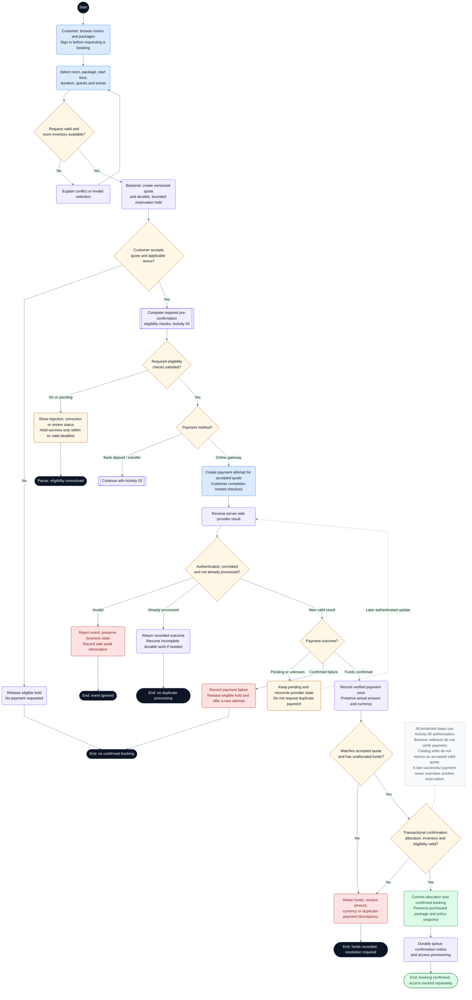

# CineNest Activity Diagram 01: Customer Booking and Online Payment

**Diagram:** 01 of 10 
**Export date:** 2026-10-14 
**Status:** Proposed workflow; implementation and execution tests not verified. 
**Artifact:** Standalone requested Markdown export; no project/repository files modified.

## Purpose

Follow a customer from room discovery to a versioned quote, controlled reservation hold, verified online payment, and guarded booking confirmation. Bank-payment requests continue in Activity 02.

Exported from one of the eight detailed interactive activity diagrams. The overview poster is a visual summary, not the detailed workflow contract.

## Participants and responsibilities

| Participant | Responsibility |
| --- | --- |
| Customer / Primary Booker | Selects a package and session, accepts terms, completes eligibility requirements, and uses an available payment method. |
| CineNest backend | Owns the quote, inventory hold, payment recording, booking guards, and durable follow-up work. |
| Payment gateway | Provides hosted checkout and authenticated server-side payment outcomes. |

## Editable activity diagram

## Diagram notation

This is an **activity-style control-flow diagram expressed with Mermaid flowchart notation**, not a strict UML/XMI model. It preserves the discussed workflow decisions without claiming executable behavior.

- The start circle begins this activity; nodes labeled **End** or **Pause** identify outcomes. A pause does not mean the booking, money, or incident has disappeared.
- Rounded actions describe work. Diamonds are decisions with labeled guards/outcomes. Double-border boxes reference another activity.
- Solid arrows show control flow. Dashed arrows with labels represent later events or retries; unlabelled dashed note connectors do not control execution.
- Blue actions identify people or external interactions where labeled; pale violet is ordinary system work, amber is a decision or pending state, green is a verified successful outcome, and red is an exception. Text remains authoritative over color.
- Responsibility is written in node labels and the participant table. These are not fixed swimlane columns. Sequential drawing does not make remote operations one atomic transaction, and no parallel fork/join is implied unless explicitly shown.

Render the fenced `mermaid` block in a Mermaid-capable Markdown viewer. The surrounding text remains readable without rendering. The viewer must support Mermaid frontmatter configuration; remove only the `---` configuration section inside the block when using a renderer that does not support it.

## Main activity outline

1. Browse published rooms and packages; establish an authenticated session before protected actions.
2. Validate the selected session and atomically create a bounded inventory hold with the authoritative quote.
3. Obtain required consent and pre-confirmation eligibility outcomes. Pending verification must not extend a hold indefinitely.
4. Choose an eligible payment method. Bank transfer continues in Activity 02; the online route uses the accepted quote.
5. Authenticate and correlate the server-side payment outcome, and process it idempotently.
6. Retain actual funds, then confirm only when payment allocation, inventory, and eligibility pass at commit.
7. Queue notifications and access provisioning durably; expose their outcomes independently.

## Guards and interpretation rules

- The ordering shown is a proposed activity view; approved eligibility/hold timing in the canonical documents remains authoritative.
- Customer identity, receipt, and booking access are scoped server-side. Public browsing does not grant protected privileges.
- A duplicate event with incomplete downstream work must resume that work safely, not fabricate a completed booking.
- Timeouts and missing callbacks require reconciliation. A payment page closing is not proof of failure.
- Prices, duration, inclusions, and policy snapshots come from the accepted quote; later catalog edits do not silently alter them.
- Database-enforced inventory includes the applicable cleaning buffer and maintenance blocks. Redis is not an assumed prerequisite.
- Remote payment and lock actions are outside a local database transaction. Actual external funds remain traceable if confirmation fails.

## Alternative outcomes and recovery

| Condition | Intended handling |
| --- | --- |
| Unavailable room / invalid selection | Offer eligible alternatives without creating a confirmed reservation. |
| Eligibility pending / rejected | Display the actual outcome and enforce the current hold deadline. |
| Pending / unknown provider result | Reconcile the original attempt; do not invite duplicate payment automatically. |
| Late funds or amount mismatch | Retain the payment and enter resolution without displacing another reservation. |
| Notification or access failure | Preserve the confirmed financial/booking state and show the failed or pending external work. |

## Review before implementation

Treat this diagram as an analysis/design view. Trace every guard and recovery route to the corresponding canonical requirement and planned acceptance check. Test authorization, state changes, duplicate processing, concurrency, and recovery as applicable. For physical/device outcomes, distinguish a simulation from actual hardware evidence. No application, payment-provider, or hardware acceptance test is claimed by this export.

## Related activity diagrams

- [02. Bank Deposit, Receipt Review and Approval](02_ActivityDiagram_Bank_Deposit_Receipt_Review_and_Approval.md)
- [04. Identity Evidence and Eligibility Review](04_ActivityDiagram_Identity_Evidence_and_Eligibility_Review.md)
- [05. Scoped RBAC and ABAC Authorization](05_ActivityDiagram_Scoped_RBAC_and_ABAC_Authorization.md)
- [06. Booking Amendment and Session Extension](06_ActivityDiagram_Booking_Amendment_and_Session_Extension.md)
- [07. Booking Cancellation and Refund Execution](07_ActivityDiagram_Booking_Cancellation_and_Refund_Execution.md)
- [08. Cinema Entry, IoT Control and Room Reset](08_ActivityDiagram_Cinema_Entry_IoT_Control_and_Room_Reset.md)

## Source and authority

- Use-case export 01: Customer Booking and Account
- Use-case export 03: Payments, Bank Review and Refunds
- Detailed interactive activity 1 of 8

These files are standalone exports, not updates to the repository. The current four canonical knowledge documents (`PROJECT.md`, `ARCHITECTURE.md`, `DESIGN.md`, `PROGRESS.md`) and their authoritative registries continue to govern requirements, approvals, and implementation state.

Diagram labels, actor bundles, pending policies, timer values, provider/hardware choices, and retry behavior retain their actual canonical status. This export neither approves unresolved policies nor certifies application code, external integrations, bank reconciliation, device behavior, or physical safety. All protected operations use the applicable scoped authorization; business invariants remain separate.
