# CineNest Component Diagram 01: Platform Components and Integration Boundaries

**View:** 01 of 02 
**Export date:** 2026-10-14 
**Status:** Proposed logical component design. Implementation, dependency qualification, deployment and hardware acceptance are not verified by this export. 
**Artifact:** Owner-requested standalone Markdown export. No project repository or canonical knowledge document is modified.

## Purpose and scope

Describe the components inside the CineNest software system and the contracts through which they interact with external services, data stores and physical equipment. This view follows the corrected component illustration and the detailed platform-component view, not the inaccurate extra technology labels in the earlier generated posters.

The customer portal and admin panel use one modular-monolith business backend. The backend contains logical business modules with published interfaces, private implementation details and owner-specific adapters. Separate boxes do **not** imply independently deployed microservices. The frontend, database, broker and physical devices are not required to run inside the backend process.

This is a selected component/interaction overview, not a complete source-code dependency graph, sequence diagram or deployment topology. The companion view explains the inward source dependencies of the Payments module.

## Editable component diagram

```mermaid
---
config:
  theme: base
  themeVariables:
    fontFamily: Arial, sans-serif
    fontSize: 15px
    primaryColor: '#F0EEFF'
    primaryTextColor: '#111827'
    primaryBorderColor: '#5B4BFF'
    lineColor: '#64748B'
    clusterBkg: '#F8FAFC'
    clusterBorder: '#94A3B8'
  flowchart:
    curve: linear
    nodeSpacing: 24
    rankSpacing: 55
    htmlLabels: true
---
flowchart TB
    subgraph FRONT["Presentation components | Proposed Next.js / React direction"]
        direction LR
        CUI["«component» Customer Portal<br/>Discover, quote, book and submit evidence<br/>Own booking and access-status views"]
        AUI["«component» Admin Panel<br/>Packages, payments and verification<br/>Room operations and scoped reports"]
        UIKIT["«shared UI components» UI and API Client<br/>TypeScript, Tailwind and CineNest design tokens<br/>Forms, tables, charts and responsive views"]
        CUI -->|uses| UIKIT
        AUI -->|uses| UIKIT
    end

    subgraph BACK["CineNest backend | ONE proposed Spring Boot / Spring Modulith application"]
        direction TB
        HTTP["«inbound adapter family» Module-owned HTTP / Live-query Adapters<br/>Authenticate entry and route to published application interfaces<br/>Authorize protected use cases at their owning module"]
        IAM["«component» Identity and Authorization<br/>Accounts, database-backed sessions and scoped grants<br/>RBAC + ABAC policy evaluation"]
        HTTP -->|identity and policy interfaces| IAM

        subgraph MODULES["Business components | Published interfaces and private internals"]
            direction LR
            VEN["«component» Venues and Rooms<br/>Configuration, capacity and readiness<br/>Maintenance requests"]
            PKG["«component» Packages and Pricing<br/>Editable details, duration and price<br/>Versioned offers and quotations"]
            BKG["«component» Booking<br/>Durable holds and inventory conflicts<br/>Confirmation, amendments and cancellation"]
            PAY["«component» Payments<br/>Gateway and manual bank review<br/>Verified credits, allocation and refunds"]
            VER["«component» Verification<br/>Private identity cases and OCR assistance<br/>Review and eligibility decisions"]
            ACC["«component» Access Control<br/>Booking-bound PIN lifecycle<br/>Check-in gate and revision-safe recovery"]
            DEV["«component» Device Operations<br/>Commands, acknowledgements and telemetry<br/>Device health and incident handling"]
        end

        HTTP -->|room configuration APIs| VEN
        HTTP -->|package APIs| PKG
        HTTP -->|reservation APIs| BKG
        HTTP -->|payment and review APIs| PAY
        HTTP -->|case APIs| VER
        HTTP -->|access APIs| ACC
        HTTP -->|control and status APIs| DEV
        BKG -->|Quote API| PKG
        BKG -->|Room Rules API| VEN
        BKG -->|Funds and Allocation API| PAY
        BKG -->|Eligibility Query| VER
        ACC -->|Current Booking Facts| BKG

        subgraph SUPPORT["Supporting components | Bounded ownership, not a universal business service"]
            direction LR
            WORK["«infrastructure capability» Durable Work<br/>Transactional publication / committed work registry<br/>Module-owned handlers, jobs and recovery"]
            NOTIFY["«component» Notifications<br/>Permitted delivery requests<br/>Attempts, retries and outcomes"]
            REPORT["«component» Reporting and Analytics<br/>Scoped projections and approved read contracts<br/>No writes to operational owners"]
            AUDIT["«component» Audit<br/>Attributable protected actions<br/>Restricted and redacted event history"]
        end
        HTTP -->|scoped report APIs| REPORT
        HTTP -->|permitted audit query| AUDIT
        PAY -.->|committed funds-verification work| WORK
        WORK -.->|booking-owned confirmation handler| BKG
        BKG -.->|committed booking effects| WORK
        WORK -.->|access-owned provisioning handler| ACC
        WORK -.->|notification handler| NOTIFY
        WORK -.->|projection handler| REPORT
        WORK -.->|audit ingestion| AUDIT

        subgraph ADAPTERS["Owner-specific integration adapters | Runtime calls use the owner's port contracts"]
            direction LR
            IDA["«adapter» OIDC<br/>Owner: Identity and Authorization"]
            PYA["«adapter family» Payment Provider<br/>Owner: Payments<br/>Outbound checkout / refund and inbound verified callbacks"]
            VSA["«adapter family» Evidence Store<br/>Separate receipt and identity-evidence ports<br/>Distinct payment / verification access scopes"]
            OCA["«adapter» OCR Provider<br/>Owner: Verification"]
            LKA["«adapter» Smart Lock<br/>Owner: Access Control"]
            MQA["«adapter» MQTT<br/>Owner: Device Operations"]
            NSA["«adapter» Email / SMS<br/>Owner: Notifications"]
        end
        IAM -->|Identity Provider Port| IDA
        PAY -->|Payment Gateway Port| PYA
        PAY -->|Receipt Store Port| VSA
        VER -->|Identity Evidence Store Port| VSA
        VER -->|Text Extraction Port| OCA
        ACC -->|Smart Lock Port| LKA
        DEV -->|Device Transport Port| MQA
        NOTIFY -->|Message Delivery Port| NSA

        PERSIST["«adapter family» Per-Module PostgreSQL Adapters<br/>Each module persists its own records through its own persistence port<br/>No cross-module repository injection or unrestricted shared repository"]
        IAM -->|identity and session persistence| PERSIST
        MODULES -->|each owner uses its own adapter| PERSIST
        WORK -->|explicitly assigned work-registry records| PERSIST
        NOTIFY -->|delivery records| PERSIST
        REPORT -->|owned projections and authorized reads| PERSIST
        AUDIT -->|audit records| PERSIST
    end

    CUI -->|HTTPS application contracts| HTTP
    AUI -->|HTTPS application contracts| HTTP

    subgraph INFRA["Data stores, external contracts and physical equipment"]
        direction LR
        DB[("PostgreSQL<br/>Module-owned records and durable reservation holds<br/>Database sessions and committed event / work records")]
        OBJ[("Private Object Storage<br/>Restricted receipts and identity evidence")]
        GOOGLE["Google Identity Provider"]
        GATE["Contracted Payment Gateway<br/>Checkout, callbacks and supported refunds"]
        OCR["OCR Provider<br/>Text extraction, not authenticity proof"]
        LOCK["Lock / Lock Service<br/>Tested credential operations and events"]
        MQTT["MQTT Broker<br/>Authenticated encrypted transport"]
        EDGE["Registered Room Controllers / Devices<br/>Supported AC, lighting, projector and sensors"]
        MSG["Messaging Provider<br/>Submission and delivery evidence where supported"]
    end
    PERSIST -->|SQL through owner-specific adapters| DB
    VSA -->|restricted object access| OBJ
    IDA <-->|sign-in exchange| GOOGLE
    PYA <-->|requests and authenticated provider events| GATE
    OCA <-->|extraction request and result| OCR
    LKA <-->|credential operations and access evidence| LOCK
    MQA <-->|scoped messages| MQTT
    MQTT <-->|commands, acknowledgements and telemetry| EDGE
    NSA <-->|notification exchanges| MSG

    MANUAL["MANUAL BANKING<br/>Finance reviewer independently checks actual bank records.<br/>No direct CineNest-to-bank API is assumed.<br/>Receipt upload is a payment claim, not verified funds."]
    MANUAL -.- PAY
    SAFETY["BOUNDARIES TO PRESERVE<br/>No active Redis dependency in this initial diagram.<br/>External provider operations are not atomic database transactions.<br/>Emergency exit is independent of payment, PIN and cloud.<br/>Proposed logical design; no implementation or physical acceptance implied."]
    SAFETY -.- ACC

    classDef client fill:#DBEAFE,color:#0B1526,stroke:#2878FF,stroke-width:1.5px;
    classDef module fill:#F0EEFF,color:#111827,stroke:#5B4BFF,stroke-width:1.5px;
    classDef security fill:#0B1526,color:#FFFFFF,stroke:#5B4BFF,stroke-width:2px;
    classDef adapter fill:#FEF3C7,color:#78350F,stroke:#B45309;
    classDef support fill:#E0F2FE,color:#0C4A6E,stroke:#0284C7;
    classDef external fill:#F1F5F9,color:#334155,stroke:#64748B;
    classDef physical fill:#DCFCE7,color:#14532D,stroke:#15803D;
    classDef note fill:#FFF7E6,color:#475569,stroke:#B45309,stroke-dasharray:4 3;
    class CUI,AUI,UIKIT client;
    class VEN,PKG,BKG,PAY,VER,ACC,DEV module;
    class IAM security;
    class HTTP,IDA,PYA,VSA,OCA,LKA,MQA,NSA,PERSIST adapter;
    class WORK,NOTIFY,REPORT,AUDIT support;
    class DB,OBJ,GOOGLE,GATE,OCR,MSG external;
    class LOCK,MQTT,EDGE physical;
    class MANUAL,SAFETY note;
```

## Component responsibilities and ownership

| Component | Owns / provides | Boundary to preserve |
| --- | --- | --- |
| Customer Portal | Discovery, selection, quote presentation, evidence submission and own-account views | The backend is authoritative for prices, booking decisions and access scope. |
| Admin Panel | Package administration, payment and identity review, room operations and reports | Visible controls are not permissions; backend authorization applies to the actual operation. |
| Shared UI and API Client | Reusable theme, components, request handling and permission-aware presentation | Do not duplicate business rules in a second frontend decision engine. |
| Module-owned HTTP / Live-query Adapters | Input translation, authenticated entry and application-interface routing | This family is not a new gateway service or a universal controller owning every module. |
| Identity and Authorization | Accounts, sessions, permission definitions, scoped grants and applicable policy evaluation | Permission and venue/resource scope must match an applicable grant; exact role bundles and limits retain their actual approval status. |
| Venues and Rooms | Descriptive/operating configuration, capacity, operational readiness and maintenance requests | The authoritative room-blocking inventory is owned by Booking, not a second availability calendar. |
| Packages and Pricing | Editable details, duration, price, inclusions, offer versions and quotations | Published changes cannot silently rewrite valid accepted quotes, purchased bookings or PIN windows. |
| Booking | Durable holds, room-inventory intervals, conflict guards, reservation lifecycle and amendments | Apply cleaning, maintenance, operating and capacity constraints through the owning contracts. |
| Payments | Gateway results, bank claims, verified credits, allocations, refunds and reconciliation | Receipt submission is not bank-credit evidence; verified funds and booking confirmation remain separate outcomes. |
| Verification | Private identity cases, extraction processing, review and digital eligibility decisions | OCR does not prove authenticity; all-guest original-document entry checks remain a separate responsibility. |
| Access Control | Booking-specific credential intent, provisioning evidence, validity, revocation and check-in integration | Use current committed booking revisions; never obstruct independent emergency exit. |
| Device Operations | Registered device communication, commands, acknowledgements, telemetry and device incidents | Requested, accepted, acknowledged, observed, stale and failed states remain distinct. |
| Notifications | Permitted message dispatch, attempts, provider outcomes and recovery | Failed delivery does not erase a paid booking or a durable review item. |
| Reporting and Analytics | Authorized projections and defined metrics | No operational writes; collections, allocated money and recognized service revenue are not interchangeable. |
| Audit | Attributable sensitive operations and restricted event history | Redact credentials and private evidence; logging does not replace authorization. |
| Durable Work capability | Assigned publication/job records and reliable dispatch infrastructure | Business handlers and retry decisions belong to their modules; this is not an all-powerful workflow owner. |
| Per-module PostgreSQL adapters | Owner-specific persistence contracts and implementation | No cross-module repository injection or unrestricted shared data-access service. |

## Published interfaces and event routes

The illustrated calls are selected examples: Booking obtains a quote from Packages and Pricing, room rules from Venues, eligibility facts from Verification, and funds/allocation behavior from Payments. Access Control reads current committed booking facts through Booking's published interface.

Keep code dependencies acyclic. The selected funds-verification event route allows a Booking-owned handler to react to Payments facts and invoke the relevant public operations without giving Payments arbitrary access to Booking internals. A runtime event route in both directions does not by itself authorize a cyclic source-code dependency. Earlier workflow/sequence views describe business interactions; the final module dependency graph and transaction orchestration still require explicit architecture verification.

For maintenance, Venues owns the request and operational evidence, while authoritative inventory blocks are recorded through Booking's contract. The orchestration detail is deliberately not expanded into a second availability implementation. Final placement of cross-module coordinators remains a design decision, not an implemented class implied by this overview.

Committed work can feed access provisioning, notifications, audit ingestion and reporting projections. The arrows do not mean every event goes to every recipient or that all effects succeed atomically. Pending work needs attributable ownership, idempotent consumption, revision checks, deadlines and defined recovery.

## Owner-specific integration adapters

| Adapter / contract | Business owner | External participant or storage | Important interpretation |
| --- | --- | --- | --- |
| Identity Provider / OIDC | Identity and Authorization | Google Identity Provider | Sign-in establishes identity; CineNest owns application authorization. |
| Payment Provider | Payments | Contracted gateway | Outbound checkout/refund and inbound authenticated callbacks are distinct adapter roles, grouped for overview readability. |
| Receipt Store | Payments | Private object storage | Scoped customer submissions and finance evidence; no public receipts bucket. |
| Identity Evidence Store | Verification | Private object storage | A separate contract and access scope even when storage infrastructure is shared. |
| OCR / Text Extraction | Verification | OCR provider | Only necessary permitted fields; uncertainty and errors are real outcomes. |
| Smart Lock | Access Control | Selected lock or lock service | Supported credential behavior, expiry, acknowledgements and offline capability must be verified for the actual hardware. |
| Device Transport / MQTT | Device Operations | Broker and registered controllers | Broker transport is not proof that a physical operation completed. Authenticate inbound telemetry as well as outbound commands. |
| Message Delivery | Notifications | Email/SMS provider | Provider acceptance and delivered-to-recipient status are distinct. |
| PostgreSQL persistence | Each owning module | PostgreSQL | Assign session/work-registry storage ownership explicitly, including framework-managed tables. |

Ports shown on the overview edges name logical requirements, not finalized Java class names. At runtime the application invokes a configured adapter through its port; in the source model, the concrete adapter implements the core-owned contract. See Diagram 02 for that distinction.

## Persistence, banking and physical boundaries

**PostgreSQL:** Proposed transactional truth for module-owned business data, durable room holds, database-backed sessions and committed work. Shared storage does not give every module permission to read or write every table. Local transactions spanning approved module interfaces require compatible transaction propagation and real-database concurrency tests.

**Private object storage:** Receipt and identity evidence have separate owner contracts and authorization scopes. An object write and a database commit are not automatically one transaction; define safe retries, cleanup of abandoned uploads and recovery from partial outcomes.

**Manual banking:** The customer pays through their bank channel, then submits evidence to CineNest. A reviewer independently checks the actual receiving account and records a scoped decision through Payments. There is no direct CineNest-to-bank integration in this view. No banking password, PIN or OTP is requested from customers.

**External side effects:** Payment-provider, messaging, OCR and lock interactions occur outside any assumed all-encompassing database transaction. Record actual funds durably even if a later booking confirmation fails. Confirmation queues access work; a successful payment alone is not access readiness.

**Physical access:** A pre-provisioned PIN must not bypass the approved check-in gate. Credentials follow the purchased interval, not the cleaning buffer. Neither a timer nor an exit event proves a room empty, clean or safe. Emergency egress is independent of application availability, payment, cloud access, PIN validity and administrative actions.

## Notation

| Element | Meaning |
| --- | --- |
| `«component»` rectangle | Logical application component or module, not an automatic deployment unit |
| Adapter-family rectangle | A compact representation of distinct owner-specific implementations |
| Named port on an edge | A runtime interaction through the owner's interface contract |
| Solid arrow | Selected use/call relationship or infrastructure connection |
| Solid double-headed edge | Logical exchange with an external participant, not guaranteed synchronous completion |
| Dashed labeled arrow | Selected committed work/event delivery route |
| Unlabeled dashed note connector | Explanatory constraint; neither control flow nor source dependency |
| Cylinder | Data store, separate from the module that owns the records |
| Outer group | Presentation/backend/support/integration boundary or reading aid, not a separate service by default |

This is a **UML-style component view expressed with Mermaid flowchart notation**, not a strict UML/XMI model. Its edge conventions differ from the source-interface implementation arrows in the companion detail. Neither diagram represents chronological execution.

## Corrected scope and approval status

The corrected reference depicts proposed Next.js/React presentation, TypeScript/Tailwind styling, one Spring Boot/Spring Modulith backend, PostgreSQL, private evidence storage and the required external contracts. This export does not choose or qualify exact software versions.

Redis is deferred, not an active dependency in this initial view. Kafka, TimescaleDB, a separate analytics database, an unrestricted shared repository layer, an all-powerful API gateway service, a native mobile application, Refine/Ant Design adoption and a multi-tenant subscription model are **not established by this component diagram**. Labels for them in earlier generated posters must not be treated as approved scope. Optional QR entry, push notifications and external analytics also need separate approval.

The corrected image is the visual reference `CineNest_Component_Diagram_Corrected.png`. The editable view retains the detailed component relationships while normalizing the earlier poster errors. No image attachment is needed to render this Markdown diagram.

## Reading and related view

[02. Payments Module: Hexagonal Ports and Adapters](02_Component%20Architecture%20Diagram_Payments_Module_Hexagonal_Ports_and_Adapters.md) shows the application interface, domain, required ports, and adapters in detail.

Open this file in a Mermaid-enabled Markdown viewer. For a viewer without Mermaid frontmatter support, remove only the initial `---` configuration section **inside the Mermaid code fence**, leaving `flowchart TB` and all diagram lines. Large overviews are best viewed with zoom. The prose and tables remain readable without Mermaid. No fonts, external images or scripts are bundled.

## Source and authority

Sources are the component views and corrected illustration supplied in this conversation, informed by the CineNest mind map and use-case, activity, sequence and context exports. Those are proposed design views, not observations of running software.

The actual repository's `PROJECT.md`, `ARCHITECTURE.md`, `DESIGN.md`, `PROGRESS.md` and authoritative registries continue to govern requirements, decisions and implementation status. This standalone export neither updates those records nor approves outstanding roles, limits, providers, transaction strategies or physical behavior.
