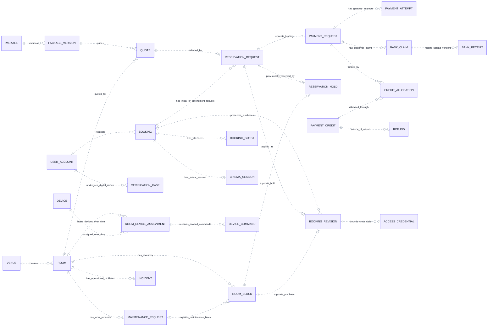

# CineNest ER Diagram 01: Core Relationship Overview

**View:** 01 of 08 
**Export date:** 2026-10-14 
**Status:** Proposed logical model; implementation and database acceptance not verified. 
**Artifact:** Requested standalone Markdown export; no repository or canonical knowledge file modified.

## Purpose

Show the main relationships across accounts, venues, versioned offers, quotations, reservations, actual funds, guest eligibility and room operations. This is a relationship-only overview; detailed attributes and constraints are expanded in Views 02–08.

## Editable ER diagram

## Entities and ownership

| Owner / area | Entities | Responsibility and boundary |
| --- | --- | --- |
| Identity and Authorization | USER_ACCOUNT; scoped identity records in View 02 | Accounts and grants do not imply unrestricted access to bookings, documents or money. |
| Venues and Rooms | VENUE, ROOM, MAINTENANCE_REQUEST | Room configuration and readiness are separate from the authoritative inventory intervals. |
| Packages and Pricing | PACKAGE, PACKAGE_VERSION, QUOTE | Editable catalog entries produce versions; accepted and purchased terms remain traceable. |
| Booking | BOOKING, RESERVATION_REQUEST, RESERVATION_HOLD, ROOM_BLOCK, BOOKING_REVISION, BOOKING_GUEST, CINEMA_SESSION | One owner enforces room availability, including holds, purchased intervals, cleaning and maintenance. |
| Payments | PAYMENT_REQUEST, PAYMENT_ATTEMPT, BANK_CLAIM, BANK_RECEIPT, PAYMENT_CREDIT, CREDIT_ALLOCATION, REFUND | Evidence submission, receipt of funds, allocation and repayment are distinct records. |
| Verification / Access / Device Operations | VERIFICATION_CASE, ACCESS_CREDENTIAL, DEVICE, ROOM_DEVICE_ASSIGNMENT, DEVICE_COMMAND, INCIDENT | Keep identity decisions, physical access and observed device behavior distinct; each record has its owning module. |

## Key constraints and interpretation

1. A BOOKING row can represent a request that has not yet been confirmed. Its existence is not evidence of payment or valid access.

2. A RESERVATION_REQUEST represents an initial purchase or amendment. A QUOTE can be selected by at most one such request in this proposal; revisions retain the actual purchased offer.

3. A ROOM_BLOCK has a booking owner OR a maintenance-request owner, never both or neither. The exclusive-owner constraint is expanded in View 04.

4. An initial hold may be converted to its committed block rather than creating overlapping inventory rows for the same purchase. Replacement holds during amendments require an explicit, concurrency-safe strategy.

5. BANK_RECEIPT records customer-uploaded evidence. PAYMENT_CREDIT records independently substantiated incoming funds. CREDIT_ALLOCATION applies available funds to a payment request.

6. Funds must remain recorded even when the room can no longer be confirmed. A refund has its own approval and outgoing-attempt history; it is not implied by cancellation.

7. ACCESS_CREDENTIAL is tied to a purchased BOOKING_REVISION and a lock assignment. Neither a catalog edit nor a later callback for an obsolete revision may restore stale entry authority.

8. CINEMA_SESSION records execution. Room readiness still requires operational evidence, not just a session end time or an exit event.

## Decisions and checks still required

Exact SQL constraints, physical table names, coordinator placement and cross-module FK policy remain design/implementation decisions.

This overview intentionally omits many supporting entities, detailed role policies, additional media/amenity records and optional engagement scope. It is not an exhaustive production schema.

## Reading the ER notation

| Notation | Meaning in these exports |
| --- | --- |
| `PK` | Primary key. Multiple PK attributes in one entity form a composite key. |
| `FK` | Proposed reference to another entity. Whether a cross-module link is enforced by a physical SQL FK is a separate implementation decision. |
| `UK` | Proposed unique key; comments identify composite or scoped uniqueness where needed. |
| `\|\|` | Exactly one at that relationship endpoint. |
| `o\|` / `\|o` | Zero or one at the relevant endpoint. |
| `o{` / `}o` | Zero or many at the relevant endpoint. |
| `\|{` / `}\|` | One or many at the relevant endpoint. |
| `--` | Identifying relationship: the parent's identity contributes to the child's identity in this model. |
| `..` | Non-identifying relationship. **Dashed lines do not mean optional, asynchronous, or unimplemented.** Optionality comes from the endpoint markers. |

Relationships are not calls, message directions, or execution order. Entity names repeated in different views refer to the same logical entity, not duplicate tables. An entity shown without fields is a reference stub; its attributes are expanded in the relevant companion view. Selected fields do not constitute an exhaustive physical schema.

Types such as `uuid`, `timestamptz`, `bigint`, `numeric` and `jsonb` are proposed descriptive types, not a migration. Money fields use minor units or exact decimal quantities under an explicit currency/rounding policy. Dates, times, nullability, source identity, sums, scope consistency, XOR ownership and non-overlap need actual constraints and tests; the picture does not enforce them.

## Scope, source and approval status

This export preserves the **eight detailed CineNest ER views** discussed in the conversation and the corrected `CineNest_ER_Diagram_Corrected.png` overview. It is informed by the preceding mind-map, use-case, activity, sequence, context and corrected component views. The earlier automatically generated ER poster is not the authoritative source for keys, entity names, privacy fields or cardinalities.

The model remains **proposed and not implementation-verified**. No SQL schema was reverse-engineered from a running database. Exact class/table names, constraints, cross-module coordination and remaining policies need approval and verification. Do not infer raw-password sign-in, a plaintext `pin_code` field on bookings, generic public identity-document URLs, unrelated personal-profile collection, active Redis, Kafka, TimescaleDB or a subscription/tenant model from this export.

Each module owns its operational records; a relationship is not permission for cross-module repository injection or unrestricted joins. Protected operations use scoped RBAC + ABAC and still enforce their owning business invariants. Runtime integrations, physical installation, emergency egress and recovery require separate evidence.

The repository's four canonical documents (`PROJECT.md`, `ARCHITECTURE.md`, `DESIGN.md`, `PROGRESS.md`) and authoritative registries retain decision and implementation authority. These owner-requested standalone exports do **not** modify the project repository, create a second canonical knowledge base, select unapproved technologies/policies or claim application, payment, provider or hardware tests passed.

## Related ER views

- [02. Identity, Sessions and Scoped RBAC + ABAC](02_ER_Diagrams_Identity_Sessions_and_Scoped_RBAC_ABAC.md)
- [03. Venues, Versioned Packages and Add-ons](03_ER_Diagrams_Venues_Versioned_Packages_and_Add_Ons.md)
- [04. Quotes, Reservation Holds and Immutable Booking Revisions](04_ER_Diagrams_Quotes_Reservation_Holds_and_Booking_Revisions.md)
- [05. Gateway Payments, Manual Bank Evidence, Allocations and Refunds](05_ER_Diagrams_Payments_Bank_Evidence_Allocations_and_Refunds.md)
- [06. Identity Evidence, Guest Check-in and Access Credentials](06_ER_Diagrams_Identity_Evidence_Guest_Check_In_and_Access_Credentials.md)
- [07. Sessions, Devices, Maintenance and Operational Readiness](07_ER_Diagrams_Sessions_Devices_Maintenance_and_Readiness.md)
- [08. Durable Work, Notifications and Audit Records](08_ER_Diagrams_Durable_Work_Notifications_and_Audit.md)

## Rendering

Open this file in a Mermaid-enabled Markdown viewer to render its fenced `erDiagram` block. Use zoom for the larger models. The prose, attributes and relationships remain readable as text without a renderer.

If the viewer cannot parse Mermaid YAML configuration, remove only the initial `---` configuration section **inside** the Mermaid fence, retaining `erDiagram` and the remaining lines. Renderer/version support is required for ER direction and key annotations. No external font, image or script assets are required to render these Markdown diagrams.
