# CineNest Context Diagram 01: System Context Overview

**View:** 01 of 02 
**Export date:** 2026-10-14 
**Status:** Proposed system context; implementation and integration acceptance not verified. 
**Artifact:** Owner-requested standalone Markdown export. The repository and its four canonical knowledge documents are not modified.

## Purpose and system boundary

Show CineNest as one software system and identify the people, third-party services, and physical equipment that interact with it. This is the overview counterpart to the two context-diagram images and the detailed interactive context view.

The central box includes the customer portal, administration interface, modular business backend, and its internal supporting capabilities. Internal modules, PostgreSQL, private storage, event workers, and transport components are deliberately not drawn as external actors. Their implementation belongs in the architecture and detailed sequence views.

Venue staff are outside the **software** boundary even when they work for the business. Locks and controllers are also outside that boundary even when CineNest owns the hardware. This is not a network, deployment, ownership, or physical-safety certification diagram.

## Editable context diagram

```mermaid
---
config:
  theme: base
  themeVariables:
    fontFamily: Arial, sans-serif
    fontSize: 16px
    primaryColor: '#F0EEFF'
    primaryTextColor: '#111827'
    primaryBorderColor: '#5B4BFF'
    lineColor: '#64748B'
    clusterBkg: '#F8FAFC'
    clusterBorder: '#CBD5E1'
  flowchart:
    curve: linear
    nodeSpacing: 32
    rankSpacing: 95
    htmlLabels: true
---
flowchart LR
    subgraph PEOPLE["People outside the software boundary"]
        direction TB
        C["Customer / Primary Booker<br/>Own bookings and evidence<br/>Guests participate in check-in"]
        V["Venue Administrator<br/>Permitted package and venue operations"]
        F["Finance Reviewer<br/>Bank review, reconciliation and refunds"]
        I["Verification Officer<br/>Purpose-bound identity review"]
        O["Operations Staff<br/>Check-in, room readiness and incidents"]
        A["System Administrator<br/>Permitted grants and configuration"]
    end

    CN["CINENEST SMART CINEMA PLATFORM<br/>Software system of interest<br/><br/>Packages and quotations | Reservations<br/>Payments and refunds | Guest eligibility<br/>Timed entry access | Room operations<br/>Reporting and audit<br/><br/>Includes customer portal, admin panel<br/>and the modular business backend"]

    subgraph EXTERNAL["External services and physical equipment"]
        direction TB
        IDP["Google Identity Provider<br/>Customer sign-in"]
        PAY["Payment Gateway<br/>Hosted checkout and supported refunds"]
        OCR["OCR Provider<br/>Document-text extraction"]
        MSG["Email / SMS Provider<br/>Permitted transactional messages"]
        LOCK["Smart Lock / Lock Service<br/>Supported timed incoming access"]
        DEV["Room Controllers and Devices<br/>AC, lighting, projector and sensors"]
    end

    C <-->|"Selections, evidence and change requests<br/>Quotes, booking states and access information"| CN
    V <-->|"Package and venue administration<br/>Validation results and scoped reports"| CN
    F <-->|"Verified bank matches and authorized decisions<br/>Claims, allocation and refund outcomes"| CN
    I <-->|"Case review and eligibility decisions<br/>Permitted evidence and processing status"| CN
    O <-->|"Check-in, controls and readiness evidence<br/>Session status, telemetry and incidents"| CN
    A <-->|"Scoped grants and configuration changes<br/>Audit and system-health results"| CN

    CN <-->|"Sign-in exchanges<br/>Validated identity assertions"| IDP
    CN <-->|"Payment and refund requests<br/>Authenticated server-side outcomes"| PAY
    CN <-->|"Necessary document data<br/>Extracted fields and uncertainty"| OCR
    CN <-->|"Delivery requests<br/>Status where supported"| MSG
    CN <-->|"Credential provision, expiry and revocation<br/>Installation evidence and access events"| LOCK
    CN <-->|"Authorized supported commands<br/>Acknowledgements and observed telemetry"| DEV

    subgraph MANUAL["Manual banking context: no direct CineNest bank API assumed"]
        BANK["Business Receiving Bank / Bank Portal<br/>Deposits, transfers and account records"]
    end
    C -.->|"Deposit or transfer outside CineNest"| BANK
    BANK -.->|"Customer banking receipt or reference"| C
    F -.->|"Inspect credits and execute authorized refunds"| BANK
    BANK -.->|"Bank-side records for independent review"| F

    classDef person fill:#DBEAFE,color:#0B1526,stroke:#2878FF,stroke-width:1.5px;
    classDef core fill:#0B1526,color:#FFFFFF,stroke:#5B4BFF,stroke-width:3px;
    classDef external fill:#F0EEFF,color:#111827,stroke:#5B4BFF,stroke-width:1.5px;
    classDef physical fill:#DCFCE7,color:#14532D,stroke:#15803D,stroke-width:1.5px;
    classDef manual fill:#FFF7E6,color:#78350F,stroke:#B45309,stroke-width:1.5px;
    class C,V,F,I,O,A person;
    class CN core;
    class IDP,PAY,OCR,MSG external;
    class LOCK,DEV physical;
    class BANK manual;
```

## Human actors and intended responsibilities

| Actor | Main interaction with CineNest | Required restriction |
| --- | --- | --- |
| Customer / Primary Booker | Browse, request a reservation, accept a quote, submit evidence, view booking/access states, request changes or support | Protected records are restricted to the customer or another explicitly authorized relationship. Public browsing can remain public. |
| Venue Administrator | Maintain permitted room/package information and manage scoped bookings | Permission and venue scope must come from an applicable grant. Package edits cannot rewrite sold terms. |
| Finance Reviewer | Review bank claims, record verified credit, allocate funds, and perform permitted reconciliation/refunds | A receipt alone does not prove payment. Approval and actual repayment are separate outcomes. |
| Verification Officer | Review authorized identity cases and record eligibility decisions | Dedicated evidence access, legitimate purpose, and restricted case scope are required. |
| Operations Staff | Record check-in, request supported controls, monitor incidents, and attest room readiness | Command authority does not imply financial or unrestricted identity-document access. |
| System Administrator | Manage permitted accounts/grants and system settings | No generic administrator bypass of financial, privacy, or safety rules. |

Actor names describe working role groupings, not approval of a final role matrix. One person may hold more than one permitted role. Attending guests participate in the on-site eligibility procedure; the diagram does not require each guest to own an application account.

## External services and equipment

| Participant | CineNest sends | CineNest receives or validates |
| --- | --- | --- |
| Google Identity Provider | The configured sign-in protocol exchange | Identity assertions and authentication outcomes; application permissions remain CineNest's responsibility |
| Payment Gateway | Hosted checkout and supported refund requests | Authenticated payment/refund results and references, including pending or failed outcomes |
| OCR Provider | Only necessary, permitted document data for extraction | Extracted fields, confidence/uncertainty and processing errors, not proof of authenticity |
| Email / SMS Provider | Permitted message recipients and transactional content | Provider-supported submission/delivery outcomes; no claim that acceptance means delivery |
| Smart Lock / Lock Service | Supported time-bound credential provisioning, expiry and revocation requests | Contract-specific installation evidence, access events and status |
| Room Controllers / Devices | Authorized commands for supported equipment | Acknowledgements, observations, connection health and timestamps |

These are functional participants, not selected vendors or verified live integrations. A lock provider and local lock may be abstracted together; the drawing does not approve a particular topology or offline capability.

## Manual banking boundary

The customer pays through a bank channel outside CineNest, then submits a receipt to CineNest. A finance reviewer independently checks the receiving account through the bank's portal or statements and records the substantiated result in CineNest.

There is intentionally **no direct CineNest-to-bank integration edge**. Bank receipts, bank credit, allocation, booking confirmation and access readiness remain different records/outcomes. Later bank-feed integration would require its own approved contract and evidence. The customer's banking password, PIN or OTP is not an input to CineNest.

## Reading the diagram

| Element | Meaning |
| --- | --- |
| Central navy box | The complete CineNest software system of interest |
| Blue boxes | People interacting with the software |
| Violet boxes | External identity, payment, extraction and messaging services |
| Green boxes | External physical-access and room-device systems |
| Amber bank box | Banking used by people outside the application |
| Solid double-headed connection | A logical exchange in both directions, not two guaranteed successful calls or a step sequence |
| Dashed labeled banking connection | A person uses a banking channel outside CineNest, not a direct platform bank API |
| Outer grouping boxes | Reading aids, not independent applications or microservice deployments |

This is a context-level view expressed in Mermaid flowchart notation. It is not a use-case, activity, sequence, or strict UML/XMI model. Arrows show relationships, not chronological execution, database transactions, or always-online behavior.

## Safeguards carried forward

Protected operations use backend-enforced scoped RBAC + ABAC. Role labels and UI visibility do not grant access. Permission and target scope must match an applicable grant; business invariants remain the responsibility of the owning operation.

Valid accepted quotations and purchased package versions are preserved. Uploaded payment evidence alone cannot confirm a booking. Verified funds still require valid inventory and the applicable pre-confirmation eligibility checks before booking confirmation. Access readiness requires its own actual provisioning evidence.

Pre-provisioned credentials must not bypass the all-guest original-ID check-in gate. Incoming credentials follow the purchased time window. A timer or exit event does not certify an empty/clean room, and independent emergency egress cannot rely on a cloud request, valid PIN, payment or administrator. Physical implementations and fallback procedures remain subject to their actual approval/testing status.

## Source normalization and authority

This export uses the detailed interactive **CineNest System Context Diagram** from the conversation, informed by `CineNest_E2E_Mind_Map.md` and the use-case, activity, and sequence exports. The first generated illustration is `wide_infographic_diagram_of_a_system_context_diagr.png`; the second is `a_wide_infographic_context_diagram_on_a_white_back.png`.

The generated images are conceptual summaries. This export corrects ambiguous bank integration lines, avoids claiming OCR proves authenticity, restores the previously established Google sign-in and device participants, and makes command/output directions explicit. Internal capability names are summarized rather than presented as independent context-level systems.

QR entry, push notifications, and external analytics appearing in the illustrations are not automatically approved requirements. The overview does not assume them. The second context export retains external analytics only as an explicitly unapproved future boundary.

The repository's `PROJECT.md`, `ARCHITECTURE.md`, `DESIGN.md`, `PROGRESS.md`, and authoritative registries continue to govern current requirements, decisions and implementation status. This export neither approves the technology stack nor creates or updates a repository knowledge document.

## Companion view and rendering

[02. External Actors and Data Exchanges](02_System_Context_External_Actors_and_Data_Exchanges.md) separates inputs from outputs and expands the manual bank-review boundary.

Open this file in a Mermaid-enabled Markdown viewer to render the fenced diagram. If the viewer does not support Mermaid YAML configuration, remove only the initial `---` configuration block **inside the Mermaid fence**, retaining `flowchart LR` and the diagram content. No external image or font files are required. The prose and tables remain readable without Mermaid rendering.
