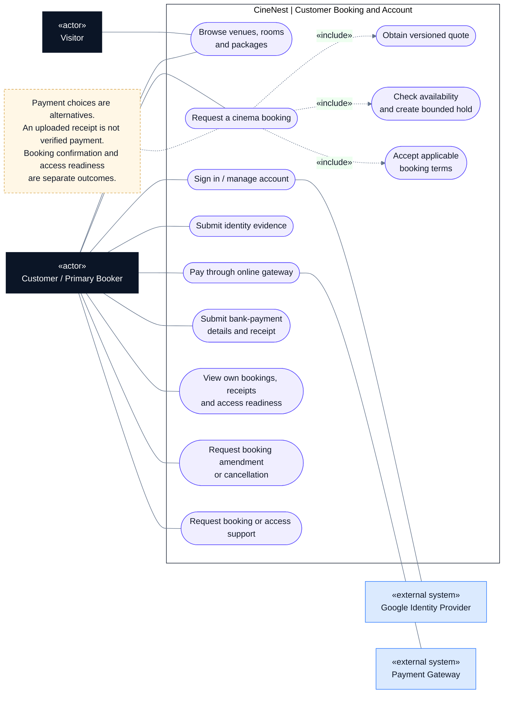

# CineNest Use-Case Diagram 01: Customer Booking and Account

**View:** 1 of 5 
**Export date:** 2026-10-14 
**Status:** Planned behavior; implementation not verified. Exact role assignments and unresolved policy choices retain their canonical approval status. 
**Artifact type:** Standalone Markdown export requested by the owner, not an update to the repository knowledge base.

## Purpose

Show how a visitor discovers CineNest and how an authenticated customer requests, pays for, and manages a cinema reservation.

## Actors

| Actor | Participation |
| --- | --- |
| Visitor | Browses published venues, rooms, packages, and displayed prices. |
| Customer / Primary Booker | Requests and manages their own bookings, submits evidence, pays, and requests support. |
| Google Identity Provider | Supports the configured customer sign-in flow. |
| Payment Gateway | Supports hosted online payment and authenticated server-side payment results. |

## Editable use-case diagram

## Notation

This is a **UML-style use-case view written with Mermaid flowchart primitives**, not a strict UML model or a sequence diagram.

- Dark rectangles identify human actors; blue rectangles identify external systems.
- Rounded nodes identify use cases inside the CineNest application boundary.
- A solid line denotes participation, not call direction, time order, or unrestricted permission.
- A dashed arrow labeled `«include»` points from a use case to required reused behavior; `«extend»` points from conditional additional behavior to its base use case.
- A dashed note connector carries an explanatory constraint, not a workflow transition.

Render the fenced `mermaid` block in a Mermaid-enabled Markdown viewer. The actor and use-case tables remain readable in a plain-text viewer. The diagram deliberately shows selected relationships rather than every authorization, audit, and validation dependency.

## Use-case catalog

| Use case | Intended result and important condition |
| --- | --- |
| Browse venues, rooms, and packages | Show published information; browsing does not reserve inventory. |
| Sign in / manage account | Establish an authenticated application session and permit allowed profile operations. |
| Request a cinema booking | Bind the selected room, package, duration, guests, and add-ons to a quote and controlled hold. |
| Obtain versioned quote | Receive a backend-issued itemized price, package version, accepted terms, and validity window. |
| Check availability and create bounded hold | Reserve eligible room inventory provisionally, including the required cleaning interval. |
| Accept applicable booking terms | Record explicit acceptance of the relevant version; sign-in alone is not a substitute. |
| Submit identity evidence | Submit permitted documents and obtain a processing/review status, not an unsupported authenticity guarantee. |
| Pay through online gateway | Use the hosted payment path; the browser success screen alone cannot confirm payment. |
| Submit bank-payment details and receipt | Create a payment claim for independent bank reconciliation and authorized review. |
| View own bookings, receipts, and access readiness | Show only the customer's permitted records, including pending and failed provisioning states. |
| Request amendment or cancellation | Submit a controlled change, subject to accepted policy, availability, and payment/refund consequences. |
| Request support | Raise a traceable booking, payment, verification, or access incident. |

## Main interaction outline

1. The visitor examines available rooms and packages, then signs in before protected booking operations.
2. The customer selects a room, package, start time, duration, guest count, and optional extras.
3. CineNest validates the request, supplies the authoritative quote, records required consent, and creates a bounded reservation hold.
4. The customer completes the applicable pre-confirmation identity/eligibility steps and chooses one payment path.
5. CineNest verifies the payment through the selected channel and confirms only a reservation that passes its current guards.
6. Access provisioning runs separately. The customer sees its actual readiness and receives the appropriate notification.
7. Later amendments, cancellations, refunds, or support requests use their own authorized workflows.

These numbered steps are a narrative outline. They do not override the approved ordering of eligibility checks or the detailed payment/hold state machines.

## Key rules and authorization

- Published package changes must not silently alter a valid accepted quote or an already purchased booking.
- Customer account permission alone does not authorize access to another customer's booking, receipt, or credential.
- Availability must be checked on the server and enforced against authoritative inventory, not inferred from a previously displayed calendar.
- Only one successful reservation/payment allocation may result from retried requests.
- No entry PIN is released merely because evidence was uploaded. Pre-confirmation eligibility and on-site original-ID checks remain distinct.
- An authorized customer still cannot bypass capacity, duration, operating-hour, or cleaning requirements.

## Alternative and exception paths

| Situation | Required visible behavior |
| --- | --- |
| No availability or conflicting hold | Explain the conflict and show eligible alternatives; do not take an unsupported booking as confirmed. |
| Quote or hold expired | Explain whether re-quotation or reconciliation is required; do not silently charge a different price. |
| Payment pending or receipt under review | Show the real payment/review state and valid hold deadline. |
| Uncertain identity evidence | Provide correction or controlled review without presenting OCR as proof. |
| Payment verified but room unavailable | Retain the received-funds record and enter booking resolution. |
| Credential or notification failure | Retain the valid payment/booking state and show recovery/support status. |

## Acceptance checks to implement

These are proposed verification targets, not evidence of tests run for this export.

- A changed booking ID cannot expose another customer's records.
- Both payment choices reach the same guarded booking-confirmation behavior without duplicate bookings.
- Package snapshots and accepted quote amounts survive subsequent catalog edits.
- An expired hold, pending review, or device failure never appears as an unqualified successful booking/access result.

## Related diagrams

- [02. Package and Venue Administration](02_Use%20case_Package_and_Venue_Administration.md)
- [03. Payments, Bank Review and Refunds](03_Use%20case_Payments_Bank_Review_and_Refunds.md)
- [04. Identity Verification and Authorization](04_Use%20case_Identity_Verification_and_Authorization.md)
- [05. Cinema Access and IoT Operations](05_Use%20case_Cinema_Access_and_IoT_Operations.md)

## Source and authority

Exported from the five CineNest use-case views discussed in this conversation, with the related E2E mind map and subsequent package, bank-payment, and hybrid-authorization clarifications. Labels are normalized for readability; financial matching/allocation and evidence-submission/processing are kept distinct.

The current repository's four canonical documents (`PROJECT.md`, `ARCHITECTURE.md`, `DESIGN.md`, `PROGRESS.md`) and its authoritative registries govern approval and implementation status. This standalone export does not replace those documents, approve proposed role bundles or hardware capabilities, or establish any completed code, test, deployment, or safety verification.
