# CineNest Activity Diagram 02: Bank Deposit, Receipt Review and Approval

**Diagram:** 02 of 10 
**Export date:** 2026-10-14 
**Status:** Proposed workflow; implementation and execution tests not verified. 
**Artifact:** Standalone requested Markdown export; no project/repository files modified.

## Purpose

Model a bank deposit or transfer, private receipt submission, independent bank-credit verification, duplicate-safe fund allocation, and conditional reservation confirmation.

Exported from one of the eight detailed interactive activity diagrams. The overview poster is a visual summary, not the detailed workflow contract.

## Participants and responsibilities

| Participant | Responsibility |
| --- | --- |
| Customer | Pays against the issued instructions and submits evidence with amount, date, and reference. |
| CineNest backend | Maintains quote/request/hold versions, safe receipt storage, review work, allocation, and booking guards. |
| Authorized finance reviewer | Verifies actual receiving-account records and records attributable decisions within scope. |
| Bank records | Independent evidence checked by the reviewer; no direct bank API is assumed. |

## Editable activity diagram

```mermaid
---
config:
  theme: base
  themeVariables:
    fontFamily: Arial, sans-serif
    fontSize: 16px
    primaryColor: '#F0EEFF'
    primaryTextColor: '#111827'
    primaryBorderColor: '#5B4BFF'
    lineColor: '#64748B'
  flowchart:
    curve: linear
---
flowchart TB
    Start((Start)) --> Offer{"Bank-payment method eligible<br/>for this booking and review window?"}
    Offer -->|No| Other("Offer eligible payment or booking alternatives")
    Other --> Stop([End: bank request not created])
    Offer -->|Yes| Request("Backend: bind quote and bank instructions<br/>to a durable hold and explicit deadlines")
    Request --> Deposit("Customer: deposit or transfer funds<br/>to the displayed receiving account")
    Deposit --> Submit("Customer: upload receipt and payment details")
    Submit --> Upload{"Ownership, file validation<br/>and safe upload checks pass?"}
    Upload -->|No| Correct("Explain upload issue; request safe replacement<br/>Never extend deadlines automatically")
    Correct --> Submit
    Upload -->|Yes| Claim("Store submission history privately<br/>Create review item and durable notification")
    Claim --> Review("Finance reviewer: open assigned review<br/>Check current scoped authority: Activity 05")
    Review --> Allowed{"Authorized for this claim,<br/>account, amount and action?"}
    Allowed -->|No| Denied([End: access denied; review item retained])
    Allowed -->|Yes| Evidence{"Evidence sufficient<br/>to investigate the payment?"}
    Evidence -->|No| More("Request more information<br/>Keep prior evidence and current hold deadline")
    More -.->|Customer resubmits| Submit
    Evidence -->|Yes| Match("Reviewer: independently match actual bank credit<br/>using receiving-account records")
    Match --> Credit{"Actual incoming credit<br/>substantiated?"}
    Credit -->|Not yet visible| Waiting("Await credit or escalate overdue review<br/>Show actual hold status")
    Waiting -.->|New bank evidence| Match
    Credit -->|Claim not substantiated| Reject("Reject claim with reason<br/>Keep later bank credits traceable")
    Reject --> Rejected([End: claim rejected; no false payment approval])
    Credit -->|Yes| Record("Record verified bank transaction once<br/>Retain actual currency, amount and reference")
    Record --> Allocation{"Funds already allocated?"}
    Allocation -->|Same request| Existing([End: return recorded result; no duplicate allocation])
    Allocation -->|Elsewhere or disputed| Resolve("Keep financial evidence<br/>Route to reconciliation / booking resolution")
    Allocation -->|Unallocated funds available| Amount{"Correct currency and<br/>enough funds for accepted quote?"}
    Amount -->|No| Resolve
    Amount -->|Yes| Guards{"Quote, inventory, eligibility and<br/>approval guards pass at commit?"}
    Guards -->|No| Resolve
    Resolve --> Pending([End: funds retained; resolution required])
    Guards -->|Yes| Commit("Atomically allocate only the amount due<br/>and confirm the eligible booking")
    Commit --> Excess("Keep any excess unallocated for resolution<br/>Queue notice and access provisioning")
    Excess --> Done([End: approved booking; access tracked separately])
    Note["Receipt upload is not proof of payment.<br/>No bank API or automatic OCR approval is assumed.<br/>Late credit never displaces another reservation.<br/>Exact deadlines, fee treatment and approval limits remain open.<br/>Unmatched credits remain in the reconciliation queue."]
    Note -.- Guards

    classDef terminal fill:#0B1526,color:#FFFFFF,stroke:#0B1526;
    classDef actor fill:#DBEAFE,color:#111827,stroke:#2878FF;
    classDef decision fill:#FFF7E6,color:#111827,stroke:#B45309;
    classDef success fill:#DCFCE7,color:#14532D,stroke:#15803D;
    classDef exception fill:#FEE2E2,color:#7F1D1D,stroke:#B91C1C;
    classDef pending fill:#FFF7E6,color:#111827,stroke:#B45309;
    classDef note fill:#F8FAFC,color:#475569,stroke:#94A3B8,stroke-dasharray:4 3;
    class Start,Stop,Denied,Rejected,Existing,Pending terminal;
    class Deposit,Submit actor;
    class Offer,Upload,Allowed,Evidence,Credit,Allocation,Amount,Guards decision;
    class Waiting,More pending;
    class Reject,Resolve exception;
    class Commit,Done success;
    class Note note;
```

## Diagram notation

This is an **activity-style control-flow diagram expressed with Mermaid flowchart notation**, not a strict UML/XMI model. It preserves the discussed workflow decisions without claiming executable behavior.

- The start circle begins this activity; nodes labeled **End** or **Pause** identify outcomes. A pause does not mean the booking, money, or incident has disappeared.
- Rounded actions describe work. Diamonds are decisions with labeled guards/outcomes. Double-border boxes reference another activity.
- Solid arrows show control flow. Dashed arrows with labels represent later events or retries; unlabelled dashed note connectors do not control execution.
- Blue actions identify people or external interactions where labeled; pale violet is ordinary system work, amber is a decision or pending state, green is a verified successful outcome, and red is an exception. Text remains authoritative over color.
- Responsibility is written in node labels and the participant table. These are not fixed swimlane columns. Sequential drawing does not make remote operations one atomic transaction, and no parallel fork/join is implied unless explicitly shown.

Render the fenced `mermaid` block in a Mermaid-capable Markdown viewer. The surrounding text remains readable without rendering. The viewer must support Mermaid frontmatter configuration; remove only the `---` configuration section inside the block when using a renderer that does not support it.

## Main activity outline

1. Confirm that bank payment is offered for the selected session and available review window.
2. Issue versioned bank instructions, exact quote, request reference, and distinct payment/review/hold deadlines.
3. Accept and safely store the customer submission; keep the review queue durable even when notification delivery fails.
4. Check reviewer authority and independently match actual receiving-account credit.
5. Record the bank transaction exactly once. Allocate only available funds and the amount due.
6. Recheck reservation and eligibility guards. Confirm only an eligible booking; otherwise retain money in resolution.
7. Track access readiness and refund/excess work separately from the approval.

## Guards and interpretation rules

- Receipt-review, verified funds, allocation, booking, and access are independent lifecycles.
- Image hashes help identify repeated uploads, but actual bank transaction matching prevents duplicate allocation.
- No exact lead time, review deadline, convenience-fee treatment, refund limit, or retention period is selected by this diagram.
- A customer correction or another receipt must not indefinitely renew a room hold.
- Stop inviting payments on an expired request; still accept late claims into reconciliation without implying a valid hold.
- Record bank-credit time, customer submission time, and review time separately. The approved policy decides payment timeliness.
- An already allocated request may need unfinished durable work resumed; it must not be allocated a second time.
- Bank credentials, OTPs, passwords, and card security codes are never needed for receipt submission.
- A customer who complied on time must have an explicit operator-delay resolution path; a late review is not automatic forfeiture.

## Alternative outcomes and recovery

| Condition | Intended handling |
| --- | --- |
| Underpayment | Record actual funds and outstanding amount; do not mark the whole booking paid. |
| Overpayment / both payment methods used | Allocate only the amount due and retain excess for a controlled resolution. |
| Duplicate transaction / simultaneous approvals | Enforce transaction identity and allocation concurrency checks. |
| Claim rejected, then money arrives | Reopen reconciliation; a rejected claim does not erase received money. |
| Expired hold / unavailable room | Offer an approved alternative or refund path; never displace another confirmed reservation. |

## Review before implementation

Treat this diagram as an analysis/design view. Trace every guard and recovery route to the corresponding canonical requirement and planned acceptance check. Test authorization, state changes, duplicate processing, concurrency, and recovery as applicable. For physical/device outcomes, distinguish a simulation from actual hardware evidence. No application, payment-provider, or hardware acceptance test is claimed by this export.

## Related activity diagrams

- [01. Customer Booking and Online Payment](01_ActivityDiagram_Customer_Booking_and_Online_Payment.md)
- [05. Scoped RBAC and ABAC Authorization](05_ActivityDiagram_Scoped_RBAC_and_ABAC_Authorization.md)
- [07. Booking Cancellation and Refund Execution](07_ActivityDiagram_Booking_Cancellation_and_Refund_Execution.md)
- [08. Cinema Entry, IoT Control and Room Reset](08_ActivityDiagram_Cinema_Entry_IoT_Control_and_Room_Reset.md)
- [10. Operational Incident and Recovery](10_ActivityDiagram_Operational_Incident_and_Recovery.md)

## Source and authority

- Use-case export 03: Payments, Bank Review and Refunds
- Detailed interactive activity 2 of 8

These files are standalone exports, not updates to the repository. The current four canonical knowledge documents (`PROJECT.md`, `ARCHITECTURE.md`, `DESIGN.md`, `PROGRESS.md`) and their authoritative registries continue to govern requirements, approvals, and implementation state.

Diagram labels, actor bundles, pending policies, timer values, provider/hardware choices, and retry behavior retain their actual canonical status. This export neither approves unresolved policies nor certifies application code, external integrations, bank reconciliation, device behavior, or physical safety. All protected operations use the applicable scoped authorization; business invariants remain separate.
