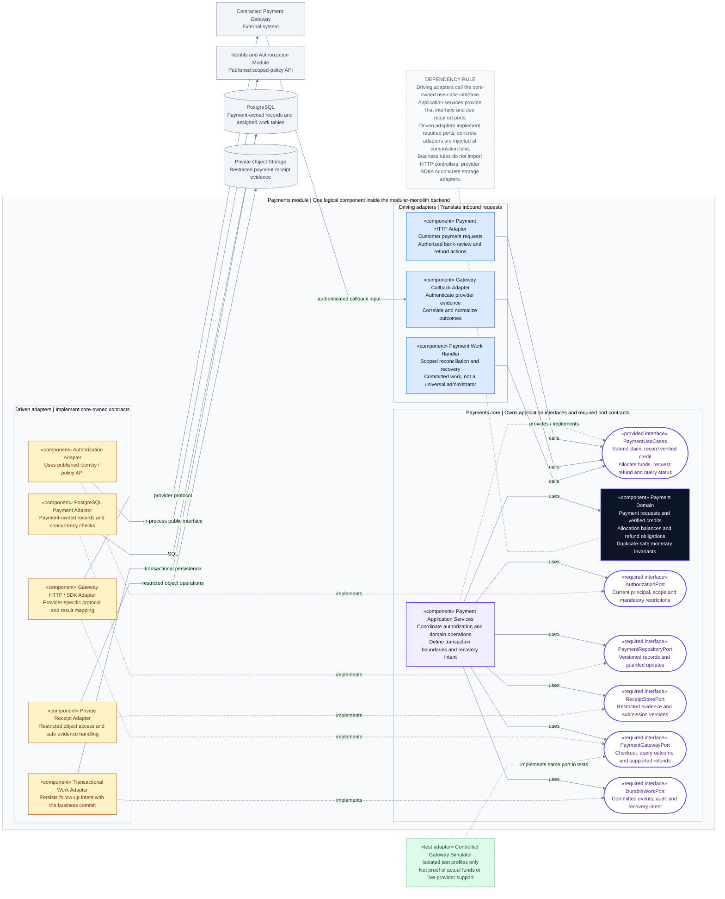

# CineNest Component Diagram 02: Payments Module - Hexagonal Ports and Adapters

**View:** 02 of 02 
**Export date:** 2026-10-14 
**Status:** Proposed module decomposition; actual source packages, port names, adapters and runtime verification are not established by this export. 
**Artifact:** Owner-requested standalone Markdown export. No project repository or canonical knowledge document is modified.

## Purpose and boundary

Expand the Payments component from the corrected platform diagram. Show how inbound requests reach the application through a provided interface, how application services apply domain rules through required ports, and how technology-specific adapters implement those ports.

The Payments module is **inside the CineNest modular monolith**, not a new microservice. Other modules are external to this module's boundary but can remain inside the same deployed backend. Database access is owner-specific, and external providers remain outside the local transaction boundary.

## Editable component diagram

## Reading the dependency direction

This is a **UML-style component/ports-and-adapters view expressed in Mermaid flowchart notation**, not a strict UML/XMI artifact or a runtime sequence. Interface names are proposed descriptive contracts, not a requirement for one Java interface per method.

| Relationship | Meaning |
| --- | --- |
| Driving adapter → `PaymentUseCases` | The entry adapter depends on/calls the published application interface. |
| Application Services ⇢ `PaymentUseCases`, labeled `provides / implements` | Application services supply the implementation of the provided interface. |
| Application Services → required port | The application depends on a core-owned abstraction, not a concrete SDK, database or file-store adapter. |
| Driven adapter ⇢ required port, labeled `implements` | A technology-specific adapter implements the port contract. The source dependency points toward that contract. |
| Application Services → Domain | Application orchestration invokes business rules and entities/value objects. |
| Adapter → external system or database | The adapter uses the actual provider protocol or infrastructure. |
| Gateway → Callback Adapter | A distinct inbound integration; authenticate evidence before admitting it to the use-case boundary. |
| Test Adapter ⇢ Gateway Port | A controlled test implementation can replace the provider adapter in isolated tests. |
| Unlabeled dashed note connector | An explanatory rule only, not a dependency. |

Concrete adapters are wired at the composition/configuration boundary. Runtime calls through an interface can execute its configured adapter without making the core import that concrete adapter. Dashed arrows here mean implementation/provision, **not** asynchronous delivery. For event routing see Diagram 01; for time order use the sequence-diagram exports.

## Components and responsibilities

| Component | Intended responsibility | Must not do |
| --- | --- | --- |
| Payment HTTP Adapter | Translate customer/admin requests; establish authenticated request context; call the owning payment use case | Treat user-supplied roles, amount, venue or receipt as trusted approval evidence; implement payment rules solely in a controller |
| Gateway Callback Adapter | Authenticate, correlate and normalize supported provider messages | Accept a browser success redirect as payment verification; invent bank callbacks for manual approvals |
| Payment Work Handler | Resume committed payment reconciliation and recovery under a scoped service identity | Act as a universal admin, bypass monetary rules or silently duplicate prior effects |
| Payment Application Services | Coordinate authorization, domain operations, local transactions, idempotency and durable recovery intent | Assume an external provider or object write is included atomically in a database transaction |
| Payment Domain | Model requests, verified credits, allocation balances, refund obligations and monetary invariants | Import HTTP controllers, gateway SDK types, concrete repositories or object-storage clients |
| Authorization Adapter | Obtain applicable policy/grant decisions through a published module interface | Inject another module's internal identity repository or combine unrelated permission/scope grants |
| PostgreSQL Payment Adapter | Map core persistence contracts to payment-owned records and enforce supported concurrency checks | Modify Booking tables directly or offer unrestricted access to every operational table |
| Private Receipt Adapter | Store/read restricted evidence and versioned receipt references | Make evidence publicly accessible or treat upload success as bank credit |
| Gateway HTTP / SDK Adapter | Translate checkout/status/refund contracts to a selected provider and normalize results | Hide pending/unknown outcomes behind a generic success value |
| Transactional Work Adapter | Persist assigned publication/audit/recovery intent within the relevant local commit | Claim delivery is complete merely because work was enqueued |
| Controlled Gateway Simulator | Provide deterministic test results and failure cases through the same port | Be enabled as a production fallback or be used as evidence that real funds were received |

## Provided and required interface contracts

| Contract | Kind | Conceptual capability |
| --- | --- | --- |
| `PaymentUseCases` | Provided interface | Submit a bank claim, ingest an authenticated gateway result, record bank-verified funds, inspect allocation, apply a guarded allocation, request a refund and query permitted status |
| `AuthorizationPort` | Required interface | Evaluate principal eligibility, matching scoped grants, mandatory restrictions, approval evidence and relevant freshness |
| `PaymentRepositoryPort` | Required interface | Read/write owned requests, verified credits, allocations and refund records with revisions and transaction-aware guards |
| `ReceiptStorePort` | Required interface | Store a safe submission version and retrieve evidence only under explicit request/role/purpose scope |
| `PaymentGatewayPort` | Required interface | Initiate hosted checkout, query an existing payment/refund attempt, and request a supported refund with stable correlation/idempotency references |
| `DurableWorkPort` | Required interface | Record committed follow-up intent for reconciliation, audit, booking coordination and notifications |

Split contracts when the actual responsibilities require it; do not introduce a generic catch-all gateway, repository or policy engine. The named ports summarize meaningful boundaries rather than mandate boilerplate classes for every function. Final package locations and exact framework integration must follow the approved implementation plan.

## Online and bank-payment entry paths

**Online gateway:** A customer request enters through the HTTP adapter. The application records a payment attempt and invokes the selected gateway through `PaymentGatewayPort`. Authenticated callback evidence enters through the callback adapter. The application records actual verified status idempotently and queues any committed follow-up work. A timeout or missing callback produces a reconciliation question, not proof of failure.

**Bank deposit or transfer:** The customer pays outside CineNest and uploads evidence through the HTTP adapter. An authorized reviewer independently matches the receiving-account credit, then invokes the permitted verification use case. A clear image, customer-entered reference or OCR result cannot prove funds arrived. There is deliberately **no bank API adapter** in this module view.

Receipt submission, bank matching, verified credit, allocation, booking confirmation, credential readiness and refund completion are separate facts/lifecycles. No entry path collapses them into a universal `approved` state.

## Coordination with Booking and other modules

Other modules consume Payments through its published application/query contracts. They never inject its concrete repository or modify its tables. Payments can publish a committed funds-verification fact; a Booking-owned handler can then coordinate the guarded reservation and allocation use cases.

The local transaction coordinating allocation and reservation must preserve each module's ownership. Its orchestration and transaction propagation need an explicit approved design and real-database concurrency tests; this diagram is not evidence that such atomicity has been implemented.

The verified incoming funds record must survive a failed reservation attempt. When inventory, quote, eligibility or authorization checks fail, retain funds and route to reconciliation, an agreed alternative or an authorized refund. For events that cross module boundaries, retain stable correlation, event version and owner scope without raw receipts, bank credentials or access PINs.

Notifications, booking confirmation and access provisioning are not implemented by a payment-provider adapter. They are independently owned use cases and durable follow-up handlers as shown in the platform view.

## Transaction, persistence and failure rules

- Persist stable payment/claim/attempt references before external effects where required; retries and callbacks must resolve to their existing records.
- Keep verified receipt-of-funds evidence separate from a transaction that may fail while allocating funds to a booking. Do not roll back the fact that money arrived merely because the room became unavailable.
- Enforce sufficient available balance, unique bank/provider transaction identity, permitted currency and exactly the amount due at allocation time. A preliminary read alone does not provide concurrency protection.
- Preserve underpayment and excess funds, including real double payments through different methods. Excess is not automatically booking revenue.
- A local database transaction cannot make the provider, object store, bank portal or lock participate atomically. Perform remote calls outside an assumed long-running business transaction and persist their actual outcomes.
- Object storage and database persistence need defined retry, cleanup and recovery behavior for partial results.
- Record refund intent/approval, initiated repayment, unknown status and verified completed repayment separately. Reconcile the original attempt before repeating a transfer after a timeout.
- Retryable jobs need scoped identities, current relevant revisions and bounded policies. “Job sent” is not evidence of business completion.
- A gateway or local bank interface may have different capabilities. Contract implementations must expose unsupported or uncertain outcomes rather than fabricate equivalence.

## Scoped RBAC + ABAC and privacy

A protected operation needs a current eligible principal and an applicable grant containing both the requested permission and resource scope. Mandatory denials, relevant ownership, legitimate evidence purpose and approved financial constraints still apply. A finance grant at Venue A plus an operations grant at Venue B is not finance authority at both venues.

Application services coordinate the permission check and their domain/persistence guards at the required consistency boundary. They must reject invalid allocations or refunds even for an otherwise permitted administrator. The domain remains responsible for money and lifecycle invariants rather than relying on a generic authorization engine to make invalid business state acceptable.

Review evidence through restricted, safe previews. Audit sensitive access and decisions without putting raw receipts, PINs, session tokens or banking secrets in ordinary logs. Exact limits, independent-review rules and revocation timing remain governed by their actual approved/proposed/open status in the canonical records.

## Test seams and review targets

These are proposed verification targets, not test results:

| Level | Suggested evidence |
| --- | --- |
| Domain unit tests | Allocation balance, under/overpayment, refund entitlement and valid state transitions without provider/database access |
| Application tests | Permission denial, idempotency, payment claim versus verified credit, failure handling and durable follow-up intent using controlled adapters |
| Real PostgreSQL tests | Simultaneous approvals/allocations, unique transaction identity, rollback behavior and durability of earlier verified funds |
| Provider contract tests | Authenticated callbacks, correlation, pending/unknown outcomes and safe refund reconciliation in a supported test environment |
| Storage tests | Unauthorized reads, unsafe file handling, versioned evidence, and object/DB partial-failure recovery |
| Architecture checks | Core does not import concrete web/SDK/storage adapters; other modules use public contracts; source dependencies remain acyclic |

No simulator output substitutes for bank-credit verification, production settlement, actual notification delivery or physical device acceptance.

## Related view, rendering and authority

[01. Platform Components and Integration Boundaries](01_Component%20Architecture%20Diagram_Platform_Components_and_Integration_Boundaries.md) places Payments alongside Booking, Packages, Verification, Access, Device Operations and supporting components.

Render the `mermaid` block in a compatible Markdown viewer. When a viewer does not support YAML frontmatter, remove only the initial `---` configuration section **inside that block**, retaining `flowchart LR` and the diagram. Text, tables and the companion link remain readable without Mermaid. No external image or font files are required.

This export follows the detailed hexagonal component view and the Payments inset in `CineNest_Component_Diagram_Corrected.png`, with explicit callback direction and interface semantics. It does not revive erroneous Kafka, TimescaleDB, active Redis, native-mobile, generic shared-repository or unrelated frontend labels from the earlier generated posters.

The repository's four canonical documents (`PROJECT.md`, `ARCHITECTURE.md`, `DESIGN.md`, `PROGRESS.md`) and authoritative registries retain decision and implementation authority. These requested exports neither create repository knowledge documents nor approve a technology stack, financial policy, integration provider or physical capability.
