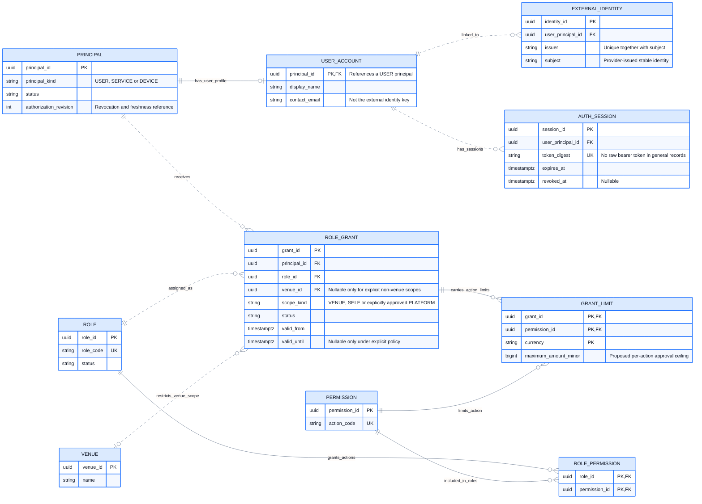

# CineNest ER Diagram 02: Identity, Sessions and Scoped RBAC + ABAC

**View:** 02 of 08 
**Export date:** 2026-10-14 
**Status:** Proposed logical model; implementation and database acceptance not verified. 
**Artifact:** Requested standalone Markdown export; no repository or canonical knowledge file modified.

## Purpose

Model user, service and device principals; external identity links; database-backed sessions; permission-bearing roles; and scoped grants with optional per-action financial limits. ABAC conditions also use facts owned by the target business modules.

## Editable ER diagram

## Entities and ownership

| Owner / area | Entities | Responsibility and boundary |
| --- | --- | --- |
| Identity and Authorization | PRINCIPAL, USER_ACCOUNT, EXTERNAL_IDENTITY, AUTH_SESSION | Identity, session status and external sign-in links; provider credentials are not ordinary application profile fields. |
| Identity and Authorization | ROLE, PERMISSION, ROLE_PERMISSION, ROLE_GRANT, GRANT_LIMIT | Role action sets and grant-specific scope/limits; no grant may borrow another role assignment’s venue to expand authority. |
| Venues and Rooms | VENUE | Reference entity only in this view; authoritative venue configuration stays with its owner. |

## Key constraints and interpretation

1. USER_ACCOUNT is a USER-principal subtype. A provisioned DEVICE principal and its DEVICE link are expanded in View 07. Subtype validity needs explicit validation; the diagram does not enforce discriminator checks.

2. The external identity key is the pair (issuer, subject), not email. Multiple identity links are a modeling capability, not approval of providers beyond the established sign-in direction.

3. AUTH_SESSION is a logical session concept. Map it to the selected supported session implementation rather than creating a second competing session system. Session tokens and authentication secrets do not belong in general logs or exports.

4. ROLE_PERMISSION has a composite primary key. GRANT_LIMIT has a composite primary key (grant_id, permission_id, currency). A limit does not itself grant the referenced action; it constrains an already applicable role permission.

5. For a VENUE grant, venue_id must be present and authoritative. A missing venue is not a wildcard. SELF and any explicitly approved PLATFORM scope need distinct constraints.

6. A protected action needs a matching action-and-scope grant plus the relevant resource conditions. Finance at Venue A combined with Operations at Venue B is not Finance at Venue B.

7. Do not permit undefined financial limits to silently become unlimited authority. Mandatory denial, account suspension, applicable self-approval controls and missing required attributes take precedence over an apparent role match.

8. ABAC also reads owner, venue, amount, evidence purpose, review assignment and current resource state through owning-module contracts. This ER view does not prescribe a generic attribute-value database or a policy-engine service.

9. authorization_revision can help identify stale authority, but a field alone does not implement session revocation, cache invalidation or transactional consistency. Those policies and negative tests remain necessary.

## Decisions and checks still required

Exact role bundles, grant assignment authority, financial thresholds, independent review, exceptions and revocation timing retain their proposed/open status until approved.

Uniqueness of overlapping grants, global scope, grant-limits consistency and framework session-table mappings must be specified before physical DDL is accepted.

## Reading the ER notation

| Notation | Meaning in these exports |
| --- | --- |
| `PK` | Primary key. Multiple PK attributes in one entity form a composite key. |
| `FK` | Proposed reference to another entity. Whether a cross-module link is enforced by a physical SQL FK is a separate implementation decision. |
| `UK` | Proposed unique key; comments identify composite or scoped uniqueness where needed. |
| `\|\|` | Exactly one at that relationship endpoint. |
| `o\|` / `\|o` | Zero or one at the relevant endpoint. |
| `o{` / `}o` | Zero or many at the relevant endpoint. |
| `\|{` / `}\|` | One or many at the relevant endpoint. |
| `--` | Identifying relationship: the parent's identity contributes to the child's identity in this model. |
| `..` | Non-identifying relationship. **Dashed lines do not mean optional, asynchronous, or unimplemented.** Optionality comes from the endpoint markers. |

Relationships are not calls, message directions, or execution order. Entity names repeated in different views refer to the same logical entity, not duplicate tables. An entity shown without fields is a reference stub; its attributes are expanded in the relevant companion view. Selected fields do not constitute an exhaustive physical schema.

Types such as `uuid`, `timestamptz`, `bigint`, `numeric` and `jsonb` are proposed descriptive types, not a migration. Money fields use minor units or exact decimal quantities under an explicit currency/rounding policy. Dates, times, nullability, source identity, sums, scope consistency, XOR ownership and non-overlap need actual constraints and tests; the picture does not enforce them.

## Scope, source and approval status

This export preserves the **eight detailed CineNest ER views** discussed in the conversation and the corrected `CineNest_ER_Diagram_Corrected.png` overview. It is informed by the preceding mind-map, use-case, activity, sequence, context and corrected component views. The earlier automatically generated ER poster is not the authoritative source for keys, entity names, privacy fields or cardinalities.

The model remains **proposed and not implementation-verified**. No SQL schema was reverse-engineered from a running database. Exact class/table names, constraints, cross-module coordination and remaining policies need approval and verification. Do not infer raw-password sign-in, a plaintext `pin_code` field on bookings, generic public identity-document URLs, unrelated personal-profile collection, active Redis, Kafka, TimescaleDB or a subscription/tenant model from this export.

Each module owns its operational records; a relationship is not permission for cross-module repository injection or unrestricted joins. Protected operations use scoped RBAC + ABAC and still enforce their owning business invariants. Runtime integrations, physical installation, emergency egress and recovery require separate evidence.

The repository's four canonical documents (`PROJECT.md`, `ARCHITECTURE.md`, `DESIGN.md`, `PROGRESS.md`) and authoritative registries retain decision and implementation authority. These owner-requested standalone exports do **not** modify the project repository, create a second canonical knowledge base, select unapproved technologies/policies or claim application, payment, provider or hardware tests passed.

## Related ER views

- [01. Core Relationship Overview](01_ER_Diagrams_Core_Relationship_Overview.md)
- [05. Gateway Payments, Manual Bank Evidence, Allocations and Refunds](05_ER_Diagrams_Payments_Bank_Evidence_Allocations_and_Refunds.md)
- [06. Identity Evidence, Guest Check-in and Access Credentials](06_ER_Diagrams_Identity_Evidence_Guest_Check_In_and_Access_Credentials.md)
- [07. Sessions, Devices, Maintenance and Operational Readiness](07_ER_Diagrams_Sessions_Devices_Maintenance_and_Readiness.md)
- [08. Durable Work, Notifications and Audit Records](08_ER_Diagrams_Durable_Work_Notifications_and_Audit.md)

## Rendering

Open this file in a Mermaid-enabled Markdown viewer to render its fenced `erDiagram` block. Use zoom for the larger models. The prose, attributes and relationships remain readable as text without a renderer.

If the viewer cannot parse Mermaid YAML configuration, remove only the initial `---` configuration section **inside** the Mermaid fence, retaining `erDiagram` and the remaining lines. Renderer/version support is required for ER direction and key annotations. No external font, image or script assets are required to render these Markdown diagrams.
