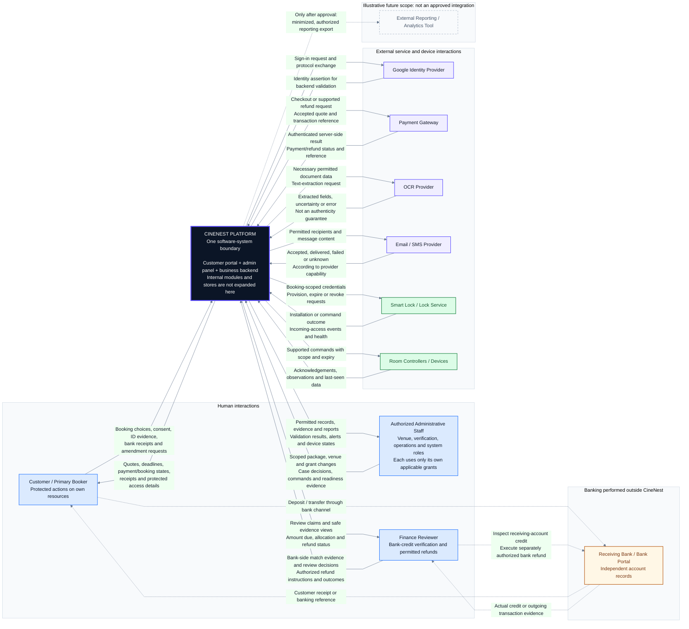

# CineNest Context Diagram 02: External Actors and Data Exchanges

**View:** 02 of 02 
**Export date:** 2026-10-14 
**Status:** Proposed interaction context; implementation and external connections not verified. 
**Artifact:** Owner-requested standalone Markdown export. No project repository or canonical knowledge document is changed.

## Purpose and scope

Make the request and output directions in the context illustrations explicit, while keeping CineNest as a single black-box software system. This complements the overall participant view rather than proposing a second architecture.

The system boundary includes the customer portal, admin panel and business backend, with internal databases, storage, jobs and module APIs abstracted away. Separate arrows are conceptual information exchanges, not a claim that every communication is synchronous or that every integration has already been implemented.

For readability, the non-finance staff roles are grouped in this view. That grouping does **not** combine their permissions: venue administration, identity verification, operations and system administration retain their separate applicable grants.

## Editable interaction context

## Human input and output contracts

| Participant | Input to CineNest | Output from CineNest | Important qualification |
| --- | --- | --- | --- |
| Customer / Primary Booker | Package/room/session choices, consent, identity evidence, bank-payment claims and permitted change requests | Versioned quotation, real hold/review deadlines, actual payment/booking/access status, permitted receipts and access instructions | The application does not need online-banking credentials. A browser success redirect is not payment authority. |
| Venue Administrator | Authorized package details, duration/price changes, venue configuration and booking actions | Validation results, publication/effective status and permitted operational records | Changes to the catalog do not modify purchased booking terms. |
| Verification Officer | Authorized case-review and eligibility decisions | Restricted evidence, extracted fields and case status | General customer administration is not an unrestricted evidence-access grant. |
| Operations Staff | Check-in evidence, supported device commands, incident reports and cleaning/readiness outcomes | Session status, actual telemetry, command outcomes and operational alerts | Unknown status cannot be re-labeled safe, empty, OFF or ready. |
| System Administrator | Permitted account/grant and platform-configuration changes | Authorized audit, validation and system-health information | No implied universal super-user exception. |
| Finance Reviewer | Independently verified bank matches, amount/currency/reference, scoped approval decisions and outgoing refund evidence | Claims, safe receipt views, expected amount, allocation, discrepancy and refund status | Verification of actual incoming money, booking confirmation and outgoing repayment completion are separate. |

## External-system exchange contracts

| Relationship | Outbound from CineNest | Inbound to CineNest | Trust/behavior constraint |
| --- | --- | --- | --- |
| Customer identity provider | The configured sign-in protocol exchange | Authentication assertions/results to validate | Authentication is not automatic agreement consent or resource authorization. The physical browser redirects are abstracted here. |
| Online payment gateway | Request hosted checkout for an accepted quote or a supported refund | Authenticated provider results and transaction identifiers | Deduplicate and reconcile. Preserve pending/unknown outcomes; a callback is not automatically success. |
| OCR provider | Necessary permitted image/document data and extraction request | Extracted text, uncertainty and processing outcome | Eligibility rules and manual review remain distinct from extraction. No authenticity or biometric capability is implied. |
| Email / SMS provider | Message request for permitted recipients | Provider-supported acceptance/delivery/error status | Messages reach customers/staff through the provider; delivery is not an atomic part of the originating business transaction. Recipient-delivery lines are omitted to reduce clutter. |
| Smart-lock interface | Current-booking credential intent, valid interval and permitted revoke/expire requests | Contract-specific installed state, events and failures | Provider acceptance, installation acknowledgement and observed access may differ. No automatic QR or offline-gate capability is selected. |
| Room-device interface | Supported commands with target scope, correlation and expiry | Command acknowledgements, timestamped telemetry and connectivity evidence | Prevent stale work and unauthorized control. One device response cannot certify all room equipment or physical conditions. |
| Optional future analytics | Only a separately approved, authorized and minimized export | Not assumed; any return feed needs its own future contract | The dashed relationship preserves an optional item in the illustrations, not an approved product integration or a claim that data is anonymized. |

Customers complete hosted online payments with the selected payment provider. That external customer-to-gateway interaction is abstracted in this context view; its detailed checkout and authenticated-result sequence is in Sequence 01. The diagram does not route raw card security credentials through CineNest.

## Manual banking and financial evidence

| External-to-external interaction | Information exchanged | CineNest consequence |
| --- | --- | --- |
| Customer to receiving bank | Cash deposit or bank transfer performed through the bank's channel | No automatic platform confirmation follows from initiating the transfer. |
| Bank to customer | Customer-side receipt/reference | The customer may upload it as a payment claim. |
| Finance reviewer to bank | Independent account-credit inspection or separately authorized outgoing refund | The reviewer uses the bank portal/records outside CineNest. |
| Bank to finance reviewer | Actual receiving-account or outgoing-transaction evidence | The reviewer records a scoped, attributable result in CineNest. |

There is **no edge between the CineNest system and the bank** in the proposed manual model. Finance may supply bank-statement facts to CineNest, but that does not make the application bank-integrated. Unmatched credits, partial amounts, excess payments and expired reservations remain reconciliation cases rather than disappearing after a rejection or timeout.

The customer is told whether a real provisional hold exists, when it expires, and whether payment review is pending. Exact lead times, payment/review deadlines, fee treatment, approval limits and refund destination controls retain their existing approved/proposed/open status; this drawing does not choose values.

## Notation and boundary interpretation

Solid one-way arrows identify the source and destination of a logical request, decision, observation or result. They are not instructions to expose new APIs. The arrow labels distinguish commands from actual outcomes and account for errors/uncertainty.

Dashed connections **inside the manual banking context** are people interacting with bank channels. The dashed connection to **External Reporting / Analytics Tool** is instead an explicitly unapproved future integration. Its separate group label and edge label distinguish that meaning; line style alone is not the authority.

Internal booking, pricing, payment, access, audit, reporting and notification capabilities stay inside the central software boundary. The outer groups are organizational aids. They do not define separately deployed services, networks, legal entities or a microservice architecture.

This is an interaction-focused context view using Mermaid flowchart primitives, not a strict data-flow-model specification. The external-to-external banking edges explain operational context and are deliberately not misrepresented as platform API calls.

## Security, policy and operational constraints

Protected actions must pass scoped RBAC + ABAC at the backend, using trusted account, resource and policy attributes. Do not borrow a permission from one venue grant and a scope from a different grant. Sensitive identity and receipt content is purpose-bound; actor labels do not imply unrestricted access.

The customer portal and admin panel present authoritative backend results. Package edits preserve accepted quotes and purchased terms. Finance approval cannot bypass reservation conflicts, required eligibility or the prohibition on duplicate fund allocation. Payment, booking and credential readiness are distinct states.

Entry credentials are restricted to the correct room and purchased time window, with a physically enforced original-ID/guest check-in gate. Locks and room devices are external to the software boundary. Cloud outages, missing events or device acknowledgements alone cannot establish vacancy, cleaning or safe egress. Qualified physical acceptance remains necessary and is not provided by this export.

## Corrections to the generated illustrations

| Illustration shortcut | Interpretation retained in this export |
| --- | --- |
| Direct bank arrows labeled manual/API/statement | Manual banking occurs between the customer/reviewer and bank; no direct bank API is assumed. |
| Reversed or ambiguous command/result directions | Requests and staff decisions flow into CineNest; scoped outputs flow back to their actual recipients. |
| OCR described as document-authenticity validation | Extraction/uncertainty only; authenticity, eligibility and manual review are separate responsibilities. |
| Google sign-in or room devices omitted from one image | Restored from the detailed context and previously supplied mind map/use-case/sequence descriptions. |
| QR, push notifications and external analytics pictured without a decision record | PIN and email/SMS remain the described baseline; QR and push are not assumed, and analytics is marked future/unapproved. |
| RBAC/ABAC described as already enforced | Intended backend requirement, with implementation status unverified in this export. |
| Modular capability list drawn inside a context boundary | Treated as a summary of CineNest responsibilities, not independent context-level software systems. |

## Sources, authority and rendering

Primary visual reference: `a_wide_infographic_context_diagram_on_a_white_back.png`. Companion visual reference: `wide_infographic_diagram_of_a_system_context_diagr.png`. The detailed interactive **CineNest System Context Diagram** and the existing mind-map, use-case, activity and sequence exports resolve ambiguities in these generated images.

Relevant supporting sequence descriptions are **02: Bank Deposit, Receipt Review and Approval**, **05: Scoped RBAC and ABAC Authorization**, and **08: Cinema Entry, IoT Control and Room Reset**. These names identify the standalone exports, not verified API implementations.

The actual `PROJECT.md`, `ARCHITECTURE.md`, `DESIGN.md`, `PROGRESS.md` and authoritative registries remain the source of approval and implementation status. No live repository was inspected or modified for this export. No provider, cloud, technology patch, hardware feature, bank connection or new policy is approved here.

[01. System Context Overview](01_System_Context_Overview.md) shows the staff roles separately and emphasizes the overall software boundary.

Render the fenced block in a Mermaid-enabled Markdown viewer. For a viewer that lacks Mermaid YAML configuration support, remove only the initial `---` configuration block **inside the Mermaid fence**. The `flowchart LR` content, text and tables are otherwise self-contained; no image or font asset is needed.
