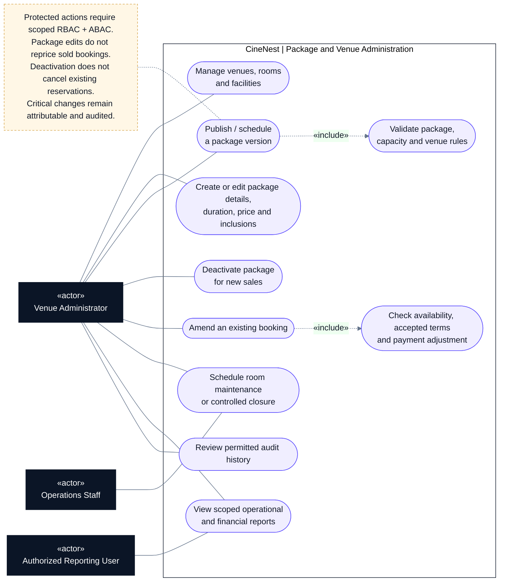

# CineNest Use-Case Diagram 02: Package and Venue Administration

**View:** 2 of 5 
**Export date:** 2026-10-14 
**Status:** Planned behavior; implementation not verified. Exact role assignments and unresolved policy choices retain their canonical approval status. 
**Artifact type:** Standalone Markdown export requested by the owner, not an update to the repository knowledge base.

## Purpose

Show the authorized administration of venues, cinema rooms, configurable packages, existing reservations, maintenance, reporting, and audit history.

## Actors

| Actor | Participation |
| --- | --- |
| Venue Administrator | Manages permitted venue/room, package, booking, and reporting operations within assigned scope. |
| Operations Staff | Schedules or manages maintenance under an appropriate scoped grant. |
| Authorized Reporting User | Reads authorized reports; the label describes a capability, not necessarily a distinct approved role. |

These are proposed role bundles. One actor may hold multiple permitted grants, but a role label never implies unrestricted access.

## Editable use-case diagram

## Notation

This is a **UML-style use-case view written with Mermaid flowchart primitives**, not a strict UML model or a sequence diagram.

- Dark rectangles identify human actors; blue rectangles identify external systems.
- Rounded nodes identify use cases inside the CineNest application boundary.
- A solid line denotes participation, not call direction, time order, or unrestricted permission.
- A dashed arrow labeled `«include»` points from a use case to required reused behavior; `«extend»` points from conditional additional behavior to its base use case.
- A dashed note connector carries an explanatory constraint, not a workflow transition.

Render the fenced `mermaid` block in a Mermaid-enabled Markdown viewer. The actor and use-case tables remain readable in a plain-text viewer. The diagram deliberately shows selected relationships rather than every authorization, audit, and validation dependency.

## Use-case catalog

| Use case | Intended result and important condition |
| --- | --- |
| Manage venues, rooms, and facilities | Maintain descriptive and operating configuration within granted scope. |
| Create or edit package details, duration, price, and inclusions | Change application-managed configuration without requiring code edits for each price change. |
| Publish or schedule a package version | Make a validated version available according to explicit effective-date rules. |
| Validate package, capacity, and venue rules | Reject inconsistent durations, unsupported inclusions, excess occupancy, and incompatible operating constraints. |
| Deactivate package for new sales | Stop eligible new purchases without deleting historical versions or cancelling purchased reservations. |
| Amend an existing booking | Apply an independently authorized change rather than modifying it through a catalog edit. |
| Check amendment consequences | Validate current inventory, accepted terms, required acceptance, payments/refunds, and affected access times. |
| Schedule maintenance or closure | Coordinate blocking intervals with authoritative reservation inventory; resolve existing bookings explicitly. |
| View scoped reports | Display authorized, defined metrics using consistent populations, periods, units, and freshness. |
| Review audit history | Inspect permitted activity without exposing raw credentials or unrestricted personal evidence. |

## Main interaction outline

1. The administrator opens a resource within an applicable permission and venue grant.
2. The administrator creates or edits package/room configuration in the existing admin interface.
3. The backend validates the whole change and, where publishing is requested, checks publication authority and effective dates.
4. CineNest records the resulting version and attributable audit information.
5. New purchases use the applicable published version. Existing bookings continue to display their purchased snapshots.
6. Maintenance, closure, or booking amendments follow explicit inventory and payment checks before changing existing reservations.

## Key rules and authorization

- Package content and prices are configurable; physical capacity, operating hours, minimum-duration policy, and cleaning constraints retain their own ownership.
- A package edit cannot bypass a venue minimum-duration policy. Policy changes require their own authorization and customer-facing reconciliation.
- A shared package must not be published across venues outside the actor's applicable grant.
- Editing and publishing can require different permissions. Exact role bundles and approval thresholds remain governed by the canonical decision register.
- The same permission and scope must come from an applicable grant; unrelated grants cannot be combined into broader authority.
- Existing quotes, payments, purchased inclusions, and PIN windows must not change merely because a catalog row changes.
- Reporting has no write authority over operational module records.

## Alternative and exception paths

| Situation | Required handling |
| --- | --- |
| Invalid or conflicting package fields | Return field-level validation; do not publish a partial change. |
| Two editors change the same version | Detect stale changes and require explicit reconciliation rather than silently overwriting. |
| Maintenance overlaps confirmed bookings | Resolve affected reservations through approved workflows; do not erase them. |
| Actor lacks publication or multi-venue scope | Deny server-side and return a safe explanation. |
| No report data or stale source data | Distinguish genuine zero, unavailable, stale, and no-permission states. |

## Acceptance checks to implement

These are proposed verification targets, not evidence of tests run for this export.

- A published price/duration change affects only the appropriate new purchases.
- A package cannot exceed the room's capacity or bypass operating constraints.
- Deactivation retains historical booking and package information.
- Cross-venue edits, stale publication, and unapproved booking changes are rejected.
- Room card/table views and report exports honor the same authoritative scope and definitions.

## Related diagrams

- [01. Customer Booking and Account](01_Use%20case_Customer_Booking_and_Account.md)
- [03. Payments, Bank Review and Refunds](03_Use%20case_Payments_Bank_Review_and_Refunds.md)
- [04. Identity Verification and Authorization](04_Use%20case_Identity_Verification_and_Authorization.md)
- [05. Cinema Access and IoT Operations](05_Use%20case_Cinema_Access_and_IoT_Operations.md)

## Source and authority

Exported from the five CineNest use-case views discussed in this conversation, with the related E2E mind map and subsequent package, bank-payment, and hybrid-authorization clarifications. Labels are normalized for readability; financial matching/allocation and evidence-submission/processing are kept distinct.

The current repository's four canonical documents (`PROJECT.md`, `ARCHITECTURE.md`, `DESIGN.md`, `PROGRESS.md`) and its authoritative registries govern approval and implementation status. This standalone export does not replace those documents, approve proposed role bundles or hardware capabilities, or establish any completed code, test, deployment, or safety verification.
