# CineNest Activity Diagram 03: Package Editing, Publication and Deactivation

**Diagram:** 03 of 10 
**Export date:** 2026-10-14 
**Status:** Proposed workflow; implementation and execution tests not verified. 
**Artifact:** Standalone requested Markdown export; no project/repository files modified.

## Purpose

Show how an authorized administrator edits package content, duration and price, saves a draft, publishes a version, schedules activation, or deactivates new sales without rewriting existing purchases.

Exported from one of the eight detailed interactive activity diagrams. The overview poster is a visual summary, not the detailed workflow contract.

## Participants and responsibilities

| Participant | Responsibility |
| --- | --- |
| Authorized administrator | Edits and previews a package under an applicable permission and venue grant. |
| Packages/pricing and venue modules | Validate fields and independent venue constraints, manage revisions, and publish the applicable offer. |
| Scheduled worker | Executes already-authorized activation work under its scoped service identity and current validity rules. |

## Editable activity diagram

```mermaid
---
config:
  theme: base
  themeVariables:
    fontFamily: Arial, sans-serif
    fontSize: 16px
    primaryColor: '#F0EEFF'
    primaryTextColor: '#111827'
    primaryBorderColor: '#5B4BFF'
    lineColor: '#64748B'
  flowchart:
    curve: linear
---
flowchart TB
    Start((Start)) --> Select("Admin: select package, affected venues<br/>and requested management action")
    Select --> Auth[["Evaluate scoped RBAC + ABAC: Activity 05"]]
    Auth --> Allowed{"Authorized for this action<br/>and every affected venue?"}
    Allowed -->|No| Deny([End: denied; no catalog change])
    Allowed -->|Yes| Action{"Requested action?"}
    Action -->|Deactivate| Deactivate("Validate current revision and deactivation impact<br/>Stop new sales under the approved effective rule")
    Deactivate --> History("Retain historical versions, accepted quotes<br/>and existing confirmed bookings; record audit")
    History --> Disabled([End: package unavailable for new sales])
    Action -->|Create or edit| Edit("Edit description, duration, price,<br/>guest allowance and included / optional services")
    Edit --> Validate{"All fields and venue constraints valid?<br/>Capacity, minimum duration, fees and inclusions"}
    Validate -->|No| Errors("Return field errors; do not save a partial publication")
    Errors --> Edit
    Validate -->|Yes| Preview("Preview full customer offer and price breakdown<br/>Show old and proposed values")
    Preview --> Intent{"Save draft or publish?"}
    Intent -->|Save draft| Draft("Save editable draft with revision check<br/>Keep live offer unchanged")
    Draft --> DraftEnd([End: draft saved; not available for purchase])
    Intent -->|Publish or schedule| PublishAuth{"Publication authority, approvals<br/>and effective dates valid?"}
    PublishAuth -->|No| Blocked([End: publication blocked; draft retained])
    PublishAuth -->|Yes| Fresh{"Base revision unchanged<br/>at transactional publication check?"}
    Fresh -->|No| Conflict("Show concurrent edit; reload and explicitly reconcile")
    Conflict --> Edit
    Fresh -->|Yes| Version("Commit immutable package version,<br/>effective window and attributable audit")
    Version --> Timing{"Effective now?"}
    Timing -->|No| Scheduled("Wait for recorded activation time<br/>Current version remains authoritative")
    Scheduled -.->|Durable scheduled trigger| Recheck
    Timing -->|Yes| Recheck{"Activation rules, scope and<br/>non-overlapping version window still valid?"}
    Recheck -->|No| Incident("Keep candidate inactive<br/>Notify authorized owner to resolve conflict")
    Incident --> Blocked
    Recheck -->|Yes| Active("Activate version atomically<br/>Refresh published package views")
    Active --> Done([End: new eligible purchases use this version])
    Note["Package changes never rewrite purchased terms or PIN windows.<br/>Editing a package cannot bypass venue rules or physical capacity.<br/>Included services must not also be charged as optional extras.<br/>Booking amendments use Activity 06, not catalog editing."]
    Note -.- Version

    classDef terminal fill:#0B1526,color:#FFFFFF,stroke:#0B1526;
    classDef actor fill:#DBEAFE,color:#111827,stroke:#2878FF;
    classDef decision fill:#FFF7E6,color:#111827,stroke:#B45309;
    classDef success fill:#DCFCE7,color:#14532D,stroke:#15803D;
    classDef exception fill:#FEE2E2,color:#7F1D1D,stroke:#B91C1C;
    classDef pending fill:#FFF7E6,color:#111827,stroke:#B45309;
    classDef note fill:#F8FAFC,color:#475569,stroke:#94A3B8,stroke-dasharray:4 3;
    class Start,Deny,Disabled,DraftEnd,Blocked terminal;
    class Select,Edit,Preview actor;
    class Allowed,Action,Validate,Intent,PublishAuth,Fresh,Timing,Recheck decision;
    class Errors,Conflict,Incident exception;
    class Scheduled pending;
    class Active,Done success;
    class Note note;
```

## Diagram notation

This is an **activity-style control-flow diagram expressed with Mermaid flowchart notation**, not a strict UML/XMI model. It preserves the discussed workflow decisions without claiming executable behavior.

- The start circle begins this activity; nodes labeled **End** or **Pause** identify outcomes. A pause does not mean the booking, money, or incident has disappeared.
- Rounded actions describe work. Diamonds are decisions with labeled guards/outcomes. Double-border boxes reference another activity.
- Solid arrows show control flow. Dashed arrows with labels represent later events or retries; unlabelled dashed note connectors do not control execution.
- Blue actions identify people or external interactions where labeled; pale violet is ordinary system work, amber is a decision or pending state, green is a verified successful outcome, and red is an exception. Text remains authoritative over color.
- Responsibility is written in node labels and the participant table. These are not fixed swimlane columns. Sequential drawing does not make remote operations one atomic transaction, and no parallel fork/join is implied unless explicitly shown.

Render the fenced `mermaid` block in a Mermaid-capable Markdown viewer. The surrounding text remains readable without rendering. The viewer must support Mermaid frontmatter configuration; remove only the `---` configuration section inside the block when using a renderer that does not support it.

## Main activity outline

1. Identify the requested action and affected venues; check permission and scope together.
2. Edit package details, duration, prices, and included services, without editing application code for each configuration change.
3. Validate all fields against approved venue/room constraints and show the full customer-facing preview.
4. Save an unpublished draft or request publication with its effective window.
5. Reject stale concurrent edits and invalid publication authority rather than overwriting or partly publishing.
6. Publish an immutable version now or activate it through scheduled, validated work.
7. For deactivation, stop eligible new sales while preserving purchased reservations and historical terms.

## Guards and interpretation rules

- Minimum-duration policy, physical capacity, operating hours, and cleaning constraints are not arbitrary package-label settings.
- Editing and publishing may require different grants. Shared-package scope must cover all affected venues.
- Treat sale-effective dates and session-validity dates separately where both exist.
- Deactivation uses the actual approved effective rule; a scheduled deactivation must not act immediately.
- Draft-save and deactivation revision conflicts need the same safe concurrency behavior as publication.
- Scheduled work uses a scoped service identity and explicit policy for already-approved work; it is not a universal admin bypass.
- A catalog change cannot directly mutate a live reservation, quote payment, or credential window.

## Alternative outcomes and recovery

| Condition | Intended handling |
| --- | --- |
| Invalid duration / price / inclusion | Return field errors; no partial publication. |
| Concurrent draft edit | Retain both writers' intent for reconciliation; do not silently overwrite. |
| Unauthorized venue publication | Deny the cross-venue action server-side. |
| Future activation becomes invalid | Keep the candidate inactive and alert an authorized owner. |
| Existing booking needs a different package | Use Activity 06 with customer acceptance and financial/inventory guards. |

## Review before implementation

Treat this diagram as an analysis/design view. Trace every guard and recovery route to the corresponding canonical requirement and planned acceptance check. Test authorization, state changes, duplicate processing, concurrency, and recovery as applicable. For physical/device outcomes, distinguish a simulation from actual hardware evidence. No application, payment-provider, or hardware acceptance test is claimed by this export.

## Related activity diagrams

- [01. Customer Booking and Online Payment](01_ActivityDiagram_Customer_Booking_and_Online_Payment.md)
- [05. Scoped RBAC and ABAC Authorization](05_ActivityDiagram_Scoped_RBAC_and_ABAC_Authorization.md)
- [06. Booking Amendment and Session Extension](06_ActivityDiagram_Booking_Amendment_and_Session_Extension.md)
- [09. Room Maintenance and Controlled Closure](09_ActivityDiagram_Room_Maintenance_and_Controlled_Closure.md)

## Source and authority

- Use-case export 02: Package and Venue Administration
- Detailed interactive activity 3 of 8

These files are standalone exports, not updates to the repository. The current four canonical knowledge documents (`PROJECT.md`, `ARCHITECTURE.md`, `DESIGN.md`, `PROGRESS.md`) and their authoritative registries continue to govern requirements, approvals, and implementation state.

Diagram labels, actor bundles, pending policies, timer values, provider/hardware choices, and retry behavior retain their actual canonical status. This export neither approves unresolved policies nor certifies application code, external integrations, bank reconciliation, device behavior, or physical safety. All protected operations use the applicable scoped authorization; business invariants remain separate.
