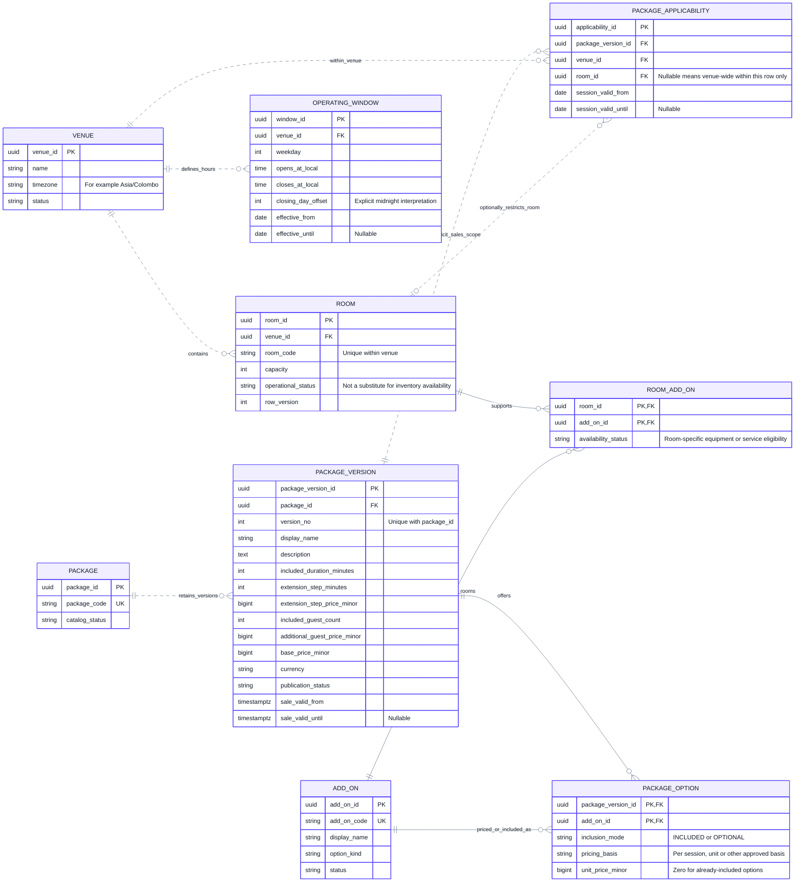

# CineNest ER Diagram 03: Venues, Versioned Packages and Add-ons

**View:** 03 of 08 
**Export date:** 2026-10-14 
**Status:** Proposed logical model; implementation and database acceptance not verified. 
**Artifact:** Requested standalone Markdown export; no repository or canonical knowledge file modified.

## Purpose

Represent venue/room configuration and effective operating windows alongside editable package versions, applicability, included services and separately priced add-ons. Package changes affect the relevant new sales, not previously purchased terms.

## Editable ER diagram

## Entities and ownership

| Owner / area | Entities | Responsibility and boundary |
| --- | --- | --- |
| Venues and Rooms | VENUE, ROOM, OPERATING_WINDOW, ROOM_ADD_ON | Descriptive configuration, physical capacity, operating rules and supported room services; not a second booking inventory calendar. |
| Packages and Pricing | PACKAGE, PACKAGE_VERSION, PACKAGE_APPLICABILITY, ADD_ON, PACKAGE_OPTION | Versioned commercial offers and applicable scope. Venue and room references do not allow cross-module writes. |

## Key constraints and interpretation

1. Enforce unique room_code within venue_id and unique version_no within package_id. A UK on a single column would not express these composite rules.

2. Drafts may be edited under revision checks. Published commercial content and its inclusions are versioned; changing catalog status or effective sales dates must not rewrite an accepted quote or booking snapshot.

3. Operating windows use venue-local time, effective dates and an explicit closing-day offset. Actual reservation instants belong in the booking model. Holiday exceptions and the closing-time/cleaning rule require explicit decisions, not assumptions.

4. PACKAGE_APPLICABILITY.room_id, when present, must belong to the row’s venue_id. A null room means the specified venue’s eligible rooms, not global access across all venues.

5. Sale-valid times and session-valid dates answer different questions. Specify interval boundaries, precedence and overlap handling so two published versions do not produce an ambiguous applicable offer.

6. An included option cannot be charged again as an optional extra. PACKAGE_OPTION amounts use the package currency; quotation lines preserve exact applied prices and descriptions.

7. ROOM_ADD_ON models operational availability. It does not imply a room can provide an add-on merely because a package advertises it. Each field still needs business validation and concurrency handling where availability changes.

8. Physical capacity, venue minimum duration and cleaning requirements remain independent constraints. A shorter package duration needs the relevant policy authorization; an edited guest allowance cannot exceed the room’s approved capacity.

9. The existing default prices and durations are initial configuration, not values permanently encoded into schema or UI. This view does not choose tax, fee, proration or discount rules.

## Decisions and checks still required

Exact minimum/maximum selectable duration, extension-disabled representation, holiday exceptions, date-overlap checks and option quantity rules require completion before schema implementation.

Images, amenities and optional promotion/loyalty records are not exhaustively expanded. Their omission here does not remove existing approved requirements or authorize unapproved engagement features.

## Reading the ER notation

| Notation | Meaning in these exports |
| --- | --- |
| `PK` | Primary key. Multiple PK attributes in one entity form a composite key. |
| `FK` | Proposed reference to another entity. Whether a cross-module link is enforced by a physical SQL FK is a separate implementation decision. |
| `UK` | Proposed unique key; comments identify composite or scoped uniqueness where needed. |
| `\|\|` | Exactly one at that relationship endpoint. |
| `o\|` / `\|o` | Zero or one at the relevant endpoint. |
| `o{` / `}o` | Zero or many at the relevant endpoint. |
| `\|{` / `}\|` | One or many at the relevant endpoint. |
| `--` | Identifying relationship: the parent's identity contributes to the child's identity in this model. |
| `..` | Non-identifying relationship. **Dashed lines do not mean optional, asynchronous, or unimplemented.** Optionality comes from the endpoint markers. |

Relationships are not calls, message directions, or execution order. Entity names repeated in different views refer to the same logical entity, not duplicate tables. An entity shown without fields is a reference stub; its attributes are expanded in the relevant companion view. Selected fields do not constitute an exhaustive physical schema.

Types such as `uuid`, `timestamptz`, `bigint`, `numeric` and `jsonb` are proposed descriptive types, not a migration. Money fields use minor units or exact decimal quantities under an explicit currency/rounding policy. Dates, times, nullability, source identity, sums, scope consistency, XOR ownership and non-overlap need actual constraints and tests; the picture does not enforce them.

## Scope, source and approval status

This export preserves the **eight detailed CineNest ER views** discussed in the conversation and the corrected `CineNest_ER_Diagram_Corrected.png` overview. It is informed by the preceding mind-map, use-case, activity, sequence, context and corrected component views. The earlier automatically generated ER poster is not the authoritative source for keys, entity names, privacy fields or cardinalities.

The model remains **proposed and not implementation-verified**. No SQL schema was reverse-engineered from a running database. Exact class/table names, constraints, cross-module coordination and remaining policies need approval and verification. Do not infer raw-password sign-in, a plaintext `pin_code` field on bookings, generic public identity-document URLs, unrelated personal-profile collection, active Redis, Kafka, TimescaleDB or a subscription/tenant model from this export.

Each module owns its operational records; a relationship is not permission for cross-module repository injection or unrestricted joins. Protected operations use scoped RBAC + ABAC and still enforce their owning business invariants. Runtime integrations, physical installation, emergency egress and recovery require separate evidence.

The repository's four canonical documents (`PROJECT.md`, `ARCHITECTURE.md`, `DESIGN.md`, `PROGRESS.md`) and authoritative registries retain decision and implementation authority. These owner-requested standalone exports do **not** modify the project repository, create a second canonical knowledge base, select unapproved technologies/policies or claim application, payment, provider or hardware tests passed.

## Related ER views

- [01. Core Relationship Overview](01_ER_Diagrams_Core_Relationship_Overview.md)
- [02. Identity, Sessions and Scoped RBAC + ABAC](02_ER_Diagrams_Identity_Sessions_and_Scoped_RBAC_ABAC.md)
- [04. Quotes, Reservation Holds and Immutable Booking Revisions](04_ER_Diagrams_Quotes_Reservation_Holds_and_Booking_Revisions.md)
- [07. Sessions, Devices, Maintenance and Operational Readiness](07_ER_Diagrams_Sessions_Devices_Maintenance_and_Readiness.md)

## Rendering

Open this file in a Mermaid-enabled Markdown viewer to render its fenced `erDiagram` block. Use zoom for the larger models. The prose, attributes and relationships remain readable as text without a renderer.

If the viewer cannot parse Mermaid YAML configuration, remove only the initial `---` configuration section **inside** the Mermaid fence, retaining `erDiagram` and the remaining lines. Renderer/version support is required for ER direction and key annotations. No external font, image or script assets are required to render these Markdown diagrams.
