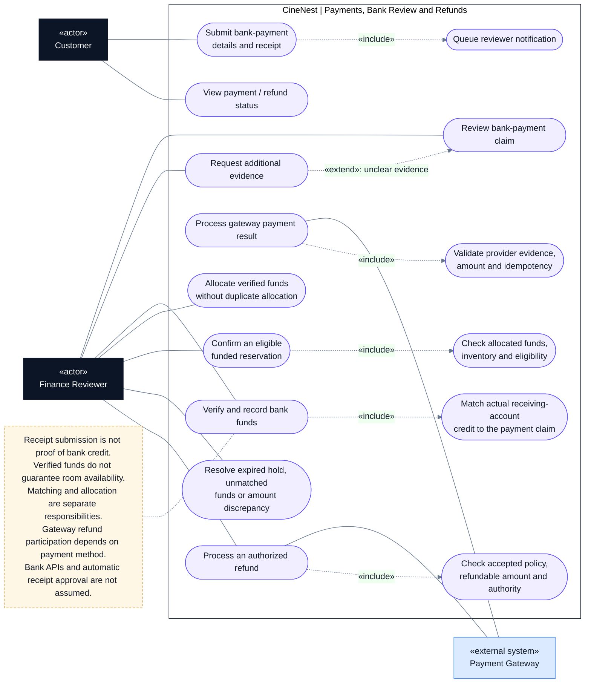

# CineNest Use-Case Diagram 03: Payments, Bank Review and Refunds

**View:** 3 of 5 
**Export date:** 2026-10-14 
**Status:** Planned behavior; implementation not verified. Exact role assignments and unresolved policy choices retain their canonical approval status. 
**Artifact type:** Standalone Markdown export requested by the owner, not an update to the repository knowledge base.

## Purpose

Show the online gateway and bank-deposit payment paths, independent verification, single allocation of funds, guarded booking confirmation, exception resolution, and refunds.

## Actors

| Actor | Participation |
| --- | --- |
| Customer | Submits bank-payment evidence and views their payment/refund outcomes. |
| Finance Reviewer | Matches actual bank funds, reviews exceptions, and performs authorized approval/refund operations. |
| Payment Gateway | Supplies authenticated payment results and handles method-appropriate gateway refunds. |

The bank is not depicted as an integrated software actor: manual matching uses the business receiving account's independently checked bank records. A direct bank API has not been established. Automated booking confirmation also occurs within the system; the finance association represents permitted manual-resolution involvement, not an unrestricted confirm button.

## Editable use-case diagram

## Notation

This is a **UML-style use-case view written with Mermaid flowchart primitives**, not a strict UML model or a sequence diagram.

- Dark rectangles identify human actors; blue rectangles identify external systems.
- Rounded nodes identify use cases inside the CineNest application boundary.
- A solid line denotes participation, not call direction, time order, or unrestricted permission.
- A dashed arrow labeled `«include»` points from a use case to required reused behavior; `«extend»` points from conditional additional behavior to its base use case.
- A dashed note connector carries an explanatory constraint, not a workflow transition.

Render the fenced `mermaid` block in a Mermaid-enabled Markdown viewer. The actor and use-case tables remain readable in a plain-text viewer. The diagram deliberately shows selected relationships rather than every authorization, audit, and validation dependency.

## Use-case catalog

| Use case | Intended result and important condition |
| --- | --- |
| Submit bank-payment details and receipt | Save a versioned claim associated with the customer's booking/payment request. |
| Queue reviewer notification | Record durable review work; a failed email must not remove the submission from the queue. |
| Review bank-payment claim | Examine permitted evidence and identify missing, unmatched, or suspicious information. |
| Request additional evidence | Conditionally extend the review when evidence is unclear; retain earlier submissions. |
| Verify and record bank funds | Independently confirm an actual credit and record bank-side evidence and reviewer attribution. |
| Allocate verified funds | Apply funds to the amount due with concurrency-safe duplicate protection; retain unallocated amounts. |
| Process gateway payment result | Authenticate and reconcile the provider result; do not trust only a browser redirect. |
| Confirm eligible funded reservation | Satisfy current reservation, payment-allocation, and required pre-confirmation eligibility guards. |
| Resolve discrepancies | Handle expired inventory, partial/excess amounts, unmatched credits, and mixed-method payments. |
| Process authorized refund | Validate the request and record actual outgoing payment outcomes independently of approval. |
| View payment/refund status | Show the customer's authorized financial record and actual progress. |

## Main interaction outline

**Bank-payment path**

1. The customer obtains a versioned quote, payment instructions, and a controlled provisional reservation.
2. The customer deposits/transfers funds and submits evidence before the relevant configured deadlines.
3. CineNest acknowledges the claim, keeps it visible in the review queue, and notifies authorized reviewers.
4. The reviewer matches the payment against actual receiving-account records. A clear receipt alone is insufficient.
5. Payments records the verified credit and safely allocates the required amount once.
6. Booking confirms only if its inventory and eligibility guards pass. Otherwise the funds remain recorded and enter resolution.
7. A successful confirmation queues notifications and access provisioning separately.

**Gateway path**

1. The customer uses hosted checkout for the accepted quote.
2. CineNest authenticates the gateway result, verifies the amount/currency, deduplicates processing, and records the payment.
3. The same guarded booking, resolution, notification, and access behavior applies.

These paths are alternatives. Switching methods or receiving both payments requires reconciliation, not two confirmations.

## Key rules and authorization

- Receipt review, funds verification/allocation, reservation state, and access readiness have separate lifecycles.
- Match actual bank-side credit identifiers; a customer-entered reference or image hash alone is not an authoritative transaction identity.
- Approval limits and separation-of-duties policies remain subject to their actual approval status. Privilege cannot bypass monetary or inventory invariants.
- A late credit must not create an overlapping reservation or silently disappear because its hold expired.
- Partial and excess funds remain traceable; only the required amount is allocated, and excess is not extra booking revenue.
- Exact review hours, lead times, deadlines, fee treatment, and refund controls remain policy decisions rather than invented constants.
- A bank-funded booking has no implied stored card token or automatic damage-charge capability.
- Bank-account instructions are versioned. A later receiving-account change must not silently rewrite an issued payment request.

## Alternative and exception paths

| Situation | Required handling |
| --- | --- |
| Funds not yet visible | Keep awaiting credit/review; do not falsely approve or erase the claim. |
| Underpayment or overpayment | Record actual funds, outstanding/excess amount, and the required resolution. |
| Same funds claimed twice / simultaneous reviewers | Prevent duplicate allocation and conflicting effective approvals. |
| Both bank and gateway payments arrive | Retain both true receipts of funds, confirm one eligible booking, and resolve the excess. |
| Hold expired or room unavailable | Record funds received and enter booking resolution; do not displace another confirmed booking. |
| Refund approved but transfer fails | Preserve approved/pending/failed distinctions; do not display refunded without payment evidence. |
| Notification or lock failure | Retry/escalate separately without turning received funds into unpaid status. |

## Acceptance checks to implement

These are proposed verification targets, not evidence of tests run for this export.

- Receipt upload never sets payment verified or access ready on its own.
- Duplicate callbacks, receipts, and simultaneous approval attempts cannot spend the same funds twice.
- Repricing the catalog cannot silently alter the amount of a valid accepted payment request.
- Expired holds, partial/excess money, and duplicate-method payments remain auditable.
- Revoked/out-of-scope financial grants and prohibited self-approval are rejected according to the approved policy.
- Refund status and collection reporting reflect actual financial events, not uploaded evidence or button clicks.

## Related diagrams

- [01. Customer Booking and Account](01_Use%20case_Customer_Booking_and_Account.md)
- [02. Package and Venue Administration](02_Use%20case_Package_and_Venue_Administration.md)
- [04. Identity Verification and Authorization](04_Use%20case_Identity_Verification_and_Authorization.md)
- [05. Cinema Access and IoT Operations](05_Use%20case_Cinema_Access_and_IoT_Operations.md)

## Source and authority

Exported from the five CineNest use-case views discussed in this conversation, with the related E2E mind map and subsequent package, bank-payment, and hybrid-authorization clarifications. Labels are normalized for readability; financial matching/allocation and evidence-submission/processing are kept distinct.

The current repository's four canonical documents (`PROJECT.md`, `ARCHITECTURE.md`, `DESIGN.md`, `PROGRESS.md`) and its authoritative registries govern approval and implementation status. This standalone export does not replace those documents, approve proposed role bundles or hardware capabilities, or establish any completed code, test, deployment, or safety verification.
