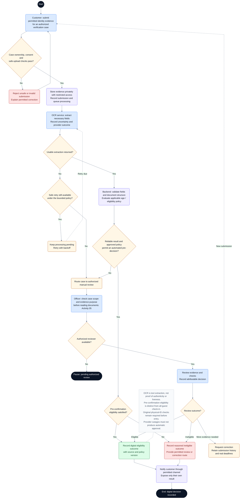

# CineNest Activity Diagram 04: Identity Evidence and Eligibility Review

**Diagram:** 04 of 10 
**Export date:** 2026-10-14 
**Status:** Proposed workflow; implementation and execution tests not verified. 
**Artifact:** Standalone requested Markdown export; no project/repository files modified.

## Purpose

Separate safe evidence submission, OCR processing, optional policy-approved automated pre-decision, manual review, and the attributable digital eligibility outcome.

Exported from one of the eight detailed interactive activity diagrams. The overview poster is a visual summary, not the detailed workflow contract.

## Participants and responsibilities

| Participant | Responsibility |
| --- | --- |
| Customer | Uploads permitted evidence for their own authorized case and supplies corrections. |
| CineNest verification module | Protects evidence, coordinates processing, and applies the current eligibility policy. |
| OCR provider | Extracts necessary text and confidence/uncertainty information; does not establish authenticity. |
| Verification officer | Reviews permitted evidence for an authorized purpose and records the case outcome. |

## Editable activity diagram

## Diagram notation

This is an **activity-style control-flow diagram expressed with Mermaid flowchart notation**, not a strict UML/XMI model. It preserves the discussed workflow decisions without claiming executable behavior.

- The start circle begins this activity; nodes labeled **End** or **Pause** identify outcomes. A pause does not mean the booking, money, or incident has disappeared.
- Rounded actions describe work. Diamonds are decisions with labeled guards/outcomes. Double-border boxes reference another activity.
- Solid arrows show control flow. Dashed arrows with labels represent later events or retries; unlabelled dashed note connectors do not control execution.
- Blue actions identify people or external interactions where labeled; pale violet is ordinary system work, amber is a decision or pending state, green is a verified successful outcome, and red is an exception. Text remains authoritative over color.
- Responsibility is written in node labels and the participant table. These are not fixed swimlane columns. Sequential drawing does not make remote operations one atomic transaction, and no parallel fork/join is implied unless explicitly shown.

Render the fenced `mermaid` block in a Mermaid-capable Markdown viewer. The surrounding text remains readable without rendering. The viewer must support Mermaid frontmatter configuration; remove only the `---` configuration section inside the block when using a renderer that does not support it.

## Main activity outline

1. Check submission ownership, applicable consent, permitted document type, and safe-upload controls.
2. Store necessary evidence privately and create durable processing work.
3. Run OCR as text extraction and evaluate deterministic structural/eligibility checks.
4. Use bounded retries for outages. If processing remains uncertain, refer to manual review rather than approving by default.
5. Allow an automated digital pre-decision only under an explicitly approved policy; otherwise require an authorized reviewer.
6. Record the decision, source/evidence, policy version, and reviewer where applicable.
7. Expose the customer's permitted outcome and correction route. All-guest on-site checks remain separate.

## Guards and interpretation rules

- An automated path in this diagram is conditional design, not approval to activate automated identity decisioning.
- A safe file rejection differs from a denied eligibility decision. Preserve the distinction in customer status.
- Use necessary data only, restricted retrieval, safe previews, and the approved retention/deletion policy.
- An unreadable or malicious file must not reach unrestricted reviewer access. A normal customer-admin role does not grant evidence access.
- No officer available means pending review, not a successful decision.
- A review/correction pause does not guarantee the original booking hold survives.
- On-site originals and guest checks remain mandatory according to the approved entry policy; the physical enforcement method requires its own approval.

## Alternative outcomes and recovery

| Condition | Intended handling |
| --- | --- |
| OCR outage | Bounded retries, then controlled manual-review/incident handling. |
| Uncertain or inconsistent fields | Correction or manual review, not authenticity claimed from OCR. |
| Out-of-scope reviewer | Deny access and retain the case for an authorized reviewer. |
| Customer wants to correct an outcome | Retain prior decisions and follow the approved re-review process. |
| Notification failure | Keep the recorded decision and retry delivery without changing eligibility. |

## Review before implementation

Treat this diagram as an analysis/design view. Trace every guard and recovery route to the corresponding canonical requirement and planned acceptance check. Test authorization, state changes, duplicate processing, concurrency, and recovery as applicable. For physical/device outcomes, distinguish a simulation from actual hardware evidence. No application, payment-provider, or hardware acceptance test is claimed by this export.

## Related activity diagrams

- [01. Customer Booking and Online Payment](01_ActivityDiagram_Customer_Booking_and_Online_Payment.md)
- [05. Scoped RBAC and ABAC Authorization](05_ActivityDiagram_Scoped_RBAC_and_ABAC_Authorization.md)
- [08. Cinema Entry, IoT Control and Room Reset](08_ActivityDiagram_Cinema_Entry_IoT_Control_and_Room_Reset.md)

## Source and authority

- Use-case export 04: Identity Verification and Authorization
- Detailed interactive activity 4 of 8

These files are standalone exports, not updates to the repository. The current four canonical knowledge documents (`PROJECT.md`, `ARCHITECTURE.md`, `DESIGN.md`, `PROGRESS.md`) and their authoritative registries continue to govern requirements, approvals, and implementation state.

Diagram labels, actor bundles, pending policies, timer values, provider/hardware choices, and retry behavior retain their actual canonical status. This export neither approves unresolved policies nor certifies application code, external integrations, bank reconciliation, device behavior, or physical safety. All protected operations use the applicable scoped authorization; business invariants remain separate.
