# CineNest ER Diagram 04: Quotes, Reservation Holds and Immutable Booking Revisions

**View:** 04 of 08 
**Export date:** 2026-10-14 
**Status:** Proposed logical model; implementation and database acceptance not verified. 
**Artifact:** Requested standalone Markdown export; no repository or canonical knowledge file modified.

## Purpose

Separate a commercial quotation, its accepted reservation request, bounded room hold, confirmed purchased revision and policy consent. One inventory owner coordinates room blocks for both bookings and maintenance.

## Editable ER diagram

```mermaid
---
config:
  theme: base
  themeVariables:
    fontFamily: Arial, sans-serif
    primaryColor: '#FFF7E6'
    primaryBorderColor: '#B45309'
    primaryTextColor: '#111827'
    lineColor: '#64748B'
---
erDiagram
    direction LR
    QUOTE {
        uuid quote_id PK
        uuid user_principal_id FK
        uuid package_version_id FK
        uuid room_id FK
        timestamptz session_start
        timestamptz session_end
        int guest_count
        bigint total_minor
        string currency
        timestamptz valid_until
    }
    QUOTE_LINE {
        uuid quote_line_id PK
        uuid quote_id FK
        string charge_code
        string description_snapshot
        numeric quantity
        bigint unit_price_minor
        bigint line_total_minor
    }
    BOOKING {
        uuid booking_id PK
        uuid booker_id FK "USER_ACCOUNT principal_id"
        string booking_reference UK
        string lifecycle_status "Row existence does not imply confirmation"
        uuid current_revision_id FK "Nullable; must reference this booking"
        int row_version
    }
    RESERVATION_REQUEST {
        uuid request_id PK
        uuid booking_id FK
        uuid quote_id FK, UK
        string request_kind "INITIAL or AMENDMENT"
        int expected_booking_revision "Nullable for initial request"
        string status
        timestamptz accepted_at "Nullable until customer acceptance"
    }
    RESERVATION_HOLD {
        uuid hold_id PK
        uuid request_id FK, UK
        uuid room_block_id FK, UK
        timestamptz expires_at
        string status
    }
    ROOM_BLOCK {
        uuid room_block_id PK
        uuid room_id FK
        uuid booking_id FK "Nullable; XOR maintenance_request_id"
        uuid maintenance_request_id FK "Nullable; XOR booking_id"
        string block_kind "HOLD, COMMITTED or MAINTENANCE"
        timestamptz starts_at
        timestamptz blocked_until "Includes required cleaning for bookings"
        string state
    }
    BOOKING_REVISION {
        uuid booking_revision_id PK
        uuid booking_id FK
        uuid request_id FK, UK
        uuid room_block_id FK, UK
        uuid room_id FK
        int revision_no "Unique with booking_id"
        timestamptz session_start
        timestamptz session_end
        int cleaning_buffer_minutes
        int guest_count
        bigint purchased_total_minor
        string currency
        jsonb purchased_terms_snapshot "Immutable commercial terms and inclusions"
    }
    POLICY_VERSION {
        uuid policy_version_id PK
        string policy_code
        int version_no "Unique with policy_code"
        string content_hash
        string approval_status
    }
    QUOTE_POLICY {
        uuid quote_id PK, FK
        uuid policy_version_id PK, FK
    }
    CONSENT_RECORD {
        uuid consent_id PK
        uuid user_principal_id FK
        uuid quote_id FK "Composite policy reference with policy_version_id"
        uuid policy_version_id FK
        timestamptz accepted_at
        string acceptance_evidence_digest
    }
    USER_ACCOUNT ||..o{ QUOTE : obtains
    PACKAGE_VERSION ||..o{ QUOTE : immutable_offer_reference
    ROOM ||..o{ QUOTE : selects_room
    QUOTE ||..o{ QUOTE_LINE : itemizes
    USER_ACCOUNT ||..o{ BOOKING : owns
    BOOKING ||..o{ RESERVATION_REQUEST : has_requests
    QUOTE ||..o| RESERVATION_REQUEST : accepted_for
    RESERVATION_REQUEST ||..o| RESERVATION_HOLD : has_bounded_hold
    ROOM ||..o{ ROOM_BLOCK : inventory_for
    BOOKING o|..o{ ROOM_BLOCK : reserves
    MAINTENANCE_REQUEST o|..o{ ROOM_BLOCK : blocks_for_work
    ROOM_BLOCK ||..o| RESERVATION_HOLD : underlies_hold
    BOOKING ||..o{ BOOKING_REVISION : owns_purchase_history
    RESERVATION_REQUEST ||..o| BOOKING_REVISION : committed_as
    ROOM_BLOCK ||..o| BOOKING_REVISION : underlies_committed_revision
    ROOM ||..o{ BOOKING_REVISION : booked_in_revision
    BOOKING_REVISION o|..o| BOOKING : selected_as_current
    QUOTE ||--o{ QUOTE_POLICY : binds_policies
    POLICY_VERSION ||--o{ QUOTE_POLICY : applied_to_quotes
    QUOTE_POLICY ||..o{ CONSENT_RECORD : accepted_as_presented
    USER_ACCOUNT ||..o{ CONSENT_RECORD : accepts
    %% Room, quote, request, booking and block references must agree.
    %% Each block has exactly one booking or maintenance owner.
    %% Replacement holds must preserve the original purchase and exclude competitors.
    %% An ER relation alone is not a database non-overlap constraint.
    %% Current-revision references and immutable snapshots need explicit DDL and tests.
```

## Entities and ownership

| Owner / area | Entities | Responsibility and boundary |
| --- | --- | --- |
| Packages and Pricing | QUOTE, QUOTE_LINE | Backend-issued commercial facts, valid-until rules and immutable line descriptions/prices. |
| Booking | BOOKING, RESERVATION_REQUEST, RESERVATION_HOLD, ROOM_BLOCK, BOOKING_REVISION | Lifecycle, room inventory and customer-accepted initial/amendment purchases. |
| Policy / consent ownership to be explicitly assigned | POLICY_VERSION, QUOTE_POLICY, CONSENT_RECORD | One version source and attributable acceptance. Not a universal shared policy engine or authorization bypass. |
| External module references | USER_ACCOUNT, PACKAGE_VERSION, ROOM, MAINTENANCE_REQUEST | Identity, catalog, venue and maintenance records are referenced, not owned or rewritten by this view. |

## Key constraints and interpretation

1. A request can have zero or one provisional hold and zero or one applied booking revision. The draft assumes a renewed/requoted attempt creates the appropriate new request rather than silently mutating an accepted one.

2. BOOKING.current_revision_id must identify a revision whose booking_id matches the parent. During an initial request it can be null. A selected-current relation does not mean old revisions are discarded.

3. QUOTE, RESERVATION_REQUEST, BOOKING_REVISION, ROOM_BLOCK and RESERVATION_HOLD must agree on user/booking, room, accepted commercial facts and interval. Independently valid foreign keys do not enforce all of these cross-record equalities.

4. Exactly one of ROOM_BLOCK.booking_id and maintenance_request_id is present. block_kind must agree with that owner. Hold conversion to a confirmed revision can retain the same block without producing a duplicate competing block.

5. Preserve the original confirmed interval while a replacement hold is pending. The inventory strategy must distinguish one booking’s related replacement blocks from unrelated competitors without allowing double reservations. No final exclusion-constraint or locking recipe is selected here.

6. Define customer time as [session_start, session_end) and blocked inventory as [starts_at, blocked_until), with the applicable cleaning interval included. Only operationally valid, active intervals may affect availability under the approved state policy.

7. Hold expiry, payment deadline, review deadline and quote validity are different facts. Expiration must be reconciled under concurrency; a late verified payment cannot override another booking.

8. QUOTE_LINE totals must reconcile to QUOTE.total_minor under an explicit exact-arithmetic and rounding policy. Minor-unit amounts and precise quantities must never use binary floating-point as payment authority.

9. A published catalog change does not alter accepted quotation or purchased snapshot content. BOOKING_REVISION preserves terms needed for pricing, inclusions, cancellation and credential validity even when the current catalog changes.

10. CONSENT_RECORD references the exact (quote_id, policy_version_id) pair in QUOTE_POLICY. Its user must be the permitted accepting party, and the relevant consent set must be complete before the protected purchase transition.

11. View 06 expands RESERVATION_REQUEST with a selected eligibility_decision_id reference. This is a complementary partial entity view, not a second reservation-request table.

## Decisions and checks still required

The current-revision FK cycle, immutable history retention, composite scope checks and non-overlap enforcement need explicit migration design and real-database tests.

Detailed hold-renewal policy, quote-expiry contradictions, timing at closing, policy-document ownership and required consent semantics remain governed by current canonical decisions.

## Reading the ER notation

| Notation | Meaning in these exports |
| --- | --- |
| `PK` | Primary key. Multiple PK attributes in one entity form a composite key. |
| `FK` | Proposed reference to another entity. Whether a cross-module link is enforced by a physical SQL FK is a separate implementation decision. |
| `UK` | Proposed unique key; comments identify composite or scoped uniqueness where needed. |
| `\|\|` | Exactly one at that relationship endpoint. |
| `o\|` / `\|o` | Zero or one at the relevant endpoint. |
| `o{` / `}o` | Zero or many at the relevant endpoint. |
| `\|{` / `}\|` | One or many at the relevant endpoint. |
| `--` | Identifying relationship: the parent's identity contributes to the child's identity in this model. |
| `..` | Non-identifying relationship. **Dashed lines do not mean optional, asynchronous, or unimplemented.** Optionality comes from the endpoint markers. |

Relationships are not calls, message directions, or execution order. Entity names repeated in different views refer to the same logical entity, not duplicate tables. An entity shown without fields is a reference stub; its attributes are expanded in the relevant companion view. Selected fields do not constitute an exhaustive physical schema.

Types such as `uuid`, `timestamptz`, `bigint`, `numeric` and `jsonb` are proposed descriptive types, not a migration. Money fields use minor units or exact decimal quantities under an explicit currency/rounding policy. Dates, times, nullability, source identity, sums, scope consistency, XOR ownership and non-overlap need actual constraints and tests; the picture does not enforce them.

## Scope, source and approval status

This export preserves the **eight detailed CineNest ER views** discussed in the conversation and the corrected `CineNest_ER_Diagram_Corrected.png` overview. It is informed by the preceding mind-map, use-case, activity, sequence, context and corrected component views. The earlier automatically generated ER poster is not the authoritative source for keys, entity names, privacy fields or cardinalities.

The model remains **proposed and not implementation-verified**. No SQL schema was reverse-engineered from a running database. Exact class/table names, constraints, cross-module coordination and remaining policies need approval and verification. Do not infer raw-password sign-in, a plaintext `pin_code` field on bookings, generic public identity-document URLs, unrelated personal-profile collection, active Redis, Kafka, TimescaleDB or a subscription/tenant model from this export.

Each module owns its operational records; a relationship is not permission for cross-module repository injection or unrestricted joins. Protected operations use scoped RBAC + ABAC and still enforce their owning business invariants. Runtime integrations, physical installation, emergency egress and recovery require separate evidence.

The repository's four canonical documents (`PROJECT.md`, `ARCHITECTURE.md`, `DESIGN.md`, `PROGRESS.md`) and authoritative registries retain decision and implementation authority. These owner-requested standalone exports do **not** modify the project repository, create a second canonical knowledge base, select unapproved technologies/policies or claim application, payment, provider or hardware tests passed.

## Related ER views

- [01. Core Relationship Overview](01_ER_Diagrams_Core_Relationship_Overview.md)
- [03. Venues, Versioned Packages and Add-ons](03_ER_Diagrams_Venues_Versioned_Packages_and_Add_Ons.md)
- [05. Gateway Payments, Manual Bank Evidence, Allocations and Refunds](05_ER_Diagrams_Payments_Bank_Evidence_Allocations_and_Refunds.md)
- [06. Identity Evidence, Guest Check-in and Access Credentials](06_ER_Diagrams_Identity_Evidence_Guest_Check_In_and_Access_Credentials.md)
- [07. Sessions, Devices, Maintenance and Operational Readiness](07_ER_Diagrams_Sessions_Devices_Maintenance_and_Readiness.md)
- [08. Durable Work, Notifications and Audit Records](08_ER_Diagrams_Durable_Work_Notifications_and_Audit.md)

## Rendering

Open this file in a Mermaid-enabled Markdown viewer to render its fenced `erDiagram` block. Use zoom for the larger models. The prose, attributes and relationships remain readable as text without a renderer.

If the viewer cannot parse Mermaid YAML configuration, remove only the initial `---` configuration section **inside** the Mermaid fence, retaining `erDiagram` and the remaining lines. Renderer/version support is required for ER direction and key annotations. No external font, image or script assets are required to render these Markdown diagrams.
