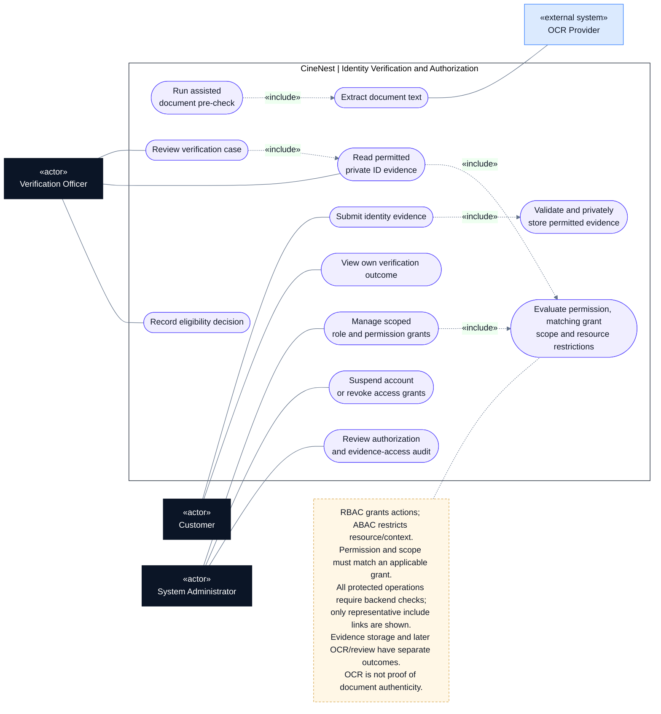

# CineNest Use-Case Diagram 04: Identity Verification and Authorization

**View:** 4 of 5 
**Export date:** 2026-10-14 
**Status:** Planned behavior; implementation not verified. Exact role assignments and unresolved policy choices retain their canonical approval status. 
**Artifact type:** Standalone Markdown export requested by the owner, not an update to the repository knowledge base.

## Purpose

Show customer identity-evidence submission and eligibility review together with scoped RBAC + ABAC administration, protected evidence access, revocation, and audit.

## Actors

| Actor | Participation |
| --- | --- |
| Customer | Submits their permitted evidence and views their own verification status. |
| Verification Officer | Reviews assigned/authorized cases and records decisions with a legitimate review purpose. |
| System Administrator | Manages explicitly granted role/permission operations, suspension/revocation, and permitted audit views. |
| OCR Provider | Supplies document-text extraction for assisted checks; it does not itself establish identity authenticity. |

Actor names describe proposed role groupings, not an approved all-powerful administrator. Business administrators, finance reviewers, and operations staff still require their own applicable grants.

## Editable use-case diagram

## Notation

This is a **UML-style use-case view written with Mermaid flowchart primitives**, not a strict UML model or a sequence diagram.

- Dark rectangles identify human actors; blue rectangles identify external systems.
- Rounded nodes identify use cases inside the CineNest application boundary.
- A solid line denotes participation, not call direction, time order, or unrestricted permission.
- A dashed arrow labeled `«include»` points from a use case to required reused behavior; `«extend»` points from conditional additional behavior to its base use case.
- A dashed note connector carries an explanatory constraint, not a workflow transition.

Render the fenced `mermaid` block in a Mermaid-enabled Markdown viewer. The actor and use-case tables remain readable in a plain-text viewer. The diagram deliberately shows selected relationships rather than every authorization, audit, and validation dependency.

## Use-case catalog

| Use case | Intended result and important condition |
| --- | --- |
| Submit identity evidence | Associate the authenticated customer's submission with an eligible case. |
| Validate and privately store evidence | Apply upload and access controls and retain submission history where required. |
| Run assisted document pre-check | Use configured OCR and deterministic checks with explicit uncertainty/failure outcomes. |
| Extract document text | Obtain limited necessary fields; extraction is not authenticity or liveness proof. |
| Review verification case | Assess the authorized case and evidence under a legitimate purpose. |
| Record eligibility decision | Record an attributable approved, rejected, or further-review outcome according to the applicable rules. |
| View own verification outcome | Show the customer's permitted status and correction path, not other people's evidence. |
| Manage scoped role and permission grants | Create/change assignments only under explicit assignment authority and scope. |
| Suspend account or revoke grants | Apply the specified revocation policy, including relevant sessions, caches, and sensitive operations. |
| Review audit | Inspect attributable events within granted scope without leaking secrets. |
| Evaluate authorization | Require a matching action permission, grant scope, resource conditions, and mandatory restrictions. |

## Main interaction outline

**Verification**

1. The customer submits an allowed identity document for a case they are authorized to access.
2. CineNest validates and stores the evidence privately, then runs configured pre-checks as separate processing work.
3. OCR errors or uncertain fields produce a correction/review state rather than an unsupported successful decision.
4. An authorized officer reviews evidence when required and records the attributable outcome.
5. The customer sees their permitted result. The on-site original-document procedure remains a separate entry requirement.

**Authorization**

1. A protected operation identifies the current principal, requested action, and authoritative target resource.
2. The backend finds an applicable grant containing both the required permission and matching resource/venue scope.
3. Ownership, review-purpose, limit, mandatory-denial, and other relevant attribute restrictions are evaluated.
4. The owning module still checks business validity; authorization alone does not make a transaction valid.
5. Sensitive grant/evidence operations are audited. Revocation follows an explicit freshness policy.

## Key rules and authorization

- Deny protected operations unless an applicable policy permits them. Approved public browsing can remain public.
- A finance grant at one venue plus an operations assignment at another must not become finance authority at both venues.
- Obtain ownership, role, scope, amount, and relevant attributes from authoritative server-side records; browser assertions are not sufficient.
- A generic administrator role must not imply unrestricted access to identity documents or role assignment.
- Apply scope to details, lists, counts, exports, downloads, and live channels, not only to buttons.
- Keep exact role bundles, financial limits, independent-review rules, exceptions, and revocation timing at their actual proposed/open status until approved.
- Store only necessary evidence under the applicable retention policy and audit sensitive access without logging full documents or credentials.
- The customer's online pre-check and all-guest on-site original-ID procedure have different responsibilities. The unattended on-site method remains an operational decision.
- An application authorization failure must not obstruct independent physical emergency exit.

## Alternative and exception paths

| Situation | Required handling |
| --- | --- |
| Missing permission, wrong venue, or foreign ownership | Deny server-side without leaking protected resource details. |
| Missing mandatory attribute or policy information | Do not default to a permissive decision. |
| Unreadable/malicious upload or OCR outage | Preserve a safe explicit rejection/review/processing status and provide the allowed correction path. |
| Removed role or suspended account | Re-evaluate or revoke authority according to the recorded session/cache policy. |
| Unauthorized evidence access or role escalation | Reject, audit appropriately, and retain incident evidence without exposing sensitive content. |

## Acceptance checks to implement

These are proposed verification targets, not evidence of tests run for this export.

- Direct API calls and altered resource IDs cannot bypass ownership or scope.
- Related permissions and venue scope must come from an applicable grant rather than unrelated role memberships.
- Role removal and suspension affect sensitive actions as specified, including active sessions and live channels.
- General customer administration does not grant identity-evidence access.
- Uncertain OCR is not reported as proven identity; access decisions and their evidence remain attributable.
- Planned authorization scenarios remain planned until executable tests and actual results demonstrate enforcement.

## Related diagrams

- [01. Customer Booking and Account](01_Use%20case_Customer_Booking_and_Account.md)
- [02. Package and Venue Administration](02_Use%20case_Package_and_Venue_Administration.md)
- [03. Payments, Bank Review and Refunds](03_Use%20case_Payments_Bank_Review_and_Refunds.md)
- [05. Cinema Access and IoT Operations](05_Use%20case_Cinema_Access_and_IoT_Operations.md)

## Source and authority

Exported from the five CineNest use-case views discussed in this conversation, with the related E2E mind map and subsequent package, bank-payment, and hybrid-authorization clarifications. Labels are normalized for readability; financial matching/allocation and evidence-submission/processing are kept distinct.

The current repository's four canonical documents (`PROJECT.md`, `ARCHITECTURE.md`, `DESIGN.md`, `PROGRESS.md`) and its authoritative registries govern approval and implementation status. This standalone export does not replace those documents, approve proposed role bundles or hardware capabilities, or establish any completed code, test, deployment, or safety verification.
