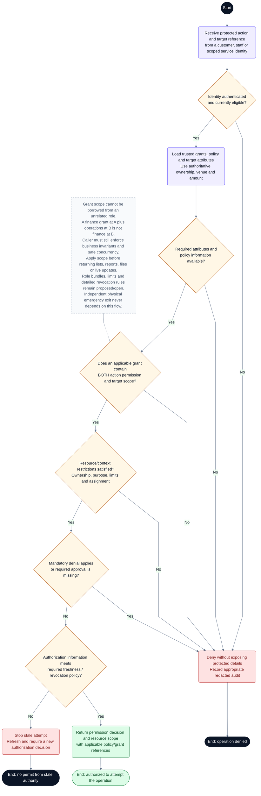

# CineNest Activity Diagram 05: Scoped RBAC and ABAC Authorization

**Diagram:** 05 of 10 
**Export date:** 2026-10-14 
**Status:** Proposed workflow; implementation and execution tests not verified. 
**Artifact:** Standalone requested Markdown export; no project/repository files modified.

## Purpose

Evaluate a protected operation against current identity, a matching action-and-scope grant, resource attributes, mandatory restrictions, and the required authorization freshness.

Exported from one of the eight detailed interactive activity diagrams. The overview poster is a visual summary, not the detailed workflow contract.

## Participants and responsibilities

| Participant | Responsibility |
| --- | --- |
| Customer, staff member, or scoped service identity | Requests a protected operation on an identified resource. |
| Authorization boundary | Resolves trusted attributes and evaluates permission, scope, mandatory restrictions, and revocation. |
| Owning business module | Uses the decision but independently enforces business invariants and concurrency controls. |

## Editable activity diagram

## Diagram notation

This is an **activity-style control-flow diagram expressed with Mermaid flowchart notation**, not a strict UML/XMI model. It preserves the discussed workflow decisions without claiming executable behavior.

- The start circle begins this activity; nodes labeled **End** or **Pause** identify outcomes. A pause does not mean the booking, money, or incident has disappeared.
- Rounded actions describe work. Diamonds are decisions with labeled guards/outcomes. Double-border boxes reference another activity.
- Solid arrows show control flow. Dashed arrows with labels represent later events or retries; unlabelled dashed note connectors do not control execution.
- Blue actions identify people or external interactions where labeled; pale violet is ordinary system work, amber is a decision or pending state, green is a verified successful outcome, and red is an exception. Text remains authoritative over color.
- Responsibility is written in node labels and the participant table. These are not fixed swimlane columns. Sequential drawing does not make remote operations one atomic transaction, and no parallel fork/join is implied unless explicitly shown.

Render the fenced `mermaid` block in a Mermaid-capable Markdown viewer. The surrounding text remains readable without rendering. The viewer must support Mermaid frontmatter configuration; remove only the `---` configuration section inside the block when using a renderer that does not support it.

## Main activity outline

1. Identify the authenticated principal or scoped integration identity and the requested action.
2. Resolve trusted resource ownership, venue, sensitivity, amount, and required policy attributes.
3. Find an applicable grant that includes both the action permission and matching target scope.
4. Evaluate ownership/context restrictions and mandatory denials or independent approvals.
5. Apply the recorded freshness and revocation policy; never permit solely from stale authority.
6. Return a scoped authorization decision. The owning use case must still validate business state and perform the mutation safely.

## Guards and interpretation rules

- The entry point is for protected operations. Separately approved public discovery can remain anonymous.
- Finance authority at Venue A plus Operations at Venue B is not Finance authority at both venues.
- Another grant cannot bypass a mandatory denial, suspension, or applicable self-approval restriction.
- For list/search operations, derive a permitted query scope rather than loading and returning unauthorized rows.
- Apply policies to reports, counts, file URLs, downloads, live subscriptions, and background work, not just buttons.
- Customer-supplied roles, owner IDs, venue IDs, and amounts are untrusted selectors/data, not authority.
- A permit is not a durable blank cheque. Sensitive mutations coordinate fresh permission and business checks at their transaction boundary.
- Role bundles, financial limits, independent-review rules, exception procedures, and exact revocation timing retain canonical proposed/open status.
- Physical emergency exit is independent of application authorization and is not an activity protected by this flow.

## Alternative outcomes and recovery

| Condition | Intended handling |
| --- | --- |
| Missing identity / mandatory attribute | Deny safely rather than defaulting to an unrestricted decision. |
| Unrelated grants appear to cover different parts | Reject privilege stitching; require one applicable action-and-scope grant. |
| Revoked role / expired authority | Stop the old attempt and follow the declared refresh/revalidation policy. |
| Authorized action violates a booking/payment invariant | Owning module rejects the business operation despite the authorization permit. |

## Review before implementation

Treat this diagram as an analysis/design view. Trace every guard and recovery route to the corresponding canonical requirement and planned acceptance check. Test authorization, state changes, duplicate processing, concurrency, and recovery as applicable. For physical/device outcomes, distinguish a simulation from actual hardware evidence. No application, payment-provider, or hardware acceptance test is claimed by this export.

## Related activity diagrams

- [01. Customer Booking and Online Payment](01_ActivityDiagram_Customer_Booking_and_Online_Payment.md)
- [02. Bank Deposit, Receipt Review and Approval](02_ActivityDiagram_Bank_Deposit_Receipt_Review_and_Approval.md)
- [03. Package Editing, Publication and Deactivation](03_ActivityDiagram_Package_Editing_Publication_and_Deactivation.md)
- [04. Identity Evidence and Eligibility Review](04_ActivityDiagram_Identity_Evidence_and_Eligibility_Review.md)
- [06. Booking Amendment and Session Extension](06_ActivityDiagram_Booking_Amendment_and_Session_Extension.md)
- [07. Booking Cancellation and Refund Execution](07_ActivityDiagram_Booking_Cancellation_and_Refund_Execution.md)
- [08. Cinema Entry, IoT Control and Room Reset](08_ActivityDiagram_Cinema_Entry_IoT_Control_and_Room_Reset.md)
- [09. Room Maintenance and Controlled Closure](09_ActivityDiagram_Room_Maintenance_and_Controlled_Closure.md)
- [10. Operational Incident and Recovery](10_ActivityDiagram_Operational_Incident_and_Recovery.md)

## Source and authority

- Use-case export 04: Identity Verification and Authorization
- Detailed interactive activity 5 of 8
- User-confirmed hybrid-authorization direction; detailed policies remain subject to canonical approval

These files are standalone exports, not updates to the repository. The current four canonical knowledge documents (`PROJECT.md`, `ARCHITECTURE.md`, `DESIGN.md`, `PROGRESS.md`) and their authoritative registries continue to govern requirements, approvals, and implementation state.

Diagram labels, actor bundles, pending policies, timer values, provider/hardware choices, and retry behavior retain their actual canonical status. This export neither approves unresolved policies nor certifies application code, external integrations, bank reconciliation, device behavior, or physical safety. All protected operations use the applicable scoped authorization; business invariants remain separate.
