# CineNest ER Diagram 05: Gateway Payments, Manual Bank Evidence, Allocations and Refunds

**View:** 05 of 08 
**Export date:** 2026-10-14 
**Status:** Proposed logical model; implementation and database acceptance not verified. 
**Artifact:** Requested standalone Markdown export; no repository or canonical knowledge file modified.

## Purpose

Distinguish a request for payment, gateway attempts/events, customer bank-payment claims, actual incoming bank credits, allocation of verified funds, and outgoing refund attempts. This is the detailed financial-record view, not an accounting-policy approval or live banking integration.

## Editable ER diagram

```mermaid
---
config:
  theme: base
  themeVariables:
    fontFamily: Arial, sans-serif
    primaryColor: '#DCFCE7'
    primaryBorderColor: '#15803D'
    primaryTextColor: '#111827'
    lineColor: '#64748B'
---
erDiagram
    direction LR
    PAYMENT_REQUEST {
        uuid payment_request_id PK
        uuid reservation_request_id FK, UK
        bigint amount_due_minor
        string currency
        string status
        timestamptz payment_deadline
        timestamptz review_deadline "Nullable for gateway-only processing"
    }
    PAYMENT_ATTEMPT {
        uuid payment_attempt_id PK
        uuid payment_request_id FK
        string provider_account_ref
        string idempotency_key "Unique within provider account"
        string provider_attempt_ref
        string status "Pending and unknown are not failure"
    }
    GATEWAY_EVENT {
        uuid gateway_event_id PK
        uuid payment_attempt_id FK "Nullable until correlated"
        string provider_account_ref
        string provider_event_ref "Unique with provider_account_ref"
        string authentication_result
        string processing_status
        timestamptz received_at
    }
    BANK_ACCOUNT {
        uuid bank_account_id PK
        string account_fingerprint UK "Identifies one actual receiving account"
        string status
    }
    BANK_ACCOUNT_VERSION {
        uuid bank_account_version_id PK
        uuid bank_account_id FK
        int version_no "Unique with bank_account_id"
        string instruction_ciphertext "Protected immutable payment instructions"
        string approval_status
        timestamptz effective_at
    }
    BANK_CLAIM {
        uuid bank_claim_id PK
        uuid payment_request_id FK
        uuid bank_account_version_id FK
        bigint declared_amount_minor "Claimed, not verified money"
        string declared_reference
        string review_status
    }
    BANK_RECEIPT {
        uuid bank_receipt_id PK
        uuid bank_claim_id FK
        string private_object_key
        string content_digest "Duplicate hint, not payment proof"
        string scan_status
        timestamptz submitted_at
    }
    BANK_TRANSACTION {
        uuid bank_transaction_id PK
        uuid bank_account_id FK
        string bank_entry_key "Unique per account using bank-side evidence"
        bigint credited_amount_minor
        string currency
        timestamptz bank_credited_at
    }
    BANK_REVIEW {
        uuid review_id PK
        uuid bank_claim_id FK
        uuid reviewer_principal_id FK
        uuid matched_bank_transaction_id FK "Nullable for rejected or pending claim"
        string decision
        string policy_revision
        timestamptz reviewed_at
    }
    PAYMENT_CREDIT {
        uuid credit_id PK
        uuid payment_attempt_id FK, UK "Nullable; XOR bank_transaction_id"
        uuid bank_transaction_id FK, UK "Nullable; XOR payment_attempt_id"
        string provider_account_ref "Gateway source only"
        string provider_transaction_ref "Unique within provider account when present"
        bigint received_amount_minor
        string currency
        timestamptz received_at
        timestamptz recorded_at
    }
    CREDIT_ALLOCATION {
        uuid allocation_id PK
        uuid credit_id FK
        uuid payment_request_id FK
        bigint signed_amount_minor "Positive allocation or audited negative reversal"
        uuid reverses_allocation_id FK "Nullable; links an earlier allocation"
        timestamptz recorded_at
    }
    REFUND {
        uuid refund_id PK
        uuid credit_id FK
        uuid payment_request_id FK "Nullable for unmatched or excess-funds resolution"
        bigint amount_minor
        string currency
        string reason
        string status "Obligation and approval are not completed repayment"
    }
    REFUND_APPROVAL {
        uuid approval_id PK
        uuid refund_id FK
        uuid reviewer_principal_id FK
        string decision
        string policy_revision
        timestamptz decided_at
    }
    REFUND_ATTEMPT {
        uuid refund_attempt_id PK
        uuid refund_id FK
        string idempotency_key
        string destination_secret_ref "Bank destination protected and verified"
        string outgoing_transaction_ref
        string status
        timestamptz completed_at "Only with reliable repayment evidence"
    }
    RESERVATION_REQUEST ||..o| PAYMENT_REQUEST : has_funding_request
    PAYMENT_REQUEST ||..o{ PAYMENT_ATTEMPT : attempted_online
    PAYMENT_ATTEMPT o|..o{ GATEWAY_EVENT : correlated_with
    PAYMENT_REQUEST ||..o{ BANK_CLAIM : receives_claims
    BANK_ACCOUNT ||..o{ BANK_ACCOUNT_VERSION : versions_instructions
    BANK_ACCOUNT_VERSION ||..o{ BANK_CLAIM : instructions_used
    BANK_CLAIM ||..o{ BANK_RECEIPT : has_evidence_versions
    BANK_CLAIM ||..o{ BANK_REVIEW : has_review_history
    PRINCIPAL ||..o{ BANK_REVIEW : performs_authorized_review
    BANK_ACCOUNT ||..o{ BANK_TRANSACTION : receives_actual_credits
    BANK_TRANSACTION o|..o{ BANK_REVIEW : optional_match_evidence
    BANK_TRANSACTION o|..o| PAYMENT_CREDIT : recognized_as_bank_funds
    PAYMENT_ATTEMPT o|..o| PAYMENT_CREDIT : recognized_as_gateway_funds
    PAYMENT_CREDIT ||..o{ CREDIT_ALLOCATION : allocated_or_reversed
    PAYMENT_REQUEST ||..o{ CREDIT_ALLOCATION : satisfied_by
    CREDIT_ALLOCATION o|..o{ CREDIT_ALLOCATION : reversed_by
    PAYMENT_CREDIT ||..o{ REFUND : source_payment
    PAYMENT_REQUEST o|..o{ REFUND : optional_resolution_context
    REFUND ||..o{ REFUND_APPROVAL : approval_history
    PRINCIPAL ||..o{ REFUND_APPROVAL : reviews
    REFUND ||..o{ REFUND_ATTEMPT : repaid_through
    %% One bank or gateway source per credit; no receipt-to-credit shortcut.
    %% Initial gateway model assumes one confirmed capture per payment attempt.
    %% Provider contracts must be checked before multiple partial captures are supported.
    %% Balance, refund reservation and reversal invariants need transactional guards.
    %% Multi-credit cancellation refunds may require multiple REFUND records.
    %% Cardinalities do not enable one credit to fund unrelated bookings by default.
    %% Verified funds survive failed reservation confirmation.
    %% Bank records here are reviewer-verified evidence, not a bank API.
```

## Entities and ownership

| Owner / area | Entities | Responsibility and boundary |
| --- | --- | --- |
| Payments | PAYMENT_REQUEST, PAYMENT_ATTEMPT, GATEWAY_EVENT | Requested funding and authenticated, idempotently ingested provider outcomes. |
| Payments | BANK_ACCOUNT, BANK_ACCOUNT_VERSION, BANK_CLAIM, BANK_RECEIPT, BANK_TRANSACTION, BANK_REVIEW | Versioned instructions, private evidence, independently verified bank-side records and attributable review history. |
| Payments | PAYMENT_CREDIT, CREDIT_ALLOCATION, REFUND, REFUND_APPROVAL, REFUND_ATTEMPT | Actual funds, controlled allocation/reversal and distinct refund obligations/repayment attempts. |
| Booking / Identity references | RESERVATION_REQUEST, PRINCIPAL | Reservation and authenticated reviewer identity stay with their owning modules; their references do not grant authority. |

## Key constraints and interpretation

1. PAYMENT_REQUEST is attached to the initial or amendment RESERVATION_REQUEST. The amount/currency must match that request’s accepted financial obligation; multiple attempts must not create multiple bookings.

2. Provider attempt keys, event references and transaction references need provider-account-scoped uniqueness. An event that is not yet correlated can be retained without creating a payment credit. An invalid message must not be admitted as verified financial evidence.

3. BANK_ACCOUNT identifies the actual receiving account; BANK_ACCOUNT_VERSION preserves issued instructions. Repeated instruction versions do not create different identities for the same incoming bank transaction.

4. BANK_CLAIM is not a bank credit, and a receipt file is not verified money. BANK_REVIEW can record pending/rejected outcomes without a matched_bank_transaction_id. A later actual credit must remain traceable even if an earlier claim was rejected.

5. BANK_TRANSACTION needs independent bank-side evidence and a reliable account-scoped entry key. A customer reference or uploaded-image digest is not sufficient identity or authenticity evidence. No direct bank API is implied.

6. Each PAYMENT_CREDIT has exactly one source: payment_attempt_id OR bank_transaction_id. Nullable unique references alone do not enforce that XOR; the physical model needs an explicit constraint and source consistency checks.

7. The selected gateway model permits one credit/capture per payment attempt. Supporting partial or multiple captures would require a deliberate revision after checking the chosen provider contract, not silently removing uniqueness.

8. CREDIT_ALLOCATION is a signed allocation/reversal ledger. Reversals must refer to the same credit and request as the original, be attributable and bounded by the amount being reversed. A negative allocation is not an outgoing refund.

9. Guard available balances under concurrency. Effective allocations, completed refunds and amounts reserved by pending refunds must not permit the same funds to be spent or repaid twice. The exact ledger equation and pending-reservation mechanism are still implementation work.

10. Underpayment remains partial funding; excess remains unallocated resolution money, not extra revenue. The schema’s many-to-many capacity does not approve using one bank deposit for unrelated bookings at launch.

11. REFUND belongs to an original credit; a payment_request_id is optional for unmatched/excess funds. If present, it must be valid context for the affected funds. A mixed-method refund may require separate records for each source credit.

12. REFUND_APPROVAL records an authorization decision, not payment execution. REFUND_ATTEMPT records actual outgoing attempts. A timeout requires reconciliation of the same attempt before another repayment is made.

13. Keep independently verified incoming funds durable before attempting a reservation/allocation transition that may fail. A failed booking or PIN provision cannot erase the fact that money arrived.

14. Private receipt keys and destination references are not public URLs or credentials. Restrict reads by customer/reviewer scope and legitimate purpose; no raw banking passwords, OTPs, card secrets or raw PINs belong in these fields.

## Decisions and checks still required

Exact review hours, lead times, claim deadlines, fee treatment, approval limits, separation of duties and bank-refund destination checks remain subject to approval.

The logical view shows claim-bound instruction versioning. A physical implementation also needs to bind the bank-instruction version when instructions are first issued, even if no claim is ever uploaded; its record location is not finalized here.

Do not infer general-ledger accounting, tax policy, automatic chargeback handling, bank-feed connectivity or a customer wallet from this payment model. Additional required records/constraints need their own approved scope.

## Reading the ER notation

| Notation | Meaning in these exports |
| --- | --- |
| `PK` | Primary key. Multiple PK attributes in one entity form a composite key. |
| `FK` | Proposed reference to another entity. Whether a cross-module link is enforced by a physical SQL FK is a separate implementation decision. |
| `UK` | Proposed unique key; comments identify composite or scoped uniqueness where needed. |
| `\|\|` | Exactly one at that relationship endpoint. |
| `o\|` / `\|o` | Zero or one at the relevant endpoint. |
| `o{` / `}o` | Zero or many at the relevant endpoint. |
| `\|{` / `}\|` | One or many at the relevant endpoint. |
| `--` | Identifying relationship: the parent's identity contributes to the child's identity in this model. |
| `..` | Non-identifying relationship. **Dashed lines do not mean optional, asynchronous, or unimplemented.** Optionality comes from the endpoint markers. |

Relationships are not calls, message directions, or execution order. Entity names repeated in different views refer to the same logical entity, not duplicate tables. An entity shown without fields is a reference stub; its attributes are expanded in the relevant companion view. Selected fields do not constitute an exhaustive physical schema.

Types such as `uuid`, `timestamptz`, `bigint`, `numeric` and `jsonb` are proposed descriptive types, not a migration. Money fields use minor units or exact decimal quantities under an explicit currency/rounding policy. Dates, times, nullability, source identity, sums, scope consistency, XOR ownership and non-overlap need actual constraints and tests; the picture does not enforce them.

## Scope, source and approval status

This export preserves the **eight detailed CineNest ER views** discussed in the conversation and the corrected `CineNest_ER_Diagram_Corrected.png` overview. It is informed by the preceding mind-map, use-case, activity, sequence, context and corrected component views. The earlier automatically generated ER poster is not the authoritative source for keys, entity names, privacy fields or cardinalities.

The model remains **proposed and not implementation-verified**. No SQL schema was reverse-engineered from a running database. Exact class/table names, constraints, cross-module coordination and remaining policies need approval and verification. Do not infer raw-password sign-in, a plaintext `pin_code` field on bookings, generic public identity-document URLs, unrelated personal-profile collection, active Redis, Kafka, TimescaleDB or a subscription/tenant model from this export.

Each module owns its operational records; a relationship is not permission for cross-module repository injection or unrestricted joins. Protected operations use scoped RBAC + ABAC and still enforce their owning business invariants. Runtime integrations, physical installation, emergency egress and recovery require separate evidence.

The repository's four canonical documents (`PROJECT.md`, `ARCHITECTURE.md`, `DESIGN.md`, `PROGRESS.md`) and authoritative registries retain decision and implementation authority. These owner-requested standalone exports do **not** modify the project repository, create a second canonical knowledge base, select unapproved technologies/policies or claim application, payment, provider or hardware tests passed.

## Related ER views

- [01. Core Relationship Overview](01_ER_Diagrams_Core_Relationship_Overview.md)
- [02. Identity, Sessions and Scoped RBAC + ABAC](02_ER_Diagrams_Identity_Sessions_and_Scoped_RBAC_ABAC.md)
- [04. Quotes, Reservation Holds and Immutable Booking Revisions](04_ER_Diagrams_Quotes_Reservation_Holds_and_Booking_Revisions.md)
- [06. Identity Evidence, Guest Check-in and Access Credentials](06_ER_Diagrams_Identity_Evidence_Guest_Check_In_and_Access_Credentials.md)
- [08. Durable Work, Notifications and Audit Records](08_ER_Diagrams_Durable_Work_Notifications_and_Audit.md)

## Rendering

Open this file in a Mermaid-enabled Markdown viewer to render its fenced `erDiagram` block. Use zoom for the larger models. The prose, attributes and relationships remain readable as text without a renderer.

If the viewer cannot parse Mermaid YAML configuration, remove only the initial `---` configuration section **inside** the Mermaid fence, retaining `erDiagram` and the remaining lines. Renderer/version support is required for ER direction and key annotations. No external font, image or script assets are required to render these Markdown diagrams.
