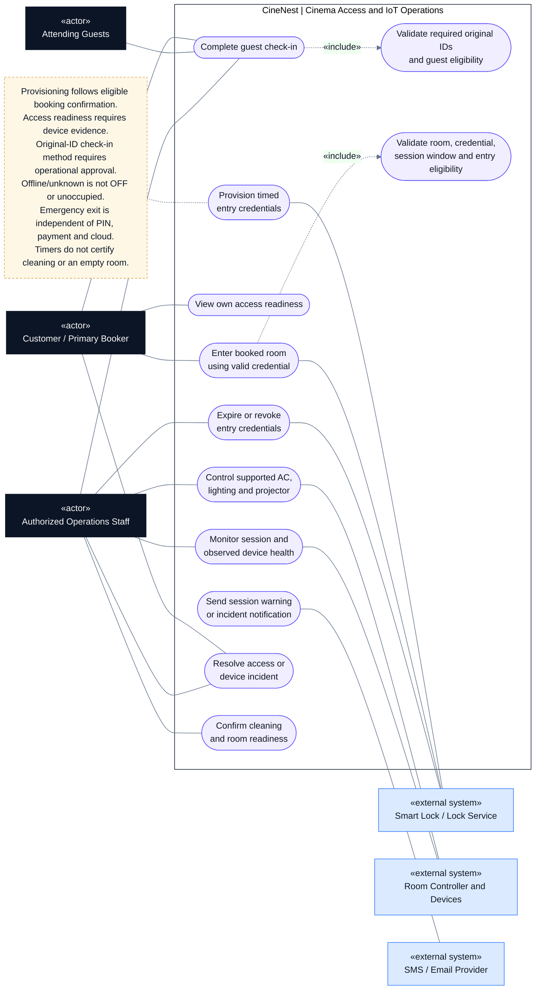

# CineNest Use-Case Diagram 05: Cinema Access and IoT Operations

**View:** 5 of 5 
**Export date:** 2026-10-14 
**Status:** Planned behavior; implementation not verified. Exact role assignments and unresolved policy choices retain their canonical approval status. 
**Artifact type:** Standalone Markdown export requested by the owner, not an update to the repository knowledge base.

## Purpose

Show guest check-in, booking-specific entry credentials, room automation, live device monitoring, warnings, incident handling, and verified room readiness.

## Actors

| Actor | Participation |
| --- | --- |
| Customer / Primary Booker | Completes check-in, views permitted access readiness, uses valid entry credentials, and requests incident support. |
| Attending Guests | Participate in the required original-ID and eligibility procedure. |
| Authorized Operations Staff | Performs permitted check-in, monitoring, controls, incident response, and readiness operations. |
| Smart Lock / Lock Service | Provisions, validates, expires, and revokes credentials where supported. |
| Room Controller and Devices | Accepts supported commands and returns acknowledgements/observations. |
| SMS / Email Provider | Delivers supported warnings and incident/customer messages. |

This view places devices outside the CineNest application boundary. It does not imply a specific physical network topology, selected lock vendor, or bank/payment involvement in emergency exit.

## Editable use-case diagram

## Notation

This is a **UML-style use-case view written with Mermaid flowchart primitives**, not a strict UML model or a sequence diagram.

- Dark rectangles identify human actors; blue rectangles identify external systems.
- Rounded nodes identify use cases inside the CineNest application boundary.
- A solid line denotes participation, not call direction, time order, or unrestricted permission.
- A dashed arrow labeled `«include»` points from a use case to required reused behavior; `«extend»` points from conditional additional behavior to its base use case.
- A dashed note connector carries an explanatory constraint, not a workflow transition.

Render the fenced `mermaid` block in a Mermaid-enabled Markdown viewer. The actor and use-case tables remain readable in a plain-text viewer. The diagram deliberately shows selected relationships rather than every authorization, audit, and validation dependency.

## Use-case catalog

| Use case | Intended result and important condition |
| --- | --- |
| Complete guest check-in | Apply the required all-guest on-site procedure before granting entry. |
| Validate original IDs and eligibility | Verify the required originals through the approved human/kiosk method; that method is not established by this drawing. |
| Provision timed entry credentials | Request a supported credential for the purchased booking interval and track its result. |
| View own access readiness | Show ready, pending, failed, expired, or unresolved outcomes based on real evidence. |
| Enter booked room | Allow entry only through a valid room-specific credential and required eligibility. |
| Validate entry | Enforce the correct room, time window, credential, and entry authorization. |
| Control supported room devices | Send permitted commands to compatible equipment with explicit acknowledgement and failure handling. |
| Monitor sessions and device health | Distinguish observed values, desired values, last-seen times, offline, and unknown states. |
| Send warning or incident notification | Issue the configured session warning and operational messages through durable delivery work. |
| Expire/revoke entry credentials | End incoming access authority as required without obstructing independent emergency egress. |
| Resolve incident | Coordinate support, bounded retries, and an approved hardware-specific fallback. |
| Confirm cleaning and readiness | Record actual operational readiness before making the room available again. |

## Main interaction outline

1. An eligible funded booking reaches confirmation and schedules/provisions its supported time-bound entry credential.
2. CineNest tracks the lock provider/controller outcome; the customer does not see an unverified command as ready access.
3. Every attendee completes the required on-site original-ID/eligibility process before entry. How that gates a pre-provisioned credential must be decided and physically tested.
4. The customer enters using the valid credential within the purchased interval. Supported re-entry follows the same validity rules.
5. Authorized session automation and operations staff control compatible lighting, AC, and projector functions, with command/result tracking.
6. The system issues the documented five-minute warning or other approved operational notifications.
7. At the session boundary, incoming credentials expire; departure and room condition are verified independently of a timer.
8. Staff complete cleaning/reset readiness, after which the room can re-enter available inventory.

Credential provisioning, entry permission, device operation, and messaging are separate outcomes. Automated work is triggered internally; it is not modeled as a fictional external "System" actor.

## Key rules and authorization

- Entry validity follows the purchased session start/end, not the cleaning buffer or an unapproved early-entry allowance.
- Catalog edits cannot extend or invalidate an existing PIN window. A booking amendment uses a separate authorized, conflict-checked workflow.
- In a pre-provisioned-lock design, a credible and tested on-site eligibility gate is still required. Merely listing both checks in a diagram does not enforce it physically.
- Never equate command sent, provider acceptance, hardware acknowledgement, and observed state without the applicable device contract.
- Protect raw PINs and device credentials from general logs, reports, messages, and broad admin access.
- A missing exit event does not prove occupancy; an exit-button event does not prove everyone has left.
- Offline/unknown must not be displayed as OFF, healthy, available, or empty.
- Emergency egress must remain possible independently of payment status, network, valid PIN, software, or an administrator. This drawing is not physical-safety certification.
- Offline credential behavior and manual fallback depend on selected hardware, qualified installation, and physical acceptance tests.
- Alarm/siren behavior must follow an approved safety procedure, not a casual automatic punishment for a missing event.

## Alternative and exception paths

| Situation | Required handling |
| --- | --- |
| Lock provisioning times out | Preserve confirmed payment/booking state, expose pending/unknown/failed access, retry safely, and escalate. |
| Wrong room, expired credential, or ineligible entry | Deny incoming entry under the approved design; never trap an occupant trying to leave. |
| Lost network, power interruption, or controller reboot | Use only tested local behavior and approved response procedures; do not claim cloud remote control solves a total outage. |
| Unsupported command or stale telemetry | Explain unsupported/unknown state and avoid fake success. |
| Suspected overstay or missing exit | Treat as an operational review signal, not definitive proof of occupancy. |
| Cleaning incomplete | Retain unavailable/readiness state and resolve any affected booking conflict explicitly. |

## Acceptance checks to implement

These are proposed verification targets, not evidence of tests run for this export.

- Exact-start/end credential validity, repeated entry, revocation, and booking amendments are tested against the selected contract.
- Unauthorized room/venue commands are denied in direct API and event paths.
- Asynchronous command retries do not misreport or duplicate unsafe effects.
- Simulators are distinguished from real-device acceptance.
- Blackout/offline behavior and independent emergency egress require physical evidence.
- Room availability cannot be restored solely by a session timer or a single exit event.

## Related diagrams

- [01. Customer Booking and Account](01_Use%20case_Customer_Booking_and_Account.md)
- [02. Package and Venue Administration](02_Use%20case_Package_and_Venue_Administration.md)
- [03. Payments, Bank Review and Refunds](03_Use%20case_Payments_Bank_Review_and_Refunds.md)
- [04. Identity Verification and Authorization](04_Use%20case_Identity_Verification_and_Authorization.md)

## Source and authority

Exported from the five CineNest use-case views discussed in this conversation, with the related E2E mind map and subsequent package, bank-payment, and hybrid-authorization clarifications. Labels are normalized for readability; financial matching/allocation and evidence-submission/processing are kept distinct.

The current repository's four canonical documents (`PROJECT.md`, `ARCHITECTURE.md`, `DESIGN.md`, `PROGRESS.md`) and its authoritative registries govern approval and implementation status. This standalone export does not replace those documents, approve proposed role bundles or hardware capabilities, or establish any completed code, test, deployment, or safety verification.
