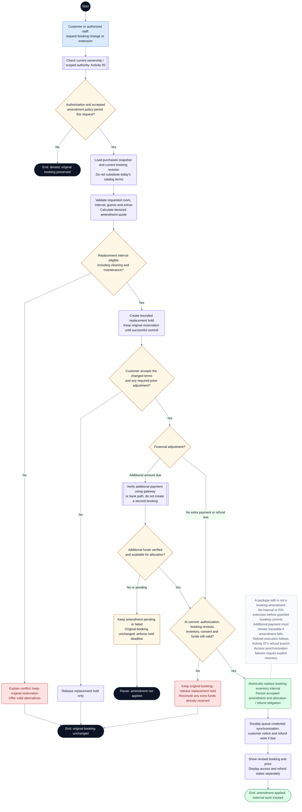

# CineNest Activity Diagram 06: Booking Amendment and Session Extension

**Diagram:** 06 of 10 
**Export date:** 2026-10-14 
**Status:** Proposed workflow; implementation and execution tests not verified. 
**Artifact:** Standalone requested Markdown export; no project/repository files modified.

## Purpose

Change an existing reservation through a separately authorized, quoted, conflict-checked amendment while preserving the original booking until the replacement can be committed safely.

Exported from one of the eight detailed interactive activity diagrams. The overview poster is a visual summary, not the detailed workflow contract.

## Participants and responsibilities

| Participant | Responsibility |
| --- | --- |
| Customer or authorized staff | Requests a change and records required acceptance of revised terms. |
| Booking/pricing modules | Preserve the purchased snapshot, calculate the amendment, coordinate inventory, and commit a versioned change. |
| Payments module | Verifies additional funds or records an authorized refund obligation. |
| Access and notification workers | Synchronize the committed booking revision to credentials and customer messages. |

## Editable activity diagram

## Diagram notation

This is an **activity-style control-flow diagram expressed with Mermaid flowchart notation**, not a strict UML/XMI model. It preserves the discussed workflow decisions without claiming executable behavior.

- The start circle begins this activity; nodes labeled **End** or **Pause** identify outcomes. A pause does not mean the booking, money, or incident has disappeared.
- Rounded actions describe work. Diamonds are decisions with labeled guards/outcomes. Double-border boxes reference another activity.
- Solid arrows show control flow. Dashed arrows with labels represent later events or retries; unlabelled dashed note connectors do not control execution.
- Blue actions identify people or external interactions where labeled; pale violet is ordinary system work, amber is a decision or pending state, green is a verified successful outcome, and red is an exception. Text remains authoritative over color.
- Responsibility is written in node labels and the participant table. These are not fixed swimlane columns. Sequential drawing does not make remote operations one atomic transaction, and no parallel fork/join is implied unless explicitly shown.

Render the fenced `mermaid` block in a Mermaid-capable Markdown viewer. The surrounding text remains readable without rendering. The viewer must support Mermaid frontmatter configuration; remove only the `---` configuration section inside the block when using a renderer that does not support it.

## Main activity outline

1. Authorize the customer/administrator and verify the accepted amendment policy.
2. Read the purchased terms and current booking revision rather than substituting the latest catalog version.
3. Validate the replacement and obtain a bounded inventory hold without releasing the original reservation.
4. Present and obtain acceptance of the amendment quote and applicable financial consequences.
5. If extra money is required, use the relevant payment-verification subflow without creating a separate booking.
6. Recheck all guards at commit, then atomically replace the reservation interval and persist the amendment.
7. Queue access synchronization, customer notices, and any refund obligation; expose those outcomes separately.

## Guards and interpretation rules

- A replacement hold must understand its own booking identity so it does not conflict with the original interval while still blocking other reservations correctly.
- Hold expiry or amendment failure does not cancel the original purchase.
- When a refund is due, the commit records an obligation; actual repayment uses the refund branch in Activity 07.
- Funds received for a failed amendment remain traceable and require refund or another approved resolution.
- Exact amendment eligibility, repricing, and customer-acceptance policy remain governed by the current canonical decisions.
- Only committed booking revisions may drive PIN changes. Stale provisioning work must not restore a superseded interval.
- If there is insufficient time to verify an extension before session end, do not grant an unverified time/PIN extension.

## Alternative outcomes and recovery

| Condition | Intended handling |
| --- | --- |
| Replacement conflict / missing approval | Retain original reservation and show a permitted alternative. |
| Extra payment pending | Amendment remains unapplied; replacement hold retains its actual deadline. |
| Concurrent booking change | Reject stale commit and reconcile against the current revision. |
| Access update fails after amendment | Show revised booking and unresolved access; recover explicitly instead of falsifying readiness. |

## Review before implementation

Treat this diagram as an analysis/design view. Trace every guard and recovery route to the corresponding canonical requirement and planned acceptance check. Test authorization, state changes, duplicate processing, concurrency, and recovery as applicable. For physical/device outcomes, distinguish a simulation from actual hardware evidence. No application, payment-provider, or hardware acceptance test is claimed by this export.

## Related activity diagrams

- [01. Customer Booking and Online Payment](01_ActivityDiagram_Customer_Booking_and_Online_Payment.md)
- [02. Bank Deposit, Receipt Review and Approval](02_ActivityDiagram_Bank_Deposit_Receipt_Review_and_Approval.md)
- [03. Package Editing, Publication and Deactivation](03_ActivityDiagram_Package_Editing_Publication_and_Deactivation.md)
- [05. Scoped RBAC and ABAC Authorization](05_ActivityDiagram_Scoped_RBAC_and_ABAC_Authorization.md)
- [07. Booking Cancellation and Refund Execution](07_ActivityDiagram_Booking_Cancellation_and_Refund_Execution.md)
- [08. Cinema Entry, IoT Control and Room Reset](08_ActivityDiagram_Cinema_Entry_IoT_Control_and_Room_Reset.md)
- [09. Room Maintenance and Controlled Closure](09_ActivityDiagram_Room_Maintenance_and_Controlled_Closure.md)

## Source and authority

- Use-case export 01: Customer Booking and Account
- Use-case export 02: Package and Venue Administration
- Detailed interactive activity 6 of 8

These files are standalone exports, not updates to the repository. The current four canonical knowledge documents (`PROJECT.md`, `ARCHITECTURE.md`, `DESIGN.md`, `PROGRESS.md`) and their authoritative registries continue to govern requirements, approvals, and implementation state.

Diagram labels, actor bundles, pending policies, timer values, provider/hardware choices, and retry behavior retain their actual canonical status. This export neither approves unresolved policies nor certifies application code, external integrations, bank reconciliation, device behavior, or physical safety. All protected operations use the applicable scoped authorization; business invariants remain separate.
