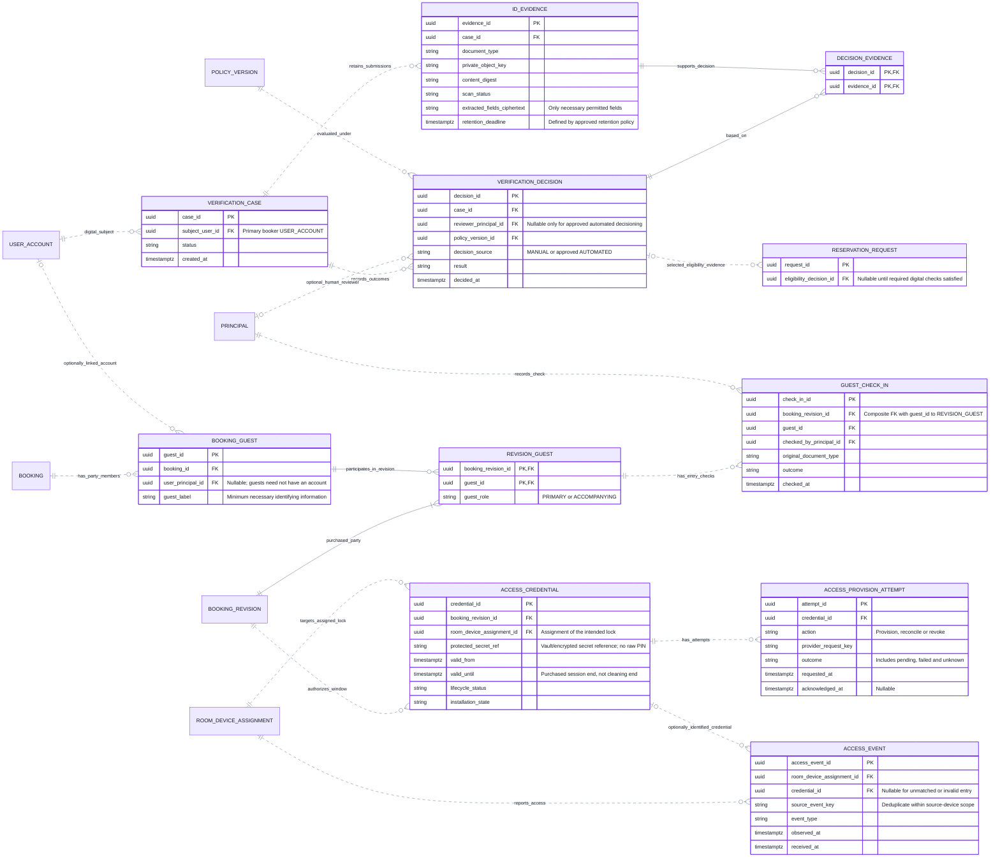

# CineNest ER Diagram 06: Identity Evidence, Guest Check-in and Access Credentials

**View:** 06 of 08 
**Export date:** 2026-10-14 
**Status:** Proposed logical model; implementation and database acceptance not verified. 
**Artifact:** Requested standalone Markdown export; no repository or canonical knowledge file modified.

## Purpose

Connect a primary booker’s digital verification evidence and decisions to reservation eligibility, while separately recording the purchased guest party, on-site original-document check-in, revision-bound credentials and observed access events.

## Editable ER diagram

## Entities and ownership

| Owner / area | Entities | Responsibility and boundary |
| --- | --- | --- |
| Verification | VERIFICATION_CASE, ID_EVIDENCE, VERIFICATION_DECISION, DECISION_EVIDENCE | Digital evidence, controlled extraction/review and attributable eligibility outcomes. |
| Booking | RESERVATION_REQUEST, BOOKING_GUEST, REVISION_GUEST | Selected eligibility reference and party composition of each purchased revision. |
| Access / check-in owner | GUEST_CHECK_IN, ACCESS_CREDENTIAL, ACCESS_PROVISION_ATTEMPT, ACCESS_EVENT | Proposed check-in/access record ownership; credential targets reference Device Operations. Final check-in responsibility must be explicit. |
| Referenced owners | USER_ACCOUNT, PRINCIPAL, POLICY_VERSION, BOOKING, BOOKING_REVISION, ROOM_DEVICE_ASSIGNMENT | Cross-view references, not duplicate tables or direct access to another module’s private repositories. |

## Key constraints and interpretation

1. A digital verification case belongs to the primary booker account. Attending guests can exist without application accounts; on-site original-document checks are separate from the booker’s online OCR process.

2. DECISION_EVIDENCE must join a decision and an evidence version from the same case. Preserve history rather than changing a past decision to point at a replacement upload.

3. An eligible decision referenced by a RESERVATION_REQUEST must concern the correct subject and applicable policy/context. A foreign key alone does not enforce the relationship between the case subject and the request’s booker.

4. A nullable reviewer is permitted only for an explicitly approved automated decision route with its provenance recorded. OCR extraction and confidence are not proof of identity, document authenticity or liveness.

5. Every purchased BOOKING_REVISION has a nonempty REVISION_GUEST set. Guest membership must agree with the revision’s booking, purchased count and permitted primary-booker rules. The minimum of one is an intended invariant, not something a child FK alone can force.

6. GUEST_CHECK_IN uses a composite reference (booking_revision_id, guest_id) to REVISION_GUEST. A check for an old party or superseded booking revision does not automatically authorize a changed party.

7. ACCESS_CREDENTIAL targets the assigned lock for the same room and applicable time. valid_until is the purchased session end, not the cleaning-buffer end. Secret references must point to restricted protected storage, not plaintext PIN fields.

8. Keep credential intent, installation evidence and every provision/reconcile/revoke attempt separate. An old callback must not restore a cancelled or superseded credential.

9. An ACCESS_EVENT can have no identified credential, for example on failed entry. Its room/device assignment, source identity and observation time still require validation and deduplication.

10. A pre-provisioned credential requires a physically enforced check-in gate or a safe alternative activation design. Merely having GUEST_CHECK_IN and ACCESS_CREDENTIAL rows does not prove that entry is controlled.

11. Protect evidence by ownership, role, venue and purpose. Sensitive access should be audited; retention and deletion must be enforced under approved rules without leaking contents in general event or audit payloads.

## Decisions and checks still required

Final on-site check-in method, approved automated eligibility policy, device installation/expiry contract, offline behavior and emergency procedures require explicit approval and actual physical tests.

This is a selected logical view; OCR processing-job details, document access logs and immutable retention/deletion evidence may map to existing durable-work/audit components rather than duplicate standalone stores.

## Reading the ER notation

| Notation | Meaning in these exports |
| --- | --- |
| `PK` | Primary key. Multiple PK attributes in one entity form a composite key. |
| `FK` | Proposed reference to another entity. Whether a cross-module link is enforced by a physical SQL FK is a separate implementation decision. |
| `UK` | Proposed unique key; comments identify composite or scoped uniqueness where needed. |
| `\|\|` | Exactly one at that relationship endpoint. |
| `o\|` / `\|o` | Zero or one at the relevant endpoint. |
| `o{` / `}o` | Zero or many at the relevant endpoint. |
| `\|{` / `}\|` | One or many at the relevant endpoint. |
| `--` | Identifying relationship: the parent's identity contributes to the child's identity in this model. |
| `..` | Non-identifying relationship. **Dashed lines do not mean optional, asynchronous, or unimplemented.** Optionality comes from the endpoint markers. |

Relationships are not calls, message directions, or execution order. Entity names repeated in different views refer to the same logical entity, not duplicate tables. An entity shown without fields is a reference stub; its attributes are expanded in the relevant companion view. Selected fields do not constitute an exhaustive physical schema.

Types such as `uuid`, `timestamptz`, `bigint`, `numeric` and `jsonb` are proposed descriptive types, not a migration. Money fields use minor units or exact decimal quantities under an explicit currency/rounding policy. Dates, times, nullability, source identity, sums, scope consistency, XOR ownership and non-overlap need actual constraints and tests; the picture does not enforce them.

## Scope, source and approval status

This export preserves the **eight detailed CineNest ER views** discussed in the conversation and the corrected `CineNest_ER_Diagram_Corrected.png` overview. It is informed by the preceding mind-map, use-case, activity, sequence, context and corrected component views. The earlier automatically generated ER poster is not the authoritative source for keys, entity names, privacy fields or cardinalities.

The model remains **proposed and not implementation-verified**. No SQL schema was reverse-engineered from a running database. Exact class/table names, constraints, cross-module coordination and remaining policies need approval and verification. Do not infer raw-password sign-in, a plaintext `pin_code` field on bookings, generic public identity-document URLs, unrelated personal-profile collection, active Redis, Kafka, TimescaleDB or a subscription/tenant model from this export.

Each module owns its operational records; a relationship is not permission for cross-module repository injection or unrestricted joins. Protected operations use scoped RBAC + ABAC and still enforce their owning business invariants. Runtime integrations, physical installation, emergency egress and recovery require separate evidence.

The repository's four canonical documents (`PROJECT.md`, `ARCHITECTURE.md`, `DESIGN.md`, `PROGRESS.md`) and authoritative registries retain decision and implementation authority. These owner-requested standalone exports do **not** modify the project repository, create a second canonical knowledge base, select unapproved technologies/policies or claim application, payment, provider or hardware tests passed.

## Related ER views

- [01. Core Relationship Overview](01_ER_Diagrams_Core_Relationship_Overview.md)
- [02. Identity, Sessions and Scoped RBAC + ABAC](02_ER_Diagrams_Identity_Sessions_and_Scoped_RBAC_ABAC.md)
- [04. Quotes, Reservation Holds and Immutable Booking Revisions](04_ER_Diagrams_Quotes_Reservation_Holds_and_Booking_Revisions.md)
- [07. Sessions, Devices, Maintenance and Operational Readiness](07_ER_Diagrams_Sessions_Devices_Maintenance_and_Readiness.md)
- [08. Durable Work, Notifications and Audit Records](08_ER_Diagrams_Durable_Work_Notifications_and_Audit.md)

## Rendering

Open this file in a Mermaid-enabled Markdown viewer to render its fenced `erDiagram` block. Use zoom for the larger models. The prose, attributes and relationships remain readable as text without a renderer.

If the viewer cannot parse Mermaid YAML configuration, remove only the initial `---` configuration section **inside** the Mermaid fence, retaining `erDiagram` and the remaining lines. Renderer/version support is required for ER direction and key annotations. No external font, image or script assets are required to render these Markdown diagrams.
