# CineNest Activity Diagram 07: Booking Cancellation and Refund Execution

**Diagram:** 07 of 10 
**Export date:** 2026-10-14 
**Status:** Proposed workflow; implementation and execution tests not verified. 
**Artifact:** Standalone requested Markdown export; no project/repository files modified.

## Purpose

Separate cancellation of a reservation from authorization and execution of an actual refund, including the pending, unknown, failed, and confirmed outgoing-payment outcomes.

Exported from one of the eight detailed interactive activity diagrams. The overview poster is a visual summary, not the detailed workflow contract.

## Participants and responsibilities

| Participant | Responsibility |
| --- | --- |
| Customer or authorized staff | Requests a cancellation under the accepted policy. |
| Booking module | Records cancellation, controls inventory release, and schedules access revocation. |
| Payments module / finance reviewer | Validates refund authority and amount and reconciles the actual repayment. |
| Payment gateway or bank-transfer process | Returns or provides evidence of the method-specific refund outcome. |

## Editable activity diagram

```mermaid
---
config:
  theme: base
  themeVariables:
    fontFamily: Arial, sans-serif
    fontSize: 16px
    primaryColor: '#F0EEFF'
    primaryTextColor: '#111827'
    primaryBorderColor: '#5B4BFF'
    lineColor: '#64748B'
  flowchart:
    curve: linear
---
flowchart TB
    Start((Start)) --> Request("Customer or authorized staff: request cancellation")
    Request --> Check("Check scoped authority: Activity 05<br/>Load booking revision, accepted terms and financial history")
    Check --> Allowed{"Current state and accepted policy<br/>permit this cancellation?"}
    Allowed -->|No| Deny([End: no cancellation; explain permitted next steps])
    Allowed -->|Yes| Preview("Show cancellation consequences<br/>and calculated refund entitlement, if any")
    Preview --> Accept{"Customer acceptance or other<br/>required cancellation authority recorded?"}
    Accept -->|No| Unchanged([End: booking unchanged])
    Accept -->|Yes| Commit("Recheck state and commit cancellation idempotently<br/>Record refund obligation if due")
    Commit --> Queue("Release future inventory when operationally safe<br/>Queue credential revocation and customer notice")
    Queue --> RefundDue{"Refund amount due?"}
    RefundDue -->|No| Closed([End: cancelled; no refund due under accepted policy])
    RefundDue -->|Yes| Review("Load outstanding refund obligation<br/>and existing attempts; prevent duplicate repayment")
    Other["Refund obligation from amendment<br/>or received-funds resolution"] --> Review
    Review --> Authority{"Refund grant, scope, limit and<br/>required independent approvals satisfied?"}
    Authority -->|No| AwaitApproval([Pause: originating workflow recorded; refund approval unresolved])
    Authority -->|Yes| Method{"Original payment channel?"}
    Method -->|Gateway| Gateway("Submit method-supported refund request<br/>with original transaction and idempotency reference")
    Method -->|Bank deposit / transfer| Bank("Authorized finance: independently verify refund destination<br/>Execute bank refund and record outgoing attempt")
    Gateway --> Outcome{"Reliable refund outcome?"}
    Bank --> Outcome
    Outcome -->|Pending or unknown| Reconcile("Keep pending; reconcile the existing attempt<br/>Do not send again merely because it timed out")
    Reconcile -.->|New provider or bank evidence| Outcome
    Outcome -->|Confirmed failure| Failed("Record failure; retry only after safe reconciliation<br/>Escalate according to the approved bounded procedure")
    Failed --> Pending([Pause: refund unresolved; originating workflow retained])
    Outcome -->|Confirmed completed| Record("Record completed refund from bank/provider evidence<br/>Update outstanding balance and notify customer")
    Record --> Done([End: originating workflow and refund outcomes recorded])
    Note["Cancellation does not wait for external refund settlement.<br/>Inventory release cannot declare an occupied room empty.<br/>Revocation must never obstruct emergency exit.<br/>Refund approval alone is not evidence that money was returned.<br/>Exact refund policies and financial limits require approval."]
    Note -.- Queue

    classDef terminal fill:#0B1526,color:#FFFFFF,stroke:#0B1526;
    classDef actor fill:#DBEAFE,color:#111827,stroke:#2878FF;
    classDef decision fill:#FFF7E6,color:#111827,stroke:#B45309;
    classDef success fill:#DCFCE7,color:#14532D,stroke:#15803D;
    classDef exception fill:#FEE2E2,color:#7F1D1D,stroke:#B91C1C;
    classDef pending fill:#FFF7E6,color:#111827,stroke:#B45309;
    classDef note fill:#F8FAFC,color:#475569,stroke:#94A3B8,stroke-dasharray:4 3;
    class Start,Deny,Unchanged,Closed,AwaitApproval,Pending terminal;
    class Request,Gateway,Bank actor;
    class Allowed,Accept,RefundDue,Authority,Method,Outcome decision;
    class Failed exception;
    class Reconcile pending;
    class Record,Done success;
    class Note,Other note;
```

## Diagram notation

This is an **activity-style control-flow diagram expressed with Mermaid flowchart notation**, not a strict UML/XMI model. It preserves the discussed workflow decisions without claiming executable behavior.

- The start circle begins this activity; nodes labeled **End** or **Pause** identify outcomes. A pause does not mean the booking, money, or incident has disappeared.
- Rounded actions describe work. Diamonds are decisions with labeled guards/outcomes. Double-border boxes reference another activity.
- Solid arrows show control flow. Dashed arrows with labels represent later events or retries; unlabelled dashed note connectors do not control execution.
- Blue actions identify people or external interactions where labeled; pale violet is ordinary system work, amber is a decision or pending state, green is a verified successful outcome, and red is an exception. Text remains authoritative over color.
- Responsibility is written in node labels and the participant table. These are not fixed swimlane columns. Sequential drawing does not make remote operations one atomic transaction, and no parallel fork/join is implied unless explicitly shown.

Render the fenced `mermaid` block in a Mermaid-capable Markdown viewer. The surrounding text remains readable without rendering. The viewer must support Mermaid frontmatter configuration; remove only the `---` configuration section inside the block when using a renderer that does not support it.

## Main activity outline

1. Authorize the cancellation and evaluate the current booking against its purchased policy.
2. Present consequences and obtain any required customer acceptance or other cancellation authority.
3. Recheck the booking revision and commit cancellation idempotently with any refund obligation.
4. Release only eligible future inventory and queue incoming-credential revocation; physical readiness is independent.
5. For a refund obligation, check funds, remaining refundable amount, authority, and required independent approval.
6. Execute the method-appropriate repayment and reconcile the existing attempt when the result is uncertain.
7. Record confirmed outgoing payment separately from refund approval, notify the customer, and retain financial history.

## Guards and interpretation rules

- The refund branch is reusable from an amendment or received-funds resolution. Those cases do not imply that the originating booking was cancelled.
- The earlier interactive diagram's shared-branch terminal wording is normalized here so a refund after an amendment does not falsely label the booking cancelled.
- A state/revision conflict at cancellation commit must abort the stale operation; it cannot silently cancel a different current state.
- Approved cancellation and refund entitlement are not the same as completed repayment.
- A provider timeout is not permission to send another payment. Reconcile first, then apply the approved retry policy.
- For mixed-method payments, reconcile each original payment and its remaining refundable amount; the two method branches are simplified per-refund views.
- A cancelled booking with uncertain credential revocation or room occupancy requires explicit readiness/access resolution.
- Bank-refund destination controls and independent approval limits remain open unless approved in the canonical knowledge.

## Alternative outcomes and recovery

| Condition | Intended handling |
| --- | --- |
| Cancellation not permitted | Retain the booking and show the permitted support/review path. |
| Refund authority missing | Keep the obligation pending; do not undo an already committed cancellation. |
| Outgoing result unknown | Do not display refunded or issue duplicate repayment; reconcile the same attempt. |
| Confirmed refund failure | Record failure and retain the outstanding obligation for controlled retry/escalation. |
| No refund due | Record the policy-grounded result without erasing the cancellation or financial history. |

## Review before implementation

Treat this diagram as an analysis/design view. Trace every guard and recovery route to the corresponding canonical requirement and planned acceptance check. Test authorization, state changes, duplicate processing, concurrency, and recovery as applicable. For physical/device outcomes, distinguish a simulation from actual hardware evidence. No application, payment-provider, or hardware acceptance test is claimed by this export.

## Related activity diagrams

- [01. Customer Booking and Online Payment](01_ActivityDiagram_Customer_Booking_and_Online_Payment.md)
- [02. Bank Deposit, Receipt Review and Approval](02_ActivityDiagram_Bank_Deposit_Receipt_Review_and_Approval.md)
- [05. Scoped RBAC and ABAC Authorization](05_ActivityDiagram_Scoped_RBAC_and_ABAC_Authorization.md)
- [06. Booking Amendment and Session Extension](06_ActivityDiagram_Booking_Amendment_and_Session_Extension.md)
- [08. Cinema Entry, IoT Control and Room Reset](08_ActivityDiagram_Cinema_Entry_IoT_Control_and_Room_Reset.md)
- [10. Operational Incident and Recovery](10_ActivityDiagram_Operational_Incident_and_Recovery.md)

## Source and authority

- Use-case export 01: Customer Booking and Account
- Use-case export 03: Payments, Bank Review and Refunds
- Detailed interactive activity 7 of 8, with shared-refund terminal wording clarified

These files are standalone exports, not updates to the repository. The current four canonical knowledge documents (`PROJECT.md`, `ARCHITECTURE.md`, `DESIGN.md`, `PROGRESS.md`) and their authoritative registries continue to govern requirements, approvals, and implementation state.

Diagram labels, actor bundles, pending policies, timer values, provider/hardware choices, and retry behavior retain their actual canonical status. This export neither approves unresolved policies nor certifies application code, external integrations, bank reconciliation, device behavior, or physical safety. All protected operations use the applicable scoped authorization; business invariants remain separate.
