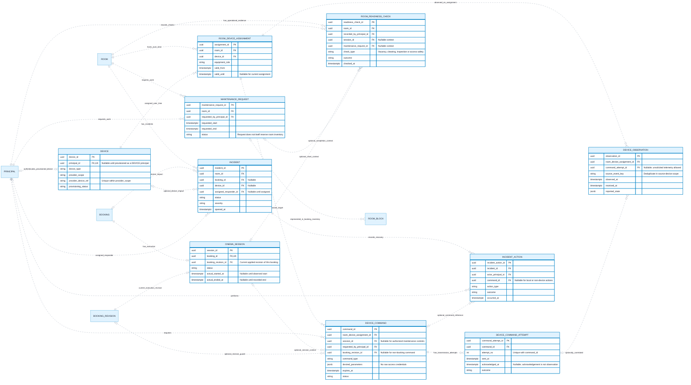

# CineNest ER Diagram 07: Sessions, Devices, Maintenance and Operational Readiness

**View:** 07 of 08 
**Export date:** 2026-10-14 
**Status:** Proposed logical model; implementation and database acceptance not verified. 
**Artifact:** Requested standalone Markdown export; no repository or canonical knowledge file modified.

## Purpose

Model room-device assignment history, booking execution, scoped commands and attempts, observed device events, planned maintenance, operational readiness checks and incident recovery. Record physical observations separately from intended or acknowledged actions.

## Editable ER diagram

## Entities and ownership

| Owner / area | Entities | Responsibility and boundary |
| --- | --- | --- |
| Device Operations | DEVICE, ROOM_DEVICE_ASSIGNMENT, DEVICE_COMMAND, DEVICE_COMMAND_ATTEMPT, DEVICE_OBSERVATION | Device identity/mapping, authorized command intent, transmissions and actual timestamped observations. |
| Booking | CINEMA_SESSION; ROOM_BLOCK reference | Actual booking execution and authoritative time-blocking inventory. |
| Venues and Rooms | MAINTENANCE_REQUEST, ROOM_READINESS_CHECK; ROOM reference | Maintenance intent, physical/operational findings and readiness; no independent competing inventory calendar. |
| Device / operations incident responsibility | INCIDENT, INCIDENT_ACTION | Room-scoped operational cases and attributable recovery under a clearly assigned module owner; not a new global workflow service. |

## Key constraints and interpretation

1. DEVICE.principal_id, when set, identifies a DEVICE principal. Secrets used to authenticate it must be managed separately. provider_device_ref is unique only within its provider_scope.

2. ROOM_DEVICE_ASSIGNMENT is historical. Prevent overlapping active room assignments for a device under this selected model; a multi-room gateway would need an explicitly refined topology rather than bypassing assignment checks.

3. CINEMA_SESSION is at most one logical execution per booking in this proposal. Its applied booking revision must belong to the same booking. Session start/end are recorded facts, not automatically inferred from a scheduled timestamp.

4. DEVICE_COMMAND references the exact assignment and, where applicable, session and booking revision. They must agree on booking/room and on current allowed scope. Maintenance commands have their own authority even when the session reference is null.

5. One command can have multiple transmission attempts, each with a unique (command_id, attempt_no). Stable provider request identities, leases or delivery records may use the selected durable-work implementation rather than invented queues.

6. DEVICE_OBSERVATION is an independently timestamped observation, optionally correlated to an attempt. An acknowledgement is not automatically a confirmed physical result. Late and unsolicited telemetry must not overwrite newer state without an explicit ordering rule.

7. MAINTENANCE_REQUEST does not itself block inventory. Only its authorized ROOM_BLOCK records do that. A planned maintenance conflict requires approved booking resolution, not deletion of customer records.

8. ROOM_READINESS_CHECK can describe vacancy, cleaning, inspections or access safety. Context references, when present, must match the room. Define whether both contexts are allowed; neither is assumed to imply the other.

9. A failed inspection or incomplete cleanup keeps a room unavailable even if the planned maintenance window or purchased session has ended. Room READY is not equivalent to a free booking slot if another reservation or block exists.

10. INCIDENT describes a room-scoped operational incident with optional booking/device/responder context. A non-room platform or payment incident would need another existing mechanism or an explicitly revised scope; it must not be forced into a fake room.

11. INCIDENT_ACTION retains local and device-related recovery outcomes. Closing the incident does not prove refund completion, credential revocation, room vacancy or safety.

12. Physical emergency exit remains independent of database state, payment, network connectivity and administrator access. These records cannot certify a physical installation or fallback procedure.

## Decisions and checks still required

Exact device topology, capabilities, retry/replay policy, event identity, time-ordering and assignment migration rules require approved contracts and tests.

The selected session/current-revision link summarizes current execution; historical session revision changes must remain auditable through a defined history/event mechanism.

Inspection requirements, readiness evidence, incident owners, response deadlines and reopening authority remain operational decisions requiring appropriate approval.

## Reading the ER notation

| Notation | Meaning in these exports |
| --- | --- |
| `PK` | Primary key. Multiple PK attributes in one entity form a composite key. |
| `FK` | Proposed reference to another entity. Whether a cross-module link is enforced by a physical SQL FK is a separate implementation decision. |
| `UK` | Proposed unique key; comments identify composite or scoped uniqueness where needed. |
| `\|\|` | Exactly one at that relationship endpoint. |
| `o\|` / `\|o` | Zero or one at the relevant endpoint. |
| `o{` / `}o` | Zero or many at the relevant endpoint. |
| `\|{` / `}\|` | One or many at the relevant endpoint. |
| `--` | Identifying relationship: the parent's identity contributes to the child's identity in this model. |
| `..` | Non-identifying relationship. **Dashed lines do not mean optional, asynchronous, or unimplemented.** Optionality comes from the endpoint markers. |

Relationships are not calls, message directions, or execution order. Entity names repeated in different views refer to the same logical entity, not duplicate tables. An entity shown without fields is a reference stub; its attributes are expanded in the relevant companion view. Selected fields do not constitute an exhaustive physical schema.

Types such as `uuid`, `timestamptz`, `bigint`, `numeric` and `jsonb` are proposed descriptive types, not a migration. Money fields use minor units or exact decimal quantities under an explicit currency/rounding policy. Dates, times, nullability, source identity, sums, scope consistency, XOR ownership and non-overlap need actual constraints and tests; the picture does not enforce them.

## Scope, source and approval status

This export preserves the **eight detailed CineNest ER views** discussed in the conversation and the corrected `CineNest_ER_Diagram_Corrected.png` overview. It is informed by the preceding mind-map, use-case, activity, sequence, context and corrected component views. The earlier automatically generated ER poster is not the authoritative source for keys, entity names, privacy fields or cardinalities.

The model remains **proposed and not implementation-verified**. No SQL schema was reverse-engineered from a running database. Exact class/table names, constraints, cross-module coordination and remaining policies need approval and verification. Do not infer raw-password sign-in, a plaintext `pin_code` field on bookings, generic public identity-document URLs, unrelated personal-profile collection, active Redis, Kafka, TimescaleDB or a subscription/tenant model from this export.

Each module owns its operational records; a relationship is not permission for cross-module repository injection or unrestricted joins. Protected operations use scoped RBAC + ABAC and still enforce their owning business invariants. Runtime integrations, physical installation, emergency egress and recovery require separate evidence.

The repository's four canonical documents (`PROJECT.md`, `ARCHITECTURE.md`, `DESIGN.md`, `PROGRESS.md`) and authoritative registries retain decision and implementation authority. These owner-requested standalone exports do **not** modify the project repository, create a second canonical knowledge base, select unapproved technologies/policies or claim application, payment, provider or hardware tests passed.

## Related ER views

- [01. Core Relationship Overview](01_ER_Diagrams_Core_Relationship_Overview.md)
- [02. Identity, Sessions and Scoped RBAC + ABAC](02_ER_Diagrams_Identity_Sessions_and_Scoped_RBAC_ABAC.md)
- [04. Quotes, Reservation Holds and Immutable Booking Revisions](04_ER_Diagrams_Quotes_Reservation_Holds_and_Booking_Revisions.md)
- [06. Identity Evidence, Guest Check-in and Access Credentials](06_ER_Diagrams_Identity_Evidence_Guest_Check_In_and_Access_Credentials.md)
- [08. Durable Work, Notifications and Audit Records](08_ER_Diagrams_Durable_Work_Notifications_and_Audit.md)

## Rendering

Open this file in a Mermaid-enabled Markdown viewer to render its fenced `erDiagram` block. Use zoom for the larger models. The prose, attributes and relationships remain readable as text without a renderer.

If the viewer cannot parse Mermaid YAML configuration, remove only the initial `---` configuration section **inside** the Mermaid fence, retaining `erDiagram` and the remaining lines. Renderer/version support is required for ER direction and key annotations. No external font, image or script assets are required to render these Markdown diagrams.
