# CineNest Activity Diagram 08: Cinema Entry, IoT Control and Room Reset

**Diagram:** 08 of 10 
**Export date:** 2026-10-14 
**Status:** Proposed workflow; implementation and execution tests not verified. 
**Artifact:** Standalone requested Markdown export; no project/repository files modified.

## Purpose

Track timed access provisioning, all-guest check-in, permitted incoming entry, session/device operations, credential expiry, verified departure, and real cleaning/readiness.

Exported from one of the eight detailed interactive activity diagrams. The overview poster is a visual summary, not the detailed workflow contract.

## Participants and responsibilities

| Participant | Responsibility |
| --- | --- |
| Customer / Primary Booker and attending guests | Complete required check-in and use a valid room-specific credential. |
| Access and session modules | Coordinate versioned provisioning, validity, monitoring, warnings, and expiry. |
| Smart lock, controller, and supported devices | Provide contract-specific installation outcomes, command acknowledgements, and observations. |
| Authorized operations / housekeeping | Handle incidents, verify departure, complete cleaning, and record room readiness. |
| Notification providers | Deliver supported messages without becoming the authority for booking, payment, or device state. |

## Editable activity diagram

```mermaid
---
config:
  theme: base
  themeVariables:
    fontFamily: Arial, sans-serif
    fontSize: 16px
    primaryColor: '#F0EEFF'
    primaryTextColor: '#111827'
    primaryBorderColor: '#5B4BFF'
    lineColor: '#64748B'
  flowchart:
    curve: linear
---
flowchart TB
    Start((Start)) --> Current{"Booking remains confirmed<br/>and provisioning preconditions hold?"}
    Current -->|No| Stop([End: no new access provisioned])
    Current -->|Yes| Provision("Access worker: request room-specific credential<br/>for the purchased start/end and booking revision")
    Provision --> Installed{"Credential installation<br/>confirmed under the device contract?"}
    Installed -->|Pending or unknown| Retry{"Safe reconciliation / retry<br/>available within deadline?"}
    Retry -->|Yes| Reconcile("Reconcile existing request before retrying<br/>Expose access pending; deduplicate commands")
    Reconcile -.->|New device/provider evidence| Installed
    Retry -->|No| AccessIssue("Open access incident; notify responder<br/>Use only a tested, approved fallback")
    Installed -->|Confirmed failure| AccessIssue
    AccessIssue --> AccessPending([Pause: access unresolved; payment is not erased])
    Installed -->|Yes| Arrival("Customer and guests arrive<br/>Complete required original-ID and eligibility check-in")
    Arrival --> Entry{"All guests eligible, room ready,<br/>credential valid and purchased window active?"}
    Entry -->|No| Refuse("Deny incoming entry or wait until valid start<br/>Provide support; never obstruct physical exit")
    Refuse --> NoEntry([Pause: entry not authorized])
    Entry -->|Yes| Enter("Permit entry and record session activity<br/>Apply approved initial room scene")
    Enter --> Monitor("Monitor current session revision and clock<br/>Track last-seen telemetry and individual command outcomes")
    Monitor --> Event{"Next relevant event?"}
    Event -->|Authorized user requests control| Auth[["Check command permission and scope: Activity 05"]]
    Auth --> CommandOK{"Authorized and safe supported command<br/>for the current room/session state?"}
    CommandOK -->|No| DenyCommand("Deny command and record reason")
    DenyCommand --> Monitor
    CommandOK -->|Yes| Send("Send command with identifier and expiry<br/>Track requested, acknowledged and observed state separately")
    Send --> CommandResult{"Command result?"}
    CommandResult -->|Acknowledged| Observe("Record acknowledgement<br/>Display only genuinely observed device state")
    Observe --> Monitor
    CommandResult -->|Failed or unknown| Incident("Flag failed/stale/unknown state<br/>Reconcile safely and alert authorized operations")
    Event -->|Device or service incident| Incident
    Incident --> Safe{"Safe to continue under<br/>the approved response procedure?"}
    Safe -->|Yes| Monitor
    Safe -->|No| Emergency("Invoke approved incident / safe-exit procedure<br/>Keep affected room unavailable")
    Event -->|Five-minute warning due and not sent| Warn("Queue warning once for the current session revision<br/>Track delivery failure separately")
    Warn --> Monitor
    Event -->|Current session ends| EndSession("Record session end or authorized termination<br/>Expire/revoke incoming credentials and reconcile uncertainty")
    Emergency --> EndSession
    EndSession --> Empty{"Departure and vacancy<br/>operationally verified?"}
    Empty -->|No or unknown| Inspect("Keep room unavailable<br/>Inspect / assist under the approved procedure")
    Inspect -.->|New operational evidence| Empty
    Empty -->|Yes| Clean("Perform cleaning and room reset<br/>Record actual readiness checks")
    Clean --> Ready{"Cleaning complete, buffer elapsed,<br/>and no unresolved safety/access/maintenance block?"}
    Ready -->|No| Unavailable([End: room unavailable; operational follow-up required])
    Ready -->|Yes| Publish("Record room READY<br/>Availability engine respects next bookings and operating hours")
    Publish --> Done([End: session closed; room readiness recorded])
    Note["Emergency egress is independent of payment, PIN and cloud.<br/>A pre-provisioned PIN still needs a physically enforced check-in gate.<br/>An exit event or timer does not prove an empty or clean room.<br/>Device contracts, fallback and physical safety remain unverified.<br/>No automatic punitive siren is implied by a missing exit event."]
    Note -.- Entry

    classDef terminal fill:#0B1526,color:#FFFFFF,stroke:#0B1526;
    classDef actor fill:#DBEAFE,color:#111827,stroke:#2878FF;
    classDef decision fill:#FFF7E6,color:#111827,stroke:#B45309;
    classDef success fill:#DCFCE7,color:#14532D,stroke:#15803D;
    classDef exception fill:#FEE2E2,color:#7F1D1D,stroke:#B91C1C;
    classDef pending fill:#FFF7E6,color:#111827,stroke:#B45309;
    classDef note fill:#F8FAFC,color:#475569,stroke:#94A3B8,stroke-dasharray:4 3;
    class Start,Stop,AccessPending,NoEntry,Unavailable terminal;
    class Arrival,Clean actor;
    class Current,Installed,Retry,Entry,Event,CommandOK,CommandResult,Safe,Empty,Ready decision;
    class AccessIssue,Refuse,DenyCommand,Incident,Emergency exception;
    class Reconcile,Inspect pending;
    class Enter,Publish,Done success;
    class Note note;
```

## Diagram notation

This is an **activity-style control-flow diagram expressed with Mermaid flowchart notation**, not a strict UML/XMI model. It preserves the discussed workflow decisions without claiming executable behavior.

- The start circle begins this activity; nodes labeled **End** or **Pause** identify outcomes. A pause does not mean the booking, money, or incident has disappeared.
- Rounded actions describe work. Diamonds are decisions with labeled guards/outcomes. Double-border boxes reference another activity.
- Solid arrows show control flow. Dashed arrows with labels represent later events or retries; unlabelled dashed note connectors do not control execution.
- Blue actions identify people or external interactions where labeled; pale violet is ordinary system work, amber is a decision or pending state, green is a verified successful outcome, and red is an exception. Text remains authoritative over color.
- Responsibility is written in node labels and the participant table. These are not fixed swimlane columns. Sequential drawing does not make remote operations one atomic transaction, and no parallel fork/join is implied unless explicitly shown.

Render the fenced `mermaid` block in a Mermaid-capable Markdown viewer. The surrounding text remains readable without rendering. The viewer must support Mermaid frontmatter configuration; remove only the `---` configuration section inside the block when using a renderer that does not support it.

## Main activity outline

1. Start from an eligible confirmed booking and provision a room-specific credential for its actual purchased interval.
2. Track the real installation outcome. Reconcile uncertain requests before bounded retries and do not display ready without evidence.
3. Complete all-guest on-site check-in and enforce a physically credible gate before incoming access is usable.
4. Permit entry only for the right credential, room, time, and current readiness/eligibility state.
5. Run permitted session automation and commands; track requested, acknowledged, and observed states separately.
6. Issue the revision-specific warning, then expire incoming access at the actual session end or authorized termination.
7. Verify departure and vacancy operationally, perform cleaning/reset, and check the buffer and unresolved blocks.
8. Record readiness; the inventory engine still respects later bookings, maintenance, and operating hours.

## Guards and interpretation rules

- A pre-provisioned credential must not bypass on-site guest eligibility. The actual gating and offline behavior require a selected and physically tested solution.
- A late credential callback for an old booking revision must not restore revoked or superseded access.
- An access credential expires at purchased session end, not after the cleaning buffer.
- The event loop depicts one event at a time; real timers and independent emergency egress must not wait for a hung device command or notification.
- Synchronous-looking arrows do not imply remote actions occur inside a database transaction or succeed together.
- Device acknowledgement and an observed physical outcome are distinct unless a verified contract explicitly equates them.
- A single exit event does not prove an empty room; a timer does not certify cleaning.
- An incident response must not depend on the cloud to allow physical emergency exit. This document is not a safety certification.
- Operational incident detail is separated in Activity 10; maintenance is Activity 09.

## Alternative outcomes and recovery

| Condition | Intended handling |
| --- | --- |
| Provisioning pending / failed | Retain financial and booking outcomes; reconcile, retry safely, or escalate access. |
| Too early / wrong room / ineligible guest | Deny incoming access or wait, with support; never obstruct exit. |
| Telemetry offline / command uncertain | Show unknown or failed status and use an approved recovery procedure. |
| Suspected overstay / missing exit | Keep readiness unresolved and inspect, not an automatic punitive siren. |
| Cleaning or safety unresolved | Keep the room unavailable and explicitly resolve impact on later reservations. |

## Review before implementation

Treat this diagram as an analysis/design view. Trace every guard and recovery route to the corresponding canonical requirement and planned acceptance check. Test authorization, state changes, duplicate processing, concurrency, and recovery as applicable. For physical/device outcomes, distinguish a simulation from actual hardware evidence. No application, payment-provider, or hardware acceptance test is claimed by this export.

## Related activity diagrams

- [01. Customer Booking and Online Payment](01_ActivityDiagram_Customer_Booking_and_Online_Payment.md)
- [04. Identity Evidence and Eligibility Review](04_ActivityDiagram_Identity_Evidence_and_Eligibility_Review.md)
- [05. Scoped RBAC and ABAC Authorization](05_ActivityDiagram_Scoped_RBAC_and_ABAC_Authorization.md)
- [06. Booking Amendment and Session Extension](06_ActivityDiagram_Booking_Amendment_and_Session_Extension.md)
- [07. Booking Cancellation and Refund Execution](07_ActivityDiagram_Booking_Cancellation_and_Refund_Execution.md)
- [09. Room Maintenance and Controlled Closure](09_ActivityDiagram_Room_Maintenance_and_Controlled_Closure.md)
- [10. Operational Incident and Recovery](10_ActivityDiagram_Operational_Incident_and_Recovery.md)

## Source and authority

- Use-case export 05: Cinema Access and IoT Operations
- Detailed interactive activity 8 of 8

These files are standalone exports, not updates to the repository. The current four canonical knowledge documents (`PROJECT.md`, `ARCHITECTURE.md`, `DESIGN.md`, `PROGRESS.md`) and their authoritative registries continue to govern requirements, approvals, and implementation state.

Diagram labels, actor bundles, pending policies, timer values, provider/hardware choices, and retry behavior retain their actual canonical status. This export neither approves unresolved policies nor certifies application code, external integrations, bank reconciliation, device behavior, or physical safety. All protected operations use the applicable scoped authorization; business invariants remain separate.
