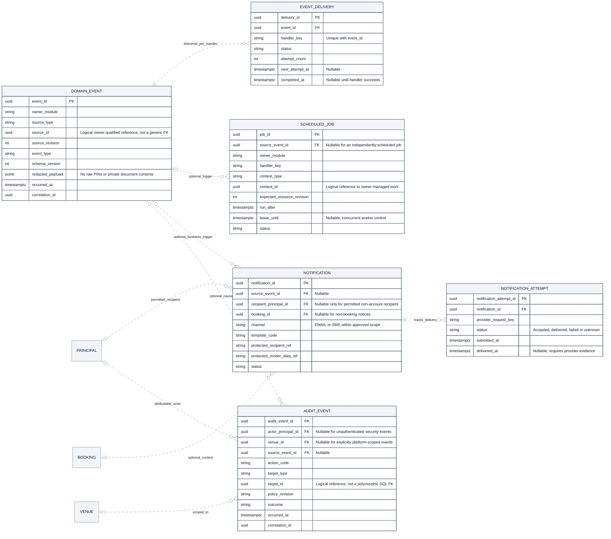

# CineNest ER Diagram 08: Durable Work, Notifications and Audit Records

**View:** 08 of 08 
**Export date:** 2026-10-14 
**Status:** Proposed logical model; implementation and database acceptance not verified. 
**Artifact:** Requested standalone Markdown export; no repository or canonical knowledge file modified.

## Purpose

Represent committed business-event intent, per-handler delivery, scheduled work, customer/staff notification attempts and attributable audit records. These are logical persistence concepts that should map to the selected supported framework and existing owner-specific storage.

## Editable ER diagram

## Entities and ownership

| Owner / area | Entities | Responsibility and boundary |
| --- | --- | --- |
| Durable-work infrastructure with explicit storage owner | DOMAIN_EVENT, EVENT_DELIVERY, SCHEDULED_JOB | Persist committed intent and dispatch state while leaving handlers, business decisions and retries with the owning module. |
| Notifications | NOTIFICATION, NOTIFICATION_ATTEMPT | Permitted recipients/content, provider attempts and actual submission/delivery outcomes. |
| Audit | AUDIT_EVENT | Attributable, redacted and protected evidence of sensitive actions and relevant denials. |
| Referenced owners | PRINCIPAL, VENUE, BOOKING | Identity, scope and permitted business context; not a universal shared data-access service. |

## Key constraints and interpretation

1. Where the chosen framework already provides a publication registry or session/work tables, map these concepts to it. Do not create duplicate registries merely because this ER view names logical entities.

2. EVENT_DELIVERY requires unique (event_id, handler_key) semantics. A committed event can legitimately have zero delivery records when it has no applicable consumer; it must not be sent to every module by default.

3. source_type/source_id, context_type/context_id and target_type/target_id are owner-qualified logical references. They are not conventional foreign keys to an arbitrary table. Define event schema validation and retention/lookup behavior explicitly.

4. Record business state and the necessary follow-up intent in the same local transaction. External provider operations, object storage and device commands do not become part of that database commit.

5. Jobs need explicitly owned handlers, concurrency-safe claiming/leases, bounded retries and recovery. expected_resource_revision helps reject stale provisioning, notifications or activation work; storing it alone does not implement the guard.

6. One NOTIFICATION can have many attempts. Provider acceptance, confirmed delivery, failure and unknown outcome are separate states. A failed notification must not undo payment, erase a review queue item or imply that a booking failed.

7. For a principal-linked recipient, the destination still requires policy-appropriate validation. A null principal is allowed only for an explicitly permitted non-account recipient, not unrestricted arbitrary sending.

8. Restricted credential delivery, where approved, must use protected rendering data and tightly scoped processing. Raw PINs, full evidence documents, banking secrets and session tokens do not belong in generic events or audit logs.

9. AUDIT_EVENT must retain actor, outcome, scope, target, policy reference and correlation where required. A null actor can describe an unauthenticated security event; a missing venue is not permission to expose the event across all venues.

10. Append-oriented audit protection, tamper resistance, deletion/retention and access restrictions require implementation and operational evidence. An entity name does not establish immutability or compliance.

11. Reporting uses authorized queries or separately owned projections as justified. This view does not introduce an analytics database, Kafka, TimescaleDB, active Redis, multi-tenant subscription system or a universal workflow owner.

## Decisions and checks still required

Select the actual framework-to-table mapping, delivery semantics, lease/retry rules, projection requirements and cleanup/retention design before physical schema approval.

Audit retention and event/job lifetime must accommodate necessary evidence and privacy requirements. Detailed policy values and decision owners remain explicit open items where unapproved.

## Reading the ER notation

| Notation | Meaning in these exports |
| --- | --- |
| `PK` | Primary key. Multiple PK attributes in one entity form a composite key. |
| `FK` | Proposed reference to another entity. Whether a cross-module link is enforced by a physical SQL FK is a separate implementation decision. |
| `UK` | Proposed unique key; comments identify composite or scoped uniqueness where needed. |
| `\|\|` | Exactly one at that relationship endpoint. |
| `o\|` / `\|o` | Zero or one at the relevant endpoint. |
| `o{` / `}o` | Zero or many at the relevant endpoint. |
| `\|{` / `}\|` | One or many at the relevant endpoint. |
| `--` | Identifying relationship: the parent's identity contributes to the child's identity in this model. |
| `..` | Non-identifying relationship. **Dashed lines do not mean optional, asynchronous, or unimplemented.** Optionality comes from the endpoint markers. |

Relationships are not calls, message directions, or execution order. Entity names repeated in different views refer to the same logical entity, not duplicate tables. An entity shown without fields is a reference stub; its attributes are expanded in the relevant companion view. Selected fields do not constitute an exhaustive physical schema.

Types such as `uuid`, `timestamptz`, `bigint`, `numeric` and `jsonb` are proposed descriptive types, not a migration. Money fields use minor units or exact decimal quantities under an explicit currency/rounding policy. Dates, times, nullability, source identity, sums, scope consistency, XOR ownership and non-overlap need actual constraints and tests; the picture does not enforce them.

## Scope, source and approval status

This export preserves the **eight detailed CineNest ER views** discussed in the conversation and the corrected `CineNest_ER_Diagram_Corrected.png` overview. It is informed by the preceding mind-map, use-case, activity, sequence, context and corrected component views. The earlier automatically generated ER poster is not the authoritative source for keys, entity names, privacy fields or cardinalities.

The model remains **proposed and not implementation-verified**. No SQL schema was reverse-engineered from a running database. Exact class/table names, constraints, cross-module coordination and remaining policies need approval and verification. Do not infer raw-password sign-in, a plaintext `pin_code` field on bookings, generic public identity-document URLs, unrelated personal-profile collection, active Redis, Kafka, TimescaleDB or a subscription/tenant model from this export.

Each module owns its operational records; a relationship is not permission for cross-module repository injection or unrestricted joins. Protected operations use scoped RBAC + ABAC and still enforce their owning business invariants. Runtime integrations, physical installation, emergency egress and recovery require separate evidence.

The repository's four canonical documents (`PROJECT.md`, `ARCHITECTURE.md`, `DESIGN.md`, `PROGRESS.md`) and authoritative registries retain decision and implementation authority. These owner-requested standalone exports do **not** modify the project repository, create a second canonical knowledge base, select unapproved technologies/policies or claim application, payment, provider or hardware tests passed.

## Related ER views

- [01. Core Relationship Overview](01_ER_Diagrams_Core_Relationship_Overview.md)
- [02. Identity, Sessions and Scoped RBAC + ABAC](02_ER_Diagrams_Identity_Sessions_and_Scoped_RBAC_ABAC.md)
- [04. Quotes, Reservation Holds and Immutable Booking Revisions](04_ER_Diagrams_Quotes_Reservation_Holds_and_Booking_Revisions.md)
- [05. Gateway Payments, Manual Bank Evidence, Allocations and Refunds](05_ER_Diagrams_Payments_Bank_Evidence_Allocations_and_Refunds.md)
- [06. Identity Evidence, Guest Check-in and Access Credentials](06_ER_Diagrams_Identity_Evidence_Guest_Check_In_and_Access_Credentials.md)
- [07. Sessions, Devices, Maintenance and Operational Readiness](07_ER_Diagrams_Sessions_Devices_Maintenance_and_Readiness.md)

## Rendering

Open this file in a Mermaid-enabled Markdown viewer to render its fenced `erDiagram` block. Use zoom for the larger models. The prose, attributes and relationships remain readable as text without a renderer.

If the viewer cannot parse Mermaid YAML configuration, remove only the initial `---` configuration section **inside** the Mermaid fence, retaining `erDiagram` and the remaining lines. Renderer/version support is required for ER direction and key annotations. No external font, image or script assets are required to render these Markdown diagrams.
