# CineNest Activity Diagram 09: Room Maintenance and Controlled Closure

**Diagram:** 09 of 10 
**Export date:** 2026-10-14 
**Status:** Proposed workflow; implementation and execution tests not verified. 
**Artifact:** Standalone requested Markdown export; no project/repository files modified.

## Purpose

Make the separate room-maintenance workflow from the overview poster editable: authorize the request, resolve reservation conflicts, record a durable inventory block, perform maintenance, and reopen only after actual readiness.

This additional standalone activity covers a separate workflow shown in the overview poster. It is adapted from that panel and the supplied use-case descriptions, with existing authorization, inventory, and safety guards made explicit.

## Participants and responsibilities

| Participant | Responsibility |
| --- | --- |
| Authorized venue / operations staff | Requests, schedules, and records maintenance within permitted room scope. |
| Booking and room modules | Control blocking intervals and current operational readiness without silently cancelling sold reservations. |
| Maintenance / qualified responders | Perform necessary work and provide required operational or physical assurance. |
| Affected customer / finance personnel | Participate in approved amendments, cancellations, or refunds where bookings are impacted. |

## Editable activity diagram

```mermaid
---
config:
  theme: base
  themeVariables:
    fontFamily: Arial, sans-serif
    fontSize: 16px
    primaryColor: '#F0EEFF'
    primaryTextColor: '#111827'
    primaryBorderColor: '#5B4BFF'
    lineColor: '#64748B'
  flowchart:
    curve: linear
---
flowchart TB
    Start((Start)) --> Request("Staff: request room maintenance<br/>with interval, reason and affected resources")
    Request --> Auth[["Evaluate current permission and venue scope: Activity 05"]]
    Auth --> Allowed{"Authorized and request valid?"}
    Allowed -->|No| Denied([End: denied or invalid; no maintenance block created])
    Allowed -->|Yes| Inspect("Check operating configuration,<br/>holds, bookings and existing blocking intervals")
    Inspect --> Conflict{"Existing reservations<br/>or protected holds affected?"}
    Conflict -->|Yes| Resolve("Keep maintenance request pending<br/>Show affected records to authorized staff")
    Resolve --> Plan{"Approved resolution and necessary<br/>customer agreement available?"}
    Plan -->|No| Pending([Pause: planned maintenance not activated])
    Plan -->|Yes| Amend[["Apply controlled amendments / cancellations<br/>and financial resolution: Activities 06 and 07"]]
    Amend --> Resolved{"Conflicts resolved<br/>without silently losing bookings or funds?"}
    Resolved -->|No| Pending
    Resolved -->|Yes| Inspect
    Conflict -->|No| CommitCheck{"At commit: scope, room revision<br/>and inventory still valid?"}
    CommitCheck -->|No| Inspect
    CommitCheck -->|Yes| Block("Commit maintenance block and audit atomically<br/>Prevent overlapping new reservations")
    Block --> Notify("Queue affected staff/customer notices<br/>Notification failure does not erase the block")
    Notify --> Due{"Approved maintenance<br/>window reached?"}
    Due -->|No| Wait("Keep scheduled block<br/>Wait for the recorded start")
    Wait -.->|Scheduled trigger| Due
    Due -->|Yes| Safe{"Room vacated and safe for the<br/>approved maintenance procedure?"}
    Safe -->|No or unknown| Incident[["Keep unavailable; invoke Activity 10<br/>Do not enter an unsafe work state"]]
    Incident --> PendingWork([Pause: maintenance / incident unresolved])
    Safe -->|Yes| Work("Perform maintenance and supported checks<br/>Record findings without changing unrelated bookings")
    Work --> Complete{"Work, required inspection and<br/>cleaning/reset checks complete?"}
    Complete -->|No| PendingWork
    Complete -->|Yes| Reopen{"Authorized block release/end reached<br/>and no other safety/access/maintenance restriction?"}
    Reopen -->|No| Held([End: maintenance status retained; follow-up required])
    Reopen -->|Yes| Release("Close only this authorized block<br/>Record readiness; preserve other reservations and blocks")
    Release --> Done([End: maintenance complete; availability remains inventory-driven])
    Note["Derived from the overview poster's maintenance panel.<br/>Planned maintenance does not silently cancel purchased bookings.<br/>Emergency restrictions use the separately approved incident procedure.<br/>Completing a task or elapsed time alone does not prove room readiness."]
    Note -.- Block

    classDef terminal fill:#0B1526,color:#FFFFFF,stroke:#0B1526;
    classDef actor fill:#DBEAFE,color:#111827,stroke:#2878FF;
    classDef decision fill:#FFF7E6,color:#111827,stroke:#B45309;
    classDef success fill:#DCFCE7,color:#14532D,stroke:#15803D;
    classDef exception fill:#FEE2E2,color:#7F1D1D,stroke:#B91C1C;
    classDef pending fill:#FFF7E6,color:#111827,stroke:#B45309;
    classDef note fill:#F8FAFC,color:#475569,stroke:#94A3B8,stroke-dasharray:4 3;
    class Start,Denied,Pending,PendingWork,Held terminal;
    class Request,Work actor;
    class Allowed,Conflict,Plan,Resolved,CommitCheck,Due,Safe,Complete,Reopen decision;
    class Resolve,Wait pending;
    class Block,Release,Done success;
    class Note note;
```

## Diagram notation

This is an **activity-style control-flow diagram expressed with Mermaid flowchart notation**, not a strict UML/XMI model. It preserves the discussed workflow decisions without claiming executable behavior.

- The start circle begins this activity; nodes labeled **End** or **Pause** identify outcomes. A pause does not mean the booking, money, or incident has disappeared.
- Rounded actions describe work. Diamonds are decisions with labeled guards/outcomes. Double-border boxes reference another activity.
- Solid arrows show control flow. Dashed arrows with labels represent later events or retries; unlabelled dashed note connectors do not control execution.
- Blue actions identify people or external interactions where labeled; pale violet is ordinary system work, amber is a decision or pending state, green is a verified successful outcome, and red is an exception. Text remains authoritative over color.
- Responsibility is written in node labels and the participant table. These are not fixed swimlane columns. Sequential drawing does not make remote operations one atomic transaction, and no parallel fork/join is implied unless explicitly shown.

Render the fenced `mermaid` block in a Mermaid-capable Markdown viewer. The surrounding text remains readable without rendering. The viewer must support Mermaid frontmatter configuration; remove only the `---` configuration section inside the block when using a renderer that does not support it.

## Main activity outline

1. Authorize a maintenance request for the intended venue, room, and time interval.
2. Check authoritative inventory, including existing bookings, provisional holds, cleaning, and other maintenance.
3. If there are conflicts, use approved amendment/cancellation and payment-resolution workflows before planned activation.
4. Recheck at commit and record the non-overlapping maintenance block durably; queue notifications.
5. At the approved window, verify that the room is actually vacated and safe for the intended work.
6. Perform maintenance, required inspections, and cleaning/reset checks.
7. Release only the appropriate block under authorization and record readiness without overriding other bookings or restrictions.

## Guards and interpretation rules

- This is the planned-maintenance route. A genuine safety emergency may require immediate restrictions through an approved incident procedure rather than waiting for normal rescheduling.
- Maintenance and bookings must use the same authoritative inventory conflict protection.
- The depicted review loops require bounded conflict handling; they are not permission to busy-loop or silently extend holds.
- A reservation conflict cannot be resolved by erasing customer bookings or financial obligations.
- Early reopening or extending a maintenance window requires its own scope and inventory checks.
- Qualified physical inspection requirements are determined by the installed equipment and approved procedure, not by this Markdown export.
- A ready room is not necessarily free for immediate booking; the availability engine still applies all other constraints.

## Alternative outcomes and recovery

| Condition | Intended handling |
| --- | --- |
| Maintenance conflicts with bookings | Keep request pending and propose authorized alternatives. |
| New conflict between preview and commit | Abort stale commit and re-evaluate current inventory. |
| Occupancy / safety unknown at work time | Keep unavailable and escalate through Activity 10. |
| Work incomplete / failed inspection | Retain restrictions and assign actual follow-up rather than marking available. |

## Review before implementation

Treat this diagram as an analysis/design view. Trace every guard and recovery route to the corresponding canonical requirement and planned acceptance check. Test authorization, state changes, duplicate processing, concurrency, and recovery as applicable. For physical/device outcomes, distinguish a simulation from actual hardware evidence. No application, payment-provider, or hardware acceptance test is claimed by this export.

## Related activity diagrams

- [03. Package Editing, Publication and Deactivation](03_ActivityDiagram_Package_Editing_Publication_and_Deactivation.md)
- [05. Scoped RBAC and ABAC Authorization](05_ActivityDiagram_Scoped_RBAC_and_ABAC_Authorization.md)
- [06. Booking Amendment and Session Extension](06_ActivityDiagram_Booking_Amendment_and_Session_Extension.md)
- [07. Booking Cancellation and Refund Execution](07_ActivityDiagram_Booking_Cancellation_and_Refund_Execution.md)
- [08. Cinema Entry, IoT Control and Room Reset](08_ActivityDiagram_Cinema_Entry_IoT_Control_and_Room_Reset.md)
- [10. Operational Incident and Recovery](10_ActivityDiagram_Operational_Incident_and_Recovery.md)

## Source and authority

- Overview activity poster: Room Maintenance Management
- Use-case export 02: Package and Venue Administration
- Use-case export 05: Cinema Access and IoT Operations; additional detail adapted for a separate export

These files are standalone exports, not updates to the repository. The current four canonical knowledge documents (`PROJECT.md`, `ARCHITECTURE.md`, `DESIGN.md`, `PROGRESS.md`) and their authoritative registries continue to govern requirements, approvals, and implementation state.

Diagram labels, actor bundles, pending policies, timer values, provider/hardware choices, and retry behavior retain their actual canonical status. This export neither approves unresolved policies nor certifies application code, external integrations, bank reconciliation, device behavior, or physical safety. All protected operations use the applicable scoped authorization; business invariants remain separate.
