# CineNest Activity Diagram 10: Operational Incident and Recovery

**Diagram:** 10 of 10 
**Export date:** 2026-10-14 
**Status:** Proposed workflow; implementation and execution tests not verified. 
**Artifact:** Standalone requested Markdown export; no project/repository files modified.

## Purpose

Make the overview poster's operational-exception workflow editable, with protected incident intake, safety-first response, scoped recovery, verification, and separate customer/financial follow-up.

This additional standalone activity covers a separate workflow shown in the overview poster. It is adapted from that panel and the supplied use-case descriptions, with existing authorization, inventory, and safety guards made explicit.

## Participants and responsibilities

| Participant | Responsibility |
| --- | --- |
| Customer, registered device, monitoring worker, or staff | Provides a permitted incident report or operational signal. |
| CineNest incident / operations workflow | Records context, assesses impact, assigns a responder, and retains actual state. |
| Authorized responder / qualified on-site personnel | Applies approved procedures and verifies safe recovery. |
| Payments, Booking, Access, and Notification modules | Handle their own consequences without conflating incident closure with refunds or access success. |

## Editable activity diagram

```mermaid
---
config:
  theme: base
  themeVariables:
    fontFamily: Arial, sans-serif
    fontSize: 16px
    primaryColor: '#F0EEFF'
    primaryTextColor: '#111827'
    primaryBorderColor: '#5B4BFF'
    lineColor: '#64748B'
  flowchart:
    curve: linear
---
flowchart TB
    Start((Start)) --> Intake("Receive customer report, registered-device event<br/>or authorized monitoring/staff observation")
    Intake --> Valid{"Source and supplied target<br/>permitted for this intake?"}
    Valid -->|No| Deny("Reject unauthorized system operation<br/>Record safe security information where appropriate")
    Deny --> Rejected([End: invalid intake rejected])
    Valid -->|Yes| Record("Create or correlate incident<br/>Capture room, booking, command and observed timestamps")
    Record --> Triage("Assess impact from actual evidence<br/>Assign an authorized responder; show unknowns honestly")
    Triage --> Safety{"Immediate life-safety risk<br/>suspected or reported?"}
    Safety -->|Yes| Emergency("Invoke approved local safety response<br/>Independent emergency exit does not wait for software")
    Emergency --> Protect("Keep affected room restricted<br/>Preserve evidence and arrange qualified assistance")
    Protect --> SafeNow{"Immediate safety response completed<br/>and authorized personnel permit technical recovery?"}
    SafeNow -->|No| SafetyPending([Pause: incident open; room remains restricted])
    SafeNow -->|Yes| RecoveryPlan
    Safety -->|No| RecoveryPlan("Review the current booking/device revision,<br/>prior attempts and permitted recovery options")
    RecoveryPlan --> Auth[["Authorize each protected recovery action: Activity 05"]]
    Auth --> Possible{"Safe supported action and<br/>appropriate authorization available?"}
    Possible -->|No| Escalate("Escalate with an owner and follow-up<br/>Preserve payment, booking and incident state")
    Escalate --> Pending([Pause: unresolved incident])
    Possible -->|Yes| Reconcile("Reconcile earlier commands and external outcomes<br/>Do not blindly repeat unlocks, payments or refunds")
    Reconcile --> Act("Perform approved bounded recovery<br/>Use tested local fallback only where applicable")
    Act --> Verify("Inspect trustworthy observations and<br/>required on-site/service checks")
    Verify --> Restored{"Service and required safety/readiness<br/>checks actually restored?"}
    Restored -->|No or unknown| Retry{"Another safe attempt permitted<br/>within the approved retry/deadline policy?"}
    Retry -->|Yes| RecoveryPlan
    Retry -->|No| Escalate
    Restored -->|Yes| Followup("Record restoration evidence and residual obligations<br/>Queue booking/payment/refund or access follow-up as needed")
    Followup --> Ready("Update only verified operational state<br/>Room availability still requires Activity 08/09 readiness")
    Ready --> Notice("Notify permitted customer/staff recipients<br/>Keep delivery and financial outcomes separately tracked")
    Notice --> Closed([End: technical incident resolved; other obligations remain visible])
    Note["Derived from the overview poster's operational-exception panel.<br/>A customer emergency call is not a privileged remote-control grant.<br/>Cloud remote unlock cannot solve a total connectivity outage.<br/>No unsupported automatic siren or unsafe power action is implied.<br/>Incident closure does not claim refund completion or unverified readiness."]
    Note -.- Triage

    classDef terminal fill:#0B1526,color:#FFFFFF,stroke:#0B1526;
    classDef actor fill:#DBEAFE,color:#111827,stroke:#2878FF;
    classDef decision fill:#FFF7E6,color:#111827,stroke:#B45309;
    classDef success fill:#DCFCE7,color:#14532D,stroke:#15803D;
    classDef exception fill:#FEE2E2,color:#7F1D1D,stroke:#B91C1C;
    classDef pending fill:#FFF7E6,color:#111827,stroke:#B45309;
    classDef note fill:#F8FAFC,color:#475569,stroke:#94A3B8,stroke-dasharray:4 3;
    class Start,Rejected,SafetyPending,Pending terminal;
    class Intake,Act actor;
    class Valid,Safety,SafeNow,Possible,Restored,Retry decision;
    class Deny,Emergency,Protect exception;
    class Escalate pending;
    class Followup,Ready,Closed success;
    class Note note;
```

## Diagram notation

This is an **activity-style control-flow diagram expressed with Mermaid flowchart notation**, not a strict UML/XMI model. It preserves the discussed workflow decisions without claiming executable behavior.

- The start circle begins this activity; nodes labeled **End** or **Pause** identify outcomes. A pause does not mean the booking, money, or incident has disappeared.
- Rounded actions describe work. Diamonds are decisions with labeled guards/outcomes. Double-border boxes reference another activity.
- Solid arrows show control flow. Dashed arrows with labels represent later events or retries; unlabelled dashed note connectors do not control execution.
- Blue actions identify people or external interactions where labeled; pale violet is ordinary system work, amber is a decision or pending state, green is a verified successful outcome, and red is an exception. Text remains authoritative over color.
- Responsibility is written in node labels and the participant table. These are not fixed swimlane columns. Sequential drawing does not make remote operations one atomic transaction, and no parallel fork/join is implied unless explicitly shown.

Render the fenced `mermaid` block in a Mermaid-capable Markdown viewer. The surrounding text remains readable without rendering. The viewer must support Mermaid frontmatter configuration; remove only the `---` configuration section inside the block when using a renderer that does not support it.

## Main activity outline

1. Accept a permitted incident report or authenticated operational signal and correlate it with the relevant resources.
2. Assess actual impact and assign an authorized responder; do not equate stale telemetry with healthy or available.
3. When safety risk is suspected, invoke the separately approved local response without making emergency egress depend on software.
4. Check current state, prior command results, supported capabilities, and scoped recovery authority.
5. Reconcile before retrying, then perform only a bounded approved action or tested fallback.
6. Verify recovery using trustworthy device/service observations and necessary physical checks.
7. Record residual customer, booking, payment, or refund obligations and update only the operational state actually established.
8. Close the technical incident when its criteria are satisfied; keep any separate financial or notification work visible.

## Guards and interpretation rules

- The intake authorization protects system data/actions; it does not prevent a person using an independent emergency or support channel.
- Priority, retry counts, escalation times, responder assignments, and fallback procedures retain their canonical approval status.
- A restart, remote unlock, or power change is not automatically safe just because it appears as a button.
- Total network failure may remove cloud control; only tested local behavior and real response procedures can be relied on.
- Use separate module-owned workflows for amendment, cancellation, refund, and access repair.
- An incident can be technically resolved while a separately tracked refund is pending. Do not hide the outstanding obligation.
- Reopening the room requires actual readiness and inventory checks, not simply an incident-status change.

## Alternative outcomes and recovery

| Condition | Intended handling |
| --- | --- |
| Unknown source or unauthorized target | Deny protected processing and record a safe security event where appropriate. |
| Immediate safety risk | Keep the room restricted and use qualified local response independently of app availability. |
| Recovery not supported / authority missing | Escalate and retain unresolved state; do not fabricate a safe fallback. |
| Repeated unknown or failed command | Reconcile and observe bounded limits before any further attempt. |
| Service cannot be restored for the booking | Coordinate an approved alternative or financial resolution without erasing received funds. |

## Review before implementation

Treat this diagram as an analysis/design view. Trace every guard and recovery route to the corresponding canonical requirement and planned acceptance check. Test authorization, state changes, duplicate processing, concurrency, and recovery as applicable. For physical/device outcomes, distinguish a simulation from actual hardware evidence. No application, payment-provider, or hardware acceptance test is claimed by this export.

## Related activity diagrams

- [02. Bank Deposit, Receipt Review and Approval](02_ActivityDiagram_Bank_Deposit_Receipt_Review_and_Approval.md)
- [05. Scoped RBAC and ABAC Authorization](05_ActivityDiagram_Scoped_RBAC_and_ABAC_Authorization.md)
- [06. Booking Amendment and Session Extension](06_ActivityDiagram_Booking_Amendment_and_Session_Extension.md)
- [07. Booking Cancellation and Refund Execution](07_ActivityDiagram_Booking_Cancellation_and_Refund_Execution.md)
- [08. Cinema Entry, IoT Control and Room Reset](08_ActivityDiagram_Cinema_Entry_IoT_Control_and_Room_Reset.md)
- [09. Room Maintenance and Controlled Closure](09_ActivityDiagram_Room_Maintenance_and_Controlled_Closure.md)

## Source and authority

- Overview activity poster: Handle Operational Exception
- Use-case export 05: Cinema Access and IoT Operations
- Use-case export 03: Payments, Bank Review and Refunds; additional detail adapted for a separate export

These files are standalone exports, not updates to the repository. The current four canonical knowledge documents (`PROJECT.md`, `ARCHITECTURE.md`, `DESIGN.md`, `PROGRESS.md`) and their authoritative registries continue to govern requirements, approvals, and implementation state.

Diagram labels, actor bundles, pending policies, timer values, provider/hardware choices, and retry behavior retain their actual canonical status. This export neither approves unresolved policies nor certifies application code, external integrations, bank reconciliation, device behavior, or physical safety. All protected operations use the applicable scoped authorization; business invariants remain separate.
