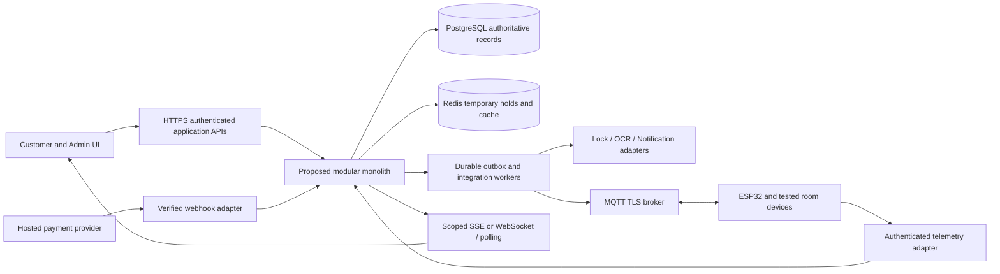

# CineNest Architecture

This document owns technology proposals, module/data/API and integration design, security/privacy, IoT and decision history. [Project](PROJECT.md), [design](DESIGN.md), [progress](PROGRESS.md). Business definitions belong in PROJECT; their enforcement belongs here.

**OWNER-APPROVED INITIAL DIRECTION (S16):** [approved scope](#stack-approval), after comparison with CN-DEC-001. S11 authorized historical research/brief only; S16 approves technology direction, with exact dependency/runtime qualification PENDING and implementation NOT_GRANTED. CN-FND-001 now has a locally verified build/runtime foundation at [current baseline](#foundation-qualified-baseline); product features/providers/hardware remain unimplemented. Exact patches/support and team capacity remain unverified implementation prerequisites. All candidate/vendor descriptions below are recommended/open, not supported account/hardware claims.

## Navigation

- [Technical delivery gates](#delivery-gates)
- [Technology](#technology)
- [System Architecture](#system-architecture)
- [Data Api](#data-api)
- [Security Privacy](#security-privacy)
- [Hybrid authorization](#authorization)
- [Iot Access](#iot-access)
- [Adr 002](#adr-002)
- [Adr 003](#adr-003)
- [Adr 004](#adr-004)
- [Open Decisions](#open-decisions)
- [Initial Stack Brief](#initial-stack-brief)

<a id="ui-implemented-boundary"></a>
## Implemented shared UI boundary — 2026-10-16

CN-UI-001 provides one root ApplicationShell and five public preview pages: /, /account, /admin, /admin/components, /admin/account. Public shell visibility is not an administration grant; unavailable business modules are Planned text without working routes. No client role/capability is invented. Generic synthetic UI examples have one shared filtered collection for cards/tables, separate from production state. No direct database or frontend business rules.

The optional CINENEST_AUTH_ORIGIN server environment value configures only the existing backend origin (HTTPS, or HTTP loopback for local verification; origin only, no credentials/path/query). Without configuration, the three same-origin transport adapters return 503 and the UI shows unconfigured state. GET /api/accounts/me, GET /api/session/csrf and POST /api/session/logout forward only those exact existing CN-AUTH-001 routes. No new authentication/admission endpoint, provider redirect proxy or second session store. Sign-in/provider/TLS deployment configuration remains separately qualified; no fake login button or production default. Requests forward only CINENEST_SESSION, not arbitrary cookies, Authorization, query roles or owner/venue attributes. Logout requires same incoming Host/request protocol Origin and the backend CSRF header; forwarded host headers never establish authority. Backend redirects/raw errors are not relayed. Account responses expose accountId/eligibility only; csrf is transient for the existing logout mechanism. All responses no-store, no sensitive logs/storage; network failures are safe 502 states. The five-second transport timeout is a technical request bound, not session expiry or authorization lifetime.

Client presentation reads no roles; eligibility failure/401/403 clears the visible account. It clears data before refresh/logout, when window focus returns, and rejects stale async results on navigation; this is presentation hygiene, not revocation enforcement. Backend still checks current authority. Isolated backend PostgreSQL evidence and actual HTTP transport tests are separate from simulated browser response tests; no full live-provider/browser session integration claim. Dependency versions, lockfile, backend policy and V1/V2 remain unchanged. See [execution](PROGRESS.md#ui-implementation) and [visual baseline](DESIGN.md#ui-implemented-baseline).

<a id="od11-resolution"></a>
## OD-11 resolution and bounded UI authority — 2026-10-16

The exact question “Requested source palette differs from checked-in proposed tokens” matches the current owner decision. OD-11 is APPROVED: preserve current checked-in tokens for CN-UI-001; no alternate-palette migration or new component library. [DESIGN](DESIGN.md#od11-approved-baseline) owns the approved visual baseline and future review conditions. The existing OD-11 registry entry retains its original question/options/impact/evidence requirement as historicalContext. Original source-pack fidelity and future migration review are not falsely declared verified.

CN-UI-001 keeps its original dependency CN-FND-001, recorded scope/exclusions/DoD and requirements. Foundation and bounded auth are VERIFIED/CLOSED. Owner authority is granted for the existing bounded shell/primitives unit after readiness, not room/package/booking/payment/report/IoT features, a second auth system or production operations. Existing authenticated/session presentation may consume already-supported boundaries without extending their policy. No new library, infrastructure, application source or token change in this decision session.

Historical OD-11 gate row (superseded by approved baseline):

| OD-11 | Requested source palette differs from checked-in proposed tokens | DESIGN_IMPLEMENTATION_GATE |

<a id="auth-implemented-boundary"></a>
## Implemented CN-AUTH-001 boundary — 2026-10-15

The [approved bounded policy](#auth-bounded-policy) is implemented for explicitly associated synthetic accounts only; see [execution evidence](PROGRESS.md#auth-implementation). This does not approve production admission, MFA, provider onboarding, global role administration or broader OD-01 choices. Boot 4.1.1 manages Spring Security 7.1.1 and Spring Session JDBC 4.1.1; the existing Modulith 2.1.1 baseline remains. No independent dependency-version override or second session system.

V2__identity_accounts_grants_sessions.sql adds only the Identity-owned cinenest_identity schema: account, unique issuer/subject external_identity, trusted account_scope venue assignments, action/scope access_grant, redacted security_audit, and framework http_session/http_session_attributes. V1 is unchanged. No tenant hierarchy, production seeds, full venue catalog, role bundle or business tables are introduced. SELF is implicit ownership for minimum own-account read; the only recognized cross-account permission is account.read with a matching VENUE grant and target assignment. Missing/null venue is not a wildcard. Grant scope and action are evaluated together, with current actor eligibility, in one parameterized SQL read; no positive authorization cache. PostgreSQL committed-state snapshots apply: a request already reading an earlier committed snapshot is not retroactively cancelled; subsequent reads see committed revocation. Sensitive mutations/concurrency rules remain future task work.

Authentication is disabled unless cinenest.identity.enabled=true. Enabling requires explicit positive cinenest.identity.session-timeout-seconds and configured issuer, authorization-uri, token-uri, jwk-set-uri, client-id and client-secret under cinenest.identity; no production timeout or credential default. The OIDC authorization-code flow validates signed issuer/subject/audience/expiry/nonce/state before explicit association; email never merges/provisions accounts. Only synthetic=true, ELIGIBLE associated accounts are admitted. Provider tokens are discarded after validation; the persisted principal is the local UUID. No password flow or token login API. Secure/HttpOnly/SameSite=Lax framework cookie and CSRF-protected POST logout; session ID rotates at login. JDBC session state is shared across instances, with inactivity expiry and active-session invalidation; this is not global logout.

Exact surface when enabled: GET /oauth2/authorization/cinenest and GET /login/oauth2/code/cinenest are protocol entry/callback only; GET /api/accounts/me and GET /api/accounts/{accountId} are authenticated current-state protected reads returning only accountId and eligibility, no-store; GET /api/session/csrf supplies the authenticated logout CSRF token, with current eligibility checked; POST /api/session/logout requires framework CSRF. Unknown/foreign/malformed account targets return the same empty 403; unauthenticated/invalid sessions receive 401. Everything else is denied. No account directory, grant-management endpoint, mutation or business invariant bypass. Audit stores local actor/target UUID where known, event kind/outcome and server timestamp only; no raw session/provider token, query, PII or secret payload. Failed unknown authentication has no local actor attribution.

Local acceptance uses an isolated signed synthetic OIDC issuer and PostgreSQL, explicitly seeded by tests, never runtime seeds. The loopback HTTP harness explicitly transports the application's still-Secure cookie for protocol testing; it is not a rendered-browser TLS/SameSite certification or live Google test. Missing production policies remain visible in the original decisions. Module verification and API/internal dependency rules cover foundation and identity; no foreign internal repository injection.

<a id="auth-bounded-policy"></a>
## CN-AUTH-001 approved bounded account/session contract — 2026-10-15

Current owner approval (request SHA-256 in OD-01.boundedAuthPolicyApproval and existing status.authReadinessReconciliation) resolves the remaining policy gates for **CN-AUTH-001 only**. The authoritative task still means “First owner/venue scoped session/auth interfaces and permitted account read”; no scope expansion, new task or full security roadmap approval. CN-FND-001 is VERIFIED/CLOSED and OD-12 approves single-organization venue-scoped authorization. CN-AUTH-001 is now READY / PLANNED under existing conditional implementation authorization, not implemented/verified. This session records decisions only. Auth-specific library/configuration qualification is work to perform within the future unit on the verified foundation, not missing owner policy evidence.

Approved admission is explicitly associated synthetic/test accounts only. Stable provider identity semantics govern association (provider/issuer and stable subject); email must not become the authoritative key or trigger automatic account merging. No automatic production provisioning, production self-registration or provider onboarding. Google provider login does not establish age, identity evidence or consent; canonical backend-owned OIDC/session recommendations remain subject to actual configuration/protocol tests, with no real provider credentials/users selected here.

Own-account reads return only the minimum representation needed by the use case. Staff/service reads require an applicable grant containing both action permission and relevant target scope; current eligibility, ownership and venue/resource attributes come from authoritative server records. No account directory, unrelated-grant stitching, generic administrator bypass or client-supplied authority. No full financial/verification/operations permission catalog or service/device provisioning implied.

Application sessions are database-backed. Expiry configuration is mandatory; explicit deterministic local/test values are permitted but never production defaults or approved production timeout values. Current application session logout performs server-side invalidation; it does not mean global logout across every device. Evaluate current account eligibility and applicable database-backed grants on every protected request; no positive authorization decision cache. Suspended/ineligible accounts and revoked/expired applicable grants stop authorizing subsequent protected requests. More advanced production caching/revocation strategies remain deferred; no invented latency or numeric lifetime guarantee.

Record appropriate redacted authentication/authorization events; never raw session IDs/tokens, provider secrets, documents, access PINs, bank credentials or unrelated sensitive evidence. Audit does not authorize an operation. Production sensitive-data storage/retention/provider and real-user rollout remain open; this synthetic test contract does not set retention days or other unrelated policy values.

Explicitly deferred unless an existing task requirement genuinely needs them: document/OCR policies, financial limits/separation of duties, refunds, device/service provisioning, production IdP onboarding/account self-registration, passwords, SaaS identity behavior and payment/booking/verification/IoT endpoints. OD-01 remains OPEN for broader choices; OD-03/05/18/28 remain OPEN for their full feature/production scopes. Their bounded auth applicability is recorded in the same existing decision records. Earlier blocked/pending policy narratives are historical and superseded only for this bounded unit. No migration, application, frontend, build file or executable test changes in this decision session; all 18 planned authorization scenarios retain their actual NOT_RUN state.

<a id="organization-scope"></a>
### OD-12 approved organization and venue boundary

Owner decision 2026-10-15 selects **SINGLE-ORGANIZATION WITH VENUE-SCOPED AUTHORIZATION**, exactly matching OD-12's “Venue-scoped single organization vs explicit future tenant isolation” question. [PROJECT](PROJECT.md#organization-scope) owns the product scope; the existing OD-12 record owns approval provenance and retained historical context. Venue/resource IDs are business authorization attributes, not tenant boundaries. One CineNest operating organization may have multiple venues and venue-specific grants. Evaluate permission and target scope within an applicable grant; never combine unrelated grants. Customer ownership remains mandatory for private bookings/receipts/credentials; system administration supplies no implicit finance/evidence/physical-safety bypass.

No tenant subscriptions, tenant billing, tenant-level Super Admin product, holding-company hierarchy, organization signup/provisioning, per-tenant databases/schemas, speculative tenant_id propagation, cross-organization sharing or tenant-aware infrastructure without another approved requirement. Keep meaningful module interfaces and opaque IDs without speculative tenant abstractions. SaaS tenancy is deferred unless a separate owner decision supported by real business requirements changes the product model. Actual isolation enforcement and tests remain NOT_VERIFIED/NOT_RUN. Exact role bundles, session/revocation/privacy and high-risk approval policies remain at OD-01/03/05/18/28 as applicable; this decision authorizes no code.

<a id="technology"></a>
## Technology

### Historical candidate inventory and evidence discipline

The candidate rows below preserve pre-S16 recommendations and research, not competing current stack selections. S16 selects the initial version lines and responsibilities at [approval](#stack-approval); unlisted vendors/libraries/module details remain recommended/open. No patches or toolchain have been qualified.
No package.json, pom.xml, build.gradle, lockfile, application code, migrations or infrastructure configuration exists in the inspected repository. Current evidence for every layer below: **documentation only; Implementation NOT_VERIFIED**. Recommendations come from S1; preferred does not mean APPROVED. No versions are pinned or claimed latest. No dependency installs/runtime config changes were made. No current provider country/product/API support is asserted; all requires official documentation and account/model validation before selection. This avoids treating an unseen proposal PDF as evidence.

| Layer | Current evidence | Preferred recommendation | Alternatives | Purpose | Dependencies | Risks | Decision | Validation needed |
|---|---|---|---|---|---|---|---|---|
| Customer/admin UI | Docs only; NOT_VERIFIED | Next.js, React, TypeScript, Tailwind CSS and shared CineNest components/tokens | Other compatible React deployment patterns | Shared accessible public/admin UI | Hosting/build strategy and OIDC/payment integration | Server/client boundary, CSP and upgrade compatibility | RECOMMENDED; provider/library selection OPEN_DECISION | Architecture/design proof of concept, hosting and accessibility QA |
| Client data/forms | Docs only; NOT_VERIFIED | TanStack Query, React Hook Form and Zod candidates | Native forms/fetch; alternatives only after evaluation | Async cache, forms and input schema ergonomics | Chosen React/Next.js stack; server validation remains authoritative | Duplicate validation schemas, stale cache/permission leaks | RECOMMENDED; provider/library selection OPEN_DECISION | Evaluate version compatibility; never use client schemas as security boundary |
| Accessible components | Docs only; NOT_VERIFIED | One consistent accessible component library (not selected) | Evaluate compatible libraries against shared tokens | Keyboard/focus primitives and reusable CineNest controls | UI stack, styling and licensing | Vendor defaults contradict cinematic shell or a11y | RECOMMENDED; provider/library selection OPEN_DECISION | Keyboard/screen-reader/reflow test representative booking/dialog/table flows |
| Charts | Docs only; NOT_VERIFIED | Recharts OR Apache ECharts; select one | Accessible table-first visualization where sufficient | Canonical charts/metrics | React integration and semantic chart contracts | Bundle cost, accessible descriptions and mobile tooltip behavior | RECOMMENDED; provider/library selection OPEN_DECISION | Compare required charts, licensing, data table support and render performance |
| Backend | Docs only; NOT_VERIFIED | Java Spring Boot with Spring Modulith modular monolith | Node.js with NestJS from S1-described proposal (PDF not read) | Explicit module boundaries in one initial deployable | Team skills, Java/toolchain and operational capacity | Boundary erosion, integration workflow and transaction design | RECOMMENDED; provider/library selection OPEN_DECISION | Record selection ADR; module boundary/test and deployment spike |
| Backend support | Docs only; NOT_VERIFIED | Spring Security, validation, Spring Data JPA, Flyway if Spring selected | Selected NestJS-compatible equivalents not chosen here | Authorization, input checks, persistence and migration discipline | Backend selection, database and module contracts | JPA coupling, migration ownership, security misconfiguration | RECOMMENDED; provider/library selection OPEN_DECISION | Compatibility review and module-owned migrations design; no migrations edited now |
| Authoritative storage | Docs only; NOT_VERIFIED | PostgreSQL | Equivalent transactional conflict guarantees subject to review | Accounts/reservations/quotes/ledgers and durable integration work | Schema ownership, range constraints and backups | Race conditions and cross-module table access | RECOMMENDED; provider/library selection OPEN_DECISION | Concurrent booking/extension/reschedule and recovery validation |
| Temporary holds/cache | Docs only; NOT_VERIFIED | Redis | Database-backed expiring holds for safe fallback | Short checkout holds and selected cache | Database reservation guard, expiry reconciliation | TTL loss, eviction, failover and stale availability | RECOMMENDED; provider/library selection OPEN_DECISION | Fault tests prove Redis absence cannot permit overlapping reservations |
| Private documents/assets | Docs only; NOT_VERIFIED | AWS S3 OR Cloudflare R2 | Approved private encrypted storage alternative | Private verification evidence and permitted media | Provider/privacy/region/key/retention choice | Exposure through signed links, cross-border processing, deletion lag | RECOMMENDED; provider/library selection OPEN_DECISION | Threat/privacy review; restricted URLs, encryption and delete lifecycle tests |
| Login/session | Docs only; NOT_VERIFIED | Google OpenID Connect, secure application sessions and backend authorization | Approved identity integration if constraints change | Customer login; stronger admin authentication | OIDC callbacks, cookie/CSRF strategy and privileged MFA decision | Account linking, token leakage and session fixation | RECOMMENDED; provider/library selection OPEN_DECISION | Provider protocol review, session expiry/revoke and privileged access testing |
| OCR | Docs only; NOT_VERIFIED | Google Cloud Vision OR AWS Textract OR validated alternative | Manual review or another evaluated extraction tool | Extract candidate document fields | Private storage, consent, regional/privacy review | OCR is not authenticity/identity/liveness proof; local script accuracy | RECOMMENDED; provider/library selection OPEN_DECISION | NIC/passport accuracy benchmark, exceptions and data processing review |
| Payments | Docs only; NOT_VERIFIED | PayHere OR supported bank IPG | Stripe only after merchant/country/product eligibility verified | Hosted checkout, verified notifications, refunds/reconciliation | Merchant underwriting, provider contract and webhook security | Unapproved business category, delayed capture/refund and fee rules | RECOMMENDED; provider/library selection OPEN_DECISION | Official provider/merchant confirmation plus sandbox and reconciliation tests |
| Locks/vendor API | Docs only; NOT_VERIFIED | Tested TTLock/Tuya-compatible hardware and supported vendor API candidates | Other tested compatible local access hardware | Time-bound entry, revoke and supported re-entry | Actual model/firmware/API agreement; safe egress hardware | Vendor cloud reliance, unsupported offline PIN/revocation and clock drift | RECOMMENDED; provider/library selection OPEN_DECISION | Hardware acceptance matrix and outage tests; no compatibility claim yet |
| Edge and broker | Docs only; NOT_VERIFIED | ESP32, MQTT over TLS; EMQX OR Mosquitto | Vendor-supported local protocol when justified | Room telemetry and bounded commands | Device certificates/ACLs, broker selection and firmware ownership | Replay, stale retained command, network loss and unsafe actuation | RECOMMENDED; provider/library selection OPEN_DECISION | Protocol/capability, TTL/ack and power/network-failure tests |
| Application/live API | Docs only; NOT_VERIFIED | HTTPS REST; SSE OR WebSocket as appropriate | Polling fallback with freshness labels | Application capabilities and live admin observations | Authorization, reconnect/cursors and ingress infrastructure | Cross-scope streams, missed events and stale projections | RECOMMENDED; provider/library selection OPEN_DECISION | Select based on directionality/fan-out; replay/freshness and permission tests |
| SMS | Docs only; NOT_VERIFIED | Notify.lk OR Twilio | Approved local delivery provider | Booking/access-link/time warnings | Provider availability/consent/cost/delivery policy | Delivery not guaranteed; secret exposure through message | RECOMMENDED; provider/library selection OPEN_DECISION | Official provider and destination support review; delivery/status/support tests |
| Email | Docs only; NOT_VERIFIED | SendGrid OR AWS SES | Approved delivery provider | Receipts, protected access instructions and operations | Domain verification, consent/template/provider choice | Bounces, spam and leaked credentials | RECOMMENDED; provider/library selection OPEN_DECISION | Provider/account verification and bounce handling tests |
| Delivery/operations | Docs only; NOT_VERIFIED | Containerized builds, CI/CD, centralized logs/metrics/alerts, backups and tested recovery | Tool choices pending; no cloud selected | Repeatable safe operations | Selected hosting/secrets/monitoring and accountable responders | Supply chain, untested restore, missing on-call process | RECOMMENDED; provider/library selection OPEN_DECISION | Recovery objectives decision, restore/failover drill and scoped deploy gates |

### Selection gates
Use [open decisions](ARCHITECTURE.md#open-decisions) OD-01/02/05/06/11 and update this ARCHITECTURE decision section after explicit final-stack approval; preserve [ADR-001](DESIGN.md#adr-001) visual approval. A new knowledge file requires explicit owner approval. Use one broker, one chart library and one initial backend approach after evaluation, not all candidates by default. Compatibility versions should be selected from official supported versions at implementation time and recorded with source/date; no invented latest versions now. Do not import framework decisions from unrelated repositories.

### Bank payment — CN-KB-BANK-PAYMENT-001
Core bank-deposit/transfer/upload/reviewer notification capability USER-CONFIRMED (Decision APPROVED, Implementation NOT_VERIFIED). [Manual matching](PROJECT.md#bank-payments) against business bank records is RECOMMENDED launch support within Payments, not a new bank gateway/library/microservice. Existing PayHere/bank-IPG/Stripe candidate selection and hosted online path remain unchanged.

Private receipt storage and safe JPEG/PNG/PDF scanning/preview use selected secure storage design (provider/size/retention open). Receipt OCR optional suggested extraction only; never approval/authenticity. Bank-feed/API matching future scope only after verified official bank/account/provider support/privacy. No bank connection, real receiving details, fees or installed integration claimed; no dependency/runtime changes.

### CN-DEC-001 initial direction (owner approved; qualification pending)

[Decision brief](ARCHITECTURE.md#initial-stack-brief), S11, proposes Java25/Boot4.1/Modulith2.1, PostgreSQL18/Flyway, Next16/React19/TypeScript5/Tailwind4/Node24, Maven/npm and database-backed sessions/work. S16 approves those initial version lines and responsibilities, with [exact conditions](#stack-approval); supported stable patch/dependency qualification PENDING, OD-01 broader choices remain OPEN_DECISION, implementation NOT_VERIFIED. This supplements historical candidate rows without accepting their other vendors. No code, dependency or runtime configuration was created.

<a id="system-architecture"></a>
## System Architecture

### Desired architecture and implemented baseline
S16 approves the initial Spring Boot/Spring Modulith modular-monolith direction; exact internal interfaces below remain RECOMMENDED. NestJS is a historical comparison, not an equally selected current backend; a changed line requires an owner-reviewed amendment. No module/table/API implementation is verified. One deployable initially does not imply one unrestricted persistence layer. Public/customer, admin, provider webhook and device ingress have separate trust/authorization boundaries.



Arrows express permitted integration flows, not deployed infrastructure. Object storage is private behind Verification/asset interfaces. External integrations are never assumed inside a successful database rollback.

| Module | Proposed ownership | Responsibilities/interfaces | Transaction boundary | Dependencies |
|---|---|---|---|---|
| Identity & Access | Accounts, sessions, capability assignments, policy-consent references | OIDC/session validation; capability checks and owner/venue scope; stronger admin auth | Own account/session/consent writes; expose account IDs and authorization interfaces | Verification decisions via interface, no raw document reads; all modules consult authorization |
| Venues/Rooms | Venues, rooms, amenities, operating windows, readiness, maintenance and mappings | Catalog, room configuration, physical clearance and permitted capability metadata | Own configuration/readiness writes; public catalog vs restricted status projection | Booking asks schedule/capacity; IoT mapping through interface |
| Booking | Holds, blocking reservations, purchases, guest counts, revisions and session schedule | Concurrency, confirmed lifecycle, changes/extensions/cancellations | Database interval guard and reservation transitions in one transaction; quote/payment verified references | Pricing quotes; verification eligibility; Payments facts; Access/Notifications via durable work |
| Pricing | Stable package catalog/immutable published versions, rate/add-on/promotion eligibility versions and immutable quote snapshots | Validate joint package publication, resolve applicability, calculate backend totals and preserve purchased quote/policy | Versioned quote transaction; no edits to sold snapshots | Room capacity/schedule; Engagement eligibility through interface; Booking consumes quote |
| Verification | Private evidence references, extracted candidates and eligibility decisions | Booker checks, restricted reviewer workflow, retention/deletion | Own decision/evidence metadata; external OCR outside DB transaction | Identity/consent + private storage; Booking sees minimal eligibility decision, never document |
| Payments | Gateway attempts/events/captures plus manual bank requests/verified funds/allocations/reviews, refunds and reconciliation ledger | Hosted checkout and independent manual credit verification, authoritative financial facts and bounded compensation | Inbox + ledger append + outbox atomically; provider capture/refund outside transaction | Booking/quote references; provider adapters; Analytics gets redacted ledger projection |
| Access Control | Credential references/versions, permitted windows and provisioning work | Install/revoke/time entry and support incidents | Credential/work state durable; external lock ack reconciled separately | Booking schedule, IoT/vendor capability interface; Notifications receives protected-link request |
| IoT | Devices, capabilities, credentials references, commands, observations and health | ESP32/broker/vendor adapters; desired vs observed state | Command accepted + durable dispatch transaction; telemetry dedupe/order/freshness | Access intent and room safety/readiness; Notifications for incidents |
| Notifications | Templates, routing consent, delivery attempts and warning schedules | Email/SMS receipts/access instructions and operational warnings | Durable notification work and dedupe; delivery never atomic with booking | Booking/session/access facts and minimal contact interface; provider adapters |
| Customer Engagement | Promotion/referral/loyalty rules and reward ledger | Versioned eligibility, earn/redeem/reverse/expire (rules open) | Ledger adjustment atomic and audited; no direct payment mutation | Verified Booking/Payments facts; Pricing requests eligibility |
| Analytics | Scoped read projections, metric definitions and report freshness | Aggregate authoritative facts without changing domain writes | Projection updates idempotent; eventual consistency explicitly labelled | Domain events/approved read interfaces; finance scopes; no cross-module table mutation |
| Audit | Redacted immutable audit event store and access projection | Actor/action/resource/reason/evidence/correlation trail | Domain durable audit intent in same local transaction; bounded ingestion/recovery | All modules emit safe events; restricted read/export interfaces |

### Interface and failure boundaries
Modules use stable commands/queries/events through published interfaces; no direct mutation of another module’s tables or import of its persistence entities. Reservation-critical writes stay within Booking with immutable references to approved quotes/decisions/payment facts; accept a capture fact once, then transactionally guard inventory. External side effects use an outbox/durable work coordinator with durable failure state and compensating actions. A committed purchase is not silently rewritten when a downstream service fails.

Each module documents ownership, invariant tests, transaction scope, safe event payload and capability checks before implementation. Shared IDs/time/money/envelopes are contracts, not a shared catch-all domain module. [Data contracts](ARCHITECTURE.md#data-api) define proposed integration behavior; [IoT failure modes](ARCHITECTURE.md#iot-access) define hardware gates. Stream updates follow the same authorized venue/owner scope and report asOf; clients recover after gaps using an authoritative snapshot.

Historical pre-approval context (retained verbatim); [current OD-12 decision](#organization-scope) supersedes the unresolved scope below:

Multi-venue configuration is proposed resource scoping. It is **not evidence of a fully isolated multi-tenant SaaS product**. Tenant/subscription architecture, data isolation model, onboarding/billing and cross-venue roles remain OD-12. Retain explicit venue IDs where applicable without inventing a tenant schema. Do not call current access isolation implemented.

### Package configuration — CN-KB-PACKAGE-CONFIGURATION-001
Core CN-A12 is user-confirmed; [package implementation design](PROJECT.md#package-management) remains RECOMMENDED. Pricing owns stable catalog identity/versioned terms and quote construction; Booking owns sold snapshots/reservations; Venues/Rooms owns minimum/hours/cleaning/physical capacity; Payments checks accepted quote; Access reads purchased session only. Package administration fits existing boundaries, not a new module or generic rules engine.

A desired configuration write/atomic publish transaction validates related fields, scope/schedules, optimistic version and operational references; durable audited cache/projection invalidation updates eligible catalog without per-edit code deployment. Provider capture/device commands remain outside publication transaction. Sold versions, payment/quote references and booked intervals are immutable except separate agreed amendment revisions. No architecture code/table/deployment evidence asserted.

### Bank payment — CN-KB-BANK-PAYMENT-001
Existing Payments owns bank requests/evidence/review/verified credits/allocation/refund/instruction versions; Booking owns shared durable holds, inventory guard and confirmed snapshots; Notifications owns reviewer/customer delivery; Access consumes eligible confirmed purchase; Audit owns safe immutable evidence. No second booking system or new microservice. [Canonical manual-payment design](PROJECT.md#bank-payments) is RECOMMENDED; core feature confirmed but unimplemented.

Verified fund fact persists independently of booking transaction success. Guarded allocation and eligible confirmation lock relevant financial/request/inventory state, dedupe operations and create durable access/notice work. Funds receipt cannot be rolled back by external failure or rejected inventory; unmatched/excess/late funds remain resolution obligations. Gateway and bank attempt satisfaction share one booking aggregate to avoid double confirmation/allocation; corrections append ledger entries. Bank credits never synthesize gateway callbacks or card capture facts. Existing package versions/quotes/snapshots and operational minimum/capacity/cleaning boundaries preserved.

<a id="data-api"></a>
## Data Api

### Contract conventions
Conceptual entities, table names and capabilities are proposals, not existing schema/endpoints. No database migrations/runtime API changes in this task. ISO currency with integer minor-unit amounts (LKR draft), UTC RFC3339 instants and IANA reporting timezone. Half-open session/reservation intervals follow [business rules](PROJECT.md#business-rules). Opaque IDs, version/ETag for writes, stable timestamp+ID sorting and bounded server pagination. Requests/exports/streams enforce owner and authorized venue scope before reading data; venue scope does not assert tenancy.

| Entity | Owner | Proposed fields | API capabilities (not paths) |
|---|---|---|---|
| Accounts | Identity & Access | accountId, provider subject mapping, profile, accountState; no OAuth tokens in response | Self profile/session; restricted account support |
| Venues and rooms | Venues/Rooms | venueId, roomId, capacity, operatingWindowVersion, amenities, readiness and observedAt | Catalog read; scoped configuration/clearance |
| Holds | Booking | holdId, ownerId, roomId, sessionStart/end, blockedUntil, expiresAt, quoteRef, version, consumed | Owner create/read/expire; no transferable hold |
| Bookings and guests | Booking | bookingId, revision, packageVersionRef/purchased display+line item+duration+buffer+policy snapshots, ownerId, roomId, guestCount/required minimal guest checks, scheduled times, state, purchase snapshots | Owner list/detail/change; authorized manual bookings |
| Package catalog and published versions | Pricing | stable packageId, immutable packageVersionId/revision, display/inclusion/duration/exact-price refs, venue/room scope, sales interval and optional service interval | Authorized list/create/duplicate/edit/preview/publish/schedule/deactivate/archive/history; actual routes/tables proposed only |
| Quotations | Pricing | quoteId/version, packageVersionRef, price/add-on/fee snapshots, currency, integer minor-unit line items, subtotal/discount/tax/fee/total, expiresAt, policyRefs | Server quote, acceptance and immutable purchase copy |
| Gateway payment attempts and captures | Payments | attemptId, booking/quote refs, providerRef, expected amount/currency, status, captured ledger refs | Create hosted checkout, verified callback/status, reconcile |
| Gateway refunds | Payments | refundId, captureRef, policy snapshot, requested/successful amount, reason, state and provider ref | Restricted request/status; balance checked atomically |
| Verification decisions | Verification | evidenceRef, decisionId/version, eligible, policy/basis/reviewer/time/expiry; candidate OCR fields restricted | Owner submit/status; reviewer decision; separate evidence access |
| Access credentials | Access Control | credentialRef/version, booking/lock refs, startsAt/endsAt, provisioning state; secret never in generic entity/list | Authorized reveal via separate protected channel; install/revoke status |
| Sessions | Booking | sessionId, bookingRevision, scheduled start/end, warning schedule and state; exit evidence separately typed | Session status, extension and incident capabilities |
| Devices and commands | IoT | deviceId, roomId, capability/schema/firmware, commandId, desiredAction, TTL, ack and observedState separately | Scoped capability-limited command and status lookup |
| Telemetry | IoT | deviceId, sequence/bootId, observedAt/receivedAt, measurements/units, quality and freshness | Authenticated ingest; authorized safe projection |
| Notifications | Notifications | notificationId, templateVersion, resourceRef, destinationRef, delivery status, scheduledAt/attemptedAt | Durable send/status; restricted contacts; no raw PIN in ordinary payload |
| Policy versions and consent | Pricing; Identity & Access | policyId/version/effectiveAt, immutable terms content/hash; consent actor/time/version/context | Versioned publish and explicit acceptance; login not acceptance |
| Engagement ledger | Customer Engagement | ledgerId, accountRef, ruleVersion, delta/reason/expiry/reversalRef; eligibility decisions | Owner read; restricted idempotent adjust/redeem |
| Audit events | Audit | eventId, actor, action, authorized venue, resourceRef, reason, timestamp, correlation and redacted diff | Scoped immutable read/export; never expose credentials |

### Application and integration responses
Successful writes return resource ID, new version, operation status, correlation ID and server asOf. Async writes return accepted/pending plus status capability, never an unconfirmed success. Failed operations return a safe code (availability_conflict, hold_expired, quote_changed, verification_required, scope_denied, provider_pending, access_unknown), recoverability, safe message and correlation ID; no raw provider secret or identity evidence. A failed HTTP transport is unknown outcome until status queried. Validation fields reference persistent UI labels.

Idempotency key is owner/scope/operation bound with request digest, durable result and retention defined by final policy. Same key/same intent returns original result; same key/different intent conflicts. Authenticate and authorize before key lookup so results cannot leak across users. Mutations check entity version; stale edits surface reload/diff, not overwrite.

### Verified gateway payment notification workflow
1. Provider adapter validates configured authenticity/signature, expected merchant, transaction/attempt, amount/currency and replay/dedupe identifiers against official selected provider contract. Client redirect is advisory only.
2. Persist inbox event and financial fact once; atomically create durable integration work/audit. Acknowledge provider only after durable acceptance. Reject or quarantine mismatches safely.
3. For gateway, Booking consumes verified fact once, checks accepted quote reference/amount/currency and eligibility/hold/reservation under authoritative concurrency guard (never silently checks latest catalog rate), confirms or records payment_exception; neither provider success nor Redis hold alone confirms inventory.
4. Create durable access provisioning/notification work. Access failure remains visible independently of paid/confirmed booking.
5. Reconciliation polls verified provider status on missing/out-of-order/unknown callbacks. Refund/compensation is a separate provider operation with its own idempotency and ledger.

A database rollback does not reverse an external capture. Outbox workers retry with bounded exponential backoff/jitter and per-operation TTL/maximum attempts determined before launch. Persist attempts and nextAttemptAt; exhausted work goes to incident/manual review, not infinite retry. Access work expires when no longer useful; no replay of stale unlock/power command. Provider operations query status before retry where outcome uncertain. Inbox/event IDs deduplicate; aggregate version/sequence handles out-of-order facts without losing original events.

### Proposed safe event envelope
```json
{
  "eventId": "opaque-unique-id",
  "eventType": "BookingConfirmed",
  "eventVersion": 1,
  "schemaVersion": "1.0.0",
  "occurredAt": "RFC3339-UTC-instant",
  "receivedAt": "RFC3339-UTC-instant",
  "correlationId": "opaque-correlation-id",
  "causationId": "opaque-parent-event-or-command-id",
  "venueId": "authorized-venue-id",
  "aggregateId": "opaque-resource-id",
  "aggregateVersion": 1,
  "payload": {"bookingId": "opaque-booking-id", "revision": 1}
}
```
This is a shape example, not a valid production timestamp fixture. Scope validated server-side, never trusted from caller payload. No raw identity document/OCR dump, PIN, card data, access token or secret in ordinary events/logs. Protected secret installation uses an explicitly secured narrow adapter channel and credential reference in normal events. Envelope timestamp distinguishes occurrence from ingestion. Consumers idempotently checkpoint; projection rebuilds preserve authorization/freshness and do not reexecute external side effects.

### Reconciliation acceptance
Future tests: duplicate/out-of-order captures, expired holds, concurrency, partial refunds, late success after cancellation, provider timeout, lost outbox ack, notification failure, failed access installation and stale telemetry. Audit evidence links original facts and compensation. [Chart contracts](tokens/cinenest-chart-specs.json) consume safe authorized projections, not screenshots or client-subset totals.

### Package configuration — CN-KB-PACKAGE-CONFIGURATION-001
[Canonical package contract](PROJECT.md#package-management) proposes scoped package.read/edit/publish/deactivate/archive; opaque immutable revision IDs, version/ETag conditional updates and idempotent publish commands. Publication validates duration/inclusions/price/operational refs/schedule together; ambiguity/stale state rejects atomically, not partial publish. Versioned quote response includes package/price/fee/add-on/policy refs, snapshot line items, currency, total and expiry. Capture reconciliation uses accepted quote and verified capture timing rather than webhook receipt time/new catalog values.

Confirmed Booking preserves purchased display details, duration/start/end/buffer, guests/services, exact total/line items, consent/policy/quote refs. Amendments have distinct accepted quote and guarded revision/payment/refund/access work; catalog events never update active PINs. PackagePublished safe event may contain stable ID/version, effective range, scope and correlation only; audit holds actor/time/reason/old-new values/version. Table names/routes, approval thresholds and distributed cache design unimplemented/proposed. See OD-17–22 for policy options.

### Bank payment — CN-KB-BANK-PAYMENT-001
[Canonical spec](PROJECT.md#bank-payments) supplies full workflows/lifecycles; conceptual names/capabilities below are proposals, not tables/routes.

| Record | Proposed owner/fields | Capabilities |
|---|---|---|
| BankPaymentRequest | Payments: requestId, owner/venue, accepted quote/package/session/inclusions/policy snapshots, expected amount/currency, instructionVersionId, due/submission/review/hold/quote-validity timestamps | Own create/status; late-claim intake; scoped reviewer list/detail; no live rate substitution |
| ReceiptSubmission/ReviewDecision | Payments: immutable submissionId/revision, private evidence ref, declared facts/payer/note, submittedAt, assignee, safe reason, reviewer/action/evidence refs/version | Own upload/correction; restricted preview/assign/await-credit/request-info/reject/match; history retained |
| VerifiedBankTransaction | Payments: fundId, receiving-account/instruction refs, independent bank transaction or controlled statement entry identity, creditedAt, verifiedAt, exact amount/currency, reviewer/evidence | Authorized independent verify/dedupe/reconcile; persist even booking impossible |
| PaymentAllocation | Payments: allocationId/fund/request/quote refs, amount/currency, allocatedAt, version/adjustment parent; unallocated/refund-reserved balances | Locked capped idempotent allocation, aggregate bank+gateway satisfaction, separate adjustment; no shared-deposit product by default |
| BankAccountInstructionVersion | Payments with bank.account.manage: stable account ref, immutable protected instruction version/effective time/verification evidence | Separately authorized change/history; old request protected, emergency redirect controlled |
| BankRefund | Payments: refundId/credit+allocation refs, approval/destination verification, outgoing operation/ref/amount/currency, requested/approved/initiated/sent/confirmed/failed timestamps | Scoped request/approve/execute/reconcile; unknown send looked up before retry, no fake gateway refund |
| BankReservationHold | Booking: request ref, durable session/cleaning range, policy/expiry/version, review extension provenance | Same conflict guard as gateway; bounded no-reupload-reset; guarded confirmation or resolution |

Inbound gateway authenticity and bank authorized reconciliation are different evidence sources. Optional proposed PaymentVerified envelope carries eventId/correlation/schema/occurredAt, evidenceSource=GATEWAY_VERIFIED or BANK_RECONCILED, stable payment/fund/request/quote refs, amount/currency, authorized venue and actor/evidence reference. No raw receipt/statement, bank credentials/instructions or PIN. Do not forge webhook/card capture for bank source. Notification/work events use references and authorized links only.

Record unique incoming credit with bank-side identity independently; then local guarded allocation/satisfaction/booking confirmation and durable outbox. Lock available credit/request/payment aggregate and room range; request/currency/version and eligibility validated, repeat operation returns original result. Notification/access external failure leaves financial fact/queued work intact. Concurrent reviewers return conflict/current assignment and cannot allocate twice. Bank statement ambiguity is controlled review, not customer-ref uniqueness. Received funds with invalid/expired slot return Funds Received / Booking Resolution Required; no displacement/new booking/reprice.

API outcomes expose review, verified-funds/allocation balance, booking and access separately; rejected receipt ≠ failed actual credit. Model initiated/credited/submitted/verified/allocated/confirmed timestamps independently; manual timeliness policy open. Existing refunds/adjustments use approved bank evidence/destination process, append history and bounded recovery. All actual routes/schema/thresholds/support remain unimplemented.

<a id="security-privacy"></a>
## Security Privacy

### Scope and status
Desired controls DOCUMENTED_DRAFT, implementation NOT_VERIFIED. No legal-compliance, merchant approval, screening licence or hardware-safety certification asserted. Source PDFs (if later supplied) are draft requirements, not proof of any approval. This document defines review topics and acceptance evidence; specific legal obligations need qualified local review, not inferred rules.

### Identity and authorization
Google OIDC proves a provider login, not age, physical identity or policy consent. Verify OIDC protocol/session securely; secure HttpOnly application cookies, appropriate SameSite/CSRF and session revocation; exact deployment strategy requires stack approval. Enforce least-privilege capabilities, owner/authorized venue scope, stronger administrative authentication and restricted emergency overrides. Separate booking management, finance refund/export, document review/evidence view, access secret reveal and device command permissions. Every protected action checked backend-side; UI hiding is insufficient. Do not presume multi-tenant SaaS isolation.

### Evidence processing and privacy
NIC/passport extraction primarily covers booker; OCR only offers candidate text. It does not prove document authenticity, identity or liveness. Age/date interpretation, rejection/appeal, manual review, all-guest original-document checks, guardian/admission policy and exception handling need final decisions (OD-03). Collect minimum required data, restrict evidence preview/export, mask IDs, log evidence access without raw contents, segregate contact/verification/access data. Private encrypted storage and controlled encryption keys; bounded signed upload/read links, file type/size validation, malware handling, audit and deletion workflows need provider/design review.

Retention periods, processing purposes, consent/legal basis, regional transfers/subprocessors, backups/deletion lag, incident obligations and account deletion conflicts are OPEN_DECISION OD-05. No invented retention days. Deletion workflow authenticates requester, checks approved legal holds/ledger obligations, removes active evidence and tracks pending copies/backups per approved lifecycle; deletion success never asserted solely from UI click. Raw documents/OCR text are excluded from ordinary events, logs and analytics.

### Consent and purchases
Explicit versioned terms/privacy/admission acceptance records actor, policy versions/hash, timestamp and context. Google sign-in and a prechecked box do not substitute for consent. Preserve booking-time quote, refund terms and consent snapshot; new policy settings cannot silently rewrite purchases. Dark patterns, hidden fees and blanket automatic card re-billing are outside approved behavior. Refund/charge consent/provider eligibility remains OD-07.

### Payment and secret boundaries
Hosted/tokenized checkout avoids application collection/storage of raw card credentials. Official provider merchant/country/product support, webhook authenticity, refund rules and responsibilities must be verified (OD-06). Do not claim hosted checkout eliminates every security/compliance responsibility. Verify events and dedupe financial facts; no client-redirect success trust.

PIN default delivery should be a protected link/in-app reveal in SMS/email, not raw secrets in templates or normal notification events. If raw PIN delivery is later required, it needs an explicit risk/consent/retention decision and narrow secure delivery channel. Mask on lists and shared receipts; exclude from URLs/query logs/analytics/exports. Credential storage/installation uses least-privilege secured adapters, secret encryption, rotation/revocation and access audit. Delivery receipt does not prove customer received or could enter.

### Safety and commercial review
Follow [IoT requirements](ARCHITECTURE.md#iot-access): independent egress, no occupant trapping or safety power interruption, unknown/offline never treated as OFF/empty. Product claims “fully automated/staff-less” cannot override required emergency, verification or physical-cleaning staffing.

OD-14 now approves restricted media offerings and neutral capability descriptions pending independent commercial screening/streaming/gaming rights and provider-term verification; photography/logo rights and venue/admission conditions are not certified by that approval. Consumer pricing/refund disclosures and final 18+ policy require review before launch. No guaranteed legal compliance or approved licensing is claimed.

### Future security evidence
Threat model customer/admin/device/provider trust boundaries; test object-level scope, privileged MFA/recovery, CSRF/session fixation, signed URLs/upload validation, secret/log leakage, webhook replay, broker ACLs, device credential rotation, dependency/supply-chain scanning, restore and incident response. These are continuous delivery gates, not tests run by this documentation task.

### Bank payment — CN-KB-BANK-PAYMENT-001
[Bank evidence/security specification](PROJECT.md#bank-payments) extends existing principles: own authenticated upload and restricted review/evidence/verify/allocation/refund/account-management scopes, private encrypted generated-key storage, true JPEG/PNG/PDF type/size validation, scan/quarantine, safe restricted previews, history and approved retention/deletion. Receipt upload is not original-ID admission verification, and OCR/email/image hash cannot independently prove credit or authorize approval.

Never request bank passwords/PINs/OTPs/card security codes. Bank details/receipt/statement/credentials excluded from public URLs, ordinary logs/event payloads and notification attachments; use protected scoped views/links. Separate receiving-account changes from ordinary review, independently verify instructions/refund destination and audit actor/time/reason/evidence/correlation. Thresholds/roles/retention/upload limits OPEN_DECISION OD-26/28; no current account, bank connectivity/legal approval or provider support asserted. Third-party payer differences require legitimate matching, not automatic fraud label. Erroneous approval and actual bank reversal append safe correction history; no deletion/occupant trapping. No bank account/money/real payment affected by this task.

<a id="authorization"></a>
## Hybrid authorization specification

### Direction and approval boundaries

S15 user-requested direction:

> CineNest combines RBAC permissions with ABAC restrictions. Roles grant action permissions. Attribute-based policies restrict those permissions to authorized venues, resources, ownership, approval limits, and relevant circumstances.
>
> Authorization is enforced by the backend and defaults to denial. It does not replace business-integrity or physical-safety rules.

The direction is established; runtime enforcement **NOT_VERIFIED**. Proposed role responsibilities are owned by [PROJECT](PROJECT.md#authorization-requirements). Exact bundles, financial thresholds, independent-review/self-approval and exception procedures remain PROPOSED/OPEN; no numeric limits selected. Initial stack direction is owner-approved by S16; exact qualification pending, CN-FND-001 and security implementation unauthorized. Approved public catalog operations may deliberately allow anonymous access; unspecified actions default to deny. An unset required limit is not unlimited authority.

### Permission vocabulary and scoped grants

Keep permissions independent of role names. Existing proposed labels stay: package.read/edit/publish/deactivate/archive; booking.create/read/update/cancel; payment.claim.submit; bank.review/verify/allocate/adjust; payments.refund; verification.review and separately verification.evidence.read; device.command; report.read/export; audit.read; bank.account.manage. These labels are conceptual contracts, not a deployed permission catalog. S15 package.update/booking.amend/payment.receipt.submit/payment.bank.review/payment.bank.verify/room.control/payment.bank_account.manage examples map conceptually to those existing labels, without adding runtime aliases or renaming established specifications. Proposed refund.request/refund.approve/refund.execute/refund.reconcile split the currently broad payments.refund capability; identity.role.assign is a proposed dedicated control. Exact catalog/splits are owner-review choices, not blanket grants.

A proposed grant is `(grantId, principalId, roleVersion OR explicitPermission, permissionSetVersion, venue/resourceScope, accountScope where applicable, limits with currency, validityInterval, conditions, grantVersion)`. Store trusted assignments; use role expansion only inside its grant. A principal's Finance Reviewer grant at Venue A plus Operations grant at Venue B cannot produce finance access at Venue B. No Cartesian product of all principal permissions with all assigned venues. Multi-venue resource writes require complete authority coverage for the proposed change; define permitted grant composition without mixing unrelated permissions/scopes. Unknown scope, missing relevant assignment or unresolved mandatory limit denies the affected action.

### Authoritative attributes and evaluation

| Attribute owner | Relevant authoritative values |
|---|---|
| Identity & Access | Current account eligibility/suspension, scoped role assignments, grant/permission versions, venue assignments, authentication assurance and approved financial authority |
| Owning business module | Resource owner, venue/room/account, booking/customer association, case assignment, sensitivity, exact amount/currency, protected revision |
| Server/policy context | Operation, current policy version, server time, independent-approval provenance and legitimate resource-specific evidence purpose |

Browser venue/owner/role/amount/purpose claims are inputs to validate, never sufficient authorization evidence. Purpose must be supported by authorized case assignment/workflow, not an arbitrary supplied string. Trusted integration/device identities require their own credentials and constrained scope, not customer sessions.

Proposed evaluation order:
1. Classify operation; anonymous access only for an explicitly approved public operation. Otherwise authenticate principal and require current eligibility/assurance.
2. Load authoritative resource attributes through the owning module's interface and current grant/policy snapshot. Missing required attributes or unavailable mandatory policy information denies; return safe unavailable/denial outcome without protected details.
3. Apply mandatory global restrictions and explicit denials (including suspension and any approved self-approval prohibition). They override every alternative grant; holding multiple roles cannot bypass them.
4. Find an applicable grant whose permission, resource/venue/account scope, approved limit/currency, validity and contextual restrictions all match together. For customer paths require verified ownership; staff paths need separately applicable staff authority.
5. Evaluate the owning module's business invariants and concurrency guards independently. Only then accept an authorized valid mutation and durable audit/work intent. Record decision provenance, never imply external execution succeeded.

Authorization asks “May this actor attempt this operation on this resource?” Business validation asks “Is the operation valid given the actual business state?” Actual bank credit, no double allocation, exact refundable balance, reservation conflict/capacity/hours, immutable purchases and safe device lifecycle remain domain rules. Do not put every business invariant into a generic policy engine. Sensitive writes must coordinate sufficiently current authorization and resource versions with transaction/locking or equivalent concurrency checks; a decision made before grant revocation or resource change is not indefinite authority. Exact version/locking/cache protocol requires future design and race tests.

### Module and channel enforcement

Identity & Access owns identity, permission definitions, role versions and scoped assignments; each business application boundary enforces resource-specific authorization. Booking owns customer ownership/reservation administration; Pricing owns scoped package edit/publication; Payments owns bank/account/financial/refund checks; Verification owns case/purpose/evidence disclosure; IoT and Access Control own permitted room/credential/command checks; Analytics and Audit own scoped projections. Use published interfaces/authorization context, not foreign repositories or persistence entities. Preserve the modular monolith recommendation.

| Boundary | Required enforcement |
|---|---|
| HTTP and application use cases | Authenticate entry and enforce application/resource authorization on every call, including internal paths; object IDs never grant access. |
| Detail, lists, search, counts, reports, aggregates and exports | Scope queries before returning rows/totals and apply consistent filters to exports/drilldowns; frontend filtering is insufficient; no existence leakage. |
| Receipt/identity downloads and access reveal | Dedicated sensitivity/purpose/ownership checks; private scoped delivery and audited reads; issued download links must respect selected expiry/revocation design, not permanent authority. |
| Live subscriptions and reconnects | Authorize stream and resource scope, refresh eligibility on reconnect and permission change; close/re-scope revoked subscriptions and avoid leaked cached events. |
| Workers and integrations | Constrained service/device identity per action/resource. Gateway authenticity/dedupe and device credentials/ACLs are separate from staff/customer authorization; jobs do not run as universal ADMIN. |

Accepted durable business work is distinct from a new privileged action. Store accepted operation, actor/grant/policy/resource version and evidence references; execute permitted steps through narrowly scoped service authority while rechecking current financial/safety/lifecycle constraints. A new refund/privileged mutation needs current authorization, not a copied revoked user's grants. Revocation cannot silently erase accepted credits/refund obligations; pause and reconcile uncertain/prohibited work with an incident. Which accepted operations may continue, and whether later approval must be repeated, remains an explicit OD-28/01 policy/design choice before that slice.

Initial implementation recommendation: explicit, testable policies inside the modular monolith, with shared grant evaluation and module-owned resource rules. No authorization microservice, external policy engine, arbitrary policy-script editor or expression language selected. The Spring version-line direction is approved by S16; concrete security configuration remains a proposed implementation, and request authentication/authorization plus method/application-boundary checks and domain policy interfaces must be configured and tested using then-supported Spring Security mechanisms. Nothing is enabled/configured today; documentation is not executable evidence.

### Revocation and audit

Suspension, role removal, venue reassignment and policy changes must invalidate relevant grants/cached decisions and affect protected sessions/streams. A valid login does not freeze authorization. Recommended versioned policies/grants and invalidation support sufficiently current checks on sensitive mutations; maximum cache staleness, revocation propagation, session termination and signed-download revocation mechanisms are **OPEN**, with no invented latency guarantee. Missing mandatory fresh information fails closed for the affected operation; recovery must preserve accepted financial obligations and independent egress. Test reconnects, caches, concurrent role changes and background work before verification.

Audit appropriate allow/deny/sensitive-read/assignment/override events with actor or service identity, action/target, authorized scope, outcome/reason, grant/policy versions, server timestamp/correlation, approval/override provenance. Restrict audit access and choose retention/denial-volume policy under OD-05; audit must not leak raw PINs, auth tokens, bank credentials, complete documents/receipts or secret links. No ordinary staff self-elevation; dedicated role assignment and receiving-account controls require approved target/scope/independent-review rules. Generic ADMIN/SUPER_ADMIN is never an implicit bypass.

### Decision status and implementation evidence

| Item | State / existing gate |
|---|---|
| Hybrid RBAC + ABAC, backend/default denial | USER_REQUESTED_DIRECTION, S15; NOT_VERIFIED runtime; CN-NFR-02 owns acceptance |
| Six role groupings and exact permission catalog | PROPOSED; capability allocation OD-18/28, privacy OD-05; OD-12 single-organization venue scope APPROVED, exact capability owners TBD |
| Financial limits, self-approval, independent review and exceptions | OPEN_DECISION OD-18/28; source S8/S9/S15 does not set thresholds or approve every recommendation |
| Evidence-purpose/case access and retention | Desired dedicated controls; exact operational/privacy process OD-03/05/28 unresolved |
| Revocation/cache/session and accepted-work revalidation | RECOMMENDED approach, exact protocol/latency/operation policy OPEN under OD-01/05/28; no guarantee |
| Framework enforcement | S16 initial direction accepted; exact qualification and separately authorized CN-AUTH-001/owning slices still required; NOT_GRANTED implementation |

The authoritative [open-decision registry](decisions/cinenest-open-decisions.json) retains all 29 IDs/statuses/owners. S15 refines authorization direction, not resolution of those choices. [T-CN-NFR-02](execution/test-plan.json) links the 18 additional planned scenarios at CN-NFR-02; existing scenarios remain. Verification requires actual policy fixtures, backend object/query/download/stream denial and positive tests, database races, revocation/cache/worker tests, audit redaction, browser-state checks and commit/environment/results. No executable tests exist here; no application, provider or physical enforcement verified. Independent physical egress needs separately qualified hardware evidence.

<a id="iot-access"></a>
## Iot Access

### Hard design constraints and proof status
Decision DOCUMENTED_DRAFT safety requirements from S1; Implementation NOT_VERIFIED. Emergency egress must not depend on cloud, payment, PIN or administrator intervention. Access expiry/revocation denies new entry and must not trap occupants. Remote lighting/AC/projector actions must not disable safety circuits, alarms, egress lighting or emergency mechanisms. Actual hardware, wiring, fail modes, physical inspection and accountable staffing are launch blockers OD-02/04, not verified by this document.

Entry valid only [session_start,session_end); requested credential installation is not installed until authoritative acknowledgement/lookup. Session/cleaning schedules follow [lifecycles](PROJECT.md#business-rules). Exit/checkout event is evidence of an event, never proof every person left. Physical occupancy status is unknown unless a validated detection/operational process supports a qualified claim.

### Capability and hardware acceptance matrix
For each lock/controller/model/firmware record local PIN capacity, scheduled validity, clock sync/drift behavior, provisioning acknowledgement, offline entry, power failure, revoke while offline, re-entry, manual/emergency egress and vendor API/country/account compatibility. Every field is currently NOT_VERIFIED. TTLock/Tuya-compatible is a candidate description, not tested compatibility. Cloud remote unlock cannot establish offline capability. Record test evidence and responsible reviewer before enabling any supported badge/control.

| Failure | Desired UI/state | Safe behavior/recovery | Evidence/launch gate |
|---|---|---|---|
| Internet/cloud/vendor outage | Unknown/degraded, last observation; no false available/unlocked | Only tested preinstalled local credentials may work; support/intervention; reconcile after reconnect | Model-specific outage and clock tests |
| Broker/ESP32 disconnected | Stale/unknown telemetry; pending command may expire | Bounded retry/TTL; no blind repeated unlock; refresh actual state | Disconnect/reconnect, ACL and retained-message tests |
| Lock power failure | Access unknown, independent egress instructions/support | Hardware-tested local/manual intervention; never promise entry or egress from cloud | Wiring/power/egress inspection |
| PIN install missing/failed | Paid/confirmed may coexist with access pending/failed | Reconcile credential version/window; bounded retry; accountable incident before arrival | Installation lookup/ack and support drill |
| Late cancel/revoke while offline | Revocation requested/unknown until evidence | Escalate tested local intervention; preserve egress; do not claim credential disabled | Offline revoke/re-entry tests |
| Command ack lost/out-of-order | Unknown original operation; requested vs observed distinct | Query command/device state; dedupe by command ID; do not replay expired command | Ack/telemetry ordering and idempotency tests |
| Sensor quiet/exit event | Physical occupancy unknown unless qualified | Do not mark room vacant or ready from signal alone | OD-13 validated detection/operational process |
| Session expired/possible overstay | Ending/ended plus separate suspected incident | Five-minute warning, safe entry expiry, staff escalation; no unsafe lock/power punishment | Staffing/response plan OD-04 |
| Buffer elapsed, cleaning unconfirmed | Cleaning_required, not ready | Physical checklist/clearance, block unsafe next admission | Staffing/readiness policy OD-04/10 |
| Clock drift or stale scheduled command | Unknown validity; expiry visible | Server/local schedule reconciliation, expire stale work; safe intervention | Time-sync/offline window boundary tests |

### Secure command contract
Authenticated device identities and MQTT over TLS with topic/resource ACLs; credentials unique/rotatable/revocable. Capability-scoped commands include command ID, desired action/units, actor/correlation, schema version, issuedAt and expiresAt. Reject stale/unauthorized/unsupported values at server and edge. Do not retain actionable unlock/power commands for replay after reboot; retained telemetry still needs freshness checks. Ack confirms receipt/processing per capability, not physical state unless explicit observed evidence. UI labels requested, pending, acknowledged, failed, expired and unknown; actual observation has observedAt/quality.

### Operations and continuous acceptance
Run simulated and physical safety-reviewed tests before controlled launch; documentation makes no hardware result claim. Maintain incident ownership/contacts, manual recovery runbooks, safe maintenance and emergency staffing. Five-minute notifications are scheduled durably and deduplicated per session revision; missed jobs do not send misleading warnings after expiry. Separate notification delivery from session end and physical cleaning. No physical commands are sent by this task.

### Bank payment — CN-KB-BANK-PAYMENT-001
[Bank verification](PROJECT.md#bank-payments) never unlocks directly. Receipt submission/reviewer alert is not verified funds; verified funds alone are not confirmation or installed access. Only sufficient authorized allocation, valid inventory and pre-confirmation eligibility allow Booking to queue existing provisioning. No PIN release while payment unverified; keep purchased session window and actual device acknowledgement. Access failure remains access pending/incident while bank payment stays verified; no reversal fiction. Original-ID entry checks and independent egress remain unchanged. Bank payment implies no card token or damage card re-billing; alternate policy requires separate approval. No real lock/controller commands sent here.

<a id="adr-002"></a>
## Adr 002

Task CN-KB-FEATURES-TECH-001 · 2026-10-14. Decision: DOCUMENTED_DRAFT (business and metric specification), OPEN_DECISION (palette migration). Implementation: NOT_VERIFIED. Source: S1 user request. ADR-001 hybrid direction remains APPROVED; its history and numbering are preserved.

### Context and resolution
New notes specify draft rates, capacity, schedule, buffer, admission and PIN window. Previous UI docs left these unresolved and referenced illustrative pre-entry timing. Adopt S1 as documented draft requirements via [canonical lifecycles](PROJECT.md#business-rules), without claiming PDF/legal/provider validation. PIN entry window is scheduled session start to end, not 15 minutes before; any source/mockup conflict is retained here. Protected access-link delivery via SMS/email is desired; ordinary events/notifications still exclude raw credentials. Raw PIN delivery remains a separate risk decision.

Old charts called captures minus refunds “recognized revenue.” Correct to net collections by financial event time; recognized revenue is a separate finance-policy-defined measure, unavailable until approved. Donut center now uses the same full scoped population as its slices (occupied / all included status rooms); a denominator limited to bookable rooms must be a separately labelled metric rather than the old ambiguous center. Booking-based status cannot certify physical occupancy. Proposed sellable minutes explicitly exclude approved non-sellable buffers/blackouts and remain finance/operations reviewed.

### Historical palette conflict (not applied)

Current owner approval is at [OD-11 resolution](#od11-resolution); the original comparison below is retained as history and does not block the preserved MVP baseline.
The request calls the following source tokens existing; the checked-in JSON differs. Preserve current JSON/CSS bytes because these active approximations are already consistent and no source pack resolves the discrepancy. [Comparison data](decisions/cinenest-palette-comparison.json) is documentation, not an imported theme. OD-11 must be resolved by design owner with contrast/render evidence before migration. Typography, spacing, borders, shadows, shell and images remain unchanged.

| Semantic role | Checked-in active approximation | S1 requested candidate |
|---|---|---|
| `sidebar.background` | `#0B1522` | `#0B1526` |
| `canvas` | `#F4F6FA` | `#F5F7FC` |
| `surface` | `#FFFFFF` | `#FFFFFF` |
| `brand.primary` | `#5135FF` | `#5B4BFF` |
| `brand.primaryHover` | `#4126D9` | `#5142ED` |
| `brand.gradientEnd` | `#754CFF` | `#7254FF` |
| `chart.bookings` | `#175CD3` | `#2878FF` |
| `brand.gold` | `#F4BE78` | `#F4C77B` |
| `text.primary` | `#101828` | `#111827` |
| `text.secondary` | `#475467` | `#64748B` |
| `success.foreground` | `#067647` | `#15803D` |
| `warning.foreground` | `#854A0E` | `#B45309` |
| `danger.foreground` | `#B42318` | `#B91C1C` |

### Consequences and acceptance
Source PDFs remain missing. Final stack/provider/hardware choices remain recommended/open and implementation NOT_VERIFIED. Contract/metric semantics may change before code exists, but updates remain explicit and traceable. [Open decisions](ARCHITECTURE.md#open-decisions) and [changelog](PROGRESS.md#version-history) record scope. No existing approved behavior is silently replaced; no application/runtime configuration changes are made.

<a id="adr-003"></a>
## Adr 003

Task CN-KB-PACKAGE-CONFIGURATION-001 · 2026-10-14. Source S8. Decision APPROVED for PR-PKG-001 / CN-A12 core requirement; RECOMMENDED for supporting publication, quote and implementation design. Implementation NOT_VERIFIED. ADR-001/002 historical decisions retained.

### Decision and provenance
User confirms authorized administrators can modify package details, customer session duration and prices via Admin Panel without code edits or a deployment per configuration change. [Canonical package management](PROJECT.md#package-management) owns this topic within existing proposed Pricing boundaries; Packages & Pricing is a proposed subsection of System Settings, not a new module/verified route or independent promotion engine.

### Defaults and invariant protection
Source-described three-hour/base/guest/extension/add-on/fee/buffer values remain initial defaults. Package settings cannot override separate operational minimum-duration policy, cleaning requirements or approved physical capacity. A shorter package requires authorized operational policy and customer terms changes. Core editability does not imply approval of proration, zero prices, dynamic pricing or tax/threshold choices.

### Supporting recommendations
Immutable published versions; joint validation/atomic publication; explicit scoped sales versus service windows; valid accepted quote honor; historical purchase snapshots; separate purchased amendment and access coordination. These designs are recommendations, not implemented/automatically approved requirements. Existing payment revalidation is clarified to accepted quote amount/currency and current inventory eligibility, not latest catalog price. No catalog edit changes booked terms/PINs or sends device commands. Conflicts/options are OD-17–22; missing PDFs/legal/hardware validation unchanged.

### Consequences and acceptance
Existing feature IDs retained; CN-A12 added. [Package acceptance scenarios](PROJECT.md#package-management) are future implementation requirements. KB 1.0.0 → 1.1.0 is a material additive documentation revision; token/chart versions and bytes are unchanged. A no-change rerun does not duplicate IDs/sections or bump versions. No application/runtime/migration/dependency/deployment/device changes.

<a id="adr-004"></a>
## Adr 004

CN-KB-BANK-PAYMENT-001 · 2026-10-14. Source S9, provenance USER-CONFIRMED; core Decision APPROVED, Implementation NOT_VERIFIED. Supporting workflow/controls/contract/report choices RECOMMENDED, method policies OPEN_DECISION. ADR-001–003 unchanged; existing package requirement approved and retained.

### Core decision
Add customer deposit/transfer to business account, receipt submission, administrator review notification and independently verified authorized payment approval alongside existing hosted online gateway option. [Canonical specification](PROJECT.md#bank-payments) owns PR-BANK-001/CN-C10/CN-A13. No real receiving account or connectivity is established by documentation.

### Conflicts and explicit resolution
- Receipt uploaded ≠ independent receiving-bank credit verification; verified funds ≠ allocation/sufficient payment ≠ guarded booking confirmation ≠ acknowledged access.
- Existing gateway notification/attempt/capture language now scoped to gateway. Bank reconciliation emits internal evidence-source facts, never forged gateway callbacks/card capture. Pre-confirmation inventory/identity/age/consent/hours/capacity remain required; original-ID checks still entry requirement.
- Gateway short checkout holds cannot silently govern manual review. Method-specific durable bounded holds/timeliness/service hours/deadlines remain OD-23/24/29; 24-hour lead is not selected.
- Initial online fee does not approve bank fee; OD-25 unresolved. Partial/excess/late/duplicate funds recorded independently, no wallet/installment/shared-deposit product inferred; no bank customer card token/damage re-billing assumption.
- Valid package/quote/instruction snapshots preserved. Received funds survive unavailable booking; safe restoration/customer-agreed alternative/approved refund, not displacement/forfeit or latest catalog reprice.
- Chart financial semantics extended from gateway captures to explicit bank credits with credited/verified/allocated/refund clocks. Receipts and allocation never double-count collections; excess/unmatched actual cash not automatic booking/recognized revenue. Existing chart series colors unchanged; chart contract content version advances intentionally. Token/CSS/image bytes preserved.

### Supporting recommendations and acceptance
Independent manual matching, controlled statement entry identity, append-only verified funds/allocations/adjustments, concurrent/idempotent guarded booking, durable alerts/access and evidence-based refunds are recommended unimplemented design. Bank feed/OCR approval/current provider support not asserted; original PDFs missing and no legal endorsement.

BP-AC01–13 require future implementation evidence. OD-23–29 cover unresolved fee/timing/matching/privacy/account/refund/staffing decisions. Material additive KB 1.1.0→1.2.0, chart contract 1.1.0→1.2.0; tokens remain 1.0.0. No no-op increment/duplicate IDs. Application/runtime/money/account/device/deployment unchanged.

<a id="open-decisions"></a>
## Open Decisions

The existing [decision registry](decisions/cinenest-open-decisions.json) owns each conflict, source, impact, options, owner, evidence and blocker classification. OD-04/10/11/12/14 are APPROVED within their recorded scopes; other rows remain OPEN_DECISION. Approval does not establish implementation or physical/legal acceptance; unresolved owners remain explicit. Resolving a row requires a named owner, explicit decision evidence and updated affected requirements/tests; documentation or Git publication cannot supply that authority.

| ID | Required decision / conflict | Blocker |
|---|---|---|
| OD-01 | Initial technology direction approved; exact qualification, cloud and remaining libraries/providers unresolved | IMPLEMENTATION_GATE |
| OD-02 | Lock/controller compatibility, offline/re-entry/revocation and clocks untested | LAUNCH_BLOCKER |
| OD-03 | 18+ draft applies all guests; digital verification covers booker | LAUNCH_BLOCKER |
| OD-04 | Staff-less visuals versus physical cleaning/emergency intervention | LAUNCH_BLOCKER |
| OD-05 | Privacy, storage provider, regional processing and retention undecided | LAUNCH_BLOCKER |
| OD-06 | Payment providers/merchant product/country support unverified | LAUNCH_BLOCKER |
| OD-07 | Refund fees/taxes/cancellation and card re-billing not finalized | LAUNCH_BLOCKER |
| OD-08 | Loyalty earning, reversal, expiry/redemption and promotion stacking undefined | FEATURE_LAUNCH_BLOCKER |
| OD-09 | Temporary hold range 10–15 min is not precise | LAUNCH_BLOCKER |
| OD-10 | Cleaning buffer after closing not resolved | LAUNCH_BLOCKER |
| OD-11 | Requested source palette differs from checked-in proposed tokens | RESOLVED_CURRENT_TOKENS_APPROVED |
| OD-12 | Multi-venue scope is not an approved multi-tenant/subscription SaaS model | SCOPE_DEPENDENT_GATE |
| OD-13 | Physical occupancy detection and overstay evidence unvalidated | FEATURE_LAUNCH_BLOCKER |
| OD-14 | Commercial screening/streaming/gaming/media rights unverified | LAUNCH_BLOCKER |
| OD-15 | PDF sources/knowledge pack absent; no page-level verification | RECONCILIATION_GATE |
| OD-16 | Recognized revenue and sellable-minute policy not approved | REPORT_LAUNCH_BLOCKER |
| OD-17 | Package proration, rounding, zero-price and tax treatment unresolved | FEATURE_LAUNCH_BLOCKER |
| OD-18 | Package price-change thresholds, role allocation and two-person approval not approved | FEATURE_LAUNCH_BLOCKER |
| OD-19 | Scope precedence and sales/session-validity version selection needs final approval | FEATURE_LAUNCH_BLOCKER |
| OD-20 | Valid quote honor, deactivation/emergency withdrawal and payment-timing evidence | FEATURE_LAUNCH_BLOCKER |
| OD-21 | Minimum-duration operational-policy authority and change process | FEATURE_LAUNCH_BLOCKER |
| OD-22 | Shared fee/add-on definitions versus deliberate package overrides | IMPLEMENTATION_GATE |
| OD-23 | Bank lead time/payment/submission/review/hold/request validity and bounded extension settings | FEATURE_LAUNCH_BLOCKER |
| OD-24 | Bank timeliness clock and quote-validity/operator-delay treatment | FEATURE_LAUNCH_BLOCKER |
| OD-25 | Convenience fee treatment for bank method | FEATURE_LAUNCH_BLOCKER |
| OD-26 | Receipt upload size/types/scan-preview and retention/deletion | FEATURE_LAUNCH_BLOCKER |
| OD-27 | Bank-side identity/controlled statement matching, partial top-ups/shared-deposit allocation | FEATURE_LAUNCH_BLOCKER |
| OD-28 | Bank-review/account-change/refund role separation and high-risk approval controls | FEATURE_LAUNCH_BLOCKER |
| OD-29 | Manual-review service staffing, overdue escalation and operator-caused failure compensation | FEATURE_LAUNCH_BLOCKER |

Core hybrid direction is approved. [PR-PKG-001 / CN-A12](PROJECT.md#package-management), S8, and [PR-BANK-001 / CN-C10/CN-A13](PROJECT.md#bank-payments), S9, are approved core requirements; supporting designs remain RECOMMENDED and policies OPEN_DECISION. Quote honor/withdrawal remains OD-20, missing originals OD-15, physical capacity assurance OM-04, legacy chart DTO mapping OM-06. Prior visual conflicts C01–C15 remain in DESIGN reference traceability. CN-DEC-001 S11 authorizes its brief only; S16 accepts the initial subset only; broader OD-01 cloud/providers/library scope remains open.

<a id="initial-stack-brief"></a>
## Initial Stack Brief

**OWNER_APPROVED_INITIAL_DIRECTION / QUALIFICATION_PENDING.** Brief prepared under S11, 2026-10-14, Asia/Colombo; initial direction accepted by S16 after scope comparison. Research and proposed mechanisms below are retained as historical evidence; [current approval](#stack-approval) governs its bounded scope. OD-01 broader choices remain OPEN_DECISION. All product implementation remains NOT_VERIFIED.

The original brief baseline, commands/review and publication receipt remain in [PROGRESS verification history](PROGRESS.md#decision-evidence-history) and existing evidence JSON. Drivers are the [project requirements](PROJECT.md#features) and module/transaction/security contracts above. No implementation spike or version installation has been authorized.

### C. Historical proposal evidence, assumptions and exclusions (before S16)

Approved architecture evidence: hybrid visual ADR-001 plus core package ADR-003 and bank ADR-004 requirements. These do not accept the implementation mechanisms below. Existing [stack](ARCHITECTURE.md#technology) and [module design](ARCHITECTURE.md#system-architecture) recommend Spring Modulith and list NestJS as alternative; those are recommendations, not approved architecture. Original PDFs S2/S3/S4 and knowledge pack remain missing; no page-level source validation invented. Current observed implementation is documentation and validators only.

Assumptions for this proposal: an initially unified backend deployment is acceptable; future authorized foundation can use isolated development containers and two language toolchains; no requirement yet demonstrates independently deployed services. Team capability, staffing, budget, traffic/load, hosting footprint, devices and provider eligibility are **UNKNOWN**. No delivery estimate, benchmark or exact cost follows from this proposal. Owner should confirm team/toolchain feasibility before accepting; if TypeScript-only capability is documented later, reopen the comparison. Venue scope is resource authorization, not accepted SaaS tenancy (OD-12).

### D. Permitted alternatives

The table is architectural judgment against the existing requirements, not measured performance or a numeric score. Both options retain the same UI, PostgreSQL integrity model and mandatory bank/package capability.

| Criterion | Java / Spring Boot / Spring Modulith | Node.js / NestJS |
|---|---|---|
| Development/operations | Two languages with UI; integrated Spring dependency management, module tooling; JVM build/configuration learning and resource footprint need measurement | TypeScript across UI/backend may simplify language tooling; framework, ORM/migrations and durable-work dependencies still require integration; CPU-heavy work must not block request handling |
| Maintainability/boundaries | Module verification and isolated module tests are available; public interfaces and persistence discipline still need enforcement | Explicit Nest modules/providers and guards; import boundaries and table ownership must be enforced by project rules/tests; no language choice prevents erosion |
| Transactions/concurrency | Spring-managed local transactions plus PostgreSQL constraints/locks; JPA needs deliberate SQL for ranges and ledger invariants | PostgreSQL transactions/constraints can give the same invariants; selected driver/ORM must keep every operation on its transaction client; promises do not serialize competing requests |
| Authorization/security | Spring Security OIDC/session/method infrastructure fits proposed capability checks; configuration errors remain dangerous | Nest guards and auth/session integrations can implement the same controls; deliberate global guard registration, scope queries and revocation required |
| Failure recovery | Modulith persisted event registry helps internal listener recovery; external side effects still require domain work/inbox, deadlines, idempotency and reconciliation | PostgreSQL outbox/work tables plus vetted workers can provide durable recovery; in-memory events/timers alone are insufficient; no queue library silently selected |
| Testing/integration | Module boundary verification, module integration tests and isolated real PostgreSQL tests align with catalog invariants | Nest testing/DI and integration tests feasible; equivalent architectural and database failure tests must be built; same hardware/provider gates |
| Deployment constraints | Backend JVM service plus Node UI and PostgreSQL; avoid native-image/cluster complexity initially | Node backend plus Node UI and PostgreSQL; do not assume Lambda/serverless compatibility for durable workers or ESM packages |
| Lifecycle | Boot/Modulith generations must align; regular patches and upgrades; no long-term paid support assumed | Node LTS lifecycle distinct from Nest major support; Nest 12 ESM/CLI floors are migration constraints; exact Nest support end date unverified |
| Reversal/migration | Switching later requires Java backend rewrite and event/ORM adaptation; keep HTTP/domain contracts and owned SQL explicit | Switching later requires TypeScript backend rewrite and worker/security adaptation; UI/SQL contracts can survive, runtime code cannot |
| Documented team capability | UNKNOWN; no claim of existing Java skill | UNKNOWN; shared language is a potential advantage, not evidence of staffing |

**Preferred:** Spring Boot/Spring Modulith modular monolith. The differentiator is available module verification and persistent internal-event tooling matching the proposed boundaries, together with one local transactional database. This is not a claim Java prevents races or Nest cannot implement safe money/booking workflows. There is no supported reason in current evidence to introduce microservices: distributed deployment would add transactional compensation/operations before a scale/team need is established. UI remains a separate presentation build; “one backend deployable” does not mean one combined JVM/Node artifact. Scale, HA and worker topology require later measured operational design.

### E. Official compatibility evidence

Access date for every source below: **2026-10-14**. Observed versions are documentation/tag facts, not an installed/tested CineNest tuple or a guarantee they are newest. The proposed selection policy pins exact supported stable versions during a separately authorized foundation; never uses floating `latest` or automatic major upgrades.

| Component | Proposed line / evidence | Constraint and verification limit |
|---|---|---|
| Java | Java 25 LTS; [Oracle roadmap](https://www.oracle.com/java/technologies/java-se-support-roadmap.html) identifies 25 as LTS | Choose a maintained OpenJDK distribution with reviewed licence/update channel before installation; Oracle contract dates do not guarantee another vendor's support; no commercial contract selected |
| Spring Boot | 4.1.x; observed reference 4.1.1 supports Java 17–26 and Maven ≥3.6.3 [requirements](https://docs.spring.io/spring-boot/system-requirements.html) | Java 25 is inside documented range. Use Boot BOM for Framework, Security, Data, validation, JDBC, Session and tests; no manual mix of platform generations |
| Spring Modulith | 2.1.x aligned to Boot 4.1.x; [tag 2.1.1 POM](https://github.com/spring-projects/spring-modulith/blob/2.1.1/pom.xml) names Boot 4.1.1 | Import matching Modulith BOM. Tagged tuple verifies declared alignment only; no project build run. [Appendix](https://docs.spring.io/spring-modulith/reference/appendix.html) still contains older snapshot rows: do not use it to combine Boot 3.x with Modulith 2.x |
| Maven | Maintained latest 3.9.x patch, wrapper checksum pinned; [release history](https://maven.apache.org/docs/history.html) observed 3.9.16 | Meets Boot floor. Older 3.9 patches are not all maintained. Plugin/JDK 25 execution remains a foundation check; no wrapper created |
| PostgreSQL | 18.x, latest supported minor pinned; [version policy](https://www.postgresql.org/support/versioning/) lists support through 2030-11-14 | 18 has been stable since 2025; proposed for explicit current migration-tool evidence and support horizon, not a beta/newest chase; container/extension permissions untested |
| Flyway/JDBC | Boot-managed `flyway-core`, `flyway-database-postgresql` and PostgreSQL JDBC driver; Boot 4.1.1 [tag BOM source](https://github.com/spring-projects/spring-boot/blob/v4.1.1/platform/spring-boot-dependencies/build.gradle) manages Flyway 12.4.0 | [Flyway PostgreSQL page](https://documentation.red-gate.com/flyway/reference/database-driver-reference/postgresql-database), updated 2026-10-09, lists verified 18 and separate module. Not proof that selected project migrations or Boot-managed patch work; empty-database/migration tests mandatory |
| Node.js | 24.x LTS patched and pinned for UI; [release table](https://nodejs.org/en/about/previous-releases) identifies 24 as LTS, 26 Current, 20 EOL | Do not choose EOL 20 merely because framework minimum allows it; infrastructure must run selected Node build/server |
| Next/React/TypeScript | Next.js 16.x App Router, React/React DOM 19.x declared matched pair, TypeScript 5.x ≥5.1; [installation](https://nextjs.org/docs/app/getting-started/installation), [v16 guide](https://nextjs.org/docs/app/guides/upgrading/version-16) | Node ≥20.9. App Router internally uses framework-selected React canary features; declaring stable React does not remove that. Exact Next patch/React peer set/TS5 patch verified and locked before foundation; TS6 not selected |
| Tailwind | 4.x through official [Next integration](https://tailwindcss.com/docs/installation/framework-guides/nextjs) | [browser compatibility](https://tailwindcss.com/docs/compatibility): Chrome111+, Safari16.4+, Firefox128+; combined floor is stricter than Next Firefox111. Existing tokens override utility defaults; browser policy needs owner acknowledgement |
| Nest alternative | Current docs compare Nest12 with Node24.x ≥24.15; [migration guide](https://docs.nestjs.com/migration-guide) | Nest12 uses ESM; CLI schematics need Node22.22.3+/24.15+/26+. Core minimum alone is insufficient. TypeScript6 migration is described. No alternative ORM/version tuple selected or installed; full feasibility remains gated if owner chooses Nest |

[Next support policy](https://nextjs.org/support-policy) identifies 16.x Active LTS. Spring projects/reference patch listings may differ; the reviewer observed newer project index patches than tagged reference sources. No exact “latest” patch claim is made. Spring and Nest precise current support end dates could not be independently established from the retrieved support pages; mark **UNVERIFIED**, require recheck before foundation/release, and stop if proposed lines are no longer supported. This does not block review of a version-line policy today; it blocks using stale versions unchecked. PostgreSQL's five-year policy is independently available. Security advisories, dependency resolution, host toolchain, licences, runtime tests, merchant/cloud/hardware compatibility remain unverified.

### F. One proposed initial stack

Propose Java25 + Spring Boot4.1/Spring Modulith2.1, Maven3.9 wrapper, Spring MVC HTTPS REST modular backend; PostgreSQL18; Boot-managed Spring Data JPA for module-owned persistence with explicit JDBC/SQL where range/ledger invariants demand it; Flyway SQL migrations as sole schema authority (no automatic production schema update); Boot-managed Spring Security/OIDC and Spring Session JDBC. Start with PostgreSQL-persisted internal events and domain work/inbox records. No message broker or job platform required for skeleton. Event registry is a tool, not a complete external workflow engine: its [documentation](https://docs.spring.io/spring-modulith/reference/events.html) explicitly qualifies native externalization limitations.

Customer/admin presentation: one Next16 App Router TypeScript5 application with distinct public/account/admin route layouts and shared React19 components, Node24 runtime, Tailwind4 mapped to existing CSS variables/JSON tokens. Import current theme rather than hand-copy colors; generate responsive values from canonical breakpoint definitions in a future authorized build. No replacement theme/component vendor chosen. Native semantic controls and owned components suffice for foundation; select accessible primitives and chart library before affected complex screens, never silently accept a library default theme.

Authentication proposal: backend owns Google OIDC callback/token validation and revocable PostgreSQL-backed application sessions using [Spring Security](https://docs.spring.io/spring-security/reference/servlet/oauth2/login/core.html) and [Session JDBC](https://docs.spring.io/spring-session/reference/configuration/jdbc.html). Browser receives Secure/HttpOnly cookie, explicit SameSite policy and CSRF protection for writes; rotate after authentication. Same public origin with reverse-proxied backend API avoids cross-site token storage. Next rendering uses authorized backend DTOs without private shared caching; it is not a second booking/payment authority. Scoped permissions checked at API/service/resource/query/export/stream level; possession of admin UI does not grant finance/evidence/device powers. Google credentials, role matrix, privileged MFA/recovery, cookie/session lifetimes and deployment proxy details require CN-AUTH-001 decisions. No auth provider account configured today.

Redis: defer provisioning/version/library. Optional later availability/catalog cache, throttling acceleration and short-lived hints; **never** sole reservation, long bank hold, payment ledger, session authority or durable external-work queue. Database expiry/reconciliation remains authoritative under cache loss. Skeleton can start without Redis, retaining cache ports and outage cases; this is a proposed initial responsibility choice, not removal of the documented candidate.

Build/testing proposal: Maven wrapper/backend Boot-managed JUnit/Modulith tests; frontend npm with exact lockfile and `npm ci`, explicit TypeScript/ESLint checks plus Next build (build alone does not replace lint). Isolated real PostgreSQL18 integration tests through Boot-compatible Testcontainers managed version; frontend Node test runner for pure logic and Playwright browser tests before critical UI slices. Exact auxiliary test-tool patches and browser downloads remain compatibility checks in authorized foundation/UI scope, not packages installed now. Local containers/dev-only secrets/sample data; no production migrations, CI secrets or cloud configured. Failure/concurrency/CSRF/scope/migration/accessibility tests accompany relevant slices, not end-only testing.

### G. Workflow fit, disadvantages and validation risks

Both serious candidates must implement the following. Spring tooling assists structure; the invariant comes from correctly designed transactions, constraints and tests, not framework choice. Proposed strategies are subject to accepted ADR and later bounded implementation design; no schema or business policy is silently settled.

| Workflow | Spring proposal / Nest alternative | Risk and future validation spike (NOT RUN) |
|---|---|---|
| Editable packages/quotes | Spring module Pricing transactional immutable publication; Nest Pricing module with transactional driver/ORM. Publish version+audit intent atomically; preserve accepted purchased terms, fee/add-on refs and consent | Competing publish/stale drafts/scope overlap, included extras and exact money. Quote-honor withdrawal/cutoff OD-20 unresolved; test chosen policy after approval, no implicit honor override |
| Concurrent bookings/holds | Both use one authoritative PostgreSQL blocking-range model including durable gateway/bank holds, maintenance and cleaning. [Range constraints](https://www.postgresql.org/docs/18/rangetypes.html) support overlap rejection; proposed application expiry transaction releases blocking status explicitly | No volatile `now()` predicate as automatic constraint expiry. Race expiry/confirmation/amendment, lock order/deadlock/retry and buffer boundaries need real database tests. No numeric hold/minimum/closing policy selected |
| Payments/approval | Both persist unique authenticated gateway facts or independently bank-reconciled credits before fulfillment; bank receipts privately reviewed; append ledger corrections. Separate guarded allocation/one-booking transaction and postcommit work | Duplicate webhook/receipt, concurrent reviewer, bank+gateway/excess/underpay and unknown refund must retain actual money. Composite local coordination calls published interfaces under defined transaction, never direct foreign-table writes; lock order and module transaction participation spike needed |
| Recovery/amendments | Spring transaction+event registry with domain work; Nest transaction+durable outbox/worker. Immutable prior purchase and revision; external operations outside DB transaction; failure yields incident/compensation | Crash before/after dispatch, late verified capture, expiry/new reservation, payment/refund difference and failed PIN revision. Exactly-once external effects never promised; idempotency/status lookup required |
| IoT/notifications | Both persist operation/version/due/expiry/attempt/ack/observed fields; no ordinary event contains PIN/document. Narrow adapters, retries, unknown-state reconciliation, durable warning/reviewer queues | Request accepted is not observed success. Lost ack, worker restart, stale command, failed notices/PIN installation simulated only until separately authorized hardware/offline/egress tests |
| Security/UI/reports | Backend scope checks and private evidence ports; React tokens/layouts and authorized projections identical with either backend. Purchased snapshots/verified ledger feed tables/charts | Cross-owner/venue access and cache leaks, signed evidence links, audit redaction, accessible errors/mobile charts, credit-vs-verification clocks and unavailable≠zero. OM-06 legacy refund-field mapping must be resolved before report implementation |

Disadvantages: two-language maintenance; Spring/JPA proxy/lazy-loading/transaction surprises; explicit SQL still required; JVM footprint/build duration not measured; Modulith learning/upgrades; Next server/client/cache/security surface and canary internals; PostgreSQL-specific range constraints reduce database portability. No commercial support or operational capacity assumed. One backend deployable shares failure/release blast radius; module tests do not isolate process failures. A later backend rewrite is expensive even when UI/API contracts survive. Team capacity and a representative build/module/database spike could overturn this preference; those spikes require later authorization and are not run here.

### H. Deferred choices and gates

Historical proposal table retained: its then-open OD-12 is superseded by the [approved organization scope](#organization-scope).

| Choice | Why not needed for CN-FND-001 skeleton / when required |
|---|---|
| Charts Recharts vs ECharts; accessible UI primitives; query/forms libraries; icon/font assets | Foundation can expose no business screens. Evaluate before CN-UI-001/complex page work; current canonical tokens and WCAG target preserved. No typography/licensing approval invented |
| MQTT EMQX vs Mosquitto, edge/locks/cloud vendor APIs | Narrow simulation ports before physical work; select before protocol/device integration. OD-02/04/13 remains physical/offline/egress acceptance blocker |
| Cloud/ingress/containers production, storage/region/scan/OCR, notifications, gateway providers | Isolated local skeleton needs no provider account. Decide before relevant upload/sandbox/payment/notification slice. No bank feed/API, fees, merchant eligibility or storage-region support claimed |
| Redis version/deployment/eviction; scaling/worker topology | Initial PostgreSQL authority and work records do not require Redis. Decide/test before caching/distribution is added; downtime cannot authorize inventory |
| Privacy, admission/guest checks, staffing/cleaning/rights, refund/tax/package/bank deadlines/roles | OD-03–10/14–16/17–29 and missing sources remain open for affected features and launch. Skeleton without real customers/financial/device effects can proceed only if separately authorized and gated |
| SaaS tenancy | OD-12 unapproved; venue IDs/scopes not subscription/tenant architecture. Resolve before scope changes demand isolation |

No feature is dropped from coverage or declared accepted through deferral. Accountable decision owners remain TBD. Approval of tools does not resolve these policies or accept capacity/safety evidence.

### I. Historical exact approval request (before S16)

> I approve the CN-DEC-001 proposed initial stack: Java 25 LTS using a maintained licence-reviewed OpenJDK distribution; Spring Boot 4.1.x with aligned Spring Modulith 2.1.x modular backend, Spring MVC, Boot-managed Security/OIDC, Session JDBC, Data JPA/JDBC and validation; PostgreSQL 18.x and Boot-managed Flyway core/PostgreSQL plugin and JDBC driver; Maven latest maintained 3.9.x wrapper; Next.js 16.x App Router with matched React/React DOM 19.x, TypeScript 5.x, Tailwind CSS 4.x, Node.js 24.x LTS and npm lockfile. I approve database-authoritative reservations/sessions/ledger and durable internal events/work, with Redis provisioning deferred and no Redis-only integrity. Exact supported stable patches must be freshly verified, pinned and tested before foundation; incompatible or unsupported lines require a revised brief. I acknowledge the stated browser floor and unknown team capability. This approves the initial technology proposal only; it does not authorize implementation, deferred vendors, spending, policies, production deployment or the whole backlog.

The statement above is the original requested approval, retained unchanged as research/proposal history; it is not the owner's actual message. S16 is the actual bounded approval below. Supporting test tools and unlisted implementation details remain recommendations subject to qualification and separately authorized execution.

<a id="stack-approval"></a>
### Owner approval S16 and scope comparison

Recorded 2026-10-14 against actual baseline `bfc4a3ffd49adb0982cd1f88fa8243f2f0956816`. Source S16 is the current owner conversation instruction, with its request hash in the existing source register. Compared against the actual original section I: approved backend/database/frontend/tooling version lines, modular-monolith direction, database-backed sessions, durable recoverable work and initially deferred Redis match. S16 makes compatible npm recording, stable supported patches, resolved dependency qualification and amendment conditions explicit. No material incompatibility found. Approval is limited to the explicit owner list; prior MVC/JPA/Session JDBC/App Router and auxiliary-tool details remain retained recommendations where not explicitly stated, not additional standalone selections or execution authority. Browser-floor/team capability risks remain visible in the research; neither is now verified.

| Approved initial scope | Direction |
|---|---|
| Backend | Java 25; Spring Boot 4.1.x; compatible Spring Modulith 2.1.x; modular monolith |
| Database | PostgreSQL 18.x; compatible Boot-managed Flyway/PostgreSQL JDBC dependencies, including PostgreSQL-specific Flyway support |
| Customer/admin frontend | Next.js 16.x; compatible React 19.x/react-dom; TypeScript 5.x satisfying framework requirements; Tailwind CSS 4.x |
| Tooling | Maintained Maven 3.9.x patch; Node.js 24 LTS; compatible, explicitly recorded npm version |
| Sessions/recovery | Database-backed sessions; durable events/background work with explicit recovery; Redis deferred initially |

**Version-selection conditions:** verify exact supported stable patches against official sources before foundation implementation; qualify the complete resolved combination through the separately authorized build/test process; record reproducible versions when implementation is authorized. No pre-release dependencies, unapproved version lines or independent overrides without a justified amendment. If qualification fails, present evidence and proposed amendment for owner review; no silent stack substitution. Approval does not claim installed dependencies, successful tests, support qualification or runtime behavior. The dated official-source research above remains historical and must be refreshed at qualification, not relabeled as today's new research.

Status separation: CN-DEC-001 brief VERIFIED/CLOSED and published; initial technology direction **OWNER_APPROVED_INITIAL_DIRECTION**; exact dependency/runtime qualification **PENDING**; RBAC + ABAC runtime **NOT_VERIFIED**; CN-FND-001 implementation **NOT_GRANTED**. Exact role bundles, limits, independent-review/exception/revocation policies and OD-18/28 owners remain open. No migrations/runtime configuration, real users/permissions/sessions, providers/cloud/hardware, costs, deployment or live actions authorized. Full OD-01 remains OPEN_DECISION because broader choices and qualification are unresolved; its existing registry holds initialStackApproval rather than closing unrelated gates.

Owner reaffirmation, 2026-10-15, current conversation instruction headed “OWNER STACK APPROVAL”: the explicit Java25, Boot4.1.x/compatible Modulith2.1.x modular monolith, PostgreSQL18.x, Boot-managed Flyway (including PostgreSQL module)/JDBC, Next16.x/matched React19.x/react-dom, framework-compatible TypeScript5.x, Tailwind4.x, maintained Maven3.9.x, Node24 LTS/recorded compatible npm, database sessions/durable work and initial Redis deferral match the S16 bounded scope above. Current official-source verification of supported stable patches, reproducible pins and complete compatibility qualification remain required before implementation; failed qualification requires a justified owner-reviewed amendment. No material scope difference; no fresh architecture research or runtime qualification performed. Historical section I includes additional implementation recommendations which this reaffirmation does not separately approve. The existing status record retains this conversation as the reaffirmation source; S16 provenance is unchanged. Foundation implementation remains NOT_GRANTED.

<a id="foundation-qualified-baseline"></a>
### Current CN-FND-001 local baseline — 2026-10-15

The owner subsequently authorized foundation implementation and the nested repository explicitly. [Foundation evidence](PROGRESS.md#foundation-implementation) now records Boot4.1.1/Modulith2.1.1, Java25, PostgreSQL18.6 with Boot-managed Flyway12.4.0/JDBC42.7.13, Maven3.9.16 and Next16.4.1/React19.3.1/TypeScript5.9.3/Tailwind4.3.3/Node24.22.0/npm11.19.1 local qualification. Exact pins are in backend/pom.xml, wrapper properties, frontend/package-lock.json and the isolated verification script; existing status holds source hashes and command evidence. One foundation migration-status API/adapter is exercised, no universal shared repository or generated business modules. HTTP is deny-all; no login/session/RBAC use cases. Canonical CSS is imported without copied palette values. Sessions/durable work remain the approved direction for later authorized slices, not implemented here. OD-01 remains OPEN for broader choices and auth-specific qualification; OD-12 is now APPROVED for single-organization venue scope; isolation implementation remains NOT_VERIFIED. Historical S16 NOT_GRANTED/pending statements describe that earlier approval, not current foundation authority. No customer/physical/provider acceptance follows.

### J. Next existing change set and stop

**CN-FND-001 — Selected-stack repository skeleton and CI** retains its exact registry scope: “Only approved local project/module skeleton, safe build/test and scoped CI definition after stack selection.” S16 satisfies initial direction approval only. See the actual [foundation prerequisite review](PROGRESS.md#foundation-prerequisites): owned paths, environment/tool permissions, qualified supported patches and complete resolved dependency/build/test acceptance still require refinement and separate explicit implementation authorization. No business feature/provider/cloud/physical effect is included. OD-01 broader choices and CN-GATE-001 affected-policy/source gates remain open; no other task executed.

Current result: initial direction approval recorded; **qualification PENDING**, **implementation NOT_GRANTED**, **next READY unit NONE**. Single next action: owner explicitly authorizes the bounded CN-FND-001 skeleton/CI scope and its reviewed environment/acceptance conditions. Stop here.

<a id="delivery-gates"></a>
## Technical delivery gates and roadmap dependencies

[S17 roadmap](PROGRESS.md#mvp-roadmap) is owner-requested presentation, not an accepted implementation sequence. Preserve S16-approved initial stack direction, pending exact qualification and separately unauthorized foundation. Modular-monolith direction is approved; meaningful hexagonal module interfaces, module-owned persistence and durable-work designs remain recommended technical approaches until implemented/verified. ER concepts never establish actual tables. Original task dependencies remain authoritative; [phase/task conflicts](PROGRESS.md#mvp-roadmap) require explicit scope/sequence refinement rather than dropping prerequisites.

| Delivery gate | Existing decisions and evidence needed |
|---|---|
| P0 → P1 | OD-01 supported stable complete dependency qualification and actual CN-FND-001 authority; initial session/admin/role/cookie/revocation decisions OD-03/05/12/18/28; local tooling/CI ownership and acceptance scope |
| Before P3 | OD-09/10/17/19/20/21/22 quote/hold/minimum/closing/cleaning/holiday/amendment rules; transaction/concurrency and immutable purchase tests, not arbitrary frontend values |
| Before P4/P6 | OD-03/05/23–29 evidence/privacy, bank hours/deadlines/fees/account changes, independent review/limits/refund destination; manual receiving-bank evidence and durable financial recovery |
| Start P0, close before P7/P8 acceptance | OD-02/03/04/13 actual lock/controller/installation/check-in/offline/revoke/egress and accountable responders/cleaning; simulators cannot close physical gates |
| Define early, verify by P9 | OD-11/16 and OM-06 chart DTO mapping, currency/time/populations; owner-agreed performance/browser/a11y/recovery targets and real database/replay/scope tests |
| Before P10 | OD-02–07/14/15/28/29 applicable privacy/rights/merchant/physical/provider/financial readiness, named operational cover and separate production go/no-go/pilot authority |

Cross-module policy checks must use owning interfaces, not shared foreign repositories; durable work does not make external payment/notification/device effects atomic. Test these constraints throughout slices, not only P9. CN-NOTIFY/CN-CUSTOMER/CN-AMEND dependencies and simulation-only task scopes conflict with some illustrative phase dates; maintain blockers and obtain amendments, never claim all phase deliverables fit one existing task. Unnamed accountable owners and qualification gaps stay unresolved.

<a id="room-scope-proposal"></a>
## CN-ROOM-001 concrete scope proposal — awaiting owner approval

**PROPOSED, not implementation authority.** Owner instruction 2026-10-16 records OD-04/10/14 and authorizes preparing this specification only. [Task registry](execution/change-sets.json) owns task/dependency/status and the proposed table/endpoint inventory. CN-AUTH-001 and CN-UI-001 are VERIFIED/CLOSED; CN-ROOM-001 remains BLOCKED with authorityAvailable=false. Its existing title is “Catalog and scoped room configuration”; requirements CN-C01/CN-A03/CN-A04 and tests T-CN-C01/T-CN-A03/T-CN-A04 retain full NOT_VERIFIED/NOT_RUN status. Applicable T-CN-NFR-02 boundary scenarios gain evidence only when actually executed. No new requirement/task/decision ID.

### Ownership and proposed persistence

One organization under OD-12; venue is a business authorization scope, not a tenant. New `com.cinenest.rooms` Modulith module owns `cinenest_rooms` and exposes application ports/DTOs; internal JDBC adapters stay private. Controllers call use cases; domain constraints stay server-side. Identity owns accounts, grants and sessions. Rooms never queries or mutates Identity tables directly. No generic tenant_id or external infrastructure.

| Proposed table | Fields and constraints |
|---|---|
| cinenest_rooms.venue | UUID venue_id PK; code unique, display_name, IANA timezone, cleaning_buffer_minutes nullable nonnegative integer, post_close_cleaning_approved boolean, operational_approval_reference nullable, enabled boolean, bigint version, created_at/updated_at UTC. A post-close true value requires a nonempty owner-approved operational reference. Such a reference must match an independently owner-approved server-side operational configuration entry, never arbitrary client text; without that entry the flag cannot be enabled. It is configuration evidence, never physical certification. |
| cinenest_rooms.venue_operating_window | venue_id FK, ISO weekday 1–7, opening_minute and closing_minute (0–1440), primary key venue_id/weekday; 0 <= opening < closing <= 1440. Missing weekday is closed. 1440 means next-day midnight in venue timezone. One same-local-day window per weekday matches the present draft; no arbitrary overnight/special-day rules. |
| cinenest_rooms.room | UUID room_id PK, venue_id FK, normalized code unique within venue, name, plain-text description, positive integer capacity, enabled boolean, bigint version, created_at/updated_at UTC. Venue relationship immutable in this slice; no hard-delete or transfer. Enabled is catalog configuration, never clean/occupied/healthy/bookable. |
| cinenest_rooms.room_facility | room_id FK, normalized capability code, plain-text label, stable sort_order; PK room_id/code. Neutral physical equipment only; no content/provider entitlement or priced add-on. |
| cinenest_rooms.room_image | UUID image_id PK, room_id FK, repository-controlled relative asset_path, required alt_text, sort_order; unique room/path. Only existing approved/public room assets may be selected. No upload, remote fetch, image provider, private evidence or mockup presented as real room photography. No actual approved photo means labelled fallback. |
| cinenest_rooms.configuration_audit | UUID event_id PK, actor_id UUID, venue_id, resource type/ID, action, allow/deny outcome, old/new version, redacted changed-field names, occurred_at UTC, correlation_id. Rooms owns this append-only configuration evidence; Identity continues its security audit. No PINs, session/provider secrets or private identity/financial evidence. |

Proposed initial venue/room configuration is disabled/incomplete, with no production hours, cleaning duration, prices, physical readiness, licence entitlement or production venue seed. Creation accepts explicitly entered configuration; no sample policy becomes a default. Nullable cleaning duration means unconfigured, not zero. Public listing requires enabled venue and room plus valid timezone, configured windows/buffer/capacity; it communicates discovery only, never live inventory. Synthetic seeds exist solely in isolated tests and labelled local rehearsal; no production admission or grant provisioning.

### Proposed API contracts

JSON UUIDs, integers and explicit versions; reject unknown writable fields. Public DTOs whitelist venue/room IDs, names, descriptions, capacity, neutral facilities, approved image paths/alt text and local operating windows/timezone. No staff names, grants, operational approval references, audit payloads, contacts, device data, availability or prices. No quote or booking API. Database/audit timestamps are UTC RFC3339; windows are local weekday/minute values with timezone/config version. Resolve local instants using IANA zone rules; reject nonexistent/ambiguous local times if later accepting session instants rather than silently shifting them.

| Endpoint group | Contract |
|---|---|
| GET /api/catalog/venues | Anonymous enabled/configured venue summaries, deterministic code/ID ordering. |
| GET /api/catalog/rooms | Anonymous room summaries; filters venueId, q (code/name), minimumCapacity, facility; page/size with total and deterministic code/ID ordering. Never infer inventory from enabled. |
| GET /api/catalog/rooms/{roomId} | Anonymous public room detail; absent/disabled/incomplete resources return 404. |
| GET /api/admin/venues | Eligible actor's grant-scoped venue list only, with permittedActions derived server-side. Empty grants never exposes a global list. |
| POST /api/admin/venues | Create venue with venueId already covered by a trusted applicable venue.write grant; no client-selected UUID creates authority. Required code/name/timezone; optional incomplete windows/buffer. 201 + Location + version. |
| GET /api/admin/venues/{venueId} | venue.read or applicable venue.write for that exact venue, with configuration completeness and permitted actions. |
| PUT /api/admin/venues/{venueId} | Applicable venue.write; expectedVersion plus complete editable venue fields/windows. Atomic update; no room transfer, production onboarding or operational approval invention. |
| GET /api/admin/venues/{venueId}/rooms | Applicable room.read or room.write for that venue. Same q/minimumCapacity/facility filters plus enabled; one backend query powers card and table with identical IDs/states/actions. |
| POST /api/admin/venues/{venueId}/rooms | Applicable room.write; required code/name/capacity, optional description/facilities/image references, initially disabled unless explicit valid enabled configuration supplied. 201 + Location + version. |
| GET /api/admin/venues/{venueId}/rooms/{roomId} | Applicable room.read or room.write; load trusted room-to-venue relationship, reject mismatched path scope. |
| PUT /api/admin/venues/{venueId}/rooms/{roomId} | Applicable room.write, expectedVersion and complete editable fields/facilities/images. Atomic aggregate update; immutable IDs/venue. No device/rate mapping. |

Proposed transport bounds (technical limits, not guest/staff policy): page >= 0, size 1–100; q <= 200 characters; codes 1–64, display names 1–200, descriptions <= 2000, alt/labels <= 300. Normalize surrounding whitespace/codes deterministically; DB unique indexes enforce concurrent uniqueness. Capacity positive PostgreSQL integer, not a newly approved physical/legal maximum. Buffer nonnegative integer, reject arithmetic overflow; no chosen duration default. Facility/image order nonnegative and deterministic. Fields are plain text, never rendered HTML. Server validates relative image paths against existing approved asset allowlist, rejects traversal and arbitrary URLs.

200 reads/updates, 201 creates; 400 malformed/field errors; 401 unauthenticated; 403 ineligible, wrong scope or missing grant (same result for protected missing/unowned targets); authorized missing targets 404; 409 duplicate code or expectedVersion conflict; sanitized 503 on unavailable persistence. Denials must not disclose another venue's data. Lists cap results in the database, with explicit filter semantics, total and stable ordering. Public responses contain no fabricated price/availability; protected responses Cache-Control no-store. Same-origin write/CSRF rules remain enabled. Frontend transport forwards only these explicit routes/methods and the existing session/CSRF contract; never an arbitrary backend proxy.

### Authorization and integration boundary proposed for this slice

Existing account-read internals are not a reusable room authorization service. Add an Identity-owned public application interface for current eligibility and applicable per-action/per-venue grants, implemented within Identity; no exported repositories or copied grant SQL in Rooms. Proposed capability vocabulary uses existing DESIGN room.read/room.write and adds venue.read/venue.write solely for venue configuration. A write grant covers the same resource's read only by an explicit action mapping, not a global administrator bypass. Owner approval of this scope includes that mapping; no role bundle is invented. Creation requires an existing grant for the requested venue UUID; isolated synthetic fixture assignment is the only supported bootstrap here. Production venue/grant administration stays deferred.

Every protected request checks current database-backed account eligibility and a single applicable grant with exact permission/scope/state/validity. Finance at A plus operations at B cannot yield configuration authority at A/B. Resolve the target's venue server-side and constrain queries before returning rows. For writes, use a transactionally defined authorization/use boundary: serialize mutations with relevant account/grant state (row locks inside Identity's port participating in the caller transaction), so a committed revocation/suspension prevents subsequent authorization; test both competing orders. Do not introduce authorization caching or a second session system. HTTP route authentication alone is insufficient. Denied writes/read attempts are attributable and redacted; successful config mutation and its audit must commit atomically, failure of required audit fails closed. No public endpoint mutates state. Public catalog GETs must work without an account, including when optional Identity is disabled; both HTTP security configurations must explicitly permit only the catalog GET allowlist and deny admin access when Identity is disabled. Operational approval references are verified against owner-approved server configuration; room/venue editors cannot create a staffing approval by typing a reference.

### Migration, compatibility and exclusions

Proposed next migration `backend/src/main/resources/db/migration/V3__venue_room_catalog.sql` is additive: schema and six tables with FK/check/unique/index constraints only. V1/V2 and existing purchase/session data remain untouched. Cross-module UUID references have no SQL foreign key into Identity's private schema. Do not add extensions or install dependencies. Supply explicit indexes for venue-scoped room/filter queries. Test clean V1→V3 and populated V2→V3 paths on real PostgreSQL, Flyway checksum stability and rollback after transaction failure. No speculative booking table/integration is permitted.

No existing reservation implementation exists. Configuration writes cannot claim to assess actual booking impacts: UI must say reservation-impact checking is not implemented, and this unit does not satisfy the full future CN-A03 acceptance. Future booking implementation must introduce a coordinated guard/impact contract before use with real reservations. Existing accepted purchase terms remain immutable; no price/purchase data is changed. Venue/room enabled flags do not certify readiness or create inventory. Display known equipment only; no content-rights automation. No package editing/publication, priced extras/add-ons, booking/availability holds, payments/refunds, hardware mapping/integration/live controls, automatic readiness, production rollout, staffing schedule or legal certification. Maintenance/holiday exceptions and readiness workflows remain their existing later task gates, not invented enum semantics.

### Checks, recovery and bounded Definition of Done

- Unit: normalization, capacity/window/buffer/path validation, local midnight boundaries and session_end versus blocked_until calculation as pure policy examples with explicit supplied duration/buffer; no booking engine or default policy. Post-close cleaning requires its explicit approved operational reference; unresolved special-day behavior is not invented.
- Real PostgreSQL/API integration: clean/upgrade migrations, FK/unique/check constraints, same-code concurrency (one success/one conflict), stale version competing writes (one success/one 409), atomic audit and failed-write recovery. Persist/reload facilities/images/windows; disabled/incomplete records excluded publicly; filters/pagination/card-table IDs match.
- Authorization: permitted action; missing permission; wrong venue/room-path; unrelated grants cannot combine; public/private DTO separation; unauthenticated, suspended, expired/revoked grants; CSRF; direct API bypass; eligibility/grant recheck and revocation races. Existing account/session/denial regressions stay passing. Map applicable cases to T-CN-NFR-02 without claiming all 18 future scenarios.
- Architecture: Modulith verification plus dependency rules; Rooms owns its operational data, no Identity-internal imports/SQL; API/use-case/domain/adapter separation; no new infrastructure or frontend business-rule authority.
- Frontend: existing build/typecheck/lint/tests; isolated transport/component tests, browser desktop/mobile widths 320/375/640/768/1024/1280/1536, keyboard/focus/labels/error announcements/reduced motion; loading/empty/error/denied/unconfigured/image failure, card/table filter parity, successful edits, 409 reload/compare and retained safe draft. Existing tokens/dependencies unchanged. Synthetic examples explicitly labelled and isolated.
- Regression/CI: existing PostgreSQL harness, foundation/Identity/architecture tests, frontend checks, both knowledge validators and whitespace; exact-source CI evidence where available. Physical hardware, licensing, production operations and customer acceptance are NOT_RUN, not substituted by mocks.

Recovery proposal: forward-only Flyway; failed transactional migration/write rolls back atomically, verify row counts/constraints/version/audit after induced failure. Code rollback uses a scoped history-preserving revert; retain additive schema/data and assess compatibility before older code resumes. No automatic down migration, DROP, data deletion or history reset. Any real data restore/destructive compensation requires a separately approved recovery plan and authorized backup; use only isolated disposable test databases for destructive rehearsal. No backup/archive is created during this planning session.

Bounded DoD: approved scope implemented with real persistence, protected administration/public discovery, facilities/images/windows and equivalent views; required positive/negative/concurrency/recovery tests and CI pass; owned records and partial requirement coverage updated honestly. No change rewrites purchases or certifies physical safety. Full CN-A03/P2/D1 acceptance remains open where future reservation/package capabilities are absent. Before READY, owner must approve this complete proposal (including Identity boundary, new venue capabilities/read implication, asset restriction and slice limitations) and separately authorize the one bounded implementation. No operational defaults, later policy or production acceptance is inferred.

Historical source wording (superseded by OD-14 policy approval; retained for provenance):

> Commercial screening/streaming subscriptions, public exhibition/content rights, gaming licences, photography/logo rights and venue/admission conditions remain OD-14. Consumer pricing/refund disclosures and final 18+ policy require review before launch. No guaranteed legal compliance or approved licensing is claimed.

<a id="room-implemented-boundary"></a>
## CN-ROOM-001 implemented boundary — 2026-10-16

Owner attachment SHA-256 and matched scope approval are retained in execution/change-sets.json scopeApproval and execution/status.json roomImplementation. The earlier room-scope-proposal is the historical proposed specification, now explicitly approved for this one task. Implemented six cinenest_rooms tables and the eleven listed methods/routes in additive V3; V1/V2 and dependency locks unchanged. Public catalogs work with Identity disabled; protected configuration fails closed. New com.cinenest.rooms owns configuration and its redacted audit through an application persistence port and internal JDBC adapter. It uses Identity's public ScopedAuthorization port, never another module's repositories/tables. Identity locks current account/grant rows in the mutation transaction; current eligibility, one applicable permission/venue grant and clock-based validity are rechecked after waits. Write grants imply only the same resource's read. No role bundle/admin bypass, production provisioning or second session system.

ExpectedVersion compare-and-update prevents lost edits; unique codes and child constraints are enforced by PostgreSQL. Success audit and aggregate mutation are atomic; denied controller access has independent redacted audit. HTTP-security denials retain Identity security audit. Normalized codes and strict typed/unknown-property validation, scoped queries, whitelist public DTOs, known-route same-origin/CSRF transport, no-store protected responses and opaque denials are implemented. Server owner approval property cinenest.rooms.operational-approvals accepts explicitly approved venueUUID:reference entries only, empty by default; editors cannot invent post-close staffing approval. No operating/time/buffer business defaults are seeded. Pure boundary tests cover separate session end/blocked-until and local midnight/DST; no session or inventory engine exists.

Image/facility records and DTOs are supported; the reviewed asset allowlist is empty because no approved real/public room photo exists. UI displays an unavailable-photo fallback; no mockup/remote asset is represented as venue photography. Adding real media needs a reviewed asset/configuration change. Neutral capability descriptions only; common unsupported entitlement claims are rejected, without claiming automated legal review. Enabled/configured is catalog state, not availability, cleaning, health or safe admission. Existing reservation-impact functionality is absent and explicitly labelled; full CN-A03/purchase-impact acceptance remains future. No package/price/booking/payment/device feature implemented.

Recovery is forward-only: failed transaction/migration leaves no partial aggregate; code rollback is a scoped Git revert retaining V3/data. Any destructive data recovery or production use needs separate authority. [Actual checks and limitations](PROGRESS.md#room-implementation) distinguish local evidence from exact-source CI, physical and customer acceptance.

<a id="package-draft-boundary"></a>
## CN-PKG-001 approved and implemented draft boundary — 2026-10-16

Owner attached approval matches the preceding read-only conversation proposal. Scope: bounded create/read/edit/duplicate/preview/history and versioned shared option selection, one venue per draft; no CN-PKG-002 or other task implementation. [PROJECT](PROJECT.md#package-bounded-approval) owns bounded policies; exact authority/source/hash lives in task.scopeApproval and status.packageImplementation. Prerequisites CN-ROOM-001/CN-UI-001 and underlying auth/foundation VERIFIED/CLOSED. No additional unresolved policy is required for this scoped synthetic/test environment. Broader decisions remain open.

V4 is additive and preserves V1–V3. Eight Pricing-owned tables: package (stable UUID/venue/code; scoped code uniqueness); package_draft (revision/name/description/LKR/exact bigint rates/positive duration bounds/whole-unit extension configuration/guest allowance/room-scope flag/policy refs/UNRESOLVED tax); package_draft_room (explicit room refs); service_definition (venue/neutral capability/approval); service_rate_version (immutable LKR per-session price revisions); package_draft_option (unique service per package, composite service/rate FK, INCLUDED/OPTIONAL); package_draft_revision (immutable configuration snapshots/reason/actor); configuration_audit (scoped actor/outcome/revisions/reason/time/correlation). Rooms owns minimum_session_policy (UUID/venue/revision/positive minutes/effective_from/approval_reference/approved_by/recorded_at). Owner-local immutable history/rate/policy triggers reject update/delete. Cross-module IDs have no foreign schema FK/join or foreign repository injection; operational constraints are not copied into Pricing as editable truth.

Pricing's application service depends on its persistence port, Identity ScopedAuthorization and Rooms PackageConstraints. Internal JDBC adapters own SQL. Rooms returns current minimum-policy revision and trusted room/capacity/facility facts. Shared venue/room locks and existing Rooms mutation's parent-venue lock serialize configuration changes; save rechecks facts before commit. Price arithmetic checks overflow, excess precision never rounds, missing policy/unsupported equipment/duplicate option/capacity violation fail closed. Code/name/description/reason bounds are 64/200/2000/500; codes normalized, unknown fields rejected; page >=0 and size1–100. Draft saves/history/audit commit atomically; version conflicts and duplicate codes return409 with no overwrite. Required audit failure rolls back, safe retry succeeds. Denied controller actions have independent redacted audit; HTTP denials retain Identity audit. No customer, provider or tenant abstraction added.

Under /api/admin/venues/{venueId}: GET/POST packages; GET packages/{packageId}; PUT packages/{packageId}/draft; POST packages/{packageId}/duplicate; POST packages/{packageId}/preview; GET packages/{packageId}/history; GET package-options. No other business endpoints. Same-origin Next adapters explicitly allow these methods/paths, forward only the existing session/CSRF contract and safe query keys, and strip unrelated cookie/bearer/client-role assertions. Backend authorization requires current eligible actor and one applicable package permission/venue grant, with edit→read implication only; source and target cannot cross venues. Publication is unavailable (canPublish=false), independent of role labels.

DTOs use currency LKR and monetary fields as integer minor-unit strings (basePriceMinor, extensionPriceMinor, extraGuestPriceMinor); frontend exact decimal conversion uses BigInt and backend rejects fractional/negative/overflowing minor-unit inputs. Included/minimum/maximumMinutes, extensionsEnabled/extensionStepMinutes, included/maximumGuests, venueWide/roomIds and explicit option serviceId/rateVersionId/mode are jointly validated. PUT/duplicate/preview require expectedRevision; create/edit/duplicate require a bounded business reason. Unknown policy/publication/role/price-override assertions are rejected. GET history has scoped page/size and total, preserving access to older revisions. Preview is of a saved revision, can illustrate selected duration/guests, exposes knownPackageComponentsMinor plus explicit unresolved tax/fee status and separately labelled optional rates; it is never a checkout total, quote, availability check or sale.

Rooms minimum bootstrap is disabled by default. Explicit server operator settings cinenest.rooms.minimum-bootstrap.enabled=true, venue-id, actor-id, minimum-minutes=180, effective-from (UTC instant) and approval-reference are all required. It validates an existing eligible attributable actor/venue, locks the venue, creates only an initial approved immutable policy and Rooms audit, repeats idempotently and refuses replacement. No HTTP policy-management endpoint; no server-wide default, auto seed or production execution performed. Future minimum changes require separately approved operational workflow and revalidation; configured policy/room facts do not certify safety or media rights. Shared service master administration remains absent; controlled isolated synthetic fixtures exercise records, real approved definitions must be independently supplied before operational use.

Rollback: scoped history-preserving code revert, retain V4 and legitimate drafts/history; no automatic destructive down migration. Failed local transaction rolls back its aggregate/history/audit; changed dependent configuration yields explicit revalidation failure. Any real data compensation/restore, publication, quote/booking/payment, deployment or live operation needs separate authority. Full requirement/customer acceptance remains open; [verification](PROGRESS.md#package-draft-implementation).

<a id="publication-boundary"></a>
## CN-PKG-002 approved implementation boundary

Owner approves latest read-only review: five Pricing tables package_version, package_version_room, package_version_option, package_publication, package_publication_work in additive V5; existing audit extended. Six admin publication operations and two public catalog reads; existing admin and room discovery UI. Atomic immutable snapshots, current authorization, deterministic frozen scope/time, durable activation/recovery and fail-closed catalog. No quotations, booking, payment, amendment, access, deployment or production operation. Full snapshot purchase tests remain planned. Application rollback disables publication/workers, retains additive schema/history/work and reconciles before resuming.

Publication physical model: package_version holds source revision, SHA256-bound approved snapshot, author/publisher/reason and policy references; package_version_room freezes expanded room IDs; package_version_option freezes selected shared-rate terms; package_publication owns revision/state, immutable sales/session UTC intervals, original local-date/timezone provenance and idempotency identity; package_publication_work owns durable due/attempt/outcome state. Existing audit gains unique package/command-key receipts with actor/hash/publication attribution. Database guard serializes stable package writes and rejects overlapping intersecting room/sales ranges; immutable triggers protect version content/scope/options. Explicit replacement withdraws the named prior publication immediately, requires publish AND deactivate in the same venue, and commits withdrawal/new version/audit atomically. No silent interval truncation or price rewrite.

Under /api/admin/venues/{venueId}/packages/{packageId}: POST publication-preview; POST/GET publications; GET publications/{publicationId}; POST publications/{publicationId}/deactivate; POST publications/{publicationId}/retry. Public GET /api/venues/{venueId}/packages and /packages/{packageId}, optionally roomId and paired UTC sessionStart/sessionEnd; current server time selects sales eligibility, no caller-selected future sales time. Explicit Next route predicates keep other operations denied. Required review fields: expectedRevision, idempotencyKey, reason, salesFromLocal/salesToLocal/sessionFromLocal/sessionToLocal; publication also requires returned contentHash; optional replacesPublicationId/replacesRevision are hash-bound. Commands use expectedRevision/idempotencyKey/reason. Separate current publish/deactivate grants imply necessary scoped reads but never edit. Independent publisher must differ from exact source revision author. Worker checks original publisher's current authority, serializes state, and retains failed activation for explicit revalidation; catalog-invalidated versions need new publication approval. Current Rooms facts and known future minimum revisions are checked; Pricing has no foreign SQL or policy-write API. Catalog responses whitelist commercial snapshot data, mark unresolved tax/fees and purchasable=false, and exclude private approval/audit/worker fields. Malformed client DTOs show recoverable state instead of crashing price formatting.

<a id="local-development-workflow"></a>
## Supported local development launchers

The owner explicitly authorized script maintenance on the existing nested repository. Root Run.sh is the central entry point; shared preflight/supervision lives there rather than duplicated helpers. All four executable scripts resolve their own repository directory and work from another current directory. Existing scripts/verify-foundation.py, dependency pins, migrations, application business behavior and phase approvals remain unchanged.

Commands: ./Run.sh (or ./Run.sh all) starts both local servers; ./Run.sh backend / frontend / verify delegates to the corresponding script; ./Run.sh check preflights both without connections/startup. ./Run-backend.sh [--check], ./Run-frontend.sh [--check], ./Run-verify.sh [--offline], and --help on each are supported. Use absolute script paths when outside the repository.

Set JAVA_HOME to a Java25 JDK. Put Node24.22.0/npm11.19.1 on PATH or set CINENEST_NODE_BIN to their bin directory; scripts verify existing frontend/.node-version and packageManager pins, never download runtimes. Frontend dependencies must already be installed with qualified npm ci before startup. Backend requires explicitly supplied CINENEST_DB_URL, CINENEST_DB_USER and CINENEST_DB_PASSWORD, plus CINENEST_DEV_DATABASE=1 confirming a local development database. No .env is sourced and no credentials/database are supplied. Only simple loopback PostgreSQL JDBC URLs are accepted; Flyway may migrate that explicitly chosen database. Never point a local tunnel at production. Spring/Java/Maven injection overrides are rejected by this bounded workflow.

Backend delegates to backend/mvnw -B with existing .cache/m2 and .cache/maven, spring-boot:run and explicit loopback address/port, using checked-in application.properties. CINENEST_HTTP_PORT defaults to its existing8080. Frontend runs existing npm run dev with --webpack --port, loopback hostname from package.json, development NODE_ENV and telemetry disabled. Webpack matches the qualified build; default Turbopack produced missing dev build manifests during actual smoke. CINENEST_FRONTEND_PORT defaults to3000. CINENEST_AUTH_ORIGIN defaults to the loopback backend at CINENEST_HTTP_PORT (8080 if unset); only explicit loopback HTTP origins are accepted. Ports must be1024–65535 and distinct; probes report conflicts without terminating their owners. A race after the probe remains possible and the real server must fail safely.

Next16.4.1 agentRules:false prevents next dev from generating another AGENTS.md, consistent with the single canonical instruction/knowledge structure. Its bundled agentRules and CLI documentation were inspected; no dependency or business feature changed. Next may regenerate tracked next-env.d.ts for dev types; the verification production build regenerates its normal build references. Launchers never reset tracked files or delete generated/user files automatically.

Verification runs bash syntax and scripts/test-launchers.py, the existing isolated PostgreSQL/backend harness, npm ci/build/typecheck/lint/test and (normally) npm audit --audit-level=high, both knowledge validators and git diff --check. --offline applies to npm ci with the existing .cache/npm and explicitly reports online audit NOT RUN; Maven/Docker artifacts must still be available or fetched by existing tools. No development database credentials are needed for verification: the unchanged harness supplies its own isolated ephemeral test environment. Launchers never delete volumes or databases and never start Docker/production services. The harness stops only its own ephemeral container as before.

Signals and sibling failure stop only launched process groups. TERM is attempted first with a bounded grace period and KILL is restricted to stubborn owned groups. The verification harness receives interrupt semantics so its existing finally cleanup can run. No pkill/killall, port-owner kill, volume prune or database removal. Backend startup against an owner-supplied dev database requires those actual credentials; preflight makes no DB connection and is not proof of DB readiness.

<a id="inventory-boundary"></a>
## Approved CN-BOOK-001 inventory boundary

Owner approval covers this bounded implementation only; [PROJECT](PROJECT.md#inventory-approved-policy) owns policy. Booking owns five additive V6 tables: hold_policy (immutable configuration/provenance), inventory_block (room/customer interval/buffer/blocked-until/blocking kind/revision), reservation_hold (trusted owner, expiry/state and configuration references), inventory_command (durable owner/key/request hash/result), inventory_audit (append-only transition evidence). btree_gist supports UUID equality in a partial GiST exclusion constraint over persisted blocking rows and half-open tstzrange(session_start,blocked_until). No clock-dependent index predicate. No quote/booking/payment or speculative future FK.

Locks serialize current account eligibility, then Rooms-owned venue configuration and room constraints, then Booking blocks. Rooms mutations already lock the venue; inventory checks acquire that same guard through a public Rooms port. Take a fresh database timestamp after waits. New allocation reconciles stale blocks before exclusion-protected insertion. Reconciliation never expires confirmed/maintenance fixture blocks. ACTIVE holds can become RELEASED, EXPIRED or INVALIDATED; terminal states never reactivate. Persist the original timezone/configuration/policy references. Evaluate effective minimum at session start and every known revision within the session. Ambiguous/nonexistent local times fail closed.

Five operations: authenticated GET /api/rooms/{roomId}/availability?sessionStartLocal=&durationMinutes=&guests= (observational candidate validation, no hold); POST /api/holds (same fields plus roomId, expectedConfiguration from inquiry and UUID idempotencyKey); owner GET /api/holds/{holdId}; owner POST /api/holds/{holdId}/release (expectedRevision and UUID idempotencyKey); scoped GET /api/admin/venues/{venueId}/inventory?page=&size= (redacted inventory, no owner identifiers). Response includes serverNow, explicit customer start/end, buffer and blockedUntil; owner hold responses include expiresAt/state/revision. Safe 400/401/403/404/409/429/503 responses; no private internals. No extension, confirmation, public expiry, quote, checkout or financial endpoint. Durable command keys are owner-bound, payload-bound and replay original terminal resources without revival.

Create admission is separately committed under the current account guard so failed allocation attempts also consume explicitly configured rate budget. Missing server configuration disables creation; immutable hold-policy rows record TTL, rate settings and operator approval reference. No production bootstrap or automatic account/grant creation. Owner eligibility uses Identity's public locking boundary; inspection requires exactly inventory.read at the same venue. CSRF and current database sessions remain authoritative. Atomic audit failure rolls back allocation/release/expiry/invalidation. Worker retries durable pending work and reads/commands reconcile even if polling is delayed.

Minimal existing-token UI: candidate local time/duration/guests, inquiry, inventory-only hold, server-based countdown, original-key retry, explicit release, terminal/conflict/error/denied/loading states; scoped redacted staff inventory inspection. No mock booking success. Tests cover real PostgreSQL migration clean/upgrade/repeat, overlap/adjacency/buffers and confirmed fixtures, concurrency/idempotency, policy changes/closing/DST, expiry/recovery/audit rollback, owner/venue/session/CSRF/rate controls, architecture and UI behavior. Full owning requirement/test records remain NOT_VERIFIED/NOT_RUN/NOT_ACCEPTED with bounded evidence only.

Rollback: disable creation and polling, retain V6 policies/history/outstanding blocks, use history-preserving application revert, reconcile retained inventory before resumption. Never drop live schema or blindly release allocations. CN-QUOTE-001 still depends on CN-BOOK-001; inventory precedes authoritative quote and creates no quote FK. Remaining quote/business endpoints keep their existing decision gates. Definition of Done is verified durable nonoverlap and bounded lifecycle/API/UI behavior, not commercial booking, physical or customer acceptance.

<a id="quotation-boundary"></a>
## CN-QUOTE-001 approved synthetic boundary

Owner approves seven Pricing-owned tables quotation_policy_revision, quotation, quotation_revision, quotation_line, quotation_acceptance, quotation_command, quotation_audit through additive V7; UUIDs, immutable accepted snapshots, exact checked arithmetic, transactional audit/idempotency. V1–V6 stay immutable; no Booking/Payments tables. Four operations: POST /api/quotes; GET /api/quotes/{quoteId}; POST /api/quotes/{quoteId}/revisions; POST /api/quotes/{quoteId}/accept. Only current eligible explicitly synthetic accounts and explicitly controlled nonproduction fixture environments; real commercial commands disabled. Server owns every amount.

Pricing owns quotation calculation/revisions/snapshot/acceptance/audit. Booking owns original holds/expiry/conflicts through a narrow public trusted-facts port; Rooms owns operational compatibility; Identity owns eligibility/grants. Lock order: Identity actor, Pricing package, Rooms venue/Booking inventory, quotation. No cross-module repository access. Revision acceptance binds exact revision/hash; expiry bounded by original hold; accepted revisions immutable, pre-acceptance changes create new review.

Synthetic fixed-minor tax fixture is an isolated explicit test profile, not a real tax model; absent/unsupported profile disables commands. Every snapshot retains fixture identity, fee policy, selections, frozen publication and operational/time context. No production policy seed. Disable quotation commands before history-preserving application rollback; retain V7/snapshots/audit, no destructive down migration. Tests must include real PostgreSQL migration/races/rollback and current authorization, UI/transport/browser checks; full commercial requirements remain unverified.

<a id="verification-boundary"></a>
## Approved bounded synthetic verification — CN-VERIFY-001

Owner instruction 2026-10-17 and attachment e2d7b00c-1b4f-440f-8088-8f14d876e033 approve manual review of synthetic NIC/passport JPEG/PNG fixtures only. OD-03/05 bounded approvals are recorded in the existing decision registry; broader legal, physical, provider/region and production retention questions remain OPEN. No OCR, real documents, external storage/identity provider, commercial eligibility, payment, hold extension or admission approval. Minimum booker/attendee age18 is an owner business rule, not a verified legal requirement. Digital evidence belongs only to the quotation owner; no delegation, transfer, automatic waiver or Google/OCR approval. Rejection does not suspend Identity accounts.

V8 owns verification_policy_revision, verification_request, identity_evidence, verification_decision, decision_evidence, verification_command, verification_work and verification_audit. Immutable consent/policy/decision/history, exact revision checks, durable command keys, transactional redacted audit and recoverable storage work are required. Identity supplies current eligibility and exact verification.review and verification.evidence.read venue grants. Pricing supplies an owned synthetic quotation context through its public interface. No foreign repository access. Review purpose is the authorized current venue review workflow; no self-review or administrator bypass.

Customer operations: POST /api/verification/requests; POST /api/verification/requests/{id}/uploads; PUT /api/verification/uploads/{id}/content; POST /api/verification/uploads/{id}/complete; GET /api/verification/requests/{id}; POST /api/verification/requests/{id}/resubmissions. Reviewer operations: GET /api/admin/venues/{venueId}/verification/requests; GET /api/admin/venues/{venueId}/verification/requests/{id}; GET /api/admin/venues/{venueId}/verification/requests/{id}/evidence/{evidenceId}; POST /api/admin/venues/{venueId}/verification/requests/{id}/decisions. No public evidence URLs.

Maximum2 images per submission,5MiB each,20MP decoded; only server-allowlisted explicitly synthetic fixtures. Private AES-GCM storage outside repository/webroot, generated keys, bounded streaming/signature/decode, quarantine, mandatory explicitly simulated scanning, stripped previews, and durable retention/deletion/orphan reconciliation. Required positive test-only upload, retention, decision and cleanup deadlines have no production defaults; absent policy disables processing. Database/filesystem are separate failure domains. Deletion is not backup/forensic erasure. Canonical states NOT_SUBMITTED/SUBMITTED/PROCESSING/REVIEW_REQUIRED/VERIFIED/REJECTED/EXPIRED/REVOKED; resubmission creates an explicit superseding generation and immutable history.

Rollback disables submissions/reviewer commands before code revert; retain V8, audit, decisions and pending cleanup; continue safe reconciliation. No destructive down migration. Full18 authorization scenarios, production security, real privacy and physical all-guest originals remain separate acceptance gates.

Synthetic development configuration (no production defaults): cinenest.verification.enabled=true only with active synthetic-quotation profile; policy-version=SYNTHETIC-<operator revision>; fixture-sha256 selects only generated watermarked built-in fixture hashes. Explicit positive upload-seconds, retention-seconds, decision-seconds and cleanup-seconds are mandatory test values, not approved real retention. storage-root must be a private outside-repository absolute directory; encryption-key is an externally supplied32-byte Base64 test key (never committed). worker-enabled=true additionally requires worker-delay-ms; use false for deterministic tests and drive recovery explicitly. Missing/invalid policy or storage denies processing. Worker cleanup may continue with submissions disabled while required test policy/key remain configured. No production configuration seed is supplied.

An explicit test operator may generate the two watermarked fixtures outside the repository with the compiled SyntheticFixtures main utility using the existing backend classpath; it prints only their synthetic SHA-256 digests and refuses existing files. These are fixed raster fixtures, not an identity-document generator or real-data classifier. Only their current generated hashes can be configured; arbitrary real-document hashes fail policy validation. Encrypted object keys are server-generated UUIDs; request/decision responses omit keys, digests and raw document contents. Preview is a newly encoded raster served only after an audited authorized review read; temporary browser blob URLs bypass shared image optimization.

Private synthetic object filenames use the CineNest verification prefix plus generated UUID and .enc extension. Orphan reconciliation recognizes only this namespace (and its encrypted temporary files); unrelated UUID-named files in the configured directory are retained. No broad directory cleanup or recursive deletion.

<a id="bank-request-boundary"></a>
## Approved bounded synthetic bank request scope — CN-PAY-BANK-001

Owner instruction 2026-10-17 and attachment aef4fd7c-aef4-4391-8fb1-812b64a05b2a approve only synthetic internal bank-request/receipt/manual-review implementation. OD-23/24/25/26/28/29 receive bounded approvals; wider commercial/privacy/staffing/financial policies remain OPEN. Real payments, genuine instructions/receipts, credit verification, allocation, confirmation, refunds and production operations remain disabled/excluded.

Approved V9 adds Payments-owned bank_policy_revision, bank_payment_request, bank_receipt_claim, bank_receipt_evidence, bank_review_decision, bank_command, bank_work, bank_audit and Booking-owned booking_bank_request_hold. V1–V8 remain immutable. UUID ownership/venue, exact integer minor money, immutable accepted quote/review history, revision/idempotency/audit/expiry/recovery controls are mandatory. Payments uses public Identity/Pricing/Booking/Verification owner interfaces, never foreign repositories.

Explicit versioned synthetic timing configuration separates minimum lead, request validity, initiation, receipt submission, review window/target, provisional inventory expiry and escalation. Missing/inconsistent configuration fails closed. No production defaults, checkout-TTL reuse, reupload renewal or reviewer-delay extension. Queue sorts earliest deadline then oldest submission; priority changes/handover/escalation are audited. Timely server submission is preserved independently of declared payment/review/bank-credit/allocation/confirmation timestamps.

Booking atomically converts a still-valid owned short hold using the existing exclusion guard, valid accepted synthetic BANK quote and immutable terms; no duplicate inventory system or purchased confirmation. Payments owns durable notification intent with disabled live delivery; CN-NOTIFY-001 remains separate. Evidence only closed watermarked synthetic JPEG/PNG fixtures: two per submission,5MiB each,20MP decoded; encrypted private test storage, quarantine/simulated scanner/fresh raster preview, explicit positive test retention/deletion, durable cleanup/reconciliation. No PDF or real financial scanner claims.

Capabilities bank.claim.review, bank.evidence.read and bank.claim.escalate require current eligible account and matching venue grants, server review purpose, no self-review/grant stitching/admin bypass, CSRF and redacted attributable audit. Synthetic BANK surcharge remains explicitly zero; external charges and real commercial fee treatment are unresolved. Synthetic windows/staff handover/overdue/escalation confer no production SLA or compensation policy.

Approved APIs: POST/GET /api/bank/requests[/{id}]; POST /api/bank/requests/{id}/claims and /resubmissions; POST /api/bank/claims/{id}/uploads; PUT /api/bank/uploads/{id}/content; POST /api/bank/uploads/{id}/complete; GET /api/admin/venues/{venueId}/bank/requests[/{id}]; GET .../{id}/evidence/{evidenceId}; POST .../{id}/decisions and /escalations. Current ownership/server amounts, expected revisions, idempotency and separate request/evidence/review/inventory results required.

Required tests include real PostgreSQL cleanV1–V9/populatedV8–V9/repeat/constraints/concurrency/rollback/restart, current permissions/owner/venue/revocation/self-review/CSRF, file quarantine/private previews/cleanup/audit, queue delivery-disabled/failure/retry/restart/deduplication, architecture and frontend/browser/regressions. These are planned until evidenced. Rollback disables new commands first; retain V9, evidence/history/audit/pending cleanup and use normal code revert. No destructive down migration or genuine financial evidence deletion.

<a id="bank-ledger-boundary"></a>
## Approved CN-PAY-BANK-002 synthetic ledger boundary

Owner instruction and attachment 5030b7c9-38bf-4189-9705-39caebae3640 approve the preceding read-only review's exact bounded specification. OD-24/27/28/29 have bounded approvals; wider commercial decisions remain OPEN. Starting main89b9cd42e693277037275641cf44d0ebd1f884c5, all ten foundation-to-BANK-001 prerequisites VERIFIED/CLOSED, V9. CN-PAY-BANK-002 reconciled READY and authorized IN_PROGRESS; no test/closure claimed.

Approved additive V10: Payments bank_credit_source_revision, incoming_payment_credit, bank_credit_verification, bank_credit_match, payment_allocation, bank_credit_adjustment, bank_financial_exception; Booking booking, booking_revision, booking_command. Reuse current command/audit/work and shared inventory. Immutable canonical source movement identities, exact positive LKR minor units, independent eligible verifier/allocator, one request per credit, multiple top-ups per request, partial/excess/unmatched/mixed synthetic-source handling. Receipt hashes/review never establish credit. Corrections retain source facts and require independent approval; source reversal remains recordable after allocation and raises shortfall without silently rewriting confirmed bookings.

Independent credit transaction A commits evidence/verification/audit before transaction B. B atomically applies final allocation, guarded synthetic Booking confirmation/revision/command/audit; failure preserves A/earlier partials and persists exception/recovery work. Current Identity grants then Payments financial scope, Pricing guards, Rooms/Booking entitlement and Verification checks use deterministic locks/fresh post-wait clocks. No reverse Booking dependency on Pricing/Payments; use public owner interfaces and no foreign repositories. Accepted request-bound quote snapshot survives its original short TTL while request remains valid; no repricing, hold renewal/displacement or eligibility bypass. Consumed holds retain the protected existing inventory block and stop ordinary expiry/release.

Finance APIs under /api/admin/venues/{venueId}/bank: POST /credits; GET /credits[/{id}]; POST /credits/{id}/matches; POST /requests/{id}/allocations; GET /exceptions[/{id}]; POST /exceptions/{id}/actions; POST /credits/{id}/corrections; POST /corrections/{id}/decisions. GET /api/bookings/{id} is Booking owned. Existing own request read exposes only safe separate financial/booking status. Six exact bank.synthetic capabilities from the owner attachment, current account/same-grant venue/purpose, no self-verification/allocation or administrator bypass; verifier differs allocator and correction proposer differs approver. Strict fields/revisions/idempotency/reasons/audit.

Only allowlisted synthetic source fixtures in explicitly enabled synthetic test environments; no real bank/gateway callbacks, collection, commercial confirmation, refunds, live notifications or devices. No production timing/SLA/staffing/compensation values. Financial exceptions support overdue assignment/handover/escalation and durable restart recovery. UI at existing /bank and /admin/bank uses current tokens/components and persistent SYNTHETIC TEST — NO REAL MONEY, SIMULATED_VERIFIED/ALLOCATED/CONFIRMED labels; real payment/confirmation flags remain false.

Required checks: real PostgreSQL cleanV1–V10/populatedV9–V10/repeat, uniqueness/exclusion, partial/top-up/excess/mixed funding, races, current grants/eligibility, forged sources, source reversals/correction independence, audit rollback, retry/restart, Modulith/hexagonal boundaries, API/frontend/browser regressions, launchers, knowledge and whitespace. Rollback disables commands first, retains V10/evidence/allocations/corrections/bookings/audit/exceptions/durable work and compatible maintenance; normal history-preserving code revert only, no destructive down migration. All verification is pending until actual evidence.

Synthetic ledger runtime configuration: commands require cinenest.bank.ledger.enabled=true and exactly the synthetic-quotation profile; explicit ledger.venue-id, ledger.fixture-credited-at (independent fixture UTC instant) and positive bounded ledger.resolution-seconds are mandatory. The closed fixture catalog contains BANK100/200/10000/50000 and GATEWAY10000/50000 LKR minor units, all named SYNTHETIC-<source>-<amount>; OVERLAP100 resolves the BANK100 canonical movement. These are fixed test evidence amounts, not prices, financial limits or production defaults. Request validity bounds synthetic credit timeliness; initiateBy remains a separate initiation fact and is not silently converted to a bank settlement deadline. Missing policy fails closed.

Optional ledger.worker-enabled=true additionally requires explicit positive ledger.worker-delay-ms. The worker escalates due financial exceptions for only the configured synthetic venue; its persisted queue survives restart. Maintenance can continue with new ledger commands disabled while the synthetic profile/source policy remains available. Corrections represent controlled full source reversals; approved reversal exposes funding shortfall while retaining original credits, allocations and confirmed synthetic booking history. Further fulfillment/refund consequences remain separate resolution. No blind retry or automatic commercial compensation.

Implemented boundary: named LedgerRepository operations are implemented only by the Payments JDBC adapter; LedgerService contains no SQL and references only public owner interfaces. Pricing requestBound preserves the immutable accepted revision/hash after the original quote TTL; Booking SyntheticBooking joins the coordinator transaction, checks current entitlement and allocator authority, consumes the hold and keeps the existing confirmed inventory range. Financial source timestamps and Booking/exception API timestamps use explicit UTC instants. Finance-only safe matched-request IDs/revisions/balances allow allocation without granting receipt-evidence access. The customer projection omits source references, reviewer notes and internal audit. [Verification/limitations](PROGRESS.md#bank-ledger-implementation).

<a id="gateway-sandbox-policy"></a>
## CN-PAY-GW-001 — bounded gateway approval and access gate

Owner approval dated 2026-10-17: current inline instruction and attachment 8ccb6e72-e9ec-4059-b7d1-258fad34c2eb, SHA256 `9f2543219ae0f453fbbf5b7d5381452937386ef59da3e87970986590f1191050`. These approvals match OD-06/07/20 only within this sandbox boundary; all three wider decisions remain OPEN_DECISION. Earlier quotation approval/history remains intact. The inline instruction conditionally authorizes implementation; the attachment limits this session to recording/qualification. Sandbox access is unavailable, so neither permits implementation now. No simulator substitution or provider acceptance is inferred.

- **OD-06:** provider-neutral Payments core, PayHere initial hosted sandbox candidate, conditional on credential/domain/callback, authenticated notification, server retrieval, exact money/currency, merchant/environment and transaction correlation qualification. No live merchant onboarding, production secret deployment, settlement or real collection approval.
- **OD-07:** one-time hosted test payment against exact accepted synthetic quote; no saved cards, recurring/re-billing, customer refunds or production collection. Provider fees are separate from customer obligation; refund request, repayment, reversal and chargeback remain distinct. Existing synthetic quotation policy is unchanged; real taxes, convenience fees, cancellation/refund terms/percentages, chargebacks and re-billing consent remain unresolved.
- **OD-20:** immutable accepted ID/revision/hash/amount/currency and inventory entitlement; creation only while quote and hold valid. Earlier quote/hold expiry is local initiation and automatic-success cutoff until authentic occurrence-time semantics are independently qualified. Automatic success requires authenticated evidence durably recorded before cutoff and current eligibility/inventory at confirmation. Ordinary withdrawal preserves accepted terms; emergency invalidity denies confirmation. No redirect/webhook/poll/retry extends inventory. Late or uncertain success creates reconciliation; never revive/displace inventory or erase funds on Booking failure. Production timing remains open.

### Approved bounded design, unimplemented

Proposed additive **V11 after V10**, not created: Payments gateway_attempt (including durable merchant/environment/order correlation), gateway_event_receipt, gateway_verified_outcome and gateway funding allocations; reuse existing command/audit/work infrastructure only through compatible owned contracts. Booking owns a narrow gateway funding association/shared obligation guard and guarded synthetic confirmation; Pricing exposes gateway accepted-quote facts; Verification owns current synthetic eligibility; Identity owns current scoped grants. No cross-module repository injection or circular dependency. Bank request-specific V10 foreign keys/confirmation and BANK-only Pricing adapter cannot be reused by mislabelling gateway data.

Uniqueness binds environment/merchant/provider transaction to one verified collection; event deduplication and monotonic reconciliation retain out-of-order facts. Allocation caps/shared obligation locking prevent bank/gateway double funding and duplicate bookings. Money is integer minor units with explicit currency. Exact accepted quote is authoritative, never client totals/latest catalogue prices. A generic provider success/authorization is not bank settlement or booking confirmation. Keep pending, authorized, captured/received, failed, cancelled, expired, unknown and reconciliation-required facts distinct; mappings require provider qualification.

Six approved proposed operations (no API exists yet): POST /api/gateway/attempts; GET /api/gateway/attempts/{id}; POST /api/gateway/attempts/{id}/checkout; POST /api/gateway/providers/payhere/notify; GET /api/admin/venues/{venue}/gateway/attempts; POST /api/admin/venues/{venue}/gateway/attempts/{id}/reconcile. Browser writes require session/current owner or explicit venue-scoped gateway authority, CSRF, command keys and revision checks; callback alone gets a narrow CSRF exception with provider authentication. Proposed gateway read/reconcile permissions and narrow confirmation service authority confer no correction/refund powers. Bank receipt-review/allocator grants are not gateway authority. Public responses omit provider secrets, raw payloads and unrelated PII; safe 401/403/404 and 409 conflicts. Server retrieves status; browser return only refreshes backend truth.

Persist attempt/correlation before external handoff, outside financial ACID effects. T1 commits authenticated/verified evidence plus durable work before acknowledgement; T2 guards allocation and Booking confirmation atomically. T2 failure retains T1 and persists resolution/retry separately. Preserve inventory exclusion. Query uncertain results before retry; bounded retry/delay/maximums require explicit sandbox configuration, no invented production defaults. UI uses current tokens/primitives with PROVIDER SANDBOX or SIMULATED INTEGRATION labels, independent financial/booking states, accessible responsive pending/failure/expired/unknown/denied/recovery views; never redirect-derived PAID.

Required later checks: invalid signatures/unsigned-field mutation, wrong merchant/environment/money, duplicates/order/replay/initiation, missing callbacks/query/timeouts/unknown, late success/expired inventory, mixed-method races/allocation caps, funds surviving Booking/audit rollback, current eligibility/grants/owner/venue/CSRF, real PostgreSQL clean/upgrade/constraints/concurrency, worker restart, architecture/API/frontend/browser regressions. Simulator tests do not satisfy hosted provider evidence. Rollback disables attempts first, retains compatible V11 plus events/outcomes/allocations/audit/exceptions/work; no destructive down migration/refund/financial erasure. Wider CN-A07/refund acceptance remains with CN-REFUND-001.

### Qualification evidence and prerequisites

Official sources accessed 2026-10-17: [sandbox](https://support.payhere.lk/sandbox-and-testing), [checkout](https://support.payhere.lk/api-%26-mobile-sdk/checkout-api), [retrieval](https://support.payhere.lk/api-%26-mobile-sdk/retrieval-api), [refund](https://support.payhere.lk/api-%26-mobile-sdk/refund-api), [merchant application](https://support.payhere.lk/application-process). Documentation DOCUMENTED/ACCESSIBLE; no CineNest hosted integration VERIFIED IN SANDBOX. Sri Lankan business support is documented, not CineNest merchant qualification. Sandbox is separate from live and moves no actual money. Checkout uses a server-generated hash and domain-specific secret, LKR exact two-decimal serialization and provider form POST. Callback must be publicly reachable; localhost alone is insufficient. Domain/app must be registered/allowed. No callback endpoint, public exposure or tunnel created here.

PayHere checksum covers merchant/order/amount/currency/status, not every returned field: do not trust unsigned payment ID, optional fields or inferred occurrence time without authenticated retrieval/correlation. Order IDs are not provider-enforced unique; multiple successful payments require separate deduped financial facts and one obligation cap. Retrieval uses sandbox App ID/Secret and OAuth; no-record does not prove failure. No provider idempotency-key guarantee or authentic capture-time timezone contract assumed. Refund/partial-refund APIs are documented, not enabled by this slice. Never follow documentation examples that expose secrets to client/third-party encoders; derive credentials server-side and redact logs.

Access gate BLOCKED: no sandbox credential names in current process or existing local development configuration, no configured/verified domain/public callback, no authenticated checkout/retrieval exercise. This is local evidence, not a claim that no external account exists. Owner must create/sign in to the separate PayHere sandbox account, obtain sandbox Merchant ID and domain-specific Merchant Secret, register/allow the integrating domain, create sandbox retrieval API App ID/Secret and arrange a separately authorized public test callback. Supply only private configuration references, never secrets in KB/chat/Git. Qualification must bind account, domain, environment and authenticated result/query before task readiness. [Current outcome](PROGRESS.md#gateway-sandbox-qualification).

<a id="admin-read-boundary"></a>
## CN-ADMIN-001 — bounded synthetic account/audit reads

Owner instruction and attachment a05eb028-208e-4fe1-9310-1728833e5ed7 approves bounded OD-05/18/28 and implementation, request SHA256 `b9432d4fe4c2c8f1ca52a49f829fe1278b9cd0bbf04d5081531906bb0ab744ef`. Exact prerequisites CN-AUTH-001 and CN-VERIFY-001 VERIFIED/CLOSED; original dependency edges unchanged. Wider OD-05/18/28 privacy/roles/financial controls remain OPEN_DECISION; PayHere remains pending. Only synthetic accounts and source-qualified Verification events are readable. No production personal-data operation or financial authority.

Identity owns account/status queries through AdminRepository/JdbcAdminRepository. Fields accountId/synthetic/eligibility/revision/venueId only; account_scope supplies trusted venue association. Existing account.read grant must match that venue. Caller must be currently eligible; suspended target remains displayable. No role bundle, external identity, contacts, last-login/session/grant inventory, private notes, evidence or financial fields returned.

Independent audit.account.read and audit.verification.read capabilities; package/bank/evidence capabilities confer none. Each request locks current caller/grants before fresh clock-based evaluation; single grant matches permission and venue, never stitched. Identity defines ScopedAuditSource; Verification implements its safe projection and rechecks authority. Thus Identity acquires no Verification dependency and no foreign repository access; existing module edges unchanged. Synthetic Verification policy and request give source/venue attribution. Verification action projects to VERIFICATION_EVENT/SOURCE_EVENT, never raw source text, and includes only permission outcomes (source PERMIT maps to ALLOW; DENY stays DENY). Non-permission cleanup/scan outcomes and unattributable requestless queue events remain excluded rather than misclassified. Opaque actor/resource IDs remain scoped; no names/reviewer-private detail. Legacy Identity security_audit lacks venue/reason/correlation and is excluded without backfill. Room/Pricing/Booking/Payments audits excluded, not claimed implemented in this slice.

V11__scoped_admin_read_audit.sql adds only Identity admin_read_audit: event_id,venue_id,actor_id,optional authorized target_id,allowlisted action/outcome/reason_code,correlation_id,occurred_at UTC; venue/time/event index and UPDATE/DELETE rejection trigger. Records do not copy foreign audit warehouses. Preserve V1-V10 and existing evidence/retention; no invented retention duration, deletion worker or production seed. New access evidence joins the read transaction; audit failure returns unavailable without releasing successful data. Not-found targets are not stored as authorized IDs. Malformed/denied authorized requests record minimal safe denial; permission denials stay in existing unscoped security audit so a caller-supplied unauthorized venue never becomes trustworthy event attribution. Outer HTTP denials retain existing security auditing.

Four GET routes: /api/admin/venues/{venue}/accounts and /accounts/{id}; /api/admin/venues/{venue}/audit and /audit/{id}. Audit requires exactly one explicit IDENTITY or VERIFICATION source; multi-source requests fail closed with400 rather than mixing authority. Default20/max100 keyset pagination; account IDs ascending, events timestamp/eventID descending. Account exact ID/eligibility; audit source, explicit from-inclusive/to-exclusive UTC range, allowlisted action/outcome only. No free text, arbitrary sorting, totals or exports. Cursor HMAC binds caller/venue/kind/filter/page size and last key; process-private random signing key means restart invalidates cursors safely, no session or provider secret dependency. Cursor is pagination, not authority. Query parameters are strict/parameterized; duplicate/unknown parameters rejected. Status401/403/404/400/503 and no-store; inaccessible details indistinguishable from absent within scope. GET changes no business state, only minimal access audit. Endpoint opt-in cinenest.identity.admin-read.enabled=true; no production default or new grant administration.

Frontend /admin/accounts uses existing shell/tokens/primitives and narrow no-store transport. Explicit synthetic labels, account/audit source/UTC/filter controls, pagination, minimal detail, loading/empty/denied/error/retry, responsive table and keyboard controls. Clear private results on venue/filter/request changes, blur/unmount and response denial; discard stale asynchronous responses. Session/grant eligibility is rechecked by backend on every load, not claimed instant push revocation while idle. No local/session storage or exports. Public frontend navigation never authorizes data.

Required bounded checks: allowed/suspended-target/current-caller, scope/membership/revocation/no stitching, source-specific isolation, legacy exclusion, redaction, stable paging/context-signed cursor/filters, direct API/CSRF, no-store, mandatory append-only read auditing/failure, real PostgreSQL cleanV1-V11/populatedV10-V11/repeat, architecture, frontend/browser/regressions. Full CN-A06/A10/A11/NFR02 acceptance remains broader. Rollback disables new read endpoint flag first; retains V11 on compatible classpath and all audit/history/evidence. No destructive down migration or data-erasing revert. [Actual evidence](PROGRESS.md#admin-read-implementation).

<a id="manual-first-dependency-impact"></a>
## Manual-payment-first execution and dependency controls

The [owner-approved business direction](PROJECT.md#manual-payment-first) defers hosted gateway execution, not its requirements or financial safeguards. No new architecture/provider choice, change-set ID, dependency edge or operational authority is introduced. CN-PAY-GW-001 remains BLOCKED pending actual PayHere sandbox access/qualification; earlier bounded OD-06/07/20 approvals and research remain valid within their scopes. CN-PAY-BANK-001/002 remain VERIFIED/CLOSED only for their synthetic scopes, never commercial acceptance.

| Task retaining a gateway obligation | Manual-payment alternative | Current approval boundary |
|---|---|---|
| CN-REFUND-001 | Approved synthetic bank-only return plan; hard dependency BANK-002 | Owner-approved scoped amendment recorded; gateway remains deferred execution/full-acceptance dependency; bounded synthetic implementation VERIFIED/CLOSED |
| CN-ACCESS-001 | Credential scheduling after guarded manual-funded booking | Task-by-task architecture, verified funding/booking contract, access-window/revocation/safety policies and tests; preserve gateway-funded path |
| CN-REPORT-001 | Manual collections/allocation/booking reporting | Task-by-task architecture, exact metrics/clock/asOf/export scope and tests; preserve gateway and combined-channel reconciliation requirements |

Only the synthetic bank-only CN-REFUND-001 dependency amendment is now explicitly approved; [scope](#refund-bank-only-scope). CN-ACCESS-001 and CN-REPORT-001 alternatives remain unapproved and their hard gateway edges unchanged. No full gateway refund requirement is removed. Downstream CN-IOT-001, CN-OPS-001, CN-NOTIFY-001, CN-CUSTOMER-001, CN-AMEND-001, CN-ENG-001, CN-ACCEPT-001 and CN-LAUNCH-001 retain their recorded prerequisites, policy gates and full acceptance obligations. A preferred execution order cannot make them READY through an unmet edge. Separate architectural approval must reconcile any proposed alternative with the authoritative task/requirement/test graph before implementation.

CN-GATE-001 is VERIFIED/CLOSED for owner-approved documentation-only scope; [closure evidence](PROGRESS.md#gate-documentation-closure). Venue/specialist appointments and OD-03/05/15 downstream acceptance remain pending/open. S2-S4 are locally checksum/page verified and owner-confirmed historical evidence; see [current reconciliation](PROJECT.md#recovered-source-reconciliation). Earlier missing-source observations remain historical; no current-policy or production acceptance follows. Required accountable role appointments: source custodian; admission owner; privacy-accountable owner and qualified privacy/legal reviewer; operating lead including cleaning/readiness/maintenance/incident duties; qualified physical-safety reviewer; manual-payment finance owner with independent verification/allocation/correction/refund responsibilities. The [current accountability record](PROJECT.md#accountability-appointments) distinguishes named management appointments from pending specialist requirements; no qualified acceptance is inferred. [Current sequencing and limits](PROGRESS.md#manual-first-phases).

OD-15 table above retains the historical decision question, not current file availability. Current S2–S4 recovery and precedence evidence is recorded in [source reconciliation](PROJECT.md#recovered-source-reconciliation); accountable custody/review remains unassigned and OD-15 stays open.

<a id="refund-bank-only-scope"></a>
## CN-REFUND-001 approved plan and dependency boundary — 2026-10-17

Current implementation successor: owner attachment9cc7b569-fe73-44e6-9ca7-7052cca6fb06 authorizes only this approved slice. Additive V12 now implements the seven Payments records, shared allocation/refund guard, immutable facts and durable reconciliation. RefundService uses Payments persistence ports and Identity ScopedAuthorization; no Booking mutation. Controllers require explicit `cinenest.bank.refunds.enabled=true`, ledger enablement, exact synthetic-quotation profile and positive `cinenest.bank.refunds.maximum-minor`; missing configuration fails closed. These are synthetic test limits, not commercial policy. No dependency version/token/framework change. Historical plan-only/readiness observations below are superseded for this implementation, retained for provenance. [Evidence](PROGRESS.md#refund-implementation).

JSON write bodies share expectedRevision (integer), commandKey (UUID), reason (1–160 characters); request adds creditId, exact amountMinor string and currency LKR; destination adds controlled destinationReference; decisions add REVIEW/APPROVE/REJECT/WITHDRAW action; evidence/reconciliation add SYNTHETIC-CONFIRMED/FAILED/UNKNOWN fixtureKey (UNKNOWN disallowed for reconciliation); attempt has no extra fields. Reject unknown fields. No caller-supplied owner, venue reassignment, real destination, outcome amount or role accepted. Errors are generic400/401/403/404/409/503, no-store. Reads expose synthetic=true and realRepayment=false; customer projection omits controlled destination mapping and financial audit. Queue is venue-scoped, bounded100, newest first; UI state filter applies to that bounded result, not a claim of complete finance reporting.

Closed fixture mapping explicitly associates BANK100/200/10000/50000 with PAYER100/200/10000/50000 respectively, explicitly bound to the existing synthetic customer-a account UUID and independently checked against source fixture. That fixture beneficiary must equal the trusted request owner; it is not inferred from the booker or receiving account. The immutable policy snapshot also binds beneficiary identity. This artificial mapping has no real bank-account semantics. Immutable destination version1 disallows substitution. Attempts record a stable independent executor identity. That executor must personally record a controlled outgoing fixture; a second current actor must independently verify the same bound immutable evidence in a separate command. RECORDED and VERIFIED are separate append-only facts; unverified evidence never completes repayment. The existing evidence/reconciliation endpoints infer the permitted stage from trusted actor and persisted facts, not a client role claim. No simulated bank connector/background sender exists. Durable refund_work is manual review/reconciliation intent; restart never automatically resends. Attempts transition through ATTEMPT_PREPARED to AWAITING_EVIDENCE atomically; no external side effect occurs between them.

Capabilities: refund.synthetic.read, .review, .destination.verify, .approve, .execute, .reconcile. Approvals require both review and approve grants for the same venue; neither unrelated venues nor system-admin labels confer capability. Current eligibility/grants locked and rechecked on command replay. Source owner, destination proposer, approver, executor and completion verifier restrictions apply server-side; grant administration is outside scope. Unknown and proven-failure obligations retain reservations until authoritative reconciliation or explicitly permitted withdrawal; source disputes freeze new attempts while preserving facts/work. Rollback disables commands/attempts, retains V12 and compatible balance guards; no destructive down migration.

Owner attachment52fba128-5ee2-427a-bf2b-e14421ad555f explicitly selects “Record these approvals and reassess readiness only.” [Business/financial policies](PROJECT.md#refund-bank-only-policy) are bounded OD-07/28 approvals; broader decisions stay OPEN. No implementation, migration, money, provider or deployment authority. Existing registered DoD remains “Approval distinct from outgoing completion; receipt facts preserved”.

Hard implementation dependency changes exactly from [CN-PAY-GW-001,CN-PAY-BANK-002] to [CN-PAY-BANK-002] for synthetic bank-only scope. Existing task records original dependencies and deferredAcceptanceDependencies: CN-PAY-GW-001 remains required for gateway-refund execution/full acceptance. CN-A07/BP-AC12 full dependency/test mappings retain gateway coverage. No other edge or task ID changed; historical evidence immutable. A bank-only pass cannot qualify gateway or mixed-method refunds; downstream scopes must inspect capability evidence rather than infer full acceptance from task closure.

### Approved planned persistence and APIs
V11 is current; V12 is additive PLANNED ONLY. Payments owns seven proposed records: refund_obligation (credit/request/owner/venue/amount/currency/policy snapshot/hash/state/revision), refund_destination_version (controlled synthetic destination/version/verification), refund_decision (append-only attributed reviews/approvals), refund_attempt (stable outgoing identity/destination/operation key/outcome), refund_outgoing_evidence (unique controlled movement/evidence plus independent verification), refund_command (actor/key/hash/result replay), refund_work (durable simulation/reconciliation/recovery). Reuse existing Payments audit where compatible; no second source of financial truth. Preserve V1-V11 and immutable credits/allocations. New V12 must extend application balance projections and PostgreSQL allocation guard to exclude active refund reservations and confirmed returns; credit-row locking/consistent order protects allocation/refund races.

| Planned method/path | Approved purpose |
|---|---|
| POST /api/bank/requests/{id}/refunds | Owned eligible synthetic source-credit return request |
| GET /api/refunds/{id} | Owned or correctly scoped safe status/timeline |
| GET /api/admin/venues/{venueId}/refunds | Bounded scoped filtered queue |
| POST /api/admin/venues/{venueId}/refunds/{id}/destination-verifications | Independently verify controlled destination version |
| POST /api/admin/venues/{venueId}/refunds/{id}/decisions | Review/approve/reject or permitted pre-dispatch withdrawal |
| POST /api/admin/venues/{venueId}/refunds/{id}/attempts | Prepare one simulated outgoing attempt |
| POST /api/admin/venues/{venueId}/refunds/{id}/attempts/{attemptId}/evidence | Record controlled synthetic outgoing evidence |
| POST /api/admin/venues/{venueId}/refunds/{id}/reconciliations | Resolve unknown state from authoritative fixture evidence |

Writes use expected revision, stable command key and bounded reason; changed payload/key conflicts. Exact minor-unit strings/ISO currency; reject overflow/unsupported currency. Request/venue/owner/policy attributes come from trusted backend facts, never claimed client roles. No new Booking mutation: only unallocated funds returned, no reservation cancellation/release or access revocation. Optional booking projection uses public owner port, no foreign repository/direct SQL. Payments uses current Identity public capability port; no new framework/infrastructure/dependencies.

### States, checks and recovery
REQUESTED → UNDER_REVIEW → APPROVED or REJECTED; approved → ATTEMPT_PREPARED → AWAITING_EVIDENCE → SIMULATED_CONFIRMED / FAILED_CONFIRMED / UNKNOWN_RECONCILIATION_REQUIRED. APPROVED reserves funds but is not repayment. Confirmed return consumes reservation once; unknown retains commitment and prevents resend. A proven failed attempt retains obligation until safe authorized retry or permitted withdrawal; no withdrawal with unresolved outgoing effect. Source facts never disappear on Booking or audit/UI failure. Response/UI remain SYNTHETIC with real repayment false.

Required planned tests: exact/overflow/currency/limit/partial/excess/duplicate balances; reject allocated/disputed/unmatched/wrong-owner/gateway-source cases; destination substitution and independence/self-review; wrong venue/grant stitching/current revocation/API denials; concurrent approval/allocation/return and aggregate guard; replay/changed payload/duplicate outgoing evidence; unknown/crash/restart/reconciliation; mandatory audit rollback; real PostgreSQL clean V1-V12/populated V11-V12/repeat/constraints; architecture/public ports; contracts; responsive/browser/keyboard/denied/private-context and existing bank/identity/quote/inventory regressions. Planned tests NOT_RUN, not genuine-bank evidence or full18 authorization acceptance.

Rollback plan: disable new commands/attempts; retain additive schema/obligations/decisions/evidence/audit/unresolved work and compatible balance guards; forward fix or compatible scoped revert, no destructive down migration/history deletion. Older application must not allocate reserved/returned money. Real transfers need separate qualified manual disbursement procedure.

Readiness: BANK-001/BANK-002 closed synthetic foundations and required hard dependency satisfied; bounded policies and plan approved; existing qualified PostgreSQL/CI harness available as evidence, runtime/config preflight still required before execution. READY rule also requires implementation authorization. Current instruction expressly withholds it, so CN-REFUND-001 remains BLOCKED solely on separate bounded implementation authorization. No provider account or real venue/reviewer appointment is required to run approved synthetic fixtures; those remain commercial/physical gates, not invented universal prerequisites.

<a id="access-bank-only-scope"></a>
## CN-ACCESS-001 approved design, implementation withheld — 2026-10-18

[Bounded policy](PROJECT.md#access-bank-only-policy) is owner-approved; this session records readiness only. Use one Access Control module in the current modular monolith. Booking exposes a typed immutable access context (booking/revision, owner, venue, room, purchased window/timezone, synthetic-confirmed state); Payments exposes typed current allocated-funding eligibility; Identity provides ScopedAuthorization and Verification current synthetic eligibility. Access must not read foreign repositories. Eligibility and issue/reissue/attempt state changes need a documented consistent transaction/locking order, version checks and concurrent revalidation through public contracts. Do not reuse the ACTIVE hold check after confirmation consumed the hold. Payments must distinguish allocated-credit reversals/disputes from unrelated unallocated excess returns. No speculative Redis, Kafka, microservice or cloud-lock integration.

Approved **design only** for additive V13: access_credential (booking/revision, owner/venue/room, protected verifier and recoverable secret, protection-key version, window, credential version/state/revocation); access_command (logical command/idempotency and safe response metadata); access_attempt (attributable single-use attempt/outcome); access_work (durable provisioning, retry/reconciliation and matching simulator evidence); access_audit (append-only scoped events without raw credentials). UUID references, purchased window constraints, one active version per booking, transactional idempotency and locking prevent double issuance/consumption. V1–V12 immutable; V13 not created now.

Use versioned explicit private Access secret protection, hashed verifier and encrypted recoverable provisioning/disclosure material; no key default or borrowing another module's secret. Persist safe references rather than raw tokens in command responses. Owner-only deliberate disclosure follows matching simulator evidence and current eligibility; remove recoverable material after disclosure or terminal transition. Lost response recovery uses safe status/reference plus explicit authorized reissue, not plaintext replay. Single-use consumption and reissue are atomic. Simulator installed is separate from scheduled/active/consumed/expired/revoked/superseded lifecycle. Unknown work cannot be blindly resent. Explicit positive test-only configuration fails closed when absent.

Approved proposed operations (none implemented):

| Method | Path | Contract |
|---|---|---|
| GET | /api/bookings/{id}/access | Owner-safe status; no raw credential |
| POST | /api/bookings/{id}/access/credentials | Issue/reissue using expected booking/credential revisions and idempotency key |
| POST | /api/bookings/{id}/access/credentials/{credentialId}/reveal | Deliberate eligible owner-only protected disclosure; no-store |
| POST | /api/bookings/{id}/access/simulated-attempts | Single-use simulation; server-side window and eligibility checks |
| GET | /api/admin/venues/{venueId}/access/credentials | Scoped paged redacted status list |
| GET | /api/admin/venues/{venueId}/access/credentials/{credentialId} | Scoped redacted detail |
| POST | /api/admin/venues/{venueId}/access/credentials/{credentialId}/revocations | Separate current revocation grant, reason, revision/idempotency |
| POST | /api/admin/venues/{venueId}/access/credentials/{credentialId}/simulations | Separate simulation grant; bounded install/failure/unknown/reconcile controls |

Mutation contracts require session authentication/CSRF, authoritative server attributes, UUID/revision/window validation, safe conflict/denied responses, no-store secrets, attributable audit, and no permission/venue stitching. Backend owns business eligibility. Existing [UI](DESIGN.md#access-simulation-ui) and dependencies are retained. No notification delivery, hardware, cancellation or booking amendment is included.

Planned verification: unit window boundaries and state transitions; real isolated PostgreSQL clean/repeat/V12→V13 migrations, idempotency, concurrent issue/reissue/consume/revoke, funding/reversal races, audit rollback, unknown-work restart/reconciliation and secret redaction; direct API owner/venue/current grants/expiry/suspension/stale revision/CSRF and missing-config denial; architecture module/SQL ownership; frontend transport/render, desktop/mobile/keyboard/loading/empty/error/denied/status rehearsal. Full T-CN-C07/T-CN-O01/T-BP-AC11/T-PK-AC12 remain NOT_RUN; physical and purchased-amendment/notification/gateway cases require future endpoints and qualified evidence. No new test PASS is claimed.

Rollback design: disable issue/reveal/attempt/work execution, retain credentials/revocations/commands/work/audit and protection-key versions required for recovery; use compatible revert or reviewed forward fix, no destructive down migration or dropping unresolved work. Future implementation DoD requires actual simulator software tests plus exact-source CI while explicitly retaining physical/gateway/full requirement gates.

Approved task-specific amendment: CN-ACCESS-001 hard dependencies become **[CN-PAY-BANK-002]** from historical **[CN-PAY-GW-001, CN-PAY-BANK-002]**. CN-PAY-GW-001 remains an explicit deferred gateway-backed execution/full-acceptance dependency in the same task record. Full requirement/test dependencies are unchanged. No REFUND hard edge added and no unrelated edge changed. OD-02 globally OPEN; bounded policy resolved only for this simulation. Separate implementation authority remains absent, so task stays BLOCKED.

### CN-ACCESS-001 implementation contract — 2026-10-18

Separate owner attachment fafad47b-3401-4902-af63-7ca426db46f1 authorizes the bounded implementation, superseding only the earlier implementation-withheld status. Access now implements the approved five-record V13 and all eight operations above. Identity adds explicit SELF grants access.synthetic.read/issue/reveal/attempt and venue grants access.synthetic.review/revoke/simulate; no role-name bypass. All actions enforce the backend contract, not browser permission flags. Public BookingAccess.lock returns the purchased immutable revision/room/window independent of consumed hold expiry. Public AccessFunding.eligible checks request ownership/venue/currency/due and allocated independently verified SYNTHETIC_BANK credits, excluding disputed/reversed allocated sources; unrelated excess-refund reservations/returns do not consume allocations. No foreign repository or SQL enters Access.

Commands require commandKey(UUID), expectedRevision, expectedVersion, bookingRevision and a bounded non-secret reason; ISSUE/REISSUE adds mode; ATTEMPT adds credentialId/token; SIMULATE adds operationId, credentialVersion, controlled fixture and reconcile(boolean). Reject unknown fields. Client identity/scope values never grant authority. Access serializes booking commands with a transaction advisory lock, current actor/grant checks, Booking's purchased row, current owner eligibility, Payments request and sorted allocated credits, then current Verification evidence. Fresh server clock enforces window boundaries. PostgreSQL constraints and locks protect one active credential version, single use and idempotency. Concurrent version/revision changes conflict safely; database deadlock/unavailability rolls back and returns a safe retry/refresh response, never partial permission or financial state.

GET status derives expiry even if the optional worker is delayed; scheduled/active transitions write only when state changes. One-time reveal requires matching simulator operation/version evidence and current eligibility; encrypted secret is cleared transactionally and command replay never returns plaintext. Reissue supersedes and destroys old secret material; UNKNOWN/RECONCILIATION_REQUIRED must be reconciled before reissue or retry. Explicit simulation command persists success/failure/unknown evidence under a stable operation identity; reconcile cannot assert another operation/version. No network adapter exists. The optional worker only clears expired/retained secrets; it never provisions, retries, delivers or controls devices unsolicited.

Configuration is private environment/Spring configuration only; no tracked secret defaults. Required cinenest.access.enabled=true and mode=SYNTHETIC_BANK_ONLY, key-version and keys.<version> (private base64 32-byte AES key), explicit positive attempt-limit, retry-limit, rate-count, rate-seconds, disclosure-limit and retention-seconds. Missing/invalid configuration fails closed. Retain historical key versions until protected material is retired; old version decryption fails closed if unavailable. Optional worker-enabled=true requires explicit positive worker-delay-ms. All values used by tests are synthetic fixtures, never production policy. GET admin queue supports page≥0 and size1–50; browser pages25 and stops after an empty page. All responses no-store; ordinary status/list/audit/idempotency records contain no credential. Denied token attempts persist before returning403; database-backed attempt/rate limits survive restart.

Actual tests/source hashes and exact-source CI receipts belong to [PROGRESS](PROGRESS.md#access-implementation) and existing status.accessImplementation. Full hardware/offline/amendment/gateway/delivery acceptance remains separate; OD-02 globally OPEN. Rollback disables Access endpoints/work, retains V13 evidence and key versions, and uses a compatible normal revert or forward fix; no down migration or historical deletion.

<a id="notification-synthetic-scope"></a>
## CN-NOTIFY-001 bounded synthetic implementation

[Owner-approved bounded policy](PROJECT.md#notification-synthetic-policy); dated2026-10-18. The Notifications capability in the current modular monolith owns templates, recipient intents, durable work/attempts, inbox/read state and notification audit. Payments and Access remain owners of their source facts and submit narrow typed versioned notification envelopes through public interfaces. Current Payments internal ReviewerNotice returns DELIVERY_DISABLED and existing NOTIFY work is not delivered-message evidence. Separate owner implementation authority32fb5987-00ae-45c8-b370-048f03b37017 now covers Notifications, typed NotificationFacts/NotificationContext owner ports and Identity NotificationRecipients, with current bounded checks at [PROGRESS](PROGRESS.md#notification-implementation). ReviewerNotice remains the historical disabled seam; it is not relabelled as delivered evidence.

Durable handoff must have no loss window between authoritative source state and notification intent. Record the minimal handoff in the source business transaction; dispatch/render/recipient resolution occurs after commit. A failed source transaction cannot emit a success notice; delivery failures never delete a review or rewrite financial/booking/access truth. Source command/idempotency/version references bind the fact; no generic client enqueue/recipient/template-body API. The implementation must explicitly test transaction rollback and independence of already-committed source facts. No event bus or persisted Spring Modulith publication registry is assumed configured; existing PostgreSQL durable work patterns suffice without new dependencies. No cross-module repository or foreign-table access.

Use Identity-owned public recipient resolution/current grant checks and narrow owning-module context/authorization interfaces, not client roles/venue IDs or raw account directory access. Customer inbox/detail/count/read require current eligible synthetic principal, recipient ownership and applicable permissions. Staff resolution and reads must match the same venue/resource purpose and current owning-module authority; unrelated grants cannot broaden scope. Separate self inbox/read-state permissions and venue-scoped administration/status/retry/reconciliation/simulation permissions are required; no unrestricted admin/customer-body access or new role-provisioning UI. Recheck recipient eligibility, current permissions and source version at dispatch and read; suppress expired/superseded notices instead of announcing stale readiness. Failed verification/funding is not automatically a reason to hide a permitted generic support/status notice. Notifications never decides business eligibility.

Approve design for additive **V14**, six Notifications-owned records:

| Record | Bounded purpose |
|---|---|
| notification_event | Stable trusted source event/kind, resource/revision and minimal source envelope; deduplicate source identity |
| notification_intent | Notification identity, recipient, venue, IN_APP_SYNTHETIC channel, fixed template/version, protected relative route, expiry/retention, inbox availability/read timestamps and revision |
| notification_work | Durable operation identity, due/next attempt, independent processing state, leases/fencing, retries and unresolved/unassigned recovery |
| notification_attempt | Append-only dispatch/capture/reconciliation evidence, stable operation/attempt identity, redacted failure code and timestamps |
| notification_command | Actor/key/payload-hash and safe command result metadata for idempotent read/retry/reconcile/simulation; no sensitive body |
| notification_audit | Append-only attributable source/recipient/work/read/control events without credentials or private evidence |

Unique source-event identity and source/recipient/channel intent combination, UUIDs, scope association, positive version/revision/lease checks, safe keyset/page bounds and concurrent read-state guards required. Intent owns inbox state; no duplicate inbox table/business entity. Fixed escaped allowlisted templates initially; no template editor/publication feature. Test-only expiry/content retention/audit handling must be explicit; cleanup must not delete authoritative Payments/Booking/Access facts or falsely implement unresolved production erasure/legal-hold law. V1–V13 immutable; additive V14 is implemented under the separate authorization.

Eight bounded synthetic operations (current check evidence remains separately recorded):

| Method | Path | Contract |
|---|---|---|
| GET | /api/notifications | Current recipient inbox, authorized unread count, bounded pagination/filtering |
| GET | /api/notifications/{id} | Current recipient-only detail and protected relative destination |
| POST | /api/notifications/{id}/read | Explicit USER_MARKED_READ, ownership/eligibility, revision/idempotency/CSRF |
| GET | /api/admin/venues/{venueId}/notifications | Scope-limited redacted delivery queue, no unrelated customer bodies |
| GET | /api/admin/venues/{venueId}/notifications/{id} | Scoped attempts/audit/template metadata and recovery status |
| POST | /api/admin/venues/{venueId}/notifications/{id}/retries | Separate current permission, bounded safe retry; reject unknown pending reconciliation |
| POST | /api/admin/venues/{venueId}/notifications/{id}/reconciliations | Match durable operation/version and authoritative simulator evidence |
| POST | /api/admin/venues/{venueId}/notifications/{id}/simulations | Test-only controlled capture/failure/unknown outcome, never live delivery |

Mutations require server-derived principal/venue/resource checks, expected revision and durable idempotency key/hash, safe errors, CSRF and attributable audit; reads/counts are no-store and authorization-filtered. Allowlisted relative destinations use existing protected workspaces such as /bank and /access; no bearer credential/token in links, no arbitrary external redirects. Notification visibility cannot authorize the destination. Production transports/configuration remain disabled; fixture values and limits are not commercial defaults.

Model independent dimensions instead of an invalid single state chain: source EVENT_OBSERVED; intent INTENT_CREATED/RECIPIENT_RESOLVED or explicit UNASSIGNED; delivery DELIVERY_ATTEMPTED then SIMULATOR_ACCEPTED/DELIVERY_FAILED/DELIVERY_UNKNOWN; inbox INBOX_AVAILABLE; read USER_MARKED_READ only by explicit authorized user command. Intent != attempted != simulator acceptance != availability != user mark. None proves external customer receipt or human comprehension. Durable operation identities, dedupe, bounded leases/fencing, restart recovery and authoritative reconciliation precede any retry of unknown results. No exactly-once external-delivery promise.

Required planned tests: correct recipient/ownership/venue, grant stitching/current revocation/suspension and admin-body separation; duplicate event/command and changed payload; source transaction rollback and delivery-failure independence; restart/lease recovery, unknown outcomes and safe retry; template escaping/allowlist, sensitive-data/token leakage; expiry/supersession/retention; paging/count authorization and concurrent read-state writes; PostgreSQL clean V1→V14/populated V13→V14/repeat/constraints/audit rollback; module/public-interface ownership; frontend keyboard/responsive/loading/empty/denied/conflict/browser regressions; actual synthetic Bank claim/review and Access lifecycle integration. Broader Booking/Refund/Ledger/provider/physical tests remain deferred, not PASS.

Rollback design for future implementation: disable new dispatch/control/worker execution, retain intents/attempts/audit/unresolved work and source review/business facts; safe compatible normal revert or forward fix, no destructive down migration or blind resend. Reconcile durable unknowns before resuming.

Hard dependencies remain exactly **[CN-PAY-BANK-001, CN-ACCESS-001]**, both VERIFIED/CLOSED for synthetic scopes. No amendment needed or approved; full requirement/test dependencies and gateway/full SMS/email obligations preserved. BANK-002/REFUND integration is excluded here, so no speculative hard edges added. Bounded OD-01/05/29 policy/schema/API/UI approval is satisfied; global decisions remain OPEN. Separate bounded implementation authorization is now recorded; execution status and checks are owned by [PROGRESS](PROGRESS.md#notification-implementation).

Notification implementation configuration is disabled by default. Operators must explicitly set `cinenest.notifications.enabled=true`, `channel=IN_APP_SYNTHETIC`, `adapter=LOCAL_CAPTURE_SIMULATOR`, an allowlist of synthetic account UUIDs in `synthetic-accounts`, and positive `expiry-seconds`, `retention-seconds` (at least expiry), `attempt-limit`, `retry-seconds`, `lease-seconds`, `rate-count`, `rate-seconds`. These are test-only configuration keys under `cinenest.notifications`, not production policy values. Scheduled dispatch additionally needs `worker-enabled=true` and an explicit positive `worker-delay-ms`; no provider credential/configuration exists. Workers record local simulator evidence only, after source commit. Disabling dispatch retains durable source events/unassigned work; configuration failure cannot authorize sending. Original event time bounds expiry/retention, so delayed resolution cannot extend old notice validity. Expired notice metadata is inaccessible to customers; minimal immutable history is retained for recovery, without claiming production legal erasure qualification.

Identity permissions are explicit: SELF `notification.read`, `notification.mark-read`; VENUE `notification.admin.read`, `notification.admin.retries`, `notification.admin.reconciliations`, `notification.admin.simulations`. No role bundles or unrestricted administrator mapping. Bank staff delivery additionally requires current `bank.claim.review` and `bank.evidence.read` at that same venue. Queue metadata includes at most100 redacted unresolved event references; it never silently marks an unassigned recipient delivered. Customer list/count/detail/read recheck current account, grants, ownership and owning-module source revision. Unknown capture evidence is reconciled from the recorded operation/fence, never from a caller-supplied delivery claim. An expired lease without capture evidence remains unknown and requires further accountable recovery rather than automatic resend.

<a id="customer-bank-only-scope"></a>
## CN-CUSTOMER-001 approved design — implementation withheld

[Owner-approved bounded policies](PROJECT.md#customer-bank-only-policy),2026-10-18. Keep the existing modular monolith and owner-specific persistence. Booking owns booking state/revisions/purchased snapshots; Payments owns requests/review/funding/refund projections; Identity owns current authentication/eligibility/authorization; Access and Notifications retain their own lifecycles. Frontend composes authorized APIs. No generic cross-module repository, shared operational dataset, new customer-history database, microservices, speculative infrastructure or dependency/library selection.

Current inspected surfaces: GET /api/bookings/{id} provides synthetic detail/snapshot via Booking's public SyntheticBooking port, with current owner or explicitly scoped staff access; preserve those existing staff semantics without extending them to customer listing. GET /api/bank/requests/{id}, GET /api/refunds/{id}, Access status/lifecycle APIs and Notifications inbox already exist. /bank,/refunds,/access,/notifications use known resource context. Missing owned lists are approved below, not implemented. Existing history has SIMULATED_CONFIRMED and immutable Booking revision1; do not generate cancellation/completed states or absent historical revisions from proposed diagrams.

| Proposed new method/path | Bounded contract and owner |
|---|---|
| GET /api/bookings | Booking-owned current-account-only paginated synthetic history, immutable purchased summary and upcoming/current/past display group; stable purchased time/UUID ordering and authoritative observation time. No arbitrary owner parameter or staff directory expansion. |
| GET /api/bank/requests | Payments-owned current-account-only paginated request summaries, separate pending/unconfirmed records, actual review/funding status, recorded synthetic deadlines and permitted protected actions. Reuse existing detail API; no new payment mutation. |
| GET /api/bank/requests/{id}/refunds | Payments-owned paginated refund summaries only for the authenticated owner's request and matching owner/venue association. Existing POST at this path and GET /api/refunds/{id} retain their approved semantics. No new refund mutation or destination disclosure. |

Use bounded pagination/stable ordering, typed redacted DTOs and safe errors under existing transport conventions; no entities/raw repository maps exposed as new API contracts. Include resource IDs, source revisions, observation times, purchased snapshots where authorized, exact minor-unit strings/currency, instants plus captured venue timezone and explicit synthetic/real-operation-false flags. Missing or conflicting source status remains unavailable/pending, never successful by inference. Current eligibility and server-derived ownership are checked per list/detail/resource; venue filters cannot broaden ownership, and no query accepts client roles as authority. No grant stitching or unrestricted admin bypass. New customer listing must not inherit legacy staff detail scope. Reuse public owner interfaces where needed, extend narrow typed owner reads rather than accessing another module's repository/SQL.

Purchased snapshot rendering cannot consult current catalog pricing to rewrite historical terms or treat quote expiry as deletion of an existing purchase. Upcoming/current/past use actual purchased start/end and server time; preserve half-open session boundaries and venue-local interpretation, with no automatic completion or inventory action. Unconfirmed requests remain their own resource type. A safe Payments projection may expose linked owner-request resolution reasons, not unrelated/unmatched bank movements or staff-private exception data. The source owner computes funding/refund balances; frontend does not duplicate financial eligibility rules or infer confirmation from a receipt.

Refund views retain actual REQUESTED,UNDER_REVIEW,APPROVED,REJECTED,WITHDRAWN,ATTEMPT_PREPARED,AWAITING_EVIDENCE,SIMULATED_CONFIRMED,FAILED_CONFIRMED,UNKNOWN_RECONCILIATION_REQUIRED and source work/evidence distinctions. Real repayment remains false. Reuse protected Access status/navigation without automatic issue/reissue/reveal/entry actions or credential leakage; each destination rechecks its own eligibility. Reuse Notifications inbox and recipient boundary; navigation/fetch must not imply delivery or mark read without the existing explicit command. Do not aggregate separate resources into a false globally atomic success claim; preserve source revisions, freshness and fail-closed partial errors. Clear private/stale frontend context on account/resource change, denial and superseding responses; no persistent browser evidence/credential storage.

No schema migration is approved or required. V1-V14, purchased terms, credits/allocations/refund reservations, source evidence and history remain unchanged. If a future implementation identifies a genuinely required schema/index change, explain ownership/upgrade/rollback and seek a scope amendment rather than creating V15 implicitly. Normal compatible code/route rollback retains all existing data; no destructive down migration, financial operation or business-state transition.

Approved future checks: correct owner/wrong customer/cross-account/venue, current/revoked session and direct-API denial; bounded stable pages, pending versus confirmed, immutable purchased terms/source revisions/venue timezone; review versus funds, linked late/unmatched resolution without ownership fabrication, refund approval/unknown/synthetic completion; Access expiry/revocation/no secrets, notification recipient/navigation; real PostgreSQL read consistency/concurrency/existing migration compatibility; public module/owner persistence enforcement; customer navigation/loading/empty/denied/unavailable/conflict/stale-context/responsive/keyboard/browser checks plus auth/bank/refund/Access/Notifications regressions. Map bounded evidence to T-CN-C08,T-CN-SUP-01 and applicable T-CN-NFR-02 without promoting full planned-test acceptance. No implementation tests run in this approval session.

Exact approved task dependency amendment: [CN-ACCESS-001,CN-NOTIFY-001] → [CN-ACCESS-001,CN-NOTIFY-001,CN-REFUND-001]. Preserve original dependency evidence; all three are VERIFIED/CLOSED for bounded synthetic scopes. BANK-002 is already transitive through Access; add no direct PayHere dependency and remove none. Full CN-C08/CN-SUP-01 requirement-level gates and downstream CN-AMEND-001 dependencies remain intact. Applicable OD-07/20/28 bounded approvals are satisfied; wider decisions remain OPEN. Full support OD-29 and commercial/physical/provider acceptance remain downstream, not silently approved. Separate implementation authority is withheld; task remains BLOCKED pending that single gate.
