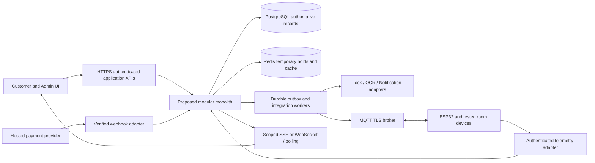

# CineNest Architecture

This document owns technology proposals, module/data/API and integration design, security/privacy, IoT and decision history. [Project](PROJECT.md), [design](DESIGN.md), [progress](PROGRESS.md). Business definitions belong in PROJECT; their enforcement belongs here.

**OWNER-APPROVED INITIAL DIRECTION (S16):** [approved scope](#stack-approval), after comparison with CN-DEC-001. S11 authorized historical research/brief only; S16 approves technology direction, with exact dependency/runtime qualification PENDING and implementation NOT_GRANTED. CN-FND-001 now has a locally verified build/runtime foundation at [current baseline](#foundation-qualified-baseline); product features/providers/hardware remain unimplemented. Exact patches/support and team capacity remain unverified implementation prerequisites. All candidate/vendor descriptions below are recommended/open, not supported account/hardware claims.

## Navigation

- [Technical delivery gates](#delivery-gates)
- [Technology](#technology)
- [System Architecture](#system-architecture)
- [Data Api](#data-api)
- [Security Privacy](#security-privacy)
- [Hybrid authorization](#authorization)
- [Iot Access](#iot-access)
- [Adr 002](#adr-002)
- [Adr 003](#adr-003)
- [Adr 004](#adr-004)
- [Open Decisions](#open-decisions)
- [Initial Stack Brief](#initial-stack-brief)

<a id="ui-implemented-boundary"></a>
## Implemented shared UI boundary — 2026-10-16

CN-UI-001 provides one root ApplicationShell and five public preview pages: /, /account, /admin, /admin/components, /admin/account. Public shell visibility is not an administration grant; unavailable business modules are Planned text without working routes. No client role/capability is invented. Generic synthetic UI examples have one shared filtered collection for cards/tables, separate from production state. No direct database or frontend business rules.

The optional CINENEST_AUTH_ORIGIN server environment value configures only the existing backend origin (HTTPS, or HTTP loopback for local verification; origin only, no credentials/path/query). Without configuration, the three same-origin transport adapters return 503 and the UI shows unconfigured state. GET /api/accounts/me, GET /api/session/csrf and POST /api/session/logout forward only those exact existing CN-AUTH-001 routes. No new authentication/admission endpoint, provider redirect proxy or second session store. Sign-in/provider/TLS deployment configuration remains separately qualified; no fake login button or production default. Requests forward only CINENEST_SESSION, not arbitrary cookies, Authorization, query roles or owner/venue attributes. Logout requires same incoming Host/request protocol Origin and the backend CSRF header; forwarded host headers never establish authority. Backend redirects/raw errors are not relayed. Account responses expose accountId/eligibility only; csrf is transient for the existing logout mechanism. All responses no-store, no sensitive logs/storage; network failures are safe 502 states. The five-second transport timeout is a technical request bound, not session expiry or authorization lifetime.

Client presentation reads no roles; eligibility failure/401/403 clears the visible account. It clears data before refresh/logout, when window focus returns, and rejects stale async results on navigation; this is presentation hygiene, not revocation enforcement. Backend still checks current authority. Isolated backend PostgreSQL evidence and actual HTTP transport tests are separate from simulated browser response tests; no full live-provider/browser session integration claim. Dependency versions, lockfile, backend policy and V1/V2 remain unchanged. See [execution](PROGRESS.md#ui-implementation) and [visual baseline](DESIGN.md#ui-implemented-baseline).

<a id="od11-resolution"></a>
## OD-11 resolution and bounded UI authority — 2026-10-16

The exact question “Requested source palette differs from checked-in proposed tokens” matches the current owner decision. OD-11 is APPROVED: preserve current checked-in tokens for CN-UI-001; no alternate-palette migration or new component library. [DESIGN](DESIGN.md#od11-approved-baseline) owns the approved visual baseline and future review conditions. The existing OD-11 registry entry retains its original question/options/impact/evidence requirement as historicalContext. Original source-pack fidelity and future migration review are not falsely declared verified.

CN-UI-001 keeps its original dependency CN-FND-001, recorded scope/exclusions/DoD and requirements. Foundation and bounded auth are VERIFIED/CLOSED. Owner authority is granted for the existing bounded shell/primitives unit after readiness, not room/package/booking/payment/report/IoT features, a second auth system or production operations. Existing authenticated/session presentation may consume already-supported boundaries without extending their policy. No new library, infrastructure, application source or token change in this decision session.

Historical OD-11 gate row (superseded by approved baseline):

| OD-11 | Requested source palette differs from checked-in proposed tokens | DESIGN_IMPLEMENTATION_GATE |

<a id="auth-implemented-boundary"></a>
## Implemented CN-AUTH-001 boundary — 2026-10-15

The [approved bounded policy](#auth-bounded-policy) is implemented for explicitly associated synthetic accounts only; see [execution evidence](PROGRESS.md#auth-implementation). This does not approve production admission, MFA, provider onboarding, global role administration or broader OD-01 choices. Boot 4.1.1 manages Spring Security 7.1.1 and Spring Session JDBC 4.1.1; the existing Modulith 2.1.1 baseline remains. No independent dependency-version override or second session system.

V2__identity_accounts_grants_sessions.sql adds only the Identity-owned cinenest_identity schema: account, unique issuer/subject external_identity, trusted account_scope venue assignments, action/scope access_grant, redacted security_audit, and framework http_session/http_session_attributes. V1 is unchanged. No tenant hierarchy, production seeds, full venue catalog, role bundle or business tables are introduced. SELF is implicit ownership for minimum own-account read; the only recognized cross-account permission is account.read with a matching VENUE grant and target assignment. Missing/null venue is not a wildcard. Grant scope and action are evaluated together, with current actor eligibility, in one parameterized SQL read; no positive authorization cache. PostgreSQL committed-state snapshots apply: a request already reading an earlier committed snapshot is not retroactively cancelled; subsequent reads see committed revocation. Sensitive mutations/concurrency rules remain future task work.

Authentication is disabled unless cinenest.identity.enabled=true. Enabling requires explicit positive cinenest.identity.session-timeout-seconds and configured issuer, authorization-uri, token-uri, jwk-set-uri, client-id and client-secret under cinenest.identity; no production timeout or credential default. The OIDC authorization-code flow validates signed issuer/subject/audience/expiry/nonce/state before explicit association; email never merges/provisions accounts. Only synthetic=true, ELIGIBLE associated accounts are admitted. Provider tokens are discarded after validation; the persisted principal is the local UUID. No password flow or token login API. Secure/HttpOnly/SameSite=Lax framework cookie and CSRF-protected POST logout; session ID rotates at login. JDBC session state is shared across instances, with inactivity expiry and active-session invalidation; this is not global logout.

Exact surface when enabled: GET /oauth2/authorization/cinenest and GET /login/oauth2/code/cinenest are protocol entry/callback only; GET /api/accounts/me and GET /api/accounts/{accountId} are authenticated current-state protected reads returning only accountId and eligibility, no-store; GET /api/session/csrf supplies the authenticated logout CSRF token, with current eligibility checked; POST /api/session/logout requires framework CSRF. Unknown/foreign/malformed account targets return the same empty 403; unauthenticated/invalid sessions receive 401. Everything else is denied. No account directory, grant-management endpoint, mutation or business invariant bypass. Audit stores local actor/target UUID where known, event kind/outcome and server timestamp only; no raw session/provider token, query, PII or secret payload. Failed unknown authentication has no local actor attribution.

Local acceptance uses an isolated signed synthetic OIDC issuer and PostgreSQL, explicitly seeded by tests, never runtime seeds. The loopback HTTP harness explicitly transports the application's still-Secure cookie for protocol testing; it is not a rendered-browser TLS/SameSite certification or live Google test. Missing production policies remain visible in the original decisions. Module verification and API/internal dependency rules cover foundation and identity; no foreign internal repository injection.

<a id="auth-bounded-policy"></a>
## CN-AUTH-001 approved bounded account/session contract — 2026-10-15

Current owner approval (request SHA-256 in OD-01.boundedAuthPolicyApproval and existing status.authReadinessReconciliation) resolves the remaining policy gates for **CN-AUTH-001 only**. The authoritative task still means “First owner/venue scoped session/auth interfaces and permitted account read”; no scope expansion, new task or full security roadmap approval. CN-FND-001 is VERIFIED/CLOSED and OD-12 approves single-organization venue-scoped authorization. CN-AUTH-001 is now READY / PLANNED under existing conditional implementation authorization, not implemented/verified. This session records decisions only. Auth-specific library/configuration qualification is work to perform within the future unit on the verified foundation, not missing owner policy evidence.

Approved admission is explicitly associated synthetic/test accounts only. Stable provider identity semantics govern association (provider/issuer and stable subject); email must not become the authoritative key or trigger automatic account merging. No automatic production provisioning, production self-registration or provider onboarding. Google provider login does not establish age, identity evidence or consent; canonical backend-owned OIDC/session recommendations remain subject to actual configuration/protocol tests, with no real provider credentials/users selected here.

Own-account reads return only the minimum representation needed by the use case. Staff/service reads require an applicable grant containing both action permission and relevant target scope; current eligibility, ownership and venue/resource attributes come from authoritative server records. No account directory, unrelated-grant stitching, generic administrator bypass or client-supplied authority. No full financial/verification/operations permission catalog or service/device provisioning implied.

Application sessions are database-backed. Expiry configuration is mandatory; explicit deterministic local/test values are permitted but never production defaults or approved production timeout values. Current application session logout performs server-side invalidation; it does not mean global logout across every device. Evaluate current account eligibility and applicable database-backed grants on every protected request; no positive authorization decision cache. Suspended/ineligible accounts and revoked/expired applicable grants stop authorizing subsequent protected requests. More advanced production caching/revocation strategies remain deferred; no invented latency or numeric lifetime guarantee.

Record appropriate redacted authentication/authorization events; never raw session IDs/tokens, provider secrets, documents, access PINs, bank credentials or unrelated sensitive evidence. Audit does not authorize an operation. Production sensitive-data storage/retention/provider and real-user rollout remain open; this synthetic test contract does not set retention days or other unrelated policy values.

Explicitly deferred unless an existing task requirement genuinely needs them: document/OCR policies, financial limits/separation of duties, refunds, device/service provisioning, production IdP onboarding/account self-registration, passwords, SaaS identity behavior and payment/booking/verification/IoT endpoints. OD-01 remains OPEN for broader choices; OD-03/05/18/28 remain OPEN for their full feature/production scopes. Their bounded auth applicability is recorded in the same existing decision records. Earlier blocked/pending policy narratives are historical and superseded only for this bounded unit. No migration, application, frontend, build file or executable test changes in this decision session; all 18 planned authorization scenarios retain their actual NOT_RUN state.

<a id="organization-scope"></a>
### OD-12 approved organization and venue boundary

Owner decision 2026-10-15 selects **SINGLE-ORGANIZATION WITH VENUE-SCOPED AUTHORIZATION**, exactly matching OD-12's “Venue-scoped single organization vs explicit future tenant isolation” question. [PROJECT](PROJECT.md#organization-scope) owns the product scope; the existing OD-12 record owns approval provenance and retained historical context. Venue/resource IDs are business authorization attributes, not tenant boundaries. One CineNest operating organization may have multiple venues and venue-specific grants. Evaluate permission and target scope within an applicable grant; never combine unrelated grants. Customer ownership remains mandatory for private bookings/receipts/credentials; system administration supplies no implicit finance/evidence/physical-safety bypass.

No tenant subscriptions, tenant billing, tenant-level Super Admin product, holding-company hierarchy, organization signup/provisioning, per-tenant databases/schemas, speculative tenant_id propagation, cross-organization sharing or tenant-aware infrastructure without another approved requirement. Keep meaningful module interfaces and opaque IDs without speculative tenant abstractions. SaaS tenancy is deferred unless a separate owner decision supported by real business requirements changes the product model. Actual isolation enforcement and tests remain NOT_VERIFIED/NOT_RUN. Exact role bundles, session/revocation/privacy and high-risk approval policies remain at OD-01/03/05/18/28 as applicable; this decision authorizes no code.

<a id="technology"></a>
## Technology

### Historical candidate inventory and evidence discipline

The candidate rows below preserve pre-S16 recommendations and research, not competing current stack selections. S16 selects the initial version lines and responsibilities at [approval](#stack-approval); unlisted vendors/libraries/module details remain recommended/open. No patches or toolchain have been qualified.
No package.json, pom.xml, build.gradle, lockfile, application code, migrations or infrastructure configuration exists in the inspected repository. Current evidence for every layer below: **documentation only; Implementation NOT_VERIFIED**. Recommendations come from S1; preferred does not mean APPROVED. No versions are pinned or claimed latest. No dependency installs/runtime config changes were made. No current provider country/product/API support is asserted; all requires official documentation and account/model validation before selection. This avoids treating an unseen proposal PDF as evidence.

| Layer | Current evidence | Preferred recommendation | Alternatives | Purpose | Dependencies | Risks | Decision | Validation needed |
|---|---|---|---|---|---|---|---|---|
| Customer/admin UI | Docs only; NOT_VERIFIED | Next.js, React, TypeScript, Tailwind CSS and shared CineNest components/tokens | Other compatible React deployment patterns | Shared accessible public/admin UI | Hosting/build strategy and OIDC/payment integration | Server/client boundary, CSP and upgrade compatibility | RECOMMENDED; provider/library selection OPEN_DECISION | Architecture/design proof of concept, hosting and accessibility QA |
| Client data/forms | Docs only; NOT_VERIFIED | TanStack Query, React Hook Form and Zod candidates | Native forms/fetch; alternatives only after evaluation | Async cache, forms and input schema ergonomics | Chosen React/Next.js stack; server validation remains authoritative | Duplicate validation schemas, stale cache/permission leaks | RECOMMENDED; provider/library selection OPEN_DECISION | Evaluate version compatibility; never use client schemas as security boundary |
| Accessible components | Docs only; NOT_VERIFIED | One consistent accessible component library (not selected) | Evaluate compatible libraries against shared tokens | Keyboard/focus primitives and reusable CineNest controls | UI stack, styling and licensing | Vendor defaults contradict cinematic shell or a11y | RECOMMENDED; provider/library selection OPEN_DECISION | Keyboard/screen-reader/reflow test representative booking/dialog/table flows |
| Charts | Docs only; NOT_VERIFIED | Recharts OR Apache ECharts; select one | Accessible table-first visualization where sufficient | Canonical charts/metrics | React integration and semantic chart contracts | Bundle cost, accessible descriptions and mobile tooltip behavior | RECOMMENDED; provider/library selection OPEN_DECISION | Compare required charts, licensing, data table support and render performance |
| Backend | Docs only; NOT_VERIFIED | Java Spring Boot with Spring Modulith modular monolith | Node.js with NestJS from S1-described proposal (PDF not read) | Explicit module boundaries in one initial deployable | Team skills, Java/toolchain and operational capacity | Boundary erosion, integration workflow and transaction design | RECOMMENDED; provider/library selection OPEN_DECISION | Record selection ADR; module boundary/test and deployment spike |
| Backend support | Docs only; NOT_VERIFIED | Spring Security, validation, Spring Data JPA, Flyway if Spring selected | Selected NestJS-compatible equivalents not chosen here | Authorization, input checks, persistence and migration discipline | Backend selection, database and module contracts | JPA coupling, migration ownership, security misconfiguration | RECOMMENDED; provider/library selection OPEN_DECISION | Compatibility review and module-owned migrations design; no migrations edited now |
| Authoritative storage | Docs only; NOT_VERIFIED | PostgreSQL | Equivalent transactional conflict guarantees subject to review | Accounts/reservations/quotes/ledgers and durable integration work | Schema ownership, range constraints and backups | Race conditions and cross-module table access | RECOMMENDED; provider/library selection OPEN_DECISION | Concurrent booking/extension/reschedule and recovery validation |
| Temporary holds/cache | Docs only; NOT_VERIFIED | Redis | Database-backed expiring holds for safe fallback | Short checkout holds and selected cache | Database reservation guard, expiry reconciliation | TTL loss, eviction, failover and stale availability | RECOMMENDED; provider/library selection OPEN_DECISION | Fault tests prove Redis absence cannot permit overlapping reservations |
| Private documents/assets | Docs only; NOT_VERIFIED | AWS S3 OR Cloudflare R2 | Approved private encrypted storage alternative | Private verification evidence and permitted media | Provider/privacy/region/key/retention choice | Exposure through signed links, cross-border processing, deletion lag | RECOMMENDED; provider/library selection OPEN_DECISION | Threat/privacy review; restricted URLs, encryption and delete lifecycle tests |
| Login/session | Docs only; NOT_VERIFIED | Google OpenID Connect, secure application sessions and backend authorization | Approved identity integration if constraints change | Customer login; stronger admin authentication | OIDC callbacks, cookie/CSRF strategy and privileged MFA decision | Account linking, token leakage and session fixation | RECOMMENDED; provider/library selection OPEN_DECISION | Provider protocol review, session expiry/revoke and privileged access testing |
| OCR | Docs only; NOT_VERIFIED | Google Cloud Vision OR AWS Textract OR validated alternative | Manual review or another evaluated extraction tool | Extract candidate document fields | Private storage, consent, regional/privacy review | OCR is not authenticity/identity/liveness proof; local script accuracy | RECOMMENDED; provider/library selection OPEN_DECISION | NIC/passport accuracy benchmark, exceptions and data processing review |
| Payments | Docs only; NOT_VERIFIED | PayHere OR supported bank IPG | Stripe only after merchant/country/product eligibility verified | Hosted checkout, verified notifications, refunds/reconciliation | Merchant underwriting, provider contract and webhook security | Unapproved business category, delayed capture/refund and fee rules | RECOMMENDED; provider/library selection OPEN_DECISION | Official provider/merchant confirmation plus sandbox and reconciliation tests |
| Locks/vendor API | Docs only; NOT_VERIFIED | Tested TTLock/Tuya-compatible hardware and supported vendor API candidates | Other tested compatible local access hardware | Time-bound entry, revoke and supported re-entry | Actual model/firmware/API agreement; safe egress hardware | Vendor cloud reliance, unsupported offline PIN/revocation and clock drift | RECOMMENDED; provider/library selection OPEN_DECISION | Hardware acceptance matrix and outage tests; no compatibility claim yet |
| Edge and broker | Docs only; NOT_VERIFIED | ESP32, MQTT over TLS; EMQX OR Mosquitto | Vendor-supported local protocol when justified | Room telemetry and bounded commands | Device certificates/ACLs, broker selection and firmware ownership | Replay, stale retained command, network loss and unsafe actuation | RECOMMENDED; provider/library selection OPEN_DECISION | Protocol/capability, TTL/ack and power/network-failure tests |
| Application/live API | Docs only; NOT_VERIFIED | HTTPS REST; SSE OR WebSocket as appropriate | Polling fallback with freshness labels | Application capabilities and live admin observations | Authorization, reconnect/cursors and ingress infrastructure | Cross-scope streams, missed events and stale projections | RECOMMENDED; provider/library selection OPEN_DECISION | Select based on directionality/fan-out; replay/freshness and permission tests |
| SMS | Docs only; NOT_VERIFIED | Notify.lk OR Twilio | Approved local delivery provider | Booking/access-link/time warnings | Provider availability/consent/cost/delivery policy | Delivery not guaranteed; secret exposure through message | RECOMMENDED; provider/library selection OPEN_DECISION | Official provider and destination support review; delivery/status/support tests |
| Email | Docs only; NOT_VERIFIED | SendGrid OR AWS SES | Approved delivery provider | Receipts, protected access instructions and operations | Domain verification, consent/template/provider choice | Bounces, spam and leaked credentials | RECOMMENDED; provider/library selection OPEN_DECISION | Provider/account verification and bounce handling tests |
| Delivery/operations | Docs only; NOT_VERIFIED | Containerized builds, CI/CD, centralized logs/metrics/alerts, backups and tested recovery | Tool choices pending; no cloud selected | Repeatable safe operations | Selected hosting/secrets/monitoring and accountable responders | Supply chain, untested restore, missing on-call process | RECOMMENDED; provider/library selection OPEN_DECISION | Recovery objectives decision, restore/failover drill and scoped deploy gates |

### Selection gates
Use [open decisions](ARCHITECTURE.md#open-decisions) OD-01/02/05/06/11 and update this ARCHITECTURE decision section after explicit final-stack approval; preserve [ADR-001](DESIGN.md#adr-001) visual approval. A new knowledge file requires explicit owner approval. Use one broker, one chart library and one initial backend approach after evaluation, not all candidates by default. Compatibility versions should be selected from official supported versions at implementation time and recorded with source/date; no invented latest versions now. Do not import framework decisions from unrelated repositories.

### Bank payment — CN-KB-BANK-PAYMENT-001
Core bank-deposit/transfer/upload/reviewer notification capability USER-CONFIRMED (Decision APPROVED, Implementation NOT_VERIFIED). [Manual matching](PROJECT.md#bank-payments) against business bank records is RECOMMENDED launch support within Payments, not a new bank gateway/library/microservice. Existing PayHere/bank-IPG/Stripe candidate selection and hosted online path remain unchanged.

Private receipt storage and safe JPEG/PNG/PDF scanning/preview use selected secure storage design (provider/size/retention open). Receipt OCR optional suggested extraction only; never approval/authenticity. Bank-feed/API matching future scope only after verified official bank/account/provider support/privacy. No bank connection, real receiving details, fees or installed integration claimed; no dependency/runtime changes.

### CN-DEC-001 initial direction (owner approved; qualification pending)

[Decision brief](ARCHITECTURE.md#initial-stack-brief), S11, proposes Java25/Boot4.1/Modulith2.1, PostgreSQL18/Flyway, Next16/React19/TypeScript5/Tailwind4/Node24, Maven/npm and database-backed sessions/work. S16 approves those initial version lines and responsibilities, with [exact conditions](#stack-approval); supported stable patch/dependency qualification PENDING, OD-01 broader choices remain OPEN_DECISION, implementation NOT_VERIFIED. This supplements historical candidate rows without accepting their other vendors. No code, dependency or runtime configuration was created.

<a id="system-architecture"></a>
## System Architecture

### Desired architecture and implemented baseline
S16 approves the initial Spring Boot/Spring Modulith modular-monolith direction; exact internal interfaces below remain RECOMMENDED. NestJS is a historical comparison, not an equally selected current backend; a changed line requires an owner-reviewed amendment. No module/table/API implementation is verified. One deployable initially does not imply one unrestricted persistence layer. Public/customer, admin, provider webhook and device ingress have separate trust/authorization boundaries.



Arrows express permitted integration flows, not deployed infrastructure. Object storage is private behind Verification/asset interfaces. External integrations are never assumed inside a successful database rollback.

| Module | Proposed ownership | Responsibilities/interfaces | Transaction boundary | Dependencies |
|---|---|---|---|---|
| Identity & Access | Accounts, sessions, capability assignments, policy-consent references | OIDC/session validation; capability checks and owner/venue scope; stronger admin auth | Own account/session/consent writes; expose account IDs and authorization interfaces | Verification decisions via interface, no raw document reads; all modules consult authorization |
| Venues/Rooms | Venues, rooms, amenities, operating windows, readiness, maintenance and mappings | Catalog, room configuration, physical clearance and permitted capability metadata | Own configuration/readiness writes; public catalog vs restricted status projection | Booking asks schedule/capacity; IoT mapping through interface |
| Booking | Holds, blocking reservations, purchases, guest counts, revisions and session schedule | Concurrency, confirmed lifecycle, changes/extensions/cancellations | Database interval guard and reservation transitions in one transaction; quote/payment verified references | Pricing quotes; verification eligibility; Payments facts; Access/Notifications via durable work |
| Pricing | Stable package catalog/immutable published versions, rate/add-on/promotion eligibility versions and immutable quote snapshots | Validate joint package publication, resolve applicability, calculate backend totals and preserve purchased quote/policy | Versioned quote transaction; no edits to sold snapshots | Room capacity/schedule; Engagement eligibility through interface; Booking consumes quote |
| Verification | Private evidence references, extracted candidates and eligibility decisions | Booker checks, restricted reviewer workflow, retention/deletion | Own decision/evidence metadata; external OCR outside DB transaction | Identity/consent + private storage; Booking sees minimal eligibility decision, never document |
| Payments | Gateway attempts/events/captures plus manual bank requests/verified funds/allocations/reviews, refunds and reconciliation ledger | Hosted checkout and independent manual credit verification, authoritative financial facts and bounded compensation | Inbox + ledger append + outbox atomically; provider capture/refund outside transaction | Booking/quote references; provider adapters; Analytics gets redacted ledger projection |
| Access Control | Credential references/versions, permitted windows and provisioning work | Install/revoke/time entry and support incidents | Credential/work state durable; external lock ack reconciled separately | Booking schedule, IoT/vendor capability interface; Notifications receives protected-link request |
| IoT | Devices, capabilities, credentials references, commands, observations and health | ESP32/broker/vendor adapters; desired vs observed state | Command accepted + durable dispatch transaction; telemetry dedupe/order/freshness | Access intent and room safety/readiness; Notifications for incidents |
| Notifications | Templates, routing consent, delivery attempts and warning schedules | Email/SMS receipts/access instructions and operational warnings | Durable notification work and dedupe; delivery never atomic with booking | Booking/session/access facts and minimal contact interface; provider adapters |
| Customer Engagement | Promotion/referral/loyalty rules and reward ledger | Versioned eligibility, earn/redeem/reverse/expire (rules open) | Ledger adjustment atomic and audited; no direct payment mutation | Verified Booking/Payments facts; Pricing requests eligibility |
| Analytics | Scoped read projections, metric definitions and report freshness | Aggregate authoritative facts without changing domain writes | Projection updates idempotent; eventual consistency explicitly labelled | Domain events/approved read interfaces; finance scopes; no cross-module table mutation |
| Audit | Redacted immutable audit event store and access projection | Actor/action/resource/reason/evidence/correlation trail | Domain durable audit intent in same local transaction; bounded ingestion/recovery | All modules emit safe events; restricted read/export interfaces |

### Interface and failure boundaries
Modules use stable commands/queries/events through published interfaces; no direct mutation of another module’s tables or import of its persistence entities. Reservation-critical writes stay within Booking with immutable references to approved quotes/decisions/payment facts; accept a capture fact once, then transactionally guard inventory. External side effects use an outbox/durable work coordinator with durable failure state and compensating actions. A committed purchase is not silently rewritten when a downstream service fails.

Each module documents ownership, invariant tests, transaction scope, safe event payload and capability checks before implementation. Shared IDs/time/money/envelopes are contracts, not a shared catch-all domain module. [Data contracts](ARCHITECTURE.md#data-api) define proposed integration behavior; [IoT failure modes](ARCHITECTURE.md#iot-access) define hardware gates. Stream updates follow the same authorized venue/owner scope and report asOf; clients recover after gaps using an authoritative snapshot.

Historical pre-approval context (retained verbatim); [current OD-12 decision](#organization-scope) supersedes the unresolved scope below:

Multi-venue configuration is proposed resource scoping. It is **not evidence of a fully isolated multi-tenant SaaS product**. Tenant/subscription architecture, data isolation model, onboarding/billing and cross-venue roles remain OD-12. Retain explicit venue IDs where applicable without inventing a tenant schema. Do not call current access isolation implemented.

### Package configuration — CN-KB-PACKAGE-CONFIGURATION-001
Core CN-A12 is user-confirmed; [package implementation design](PROJECT.md#package-management) remains RECOMMENDED. Pricing owns stable catalog identity/versioned terms and quote construction; Booking owns sold snapshots/reservations; Venues/Rooms owns minimum/hours/cleaning/physical capacity; Payments checks accepted quote; Access reads purchased session only. Package administration fits existing boundaries, not a new module or generic rules engine.

A desired configuration write/atomic publish transaction validates related fields, scope/schedules, optimistic version and operational references; durable audited cache/projection invalidation updates eligible catalog without per-edit code deployment. Provider capture/device commands remain outside publication transaction. Sold versions, payment/quote references and booked intervals are immutable except separate agreed amendment revisions. No architecture code/table/deployment evidence asserted.

### Bank payment — CN-KB-BANK-PAYMENT-001
Existing Payments owns bank requests/evidence/review/verified credits/allocation/refund/instruction versions; Booking owns shared durable holds, inventory guard and confirmed snapshots; Notifications owns reviewer/customer delivery; Access consumes eligible confirmed purchase; Audit owns safe immutable evidence. No second booking system or new microservice. [Canonical manual-payment design](PROJECT.md#bank-payments) is RECOMMENDED; core feature confirmed but unimplemented.

Verified fund fact persists independently of booking transaction success. Guarded allocation and eligible confirmation lock relevant financial/request/inventory state, dedupe operations and create durable access/notice work. Funds receipt cannot be rolled back by external failure or rejected inventory; unmatched/excess/late funds remain resolution obligations. Gateway and bank attempt satisfaction share one booking aggregate to avoid double confirmation/allocation; corrections append ledger entries. Bank credits never synthesize gateway callbacks or card capture facts. Existing package versions/quotes/snapshots and operational minimum/capacity/cleaning boundaries preserved.

<a id="data-api"></a>
## Data Api

### Contract conventions
Conceptual entities, table names and capabilities are proposals, not existing schema/endpoints. No database migrations/runtime API changes in this task. ISO currency with integer minor-unit amounts (LKR draft), UTC RFC3339 instants and IANA reporting timezone. Half-open session/reservation intervals follow [business rules](PROJECT.md#business-rules). Opaque IDs, version/ETag for writes, stable timestamp+ID sorting and bounded server pagination. Requests/exports/streams enforce owner and authorized venue scope before reading data; venue scope does not assert tenancy.

| Entity | Owner | Proposed fields | API capabilities (not paths) |
|---|---|---|---|
| Accounts | Identity & Access | accountId, provider subject mapping, profile, accountState; no OAuth tokens in response | Self profile/session; restricted account support |
| Venues and rooms | Venues/Rooms | venueId, roomId, capacity, operatingWindowVersion, amenities, readiness and observedAt | Catalog read; scoped configuration/clearance |
| Holds | Booking | holdId, ownerId, roomId, sessionStart/end, blockedUntil, expiresAt, quoteRef, version, consumed | Owner create/read/expire; no transferable hold |
| Bookings and guests | Booking | bookingId, revision, packageVersionRef/purchased display+line item+duration+buffer+policy snapshots, ownerId, roomId, guestCount/required minimal guest checks, scheduled times, state, purchase snapshots | Owner list/detail/change; authorized manual bookings |
| Package catalog and published versions | Pricing | stable packageId, immutable packageVersionId/revision, display/inclusion/duration/exact-price refs, venue/room scope, sales interval and optional service interval | Authorized list/create/duplicate/edit/preview/publish/schedule/deactivate/archive/history; actual routes/tables proposed only |
| Quotations | Pricing | quoteId/version, packageVersionRef, price/add-on/fee snapshots, currency, integer minor-unit line items, subtotal/discount/tax/fee/total, expiresAt, policyRefs | Server quote, acceptance and immutable purchase copy |
| Gateway payment attempts and captures | Payments | attemptId, booking/quote refs, providerRef, expected amount/currency, status, captured ledger refs | Create hosted checkout, verified callback/status, reconcile |
| Gateway refunds | Payments | refundId, captureRef, policy snapshot, requested/successful amount, reason, state and provider ref | Restricted request/status; balance checked atomically |
| Verification decisions | Verification | evidenceRef, decisionId/version, eligible, policy/basis/reviewer/time/expiry; candidate OCR fields restricted | Owner submit/status; reviewer decision; separate evidence access |
| Access credentials | Access Control | credentialRef/version, booking/lock refs, startsAt/endsAt, provisioning state; secret never in generic entity/list | Authorized reveal via separate protected channel; install/revoke status |
| Sessions | Booking | sessionId, bookingRevision, scheduled start/end, warning schedule and state; exit evidence separately typed | Session status, extension and incident capabilities |
| Devices and commands | IoT | deviceId, roomId, capability/schema/firmware, commandId, desiredAction, TTL, ack and observedState separately | Scoped capability-limited command and status lookup |
| Telemetry | IoT | deviceId, sequence/bootId, observedAt/receivedAt, measurements/units, quality and freshness | Authenticated ingest; authorized safe projection |
| Notifications | Notifications | notificationId, templateVersion, resourceRef, destinationRef, delivery status, scheduledAt/attemptedAt | Durable send/status; restricted contacts; no raw PIN in ordinary payload |
| Policy versions and consent | Pricing; Identity & Access | policyId/version/effectiveAt, immutable terms content/hash; consent actor/time/version/context | Versioned publish and explicit acceptance; login not acceptance |
| Engagement ledger | Customer Engagement | ledgerId, accountRef, ruleVersion, delta/reason/expiry/reversalRef; eligibility decisions | Owner read; restricted idempotent adjust/redeem |
| Audit events | Audit | eventId, actor, action, authorized venue, resourceRef, reason, timestamp, correlation and redacted diff | Scoped immutable read/export; never expose credentials |

### Application and integration responses
Successful writes return resource ID, new version, operation status, correlation ID and server asOf. Async writes return accepted/pending plus status capability, never an unconfirmed success. Failed operations return a safe code (availability_conflict, hold_expired, quote_changed, verification_required, scope_denied, provider_pending, access_unknown), recoverability, safe message and correlation ID; no raw provider secret or identity evidence. A failed HTTP transport is unknown outcome until status queried. Validation fields reference persistent UI labels.

Idempotency key is owner/scope/operation bound with request digest, durable result and retention defined by final policy. Same key/same intent returns original result; same key/different intent conflicts. Authenticate and authorize before key lookup so results cannot leak across users. Mutations check entity version; stale edits surface reload/diff, not overwrite.

### Verified gateway payment notification workflow
1. Provider adapter validates configured authenticity/signature, expected merchant, transaction/attempt, amount/currency and replay/dedupe identifiers against official selected provider contract. Client redirect is advisory only.
2. Persist inbox event and financial fact once; atomically create durable integration work/audit. Acknowledge provider only after durable acceptance. Reject or quarantine mismatches safely.
3. For gateway, Booking consumes verified fact once, checks accepted quote reference/amount/currency and eligibility/hold/reservation under authoritative concurrency guard (never silently checks latest catalog rate), confirms or records payment_exception; neither provider success nor Redis hold alone confirms inventory.
4. Create durable access provisioning/notification work. Access failure remains visible independently of paid/confirmed booking.
5. Reconciliation polls verified provider status on missing/out-of-order/unknown callbacks. Refund/compensation is a separate provider operation with its own idempotency and ledger.

A database rollback does not reverse an external capture. Outbox workers retry with bounded exponential backoff/jitter and per-operation TTL/maximum attempts determined before launch. Persist attempts and nextAttemptAt; exhausted work goes to incident/manual review, not infinite retry. Access work expires when no longer useful; no replay of stale unlock/power command. Provider operations query status before retry where outcome uncertain. Inbox/event IDs deduplicate; aggregate version/sequence handles out-of-order facts without losing original events.

### Proposed safe event envelope
```json
{
  "eventId": "opaque-unique-id",
  "eventType": "BookingConfirmed",
  "eventVersion": 1,
  "schemaVersion": "1.0.0",
  "occurredAt": "RFC3339-UTC-instant",
  "receivedAt": "RFC3339-UTC-instant",
  "correlationId": "opaque-correlation-id",
  "causationId": "opaque-parent-event-or-command-id",
  "venueId": "authorized-venue-id",
  "aggregateId": "opaque-resource-id",
  "aggregateVersion": 1,
  "payload": {"bookingId": "opaque-booking-id", "revision": 1}
}
```
This is a shape example, not a valid production timestamp fixture. Scope validated server-side, never trusted from caller payload. No raw identity document/OCR dump, PIN, card data, access token or secret in ordinary events/logs. Protected secret installation uses an explicitly secured narrow adapter channel and credential reference in normal events. Envelope timestamp distinguishes occurrence from ingestion. Consumers idempotently checkpoint; projection rebuilds preserve authorization/freshness and do not reexecute external side effects.

### Reconciliation acceptance
Future tests: duplicate/out-of-order captures, expired holds, concurrency, partial refunds, late success after cancellation, provider timeout, lost outbox ack, notification failure, failed access installation and stale telemetry. Audit evidence links original facts and compensation. [Chart contracts](tokens/cinenest-chart-specs.json) consume safe authorized projections, not screenshots or client-subset totals.

### Package configuration — CN-KB-PACKAGE-CONFIGURATION-001
[Canonical package contract](PROJECT.md#package-management) proposes scoped package.read/edit/publish/deactivate/archive; opaque immutable revision IDs, version/ETag conditional updates and idempotent publish commands. Publication validates duration/inclusions/price/operational refs/schedule together; ambiguity/stale state rejects atomically, not partial publish. Versioned quote response includes package/price/fee/add-on/policy refs, snapshot line items, currency, total and expiry. Capture reconciliation uses accepted quote and verified capture timing rather than webhook receipt time/new catalog values.

Confirmed Booking preserves purchased display details, duration/start/end/buffer, guests/services, exact total/line items, consent/policy/quote refs. Amendments have distinct accepted quote and guarded revision/payment/refund/access work; catalog events never update active PINs. PackagePublished safe event may contain stable ID/version, effective range, scope and correlation only; audit holds actor/time/reason/old-new values/version. Table names/routes, approval thresholds and distributed cache design unimplemented/proposed. See OD-17–22 for policy options.

### Bank payment — CN-KB-BANK-PAYMENT-001
[Canonical spec](PROJECT.md#bank-payments) supplies full workflows/lifecycles; conceptual names/capabilities below are proposals, not tables/routes.

| Record | Proposed owner/fields | Capabilities |
|---|---|---|
| BankPaymentRequest | Payments: requestId, owner/venue, accepted quote/package/session/inclusions/policy snapshots, expected amount/currency, instructionVersionId, due/submission/review/hold/quote-validity timestamps | Own create/status; late-claim intake; scoped reviewer list/detail; no live rate substitution |
| ReceiptSubmission/ReviewDecision | Payments: immutable submissionId/revision, private evidence ref, declared facts/payer/note, submittedAt, assignee, safe reason, reviewer/action/evidence refs/version | Own upload/correction; restricted preview/assign/await-credit/request-info/reject/match; history retained |
| VerifiedBankTransaction | Payments: fundId, receiving-account/instruction refs, independent bank transaction or controlled statement entry identity, creditedAt, verifiedAt, exact amount/currency, reviewer/evidence | Authorized independent verify/dedupe/reconcile; persist even booking impossible |
| PaymentAllocation | Payments: allocationId/fund/request/quote refs, amount/currency, allocatedAt, version/adjustment parent; unallocated/refund-reserved balances | Locked capped idempotent allocation, aggregate bank+gateway satisfaction, separate adjustment; no shared-deposit product by default |
| BankAccountInstructionVersion | Payments with bank.account.manage: stable account ref, immutable protected instruction version/effective time/verification evidence | Separately authorized change/history; old request protected, emergency redirect controlled |
| BankRefund | Payments: refundId/credit+allocation refs, approval/destination verification, outgoing operation/ref/amount/currency, requested/approved/initiated/sent/confirmed/failed timestamps | Scoped request/approve/execute/reconcile; unknown send looked up before retry, no fake gateway refund |
| BankReservationHold | Booking: request ref, durable session/cleaning range, policy/expiry/version, review extension provenance | Same conflict guard as gateway; bounded no-reupload-reset; guarded confirmation or resolution |

Inbound gateway authenticity and bank authorized reconciliation are different evidence sources. Optional proposed PaymentVerified envelope carries eventId/correlation/schema/occurredAt, evidenceSource=GATEWAY_VERIFIED or BANK_RECONCILED, stable payment/fund/request/quote refs, amount/currency, authorized venue and actor/evidence reference. No raw receipt/statement, bank credentials/instructions or PIN. Do not forge webhook/card capture for bank source. Notification/work events use references and authorized links only.

Record unique incoming credit with bank-side identity independently; then local guarded allocation/satisfaction/booking confirmation and durable outbox. Lock available credit/request/payment aggregate and room range; request/currency/version and eligibility validated, repeat operation returns original result. Notification/access external failure leaves financial fact/queued work intact. Concurrent reviewers return conflict/current assignment and cannot allocate twice. Bank statement ambiguity is controlled review, not customer-ref uniqueness. Received funds with invalid/expired slot return Funds Received / Booking Resolution Required; no displacement/new booking/reprice.

API outcomes expose review, verified-funds/allocation balance, booking and access separately; rejected receipt ≠ failed actual credit. Model initiated/credited/submitted/verified/allocated/confirmed timestamps independently; manual timeliness policy open. Existing refunds/adjustments use approved bank evidence/destination process, append history and bounded recovery. All actual routes/schema/thresholds/support remain unimplemented.

<a id="security-privacy"></a>
## Security Privacy

### Scope and status
Desired controls DOCUMENTED_DRAFT, implementation NOT_VERIFIED. No legal-compliance, merchant approval, screening licence or hardware-safety certification asserted. Source PDFs (if later supplied) are draft requirements, not proof of any approval. This document defines review topics and acceptance evidence; specific legal obligations need qualified local review, not inferred rules.

### Identity and authorization
Google OIDC proves a provider login, not age, physical identity or policy consent. Verify OIDC protocol/session securely; secure HttpOnly application cookies, appropriate SameSite/CSRF and session revocation; exact deployment strategy requires stack approval. Enforce least-privilege capabilities, owner/authorized venue scope, stronger administrative authentication and restricted emergency overrides. Separate booking management, finance refund/export, document review/evidence view, access secret reveal and device command permissions. Every protected action checked backend-side; UI hiding is insufficient. Do not presume multi-tenant SaaS isolation.

### Evidence processing and privacy
NIC/passport extraction primarily covers booker; OCR only offers candidate text. It does not prove document authenticity, identity or liveness. Age/date interpretation, rejection/appeal, manual review, all-guest original-document checks, guardian/admission policy and exception handling need final decisions (OD-03). Collect minimum required data, restrict evidence preview/export, mask IDs, log evidence access without raw contents, segregate contact/verification/access data. Private encrypted storage and controlled encryption keys; bounded signed upload/read links, file type/size validation, malware handling, audit and deletion workflows need provider/design review.

Retention periods, processing purposes, consent/legal basis, regional transfers/subprocessors, backups/deletion lag, incident obligations and account deletion conflicts are OPEN_DECISION OD-05. No invented retention days. Deletion workflow authenticates requester, checks approved legal holds/ledger obligations, removes active evidence and tracks pending copies/backups per approved lifecycle; deletion success never asserted solely from UI click. Raw documents/OCR text are excluded from ordinary events, logs and analytics.

### Consent and purchases
Explicit versioned terms/privacy/admission acceptance records actor, policy versions/hash, timestamp and context. Google sign-in and a prechecked box do not substitute for consent. Preserve booking-time quote, refund terms and consent snapshot; new policy settings cannot silently rewrite purchases. Dark patterns, hidden fees and blanket automatic card re-billing are outside approved behavior. Refund/charge consent/provider eligibility remains OD-07.

### Payment and secret boundaries
Hosted/tokenized checkout avoids application collection/storage of raw card credentials. Official provider merchant/country/product support, webhook authenticity, refund rules and responsibilities must be verified (OD-06). Do not claim hosted checkout eliminates every security/compliance responsibility. Verify events and dedupe financial facts; no client-redirect success trust.

PIN default delivery should be a protected link/in-app reveal in SMS/email, not raw secrets in templates or normal notification events. If raw PIN delivery is later required, it needs an explicit risk/consent/retention decision and narrow secure delivery channel. Mask on lists and shared receipts; exclude from URLs/query logs/analytics/exports. Credential storage/installation uses least-privilege secured adapters, secret encryption, rotation/revocation and access audit. Delivery receipt does not prove customer received or could enter.

### Safety and commercial review
Follow [IoT requirements](ARCHITECTURE.md#iot-access): independent egress, no occupant trapping or safety power interruption, unknown/offline never treated as OFF/empty. Product claims “fully automated/staff-less” cannot override required emergency, verification or physical-cleaning staffing.

OD-14 now approves restricted media offerings and neutral capability descriptions pending independent commercial screening/streaming/gaming rights and provider-term verification; photography/logo rights and venue/admission conditions are not certified by that approval. Consumer pricing/refund disclosures and final 18+ policy require review before launch. No guaranteed legal compliance or approved licensing is claimed.

### Future security evidence
Threat model customer/admin/device/provider trust boundaries; test object-level scope, privileged MFA/recovery, CSRF/session fixation, signed URLs/upload validation, secret/log leakage, webhook replay, broker ACLs, device credential rotation, dependency/supply-chain scanning, restore and incident response. These are continuous delivery gates, not tests run by this documentation task.

### Bank payment — CN-KB-BANK-PAYMENT-001
[Bank evidence/security specification](PROJECT.md#bank-payments) extends existing principles: own authenticated upload and restricted review/evidence/verify/allocation/refund/account-management scopes, private encrypted generated-key storage, true JPEG/PNG/PDF type/size validation, scan/quarantine, safe restricted previews, history and approved retention/deletion. Receipt upload is not original-ID admission verification, and OCR/email/image hash cannot independently prove credit or authorize approval.

Never request bank passwords/PINs/OTPs/card security codes. Bank details/receipt/statement/credentials excluded from public URLs, ordinary logs/event payloads and notification attachments; use protected scoped views/links. Separate receiving-account changes from ordinary review, independently verify instructions/refund destination and audit actor/time/reason/evidence/correlation. Thresholds/roles/retention/upload limits OPEN_DECISION OD-26/28; no current account, bank connectivity/legal approval or provider support asserted. Third-party payer differences require legitimate matching, not automatic fraud label. Erroneous approval and actual bank reversal append safe correction history; no deletion/occupant trapping. No bank account/money/real payment affected by this task.

<a id="authorization"></a>
## Hybrid authorization specification

### Direction and approval boundaries

S15 user-requested direction:

> CineNest combines RBAC permissions with ABAC restrictions. Roles grant action permissions. Attribute-based policies restrict those permissions to authorized venues, resources, ownership, approval limits, and relevant circumstances.
>
> Authorization is enforced by the backend and defaults to denial. It does not replace business-integrity or physical-safety rules.

The direction is established; runtime enforcement **NOT_VERIFIED**. Proposed role responsibilities are owned by [PROJECT](PROJECT.md#authorization-requirements). Exact bundles, financial thresholds, independent-review/self-approval and exception procedures remain PROPOSED/OPEN; no numeric limits selected. Initial stack direction is owner-approved by S16; exact qualification pending, CN-FND-001 and security implementation unauthorized. Approved public catalog operations may deliberately allow anonymous access; unspecified actions default to deny. An unset required limit is not unlimited authority.

### Permission vocabulary and scoped grants

Keep permissions independent of role names. Existing proposed labels stay: package.read/edit/publish/deactivate/archive; booking.create/read/update/cancel; payment.claim.submit; bank.review/verify/allocate/adjust; payments.refund; verification.review and separately verification.evidence.read; device.command; report.read/export; audit.read; bank.account.manage. These labels are conceptual contracts, not a deployed permission catalog. S15 package.update/booking.amend/payment.receipt.submit/payment.bank.review/payment.bank.verify/room.control/payment.bank_account.manage examples map conceptually to those existing labels, without adding runtime aliases or renaming established specifications. Proposed refund.request/refund.approve/refund.execute/refund.reconcile split the currently broad payments.refund capability; identity.role.assign is a proposed dedicated control. Exact catalog/splits are owner-review choices, not blanket grants.

A proposed grant is `(grantId, principalId, roleVersion OR explicitPermission, permissionSetVersion, venue/resourceScope, accountScope where applicable, limits with currency, validityInterval, conditions, grantVersion)`. Store trusted assignments; use role expansion only inside its grant. A principal's Finance Reviewer grant at Venue A plus Operations grant at Venue B cannot produce finance access at Venue B. No Cartesian product of all principal permissions with all assigned venues. Multi-venue resource writes require complete authority coverage for the proposed change; define permitted grant composition without mixing unrelated permissions/scopes. Unknown scope, missing relevant assignment or unresolved mandatory limit denies the affected action.

### Authoritative attributes and evaluation

| Attribute owner | Relevant authoritative values |
|---|---|
| Identity & Access | Current account eligibility/suspension, scoped role assignments, grant/permission versions, venue assignments, authentication assurance and approved financial authority |
| Owning business module | Resource owner, venue/room/account, booking/customer association, case assignment, sensitivity, exact amount/currency, protected revision |
| Server/policy context | Operation, current policy version, server time, independent-approval provenance and legitimate resource-specific evidence purpose |

Browser venue/owner/role/amount/purpose claims are inputs to validate, never sufficient authorization evidence. Purpose must be supported by authorized case assignment/workflow, not an arbitrary supplied string. Trusted integration/device identities require their own credentials and constrained scope, not customer sessions.

Proposed evaluation order:
1. Classify operation; anonymous access only for an explicitly approved public operation. Otherwise authenticate principal and require current eligibility/assurance.
2. Load authoritative resource attributes through the owning module's interface and current grant/policy snapshot. Missing required attributes or unavailable mandatory policy information denies; return safe unavailable/denial outcome without protected details.
3. Apply mandatory global restrictions and explicit denials (including suspension and any approved self-approval prohibition). They override every alternative grant; holding multiple roles cannot bypass them.
4. Find an applicable grant whose permission, resource/venue/account scope, approved limit/currency, validity and contextual restrictions all match together. For customer paths require verified ownership; staff paths need separately applicable staff authority.
5. Evaluate the owning module's business invariants and concurrency guards independently. Only then accept an authorized valid mutation and durable audit/work intent. Record decision provenance, never imply external execution succeeded.

Authorization asks “May this actor attempt this operation on this resource?” Business validation asks “Is the operation valid given the actual business state?” Actual bank credit, no double allocation, exact refundable balance, reservation conflict/capacity/hours, immutable purchases and safe device lifecycle remain domain rules. Do not put every business invariant into a generic policy engine. Sensitive writes must coordinate sufficiently current authorization and resource versions with transaction/locking or equivalent concurrency checks; a decision made before grant revocation or resource change is not indefinite authority. Exact version/locking/cache protocol requires future design and race tests.

### Module and channel enforcement

Identity & Access owns identity, permission definitions, role versions and scoped assignments; each business application boundary enforces resource-specific authorization. Booking owns customer ownership/reservation administration; Pricing owns scoped package edit/publication; Payments owns bank/account/financial/refund checks; Verification owns case/purpose/evidence disclosure; IoT and Access Control own permitted room/credential/command checks; Analytics and Audit own scoped projections. Use published interfaces/authorization context, not foreign repositories or persistence entities. Preserve the modular monolith recommendation.

| Boundary | Required enforcement |
|---|---|
| HTTP and application use cases | Authenticate entry and enforce application/resource authorization on every call, including internal paths; object IDs never grant access. |
| Detail, lists, search, counts, reports, aggregates and exports | Scope queries before returning rows/totals and apply consistent filters to exports/drilldowns; frontend filtering is insufficient; no existence leakage. |
| Receipt/identity downloads and access reveal | Dedicated sensitivity/purpose/ownership checks; private scoped delivery and audited reads; issued download links must respect selected expiry/revocation design, not permanent authority. |
| Live subscriptions and reconnects | Authorize stream and resource scope, refresh eligibility on reconnect and permission change; close/re-scope revoked subscriptions and avoid leaked cached events. |
| Workers and integrations | Constrained service/device identity per action/resource. Gateway authenticity/dedupe and device credentials/ACLs are separate from staff/customer authorization; jobs do not run as universal ADMIN. |

Accepted durable business work is distinct from a new privileged action. Store accepted operation, actor/grant/policy/resource version and evidence references; execute permitted steps through narrowly scoped service authority while rechecking current financial/safety/lifecycle constraints. A new refund/privileged mutation needs current authorization, not a copied revoked user's grants. Revocation cannot silently erase accepted credits/refund obligations; pause and reconcile uncertain/prohibited work with an incident. Which accepted operations may continue, and whether later approval must be repeated, remains an explicit OD-28/01 policy/design choice before that slice.

Initial implementation recommendation: explicit, testable policies inside the modular monolith, with shared grant evaluation and module-owned resource rules. No authorization microservice, external policy engine, arbitrary policy-script editor or expression language selected. The Spring version-line direction is approved by S16; concrete security configuration remains a proposed implementation, and request authentication/authorization plus method/application-boundary checks and domain policy interfaces must be configured and tested using then-supported Spring Security mechanisms. Nothing is enabled/configured today; documentation is not executable evidence.

### Revocation and audit

Suspension, role removal, venue reassignment and policy changes must invalidate relevant grants/cached decisions and affect protected sessions/streams. A valid login does not freeze authorization. Recommended versioned policies/grants and invalidation support sufficiently current checks on sensitive mutations; maximum cache staleness, revocation propagation, session termination and signed-download revocation mechanisms are **OPEN**, with no invented latency guarantee. Missing mandatory fresh information fails closed for the affected operation; recovery must preserve accepted financial obligations and independent egress. Test reconnects, caches, concurrent role changes and background work before verification.

Audit appropriate allow/deny/sensitive-read/assignment/override events with actor or service identity, action/target, authorized scope, outcome/reason, grant/policy versions, server timestamp/correlation, approval/override provenance. Restrict audit access and choose retention/denial-volume policy under OD-05; audit must not leak raw PINs, auth tokens, bank credentials, complete documents/receipts or secret links. No ordinary staff self-elevation; dedicated role assignment and receiving-account controls require approved target/scope/independent-review rules. Generic ADMIN/SUPER_ADMIN is never an implicit bypass.

### Decision status and implementation evidence

| Item | State / existing gate |
|---|---|
| Hybrid RBAC + ABAC, backend/default denial | USER_REQUESTED_DIRECTION, S15; NOT_VERIFIED runtime; CN-NFR-02 owns acceptance |
| Six role groupings and exact permission catalog | PROPOSED; capability allocation OD-18/28, privacy OD-05; OD-12 single-organization venue scope APPROVED, exact capability owners TBD |
| Financial limits, self-approval, independent review and exceptions | OPEN_DECISION OD-18/28; source S8/S9/S15 does not set thresholds or approve every recommendation |
| Evidence-purpose/case access and retention | Desired dedicated controls; exact operational/privacy process OD-03/05/28 unresolved |
| Revocation/cache/session and accepted-work revalidation | RECOMMENDED approach, exact protocol/latency/operation policy OPEN under OD-01/05/28; no guarantee |
| Framework enforcement | S16 initial direction accepted; exact qualification and separately authorized CN-AUTH-001/owning slices still required; NOT_GRANTED implementation |

The authoritative [open-decision registry](decisions/cinenest-open-decisions.json) retains all 29 IDs/statuses/owners. S15 refines authorization direction, not resolution of those choices. [T-CN-NFR-02](execution/test-plan.json) links the 18 additional planned scenarios at CN-NFR-02; existing scenarios remain. Verification requires actual policy fixtures, backend object/query/download/stream denial and positive tests, database races, revocation/cache/worker tests, audit redaction, browser-state checks and commit/environment/results. No executable tests exist here; no application, provider or physical enforcement verified. Independent physical egress needs separately qualified hardware evidence.

<a id="iot-access"></a>
## Iot Access

### Hard design constraints and proof status
Decision DOCUMENTED_DRAFT safety requirements from S1; Implementation NOT_VERIFIED. Emergency egress must not depend on cloud, payment, PIN or administrator intervention. Access expiry/revocation denies new entry and must not trap occupants. Remote lighting/AC/projector actions must not disable safety circuits, alarms, egress lighting or emergency mechanisms. Actual hardware, wiring, fail modes, physical inspection and accountable staffing are launch blockers OD-02/04, not verified by this document.

Entry valid only [session_start,session_end); requested credential installation is not installed until authoritative acknowledgement/lookup. Session/cleaning schedules follow [lifecycles](PROJECT.md#business-rules). Exit/checkout event is evidence of an event, never proof every person left. Physical occupancy status is unknown unless a validated detection/operational process supports a qualified claim.

### Capability and hardware acceptance matrix
For each lock/controller/model/firmware record local PIN capacity, scheduled validity, clock sync/drift behavior, provisioning acknowledgement, offline entry, power failure, revoke while offline, re-entry, manual/emergency egress and vendor API/country/account compatibility. Every field is currently NOT_VERIFIED. TTLock/Tuya-compatible is a candidate description, not tested compatibility. Cloud remote unlock cannot establish offline capability. Record test evidence and responsible reviewer before enabling any supported badge/control.

| Failure | Desired UI/state | Safe behavior/recovery | Evidence/launch gate |
|---|---|---|---|
| Internet/cloud/vendor outage | Unknown/degraded, last observation; no false available/unlocked | Only tested preinstalled local credentials may work; support/intervention; reconcile after reconnect | Model-specific outage and clock tests |
| Broker/ESP32 disconnected | Stale/unknown telemetry; pending command may expire | Bounded retry/TTL; no blind repeated unlock; refresh actual state | Disconnect/reconnect, ACL and retained-message tests |
| Lock power failure | Access unknown, independent egress instructions/support | Hardware-tested local/manual intervention; never promise entry or egress from cloud | Wiring/power/egress inspection |
| PIN install missing/failed | Paid/confirmed may coexist with access pending/failed | Reconcile credential version/window; bounded retry; accountable incident before arrival | Installation lookup/ack and support drill |
| Late cancel/revoke while offline | Revocation requested/unknown until evidence | Escalate tested local intervention; preserve egress; do not claim credential disabled | Offline revoke/re-entry tests |
| Command ack lost/out-of-order | Unknown original operation; requested vs observed distinct | Query command/device state; dedupe by command ID; do not replay expired command | Ack/telemetry ordering and idempotency tests |
| Sensor quiet/exit event | Physical occupancy unknown unless qualified | Do not mark room vacant or ready from signal alone | OD-13 validated detection/operational process |
| Session expired/possible overstay | Ending/ended plus separate suspected incident | Five-minute warning, safe entry expiry, staff escalation; no unsafe lock/power punishment | Staffing/response plan OD-04 |
| Buffer elapsed, cleaning unconfirmed | Cleaning_required, not ready | Physical checklist/clearance, block unsafe next admission | Staffing/readiness policy OD-04/10 |
| Clock drift or stale scheduled command | Unknown validity; expiry visible | Server/local schedule reconciliation, expire stale work; safe intervention | Time-sync/offline window boundary tests |

### Secure command contract
Authenticated device identities and MQTT over TLS with topic/resource ACLs; credentials unique/rotatable/revocable. Capability-scoped commands include command ID, desired action/units, actor/correlation, schema version, issuedAt and expiresAt. Reject stale/unauthorized/unsupported values at server and edge. Do not retain actionable unlock/power commands for replay after reboot; retained telemetry still needs freshness checks. Ack confirms receipt/processing per capability, not physical state unless explicit observed evidence. UI labels requested, pending, acknowledged, failed, expired and unknown; actual observation has observedAt/quality.

### Operations and continuous acceptance
Run simulated and physical safety-reviewed tests before controlled launch; documentation makes no hardware result claim. Maintain incident ownership/contacts, manual recovery runbooks, safe maintenance and emergency staffing. Five-minute notifications are scheduled durably and deduplicated per session revision; missed jobs do not send misleading warnings after expiry. Separate notification delivery from session end and physical cleaning. No physical commands are sent by this task.

### Bank payment — CN-KB-BANK-PAYMENT-001
[Bank verification](PROJECT.md#bank-payments) never unlocks directly. Receipt submission/reviewer alert is not verified funds; verified funds alone are not confirmation or installed access. Only sufficient authorized allocation, valid inventory and pre-confirmation eligibility allow Booking to queue existing provisioning. No PIN release while payment unverified; keep purchased session window and actual device acknowledgement. Access failure remains access pending/incident while bank payment stays verified; no reversal fiction. Original-ID entry checks and independent egress remain unchanged. Bank payment implies no card token or damage card re-billing; alternate policy requires separate approval. No real lock/controller commands sent here.

<a id="adr-002"></a>
## Adr 002

Task CN-KB-FEATURES-TECH-001 · 2026-10-14. Decision: DOCUMENTED_DRAFT (business and metric specification), OPEN_DECISION (palette migration). Implementation: NOT_VERIFIED. Source: S1 user request. ADR-001 hybrid direction remains APPROVED; its history and numbering are preserved.

### Context and resolution
New notes specify draft rates, capacity, schedule, buffer, admission and PIN window. Previous UI docs left these unresolved and referenced illustrative pre-entry timing. Adopt S1 as documented draft requirements via [canonical lifecycles](PROJECT.md#business-rules), without claiming PDF/legal/provider validation. PIN entry window is scheduled session start to end, not 15 minutes before; any source/mockup conflict is retained here. Protected access-link delivery via SMS/email is desired; ordinary events/notifications still exclude raw credentials. Raw PIN delivery remains a separate risk decision.

Old charts called captures minus refunds “recognized revenue.” Correct to net collections by financial event time; recognized revenue is a separate finance-policy-defined measure, unavailable until approved. Donut center now uses the same full scoped population as its slices (occupied / all included status rooms); a denominator limited to bookable rooms must be a separately labelled metric rather than the old ambiguous center. Booking-based status cannot certify physical occupancy. Proposed sellable minutes explicitly exclude approved non-sellable buffers/blackouts and remain finance/operations reviewed.

### Historical palette conflict (not applied)

Current owner approval is at [OD-11 resolution](#od11-resolution); the original comparison below is retained as history and does not block the preserved MVP baseline.
The request calls the following source tokens existing; the checked-in JSON differs. Preserve current JSON/CSS bytes because these active approximations are already consistent and no source pack resolves the discrepancy. [Comparison data](decisions/cinenest-palette-comparison.json) is documentation, not an imported theme. OD-11 must be resolved by design owner with contrast/render evidence before migration. Typography, spacing, borders, shadows, shell and images remain unchanged.

| Semantic role | Checked-in active approximation | S1 requested candidate |
|---|---|---|
| `sidebar.background` | `#0B1522` | `#0B1526` |
| `canvas` | `#F4F6FA` | `#F5F7FC` |
| `surface` | `#FFFFFF` | `#FFFFFF` |
| `brand.primary` | `#5135FF` | `#5B4BFF` |
| `brand.primaryHover` | `#4126D9` | `#5142ED` |
| `brand.gradientEnd` | `#754CFF` | `#7254FF` |
| `chart.bookings` | `#175CD3` | `#2878FF` |
| `brand.gold` | `#F4BE78` | `#F4C77B` |
| `text.primary` | `#101828` | `#111827` |
| `text.secondary` | `#475467` | `#64748B` |
| `success.foreground` | `#067647` | `#15803D` |
| `warning.foreground` | `#854A0E` | `#B45309` |
| `danger.foreground` | `#B42318` | `#B91C1C` |

### Consequences and acceptance
Source PDFs remain missing. Final stack/provider/hardware choices remain recommended/open and implementation NOT_VERIFIED. Contract/metric semantics may change before code exists, but updates remain explicit and traceable. [Open decisions](ARCHITECTURE.md#open-decisions) and [changelog](PROGRESS.md#version-history) record scope. No existing approved behavior is silently replaced; no application/runtime configuration changes are made.

<a id="adr-003"></a>
## Adr 003

Task CN-KB-PACKAGE-CONFIGURATION-001 · 2026-10-14. Source S8. Decision APPROVED for PR-PKG-001 / CN-A12 core requirement; RECOMMENDED for supporting publication, quote and implementation design. Implementation NOT_VERIFIED. ADR-001/002 historical decisions retained.

### Decision and provenance
User confirms authorized administrators can modify package details, customer session duration and prices via Admin Panel without code edits or a deployment per configuration change. [Canonical package management](PROJECT.md#package-management) owns this topic within existing proposed Pricing boundaries; Packages & Pricing is a proposed subsection of System Settings, not a new module/verified route or independent promotion engine.

### Defaults and invariant protection
Source-described three-hour/base/guest/extension/add-on/fee/buffer values remain initial defaults. Package settings cannot override separate operational minimum-duration policy, cleaning requirements or approved physical capacity. A shorter package requires authorized operational policy and customer terms changes. Core editability does not imply approval of proration, zero prices, dynamic pricing or tax/threshold choices.

### Supporting recommendations
Immutable published versions; joint validation/atomic publication; explicit scoped sales versus service windows; valid accepted quote honor; historical purchase snapshots; separate purchased amendment and access coordination. These designs are recommendations, not implemented/automatically approved requirements. Existing payment revalidation is clarified to accepted quote amount/currency and current inventory eligibility, not latest catalog price. No catalog edit changes booked terms/PINs or sends device commands. Conflicts/options are OD-17–22; missing PDFs/legal/hardware validation unchanged.

### Consequences and acceptance
Existing feature IDs retained; CN-A12 added. [Package acceptance scenarios](PROJECT.md#package-management) are future implementation requirements. KB 1.0.0 → 1.1.0 is a material additive documentation revision; token/chart versions and bytes are unchanged. A no-change rerun does not duplicate IDs/sections or bump versions. No application/runtime/migration/dependency/deployment/device changes.

<a id="adr-004"></a>
## Adr 004

CN-KB-BANK-PAYMENT-001 · 2026-10-14. Source S9, provenance USER-CONFIRMED; core Decision APPROVED, Implementation NOT_VERIFIED. Supporting workflow/controls/contract/report choices RECOMMENDED, method policies OPEN_DECISION. ADR-001–003 unchanged; existing package requirement approved and retained.

### Core decision
Add customer deposit/transfer to business account, receipt submission, administrator review notification and independently verified authorized payment approval alongside existing hosted online gateway option. [Canonical specification](PROJECT.md#bank-payments) owns PR-BANK-001/CN-C10/CN-A13. No real receiving account or connectivity is established by documentation.

### Conflicts and explicit resolution
- Receipt uploaded ≠ independent receiving-bank credit verification; verified funds ≠ allocation/sufficient payment ≠ guarded booking confirmation ≠ acknowledged access.
- Existing gateway notification/attempt/capture language now scoped to gateway. Bank reconciliation emits internal evidence-source facts, never forged gateway callbacks/card capture. Pre-confirmation inventory/identity/age/consent/hours/capacity remain required; original-ID checks still entry requirement.
- Gateway short checkout holds cannot silently govern manual review. Method-specific durable bounded holds/timeliness/service hours/deadlines remain OD-23/24/29; 24-hour lead is not selected.
- Initial online fee does not approve bank fee; OD-25 unresolved. Partial/excess/late/duplicate funds recorded independently, no wallet/installment/shared-deposit product inferred; no bank customer card token/damage re-billing assumption.
- Valid package/quote/instruction snapshots preserved. Received funds survive unavailable booking; safe restoration/customer-agreed alternative/approved refund, not displacement/forfeit or latest catalog reprice.
- Chart financial semantics extended from gateway captures to explicit bank credits with credited/verified/allocated/refund clocks. Receipts and allocation never double-count collections; excess/unmatched actual cash not automatic booking/recognized revenue. Existing chart series colors unchanged; chart contract content version advances intentionally. Token/CSS/image bytes preserved.

### Supporting recommendations and acceptance
Independent manual matching, controlled statement entry identity, append-only verified funds/allocations/adjustments, concurrent/idempotent guarded booking, durable alerts/access and evidence-based refunds are recommended unimplemented design. Bank feed/OCR approval/current provider support not asserted; original PDFs missing and no legal endorsement.

BP-AC01–13 require future implementation evidence. OD-23–29 cover unresolved fee/timing/matching/privacy/account/refund/staffing decisions. Material additive KB 1.1.0→1.2.0, chart contract 1.1.0→1.2.0; tokens remain 1.0.0. No no-op increment/duplicate IDs. Application/runtime/money/account/device/deployment unchanged.

<a id="open-decisions"></a>
## Open Decisions

The existing [decision registry](decisions/cinenest-open-decisions.json) owns each conflict, source, impact, options, owner, evidence and blocker classification. OD-04/10/11/12/14 are APPROVED within their recorded scopes; other rows remain OPEN_DECISION. Approval does not establish implementation or physical/legal acceptance; unresolved owners remain explicit. Resolving a row requires a named owner, explicit decision evidence and updated affected requirements/tests; documentation or Git publication cannot supply that authority.

| ID | Required decision / conflict | Blocker |
|---|---|---|
| OD-01 | Initial technology direction approved; exact qualification, cloud and remaining libraries/providers unresolved | IMPLEMENTATION_GATE |
| OD-02 | Lock/controller compatibility, offline/re-entry/revocation and clocks untested | LAUNCH_BLOCKER |
| OD-03 | 18+ draft applies all guests; digital verification covers booker | LAUNCH_BLOCKER |
| OD-04 | Staff-less visuals versus physical cleaning/emergency intervention | LAUNCH_BLOCKER |
| OD-05 | Privacy, storage provider, regional processing and retention undecided | LAUNCH_BLOCKER |
| OD-06 | Payment providers/merchant product/country support unverified | LAUNCH_BLOCKER |
| OD-07 | Refund fees/taxes/cancellation and card re-billing not finalized | LAUNCH_BLOCKER |
| OD-08 | Initial-release execution deferral APPROVED; future earning/reversal/expiry/redemption/stacking rules unapproved; [decision](PROJECT.md#engagement-execution-deferral) | FEATURE_LAUNCH_BLOCKER on reactivation |
| OD-09 | Temporary hold range 10–15 min is not precise | LAUNCH_BLOCKER |
| OD-10 | Cleaning buffer after closing not resolved | LAUNCH_BLOCKER |
| OD-11 | Requested source palette differs from checked-in proposed tokens | RESOLVED_CURRENT_TOKENS_APPROVED |
| OD-12 | Multi-venue scope is not an approved multi-tenant/subscription SaaS model | SCOPE_DEPENDENT_GATE |
| OD-13 | Physical occupancy detection and overstay evidence unvalidated | FEATURE_LAUNCH_BLOCKER |
| OD-14 | Commercial screening/streaming/gaming/media rights unverified | LAUNCH_BLOCKER |
| OD-15 | PDF sources/knowledge pack absent; no page-level verification | RECONCILIATION_GATE |
| OD-16 | Recognized revenue and sellable-minute policy not approved | REPORT_LAUNCH_BLOCKER |
| OD-17 | Package proration, rounding, zero-price and tax treatment unresolved | FEATURE_LAUNCH_BLOCKER |
| OD-18 | Package price-change thresholds, role allocation and two-person approval not approved | FEATURE_LAUNCH_BLOCKER |
| OD-19 | Scope precedence and sales/session-validity version selection needs final approval | FEATURE_LAUNCH_BLOCKER |
| OD-20 | Valid quote honor, deactivation/emergency withdrawal and payment-timing evidence | FEATURE_LAUNCH_BLOCKER |
| OD-21 | Minimum-duration operational-policy authority and change process | FEATURE_LAUNCH_BLOCKER |
| OD-22 | Shared fee/add-on definitions versus deliberate package overrides | IMPLEMENTATION_GATE |
| OD-23 | Bank lead time/payment/submission/review/hold/request validity and bounded extension settings | FEATURE_LAUNCH_BLOCKER |
| OD-24 | Bank timeliness clock and quote-validity/operator-delay treatment | FEATURE_LAUNCH_BLOCKER |
| OD-25 | Convenience fee treatment for bank method | FEATURE_LAUNCH_BLOCKER |
| OD-26 | Receipt upload size/types/scan-preview and retention/deletion | FEATURE_LAUNCH_BLOCKER |
| OD-27 | Bank-side identity/controlled statement matching, partial top-ups/shared-deposit allocation | FEATURE_LAUNCH_BLOCKER |
| OD-28 | Bank-review/account-change/refund role separation and high-risk approval controls | FEATURE_LAUNCH_BLOCKER |
| OD-29 | Manual-review service staffing, overdue escalation and operator-caused failure compensation | FEATURE_LAUNCH_BLOCKER |

Core hybrid direction is approved. [PR-PKG-001 / CN-A12](PROJECT.md#package-management), S8, and [PR-BANK-001 / CN-C10/CN-A13](PROJECT.md#bank-payments), S9, are approved core requirements; supporting designs remain RECOMMENDED and policies OPEN_DECISION. Quote honor/withdrawal remains OD-20, missing originals OD-15, physical capacity assurance OM-04, legacy chart DTO mapping OM-06. Prior visual conflicts C01–C15 remain in DESIGN reference traceability. CN-DEC-001 S11 authorizes its brief only; S16 accepts the initial subset only; broader OD-01 cloud/providers/library scope remains open.

<a id="initial-stack-brief"></a>
## Initial Stack Brief

**OWNER_APPROVED_INITIAL_DIRECTION / QUALIFICATION_PENDING.** Brief prepared under S11, 2026-10-14, Asia/Colombo; initial direction accepted by S16 after scope comparison. Research and proposed mechanisms below are retained as historical evidence; [current approval](#stack-approval) governs its bounded scope. OD-01 broader choices remain OPEN_DECISION. All product implementation remains NOT_VERIFIED.

The original brief baseline, commands/review and publication receipt remain in [PROGRESS verification history](PROGRESS.md#decision-evidence-history) and existing evidence JSON. Drivers are the [project requirements](PROJECT.md#features) and module/transaction/security contracts above. No implementation spike or version installation has been authorized.

### C. Historical proposal evidence, assumptions and exclusions (before S16)

Approved architecture evidence: hybrid visual ADR-001 plus core package ADR-003 and bank ADR-004 requirements. These do not accept the implementation mechanisms below. Existing [stack](ARCHITECTURE.md#technology) and [module design](ARCHITECTURE.md#system-architecture) recommend Spring Modulith and list NestJS as alternative; those are recommendations, not approved architecture. Original PDFs S2/S3/S4 and knowledge pack remain missing; no page-level source validation invented. Current observed implementation is documentation and validators only.

Assumptions for this proposal: an initially unified backend deployment is acceptable; future authorized foundation can use isolated development containers and two language toolchains; no requirement yet demonstrates independently deployed services. Team capability, staffing, budget, traffic/load, hosting footprint, devices and provider eligibility are **UNKNOWN**. No delivery estimate, benchmark or exact cost follows from this proposal. Owner should confirm team/toolchain feasibility before accepting; if TypeScript-only capability is documented later, reopen the comparison. Venue scope is resource authorization, not accepted SaaS tenancy (OD-12).

### D. Permitted alternatives

The table is architectural judgment against the existing requirements, not measured performance or a numeric score. Both options retain the same UI, PostgreSQL integrity model and mandatory bank/package capability.

| Criterion | Java / Spring Boot / Spring Modulith | Node.js / NestJS |
|---|---|---|
| Development/operations | Two languages with UI; integrated Spring dependency management, module tooling; JVM build/configuration learning and resource footprint need measurement | TypeScript across UI/backend may simplify language tooling; framework, ORM/migrations and durable-work dependencies still require integration; CPU-heavy work must not block request handling |
| Maintainability/boundaries | Module verification and isolated module tests are available; public interfaces and persistence discipline still need enforcement | Explicit Nest modules/providers and guards; import boundaries and table ownership must be enforced by project rules/tests; no language choice prevents erosion |
| Transactions/concurrency | Spring-managed local transactions plus PostgreSQL constraints/locks; JPA needs deliberate SQL for ranges and ledger invariants | PostgreSQL transactions/constraints can give the same invariants; selected driver/ORM must keep every operation on its transaction client; promises do not serialize competing requests |
| Authorization/security | Spring Security OIDC/session/method infrastructure fits proposed capability checks; configuration errors remain dangerous | Nest guards and auth/session integrations can implement the same controls; deliberate global guard registration, scope queries and revocation required |
| Failure recovery | Modulith persisted event registry helps internal listener recovery; external side effects still require domain work/inbox, deadlines, idempotency and reconciliation | PostgreSQL outbox/work tables plus vetted workers can provide durable recovery; in-memory events/timers alone are insufficient; no queue library silently selected |
| Testing/integration | Module boundary verification, module integration tests and isolated real PostgreSQL tests align with catalog invariants | Nest testing/DI and integration tests feasible; equivalent architectural and database failure tests must be built; same hardware/provider gates |
| Deployment constraints | Backend JVM service plus Node UI and PostgreSQL; avoid native-image/cluster complexity initially | Node backend plus Node UI and PostgreSQL; do not assume Lambda/serverless compatibility for durable workers or ESM packages |
| Lifecycle | Boot/Modulith generations must align; regular patches and upgrades; no long-term paid support assumed | Node LTS lifecycle distinct from Nest major support; Nest 12 ESM/CLI floors are migration constraints; exact Nest support end date unverified |
| Reversal/migration | Switching later requires Java backend rewrite and event/ORM adaptation; keep HTTP/domain contracts and owned SQL explicit | Switching later requires TypeScript backend rewrite and worker/security adaptation; UI/SQL contracts can survive, runtime code cannot |
| Documented team capability | UNKNOWN; no claim of existing Java skill | UNKNOWN; shared language is a potential advantage, not evidence of staffing |

**Preferred:** Spring Boot/Spring Modulith modular monolith. The differentiator is available module verification and persistent internal-event tooling matching the proposed boundaries, together with one local transactional database. This is not a claim Java prevents races or Nest cannot implement safe money/booking workflows. There is no supported reason in current evidence to introduce microservices: distributed deployment would add transactional compensation/operations before a scale/team need is established. UI remains a separate presentation build; “one backend deployable” does not mean one combined JVM/Node artifact. Scale, HA and worker topology require later measured operational design.

### E. Official compatibility evidence

Access date for every source below: **2026-10-14**. Observed versions are documentation/tag facts, not an installed/tested CineNest tuple or a guarantee they are newest. The proposed selection policy pins exact supported stable versions during a separately authorized foundation; never uses floating `latest` or automatic major upgrades.

| Component | Proposed line / evidence | Constraint and verification limit |
|---|---|---|
| Java | Java 25 LTS; [Oracle roadmap](https://www.oracle.com/java/technologies/java-se-support-roadmap.html) identifies 25 as LTS | Choose a maintained OpenJDK distribution with reviewed licence/update channel before installation; Oracle contract dates do not guarantee another vendor's support; no commercial contract selected |
| Spring Boot | 4.1.x; observed reference 4.1.1 supports Java 17–26 and Maven ≥3.6.3 [requirements](https://docs.spring.io/spring-boot/system-requirements.html) | Java 25 is inside documented range. Use Boot BOM for Framework, Security, Data, validation, JDBC, Session and tests; no manual mix of platform generations |
| Spring Modulith | 2.1.x aligned to Boot 4.1.x; [tag 2.1.1 POM](https://github.com/spring-projects/spring-modulith/blob/2.1.1/pom.xml) names Boot 4.1.1 | Import matching Modulith BOM. Tagged tuple verifies declared alignment only; no project build run. [Appendix](https://docs.spring.io/spring-modulith/reference/appendix.html) still contains older snapshot rows: do not use it to combine Boot 3.x with Modulith 2.x |
| Maven | Maintained latest 3.9.x patch, wrapper checksum pinned; [release history](https://maven.apache.org/docs/history.html) observed 3.9.16 | Meets Boot floor. Older 3.9 patches are not all maintained. Plugin/JDK 25 execution remains a foundation check; no wrapper created |
| PostgreSQL | 18.x, latest supported minor pinned; [version policy](https://www.postgresql.org/support/versioning/) lists support through 2030-11-14 | 18 has been stable since 2025; proposed for explicit current migration-tool evidence and support horizon, not a beta/newest chase; container/extension permissions untested |
| Flyway/JDBC | Boot-managed `flyway-core`, `flyway-database-postgresql` and PostgreSQL JDBC driver; Boot 4.1.1 [tag BOM source](https://github.com/spring-projects/spring-boot/blob/v4.1.1/platform/spring-boot-dependencies/build.gradle) manages Flyway 12.4.0 | [Flyway PostgreSQL page](https://documentation.red-gate.com/flyway/reference/database-driver-reference/postgresql-database), updated 2026-10-09, lists verified 18 and separate module. Not proof that selected project migrations or Boot-managed patch work; empty-database/migration tests mandatory |
| Node.js | 24.x LTS patched and pinned for UI; [release table](https://nodejs.org/en/about/previous-releases) identifies 24 as LTS, 26 Current, 20 EOL | Do not choose EOL 20 merely because framework minimum allows it; infrastructure must run selected Node build/server |
| Next/React/TypeScript | Next.js 16.x App Router, React/React DOM 19.x declared matched pair, TypeScript 5.x ≥5.1; [installation](https://nextjs.org/docs/app/getting-started/installation), [v16 guide](https://nextjs.org/docs/app/guides/upgrading/version-16) | Node ≥20.9. App Router internally uses framework-selected React canary features; declaring stable React does not remove that. Exact Next patch/React peer set/TS5 patch verified and locked before foundation; TS6 not selected |
| Tailwind | 4.x through official [Next integration](https://tailwindcss.com/docs/installation/framework-guides/nextjs) | [browser compatibility](https://tailwindcss.com/docs/compatibility): Chrome111+, Safari16.4+, Firefox128+; combined floor is stricter than Next Firefox111. Existing tokens override utility defaults; browser policy needs owner acknowledgement |
| Nest alternative | Current docs compare Nest12 with Node24.x ≥24.15; [migration guide](https://docs.nestjs.com/migration-guide) | Nest12 uses ESM; CLI schematics need Node22.22.3+/24.15+/26+. Core minimum alone is insufficient. TypeScript6 migration is described. No alternative ORM/version tuple selected or installed; full feasibility remains gated if owner chooses Nest |

[Next support policy](https://nextjs.org/support-policy) identifies 16.x Active LTS. Spring projects/reference patch listings may differ; the reviewer observed newer project index patches than tagged reference sources. No exact “latest” patch claim is made. Spring and Nest precise current support end dates could not be independently established from the retrieved support pages; mark **UNVERIFIED**, require recheck before foundation/release, and stop if proposed lines are no longer supported. This does not block review of a version-line policy today; it blocks using stale versions unchecked. PostgreSQL's five-year policy is independently available. Security advisories, dependency resolution, host toolchain, licences, runtime tests, merchant/cloud/hardware compatibility remain unverified.

### F. One proposed initial stack

Propose Java25 + Spring Boot4.1/Spring Modulith2.1, Maven3.9 wrapper, Spring MVC HTTPS REST modular backend; PostgreSQL18; Boot-managed Spring Data JPA for module-owned persistence with explicit JDBC/SQL where range/ledger invariants demand it; Flyway SQL migrations as sole schema authority (no automatic production schema update); Boot-managed Spring Security/OIDC and Spring Session JDBC. Start with PostgreSQL-persisted internal events and domain work/inbox records. No message broker or job platform required for skeleton. Event registry is a tool, not a complete external workflow engine: its [documentation](https://docs.spring.io/spring-modulith/reference/events.html) explicitly qualifies native externalization limitations.

Customer/admin presentation: one Next16 App Router TypeScript5 application with distinct public/account/admin route layouts and shared React19 components, Node24 runtime, Tailwind4 mapped to existing CSS variables/JSON tokens. Import current theme rather than hand-copy colors; generate responsive values from canonical breakpoint definitions in a future authorized build. No replacement theme/component vendor chosen. Native semantic controls and owned components suffice for foundation; select accessible primitives and chart library before affected complex screens, never silently accept a library default theme.

Authentication proposal: backend owns Google OIDC callback/token validation and revocable PostgreSQL-backed application sessions using [Spring Security](https://docs.spring.io/spring-security/reference/servlet/oauth2/login/core.html) and [Session JDBC](https://docs.spring.io/spring-session/reference/configuration/jdbc.html). Browser receives Secure/HttpOnly cookie, explicit SameSite policy and CSRF protection for writes; rotate after authentication. Same public origin with reverse-proxied backend API avoids cross-site token storage. Next rendering uses authorized backend DTOs without private shared caching; it is not a second booking/payment authority. Scoped permissions checked at API/service/resource/query/export/stream level; possession of admin UI does not grant finance/evidence/device powers. Google credentials, role matrix, privileged MFA/recovery, cookie/session lifetimes and deployment proxy details require CN-AUTH-001 decisions. No auth provider account configured today.

Redis: defer provisioning/version/library. Optional later availability/catalog cache, throttling acceleration and short-lived hints; **never** sole reservation, long bank hold, payment ledger, session authority or durable external-work queue. Database expiry/reconciliation remains authoritative under cache loss. Skeleton can start without Redis, retaining cache ports and outage cases; this is a proposed initial responsibility choice, not removal of the documented candidate.

Build/testing proposal: Maven wrapper/backend Boot-managed JUnit/Modulith tests; frontend npm with exact lockfile and `npm ci`, explicit TypeScript/ESLint checks plus Next build (build alone does not replace lint). Isolated real PostgreSQL18 integration tests through Boot-compatible Testcontainers managed version; frontend Node test runner for pure logic and Playwright browser tests before critical UI slices. Exact auxiliary test-tool patches and browser downloads remain compatibility checks in authorized foundation/UI scope, not packages installed now. Local containers/dev-only secrets/sample data; no production migrations, CI secrets or cloud configured. Failure/concurrency/CSRF/scope/migration/accessibility tests accompany relevant slices, not end-only testing.

### G. Workflow fit, disadvantages and validation risks

Both serious candidates must implement the following. Spring tooling assists structure; the invariant comes from correctly designed transactions, constraints and tests, not framework choice. Proposed strategies are subject to accepted ADR and later bounded implementation design; no schema or business policy is silently settled.

| Workflow | Spring proposal / Nest alternative | Risk and future validation spike (NOT RUN) |
|---|---|---|
| Editable packages/quotes | Spring module Pricing transactional immutable publication; Nest Pricing module with transactional driver/ORM. Publish version+audit intent atomically; preserve accepted purchased terms, fee/add-on refs and consent | Competing publish/stale drafts/scope overlap, included extras and exact money. Quote-honor withdrawal/cutoff OD-20 unresolved; test chosen policy after approval, no implicit honor override |
| Concurrent bookings/holds | Both use one authoritative PostgreSQL blocking-range model including durable gateway/bank holds, maintenance and cleaning. [Range constraints](https://www.postgresql.org/docs/18/rangetypes.html) support overlap rejection; proposed application expiry transaction releases blocking status explicitly | No volatile `now()` predicate as automatic constraint expiry. Race expiry/confirmation/amendment, lock order/deadlock/retry and buffer boundaries need real database tests. No numeric hold/minimum/closing policy selected |
| Payments/approval | Both persist unique authenticated gateway facts or independently bank-reconciled credits before fulfillment; bank receipts privately reviewed; append ledger corrections. Separate guarded allocation/one-booking transaction and postcommit work | Duplicate webhook/receipt, concurrent reviewer, bank+gateway/excess/underpay and unknown refund must retain actual money. Composite local coordination calls published interfaces under defined transaction, never direct foreign-table writes; lock order and module transaction participation spike needed |
| Recovery/amendments | Spring transaction+event registry with domain work; Nest transaction+durable outbox/worker. Immutable prior purchase and revision; external operations outside DB transaction; failure yields incident/compensation | Crash before/after dispatch, late verified capture, expiry/new reservation, payment/refund difference and failed PIN revision. Exactly-once external effects never promised; idempotency/status lookup required |
| IoT/notifications | Both persist operation/version/due/expiry/attempt/ack/observed fields; no ordinary event contains PIN/document. Narrow adapters, retries, unknown-state reconciliation, durable warning/reviewer queues | Request accepted is not observed success. Lost ack, worker restart, stale command, failed notices/PIN installation simulated only until separately authorized hardware/offline/egress tests |
| Security/UI/reports | Backend scope checks and private evidence ports; React tokens/layouts and authorized projections identical with either backend. Purchased snapshots/verified ledger feed tables/charts | Cross-owner/venue access and cache leaks, signed evidence links, audit redaction, accessible errors/mobile charts, credit-vs-verification clocks and unavailable≠zero. OM-06 legacy refund-field mapping must be resolved before report implementation |

Disadvantages: two-language maintenance; Spring/JPA proxy/lazy-loading/transaction surprises; explicit SQL still required; JVM footprint/build duration not measured; Modulith learning/upgrades; Next server/client/cache/security surface and canary internals; PostgreSQL-specific range constraints reduce database portability. No commercial support or operational capacity assumed. One backend deployable shares failure/release blast radius; module tests do not isolate process failures. A later backend rewrite is expensive even when UI/API contracts survive. Team capacity and a representative build/module/database spike could overturn this preference; those spikes require later authorization and are not run here.

### H. Deferred choices and gates

Historical proposal table retained: its then-open OD-12 is superseded by the [approved organization scope](#organization-scope).

| Choice | Why not needed for CN-FND-001 skeleton / when required |
|---|---|
| Charts Recharts vs ECharts; accessible UI primitives; query/forms libraries; icon/font assets | Foundation can expose no business screens. Evaluate before CN-UI-001/complex page work; current canonical tokens and WCAG target preserved. No typography/licensing approval invented |
| MQTT EMQX vs Mosquitto, edge/locks/cloud vendor APIs | Narrow simulation ports before physical work; select before protocol/device integration. OD-02/04/13 remains physical/offline/egress acceptance blocker |
| Cloud/ingress/containers production, storage/region/scan/OCR, notifications, gateway providers | Isolated local skeleton needs no provider account. Decide before relevant upload/sandbox/payment/notification slice. No bank feed/API, fees, merchant eligibility or storage-region support claimed |
| Redis version/deployment/eviction; scaling/worker topology | Initial PostgreSQL authority and work records do not require Redis. Decide/test before caching/distribution is added; downtime cannot authorize inventory |
| Privacy, admission/guest checks, staffing/cleaning/rights, refund/tax/package/bank deadlines/roles | OD-03–10/14–16/17–29 and missing sources remain open for affected features and launch. Skeleton without real customers/financial/device effects can proceed only if separately authorized and gated |
| SaaS tenancy | OD-12 unapproved; venue IDs/scopes not subscription/tenant architecture. Resolve before scope changes demand isolation |

No feature is dropped from coverage or declared accepted through deferral. Accountable decision owners remain TBD. Approval of tools does not resolve these policies or accept capacity/safety evidence.

### I. Historical exact approval request (before S16)

> I approve the CN-DEC-001 proposed initial stack: Java 25 LTS using a maintained licence-reviewed OpenJDK distribution; Spring Boot 4.1.x with aligned Spring Modulith 2.1.x modular backend, Spring MVC, Boot-managed Security/OIDC, Session JDBC, Data JPA/JDBC and validation; PostgreSQL 18.x and Boot-managed Flyway core/PostgreSQL plugin and JDBC driver; Maven latest maintained 3.9.x wrapper; Next.js 16.x App Router with matched React/React DOM 19.x, TypeScript 5.x, Tailwind CSS 4.x, Node.js 24.x LTS and npm lockfile. I approve database-authoritative reservations/sessions/ledger and durable internal events/work, with Redis provisioning deferred and no Redis-only integrity. Exact supported stable patches must be freshly verified, pinned and tested before foundation; incompatible or unsupported lines require a revised brief. I acknowledge the stated browser floor and unknown team capability. This approves the initial technology proposal only; it does not authorize implementation, deferred vendors, spending, policies, production deployment or the whole backlog.

The statement above is the original requested approval, retained unchanged as research/proposal history; it is not the owner's actual message. S16 is the actual bounded approval below. Supporting test tools and unlisted implementation details remain recommendations subject to qualification and separately authorized execution.

<a id="stack-approval"></a>
### Owner approval S16 and scope comparison

Recorded 2026-10-14 against actual baseline `bfc4a3ffd49adb0982cd1f88fa8243f2f0956816`. Source S16 is the current owner conversation instruction, with its request hash in the existing source register. Compared against the actual original section I: approved backend/database/frontend/tooling version lines, modular-monolith direction, database-backed sessions, durable recoverable work and initially deferred Redis match. S16 makes compatible npm recording, stable supported patches, resolved dependency qualification and amendment conditions explicit. No material incompatibility found. Approval is limited to the explicit owner list; prior MVC/JPA/Session JDBC/App Router and auxiliary-tool details remain retained recommendations where not explicitly stated, not additional standalone selections or execution authority. Browser-floor/team capability risks remain visible in the research; neither is now verified.

| Approved initial scope | Direction |
|---|---|
| Backend | Java 25; Spring Boot 4.1.x; compatible Spring Modulith 2.1.x; modular monolith |
| Database | PostgreSQL 18.x; compatible Boot-managed Flyway/PostgreSQL JDBC dependencies, including PostgreSQL-specific Flyway support |
| Customer/admin frontend | Next.js 16.x; compatible React 19.x/react-dom; TypeScript 5.x satisfying framework requirements; Tailwind CSS 4.x |
| Tooling | Maintained Maven 3.9.x patch; Node.js 24 LTS; compatible, explicitly recorded npm version |
| Sessions/recovery | Database-backed sessions; durable events/background work with explicit recovery; Redis deferred initially |

**Version-selection conditions:** verify exact supported stable patches against official sources before foundation implementation; qualify the complete resolved combination through the separately authorized build/test process; record reproducible versions when implementation is authorized. No pre-release dependencies, unapproved version lines or independent overrides without a justified amendment. If qualification fails, present evidence and proposed amendment for owner review; no silent stack substitution. Approval does not claim installed dependencies, successful tests, support qualification or runtime behavior. The dated official-source research above remains historical and must be refreshed at qualification, not relabeled as today's new research.

Status separation: CN-DEC-001 brief VERIFIED/CLOSED and published; initial technology direction **OWNER_APPROVED_INITIAL_DIRECTION**; exact dependency/runtime qualification **PENDING**; RBAC + ABAC runtime **NOT_VERIFIED**; CN-FND-001 implementation **NOT_GRANTED**. Exact role bundles, limits, independent-review/exception/revocation policies and OD-18/28 owners remain open. No migrations/runtime configuration, real users/permissions/sessions, providers/cloud/hardware, costs, deployment or live actions authorized. Full OD-01 remains OPEN_DECISION because broader choices and qualification are unresolved; its existing registry holds initialStackApproval rather than closing unrelated gates.

Owner reaffirmation, 2026-10-15, current conversation instruction headed “OWNER STACK APPROVAL”: the explicit Java25, Boot4.1.x/compatible Modulith2.1.x modular monolith, PostgreSQL18.x, Boot-managed Flyway (including PostgreSQL module)/JDBC, Next16.x/matched React19.x/react-dom, framework-compatible TypeScript5.x, Tailwind4.x, maintained Maven3.9.x, Node24 LTS/recorded compatible npm, database sessions/durable work and initial Redis deferral match the S16 bounded scope above. Current official-source verification of supported stable patches, reproducible pins and complete compatibility qualification remain required before implementation; failed qualification requires a justified owner-reviewed amendment. No material scope difference; no fresh architecture research or runtime qualification performed. Historical section I includes additional implementation recommendations which this reaffirmation does not separately approve. The existing status record retains this conversation as the reaffirmation source; S16 provenance is unchanged. Foundation implementation remains NOT_GRANTED.

<a id="foundation-qualified-baseline"></a>
### Current CN-FND-001 local baseline — 2026-10-15

The owner subsequently authorized foundation implementation and the nested repository explicitly. [Foundation evidence](PROGRESS.md#foundation-implementation) now records Boot4.1.1/Modulith2.1.1, Java25, PostgreSQL18.6 with Boot-managed Flyway12.4.0/JDBC42.7.13, Maven3.9.16 and Next16.4.1/React19.3.1/TypeScript5.9.3/Tailwind4.3.3/Node24.22.0/npm11.19.1 local qualification. Exact pins are in backend/pom.xml, wrapper properties, frontend/package-lock.json and the isolated verification script; existing status holds source hashes and command evidence. One foundation migration-status API/adapter is exercised, no universal shared repository or generated business modules. HTTP is deny-all; no login/session/RBAC use cases. Canonical CSS is imported without copied palette values. Sessions/durable work remain the approved direction for later authorized slices, not implemented here. OD-01 remains OPEN for broader choices and auth-specific qualification; OD-12 is now APPROVED for single-organization venue scope; isolation implementation remains NOT_VERIFIED. Historical S16 NOT_GRANTED/pending statements describe that earlier approval, not current foundation authority. No customer/physical/provider acceptance follows.

### J. Next existing change set and stop

**CN-FND-001 — Selected-stack repository skeleton and CI** retains its exact registry scope: “Only approved local project/module skeleton, safe build/test and scoped CI definition after stack selection.” S16 satisfies initial direction approval only. See the actual [foundation prerequisite review](PROGRESS.md#foundation-prerequisites): owned paths, environment/tool permissions, qualified supported patches and complete resolved dependency/build/test acceptance still require refinement and separate explicit implementation authorization. No business feature/provider/cloud/physical effect is included. OD-01 broader choices and CN-GATE-001 affected-policy/source gates remain open; no other task executed.

Current result: initial direction approval recorded; **qualification PENDING**, **implementation NOT_GRANTED**, **next READY unit NONE**. Single next action: owner explicitly authorizes the bounded CN-FND-001 skeleton/CI scope and its reviewed environment/acceptance conditions. Stop here.

<a id="delivery-gates"></a>
## Technical delivery gates and roadmap dependencies

[S17 roadmap](PROGRESS.md#mvp-roadmap) is owner-requested presentation, not an accepted implementation sequence. Preserve S16-approved initial stack direction, pending exact qualification and separately unauthorized foundation. Modular-monolith direction is approved; meaningful hexagonal module interfaces, module-owned persistence and durable-work designs remain recommended technical approaches until implemented/verified. ER concepts never establish actual tables. Original task dependencies remain authoritative; [phase/task conflicts](PROGRESS.md#mvp-roadmap) require explicit scope/sequence refinement rather than dropping prerequisites.

| Delivery gate | Existing decisions and evidence needed |
|---|---|
| P0 → P1 | OD-01 supported stable complete dependency qualification and actual CN-FND-001 authority; initial session/admin/role/cookie/revocation decisions OD-03/05/12/18/28; local tooling/CI ownership and acceptance scope |
| Before P3 | OD-09/10/17/19/20/21/22 quote/hold/minimum/closing/cleaning/holiday/amendment rules; transaction/concurrency and immutable purchase tests, not arbitrary frontend values |
| Before P4/P6 | OD-03/05/23–29 evidence/privacy, bank hours/deadlines/fees/account changes, independent review/limits/refund destination; manual receiving-bank evidence and durable financial recovery |
| Start P0, close before P7/P8 acceptance | OD-02/03/04/13 actual lock/controller/installation/check-in/offline/revoke/egress and accountable responders/cleaning; simulators cannot close physical gates |
| Define early, verify by P9 | OD-11/16 and OM-06 chart DTO mapping, currency/time/populations; owner-agreed performance/browser/a11y/recovery targets and real database/replay/scope tests |
| Before P10 | OD-02–07/14/15/28/29 applicable privacy/rights/merchant/physical/provider/financial readiness, named operational cover and separate production go/no-go/pilot authority |

Cross-module policy checks must use owning interfaces, not shared foreign repositories; durable work does not make external payment/notification/device effects atomic. Test these constraints throughout slices, not only P9. CN-NOTIFY/CN-CUSTOMER/CN-AMEND dependencies and simulation-only task scopes conflict with some illustrative phase dates; maintain blockers and obtain amendments, never claim all phase deliverables fit one existing task. Unnamed accountable owners and qualification gaps stay unresolved.

<a id="room-scope-proposal"></a>
## CN-ROOM-001 concrete scope proposal — awaiting owner approval

**PROPOSED, not implementation authority.** Owner instruction 2026-10-16 records OD-04/10/14 and authorizes preparing this specification only. [Task registry](execution/change-sets.json) owns task/dependency/status and the proposed table/endpoint inventory. CN-AUTH-001 and CN-UI-001 are VERIFIED/CLOSED; CN-ROOM-001 remains BLOCKED with authorityAvailable=false. Its existing title is “Catalog and scoped room configuration”; requirements CN-C01/CN-A03/CN-A04 and tests T-CN-C01/T-CN-A03/T-CN-A04 retain full NOT_VERIFIED/NOT_RUN status. Applicable T-CN-NFR-02 boundary scenarios gain evidence only when actually executed. No new requirement/task/decision ID.

### Ownership and proposed persistence

One organization under OD-12; venue is a business authorization scope, not a tenant. New `com.cinenest.rooms` Modulith module owns `cinenest_rooms` and exposes application ports/DTOs; internal JDBC adapters stay private. Controllers call use cases; domain constraints stay server-side. Identity owns accounts, grants and sessions. Rooms never queries or mutates Identity tables directly. No generic tenant_id or external infrastructure.

| Proposed table | Fields and constraints |
|---|---|
| cinenest_rooms.venue | UUID venue_id PK; code unique, display_name, IANA timezone, cleaning_buffer_minutes nullable nonnegative integer, post_close_cleaning_approved boolean, operational_approval_reference nullable, enabled boolean, bigint version, created_at/updated_at UTC. A post-close true value requires a nonempty owner-approved operational reference. Such a reference must match an independently owner-approved server-side operational configuration entry, never arbitrary client text; without that entry the flag cannot be enabled. It is configuration evidence, never physical certification. |
| cinenest_rooms.venue_operating_window | venue_id FK, ISO weekday 1–7, opening_minute and closing_minute (0–1440), primary key venue_id/weekday; 0 <= opening < closing <= 1440. Missing weekday is closed. 1440 means next-day midnight in venue timezone. One same-local-day window per weekday matches the present draft; no arbitrary overnight/special-day rules. |
| cinenest_rooms.room | UUID room_id PK, venue_id FK, normalized code unique within venue, name, plain-text description, positive integer capacity, enabled boolean, bigint version, created_at/updated_at UTC. Venue relationship immutable in this slice; no hard-delete or transfer. Enabled is catalog configuration, never clean/occupied/healthy/bookable. |
| cinenest_rooms.room_facility | room_id FK, normalized capability code, plain-text label, stable sort_order; PK room_id/code. Neutral physical equipment only; no content/provider entitlement or priced add-on. |
| cinenest_rooms.room_image | UUID image_id PK, room_id FK, repository-controlled relative asset_path, required alt_text, sort_order; unique room/path. Only existing approved/public room assets may be selected. No upload, remote fetch, image provider, private evidence or mockup presented as real room photography. No actual approved photo means labelled fallback. |
| cinenest_rooms.configuration_audit | UUID event_id PK, actor_id UUID, venue_id, resource type/ID, action, allow/deny outcome, old/new version, redacted changed-field names, occurred_at UTC, correlation_id. Rooms owns this append-only configuration evidence; Identity continues its security audit. No PINs, session/provider secrets or private identity/financial evidence. |

Proposed initial venue/room configuration is disabled/incomplete, with no production hours, cleaning duration, prices, physical readiness, licence entitlement or production venue seed. Creation accepts explicitly entered configuration; no sample policy becomes a default. Nullable cleaning duration means unconfigured, not zero. Public listing requires enabled venue and room plus valid timezone, configured windows/buffer/capacity; it communicates discovery only, never live inventory. Synthetic seeds exist solely in isolated tests and labelled local rehearsal; no production admission or grant provisioning.

### Proposed API contracts

JSON UUIDs, integers and explicit versions; reject unknown writable fields. Public DTOs whitelist venue/room IDs, names, descriptions, capacity, neutral facilities, approved image paths/alt text and local operating windows/timezone. No staff names, grants, operational approval references, audit payloads, contacts, device data, availability or prices. No quote or booking API. Database/audit timestamps are UTC RFC3339; windows are local weekday/minute values with timezone/config version. Resolve local instants using IANA zone rules; reject nonexistent/ambiguous local times if later accepting session instants rather than silently shifting them.

| Endpoint group | Contract |
|---|---|
| GET /api/catalog/venues | Anonymous enabled/configured venue summaries, deterministic code/ID ordering. |
| GET /api/catalog/rooms | Anonymous room summaries; filters venueId, q (code/name), minimumCapacity, facility; page/size with total and deterministic code/ID ordering. Never infer inventory from enabled. |
| GET /api/catalog/rooms/{roomId} | Anonymous public room detail; absent/disabled/incomplete resources return 404. |
| GET /api/admin/venues | Eligible actor's grant-scoped venue list only, with permittedActions derived server-side. Empty grants never exposes a global list. |
| POST /api/admin/venues | Create venue with venueId already covered by a trusted applicable venue.write grant; no client-selected UUID creates authority. Required code/name/timezone; optional incomplete windows/buffer. 201 + Location + version. |
| GET /api/admin/venues/{venueId} | venue.read or applicable venue.write for that exact venue, with configuration completeness and permitted actions. |
| PUT /api/admin/venues/{venueId} | Applicable venue.write; expectedVersion plus complete editable venue fields/windows. Atomic update; no room transfer, production onboarding or operational approval invention. |
| GET /api/admin/venues/{venueId}/rooms | Applicable room.read or room.write for that venue. Same q/minimumCapacity/facility filters plus enabled; one backend query powers card and table with identical IDs/states/actions. |
| POST /api/admin/venues/{venueId}/rooms | Applicable room.write; required code/name/capacity, optional description/facilities/image references, initially disabled unless explicit valid enabled configuration supplied. 201 + Location + version. |
| GET /api/admin/venues/{venueId}/rooms/{roomId} | Applicable room.read or room.write; load trusted room-to-venue relationship, reject mismatched path scope. |
| PUT /api/admin/venues/{venueId}/rooms/{roomId} | Applicable room.write, expectedVersion and complete editable fields/facilities/images. Atomic aggregate update; immutable IDs/venue. No device/rate mapping. |

Proposed transport bounds (technical limits, not guest/staff policy): page >= 0, size 1–100; q <= 200 characters; codes 1–64, display names 1–200, descriptions <= 2000, alt/labels <= 300. Normalize surrounding whitespace/codes deterministically; DB unique indexes enforce concurrent uniqueness. Capacity positive PostgreSQL integer, not a newly approved physical/legal maximum. Buffer nonnegative integer, reject arithmetic overflow; no chosen duration default. Facility/image order nonnegative and deterministic. Fields are plain text, never rendered HTML. Server validates relative image paths against existing approved asset allowlist, rejects traversal and arbitrary URLs.

200 reads/updates, 201 creates; 400 malformed/field errors; 401 unauthenticated; 403 ineligible, wrong scope or missing grant (same result for protected missing/unowned targets); authorized missing targets 404; 409 duplicate code or expectedVersion conflict; sanitized 503 on unavailable persistence. Denials must not disclose another venue's data. Lists cap results in the database, with explicit filter semantics, total and stable ordering. Public responses contain no fabricated price/availability; protected responses Cache-Control no-store. Same-origin write/CSRF rules remain enabled. Frontend transport forwards only these explicit routes/methods and the existing session/CSRF contract; never an arbitrary backend proxy.

### Authorization and integration boundary proposed for this slice

Existing account-read internals are not a reusable room authorization service. Add an Identity-owned public application interface for current eligibility and applicable per-action/per-venue grants, implemented within Identity; no exported repositories or copied grant SQL in Rooms. Proposed capability vocabulary uses existing DESIGN room.read/room.write and adds venue.read/venue.write solely for venue configuration. A write grant covers the same resource's read only by an explicit action mapping, not a global administrator bypass. Owner approval of this scope includes that mapping; no role bundle is invented. Creation requires an existing grant for the requested venue UUID; isolated synthetic fixture assignment is the only supported bootstrap here. Production venue/grant administration stays deferred.

Every protected request checks current database-backed account eligibility and a single applicable grant with exact permission/scope/state/validity. Finance at A plus operations at B cannot yield configuration authority at A/B. Resolve the target's venue server-side and constrain queries before returning rows. For writes, use a transactionally defined authorization/use boundary: serialize mutations with relevant account/grant state (row locks inside Identity's port participating in the caller transaction), so a committed revocation/suspension prevents subsequent authorization; test both competing orders. Do not introduce authorization caching or a second session system. HTTP route authentication alone is insufficient. Denied writes/read attempts are attributable and redacted; successful config mutation and its audit must commit atomically, failure of required audit fails closed. No public endpoint mutates state. Public catalog GETs must work without an account, including when optional Identity is disabled; both HTTP security configurations must explicitly permit only the catalog GET allowlist and deny admin access when Identity is disabled. Operational approval references are verified against owner-approved server configuration; room/venue editors cannot create a staffing approval by typing a reference.

### Migration, compatibility and exclusions

Proposed next migration `backend/src/main/resources/db/migration/V3__venue_room_catalog.sql` is additive: schema and six tables with FK/check/unique/index constraints only. V1/V2 and existing purchase/session data remain untouched. Cross-module UUID references have no SQL foreign key into Identity's private schema. Do not add extensions or install dependencies. Supply explicit indexes for venue-scoped room/filter queries. Test clean V1→V3 and populated V2→V3 paths on real PostgreSQL, Flyway checksum stability and rollback after transaction failure. No speculative booking table/integration is permitted.

No existing reservation implementation exists. Configuration writes cannot claim to assess actual booking impacts: UI must say reservation-impact checking is not implemented, and this unit does not satisfy the full future CN-A03 acceptance. Future booking implementation must introduce a coordinated guard/impact contract before use with real reservations. Existing accepted purchase terms remain immutable; no price/purchase data is changed. Venue/room enabled flags do not certify readiness or create inventory. Display known equipment only; no content-rights automation. No package editing/publication, priced extras/add-ons, booking/availability holds, payments/refunds, hardware mapping/integration/live controls, automatic readiness, production rollout, staffing schedule or legal certification. Maintenance/holiday exceptions and readiness workflows remain their existing later task gates, not invented enum semantics.

### Checks, recovery and bounded Definition of Done

- Unit: normalization, capacity/window/buffer/path validation, local midnight boundaries and session_end versus blocked_until calculation as pure policy examples with explicit supplied duration/buffer; no booking engine or default policy. Post-close cleaning requires its explicit approved operational reference; unresolved special-day behavior is not invented.
- Real PostgreSQL/API integration: clean/upgrade migrations, FK/unique/check constraints, same-code concurrency (one success/one conflict), stale version competing writes (one success/one 409), atomic audit and failed-write recovery. Persist/reload facilities/images/windows; disabled/incomplete records excluded publicly; filters/pagination/card-table IDs match.
- Authorization: permitted action; missing permission; wrong venue/room-path; unrelated grants cannot combine; public/private DTO separation; unauthenticated, suspended, expired/revoked grants; CSRF; direct API bypass; eligibility/grant recheck and revocation races. Existing account/session/denial regressions stay passing. Map applicable cases to T-CN-NFR-02 without claiming all 18 future scenarios.
- Architecture: Modulith verification plus dependency rules; Rooms owns its operational data, no Identity-internal imports/SQL; API/use-case/domain/adapter separation; no new infrastructure or frontend business-rule authority.
- Frontend: existing build/typecheck/lint/tests; isolated transport/component tests, browser desktop/mobile widths 320/375/640/768/1024/1280/1536, keyboard/focus/labels/error announcements/reduced motion; loading/empty/error/denied/unconfigured/image failure, card/table filter parity, successful edits, 409 reload/compare and retained safe draft. Existing tokens/dependencies unchanged. Synthetic examples explicitly labelled and isolated.
- Regression/CI: existing PostgreSQL harness, foundation/Identity/architecture tests, frontend checks, both knowledge validators and whitespace; exact-source CI evidence where available. Physical hardware, licensing, production operations and customer acceptance are NOT_RUN, not substituted by mocks.

Recovery proposal: forward-only Flyway; failed transactional migration/write rolls back atomically, verify row counts/constraints/version/audit after induced failure. Code rollback uses a scoped history-preserving revert; retain additive schema/data and assess compatibility before older code resumes. No automatic down migration, DROP, data deletion or history reset. Any real data restore/destructive compensation requires a separately approved recovery plan and authorized backup; use only isolated disposable test databases for destructive rehearsal. No backup/archive is created during this planning session.

Bounded DoD: approved scope implemented with real persistence, protected administration/public discovery, facilities/images/windows and equivalent views; required positive/negative/concurrency/recovery tests and CI pass; owned records and partial requirement coverage updated honestly. No change rewrites purchases or certifies physical safety. Full CN-A03/P2/D1 acceptance remains open where future reservation/package capabilities are absent. Before READY, owner must approve this complete proposal (including Identity boundary, new venue capabilities/read implication, asset restriction and slice limitations) and separately authorize the one bounded implementation. No operational defaults, later policy or production acceptance is inferred.

Historical source wording (superseded by OD-14 policy approval; retained for provenance):

> Commercial screening/streaming subscriptions, public exhibition/content rights, gaming licences, photography/logo rights and venue/admission conditions remain OD-14. Consumer pricing/refund disclosures and final 18+ policy require review before launch. No guaranteed legal compliance or approved licensing is claimed.

<a id="room-implemented-boundary"></a>
## CN-ROOM-001 implemented boundary — 2026-10-16

Owner attachment SHA-256 and matched scope approval are retained in execution/change-sets.json scopeApproval and execution/status.json roomImplementation. The earlier room-scope-proposal is the historical proposed specification, now explicitly approved for this one task. Implemented six cinenest_rooms tables and the eleven listed methods/routes in additive V3; V1/V2 and dependency locks unchanged. Public catalogs work with Identity disabled; protected configuration fails closed. New com.cinenest.rooms owns configuration and its redacted audit through an application persistence port and internal JDBC adapter. It uses Identity's public ScopedAuthorization port, never another module's repositories/tables. Identity locks current account/grant rows in the mutation transaction; current eligibility, one applicable permission/venue grant and clock-based validity are rechecked after waits. Write grants imply only the same resource's read. No role bundle/admin bypass, production provisioning or second session system.

ExpectedVersion compare-and-update prevents lost edits; unique codes and child constraints are enforced by PostgreSQL. Success audit and aggregate mutation are atomic; denied controller access has independent redacted audit. HTTP-security denials retain Identity security audit. Normalized codes and strict typed/unknown-property validation, scoped queries, whitelist public DTOs, known-route same-origin/CSRF transport, no-store protected responses and opaque denials are implemented. Server owner approval property cinenest.rooms.operational-approvals accepts explicitly approved venueUUID:reference entries only, empty by default; editors cannot invent post-close staffing approval. No operating/time/buffer business defaults are seeded. Pure boundary tests cover separate session end/blocked-until and local midnight/DST; no session or inventory engine exists.

Image/facility records and DTOs are supported; the reviewed asset allowlist is empty because no approved real/public room photo exists. UI displays an unavailable-photo fallback; no mockup/remote asset is represented as venue photography. Adding real media needs a reviewed asset/configuration change. Neutral capability descriptions only; common unsupported entitlement claims are rejected, without claiming automated legal review. Enabled/configured is catalog state, not availability, cleaning, health or safe admission. Existing reservation-impact functionality is absent and explicitly labelled; full CN-A03/purchase-impact acceptance remains future. No package/price/booking/payment/device feature implemented.

Recovery is forward-only: failed transaction/migration leaves no partial aggregate; code rollback is a scoped Git revert retaining V3/data. Any destructive data recovery or production use needs separate authority. [Actual checks and limitations](PROGRESS.md#room-implementation) distinguish local evidence from exact-source CI, physical and customer acceptance.

<a id="package-draft-boundary"></a>
## CN-PKG-001 approved and implemented draft boundary — 2026-10-16

Owner attached approval matches the preceding read-only conversation proposal. Scope: bounded create/read/edit/duplicate/preview/history and versioned shared option selection, one venue per draft; no CN-PKG-002 or other task implementation. [PROJECT](PROJECT.md#package-bounded-approval) owns bounded policies; exact authority/source/hash lives in task.scopeApproval and status.packageImplementation. Prerequisites CN-ROOM-001/CN-UI-001 and underlying auth/foundation VERIFIED/CLOSED. No additional unresolved policy is required for this scoped synthetic/test environment. Broader decisions remain open.

V4 is additive and preserves V1–V3. Eight Pricing-owned tables: package (stable UUID/venue/code; scoped code uniqueness); package_draft (revision/name/description/LKR/exact bigint rates/positive duration bounds/whole-unit extension configuration/guest allowance/room-scope flag/policy refs/UNRESOLVED tax); package_draft_room (explicit room refs); service_definition (venue/neutral capability/approval); service_rate_version (immutable LKR per-session price revisions); package_draft_option (unique service per package, composite service/rate FK, INCLUDED/OPTIONAL); package_draft_revision (immutable configuration snapshots/reason/actor); configuration_audit (scoped actor/outcome/revisions/reason/time/correlation). Rooms owns minimum_session_policy (UUID/venue/revision/positive minutes/effective_from/approval_reference/approved_by/recorded_at). Owner-local immutable history/rate/policy triggers reject update/delete. Cross-module IDs have no foreign schema FK/join or foreign repository injection; operational constraints are not copied into Pricing as editable truth.

Pricing's application service depends on its persistence port, Identity ScopedAuthorization and Rooms PackageConstraints. Internal JDBC adapters own SQL. Rooms returns current minimum-policy revision and trusted room/capacity/facility facts. Shared venue/room locks and existing Rooms mutation's parent-venue lock serialize configuration changes; save rechecks facts before commit. Price arithmetic checks overflow, excess precision never rounds, missing policy/unsupported equipment/duplicate option/capacity violation fail closed. Code/name/description/reason bounds are 64/200/2000/500; codes normalized, unknown fields rejected; page >=0 and size1–100. Draft saves/history/audit commit atomically; version conflicts and duplicate codes return409 with no overwrite. Required audit failure rolls back, safe retry succeeds. Denied controller actions have independent redacted audit; HTTP denials retain Identity audit. No customer, provider or tenant abstraction added.

Under /api/admin/venues/{venueId}: GET/POST packages; GET packages/{packageId}; PUT packages/{packageId}/draft; POST packages/{packageId}/duplicate; POST packages/{packageId}/preview; GET packages/{packageId}/history; GET package-options. No other business endpoints. Same-origin Next adapters explicitly allow these methods/paths, forward only the existing session/CSRF contract and safe query keys, and strip unrelated cookie/bearer/client-role assertions. Backend authorization requires current eligible actor and one applicable package permission/venue grant, with edit→read implication only; source and target cannot cross venues. Publication is unavailable (canPublish=false), independent of role labels.

DTOs use currency LKR and monetary fields as integer minor-unit strings (basePriceMinor, extensionPriceMinor, extraGuestPriceMinor); frontend exact decimal conversion uses BigInt and backend rejects fractional/negative/overflowing minor-unit inputs. Included/minimum/maximumMinutes, extensionsEnabled/extensionStepMinutes, included/maximumGuests, venueWide/roomIds and explicit option serviceId/rateVersionId/mode are jointly validated. PUT/duplicate/preview require expectedRevision; create/edit/duplicate require a bounded business reason. Unknown policy/publication/role/price-override assertions are rejected. GET history has scoped page/size and total, preserving access to older revisions. Preview is of a saved revision, can illustrate selected duration/guests, exposes knownPackageComponentsMinor plus explicit unresolved tax/fee status and separately labelled optional rates; it is never a checkout total, quote, availability check or sale.

Rooms minimum bootstrap is disabled by default. Explicit server operator settings cinenest.rooms.minimum-bootstrap.enabled=true, venue-id, actor-id, minimum-minutes=180, effective-from (UTC instant) and approval-reference are all required. It validates an existing eligible attributable actor/venue, locks the venue, creates only an initial approved immutable policy and Rooms audit, repeats idempotently and refuses replacement. No HTTP policy-management endpoint; no server-wide default, auto seed or production execution performed. Future minimum changes require separately approved operational workflow and revalidation; configured policy/room facts do not certify safety or media rights. Shared service master administration remains absent; controlled isolated synthetic fixtures exercise records, real approved definitions must be independently supplied before operational use.

Rollback: scoped history-preserving code revert, retain V4 and legitimate drafts/history; no automatic destructive down migration. Failed local transaction rolls back its aggregate/history/audit; changed dependent configuration yields explicit revalidation failure. Any real data compensation/restore, publication, quote/booking/payment, deployment or live operation needs separate authority. Full requirement/customer acceptance remains open; [verification](PROGRESS.md#package-draft-implementation).

<a id="publication-boundary"></a>
## CN-PKG-002 approved implementation boundary

Owner approves latest read-only review: five Pricing tables package_version, package_version_room, package_version_option, package_publication, package_publication_work in additive V5; existing audit extended. Six admin publication operations and two public catalog reads; existing admin and room discovery UI. Atomic immutable snapshots, current authorization, deterministic frozen scope/time, durable activation/recovery and fail-closed catalog. No quotations, booking, payment, amendment, access, deployment or production operation. Full snapshot purchase tests remain planned. Application rollback disables publication/workers, retains additive schema/history/work and reconciles before resuming.

Publication physical model: package_version holds source revision, SHA256-bound approved snapshot, author/publisher/reason and policy references; package_version_room freezes expanded room IDs; package_version_option freezes selected shared-rate terms; package_publication owns revision/state, immutable sales/session UTC intervals, original local-date/timezone provenance and idempotency identity; package_publication_work owns durable due/attempt/outcome state. Existing audit gains unique package/command-key receipts with actor/hash/publication attribution. Database guard serializes stable package writes and rejects overlapping intersecting room/sales ranges; immutable triggers protect version content/scope/options. Explicit replacement withdraws the named prior publication immediately, requires publish AND deactivate in the same venue, and commits withdrawal/new version/audit atomically. No silent interval truncation or price rewrite.

Under /api/admin/venues/{venueId}/packages/{packageId}: POST publication-preview; POST/GET publications; GET publications/{publicationId}; POST publications/{publicationId}/deactivate; POST publications/{publicationId}/retry. Public GET /api/venues/{venueId}/packages and /packages/{packageId}, optionally roomId and paired UTC sessionStart/sessionEnd; current server time selects sales eligibility, no caller-selected future sales time. Explicit Next route predicates keep other operations denied. Required review fields: expectedRevision, idempotencyKey, reason, salesFromLocal/salesToLocal/sessionFromLocal/sessionToLocal; publication also requires returned contentHash; optional replacesPublicationId/replacesRevision are hash-bound. Commands use expectedRevision/idempotencyKey/reason. Separate current publish/deactivate grants imply necessary scoped reads but never edit. Independent publisher must differ from exact source revision author. Worker checks original publisher's current authority, serializes state, and retains failed activation for explicit revalidation; catalog-invalidated versions need new publication approval. Current Rooms facts and known future minimum revisions are checked; Pricing has no foreign SQL or policy-write API. Catalog responses whitelist commercial snapshot data, mark unresolved tax/fees and purchasable=false, and exclude private approval/audit/worker fields. Malformed client DTOs show recoverable state instead of crashing price formatting.

<a id="local-development-workflow"></a>
## Supported local development launchers

The owner explicitly authorized script maintenance on the existing nested repository. Root Run.sh is the central entry point; shared preflight/supervision lives there rather than duplicated helpers. All four executable scripts resolve their own repository directory and work from another current directory. Existing scripts/verify-foundation.py, dependency pins, migrations, application business behavior and phase approvals remain unchanged.

Commands: ./Run.sh (or ./Run.sh all) starts both local servers; ./Run.sh backend / frontend / verify delegates to the corresponding script; ./Run.sh check preflights both without connections/startup. ./Run-backend.sh [--check], ./Run-frontend.sh [--check], ./Run-verify.sh [--offline], and --help on each are supported. Use absolute script paths when outside the repository.

Set JAVA_HOME to a Java25 JDK. Put Node24.22.0/npm11.19.1 on PATH or set CINENEST_NODE_BIN to their bin directory; scripts verify existing frontend/.node-version and packageManager pins, never download runtimes. Frontend dependencies must already be installed with qualified npm ci before startup. Backend requires explicitly supplied CINENEST_DB_URL, CINENEST_DB_USER and CINENEST_DB_PASSWORD, plus CINENEST_DEV_DATABASE=1 confirming a local development database. No .env is sourced and no credentials/database are supplied. Only simple loopback PostgreSQL JDBC URLs are accepted; Flyway may migrate that explicitly chosen database. Never point a local tunnel at production. Spring/Java/Maven injection overrides are rejected by this bounded workflow.

Backend delegates to backend/mvnw -B with existing .cache/m2 and .cache/maven, spring-boot:run and explicit loopback address/port, using checked-in application.properties. CINENEST_HTTP_PORT defaults to its existing8080. Frontend runs existing npm run dev with --webpack --port, loopback hostname from package.json, development NODE_ENV and telemetry disabled. Webpack matches the qualified build; default Turbopack produced missing dev build manifests during actual smoke. CINENEST_FRONTEND_PORT defaults to3000. CINENEST_AUTH_ORIGIN defaults to the loopback backend at CINENEST_HTTP_PORT (8080 if unset); only explicit loopback HTTP origins are accepted. Ports must be1024–65535 and distinct; probes report conflicts without terminating their owners. A race after the probe remains possible and the real server must fail safely.

Next16.4.1 agentRules:false prevents next dev from generating another AGENTS.md, consistent with the single canonical instruction/knowledge structure. Its bundled agentRules and CLI documentation were inspected; no dependency or business feature changed. Next may regenerate tracked next-env.d.ts for dev types; the verification production build regenerates its normal build references. Launchers never reset tracked files or delete generated/user files automatically.

Verification runs bash syntax and scripts/test-launchers.py, the existing isolated PostgreSQL/backend harness, npm ci/build/typecheck/lint/test and (normally) npm audit --audit-level=high, both knowledge validators and git diff --check. --offline applies to npm ci with the existing .cache/npm and explicitly reports online audit NOT RUN; Maven/Docker artifacts must still be available or fetched by existing tools. No development database credentials are needed for verification: the unchanged harness supplies its own isolated ephemeral test environment. Launchers never delete volumes or databases and never start Docker/production services. The harness stops only its own ephemeral container as before.

Signals and sibling failure stop only launched process groups. TERM is attempted first with a bounded grace period and KILL is restricted to stubborn owned groups. The verification harness receives interrupt semantics so its existing finally cleanup can run. No pkill/killall, port-owner kill, volume prune or database removal. Backend startup against an owner-supplied dev database requires those actual credentials; preflight makes no DB connection and is not proof of DB readiness.

<a id="inventory-boundary"></a>
## Approved CN-BOOK-001 inventory boundary

Owner approval covers this bounded implementation only; [PROJECT](PROJECT.md#inventory-approved-policy) owns policy. Booking owns five additive V6 tables: hold_policy (immutable configuration/provenance), inventory_block (room/customer interval/buffer/blocked-until/blocking kind/revision), reservation_hold (trusted owner, expiry/state and configuration references), inventory_command (durable owner/key/request hash/result), inventory_audit (append-only transition evidence). btree_gist supports UUID equality in a partial GiST exclusion constraint over persisted blocking rows and half-open tstzrange(session_start,blocked_until). No clock-dependent index predicate. No quote/booking/payment or speculative future FK.

Locks serialize current account eligibility, then Rooms-owned venue configuration and room constraints, then Booking blocks. Rooms mutations already lock the venue; inventory checks acquire that same guard through a public Rooms port. Take a fresh database timestamp after waits. New allocation reconciles stale blocks before exclusion-protected insertion. Reconciliation never expires confirmed/maintenance fixture blocks. ACTIVE holds can become RELEASED, EXPIRED or INVALIDATED; terminal states never reactivate. Persist the original timezone/configuration/policy references. Evaluate effective minimum at session start and every known revision within the session. Ambiguous/nonexistent local times fail closed.

Five operations: authenticated GET /api/rooms/{roomId}/availability?sessionStartLocal=&durationMinutes=&guests= (observational candidate validation, no hold); POST /api/holds (same fields plus roomId, expectedConfiguration from inquiry and UUID idempotencyKey); owner GET /api/holds/{holdId}; owner POST /api/holds/{holdId}/release (expectedRevision and UUID idempotencyKey); scoped GET /api/admin/venues/{venueId}/inventory?page=&size= (redacted inventory, no owner identifiers). Response includes serverNow, explicit customer start/end, buffer and blockedUntil; owner hold responses include expiresAt/state/revision. Safe 400/401/403/404/409/429/503 responses; no private internals. No extension, confirmation, public expiry, quote, checkout or financial endpoint. Durable command keys are owner-bound, payload-bound and replay original terminal resources without revival.

Create admission is separately committed under the current account guard so failed allocation attempts also consume explicitly configured rate budget. Missing server configuration disables creation; immutable hold-policy rows record TTL, rate settings and operator approval reference. No production bootstrap or automatic account/grant creation. Owner eligibility uses Identity's public locking boundary; inspection requires exactly inventory.read at the same venue. CSRF and current database sessions remain authoritative. Atomic audit failure rolls back allocation/release/expiry/invalidation. Worker retries durable pending work and reads/commands reconcile even if polling is delayed.

Minimal existing-token UI: candidate local time/duration/guests, inquiry, inventory-only hold, server-based countdown, original-key retry, explicit release, terminal/conflict/error/denied/loading states; scoped redacted staff inventory inspection. No mock booking success. Tests cover real PostgreSQL migration clean/upgrade/repeat, overlap/adjacency/buffers and confirmed fixtures, concurrency/idempotency, policy changes/closing/DST, expiry/recovery/audit rollback, owner/venue/session/CSRF/rate controls, architecture and UI behavior. Full owning requirement/test records remain NOT_VERIFIED/NOT_RUN/NOT_ACCEPTED with bounded evidence only.

Rollback: disable creation and polling, retain V6 policies/history/outstanding blocks, use history-preserving application revert, reconcile retained inventory before resumption. Never drop live schema or blindly release allocations. CN-QUOTE-001 still depends on CN-BOOK-001; inventory precedes authoritative quote and creates no quote FK. Remaining quote/business endpoints keep their existing decision gates. Definition of Done is verified durable nonoverlap and bounded lifecycle/API/UI behavior, not commercial booking, physical or customer acceptance.

<a id="quotation-boundary"></a>
## CN-QUOTE-001 approved synthetic boundary

Owner approves seven Pricing-owned tables quotation_policy_revision, quotation, quotation_revision, quotation_line, quotation_acceptance, quotation_command, quotation_audit through additive V7; UUIDs, immutable accepted snapshots, exact checked arithmetic, transactional audit/idempotency. V1–V6 stay immutable; no Booking/Payments tables. Four operations: POST /api/quotes; GET /api/quotes/{quoteId}; POST /api/quotes/{quoteId}/revisions; POST /api/quotes/{quoteId}/accept. Only current eligible explicitly synthetic accounts and explicitly controlled nonproduction fixture environments; real commercial commands disabled. Server owns every amount.

Pricing owns quotation calculation/revisions/snapshot/acceptance/audit. Booking owns original holds/expiry/conflicts through a narrow public trusted-facts port; Rooms owns operational compatibility; Identity owns eligibility/grants. Lock order: Identity actor, Pricing package, Rooms venue/Booking inventory, quotation. No cross-module repository access. Revision acceptance binds exact revision/hash; expiry bounded by original hold; accepted revisions immutable, pre-acceptance changes create new review.

Synthetic fixed-minor tax fixture is an isolated explicit test profile, not a real tax model; absent/unsupported profile disables commands. Every snapshot retains fixture identity, fee policy, selections, frozen publication and operational/time context. No production policy seed. Disable quotation commands before history-preserving application rollback; retain V7/snapshots/audit, no destructive down migration. Tests must include real PostgreSQL migration/races/rollback and current authorization, UI/transport/browser checks; full commercial requirements remain unverified.

<a id="verification-boundary"></a>
## Approved bounded synthetic verification — CN-VERIFY-001

Owner instruction 2026-10-17 and attachment e2d7b00c-1b4f-440f-8088-8f14d876e033 approve manual review of synthetic NIC/passport JPEG/PNG fixtures only. OD-03/05 bounded approvals are recorded in the existing decision registry; broader legal, physical, provider/region and production retention questions remain OPEN. No OCR, real documents, external storage/identity provider, commercial eligibility, payment, hold extension or admission approval. Minimum booker/attendee age18 is an owner business rule, not a verified legal requirement. Digital evidence belongs only to the quotation owner; no delegation, transfer, automatic waiver or Google/OCR approval. Rejection does not suspend Identity accounts.

V8 owns verification_policy_revision, verification_request, identity_evidence, verification_decision, decision_evidence, verification_command, verification_work and verification_audit. Immutable consent/policy/decision/history, exact revision checks, durable command keys, transactional redacted audit and recoverable storage work are required. Identity supplies current eligibility and exact verification.review and verification.evidence.read venue grants. Pricing supplies an owned synthetic quotation context through its public interface. No foreign repository access. Review purpose is the authorized current venue review workflow; no self-review or administrator bypass.

Customer operations: POST /api/verification/requests; POST /api/verification/requests/{id}/uploads; PUT /api/verification/uploads/{id}/content; POST /api/verification/uploads/{id}/complete; GET /api/verification/requests/{id}; POST /api/verification/requests/{id}/resubmissions. Reviewer operations: GET /api/admin/venues/{venueId}/verification/requests; GET /api/admin/venues/{venueId}/verification/requests/{id}; GET /api/admin/venues/{venueId}/verification/requests/{id}/evidence/{evidenceId}; POST /api/admin/venues/{venueId}/verification/requests/{id}/decisions. No public evidence URLs.

Maximum2 images per submission,5MiB each,20MP decoded; only server-allowlisted explicitly synthetic fixtures. Private AES-GCM storage outside repository/webroot, generated keys, bounded streaming/signature/decode, quarantine, mandatory explicitly simulated scanning, stripped previews, and durable retention/deletion/orphan reconciliation. Required positive test-only upload, retention, decision and cleanup deadlines have no production defaults; absent policy disables processing. Database/filesystem are separate failure domains. Deletion is not backup/forensic erasure. Canonical states NOT_SUBMITTED/SUBMITTED/PROCESSING/REVIEW_REQUIRED/VERIFIED/REJECTED/EXPIRED/REVOKED; resubmission creates an explicit superseding generation and immutable history.

Rollback disables submissions/reviewer commands before code revert; retain V8, audit, decisions and pending cleanup; continue safe reconciliation. No destructive down migration. Full18 authorization scenarios, production security, real privacy and physical all-guest originals remain separate acceptance gates.

Synthetic development configuration (no production defaults): cinenest.verification.enabled=true only with active synthetic-quotation profile; policy-version=SYNTHETIC-<operator revision>; fixture-sha256 selects only generated watermarked built-in fixture hashes. Explicit positive upload-seconds, retention-seconds, decision-seconds and cleanup-seconds are mandatory test values, not approved real retention. storage-root must be a private outside-repository absolute directory; encryption-key is an externally supplied32-byte Base64 test key (never committed). worker-enabled=true additionally requires worker-delay-ms; use false for deterministic tests and drive recovery explicitly. Missing/invalid policy or storage denies processing. Worker cleanup may continue with submissions disabled while required test policy/key remain configured. No production configuration seed is supplied.

An explicit test operator may generate the two watermarked fixtures outside the repository with the compiled SyntheticFixtures main utility using the existing backend classpath; it prints only their synthetic SHA-256 digests and refuses existing files. These are fixed raster fixtures, not an identity-document generator or real-data classifier. Only their current generated hashes can be configured; arbitrary real-document hashes fail policy validation. Encrypted object keys are server-generated UUIDs; request/decision responses omit keys, digests and raw document contents. Preview is a newly encoded raster served only after an audited authorized review read; temporary browser blob URLs bypass shared image optimization.

Private synthetic object filenames use the CineNest verification prefix plus generated UUID and .enc extension. Orphan reconciliation recognizes only this namespace (and its encrypted temporary files); unrelated UUID-named files in the configured directory are retained. No broad directory cleanup or recursive deletion.

<a id="bank-request-boundary"></a>
## Approved bounded synthetic bank request scope — CN-PAY-BANK-001

Owner instruction 2026-10-17 and attachment aef4fd7c-aef4-4391-8fb1-812b64a05b2a approve only synthetic internal bank-request/receipt/manual-review implementation. OD-23/24/25/26/28/29 receive bounded approvals; wider commercial/privacy/staffing/financial policies remain OPEN. Real payments, genuine instructions/receipts, credit verification, allocation, confirmation, refunds and production operations remain disabled/excluded.

Approved V9 adds Payments-owned bank_policy_revision, bank_payment_request, bank_receipt_claim, bank_receipt_evidence, bank_review_decision, bank_command, bank_work, bank_audit and Booking-owned booking_bank_request_hold. V1–V8 remain immutable. UUID ownership/venue, exact integer minor money, immutable accepted quote/review history, revision/idempotency/audit/expiry/recovery controls are mandatory. Payments uses public Identity/Pricing/Booking/Verification owner interfaces, never foreign repositories.

Explicit versioned synthetic timing configuration separates minimum lead, request validity, initiation, receipt submission, review window/target, provisional inventory expiry and escalation. Missing/inconsistent configuration fails closed. No production defaults, checkout-TTL reuse, reupload renewal or reviewer-delay extension. Queue sorts earliest deadline then oldest submission; priority changes/handover/escalation are audited. Timely server submission is preserved independently of declared payment/review/bank-credit/allocation/confirmation timestamps.

Booking atomically converts a still-valid owned short hold using the existing exclusion guard, valid accepted synthetic BANK quote and immutable terms; no duplicate inventory system or purchased confirmation. Payments owns durable notification intent with disabled live delivery; CN-NOTIFY-001 remains separate. Evidence only closed watermarked synthetic JPEG/PNG fixtures: two per submission,5MiB each,20MP decoded; encrypted private test storage, quarantine/simulated scanner/fresh raster preview, explicit positive test retention/deletion, durable cleanup/reconciliation. No PDF or real financial scanner claims.

Capabilities bank.claim.review, bank.evidence.read and bank.claim.escalate require current eligible account and matching venue grants, server review purpose, no self-review/grant stitching/admin bypass, CSRF and redacted attributable audit. Synthetic BANK surcharge remains explicitly zero; external charges and real commercial fee treatment are unresolved. Synthetic windows/staff handover/overdue/escalation confer no production SLA or compensation policy.

Approved APIs: POST/GET /api/bank/requests[/{id}]; POST /api/bank/requests/{id}/claims and /resubmissions; POST /api/bank/claims/{id}/uploads; PUT /api/bank/uploads/{id}/content; POST /api/bank/uploads/{id}/complete; GET /api/admin/venues/{venueId}/bank/requests[/{id}]; GET .../{id}/evidence/{evidenceId}; POST .../{id}/decisions and /escalations. Current ownership/server amounts, expected revisions, idempotency and separate request/evidence/review/inventory results required.

Required tests include real PostgreSQL cleanV1–V9/populatedV8–V9/repeat/constraints/concurrency/rollback/restart, current permissions/owner/venue/revocation/self-review/CSRF, file quarantine/private previews/cleanup/audit, queue delivery-disabled/failure/retry/restart/deduplication, architecture and frontend/browser/regressions. These are planned until evidenced. Rollback disables new commands first; retain V9, evidence/history/audit/pending cleanup and use normal code revert. No destructive down migration or genuine financial evidence deletion.

<a id="bank-ledger-boundary"></a>
## Approved CN-PAY-BANK-002 synthetic ledger boundary

Owner instruction and attachment 5030b7c9-38bf-4189-9705-39caebae3640 approve the preceding read-only review's exact bounded specification. OD-24/27/28/29 have bounded approvals; wider commercial decisions remain OPEN. Starting main89b9cd42e693277037275641cf44d0ebd1f884c5, all ten foundation-to-BANK-001 prerequisites VERIFIED/CLOSED, V9. CN-PAY-BANK-002 reconciled READY and authorized IN_PROGRESS; no test/closure claimed.

Approved additive V10: Payments bank_credit_source_revision, incoming_payment_credit, bank_credit_verification, bank_credit_match, payment_allocation, bank_credit_adjustment, bank_financial_exception; Booking booking, booking_revision, booking_command. Reuse current command/audit/work and shared inventory. Immutable canonical source movement identities, exact positive LKR minor units, independent eligible verifier/allocator, one request per credit, multiple top-ups per request, partial/excess/unmatched/mixed synthetic-source handling. Receipt hashes/review never establish credit. Corrections retain source facts and require independent approval; source reversal remains recordable after allocation and raises shortfall without silently rewriting confirmed bookings.

Independent credit transaction A commits evidence/verification/audit before transaction B. B atomically applies final allocation, guarded synthetic Booking confirmation/revision/command/audit; failure preserves A/earlier partials and persists exception/recovery work. Current Identity grants then Payments financial scope, Pricing guards, Rooms/Booking entitlement and Verification checks use deterministic locks/fresh post-wait clocks. No reverse Booking dependency on Pricing/Payments; use public owner interfaces and no foreign repositories. Accepted request-bound quote snapshot survives its original short TTL while request remains valid; no repricing, hold renewal/displacement or eligibility bypass. Consumed holds retain the protected existing inventory block and stop ordinary expiry/release.

Finance APIs under /api/admin/venues/{venueId}/bank: POST /credits; GET /credits[/{id}]; POST /credits/{id}/matches; POST /requests/{id}/allocations; GET /exceptions[/{id}]; POST /exceptions/{id}/actions; POST /credits/{id}/corrections; POST /corrections/{id}/decisions. GET /api/bookings/{id} is Booking owned. Existing own request read exposes only safe separate financial/booking status. Six exact bank.synthetic capabilities from the owner attachment, current account/same-grant venue/purpose, no self-verification/allocation or administrator bypass; verifier differs allocator and correction proposer differs approver. Strict fields/revisions/idempotency/reasons/audit.

Only allowlisted synthetic source fixtures in explicitly enabled synthetic test environments; no real bank/gateway callbacks, collection, commercial confirmation, refunds, live notifications or devices. No production timing/SLA/staffing/compensation values. Financial exceptions support overdue assignment/handover/escalation and durable restart recovery. UI at existing /bank and /admin/bank uses current tokens/components and persistent SYNTHETIC TEST — NO REAL MONEY, SIMULATED_VERIFIED/ALLOCATED/CONFIRMED labels; real payment/confirmation flags remain false.

Required checks: real PostgreSQL cleanV1–V10/populatedV9–V10/repeat, uniqueness/exclusion, partial/top-up/excess/mixed funding, races, current grants/eligibility, forged sources, source reversals/correction independence, audit rollback, retry/restart, Modulith/hexagonal boundaries, API/frontend/browser regressions, launchers, knowledge and whitespace. Rollback disables commands first, retains V10/evidence/allocations/corrections/bookings/audit/exceptions/durable work and compatible maintenance; normal history-preserving code revert only, no destructive down migration. All verification is pending until actual evidence.

Synthetic ledger runtime configuration: commands require cinenest.bank.ledger.enabled=true and exactly the synthetic-quotation profile; explicit ledger.venue-id, ledger.fixture-credited-at (independent fixture UTC instant) and positive bounded ledger.resolution-seconds are mandatory. The closed fixture catalog contains BANK100/200/10000/50000 and GATEWAY10000/50000 LKR minor units, all named SYNTHETIC-<source>-<amount>; OVERLAP100 resolves the BANK100 canonical movement. These are fixed test evidence amounts, not prices, financial limits or production defaults. Request validity bounds synthetic credit timeliness; initiateBy remains a separate initiation fact and is not silently converted to a bank settlement deadline. Missing policy fails closed.

Optional ledger.worker-enabled=true additionally requires explicit positive ledger.worker-delay-ms. The worker escalates due financial exceptions for only the configured synthetic venue; its persisted queue survives restart. Maintenance can continue with new ledger commands disabled while the synthetic profile/source policy remains available. Corrections represent controlled full source reversals; approved reversal exposes funding shortfall while retaining original credits, allocations and confirmed synthetic booking history. Further fulfillment/refund consequences remain separate resolution. No blind retry or automatic commercial compensation.

Implemented boundary: named LedgerRepository operations are implemented only by the Payments JDBC adapter; LedgerService contains no SQL and references only public owner interfaces. Pricing requestBound preserves the immutable accepted revision/hash after the original quote TTL; Booking SyntheticBooking joins the coordinator transaction, checks current entitlement and allocator authority, consumes the hold and keeps the existing confirmed inventory range. Financial source timestamps and Booking/exception API timestamps use explicit UTC instants. Finance-only safe matched-request IDs/revisions/balances allow allocation without granting receipt-evidence access. The customer projection omits source references, reviewer notes and internal audit. [Verification/limitations](PROGRESS.md#bank-ledger-implementation).

<a id="gateway-sandbox-policy"></a>
## CN-PAY-GW-001 — bounded gateway approval and access gate

Owner approval dated 2026-10-17: current inline instruction and attachment 8ccb6e72-e9ec-4059-b7d1-258fad34c2eb, SHA256 `9f2543219ae0f453fbbf5b7d5381452937386ef59da3e87970986590f1191050`. These approvals match OD-06/07/20 only within this sandbox boundary; all three wider decisions remain OPEN_DECISION. Earlier quotation approval/history remains intact. The inline instruction conditionally authorizes implementation; the attachment limits this session to recording/qualification. Sandbox access is unavailable, so neither permits implementation now. No simulator substitution or provider acceptance is inferred.

- **OD-06:** provider-neutral Payments core, PayHere initial hosted sandbox candidate, conditional on credential/domain/callback, authenticated notification, server retrieval, exact money/currency, merchant/environment and transaction correlation qualification. No live merchant onboarding, production secret deployment, settlement or real collection approval.
- **OD-07:** one-time hosted test payment against exact accepted synthetic quote; no saved cards, recurring/re-billing, customer refunds or production collection. Provider fees are separate from customer obligation; refund request, repayment, reversal and chargeback remain distinct. Existing synthetic quotation policy is unchanged; real taxes, convenience fees, cancellation/refund terms/percentages, chargebacks and re-billing consent remain unresolved.
- **OD-20:** immutable accepted ID/revision/hash/amount/currency and inventory entitlement; creation only while quote and hold valid. Earlier quote/hold expiry is local initiation and automatic-success cutoff until authentic occurrence-time semantics are independently qualified. Automatic success requires authenticated evidence durably recorded before cutoff and current eligibility/inventory at confirmation. Ordinary withdrawal preserves accepted terms; emergency invalidity denies confirmation. No redirect/webhook/poll/retry extends inventory. Late or uncertain success creates reconciliation; never revive/displace inventory or erase funds on Booking failure. Production timing remains open.

### Approved bounded design, unimplemented

Proposed additive **V11 after V10**, not created: Payments gateway_attempt (including durable merchant/environment/order correlation), gateway_event_receipt, gateway_verified_outcome and gateway funding allocations; reuse existing command/audit/work infrastructure only through compatible owned contracts. Booking owns a narrow gateway funding association/shared obligation guard and guarded synthetic confirmation; Pricing exposes gateway accepted-quote facts; Verification owns current synthetic eligibility; Identity owns current scoped grants. No cross-module repository injection or circular dependency. Bank request-specific V10 foreign keys/confirmation and BANK-only Pricing adapter cannot be reused by mislabelling gateway data.

Uniqueness binds environment/merchant/provider transaction to one verified collection; event deduplication and monotonic reconciliation retain out-of-order facts. Allocation caps/shared obligation locking prevent bank/gateway double funding and duplicate bookings. Money is integer minor units with explicit currency. Exact accepted quote is authoritative, never client totals/latest catalogue prices. A generic provider success/authorization is not bank settlement or booking confirmation. Keep pending, authorized, captured/received, failed, cancelled, expired, unknown and reconciliation-required facts distinct; mappings require provider qualification.

Six approved proposed operations (no API exists yet): POST /api/gateway/attempts; GET /api/gateway/attempts/{id}; POST /api/gateway/attempts/{id}/checkout; POST /api/gateway/providers/payhere/notify; GET /api/admin/venues/{venue}/gateway/attempts; POST /api/admin/venues/{venue}/gateway/attempts/{id}/reconcile. Browser writes require session/current owner or explicit venue-scoped gateway authority, CSRF, command keys and revision checks; callback alone gets a narrow CSRF exception with provider authentication. Proposed gateway read/reconcile permissions and narrow confirmation service authority confer no correction/refund powers. Bank receipt-review/allocator grants are not gateway authority. Public responses omit provider secrets, raw payloads and unrelated PII; safe 401/403/404 and 409 conflicts. Server retrieves status; browser return only refreshes backend truth.

Persist attempt/correlation before external handoff, outside financial ACID effects. T1 commits authenticated/verified evidence plus durable work before acknowledgement; T2 guards allocation and Booking confirmation atomically. T2 failure retains T1 and persists resolution/retry separately. Preserve inventory exclusion. Query uncertain results before retry; bounded retry/delay/maximums require explicit sandbox configuration, no invented production defaults. UI uses current tokens/primitives with PROVIDER SANDBOX or SIMULATED INTEGRATION labels, independent financial/booking states, accessible responsive pending/failure/expired/unknown/denied/recovery views; never redirect-derived PAID.

Required later checks: invalid signatures/unsigned-field mutation, wrong merchant/environment/money, duplicates/order/replay/initiation, missing callbacks/query/timeouts/unknown, late success/expired inventory, mixed-method races/allocation caps, funds surviving Booking/audit rollback, current eligibility/grants/owner/venue/CSRF, real PostgreSQL clean/upgrade/constraints/concurrency, worker restart, architecture/API/frontend/browser regressions. Simulator tests do not satisfy hosted provider evidence. Rollback disables attempts first, retains compatible V11 plus events/outcomes/allocations/audit/exceptions/work; no destructive down migration/refund/financial erasure. Wider CN-A07/refund acceptance remains with CN-REFUND-001.

### Qualification evidence and prerequisites

Official sources accessed 2026-10-17: [sandbox](https://support.payhere.lk/sandbox-and-testing), [checkout](https://support.payhere.lk/api-%26-mobile-sdk/checkout-api), [retrieval](https://support.payhere.lk/api-%26-mobile-sdk/retrieval-api), [refund](https://support.payhere.lk/api-%26-mobile-sdk/refund-api), [merchant application](https://support.payhere.lk/application-process). Documentation DOCUMENTED/ACCESSIBLE; no CineNest hosted integration VERIFIED IN SANDBOX. Sri Lankan business support is documented, not CineNest merchant qualification. Sandbox is separate from live and moves no actual money. Checkout uses a server-generated hash and domain-specific secret, LKR exact two-decimal serialization and provider form POST. Callback must be publicly reachable; localhost alone is insufficient. Domain/app must be registered/allowed. No callback endpoint, public exposure or tunnel created here.

PayHere checksum covers merchant/order/amount/currency/status, not every returned field: do not trust unsigned payment ID, optional fields or inferred occurrence time without authenticated retrieval/correlation. Order IDs are not provider-enforced unique; multiple successful payments require separate deduped financial facts and one obligation cap. Retrieval uses sandbox App ID/Secret and OAuth; no-record does not prove failure. No provider idempotency-key guarantee or authentic capture-time timezone contract assumed. Refund/partial-refund APIs are documented, not enabled by this slice. Never follow documentation examples that expose secrets to client/third-party encoders; derive credentials server-side and redact logs.

Access gate BLOCKED: no sandbox credential names in current process or existing local development configuration, no configured/verified domain/public callback, no authenticated checkout/retrieval exercise. This is local evidence, not a claim that no external account exists. Owner must create/sign in to the separate PayHere sandbox account, obtain sandbox Merchant ID and domain-specific Merchant Secret, register/allow the integrating domain, create sandbox retrieval API App ID/Secret and arrange a separately authorized public test callback. Supply only private configuration references, never secrets in KB/chat/Git. Qualification must bind account, domain, environment and authenticated result/query before task readiness. [Current outcome](PROGRESS.md#gateway-sandbox-qualification).

<a id="admin-read-boundary"></a>
## CN-ADMIN-001 — bounded synthetic account/audit reads

Owner instruction and attachment a05eb028-208e-4fe1-9310-1728833e5ed7 approves bounded OD-05/18/28 and implementation, request SHA256 `b9432d4fe4c2c8f1ca52a49f829fe1278b9cd0bbf04d5081531906bb0ab744ef`. Exact prerequisites CN-AUTH-001 and CN-VERIFY-001 VERIFIED/CLOSED; original dependency edges unchanged. Wider OD-05/18/28 privacy/roles/financial controls remain OPEN_DECISION; PayHere remains pending. Only synthetic accounts and source-qualified Verification events are readable. No production personal-data operation or financial authority.

Identity owns account/status queries through AdminRepository/JdbcAdminRepository. Fields accountId/synthetic/eligibility/revision/venueId only; account_scope supplies trusted venue association. Existing account.read grant must match that venue. Caller must be currently eligible; suspended target remains displayable. No role bundle, external identity, contacts, last-login/session/grant inventory, private notes, evidence or financial fields returned.

Independent audit.account.read and audit.verification.read capabilities; package/bank/evidence capabilities confer none. Each request locks current caller/grants before fresh clock-based evaluation; single grant matches permission and venue, never stitched. Identity defines ScopedAuditSource; Verification implements its safe projection and rechecks authority. Thus Identity acquires no Verification dependency and no foreign repository access; existing module edges unchanged. Synthetic Verification policy and request give source/venue attribution. Verification action projects to VERIFICATION_EVENT/SOURCE_EVENT, never raw source text, and includes only permission outcomes (source PERMIT maps to ALLOW; DENY stays DENY). Non-permission cleanup/scan outcomes and unattributable requestless queue events remain excluded rather than misclassified. Opaque actor/resource IDs remain scoped; no names/reviewer-private detail. Legacy Identity security_audit lacks venue/reason/correlation and is excluded without backfill. Room/Pricing/Booking/Payments audits excluded, not claimed implemented in this slice.

V11__scoped_admin_read_audit.sql adds only Identity admin_read_audit: event_id,venue_id,actor_id,optional authorized target_id,allowlisted action/outcome/reason_code,correlation_id,occurred_at UTC; venue/time/event index and UPDATE/DELETE rejection trigger. Records do not copy foreign audit warehouses. Preserve V1-V10 and existing evidence/retention; no invented retention duration, deletion worker or production seed. New access evidence joins the read transaction; audit failure returns unavailable without releasing successful data. Not-found targets are not stored as authorized IDs. Malformed/denied authorized requests record minimal safe denial; permission denials stay in existing unscoped security audit so a caller-supplied unauthorized venue never becomes trustworthy event attribution. Outer HTTP denials retain existing security auditing.

Four GET routes: /api/admin/venues/{venue}/accounts and /accounts/{id}; /api/admin/venues/{venue}/audit and /audit/{id}. Audit requires exactly one explicit IDENTITY or VERIFICATION source; multi-source requests fail closed with400 rather than mixing authority. Default20/max100 keyset pagination; account IDs ascending, events timestamp/eventID descending. Account exact ID/eligibility; audit source, explicit from-inclusive/to-exclusive UTC range, allowlisted action/outcome only. No free text, arbitrary sorting, totals or exports. Cursor HMAC binds caller/venue/kind/filter/page size and last key; process-private random signing key means restart invalidates cursors safely, no session or provider secret dependency. Cursor is pagination, not authority. Query parameters are strict/parameterized; duplicate/unknown parameters rejected. Status401/403/404/400/503 and no-store; inaccessible details indistinguishable from absent within scope. GET changes no business state, only minimal access audit. Endpoint opt-in cinenest.identity.admin-read.enabled=true; no production default or new grant administration.

Frontend /admin/accounts uses existing shell/tokens/primitives and narrow no-store transport. Explicit synthetic labels, account/audit source/UTC/filter controls, pagination, minimal detail, loading/empty/denied/error/retry, responsive table and keyboard controls. Clear private results on venue/filter/request changes, blur/unmount and response denial; discard stale asynchronous responses. Session/grant eligibility is rechecked by backend on every load, not claimed instant push revocation while idle. No local/session storage or exports. Public frontend navigation never authorizes data.

Required bounded checks: allowed/suspended-target/current-caller, scope/membership/revocation/no stitching, source-specific isolation, legacy exclusion, redaction, stable paging/context-signed cursor/filters, direct API/CSRF, no-store, mandatory append-only read auditing/failure, real PostgreSQL cleanV1-V11/populatedV10-V11/repeat, architecture, frontend/browser/regressions. Full CN-A06/A10/A11/NFR02 acceptance remains broader. Rollback disables new read endpoint flag first; retains V11 on compatible classpath and all audit/history/evidence. No destructive down migration or data-erasing revert. [Actual evidence](PROGRESS.md#admin-read-implementation).

<a id="manual-first-dependency-impact"></a>
## Manual-payment-first execution and dependency controls

The [owner-approved business direction](PROJECT.md#manual-payment-first) defers hosted gateway execution, not its requirements or financial safeguards. No new architecture/provider choice, change-set ID, dependency edge or operational authority is introduced. CN-PAY-GW-001 remains BLOCKED pending actual PayHere sandbox access/qualification; earlier bounded OD-06/07/20 approvals and research remain valid within their scopes. CN-PAY-BANK-001/002 remain VERIFIED/CLOSED only for their synthetic scopes, never commercial acceptance.

| Task retaining a gateway obligation | Manual-payment alternative | Current approval boundary |
|---|---|---|
| CN-REFUND-001 | Approved synthetic bank-only return plan; hard dependency BANK-002 | Owner-approved scoped amendment recorded; gateway remains deferred execution/full-acceptance dependency; bounded synthetic implementation VERIFIED/CLOSED |
| CN-ACCESS-001 | Credential scheduling after guarded manual-funded booking | Task-by-task architecture, verified funding/booking contract, access-window/revocation/safety policies and tests; preserve gateway-funded path |
| CN-REPORT-001 | Manual collections/allocation/booking reporting | Task-by-task architecture, exact metrics/clock/asOf/export scope and tests; preserve gateway and combined-channel reconciliation requirements |

Historical sequencing checkpoint before subsequent bounded approvals: only the synthetic bank-only CN-REFUND-001 dependency amendment was then explicitly approved; [scope](#refund-bank-only-scope). CN-ACCESS-001 and CN-REPORT-001 alternatives remain unapproved and their hard gateway edges unchanged. No full gateway refund requirement is removed. Downstream CN-IOT-001, CN-OPS-001, CN-NOTIFY-001, CN-CUSTOMER-001, CN-AMEND-001, CN-ENG-001, CN-ACCEPT-001 and CN-LAUNCH-001 retain their recorded prerequisites, policy gates and full acceptance obligations. A preferred execution order cannot make them READY through an unmet edge. Separate architectural approval must reconcile any proposed alternative with the authoritative task/requirement/test graph before implementation.

CN-GATE-001 is VERIFIED/CLOSED for owner-approved documentation-only scope; [closure evidence](PROGRESS.md#gate-documentation-closure). Venue/specialist appointments and OD-03/05/15 downstream acceptance remain pending/open. S2-S4 are locally checksum/page verified and owner-confirmed historical evidence; see [current reconciliation](PROJECT.md#recovered-source-reconciliation). Earlier missing-source observations remain historical; no current-policy or production acceptance follows. Required accountable role appointments: source custodian; admission owner; privacy-accountable owner and qualified privacy/legal reviewer; operating lead including cleaning/readiness/maintenance/incident duties; qualified physical-safety reviewer; manual-payment finance owner with independent verification/allocation/correction/refund responsibilities. The [current accountability record](PROJECT.md#accountability-appointments) distinguishes named management appointments from pending specialist requirements; no qualified acceptance is inferred. [Current sequencing and limits](PROGRESS.md#manual-first-phases).

OD-15 table above retains the historical decision question, not current file availability. Current S2–S4 recovery and precedence evidence is recorded in [source reconciliation](PROJECT.md#recovered-source-reconciliation); accountable custody/review remains unassigned and OD-15 stays open.

<a id="refund-bank-only-scope"></a>
## CN-REFUND-001 approved plan and dependency boundary — 2026-10-17

Current implementation successor: owner attachment9cc7b569-fe73-44e6-9ca7-7052cca6fb06 authorizes only this approved slice. Additive V12 now implements the seven Payments records, shared allocation/refund guard, immutable facts and durable reconciliation. RefundService uses Payments persistence ports and Identity ScopedAuthorization; no Booking mutation. Controllers require explicit `cinenest.bank.refunds.enabled=true`, ledger enablement, exact synthetic-quotation profile and positive `cinenest.bank.refunds.maximum-minor`; missing configuration fails closed. These are synthetic test limits, not commercial policy. No dependency version/token/framework change. Historical plan-only/readiness observations below are superseded for this implementation, retained for provenance. [Evidence](PROGRESS.md#refund-implementation).

JSON write bodies share expectedRevision (integer), commandKey (UUID), reason (1–160 characters); request adds creditId, exact amountMinor string and currency LKR; destination adds controlled destinationReference; decisions add REVIEW/APPROVE/REJECT/WITHDRAW action; evidence/reconciliation add SYNTHETIC-CONFIRMED/FAILED/UNKNOWN fixtureKey (UNKNOWN disallowed for reconciliation); attempt has no extra fields. Reject unknown fields. No caller-supplied owner, venue reassignment, real destination, outcome amount or role accepted. Errors are generic400/401/403/404/409/503, no-store. Reads expose synthetic=true and realRepayment=false; customer projection omits controlled destination mapping and financial audit. Queue is venue-scoped, bounded100, newest first; UI state filter applies to that bounded result, not a claim of complete finance reporting.

Closed fixture mapping explicitly associates BANK100/200/10000/50000 with PAYER100/200/10000/50000 respectively, explicitly bound to the existing synthetic customer-a account UUID and independently checked against source fixture. That fixture beneficiary must equal the trusted request owner; it is not inferred from the booker or receiving account. The immutable policy snapshot also binds beneficiary identity. This artificial mapping has no real bank-account semantics. Immutable destination version1 disallows substitution. Attempts record a stable independent executor identity. That executor must personally record a controlled outgoing fixture; a second current actor must independently verify the same bound immutable evidence in a separate command. RECORDED and VERIFIED are separate append-only facts; unverified evidence never completes repayment. The existing evidence/reconciliation endpoints infer the permitted stage from trusted actor and persisted facts, not a client role claim. No simulated bank connector/background sender exists. Durable refund_work is manual review/reconciliation intent; restart never automatically resends. Attempts transition through ATTEMPT_PREPARED to AWAITING_EVIDENCE atomically; no external side effect occurs between them.

Capabilities: refund.synthetic.read, .review, .destination.verify, .approve, .execute, .reconcile. Approvals require both review and approve grants for the same venue; neither unrelated venues nor system-admin labels confer capability. Current eligibility/grants locked and rechecked on command replay. Source owner, destination proposer, approver, executor and completion verifier restrictions apply server-side; grant administration is outside scope. Unknown and proven-failure obligations retain reservations until authoritative reconciliation or explicitly permitted withdrawal; source disputes freeze new attempts while preserving facts/work. Rollback disables commands/attempts, retains V12 and compatible balance guards; no destructive down migration.

Owner attachment52fba128-5ee2-427a-bf2b-e14421ad555f explicitly selects “Record these approvals and reassess readiness only.” [Business/financial policies](PROJECT.md#refund-bank-only-policy) are bounded OD-07/28 approvals; broader decisions stay OPEN. No implementation, migration, money, provider or deployment authority. Existing registered DoD remains “Approval distinct from outgoing completion; receipt facts preserved”.

Hard implementation dependency changes exactly from [CN-PAY-GW-001,CN-PAY-BANK-002] to [CN-PAY-BANK-002] for synthetic bank-only scope. Existing task records original dependencies and deferredAcceptanceDependencies: CN-PAY-GW-001 remains required for gateway-refund execution/full acceptance. CN-A07/BP-AC12 full dependency/test mappings retain gateway coverage. No other edge or task ID changed; historical evidence immutable. A bank-only pass cannot qualify gateway or mixed-method refunds; downstream scopes must inspect capability evidence rather than infer full acceptance from task closure.

### Approved planned persistence and APIs
V11 is current; V12 is additive PLANNED ONLY. Payments owns seven proposed records: refund_obligation (credit/request/owner/venue/amount/currency/policy snapshot/hash/state/revision), refund_destination_version (controlled synthetic destination/version/verification), refund_decision (append-only attributed reviews/approvals), refund_attempt (stable outgoing identity/destination/operation key/outcome), refund_outgoing_evidence (unique controlled movement/evidence plus independent verification), refund_command (actor/key/hash/result replay), refund_work (durable simulation/reconciliation/recovery). Reuse existing Payments audit where compatible; no second source of financial truth. Preserve V1-V11 and immutable credits/allocations. New V12 must extend application balance projections and PostgreSQL allocation guard to exclude active refund reservations and confirmed returns; credit-row locking/consistent order protects allocation/refund races.

| Planned method/path | Approved purpose |
|---|---|
| POST /api/bank/requests/{id}/refunds | Owned eligible synthetic source-credit return request |
| GET /api/refunds/{id} | Owned or correctly scoped safe status/timeline |
| GET /api/admin/venues/{venueId}/refunds | Bounded scoped filtered queue |
| POST /api/admin/venues/{venueId}/refunds/{id}/destination-verifications | Independently verify controlled destination version |
| POST /api/admin/venues/{venueId}/refunds/{id}/decisions | Review/approve/reject or permitted pre-dispatch withdrawal |
| POST /api/admin/venues/{venueId}/refunds/{id}/attempts | Prepare one simulated outgoing attempt |
| POST /api/admin/venues/{venueId}/refunds/{id}/attempts/{attemptId}/evidence | Record controlled synthetic outgoing evidence |
| POST /api/admin/venues/{venueId}/refunds/{id}/reconciliations | Resolve unknown state from authoritative fixture evidence |

Writes use expected revision, stable command key and bounded reason; changed payload/key conflicts. Exact minor-unit strings/ISO currency; reject overflow/unsupported currency. Request/venue/owner/policy attributes come from trusted backend facts, never claimed client roles. No new Booking mutation: only unallocated funds returned, no reservation cancellation/release or access revocation. Optional booking projection uses public owner port, no foreign repository/direct SQL. Payments uses current Identity public capability port; no new framework/infrastructure/dependencies.

### States, checks and recovery
REQUESTED → UNDER_REVIEW → APPROVED or REJECTED; approved → ATTEMPT_PREPARED → AWAITING_EVIDENCE → SIMULATED_CONFIRMED / FAILED_CONFIRMED / UNKNOWN_RECONCILIATION_REQUIRED. APPROVED reserves funds but is not repayment. Confirmed return consumes reservation once; unknown retains commitment and prevents resend. A proven failed attempt retains obligation until safe authorized retry or permitted withdrawal; no withdrawal with unresolved outgoing effect. Source facts never disappear on Booking or audit/UI failure. Response/UI remain SYNTHETIC with real repayment false.

Required planned tests: exact/overflow/currency/limit/partial/excess/duplicate balances; reject allocated/disputed/unmatched/wrong-owner/gateway-source cases; destination substitution and independence/self-review; wrong venue/grant stitching/current revocation/API denials; concurrent approval/allocation/return and aggregate guard; replay/changed payload/duplicate outgoing evidence; unknown/crash/restart/reconciliation; mandatory audit rollback; real PostgreSQL clean V1-V12/populated V11-V12/repeat/constraints; architecture/public ports; contracts; responsive/browser/keyboard/denied/private-context and existing bank/identity/quote/inventory regressions. Planned tests NOT_RUN, not genuine-bank evidence or full18 authorization acceptance.

Rollback plan: disable new commands/attempts; retain additive schema/obligations/decisions/evidence/audit/unresolved work and compatible balance guards; forward fix or compatible scoped revert, no destructive down migration/history deletion. Older application must not allocate reserved/returned money. Real transfers need separate qualified manual disbursement procedure.

Readiness: BANK-001/BANK-002 closed synthetic foundations and required hard dependency satisfied; bounded policies and plan approved; existing qualified PostgreSQL/CI harness available as evidence, runtime/config preflight still required before execution. READY rule also requires implementation authorization. Current instruction expressly withholds it, so CN-REFUND-001 remains BLOCKED solely on separate bounded implementation authorization. No provider account or real venue/reviewer appointment is required to run approved synthetic fixtures; those remain commercial/physical gates, not invented universal prerequisites.

<a id="access-bank-only-scope"></a>
## CN-ACCESS-001 approved design, implementation withheld — 2026-10-18

[Bounded policy](PROJECT.md#access-bank-only-policy) is owner-approved; this session records readiness only. Use one Access Control module in the current modular monolith. Booking exposes a typed immutable access context (booking/revision, owner, venue, room, purchased window/timezone, synthetic-confirmed state); Payments exposes typed current allocated-funding eligibility; Identity provides ScopedAuthorization and Verification current synthetic eligibility. Access must not read foreign repositories. Eligibility and issue/reissue/attempt state changes need a documented consistent transaction/locking order, version checks and concurrent revalidation through public contracts. Do not reuse the ACTIVE hold check after confirmation consumed the hold. Payments must distinguish allocated-credit reversals/disputes from unrelated unallocated excess returns. No speculative Redis, Kafka, microservice or cloud-lock integration.

Approved **design only** for additive V13: access_credential (booking/revision, owner/venue/room, protected verifier and recoverable secret, protection-key version, window, credential version/state/revocation); access_command (logical command/idempotency and safe response metadata); access_attempt (attributable single-use attempt/outcome); access_work (durable provisioning, retry/reconciliation and matching simulator evidence); access_audit (append-only scoped events without raw credentials). UUID references, purchased window constraints, one active version per booking, transactional idempotency and locking prevent double issuance/consumption. V1–V12 immutable; V13 not created now.

Use versioned explicit private Access secret protection, hashed verifier and encrypted recoverable provisioning/disclosure material; no key default or borrowing another module's secret. Persist safe references rather than raw tokens in command responses. Owner-only deliberate disclosure follows matching simulator evidence and current eligibility; remove recoverable material after disclosure or terminal transition. Lost response recovery uses safe status/reference plus explicit authorized reissue, not plaintext replay. Single-use consumption and reissue are atomic. Simulator installed is separate from scheduled/active/consumed/expired/revoked/superseded lifecycle. Unknown work cannot be blindly resent. Explicit positive test-only configuration fails closed when absent.

Approved proposed operations (none implemented):

| Method | Path | Contract |
|---|---|---|
| GET | /api/bookings/{id}/access | Owner-safe status; no raw credential |
| POST | /api/bookings/{id}/access/credentials | Issue/reissue using expected booking/credential revisions and idempotency key |
| POST | /api/bookings/{id}/access/credentials/{credentialId}/reveal | Deliberate eligible owner-only protected disclosure; no-store |
| POST | /api/bookings/{id}/access/simulated-attempts | Single-use simulation; server-side window and eligibility checks |
| GET | /api/admin/venues/{venueId}/access/credentials | Scoped paged redacted status list |
| GET | /api/admin/venues/{venueId}/access/credentials/{credentialId} | Scoped redacted detail |
| POST | /api/admin/venues/{venueId}/access/credentials/{credentialId}/revocations | Separate current revocation grant, reason, revision/idempotency |
| POST | /api/admin/venues/{venueId}/access/credentials/{credentialId}/simulations | Separate simulation grant; bounded install/failure/unknown/reconcile controls |

Mutation contracts require session authentication/CSRF, authoritative server attributes, UUID/revision/window validation, safe conflict/denied responses, no-store secrets, attributable audit, and no permission/venue stitching. Backend owns business eligibility. Existing [UI](DESIGN.md#access-simulation-ui) and dependencies are retained. No notification delivery, hardware, cancellation or booking amendment is included.

Planned verification: unit window boundaries and state transitions; real isolated PostgreSQL clean/repeat/V12→V13 migrations, idempotency, concurrent issue/reissue/consume/revoke, funding/reversal races, audit rollback, unknown-work restart/reconciliation and secret redaction; direct API owner/venue/current grants/expiry/suspension/stale revision/CSRF and missing-config denial; architecture module/SQL ownership; frontend transport/render, desktop/mobile/keyboard/loading/empty/error/denied/status rehearsal. Full T-CN-C07/T-CN-O01/T-BP-AC11/T-PK-AC12 remain NOT_RUN; physical and purchased-amendment/notification/gateway cases require future endpoints and qualified evidence. No new test PASS is claimed.

Rollback design: disable issue/reveal/attempt/work execution, retain credentials/revocations/commands/work/audit and protection-key versions required for recovery; use compatible revert or reviewed forward fix, no destructive down migration or dropping unresolved work. Future implementation DoD requires actual simulator software tests plus exact-source CI while explicitly retaining physical/gateway/full requirement gates.

Approved task-specific amendment: CN-ACCESS-001 hard dependencies become **[CN-PAY-BANK-002]** from historical **[CN-PAY-GW-001, CN-PAY-BANK-002]**. CN-PAY-GW-001 remains an explicit deferred gateway-backed execution/full-acceptance dependency in the same task record. Full requirement/test dependencies are unchanged. No REFUND hard edge added and no unrelated edge changed. OD-02 globally OPEN; bounded policy resolved only for this simulation. Separate implementation authority remains absent, so task stays BLOCKED.

### CN-ACCESS-001 implementation contract — 2026-10-18

Separate owner attachment fafad47b-3401-4902-af63-7ca426db46f1 authorizes the bounded implementation, superseding only the earlier implementation-withheld status. Access now implements the approved five-record V13 and all eight operations above. Identity adds explicit SELF grants access.synthetic.read/issue/reveal/attempt and venue grants access.synthetic.review/revoke/simulate; no role-name bypass. All actions enforce the backend contract, not browser permission flags. Public BookingAccess.lock returns the purchased immutable revision/room/window independent of consumed hold expiry. Public AccessFunding.eligible checks request ownership/venue/currency/due and allocated independently verified SYNTHETIC_BANK credits, excluding disputed/reversed allocated sources; unrelated excess-refund reservations/returns do not consume allocations. No foreign repository or SQL enters Access.

Commands require commandKey(UUID), expectedRevision, expectedVersion, bookingRevision and a bounded non-secret reason; ISSUE/REISSUE adds mode; ATTEMPT adds credentialId/token; SIMULATE adds operationId, credentialVersion, controlled fixture and reconcile(boolean). Reject unknown fields. Client identity/scope values never grant authority. Access serializes booking commands with a transaction advisory lock, current actor/grant checks, Booking's purchased row, current owner eligibility, Payments request and sorted allocated credits, then current Verification evidence. Fresh server clock enforces window boundaries. PostgreSQL constraints and locks protect one active credential version, single use and idempotency. Concurrent version/revision changes conflict safely; database deadlock/unavailability rolls back and returns a safe retry/refresh response, never partial permission or financial state.

GET status derives expiry even if the optional worker is delayed; scheduled/active transitions write only when state changes. One-time reveal requires matching simulator operation/version evidence and current eligibility; encrypted secret is cleared transactionally and command replay never returns plaintext. Reissue supersedes and destroys old secret material; UNKNOWN/RECONCILIATION_REQUIRED must be reconciled before reissue or retry. Explicit simulation command persists success/failure/unknown evidence under a stable operation identity; reconcile cannot assert another operation/version. No network adapter exists. The optional worker only clears expired/retained secrets; it never provisions, retries, delivers or controls devices unsolicited.

Configuration is private environment/Spring configuration only; no tracked secret defaults. Required cinenest.access.enabled=true and mode=SYNTHETIC_BANK_ONLY, key-version and keys.<version> (private base64 32-byte AES key), explicit positive attempt-limit, retry-limit, rate-count, rate-seconds, disclosure-limit and retention-seconds. Missing/invalid configuration fails closed. Retain historical key versions until protected material is retired; old version decryption fails closed if unavailable. Optional worker-enabled=true requires explicit positive worker-delay-ms. All values used by tests are synthetic fixtures, never production policy. GET admin queue supports page≥0 and size1–50; browser pages25 and stops after an empty page. All responses no-store; ordinary status/list/audit/idempotency records contain no credential. Denied token attempts persist before returning403; database-backed attempt/rate limits survive restart.

Actual tests/source hashes and exact-source CI receipts belong to [PROGRESS](PROGRESS.md#access-implementation) and existing status.accessImplementation. Full hardware/offline/amendment/gateway/delivery acceptance remains separate; OD-02 globally OPEN. Rollback disables Access endpoints/work, retains V13 evidence and key versions, and uses a compatible normal revert or forward fix; no down migration or historical deletion.

<a id="notification-synthetic-scope"></a>
## CN-NOTIFY-001 bounded synthetic implementation

[Owner-approved bounded policy](PROJECT.md#notification-synthetic-policy); dated2026-10-18. The Notifications capability in the current modular monolith owns templates, recipient intents, durable work/attempts, inbox/read state and notification audit. Payments and Access remain owners of their source facts and submit narrow typed versioned notification envelopes through public interfaces. Current Payments internal ReviewerNotice returns DELIVERY_DISABLED and existing NOTIFY work is not delivered-message evidence. Separate owner implementation authority32fb5987-00ae-45c8-b370-048f03b37017 now covers Notifications, typed NotificationFacts/NotificationContext owner ports and Identity NotificationRecipients, with current bounded checks at [PROGRESS](PROGRESS.md#notification-implementation). ReviewerNotice remains the historical disabled seam; it is not relabelled as delivered evidence.

Durable handoff must have no loss window between authoritative source state and notification intent. Record the minimal handoff in the source business transaction; dispatch/render/recipient resolution occurs after commit. A failed source transaction cannot emit a success notice; delivery failures never delete a review or rewrite financial/booking/access truth. Source command/idempotency/version references bind the fact; no generic client enqueue/recipient/template-body API. The implementation must explicitly test transaction rollback and independence of already-committed source facts. No event bus or persisted Spring Modulith publication registry is assumed configured; existing PostgreSQL durable work patterns suffice without new dependencies. No cross-module repository or foreign-table access.

Use Identity-owned public recipient resolution/current grant checks and narrow owning-module context/authorization interfaces, not client roles/venue IDs or raw account directory access. Customer inbox/detail/count/read require current eligible synthetic principal, recipient ownership and applicable permissions. Staff resolution and reads must match the same venue/resource purpose and current owning-module authority; unrelated grants cannot broaden scope. Separate self inbox/read-state permissions and venue-scoped administration/status/retry/reconciliation/simulation permissions are required; no unrestricted admin/customer-body access or new role-provisioning UI. Recheck recipient eligibility, current permissions and source version at dispatch and read; suppress expired/superseded notices instead of announcing stale readiness. Failed verification/funding is not automatically a reason to hide a permitted generic support/status notice. Notifications never decides business eligibility.

Approve design for additive **V14**, six Notifications-owned records:

| Record | Bounded purpose |
|---|---|
| notification_event | Stable trusted source event/kind, resource/revision and minimal source envelope; deduplicate source identity |
| notification_intent | Notification identity, recipient, venue, IN_APP_SYNTHETIC channel, fixed template/version, protected relative route, expiry/retention, inbox availability/read timestamps and revision |
| notification_work | Durable operation identity, due/next attempt, independent processing state, leases/fencing, retries and unresolved/unassigned recovery |
| notification_attempt | Append-only dispatch/capture/reconciliation evidence, stable operation/attempt identity, redacted failure code and timestamps |
| notification_command | Actor/key/payload-hash and safe command result metadata for idempotent read/retry/reconcile/simulation; no sensitive body |
| notification_audit | Append-only attributable source/recipient/work/read/control events without credentials or private evidence |

Unique source-event identity and source/recipient/channel intent combination, UUIDs, scope association, positive version/revision/lease checks, safe keyset/page bounds and concurrent read-state guards required. Intent owns inbox state; no duplicate inbox table/business entity. Fixed escaped allowlisted templates initially; no template editor/publication feature. Test-only expiry/content retention/audit handling must be explicit; cleanup must not delete authoritative Payments/Booking/Access facts or falsely implement unresolved production erasure/legal-hold law. V1–V13 immutable; additive V14 is implemented under the separate authorization.

Eight bounded synthetic operations (current check evidence remains separately recorded):

| Method | Path | Contract |
|---|---|---|
| GET | /api/notifications | Current recipient inbox, authorized unread count, bounded pagination/filtering |
| GET | /api/notifications/{id} | Current recipient-only detail and protected relative destination |
| POST | /api/notifications/{id}/read | Explicit USER_MARKED_READ, ownership/eligibility, revision/idempotency/CSRF |
| GET | /api/admin/venues/{venueId}/notifications | Scope-limited redacted delivery queue, no unrelated customer bodies |
| GET | /api/admin/venues/{venueId}/notifications/{id} | Scoped attempts/audit/template metadata and recovery status |
| POST | /api/admin/venues/{venueId}/notifications/{id}/retries | Separate current permission, bounded safe retry; reject unknown pending reconciliation |
| POST | /api/admin/venues/{venueId}/notifications/{id}/reconciliations | Match durable operation/version and authoritative simulator evidence |
| POST | /api/admin/venues/{venueId}/notifications/{id}/simulations | Test-only controlled capture/failure/unknown outcome, never live delivery |

Mutations require server-derived principal/venue/resource checks, expected revision and durable idempotency key/hash, safe errors, CSRF and attributable audit; reads/counts are no-store and authorization-filtered. Allowlisted relative destinations use existing protected workspaces such as /bank and /access; no bearer credential/token in links, no arbitrary external redirects. Notification visibility cannot authorize the destination. Production transports/configuration remain disabled; fixture values and limits are not commercial defaults.

Model independent dimensions instead of an invalid single state chain: source EVENT_OBSERVED; intent INTENT_CREATED/RECIPIENT_RESOLVED or explicit UNASSIGNED; delivery DELIVERY_ATTEMPTED then SIMULATOR_ACCEPTED/DELIVERY_FAILED/DELIVERY_UNKNOWN; inbox INBOX_AVAILABLE; read USER_MARKED_READ only by explicit authorized user command. Intent != attempted != simulator acceptance != availability != user mark. None proves external customer receipt or human comprehension. Durable operation identities, dedupe, bounded leases/fencing, restart recovery and authoritative reconciliation precede any retry of unknown results. No exactly-once external-delivery promise.

Required planned tests: correct recipient/ownership/venue, grant stitching/current revocation/suspension and admin-body separation; duplicate event/command and changed payload; source transaction rollback and delivery-failure independence; restart/lease recovery, unknown outcomes and safe retry; template escaping/allowlist, sensitive-data/token leakage; expiry/supersession/retention; paging/count authorization and concurrent read-state writes; PostgreSQL clean V1→V14/populated V13→V14/repeat/constraints/audit rollback; module/public-interface ownership; frontend keyboard/responsive/loading/empty/denied/conflict/browser regressions; actual synthetic Bank claim/review and Access lifecycle integration. Broader Booking/Refund/Ledger/provider/physical tests remain deferred, not PASS.

Rollback design for future implementation: disable new dispatch/control/worker execution, retain intents/attempts/audit/unresolved work and source review/business facts; safe compatible normal revert or forward fix, no destructive down migration or blind resend. Reconcile durable unknowns before resuming.

Hard dependencies remain exactly **[CN-PAY-BANK-001, CN-ACCESS-001]**, both VERIFIED/CLOSED for synthetic scopes. No amendment needed or approved; full requirement/test dependencies and gateway/full SMS/email obligations preserved. BANK-002/REFUND integration is excluded here, so no speculative hard edges added. Bounded OD-01/05/29 policy/schema/API/UI approval is satisfied; global decisions remain OPEN. Separate bounded implementation authorization is now recorded; execution status and checks are owned by [PROGRESS](PROGRESS.md#notification-implementation).

Notification implementation configuration is disabled by default. Operators must explicitly set `cinenest.notifications.enabled=true`, `channel=IN_APP_SYNTHETIC`, `adapter=LOCAL_CAPTURE_SIMULATOR`, an allowlist of synthetic account UUIDs in `synthetic-accounts`, and positive `expiry-seconds`, `retention-seconds` (at least expiry), `attempt-limit`, `retry-seconds`, `lease-seconds`, `rate-count`, `rate-seconds`. These are test-only configuration keys under `cinenest.notifications`, not production policy values. Scheduled dispatch additionally needs `worker-enabled=true` and an explicit positive `worker-delay-ms`; no provider credential/configuration exists. Workers record local simulator evidence only, after source commit. Disabling dispatch retains durable source events/unassigned work; configuration failure cannot authorize sending. Original event time bounds expiry/retention, so delayed resolution cannot extend old notice validity. Expired notice metadata is inaccessible to customers; minimal immutable history is retained for recovery, without claiming production legal erasure qualification.

Identity permissions are explicit: SELF `notification.read`, `notification.mark-read`; VENUE `notification.admin.read`, `notification.admin.retries`, `notification.admin.reconciliations`, `notification.admin.simulations`. No role bundles or unrestricted administrator mapping. Bank staff delivery additionally requires current `bank.claim.review` and `bank.evidence.read` at that same venue. Queue metadata includes at most100 redacted unresolved event references; it never silently marks an unassigned recipient delivered. Customer list/count/detail/read recheck current account, grants, ownership and owning-module source revision. Unknown capture evidence is reconciled from the recorded operation/fence, never from a caller-supplied delivery claim. An expired lease without capture evidence remains unknown and requires further accountable recovery rather than automatic resend.

<a id="customer-bank-only-scope"></a>
## CN-CUSTOMER-001 approved design — implementation withheld

[Owner-approved bounded policies](PROJECT.md#customer-bank-only-policy),2026-10-18. Keep the existing modular monolith and owner-specific persistence. Booking owns booking state/revisions/purchased snapshots; Payments owns requests/review/funding/refund projections; Identity owns current authentication/eligibility/authorization; Access and Notifications retain their own lifecycles. Frontend composes authorized APIs. No generic cross-module repository, shared operational dataset, new customer-history database, microservices, speculative infrastructure or dependency/library selection.

Current inspected surfaces: GET /api/bookings/{id} provides synthetic detail/snapshot via Booking's public SyntheticBooking port, with current owner or explicitly scoped staff access; preserve those existing staff semantics without extending them to customer listing. GET /api/bank/requests/{id}, GET /api/refunds/{id}, Access status/lifecycle APIs and Notifications inbox already exist. /bank,/refunds,/access,/notifications use known resource context. Missing owned lists are approved below, not implemented. Existing history has SIMULATED_CONFIRMED and immutable Booking revision1; do not generate cancellation/completed states or absent historical revisions from proposed diagrams.

| Proposed new method/path | Bounded contract and owner |
|---|---|
| GET /api/bookings | Booking-owned current-account-only paginated synthetic history, immutable purchased summary and upcoming/current/past display group; stable purchased time/UUID ordering and authoritative observation time. No arbitrary owner parameter or staff directory expansion. |
| GET /api/bank/requests | Payments-owned current-account-only paginated request summaries, separate pending/unconfirmed records, actual review/funding status, recorded synthetic deadlines and permitted protected actions. Reuse existing detail API; no new payment mutation. |
| GET /api/bank/requests/{id}/refunds | Payments-owned paginated refund summaries only for the authenticated owner's request and matching owner/venue association. Existing POST at this path and GET /api/refunds/{id} retain their approved semantics. No new refund mutation or destination disclosure. |

Use bounded pagination/stable ordering, typed redacted DTOs and safe errors under existing transport conventions; no entities/raw repository maps exposed as new API contracts. Include resource IDs, source revisions, observation times, purchased snapshots where authorized, exact minor-unit strings/currency, instants plus captured venue timezone and explicit synthetic/real-operation-false flags. Missing or conflicting source status remains unavailable/pending, never successful by inference. Current eligibility and server-derived ownership are checked per list/detail/resource; venue filters cannot broaden ownership, and no query accepts client roles as authority. No grant stitching or unrestricted admin bypass. New customer listing must not inherit legacy staff detail scope. Reuse public owner interfaces where needed, extend narrow typed owner reads rather than accessing another module's repository/SQL.

Purchased snapshot rendering cannot consult current catalog pricing to rewrite historical terms or treat quote expiry as deletion of an existing purchase. Upcoming/current/past use actual purchased start/end and server time; preserve half-open session boundaries and venue-local interpretation, with no automatic completion or inventory action. Unconfirmed requests remain their own resource type. A safe Payments projection may expose linked owner-request resolution reasons, not unrelated/unmatched bank movements or staff-private exception data. The source owner computes funding/refund balances; frontend does not duplicate financial eligibility rules or infer confirmation from a receipt.

Refund views retain actual REQUESTED,UNDER_REVIEW,APPROVED,REJECTED,WITHDRAWN,ATTEMPT_PREPARED,AWAITING_EVIDENCE,SIMULATED_CONFIRMED,FAILED_CONFIRMED,UNKNOWN_RECONCILIATION_REQUIRED and source work/evidence distinctions. Real repayment remains false. Reuse protected Access status/navigation without automatic issue/reissue/reveal/entry actions or credential leakage; each destination rechecks its own eligibility. Reuse Notifications inbox and recipient boundary; navigation/fetch must not imply delivery or mark read without the existing explicit command. Do not aggregate separate resources into a false globally atomic success claim; preserve source revisions, freshness and fail-closed partial errors. Clear private/stale frontend context on account/resource change, denial and superseding responses; no persistent browser evidence/credential storage.

No schema migration is approved or required. V1-V14, purchased terms, credits/allocations/refund reservations, source evidence and history remain unchanged. If a future implementation identifies a genuinely required schema/index change, explain ownership/upgrade/rollback and seek a scope amendment rather than creating V15 implicitly. Normal compatible code/route rollback retains all existing data; no destructive down migration, financial operation or business-state transition.

Approved future checks: correct owner/wrong customer/cross-account/venue, current/revoked session and direct-API denial; bounded stable pages, pending versus confirmed, immutable purchased terms/source revisions/venue timezone; review versus funds, linked late/unmatched resolution without ownership fabrication, refund approval/unknown/synthetic completion; Access expiry/revocation/no secrets, notification recipient/navigation; real PostgreSQL read consistency/concurrency/existing migration compatibility; public module/owner persistence enforcement; customer navigation/loading/empty/denied/unavailable/conflict/stale-context/responsive/keyboard/browser checks plus auth/bank/refund/Access/Notifications regressions. Map bounded evidence to T-CN-C08,T-CN-SUP-01 and applicable T-CN-NFR-02 without promoting full planned-test acceptance. No implementation tests run in this approval session.

Exact approved task dependency amendment: [CN-ACCESS-001,CN-NOTIFY-001] → [CN-ACCESS-001,CN-NOTIFY-001,CN-REFUND-001]. Preserve original dependency evidence; all three are VERIFIED/CLOSED for bounded synthetic scopes. BANK-002 is already transitive through Access; add no direct PayHere dependency and remove none. Full CN-C08/CN-SUP-01 requirement-level gates and downstream CN-AMEND-001 dependencies remain intact. Applicable OD-07/20/28 bounded approvals are satisfied; wider decisions remain OPEN. Full support OD-29 and commercial/physical/provider acceptance remain downstream, not silently approved. Separate implementation authority is withheld; task remains BLOCKED pending that single gate.

Implemented bounded APIs/pages under separate owner authorization2026-10-18; preceding withheld/future statements describe the approved design checkpoint. Typed owned list contracts include source observations/revisions, original purchased line items and venue-local windows; safe Payments projections keep claims/review/matched verified synthetic credit/allocations/refunds distinct. Lists use page0–10000,size1–25, timestamp-descending/UUID-descending ordering; concurrent insertion may shift offset pages, so refresh rather than treating pages as an atomic export. Refund reads lock the parent request alongside source transitions. Existing detail staff authority retained; a customer detail composition also requires the owned parent-request API, so staff detail access alone does not grant the customer page. V1–V14 unchanged. [Executed evidence](PROGRESS.md#customer-implementation).

<a id="amend-synthetic-scope"></a>
## CN-AMEND-001 bounded synthetic implementation boundary

Current authority update: separate owner attachmentbdf9e9b5-02cc-40c7-a5d0-b37a97eecb7e authorizes only this previously approved synthetic implementation; [execution evidence](PROGRESS.md#amend-implementation) owns current status. Earlier implementation-withheld statements below are historical approval-session context. No broader commercial/physical acceptance.

[Approved bounded business policies](PROJECT.md#amend-synthetic-policy) apply. Modular monolith retained. Booking owns amendment lifecycle,purchased revisions and inventory; Pricing owns quotation/publication; Payments owns financial truth; Access owns credential history/lifecycle; Notifications owns synthetic notice delivery; Identity owns current eligibility/authorization. Use narrow typed public owner interfaces/adapters; no foreign repositories,reverse module cycles,shared datastore,microservices or broker. Existing quote/availability APIs reused only where compatible; no current API already amends a purchased booking.

Keep original confirmed interval while acquiring a bounded disjoint replacement hold. Confirmation locks/rechecks current actor ownership,venue/resource scope,expected booking/proposal revisions,exact accepted hash,Rooms configuration/minimums,target availability,quote validity and Payments funding. Atomically consume replacement,append immutable revision2,retire original blocking interval and persist acceptance/idempotency/audit plus the durable Notifications handoff. On failure roll back that transition and retain original interval and financial history. Withdrawal/expiry release only replacement. PostgreSQL exclusion/locking remains authoritative; stale/duplicate/concurrent requests cannot bypass guards. Expiry uses the earliest approved hold/original-start/target-start deadline and fresh database time after locks. Existing600-second configurable hold policy is not renewed or replaced by a new business default.

Access supplies an authoritative public no-credential-ever-issued guard. Any revoked,expired,consumed,superseded or unknown credential history disqualifies; absence of currently active credentials is insufficient. Live proposal prevents issuance under a common serialization contract; check again at commit. Implementation must reconcile lock order with existing Access issuance and prove races/expiry/restart safety; no hardware call or physical revocation claim. Preserve original funding/verification quote association and store amendment quote separately; never copy verification approval onto another quote or weaken current eligibility.

Payments supplies a narrow public guard for independently verified synthetic original allocation,correct booking/owner/venue/currency,sufficient original amount and no disqualifying dispute/unauthorized adjustment. No ledger write,reallocation,refund or new financial obligation. Existing unallocated-return/refund commitments remain protected and financial facts survive amendment failure. Missing or conflicting authoritative facts fail closed.

One new typed versioned Booking event AMENDMENT_CONFIRMED only, with durable Notifications integration and a protected customer booking-workspace destination. Minimal safe references,recipient authorization,deduplication/source-revision checks and recovery; no identity/payment evidence,credentials or sensitive payload. The existing public Notifications contract durably records the source event within the authorized commit; Notifications retains ownership of recipient resolution and durable intent creation. Commit establishes durable handoff, not delivery; subsequent delivery failure cannot undo booking/funding. Requested/quoted/additional-payment/rejected/expired/access-updated/reconciliation notification families are not added in this slice. No live email/SMS.

Implemented additive V15 after verifying V14 at the implementation baseline. Booking amendment lifecycle record includes target hold/quote,original revision,proposed purchased-window snapshot,expiry,acceptance,status/revision; separate command-idempotency and append-only amendment audit records; immutable revision2 support without destructive historical edits. Existing revision1 data and original funding association retained. Current revision=1 schema check and readers must be evolved explicitly; current customer/detail/list and Access consumers must agree on latest accepted revision and preserve original history. Notifications narrowly extends existing source/kind/destination constraints for the single event. V1–V14 unchanged; no Payments datastore. V15 creates booking_amendment, booking_amendment_command and booking_amendment_audit in Booking; guards immutable history, single revision2 and complete atomic inventory replacement at commit. No destructive down migration.

| Approved proposed method/path | Contract |
|---|---|
| POST /api/bookings/{id}/amendments | Owner creates bounded proposal referencing compatible target hold/authoritative quote and original revision |
| GET /api/bookings/{id}/amendments/{amendmentId} | Current authorized owner reads original/proposed facts,actual deadline,state/revision and safe reasons |
| POST /api/bookings/{id}/amendments/{amendmentId}/confirm | Explicit exact-term acceptance and guarded atomic revision1→2 commit |
| POST /api/bookings/{id}/amendments/{amendmentId}/withdrawals | Permitted proposal withdrawal and replacement-only release |

Writes require current authentication/eligibility,owner and venue/resource match,booking/proposal expected revisions,exact accepted proposal hash,idempotency and attributable audit; safe redacted no-store responses and CSRF under current patterns. No arbitrary client authority or staff-on-behalf mutation. Server expiry/maintenance is not a new customer financial action. These four APIs are implemented only behind the explicit synthetic-quotation profile and disabled-by-default cinenest.booking.amendments.enabled switch.

Approved coverage boundary (actual executed evidence and limits at [implementation](PROGRESS.md#amend-implementation); full plans remain unaccepted): eligible1→2,wrong owner/venue/account,revoked authority/grant stitching/direct API denial; expired/stale/duplicate/concurrent requests and competing intervals; original preserved on failed confirmation,withdrawal or crash/restart; immutable purchase/history and exact zero delta/nonzero denial; insufficient/disputed funding and existing refund-reservation protection; credential history in every state and issuance/amendment races; quote expiry/withdrawal and Rooms minimum revalidation; notification dedupe/recipient/redaction/failure recovery; PostgreSQL migration/constraints/locking/rollback; public-port/Modulith boundaries; customer responsive/keyboard/loading/empty/error/denied/conflict/stale-context/browser and existing regressions. No full requirement plan PASS from synthetic evidence.

Rollback disables amendment writes and retains accepted revisions,original/target inventory history,commands/audit and notification work. Forward fix or compatible code revert only; revision1-only code is not a safe rollback after revision2 exists. No destructive down migration or financial/device compensation.

Hard dependencies remain exactly [CN-CUSTOMER-001,CN-QUOTE-001,CN-REFUND-001], all VERIFIED/CLOSED; Access/Notifications/bank foundations already transitive. No edge amendment,PayHere prerequisite or requirement removal. PK-AC12/T-PK-AC12 gain an explicit bounded CN-AMEND-001 evidence association while their existing full CN-ACCESS-001 ownership,wording,dependencies,gateway/OD-02 gates and full acceptance remain unchanged. DoD unchanged: Original purchase history retained with safe accepted revision. Separate implementation authorization is now recorded; current task verification/closure is governed by [execution evidence](PROGRESS.md#amend-implementation), not this historical recording-only checkpoint.

<a id="iot-synthetic-scope"></a>
## CN-IOT-001 approved simulator design and implemented boundary

[Bounded business policy](PROJECT.md#iot-synthetic-policy). Source/hash and explicit readiness-only authority are in existing decision/task/status records. Keep original task objective,in/out scope,requirement IDs,dependencies and DoD: “Unknown never OFF/available; simulator evidence qualified”. Historical readiness-only checkpoint: separate implementation authorization was the sole remaining start gate; BLOCKED,authorityAvailable=false. Current bounded implementation/closure is recorded at [execution evidence](PROGRESS.md#iot-implementation). Global OD-01/02/13 remain OPEN.

Booking owns purchased windows/revisions; Access owns credentials/entry; IoT owns synthetic inventory/assignment,commands,observations,attempts,reconciliation/device audit; Operations owns human readiness/maintenance; Notifications owns delivery; Identity owns current eligibility/scoped grants. Use narrow typed public owner interfaces; BookingAccess already supplies purchased context. Add a narrow Access public fact interface where needed,never import internal services or query foreign tables. No circular dependencies or shared persistence ownership. No new notification family or production adapter.

Bind command acceptance,dispatch and controlled reconciliation to trusted booking,current revision,venue/room,purchased [start,end),current applicable authority and required synthetic Access eligibility. Current Access facts are necessary but never physical evidence. Serialize/recheck amendment races; suppress stale commands,preserve old history and never silently retarget. No separate session engine: derive UPCOMING/WITHIN_WINDOW/WINDOW_ENDED for display only; no departure or occupancy claim.

One in-process LIGHT_SET_STATE adapter allows explicit ON/OFF only. Distinguish desired state,command acknowledgment and separately recorded simulated observation. PENDING/ACKNOWLEDGED/FAILED/EXPIRED/UNKNOWN command states retain attempts. Missing acknowledgment is not failure; acknowledgment never establishes observation. Expired work never dispatches. Unknown outcomes require controlled reconciliation before retry,not blind resend. Preserve last valid observation with source timestamp,sequence/freshness and unknown/stale qualification; out-of-order observations cannot overwrite newer evidence. Simulator-only credential/correlation binding prevents arbitrary outcome injection.

Additive IoT-owned persistence after verified V15 (candidate V16,not created): minimal synthetic device identity/room assignment,current simulated observation,booking/revision association,durable command intent with unique actor/scope/operation-bound idempotency key and payload digest,attempt history,reconciliation and append-only audit. UUIDs,correlation,source/received timestamps,expected revisions,expiry,history retention and PostgreSQL locking/uniqueness/concurrency constraints. Reuse command receipts rather than duplicate idempotency stores. Preserve V1–V15. No foreign datastore writes or speculative session/tenancy tables.

| Approved proposed method/path | Purpose |
|---|---|
| GET /api/admin/venues/{venue}/iot/devices | Scoped synthetic inventory/status with bounded filters/paging |
| GET /api/admin/venues/{venue}/iot/devices/{device} | Device,booking context,observations,command/exception/audit history |
| POST /api/admin/venues/{venue}/iot/devices/{device}/commands | Explicit permitted LIGHT_SET_STATE ON/OFF intent |
| POST /api/admin/venues/{venue}/iot/devices/{device}/commands/{command}/simulations | Controlled simulator outcome/independent observation |
| POST /api/admin/venues/{venue}/iot/devices/{device}/commands/{command}/reconciliations | Append attributable simulator reconciliation evidence |

Require current authenticated eligible account,applicable resource/venue grant,CSRF,expected revisions,idempotency/digest,bounded inputs,safe redacted no-store errors and atomic audit. Separate status-read,command,outcome-recording and reconciliation permissions; no staff-role assumption,admin bypass or grant stitching. Disabled by default with explicit synthetic mode and positive test-only TTL,freshness,retry/rate limits; absent configuration fails closed. No invented commercial defaults.

Required future tests: permitted/wrong-owner/wrong-venue/revoked/suspended/stitched authority and direct API denial; booking/revision/window/Access eligibility and concurrent amendment suppression; ON/OFF allowlist/invalid capability/offline/expired/missing config; duplicate/changed-payload replay,timeout/UNKNOWN,no blind retry,reconciliation,restart,ordering/concurrent state consistency; transactional audit failure rollback; real PostgreSQL clean/populated upgrade/repeat/constraints/concurrency; Modulith/public-port boundaries and Booking/Access regressions; staff responsive/keyboard/loading/empty/denied/conflict/unconfigured/browser safety labels; no false occupancy/readiness,physical dispatch or egress dependence. Full T-CN-O02/T-CN-O04/T-CN-A05 remain NOT_RUN; no physical or phase acceptance from simulator tests.

Rollback first disables new commands; retain assignments,historical desired states,attempts,observations,unknown outcomes,reconciliation and audit. Compatible code rollback or reviewed forward remediation only,no destructive down migration or uncertain-to-success conversion. Current task edge remains exactly CN-ACCESS-001; no gateway dependency or edge amendment. No application,migration,API or UI implementation authorized by this design approval.

Current implementation boundary: separate owner authorization is recorded at [execution evidence](PROGRESS.md#iot-implementation). V16 adds six IoT-owned tables: device,assignment,command,receipt,attempt,audit. Assignment/command composite binding,append-only assignment/attempt/receipt/audit,immutable command context,guarded command/device revisions and one unresolved command per device are database-enforced. Implemented IotRepository/LightingSimulator ports keep SQL/network out of application service; JdbcIotRepository owns only cinenest_iot SQL. DeviceAccess is Access-owned and rechecks current synthetic installation,original funding/verification and credential booking/window/version association,without exposing secrets. Access advisory lock precedes Identity/Booking/device locks. Five approved staff APIs and disabled-by-default in-process simulator only; no live transport.

Explicit configuration: cinenest.iot.enabled=true plus mode=SYNTHETIC_LIGHTING and positive ttl-seconds,freshness-seconds,attempt-limit,rate-count,rate-seconds. No commercial values/defaults. Optional expiry-only worker requires worker-enabled=true and positive worker-delay-ms; no unsolicited dispatch or UNKNOWN retries. Controlled bootstrap requires bootstrap-enabled=true,fixture-device,fixture-venue,fixture-room,fixture-enabled and fixture-online; validates current Rooms facts,retains assignment,and audits repeat configuration changes. It creates no automatic production inventory. Simulator outcomes require operation correlation,expected command revision,current grant-matched venue and purchased [start,end) eligibility; acknowledgement alone never updates observed state. Current /admin/iot is staff-only; customer equipment controls remain absent.

Bounded synthetic CN-IOT-001 software VERIFIED/CLOSED after exact-source CI;[evidence](PROGRESS.md#iot-implementation). TTL prevents dispatch;UNKNOWN result lookup may occur after TTL only under current booking/window/Access/authorization guards,without dispatch. Mutations require current read authority as well as their distinct action permission because responses contain device history. No change to global OD-01/02/13 or full physical acceptance.

<a id="ops-synthetic-scope"></a>
## CN-OPS-001 approved synthetic turnover scope — 2026-10-19

[Owner policy](PROJECT.md#ops-synthetic-policy) approves design only; implementation NOT_GRANTED. One room-turnover case, versioned checklist and linked cleaning/maintenance/unknown-device exceptions within existing Venues/Rooms ownership. Include optional validated booking reference, explicit creation, scoped assignment, cleaning assertion, acknowledgement, synthetic review, unresolved tracking, append-only evidence and controlled synthetic resolution; actor/time/revision/scope mandatory. Booking owns inventory, holds, purchases and revisions; Access credentials; IoT commands/observations; Notifications delivery. No new Operations platform, broker, foreign repository access or circular dependency. Public interfaces only. Existing IoT has no public status projection; any future narrow read contract must preserve current module direction (Rooms must not directly depend on IoT). Prefer caller-composed read context through a reviewed adapter with no domain write back or foreign SQL. Resolve concrete contracts during separately authorized implementation; no speculative endpoint generation.

Proposed additive V17 only if V16 remains current: minimum logical records turnover case, append-only checklist/exception entries, idempotent command receipts and append-only audit, reusing existing records where suitable. UUIDs, venue/room binding, optional validated booking, synthetic marker, lifecycle revision, assignment/acknowledgement, checklist version/evidence, exception links and review outcome. No arbitrary uploads/private identity evidence or invented retention. V1–V16 unchanged; no migration created now.

API boundary `/api/admin/venues/{venue}/operations/cases`: list/detail/create, assign, append checklist/exception evidence, acknowledge, synthetic review/resolution. Concrete reviewed routes/contracts during implementation. Current eligibility, matching venue/room scope, separate read/record/assign/review grants, expected revisions, idempotency/fingerprint conflicts, CSRF, safe errors/redacted audit; no admin bypass/grant stitching.

Exclude real clearance/cleaning/admission, automatic reopening, inventory blocking/cancellation, credential revocation, equipment commands, customer readiness messages, full incident management and production staffing. Synthetic outcomes never alter availability. Actual blocking requires separately approved transactional Booking-owned guard across availability/holds/confirmation/amendments; existing purchases preserved. Source Booking/Access/IoT facts stay authoritative; exceptions reference them, never duplicate state as truth. No timer-based vacancy or automatic exception closure from newer telemetry. No new notification families/live delivery.

Verification required: current staff eligibility/scoped grants, cross-venue/room denial, revocation/stitching, missing evidence/invalid transitions, concurrent decisions, retries/changed payload, unassigned/unresolved persistence, UNKNOWN/offline references, PostgreSQL upgrade/constraints/audit atomicity/rollback/restart, architecture, responsive/accessibility UI and Booking/Access/IoT regressions. Explicitly prove no automatic physical READY/occupancy certification/inventory mutation/equipment control; egress independent. Planned checks are not passed.

Recovery: stop new case commands, retain state/restrictions/unresolved work/evidence/audit and recover idempotently; no destructive schema rollback or UNKNOWN-to-READY conversion. Original task DoD remains “Physical readiness requires accountable evidence and staff”. Owner-approved bounded interpretation: verified simulation, attributed checklist evidence and enforced limitations satisfy only bounded documentation/software closure. Physical clearance still requires identified venue, authorized staff, qualified safety review, real inspection and approved operating procedures. No physical or full requirement acceptance follows. Task dependency CN-IOT-001 preserved; task remains BLOCKED solely on separate implementation authorization. [Readiness](PROGRESS.md#ops-readiness-reconciliation).

Current CN-OPS-001 implementation successor: separate owner authorization2cf3fc9d-4024-46f8-9e8e-71dd7b326ce8. V17 adds only `cinenest_rooms.turnover_case`, `turnover_entry`, `turnover_receipt`, `turnover_audit`; room/venue composite FK, immutable case context/checklist, revision guard and append-only evidence/receipts/audit. Checklist version/definition binding is serialized and immutable across cases. Snapshots survive later configuration changes. No Booking/Access/IoT/financial datastore writes.

TurnoverService owns orchestration through TurnoverRepository and Identity public authorization. Rooms-owned public OperationsEvidence read port is implemented by Booking and IoT source-owned adapters; Rooms does not import those modules. Booking adapter validates current synthetic confirmed booking/room/venue/revision; IoT adapter returns only referenced scoped command ID/revision/state, never occupancy. No new module/edge/cycle/notification family.

Configuration: mutations default disabled; require `cinenest.rooms.turnover.enabled=true` and explicit `cinenest.rooms.turnover.synthetic-checklist=VERSION:ITEM_CODE,ITEM_CODE`. Codes limited to20 required unique bounded identifiers. No default physical checklist; examples are synthetic fixture definitions only. Disabling mutations preserves authorized reads and all historical evidence. No worker/timer creates/completes tasks.

Actual API: GET/POST `/api/admin/venues/{venue}/operations/cases`, GET `/{id}`, POST `/{id}/{action}` where action is exactly assignments,acknowledgements,checklist,completion-assertions,exceptions,exception-resolutions,reviews. Every mutation requires actor-scoped commandKey, expectedVersion and fingerprint; CSRF/current eligible synthetic account, `operations.synthetic.read` plus matching record/assign/review grant at that same venue. No grant stitching/admin bypass. Room binding is server validated; foreign/invalid optional references denied. Safe no-store responses and attributable success/denied audit.

Lifecycle OPEN(unassigned or assigned) → ACKNOWLEDGED(by current assignee) → ASSERTED(all required items asserted and explicit completion) → RESOLVED(explicit synthetic review, checklist complete, no unresolved exception, assignee authority still current). Assignment/reassignment/unassignment allowed only before acknowledgement. Evidence is append-only. Exceptions CLEANING/MAINTENANCE/UNKNOWN_DEVICE remain unresolved until explicit permitted exception resolution; later telemetry never resolves them. Optional linked IoT command includes historical source revision/reported state. Case state never changes room enablement, inventory, credentials or physical status. Physical occupancy UNKNOWN/readiness UNVERIFIED always. [Verification](PROGRESS.md#ops-implementation).

Current CN-OPS-001 bounded status: VERIFIED/CLOSED for synthetic software only; [exact-source CI and acceptance limits](PROGRESS.md#ops-implementation). No physical, operational, inventory or production acceptance follows.

<a id="report-bank-synthetic-scope"></a>
## CN-REPORT-001 approved bounded bank-credit report — 2026-10-19

[Owner policy](PROJECT.md#report-bank-synthetic-policy) approves scope/design only. Original objective/scope/exclusion/DoD and historical gateway dependency retained in registry. Registered DoD remains “Only authoritative safe metrics, further charts refined before READY”. This approved bounded report refines only safe bank-credit balances; exports and remaining charts explicitly deferred, not accepted. No application source, migration or implementation authority now.

Population: unique Payments-owned SYNTHETIC_BANK credit movements with SIMULATED_VERIFIED evidence, selected authorized venue/currency and optional credited-date cohort. C = verified synthetic credit amount counted once; A = authoritative credit allocations; T = refund obligations in SIMULATED_CONFIRMED backed by independently verified outgoing evidence, once per obligation; R = commitments in APPROVED,ATTEMPT_PREPARED,AWAITING_EVIDENCE,FAILED_CONFIRMED,UNKNOWN_RECONCILIATION_REQUIRED. U=C−A−T; F=U−R. Requested/under-review refunds are neither approved reservations nor returns. Confirmed returns leave R, preventing double subtraction; UNKNOWN stays reserved. Available allocation balance equals F only when current source eligibility permits; disputed/reversed sources expose explicit unavailable-for-allocation reason, not available funds. Reject negative/inconsistent invariants, never clamp errors to zero. Corrections/disputes remain explicit; a correction flag is not independently evidenced reversal cash.

OM-06 bounded mapping approved to authoritative V12 refund lifecycle/outgoing evidence. Distinct commitment/confirmedSyntheticReturn/unallocatedResidual/uncommittedResidual/availableAllocation fields; do not populate legacy refundedMinor/confirmedRefundMinor from unsupported values or approval timestamps. Wider OM-06 remains OPEN and historical gap/recovery retained. Full chart contracts are not silently rewritten.

Current snapshot only: complete-population totals and associated rows share one PostgreSQL-consistent snapshot, explicit snapshotAt,metric-definition version,venue/currency/date filters and stable timestamp+ID ordering/bounded pagination. Exact minor-unit arithmetic; preserve currency groups(current source LKR), no conversion. Credited cohort [from,to) uses authoritative venue IANA timezone converted to UTC; include all relevant allocation/return/commitment effects visible in snapshot even outside cohort event dates. No historical-as-of reconstruction; creditedAt,verifiedAt,allocatedAt and verified outgoing evidence time remain distinct. Empty population may be zero; missing/inconsistent source is unavailable. Independent page requests expose their own snapshotAt changes, never claim immutable export. No authoritative frontend/cache totals.

Payments owns source tables and financial query logic; expose typed redacted public owner-module query contract. Reporting composes/presents read-only results; Identity owns current eligibility/grants. No foreign repository injection/SQL ownership, reporting financial mutation, duplicate ledger, microservice/broker or new infrastructure. Require current report.bank.synthetic.read at matching venue/resource; no admin bypass/grant stitching/positive permission cache. Existing source drilldowns enforce their own current permissions; report-read grants no allocation/correction/refund/bank administration/export action. Exclude raw IDs/documents/receipt images/account details/destinations/tokens/private notifications/unrelated customer data; opaque resource references and safe aggregate facts only. Governed access audit required. No migration approved: existing records sufficient, V1–V17 unchanged; unexpected persistence need returns for review.

Approved API design: GET `/api/admin/venues/{venue}/reports/synthetic-bank-balances`, typed redacted summary/rows, bounded pagination,safe date filters,stable ordering,snapshot metadata,currency separation,exact amounts,safe errors and access audit. No endpoint implemented. [UI](DESIGN.md#report-bank-synthetic-ui).

Approved task-specific dependency amendment: hard [CN-PAY-GW-001,CN-PAY-BANK-002] → [CN-PAY-BANK-002,CN-REFUND-001]. Both new hard prerequisites VERIFIED/CLOSED. Preserve historicalImplementationDependencies and deferredAcceptanceDependencies for gateway/mixed-channel execution/full acceptance. Requirement/test dependencies retain full-acceptance gateway obligations. CN-ENG-001/CN-ACCEPT-001 and all unrelated hard edges unchanged; no automatic unblocking.

Required future tests: exact C/A/T/R/U/F totals,duplicates,partial returns,UNKNOWN/FAILED_CONFIRMED reservations,disputes/corrections/unmatched credits,negative invariants,currency/date/timezone boundaries,concurrent allocation/refund transitions,snapshot consistency/pagination,current/revoked/wrong-venue/stitching denial,protected drilldowns,redaction,real PostgreSQL/source integrity,Modulith owner boundaries and frontend/browser truthful labels/responsiveness/keyboard access. Tests remain planned. Rollback disables report route/UI only; preserve all credits,allocations,refunds,bookings,reconciliation/audit/authorization. No destructive financial migration. Separate implementation authorization remains sole immediate gate.

CN-REPORT-001 current implementation successor: separate authorization9fa5036c-0274-4825-9591-d16ceb075448. Payments public BankBalanceReport contract provides typed Query/Amounts/Row/Snapshot records; every monetary amount is an exact decimal minor-unit string, unavailable row allocation amount is null with DISPUTED/SOURCE_REVERSED reason. Payments-owned JdbcBankReportRepository aggregates sources separately to avoid fan-out; BankReportMath rejects missing,negative,fractional,overflow and inconsistent values. Each confirmed return needs independently VERIFIED outgoing SYNTHETIC-CONFIRMED evidence; reserved states remain separate and UNKNOWN never becomes repayment. Missing verification or inconsistent financial source returns no totals. Source corrections flag eligibility, never synthesize another reversal movement. Source eligibility is not actor permission to allocate; all financial commands retain their current matching/ownership/independence/business guards.

BankReportAdapter runs summary,rows,exception references and governed access audit within one PostgreSQL REPEATABLE_READ transaction, with complete-population totals independent of LIMIT/OFFSET. Only existing Payments bank_audit receives report GENERATED/DENIED audit; no ledger/booking/refund mutation or schema migration. Reporting package composes Payments public read contract, Rooms VenueReportingClock and Identity ScopedAuthorization; no foreign SQL/repository. Current report.bank.synthetic.read checked before snapshot and again before returning, so a revocation committed during read prevents delivery. Credit drilldown visibility needs its separate permission and the target endpoint checks current authority independently.

GET `/api/admin/venues/{venue}/reports/synthetic-bank-balances` accepts explicit currency,optional paired from/to venue-local ISO dates,end exclusive,page/size. Reject unknown filters including export/asOf,invalid/excessive ranges,ambiguous/nonexistent midnight boundaries and invalid pagination; limits page0–100000,size1–100 are technical guards. Current IANA zone supplied by Rooms; DST conversion is date-based,not fixed24 hours. Each response has snapshotAt,metric definition SYNTHETIC-BANK-BALANCES-V1,applied filters,timezone,total and summary/rows; subsequent pages are independently timestamped snapshots,not historical exports. No financial cache.

Default disabled; explicit `cinenest.reporting.synthetic-bank.enabled=true` and positive `cinenest.reporting.synthetic-bank.maximum-days` required. Synthetic test maximum366 days is not a commercial policy/default. Rollback disables route/UI via configuration/code while preserving sources/audit/grants. V1–V17,dependency edges/tokens/package dependencies unchanged; no V18. [Evidence](PROGRESS.md#report-bank-implementation).

Current CN-REPORT-001 bounded status: VERIFIED/CLOSED for synthetic current bank-credit balance report only; [exact-source evidence and acceptance limits](PROGRESS.md#report-bank-implementation). No real financial/export/gateway/commercial acceptance follows.


<a id="engagement-feasibility"></a>
## CN-ENG-001 feasibility — proposed only

Business options and all unselected policies belong to [PROJECT](PROJECT.md#engagement-decision-brief). This brief introduces no module, table, migration, endpoint, dependency, deployment or frontend behavior. Existing architecture identifies Customer Engagement as the proposed owner of rule versions/reward ledger; establishing that module and concrete contracts requires separate approval. No cross-module table access or direct Payments mutation is proposed.

| Existing public boundary | Potential future use | Present limitation / required new contract |
|---|---|---|
| Identity AccountView, ScopedAuthorization | Stable local identity, eligibility, applicable owner/venue grant checks | No engagement permission vocabulary, new-customer classification, referral consent or privacy lifecycle contract yet; define only after policy approval |
| Booking BookingAccess, SyntheticBooking, AmendmentGuards | Trusted owner/venue/purchase revision and amendment context | Synthetic confirmation is not completed attendance/service use; new minimal qualifying lifecycle/reversal evidence contract needed |
| Pricing BankQuotation, VerificationQuotation; Rooms PackageConstraints | Immutable accepted synthetic terms, package applicability facts | No promotion eligibility/discount/redemption port; future Pricing owns exact totals and immutable quote snapshots; Engagement must not recalculate sold quotes |
| Payments AccessFunding, BankBalanceReport | Existing narrow funding eligibility and redacted synthetic balance facts | Neither is a reward accrual feed or commercial revenue recognition. Define minimal verified qualifying allocation/refund/correction event queries through Payments-owned interfaces; never derive rewards from report totals |
| Refund implementation inside Payments | Owns synthetic return obligations/evidence | No engagement reversal feed or commercial cancellation settlement policy; approved minimal refund state/causal-reference contract needed |
| Notifications NotificationFacts, NotificationContext | Typed durable handoff/minimal synthetic routing | Existing enum has no engagement event family; new typed events/consent/template scope would need approval; no live delivery |
| Reporting bank snapshot interface | Reconciliation reference only | No loyalty balances, campaign attribution, reward liability or engagement metrics; separately define owner-controlled projections if approved |

Future feasibility questions: source-event stability and ordering, unique causal IDs/revisions, transactional earn/redemption and reservation semantics, rule-version binding, failure replay/outbox design, reconciliation/reversal when spend already occurred, data minimization and deletion vs audit retention. No event schema or monetary/point representation is selected by this brief. Financial/reward facts remain owned by their source module; an authorization permit cannot bypass business invariants. Venue scope is not SaaS tenancy. No new provider/infrastructure is needed for documentation preparation; PayHere is not a hard or transitive CN-ENG-001 dependency under the current graph.

Future implementation scope must enumerate exact owned schema/API/UI, migration/upgrade tests, current-authority checks, concurrency/recovery tests and compensation-aware rollback before authorization. A code revert cannot erase earned obligations; preserve ledger/purchase/audit history and require an explicit data/external compensation plan. Production financial/privacy acceptance remains separate. Documentation rollback is a scoped history-preserving revert only.


## OD-08 approved execution deferral — 2026-10-19

[Owner decision](PROJECT.md#engagement-execution-deferral) selects the registered OD-08 option “Defer feature” separately for loyalty, referrals and promotions. OD-08 is APPROVED only for initial-commercial-release execution deferral; implementationStatus remains NOT_VERIFIED and future reward/discount policies remain unapproved. Original question, evidence requirements and feature-launch blocker are preserved: reactivation still requires product/finance rules and abuse/reversal evidence. No engagement module/schema/API/UI or provider is introduced. CN-ENG-001 closes its decision brief only; no operational acceptance follows. Existing dependency edges are unchanged. [Closure evidence](PROGRESS.md#engagement-decision-closure).

<a id="synthetic-recovery-qualification-plan"></a>
## CN-NFR-04 synthetic recovery qualification plan — SCOPE APPROVED, EXECUTION NOT AUTHORIZED

Owner authorizes documentation preparation only under existing CN-ACCEPT-001. No backup, restore, container provisioning, fixture mutation, recovery script creation/execution or application startup is authorized here. No production provider, policy, retention period or numerical RPO/RTO is selected. CN-NFR-04 remains BLOCKED / NOT_VERIFIED / NOT_ACCEPTED; T-CN-NFR-04 NOT_RUN; CN-ACCEPT-001 BLOCKED. Exact requirement: “Defined recovery objectives and actual isolated restore/failover evidence, not backup existence alone.” [Preparation/evidence status](PROGRESS.md#synthetic-recovery-preparation). PROJECT continues to own business, finance and privacy rules; this proposal cannot supersede them.

### Owner scope approval and readiness boundary — 2026-10-19

Superseding authority: current owner attachment “CN-ACCEPT-001 — CN-NFR-04 Synthetic Backup/Restore Qualification Scope Approval and Readiness Reconciliation”, SHA-256 550d1cfea92f8227be77ec31d3a1c839b06330313ad679b231d671b8100c8ac3. Owner explicitly selects “Record approvals and reassess readiness only.” The preceding preparation-only statement is retained as history; this approval covers the existing test specification,isolated synthetic source/target controls,logical archive method,coordinated database/evidence/key coverage,financial/domain reconciliation,16-case matrix,evidence and safety/cleanup design only. It grants no tooling implementation,container/database creation,backup/restore execution or production operation. [Execution reconciliation](PROGRESS.md#synthetic-recovery-scope-approval).

Approved data coverage: Identity,Rooms/Pricing packages,Booking,Verification,Payments-owned refunds,Access,Notifications,IoT and Rooms-owned Operations,including protected evidence,immutable histories,idempotency,durable work/audit and ownership. The approved arithmetic check is uncommitted synthetic balance F=C−A−T−R with source eligibility/disputes still restricting availability. No duplicate allocations/returns,blind UNKNOWN retries,uncertain-to-success conversion or audit deletion. Booking recovery includes purchased revisions1/2,amendments,holds/expiry and venue/room binding; Access expiry/revocation/UNKNOWN/provisioning history must not reveal/regenerate secrets. Notification inbox/read/replay,IoT assignment/TTL/stale/desired-ACK-observed distinctions and operational checklist/exception/audit checks remain mandatory. No physical occupancy/readiness determination or real bank/ID/notification/device behavior is approved. The matrix below is APPROVED AS TEST DESIGN ONLY; all16 cases NOT_RUN.

| Stage | Current status / evidence boundary |
|---|---|
| A Scope/method/test design approved | APPROVED by this owner instruction; includes logical archive for the bounded synthetic test only |
| B Tooling implementation authorized | NOT_GRANTED; no recovery script/tool implementation |
| C Backup/restore execution authorized | NOT_GRANTED; no source/target database/container creation,backup,restore or destructive commands |
| D Tests executed | NOT_RUN for all proposed recovery scenarios |
| E Recovery evidence reviewed | NOT_AVAILABLE; document consistency checks are not recovery results |
| F Full requirement accepted | NOT_VERIFIED / NOT_ACCEPTED;T-CN-NFR-04 NOT_RUN;CN-ACCEPT-001 BLOCKED |

Concrete prerequisites still pending: reviewed synthetic fixture identities and expected state manifest; exact disposable run resource boundaries and identity/provenance refusal checks; restricted bootstrap/backup/restore/runtime role/grant specification; test-key generation/separation/recovery/disposal custody; approved evidence location/redaction and named technical reviewer/authority; exact ownership-checked cleanup and failure custody authorization; separate explicit tooling implementation and backup/restore execution authorization. Approval of their design is not approval of unspecified actual resources,permissions or cleanup targets. No task edge is amended or registered task marked READY. Numerical recovery targets are not required merely to prepare the scope; any future exploratory measurement needs its own authority and cannot establish full recovery acceptance.

### Existing capability assessment

| Capability | Source evidence and classification | Boundary |
|---|---|---|
| PostgreSQL isolation/startup | IMPLEMENTED; historically VERIFIED in scripts/verify-foundation.py: pinned PostgreSQL18.6 image digest, unique labelled container, tmpfs, random loopback port, generated temporary credentials | No persistent backup; not an existing recovery runner |
| Connection/secrets handling | IMPLEMENTED: explicit CINENEST_DB_URL/USER/PASSWORD; localhost binding; Flyway clean disabled, validate-on-migrate enabled | Production least-privilege, secret storage/rotation and restored grants PRODUCTION-UNQUALIFIED |
| Schema upgrades/constraints | VERIFIED within prior feature receipts; V1–V17, PostgreSQL integration/upgrade/repeat tests | Migrations and process restart are not database restore tests |
| Packaged startup/durable retry | PARTIALLY VERIFIED: foundation harness startup/HTTP denial; BankIntegrationTest includes actual worker restart/UNKNOWN refund preservation | Same live test database, not restored database or failover evidence |
| Test fixtures | IMPLEMENTED, VERIFIED within feature tests: isolated synthetic identities, booking, bank/refund/access/IoT facts | No approved consistent cross-domain recovery fixture yet |
| Private evidence files | IMPLEMENTED: Verification and Payments EncryptedEvidenceStore; configured private absolute storage roots and separate encryption keys | PostgreSQL dump does not capture these files or keys; end-to-end recovery NOT VERIFIED |
| Backup/restore scripts and tests | NOT IMPLEMENTED in inspected scripts/workflows/test sources; no pg_dump/pg_restore/basebackup qualification harness found | No backup validity, restore duration or RPO/RTO evidence |
| Backup encryption/retention/restore operations | PRODUCTION-UNQUALIFIED | Provider, custody, frequency, retention, objectives and accountable recovery reviewers unresolved |

This assessment is source/receipt review, not a newly executed application test. A test helper named restoreAccessClock restores an injected test clock, not a database backup.

### Data scope and consistent synthetic fixture

Use one whole synthetic database snapshot, including schema/data, sequences, constraints/indexes, functions/triggers and the actual Flyway history location discovered at execution. Do not guess history schema or omit module tables through selective exports. Enumerate the live catalog against unchanged V1–V17 and fail on unknown/missing objects. Schema ownership stays with the existing domain; no new ledger or recovery-owned copy becomes authoritative.

| Owner | Actual tables/families to include | Required fixture/assertions and protected content |
|---|---|---|
| Identity | account, external_identity, account_scope, access_grant, security_audit, admin_read_audit, http_session and attributes | Eligible/suspended/revoked synthetic accounts and differing venue grants; session/provider identifiers and attributes are private; never reuse backed-up cookies automatically |
| Rooms | venue, venue_operating_window, room, room_facility, room_image, minimum_session_policy, configuration_audit | Two synthetic venues/rooms; timezone/windows/capacity and ownership intact; image references restricted to test assets |
| Pricing/packages | package, package_draft/room/option/revision; service_definition/rate_version; package_version/room/option, package_publication/work; configuration_audit | Published/draft history and pending publication; do not rewrite accepted/sold versions |
| Pricing/quotes | quotation_policy_revision, quotation, quotation_revision/line/acceptance/command/audit | Immutable exact currency/minor-unit snapshots and idempotency |
| Booking | hold_policy, inventory_block, reservation_hold, inventory_command/audit, booking_bank_request_hold, booking, booking_revision/command, booking_amendment/command/audit | Active and expired holds, confirmed interval, accepted revision/amendment; GiST exclusion and blocked-until buffer remain enforced |
| Verification | verification_policy_revision, verification_request, identity_evidence, verification_decision, decision_evidence, verification_command/work/audit | Synthetic-only encrypted original/preview file references; retention/deletion and leased work preserved |
| Payments | bank_policy_revision, bank_payment_request, bank_receipt_claim/evidence, bank_review_decision, bank_command/work/audit; bank_credit_source_revision, incoming_payment_credit, bank_credit_verification/match/adjustment, payment_allocation, bank_financial_exception | Verified synthetic source identities; duplicate guards, disputes, allocation and review separation; private receipt files and contact/destination data redacted |
| Refunds (Payments-owned) | refund_obligation, refund_destination_version, refund_decision, refund_attempt, refund_outgoing_evidence, refund_command/work | Reservations, confirmed synthetic returns, UNKNOWN attempt and reconciliation obligations; no second financial owner |
| Access | access_credential, access_work/command/attempt/audit | Revision-bound encrypted/protected secrets, pending/expired/revoked/UNKNOWN states; no PIN plaintext in evidence |
| Notifications | notification_event/intent/work/attempt/command/audit | Durable intent, inbox/read state, attempt ownership/idempotency; only synthetic in-app/local capture, no real recipients |
| IoT | device, assignment, command, receipt, attempt, audit | Assignment history, command expiry, synthetic ACK/observation/UNKNOWN; no real device identifiers/transport |
| Operations (Rooms-owned) | turnover_case, turnover_entry, turnover_receipt, turnover_audit | Versioned checklist, assignments, links, exceptions and attributed review; occupancy UNKNOWN/readiness UNVERIFIED |
| Foundation/migrations | foundation namespace, Flyway history plus required extensions | Exact successful history/checksums through V17, no pending/failed migration; btree_gist availability and exclusion semantics |

The future fixture must exercise real existing transitions with synthetic facts rather than disabling integrity triggers to manufacture passing data. Preserve causal IDs, revisions, timestamps, audits, immutable history and command results. Record outstanding work/leases before the cut. Freeze all synthetic writers/workers while capturing the database, encrypted objects and a canonical per-object/table manifest at one agreed cut; database snapshot consistency alone does not make filesystem contents consistent. Cross-reference every live evidence object/preview and hash; missing or mismatched blobs fail qualification. Exercise the actual configured Access protection/key requirements discovered from its implementation. Generate ephemeral test keys; keep key material separate from archives/logs/Git, with only opaque test key references in evidence. Loss/wrong key must fail closed. Restoring the database alone is not full-fixture recovery.

### Isolated environment and backup choices — approved bounded design; concrete run details pending

Future execution requires explicit approval of a run-specific resource allowlist: independent source/target containers and local database names cinenest_recovery_source_<run-id> and cinenest_recovery_target_<run-id> (templates, not existing or production names), image/client digests, isolated network, encrypted-evidence roots, archive path and generated credentials. Reuse the qualified PostgreSQL18.6 line/digest initially; this is not an upgrade. Record source/target container IDs, labels, database identity, server identity and distinct addresses; reject any target/source identity collision. Names, localhost or a “synthetic” flag alone do not prove isolation. Accept only resources created/attested for this run; reject inherited development/production DSNs, credentials, provider tokens and external endpoints. No shared volumes, workstation-wide exposure or real outbound connectivity. Controlled local synthetic identity simulator only if specifically included in execution approval.

| Approach | Qualification choice / limitation |
|---|---|
| Whole-database logical archive | Owner-approved logical archive method for this bounded synthetic test design; execution and production strategy NOT APPROVED: PostgreSQL18 pg_dump custom archive, complete schema/data and explicit snapshot identity; no selective omission. Roles/tablespaces are not captured as cluster globals by a single-database dump. See [official pg_dump](https://www.postgresql.org/docs/18/app-pgdump.html). |
| Filesystem/physical base backup | Alternative for separate operational qualification; cannot copy arbitrary live database files as a valid backup. Cluster/version/storage requirements and startup recovery need their own reviewed procedure. |
| Base backup plus WAL/PITR | Future production option if approved recovery objectives require it; WAL continuity, storage, keys, target time and external effects reconciliation are separate qualifications. Not established by a logical archive test. See [PostgreSQL backup approaches](https://www.postgresql.org/docs/18/backup.html). |

For the candidate logical test, compare exact server/client versions, encoding/locale/timezone, extension versions and archive compatibility before restoration. Require btree_gist and any catalog-discovered extension; missing prerequisites fail before enabling the app. Cluster roles are separately provisioned as disposable test roles, never imported production globals/password hashes. A trusted test bootstrap role may prepare only the isolated target prerequisites; restore/application roles remain target-scoped. Explicitly review ownership/ACL mapping: if using no-owner/no-acl/no-tablespaces, recreate and verify least-privilege test grants, do not mistake omitted ACLs for restored security. App is never given restoration/bootstrap privileges. Keep source read and target restore access distinct.

Compression is not encryption. Candidate archive and companion evidence need restricted permissions, encryption at rest/in transit as applicable, separate key custody, authenticated identity/provenance and a cryptographic checksum. Inspect trusted archive contents as well as metadata: restoring a dump executes source-controlled code. Archive file creation, checksum or table-of-contents inspection alone does not establish completeness/restorability. Proposed [pg_restore](https://www.postgresql.org/docs/18/app-pgrestore.html) single-transaction/exit-on-error behavior should be evaluated for the small isolated fixture; no clean/create/drop against an existing shared database, no trigger disabling or error-ignore shortcut. Encryption mechanism, production storage provider, retention and production role model remain unselected.

### Approved procedure design — NOT AUTHORIZED FOR EXECUTION

1. Obtain separate bounded execution authority and the run resource/configuration allowlist; attest synthetic source provenance. Inventory exact migration/application hashes, roles/extensions and external evidence/key requirements. Sanitize inherited environment; no real data or credentials.
2. Create only approved disposable resources; source/target identities must differ from each other and all active environments. Build the reviewed synthetic fixture; disable dispatch/automatic workers and all real integrations before capture. Quiesce writers, define recovery cut and inventory pending work.
3. Capture complete logical database archive and matching encrypted synthetic evidence objects at the same cut; retain source untouched as the comparison oracle. Record digests, expected catalogs, counts, canonical keyed history/ledger manifests, sequences and work states. Keys stay out of the bundle and logs.
4. Verify archive provenance, checksum, inventory/completeness, versions/extensions and companion objects before touching target. Provision an empty isolated target and reviewed roles/grants; never connect restore commands to development/production. Wrong source/target/credentials abort immediately.
5. Restore into that empty target with reviewed transaction/error handling. An interrupted/failed restore stays quarantined; do not serve partial data or patch it with ad-hoc SQL. No Flyway clean/repair/baseline, historical migration edit, down migration or automatic upgrade to hide inconsistency.
6. Verify actual Flyway history and checksums V1–V17 with approved tooling, no pending/failed migrations; inspect constraints, triggers, extension semantics, sequences, domain manifests and cross-domain references. Verify evidence objects and test key availability without printing plaintext. Missing data/configuration fails, not an empty success.
7. Start the exact approved application build against the restored target only, with controlled synthetic configuration, no dispatch and localhost test ingress. Verify startup/deny behavior. Missing configuration/key/authority must leave protected operations unavailable. No production endpoint or new application code is assumed.
8. Perform allowed owner/venue reads and denied/suspended/revoked/cross-venue/grant-stitching checks through existing boundaries. Do not automatically honor restored client sessions; use controlled synthetic reauthentication and reviewed current-authority checks. A backup cannot contain post-cut revocations: quarantine authority until trusted post-cut changes are reconciled; never claim snapshot recovery preserves later revocation automatically.
9. Reconcile financial, booking, evidence, access and operational facts below. Compare the same cut first, then separately test time-dependent expiry and accepted work with a controlled clock. Never move the clock backwards to revive expired inventory/credentials.
10. Only when specifically included in execution approval, release eligible synthetic workers one domain at a time; test fencing/idempotency/retry and preserved UNKNOWN reconciliation with a local simulator/capture. No blind replay of uncertain outcomes, no automatic secret issuance/disclosure and no real effects.
11. Record redacted timestamps/durations, outputs, state/invariant comparisons, failures, reviewer attribution and test disposition in existing evidence records. Record observations even if objectives are not approved; no RPO/RTO or full-plan pass inferred.
12. Stop only processes/containers created by this run, after verifying IDs/labels/ownership. No prune, wildcard cleanup, recursive deletion, shared database/volume deletion or automatic archive purge. Prefer tmpfs/ephemeral resources; preserve approved redacted evidence and quarantine failed artifacts under explicit custody pending an approved disposal decision. Missing cleanup ownership stops cleanup and records a blocker.

### Reconciliation and recovery assertions

Payments owns exact currency/minor-unit arithmetic: for each unique eligible verified synthetic credit C, allocations A, independently confirmed synthetic returns T and active refund reservations R, available F=C−A−T−R. Compare all source identities once, currency cohorts, C/A/T/R and U=C−A−T with canonical manifests; never add fan-out duplicates or treat a receipt/redirect as C. Active reservations include approved/prepared/awaiting-evidence/UNKNOWN and FAILED_CONFIRMED obligations until the existing approved lifecycle releases them. Negative/missing/overflow values fail invariants. Disputed/reversed/ineligible sources remain restricted with unavailable/null eligibility as the implemented report contract requires; arithmetic F is not automatically allocatable money. Do not delete adjustments, financial exceptions, audit or source evidence to make totals match.

Verify allocations cannot be repeated; confirmed returns retain independent evidence and cannot be confirmed twice. UNKNOWN outgoing attempts retain reservations and reconciliation work after restore/restart; neither timeout nor restore may relabel success or blindly create another attempt. Later real bank/provider movements outside the snapshot would require independent external reconciliation; this synthetic test cannot prove commercial RPO or exactly-once external effects.

Booking: same immutable purchased snapshots/current accepted revision, amendment links, confirmed blocking interval and cleaning buffer; expired holds release only through existing transitions, competing acquisition cannot violate exclusion/capacity/windows. No restore-time confirmation, cancellation, extension or resurrection. Access: preserve room/owner/venue/revision binding, expiry/revocation, work/attempt fences and UNKNOWN status; inspect safe metadata only, no raw credentials, automatic reissue, real provisioning or door operation.

Notifications: retain event/intent/inbox ownership/read state, unique command/work/attempt identities; completed items must not redeliver and uncertain attempts must follow existing reconciliation semantics, never invented provider success. IoT: preserve assignments/command/receipt/observation history; expired/stale revision commands cannot execute, UNKNOWN stays uncertain, ACK differs from observation. Operations: checklist/case/entry/receipt/audit and assignments/exceptions survive; restored assertions never establish occupancy, readiness or physical acceptance. Preserve domain ownership; recovery checks may compare existing trusted source facts but do not introduce cross-module operational writes.

### Approved failure-test design matrix — ALL NOT_RUN

Shared setup S: approved isolated whole-domain synthetic fixture at the captured cut, manifest/key references, empty disposable target, exact build/image/client versions and outbound effects disabled. Evidence E: redacted commands/results, pre/post hashes/counts/keyed assertions, timestamps, failure reason, reviewer and resource IDs; never dump rows/secrets. Cleanup C: quarantine failure, stop only run-owned resources, retain permitted evidence and apply reviewed disposal rules. Each row inherits S/E/C; its delta is explicit below.

| Case | Setup / synthetic fixture delta | Expected result / evidence | Failure handling / cleanup |
|---|---|---|---|
| A Valid recovery | Complete S including blobs, pending work and current grants | Catalog/history/hash/constraint/domain checks match cut; startup and eligible read succeed; E includes measured restore/readiness times | Any mismatch blocks qualification; C |
| B Corrupted archive | Alter a disposable archive copy, never source | Checksum/authentication failure before restore; E identifies rejected artifact | Quarantine copy, no startup; C |
| C Incomplete bundle | Omit schema/table/data section or evidence object from a copied bundle; retain expected manifest | Independent manifest/domain/object checks detect omission even if restore exits successfully | No zero/default substitution; C |
| D Wrong version | Advertise/use a non-allowlisted server/client image on test target | Compatibility preflight refuses it; E includes actual versions | No upgrade workaround; C |
| E Extension/migration missing | Isolated target lacks required extension, or copied fixture has incomplete/mismatched Flyway history | Preflight/Flyway/catalog/constraint validation fails; E shows exact prerequisite | No repair/trigger bypass; C |
| F Configuration/key missing | Remove synthetic key/storage-root/session policy from controlled test config | Protected service/startup fails closed; E contains property names only | No fallback credentials or plaintext; C |
| G Interrupted restore | Terminate only run-owned target restore process mid-operation | Target never serves partially restored data; transaction/quarantine result recorded | Retry into another empty owned target under approved procedure, not shared DB cleanup; C |
| H Failed app startup | Restored target valid but controlled synthetic runtime configuration invalid | Clear failure/no sensitive logs or protected success; E captures reason | Target quarantined, preserve source; C |
| I Duplicate work replay | Replay existing command and completed/leased work identities with concurrent synthetic workers | At most one committed effect; completed work not reclaimed, stale attempt cannot finalize; E compares IDs/counts | Stop dispatch on duplicate or fence violation; C |
| J UNKNOWN money/refund | Include existing UNKNOWN outgoing attempt/reservation and synthetic reconciliation work | Same attempt/obligation preserved, no second disbursement or invented success; E reconciles C/A/T/R/F | Reconciliation remains required; C |
| K UNKNOWN Access/IoT | Pending/UNKNOWN work with stale revision and synthetic observation | No blind reissue/retry; no credential disclosure; expired command suppressed; UNKNOWN not success | Keep quarantined/uncertain, no physical effects; C |
| L Expired holds | Active-at-cut hold whose deadline passes before controlled recovery check | Existing expiry/idempotency transitions run safely; confirmed intervals remain; E records cut/check clocks | Do not revive or double-reserve; C |
| M Revoked authority | Pre-cut revoked/suspended account; separate post-cut revocation not present in archive | Pre-cut direct API denied; post-cut safety requires quarantine/trusted reconciliation, never automatic stale permit | No live restored session reuse; C |
| N Wrong venue/grant stitching | Venue A finance and Venue B unrelated operations grants plus another owner | Wrong owner/venue and combined unrelated grants denied; valid matching grant succeeds only for approved synthetic reads | No admin bypass; C |
| O History/audit integrity | Published/sold versions, source movement/adjustment, accepted amendment, inbox read state and audit fixture | Exact causal history and immutable constraints survive; privileged review attributable; E redacts private content | Mismatch/audit failure blocks qualification; C |
| P Failed-test cleanup | Failure after partial target provisioning/app process creation | Only verified run-owned IDs stopped; shared resources untouched; evidence/custody retained and cleanup confirmed | Unknown ownership stops cleanup; no prune or broad delete; C |

Additional negative assertions: permission/ACL mismatch, missing/wrong blob key, privilege escalation, missing source verification, double allocation/return, privacy/log leakage and orphaned evidence cannot be waived by a successful startup. No tests above were executed by preparing this matrix.

### Required redacted evidence packet — future execution only

Record run ID/authority, exact source commit/application and image/client versions, attested synthetic source database/server/container identities, backup method and archive identity/hash, coordinated cut and companion-object manifest/key references, extension/role-grant inventory and Flyway V17 history/checksums, distinct target identity, backup/restore/startup/reconciliation timestamps and durations, catalog/constraint/integrity results, exact-currency financial and booking reconciliation, current-authorization/denial checks, durable-work/recovery observations, each matrix disposition, failures/residual obligations, ownership-checked cleanup outcome and named operator/reviewer acceptance. Evidence must distinguish technical observation from approved objectives/full acceptance. Do not include DSNs with credentials, passwords, keys, cookies, raw PINs, provider tokens, plaintext evidence or private row exports. Future raw artifacts require explicit restricted custody/disposal authority; only approved redacted references belong in existing execution records, never new narrative reports by default.

### Recovery objectives and approval package — UNSELECTED

| Owner decision | Options to review, without selecting values |
|---|---|
| RPO | Scheduled logical-snapshot recovery point; more frequent snapshots; separately qualified WAL/PITR. Specify acceptable committed-data loss and handling of post-cut obligations; measurements alone are not a target approval. |
| RTO | Database restored vs application securely usable and reconciled; choose full end-to-end boundary, start trigger and required readiness checks, then an explicit duration. Report restore-only and total times separately. |
| Frequency | Scheduled and/or event-triggered backups; choose interval, load window, failure escalation and independent verification cadence. |
| Retention | Choose period, generation count, encryption/key custody and deletion/hold handling with privacy/finance review; no values supplied here. |
| Environment | Bounded disposable synthetic local qualification first, or separately authorized staging/production qualification; do not infer equivalence. |
| Ownership | Name recovery operator, evidence custodian, technical reviewer and applicable finance/privacy reviewers with accepted authority; existing management roles alone do not fill specialist gaps. |
| Evidence acceptance | Agree fixture/run matrix, reconciliation tolerances (no unexplained financial difference), duration boundary, reviewer and pass/fail rules; full requirement acceptance remains independent. |

Next execution gate: this bounded method/test design is approved; the concrete technical contract is now approved as recorded below; named recovery appointments,tool qualification and separate tooling/execution authority remain outstanding. Numerical commercial RPO/RTO, provider/storage/retention and privacy decisions remain separate; if unselected, any authorized exploratory run reports observations only and cannot pass full T-CN-NFR-04. Do not mark the whole CN-ACCEPT-001 READY: its three hard dependencies are VERIFIED/CLOSED, but OD-02/03/05/15 and qualified physical/business/legal/integrated-test gates remain. CN-NFR-04 also references OD-01/05. D0 reviewer/scheduling and PayHere do not block preparing this plan; their acceptance obligations and all graph edges are preserved. Full failover/PITR, production backup security, external-effect reconciliation, specialist/venue/customer and launch evidence remain unqualified.


### Exact owner questions still unanswered for recovery objectives

These questions request future decisions; none is answered or approved by scope approval:

1. What committed-data loss is acceptable (RPO),measured from which recovery cut,for which data classes,and how must post-cut financial/authorization obligations be reconciled?
2. What end-to-end recovery time (RTO) is acceptable,starting at which incident/declaration point and ending at which secure,reconciled service-readiness criteria? Should restore-only duration also be reported separately?
3. What backup frequency,allowed operating window,verification cadence and missed-backup escalation should apply?
4. What retention/generation policy,deletion/legal-hold handling and encryption-key recovery lifetime is approved,subject to qualified privacy/finance review?
5. Which recovery/storage environment,provider/region,access/custody and encryption controls are approved for later staging/production? No production storage choice is supplied now.
6. Who accepts recovery operator,evidence-custodian,technical-reviewer and applicable specialist responsibilities,and what review/pass/fail authority does each hold?
7. What production recovery limits,external-effect reconciliation and commercial failover requirements apply,and which physical/WAL/PITR qualifications would be required separately?

Measured synthetic restore duration may later be recorded as an observation only; it must never become an approved production RTO by implication.

<a id="synthetic-recovery-execution-specification"></a>
### Concrete synthetic execution specification — CONTRACT APPROVED, TOOLING/EXECUTION NOT AUTHORIZED

Historical preparation: the concrete specification was proposed at [d155f163](https://github.com/Hasitha3513/Theater-Project/blob/d155f163bc47f7cb1b070d99d5f67e7f7428781c/knowledge/ARCHITECTURE.md#synthetic-recovery-execution-specification), following documentation authority at1bee18ca3ec97ecadbb4cf60f175202d1a78c2cf. Superseding owner approval,2026-10-19: “Synthetic Recovery Execution Contract Approval”, attachment1c620f56-f3ec-402f-bc4a-1d4a95dafc7d, SHA-256 bfa2aa7f707cb116fccc34076fa37b5f7b20bab11eb29403139763c0763e37b3; explicit selection “Record technical-contract approval and reassess readiness only.” The technical design below is APPROVED,including proposed resource boundaries,synthetic fixtures,fail-closed preflight,logical archive/coordinated encrypted evidence/test keys,financial C/A/T/R/U/F invariants and eligibility/disputes,domain reconciliation,A–P procedures,evidence and ownership-checked cleanup. Names remain proposed identifiers,not resources that exist. No resource,configuration,credential,key,script,backup or restore is created or executed by recording approval.

| Current authority/evidence stage | Status |
|---|---|
| A Scope/method/test design | APPROVED |
| B Concrete technical execution contract | APPROVED by the owner instruction above |
| C Tooling implementation authority | NOT_GRANTED |
| D Synthetic execution authority | NOT_GRANTED |
| E A–P tests executed | ALL NOT_RUN |
| F Independent recovery evidence review | NOT_AVAILABLE |
| G Full CN-NFR-04 verification/acceptance | NOT_VERIFIED / NOT_ACCEPTED;T-CN-NFR-04 NOT_RUN;CN-ACCEPT-001 BLOCKED |

The earlier six-stage table records the prior scope-approval boundary; this seven-stage table is the current authority view. Approved design does not appoint people or authorize operation.

#### Pending synthetic recovery appointments and separate authority gates

| Appointment/status | Responsibilities and permitted actions,only after separate authority | Separation,competence,evidence access and scope |
|---|---|---|
| Synthetic recovery operator — PENDING | Attest exact disposable identities/provenance,perform approved preflight/run/reconciliation,stop on uncertainty,capture redacted receipts and clean only owned resources | Requires PostgreSQL restore,isolation and domain-reconciliation competence; controlled raw execution evidence access; no self-acceptance of recovery evidence. Future approved R/N only,no production or real operations |
| Test-key custodian — PENDING | Generate/protect/version test-only keys under later authority,maintain archive/key mapping,controlled recovery and approved disposal | Requires secret-custody competence; restricted key access separate from archives; never publish plaintext in receipts/logs/Git. No approved operator/custodian combination or key-loss bypass; no independent review of own custody work. Future approved R/N only |
| Independent recovery evidence reviewer — PENDING | Review source/target identities,integrity,domain assertions,failures,cleanup and evidence sufficiency;record accept/change/block for the bounded recovery evidence | Must be independent of the execution/key-custody work reviewed,with relevant recovery/security competence; redacted receipts and controlled supporting metadata,not routine plaintext keys. No customer,commercial,legal,financial or physical acceptance authority inferred |

No person or qualification is assigned by management ownership or presenter status. Responsibilities above describe the approved bounded contract,not accepted appointments.

Prerequisites for C: separately authorized tooling-only scope and checks; qualify candidate runner/tool versions,compatibility and GnuPG envelope/integrity behavior before implementation or execution. Review the existing proposed file boundaries,restricted relation-grant manifest and fixture feasibility; unavailable compatible artifacts require an amendment,not installation or widened privileges. No qualification tooling or infrastructure is authorized now. Pending execution appointments need not block documentation/static qualification planning.

Prerequisites for D: separate explicit synthetic execution authority covering provisioning,run/scenario resources,fixtures,keys,preflight,evidence and ownership-checked cleanup; named accepted operator,custodian and independent reviewer with bounded scope; qualified tools and reviewed tooling; frozen actual run manifest and attested disposable source/target identities before backup. Any missing authority,identity,isolation or custody evidence stops execution. No real provider,notification,hardware or production access. Numerical production RPO/RTO,frequency,retention,storage,ownership,failover and commercial acceptance remain unapproved; synthetic measurements cannot establish them.

#### Resource contract

R is a future run-specific32-character lowercase hexadecimal identifier; generated only after authorization,then frozen in the approved run receipt. N is a scenario letter A–P plus an isolated retry number. Neither R nor any identifier/secret is generated in this session. Every resource must have task=CN-ACCEPT-001,purpose=CN-NFR-04,run=R,scenario=N labels and an exact container/network/file identity recorded by the future operator. The labels/name alone are insufficient ownership proof: cross-check creation receipt,immutable Docker ID,actual network mounts/attachments,database identity/owner and approved paths. No existing development database is a permissible source.

| Proposed resource identity | Owner / isolation and permissions | Creation,lifetime,cleanup and evidence |
|---|---|---|
| Source container cnr04-src-R-N; database cnr04_src_R | Run operator; pinned existing PostgreSQL18.6 digest from scripts/verify-foundation.py; tmpfs database,no host data volume | Create only under separate execution approval; source fixtures private to N; retain untouched while comparing; stop exact owned ID after evidence; source receipt |
| Restore container cnr04-dst-R-N; database cnr04_dst_R | Same operator,distinct cluster system identifier/container/database from source; no shared storage | Empty target only; every failed retry gets a fresh N/ID; no clean/drop of a reused database; target receipt |
| Network cnr04-net-R-N | Internal Docker network containing only source,target and runner; no published database ports or real service links | Create per scenario; verify internal flag and exact membership; remove only owned network after owned members stop; network receipt |
| Runner cnr04-app-R-N; image cnr04-runner:R | Isolated Java25 test/application runtime; non-root,read-only app/dependency inputs,no Docker socket,no host network,no privilege escalation | Proposed future test-only recipe combines already qualified JDK archive/checksum and prebuilt test/JAR artifacts with the pinned existing PostgreSQL tool image; no new package/dependency downloads. Image digest and Java/native-library compatibility must be qualified before execution; failure blocks,not permission to install alternatives. Runtime network only cnr04-net-R-N; runner receipt |
| Root /tmp/cnr04-R/ with scenario subdirectory N/ | Operator-owned,0700,no symlink components,exclusive creation,no traversal; outside repository | Proposed location only; fail if already exists or resolves outside exact approved root; lifetime one run; never recursively delete; artifact receipt |
| N/archive/database.dump.enc; N/archive/evidence.bundle.enc |0600 encrypted archive and coordinated encrypted object bundle; test keys stored separately | Complete whole-DB custom archive inside encrypted envelope; hashes before/after decryption,authenticated custody,source cut linkage; no Git; retain on failure under approved custody until explicit disposal |
| N/private/keys/ and N/private/credentials/ |0700 directories/0600 files,run-scoped generated test material only; separate from backup archives and redacted output | No values in commands,logs,receipts or env dumps; explicit key versions/mapping; no persistent/global secret configuration; cleanup only approved exact files or ephemeral tmpfs destruction |
| N/private/logs/; N/evidence/ | Raw restricted logs separate from redacted evidence; app storage under N/source-objects/ and N/target-objects/ with0700 roots | Logs are not automatically safe to publish; raw logs need reviewed redaction first. Evidence contains opaque references,histograms/digests/outcomes rather than private payloads; custody/disposal pending owner approval |

Source/target/runner/network and file roots are approved technical proposals; actual provisioning and run identities require separate execution authority. Host orchestration may use Docker control outside the runner,never expose its socket inside the application. Any runner image recipe/test orchestration is future tooling,not an added application platform or dependency. If existing approved runtime artifacts cannot run in this isolated layout,return the specific compatibility gap for amendment; do not silently switch images,enable host egress or relax isolation.

#### Fail-closed preflight and roles — specification only, NOT EXECUTED

Preflight must first check two independent authority grants: tooling implementation and synthetic execution. Require explicit CN-NFR-04 synthetic mode,approved R/N/resource receipt,allowlisted pinned images/build,exact endpoint/database owner/cluster identity and synthetic fixture manifest. Enumerate inherited environment by names/presence only: reject unknown CINENEST/PG/provider credential/configuration inputs rather than forwarding workstation defaults. Only generated run credentials may enter the runner; no real identity files,OAuth production issuer,PayHere keys,bank endpoints,message providers,device addresses or shared mounts. Resolve paths without following symlinks and reject unowned/pre-existing files. Check source/target identities differ and match attested container/network/cluster receipts; database name/localhost is not proof. Verify enforced runner network membership and absence of external attachments/routes/host networking before application startup. A planned negative connectivity probe must address an explicitly approved inert test destination,never a real bank/device/provider. Missing identity,excess privilege,external egress or uncertain cleanup ownership aborts before backup/restore. None of these preflight commands are run now.

| Proposed role family (R suffix,all names below63 bytes) | Source/target permissions | Refusal boundary |
|---|---|---|
| cnr04_boot_R | Container-local bootstrap identity only,used by operator for empty DB/roles/extension creation | Explicit isolated provisioning exception only; never a backup/restore/app credential,never trusted on a shared cluster; excluded from runner config and disposed before service checks |
| cnr04_owner_R | NOLOGIN owner of the one scenario database and its application schemas | No owner inheritance for runtime users; no cross-database ownership; no production role/global import |
| cnr04_seed_R | Temporary fixture builder,scoped to run-owned source; migrations/bootstrap via reviewed owner role | Only synthetic setup through existing fixture patterns/services; no trigger disabling,Flyway repair or source history edits after cut; revoke before backup |
| cnr04_backup_R | LOGIN,source CONNECT/schema USAGE,SELECT on every required table/sequence and explicit large-object read if catalog contains any | NOSUPERUSER,NOCREATEDB,NOCREATEROLE,NOREPLICATION,NOBYPASSRLS; no DML/schema creation; RLS/permission-induced partial capture must fail,never use filtered-backup success |
| cnr04_restore_R | LOGIN,target CONNECT plus explicitly permitted SET ROLE to isolated cnr04_owner_R for schema/data restore | No source/shared access or global privileges; extension prerequisite provisioned by isolated bootstrap; restore cannot choose arbitrary database/role |
| cnr04_app_R | LOGIN,target CONNECT/schema USAGE; SELECT on catalogued application data; DML only on reviewed V1–V17 mutable business/work/session tables; INSERT/SELECT on audit and immutable history; approved sequence/function usage | No table/schema/extension creation,role membership,trigger disable or superuser; no UPDATE/DELETE grants on audit/history. Business owner/venue checks remain enforced by backend,not replaced by this process-level role |
| cnr04_check_R | LOGIN,target read-only SELECT for integrity comparisons,not application mutation | No source mutation,DDL,role escalation or restoration authority; keep private raw results out of evidence |

Use the same role names in separate owned clusters only when scope permits; never infer cross-cluster equivalence. Revoke PUBLIC CONNECT/CREATE on the scenario DB and grant explicitly; reject unexpected members/default grants. Source backup/bootstrap credentials and envelope secrets stay in host-side restricted custody; restored application mounts only target runtime credentials and required test application keys,never source/restore/bootstrap password files or the Docker socket. Source fixture setup and restored application phases use separate scoped runtime inputs. Required extension control files must be available in the pinned image; let the target owner restore a trusted extension,or if preinstallation is required bootstrap must create/map it under the target owner and verify restore metadata privileges. Do not silently skip extension ownership/comment failures. Current V1–V17 catalog and existing SQL usage define the reviewed exact relation/function grant allowlist; new/unrecognised objects fail preflight. The concrete relation-level grant manifest must be reviewed as part of future tooling rather than a blanket grant to future objects. App startup must not use bootstrap/owner credentials: validate existing Flyway history with the scoped role and no pending migrations. If existing Flyway/app startup needs privileges outside this contract,stop and return a scoped amendment instead of widening privileges or changing production code. Dedicated negative scenarios may mutate only copied disposable fixtures under explicitly limited scenario authority; source oracle stays frozen.

#### Reproducible fixture contract

Use deterministic UUIDv5 IDs derived from fixed standard namespace NAMESPACE_URL and string urn:cinenest:cn-nfr-04:R:LABEL. This proposes an ID algorithm,not generated identities. Keep the resulting label→UUID mapping in the restricted future run receipt. Secrets are independently random,never derived from UUIDs. Relations below are deterministic; business policies reuse explicit existing synthetic integration-test configuration,with every effective setting copied into the approved fixture manifest. No sample amount,window or role becomes a commercial default. T0 is the actual source database timestamp captured for fixture/cut evidence; no production clock manipulation. For expiry cases,use existing test clock controls if already supported,or elapsed real test time; if unsupported,report a tooling gap rather than add a business bypass.

| Fixture labels / relationships | Proposed state and assertions |
|---|---|
| VA/VB; RA/RB; CUSTOMER_A/CUSTOMER_B | Two venues/rooms,distinct owners; labelled SYNTHETIC-RECOVERY; existing approved test windows/capacity/minimum/timezone fixture values,not production hours; no real contacts/photos |
| OP_A,FIN_VERIFY_A,FIN_ALLOC_A,FIN_EXEC_A,FIN_REVIEW_A,REVOKED_A,SUSPENDED_A,STITCHED | Distinct synthetic actors; explicitly matching venue/action grants from existing vocabulary. STITCHED has finance at VA and unrelated operations at VB. REVOKED_A grant revoked before cut; SUSPENDED_A suspended. Independent credit/return actors are different people-in-test,not claims of appointed real staff |
| PK_DRAFT,PK_V1,PK_V2,Q1/Q2,H_ACTIVE,H_EXPIRED | Existing draft/published package and accepted synthetic quote snapshots; Q1 used by booking,PK_V2 must not rewrite it. Distinct compatible holds include active/expired and competing intervals; maintain GiST and policy guards. Never create arbitrary quote totals that contradict their real line snapshots |
| B1,B1_R1,B1_R2,AMEND_1 | One owner/venue/room-bound synthetic confirmed booking with immutable revision1 then accepted zero-difference revision2 and original purchased/funding lineage. Build through existing supported flow; choose zero-difference quote whose exact approved test line sum is A,below. Expiry/UNKNOWN access fixtures use separate bookings so they do not defeat amendment preconditions |
| CREDIT_MAIN,ALLOC_MAIN,RETURN_DONE,RETURN_UNKNOWN | One verified eligible synthetic credit using existing source fixture SYNTHETIC-BANK-10000,C=10000;A=4000,T=1000,R=2000,all LKR integer minor-unit TEST VALUES. U=5000,F=3000. ALLOC_MAIN funds a consistent exact4000 quote/booking; approved synthetic refund obligations use remaining unallocated funds. Independent confirmed outgoing evidence backs RETURN_DONE; RETURN_UNKNOWN retains its2000 reservation and reconciliation work. Values are reproducibility fixtures only,not rates,prices or limits |
| CREDIT_DISPUTED and exception variants | Separate existing source fixture SYNTHETIC-BANK-50000,amount50000,allocation/return/reservation zero; source disputed/ineligible,arithmetic F=50000 but available must remain restricted/null as existing contract. Do not mix into eligible available3000. Compare per-credit/per-currency rows,not an invented grand spendable total. Missing-verification/failed-state variants belong only to their existing matrix case |
| VERIFY_A,EVIDENCE_A,RECEIPT_A | Synthetic generated image/text content only; coherent decisions/claims and encrypted original/preview references. Fixed non-person text SYNTHETIC RECOVERY TEST — NOT AN ID OR BANK RECEIPT; no actual identity document,receipt or account number |
| ACCESS_CURRENT,ACCESS_EXPIRED,ACCESS_REVOKED,ACCESS_UNKNOWN | Separate appropriate confirmed bookings/current revisions and existing source funding eligibility; immutable versions/provisioning attempts retained. Do not force credentials onto B1 before its legal reschedule. Metadata checked without revealing PINs or minting replacements |
| NOTICE_READ,NOTICE_UNREAD,NOTICE_FAILED,NOTICE_UNKNOWN | Existing synthetic in-app/local-capture intents and recipient ownership. Read states preserved; DELIVERY_FAILED/DELIVERY_UNKNOWN and existing accepted/failed fixture outcomes,not invented live channel enums |
| DEVICE_A,ASSIGN_OLD,ASSIGN_CURRENT,CMD_DONE,CMD_EXPIRED,CMD_UNKNOWN | Existing synthetic lighting device only; assignment revisions,ACK/observation ordering and expiry; old/stale command cannot operate current assignment. No physical transport or new device type |
| TURNOVER_A,CHECK_V1,CHECK_V2,UNASSIGNED_CASE,EXCEPTION_A | Existing Rooms-owned cases/entries/receipts,audit and supported assignment state; preserve checklist history and unresolved exceptions. If an unassigned variant is unsupported by current constraints,report the gap; do not invent a table or state. Occupancy UNKNOWN/readiness UNVERIFIED |

The arithmetic example fixes A=4000 but does not authorize quote-engine changes: tooling must demonstrate the4000 exact quote through existing configurable synthetic package/quote policies,or return that fixture incompatibility for review. Use existing integration-fixture bootstrap SQL only for policies/grants absent from public setup interfaces; exercise business transitions through owning service/API where supported. No TRUNCATE/CASCADE/shared reset/constraint disabling or new application persistence. Capture canonical keyed source manifests after all fixture transitions commit. Do not count source facts twice through child joins. Any additional fixture needed for a matrix case is a case-specific variant,not a new mandatory scenario or production policy.

#### Archive,object and key specification

Use existing pinned PostgreSQL18.6 image digest sha256:74935e72241653ca55e0414067e6d8763aceb8a810eb51b452253ec3dcfc4336 for server and pg_dump/pg_restore client tools; verify reported versions and actual digest. Snapshot exact approved V1–V17 history/catalog,btree_gist,schemas/data/sequences/functions/triggers/indexes/large objects if present. Capture actual Flyway history location; do not assume public or move it. Backup argv proposal: pg_dump with format=custom,complete schema/data,no schema/table filters,no clean/create,explicit source host/port/database/backup role and file target inside the private run root. Use a0600 scoped password file/secret input rather than credentials in argv. Never run this proposal during specification preparation.

Quiesce all writers,workers and deletion before the cut. Explicitly set false for existing worker switches: cinenest.pricing.publication-worker.enabled,cinenest.booking.worker.enabled,cinenest.verification.worker-enabled,cinenest.bank.worker-enabled,cinenest.bank.ledger.worker-enabled,cinenest.access.worker-enabled,cinenest.notifications.worker-enabled,cinenest.iot.worker-enabled. Enumerate all actual worker/bootstrap switches from the approved source; any unrecognised auto-dispatch blocks startup. Feature test policies and safe synthetic modes come from existing fixtures,never ambient defaults. Do not rely on booking worker's enabled-by-default behavior. No gateway mode,real issuer,message sender or hardware endpoint is allowed.

With source frozen,create the logical archive and coordinated encrypted original/preview object bundle; enumerate exact object IDs,digests and referenced key versions. Reject symlinks,orphan/missing live objects,path traversal or changed-under-capture hashes. Database rows and files share one cut ID. Separate three application key contexts: cinenest.verification.encryption-key,cinenest.bank.encryption-key and versioned cinenest.access.keys.<version> with cinenest.access.key-version. Use generated32-byte test keys matching existing AES-GCM contracts; retain required old/current Access key versions for the fixture. Backup-envelope secret is separate from application keys. Concrete candidate for owner review: existing /usr/bin/gpg (path presence inspected only),symmetric OpenPGP AES256 envelope with integrity checking; proposed batch/loopback passphrase input through a private inherited file descriptor,no-symkey-cache,no-options,explicit run-private homedir and no recipient/keyserver operations. Exact binary version/hash and integrity-failure behavior must be qualified before use; no installation or custom crypto is approved. GnuPG invocation/options follow its [official commands](https://gnupg.org/documentation/manuals/gnupg/Operational-GPG-Commands.html) and [passphrase/cache guidance](https://gnupg.org/documentation/manuals/gnupg/GPG-Esoteric-Options.html). Use host-side offline archive handling with only attested synthetic artifacts; no global GnuPG home/agent/configuration changes. Do not pass secret text in argv. Decrypt to a private staging file and expose it to archive/restore steps only after final integrity success; any partial output is quarantined. Owner approval of this candidate and qualifying its binary/agent cleanup are still required. No encryption/decryption command runs now. Compression alone is insufficient. No key value or credential is included in archive manifests,Git or redacted evidence.

Exact proposed private intermediate paths: N/private/staging/database.dump and N/private/staging/evidence.bundle,0600 under0700 staging; final encrypted outputs are the archive paths in the resource table. Source/target password files are N/private/credentials/source.pgpass and target.pgpass,0600,not mounted to the restored app. Envelope passphrase is independently generated32 random bytes encoded as one base64 line in N/private/keys/envelope.passphrase,passed by descriptor only; never generated now. App keys use their existing32-byte/base64 contracts and separate version references. Partial plaintext output remains quarantined until integrity verification and exact-path cleanup approval. Record archive/envelope identity,source cut,method,tool version,hash,size,exit code and stderr warning disposition. Inspect archive catalog and reviewed SQL content from the trusted source; compare expected complete catalog/table/keyed manifests,not just successful exit/file existence. A single-database dump excludes cluster-global roles; recreate only reviewed synthetic roles/ACL mapping. Whole-cluster globals/password hashes are prohibited. Backup validity requires restored integrity checks. Production backup retention/provider/key policy remains unselected.

#### Ordered restore contract — all steps NOT AUTHORIZED / NOT EXECUTED

1. Verify separate tooling and execution authority plus the approved R/N fixture/resource/role/key/evidence/cleanup manifest. A proposed plan is not authority.
2. Verify source/target/runner ownership,distinct cluster IDs,empty target and enforced internal network. Disable real outbound connectivity and automatic dispatch **before** startup,not after it.
3. Verify source archive/evidence/key-version provenance and authenticated envelope/checksums. Decrypt only within approved private temporary storage; never log plaintext. Reject missing/incomplete bundles.
4. Verify exact server/client version,image/build,encoding/locale/timezone,btree_gist and catalog prerequisites. Create only scoped synthetic roles and grants under isolated bootstrap authority; do not import globals.
5. Check matching test keys are available and independently custodied. Missing/wrong key fails closed,not permission to regenerate keys over existing ciphertext.
6. Restore with pg_restore proposal: explicit target host/port/database/restore identity,role=cnr04_owner_R,single-transaction,exit-on-error,no-owner,no-acl,no-tablespaces. No clean/create,disable-triggers or continue-on-error shortcut. This is an argument specification,not an executable script.
7. Reapply the reviewed restricted target ACLs; compare effective membership and privileges. Reject excess grants or unexpected objects.
8. Validate exact successful Flyway history/checksums through V17,no pending/failed migrations. No clean/repair/baseline/down migration or silent upgrade. Verify all exclusion/FK/unique/check/immutable constraints and sequences.
9. Restore encrypted evidence to the distinct target root; compare file/reference/hash coverage and test-key availability. Source files remain untouched.
10. Start exact approved JAR/test runner inside the isolated runtime with explicit synthetic configuration and workers off. Scope existing startup denial/auth checks; no new product endpoint or real credential disclosure.
11. Compare same-cut database/domain manifests first. Then separately assess current-time expiry; no clock rollback to revive holds/credentials. Use fresh synthetic authentication,not restored browser cookies.
12. Verify eligible and revoked/suspended/wrong-owner/wrong-venue/stitching behavior. For post-cut revocations absent from the dump,quarantine access and reconcile a separately captured trusted synthetic revocation reference before any permit; do not claim archive-only freshness.
13. Reconcile C/A/T/R/U/F,source eligibility,command identity/attempt counts,immutable booking revisions,purchases,access metadata,notification inbox,IoT/operational history and audit.
14. Only in specifically authorized scenarios,enable eligible synthetic workers one domain at a time with recorded switches; observe fencing/idempotency and safe UNKNOWN handling. No automatic bulk replay or real effects.
15. Capture start/cut/backup/restore/startup/reconciliation/cleanup timestamps and monotonic durations separately. Restore-only and securely usable end-to-end times remain observations,not approved RTO.
16. Confirm cleanup authorization and exact ownership again. Stop run-owned app/restore processes,then exact owned source/target/runner containers; remove only owned network after members stop. No global prune/reset or shared volume/database operations.
17. Inventory remaining artifacts; remove only explicitly approved private ephemeral files by exact path after no-symlink checks,then remove empty directories non-recursively. On uncertainty stop cleanup,retain restricted custody and record a blocker. No wildcard/recursive deletion or automatic removal of failed archives. Preserve redacted evidence and record cleanup confirmation/reviewer disposition.

#### A–P execution ordering and scenario deltas — ALL NOT_RUN

The preceding approved A–P matrix remains the single owner of expected outcomes/invariants. Each row below adds concrete procedure/resource/stop detail,not a new scenario or substitute. Common preconditions: approved source fixture/cut and isolated R/N; procedure steps1–17; evidence packet defined above plus case-specific assertions. Each scenario gets its own source/target pair and archive copy; no mutation/reuse of the base oracle. Every row requires cleanup steps16–17 and stops on lost identity/isolation/authority,unexpected success,unexplained data difference or cleanup ambiguity. Prepare the A baseline first; run preflight/archive failures B–F before controlled restore G–H,then domain replay/security I–O;P verifies failure cleanup. No order is permission to execute.

| Case / resources and fixture | Exact procedure delta and expected result | Required evidence / stop and cleanup |
|---|---|---|
| A / R-A / complete fixture | Follow1–17;compare catalog,objects,roles and keyed domain manifests;positive authorized read and deny checks | All domain comparisons at cut including C10000/A4000/T1000/R2000/U5000/F3000;stop any mismatch;owned cleanup |
| B / R-B / disposable archive copy | Change bytes of copy after trusted expected digest recorded;run verification only,never restore rejected copy | Integrity rejection before target use;any accepted corruption blocks;quarantine copy/owned cleanup |
| C / R-C / incomplete bundle copy | Omit one required archive relation/data item or live encrypted preview while retaining original expected inventory;attempt only approved verification/restoration stage | Completeness check fails even if tool exit0;no empty-data success;quarantine and cleanup |
| D / R-D / mismatched advertised version | Present a deliberately non-allowlisted version identity to preflight without pulling/installing other versions | Reject before restore;no silent compatibility fallback;cleanup only provisioned owned resources |
| E / R-E / missing prerequisite | Use a separately built valid V16 fixture while the expected contract is V17;never delete/edit base history. For the extension branch require an actual unavailable required extension/control version,not merely an uninstalled extension that restore can create; if pinned tooling cannot construct it safely,report that branch NOT_RUN and request review | Preflight/Flyway/constraint failure;no repair or disabled constraints;quarantine target |
| F / R-F / missing key/config | Withhold each required fixture key/storage/session-policy reference through controlled runtime inputs | Startup/protected action unavailable;no fallback/plaintext/regeneration;redacted property/error names;cleanup |
| G / R-G / complete archive | Interrupt only recorded target pg_restore process mid-restore;inspect transactional rollback/quarantine;retry only into fresh approved target suffix | No partial target served;process/transaction outcome and new target identity;no in-place SQL repair;cleanup both owned retries |
| H / R-H / valid restored DB | Supply intentionally invalid approved test runtime configuration at step10 | Application fails safely;source/target facts unchanged,no sensitive error output;quarantine and cleanup |
| I / R-I / command+work fixtures | Invoke same existing synthetic command ID twice and race eligible worker claims;release stale leased attempt after newer completion | Counts/effects stable,one accepted result,current fence wins,completed item not reclaimed;stop duplicate effect;cleanup |
| J / R-J / RETURN_UNKNOWN | Restart restored synthetic refund worker twice with the recorded attempt;use only existing approved reconciliation path when explicit synthetic evidence exists | Reservation2000 and attempt identity retained;no second outgoing attempt or invented success;C/A/T/R/F exact;stop unsafe replay;cleanup |
| K / R-K / ACCESS_UNKNOWN,CMD_UNKNOWN | Resume controlled synthetic reconciliation and submit stale assignment/revision command;check expired/revoked access metadata without reveal call | UNKNOWN remains uncertain until supported evidence;no PIN output/reissue,stale operation suppressed;cleanup |
| L / R-L / H_ACTIVE,H_EXPIRED | Verify both at cut,then let deadline elapse using supported clock/wait;run only existing expiry transition and competing synthetic hold checks | No revived expired hold or lost confirmed block;record cut/check time and exclusion outcome;cleanup |
| M / R-M / REVOKED_A,SUSPENDED_A | Fresh synthetic login/direct API attempts;for separate post-cut revocation case keep restored app quarantined until trusted synthetic current-authority reconciliation | Pre-cut denial and no automatic stale-session authority;missing post-cut truth blocks permit,not silently accepted;cleanup |
| N / R-N / VA/VB,CUSTOMER_A/B,STITCHED | Positive matching-scope read plus other owner/venue direct reads and finance-VA+operations-VB attempt | Correct allow/deny and no protected existence/content leakage or stitched finance authority;cleanup |
| O / R-O / all history/work/audits | Compare exact source movement/adjustment,purchased Q1/B1 revisions1/2,AMEND_1,package versions,notification read state and operational checklist lineage;assert immutable/ACL guards using disposable target-only negative transactions | Stable hashes/causal links,attributable safe audit and enforced constraints;rollback each negative transaction;stop audit/history difference;cleanup |
| P / R-P / partial owned provisioning | Induce a documented failure after own target/process creation,then follow cleanup;include a non-owned sentinel reference that cleanup must refuse to touch without connecting to another system | Receipt proves only owned IDs stopped and sentinel untouched;ownership ambiguity stops deletion;retained artifacts/custody and cleanup review |

These procedures do not mandate additional scenarios beyond A–P. Required checks already contained by a case (keys,expiry,ACLs,disputes) are subassertions. Unsupported current fixture/API behavior is a recorded gap,not permission for new business code or a fabricated pass. All16 cases remain NOT_RUN.

#### Smallest future tooling unit and approval package

Use existing CN-ACCEPT-001 and T-CN-NFR-04; no new change-set ID/backlog or application module. Proposed future task-owned files: scripts/verify-recovery.py (mode/authority preflight,resource ledger,orchestration,redaction,cleanup),backend/src/test/java/com/cinenest/RecoveryQualificationTest.java (fixture/reference assertions through current owners),and only if approved/qualified scripts/recovery-runner.Dockerfile (isolated test runtime recipe). These are filenames proposed here,not created. Reuse scripts/verify-foundation.py image/version/owned-process conventions and current Bank/Inventory/Identity/Pricing/Verification/Access/Notification/IoT/Rooms integration-fixture patterns. Do not invoke their blanket TRUNCATE/reset helpers on arbitrary destinations. Any helper extraction must remain test-only with no business-rule duplication. No new dependency,application config,migration or automatic CI recovery execution selected; future CI entry requires its own execution authority.

Tooling-only authorization would permit implementation plus syntax/static/redaction/ownership refusal tests using inert inputs,not container/database creation or dump/restore. Synthetic execution authorization is separate and must enumerate exact R/resource boundary,role/grant/key custody,fixtures/scenarios,approved cleanup/evidence paths and operator/reviewer. Existing validators remain unchanged; all domain scenarios keep NOT_RUN until actually executed. If a runtime recipe,privilege contract,encryption mechanism or fixture cannot be qualified without extra technology/permission,return that exact blocker for approval.

Evidence specification: source Git SHA/build/image/client versions;actual Flyway head/hash;R/N and source/target cluster/owner/network identities;fixture label mapping;cut/timezone;archive/blob digests and key-version references;restore-only/end-to-end durations;schema/history/ACL/invariant and per-case outcomes;C/A/T/R/U/F per currency/source eligibility;booking/access/notification/IoT/operations comparisons;denial/idempotency/recovery behavior;stopped IDs and residual artifact custody;named reviewer with technical evidence acceptance authority. Raw logs/keys/passwords/cookies/PINs/private payloads never enter Git or redacted evidence. Reviewer is PENDING;do not invent independent finance,privacy/safety qualification or customer acceptance. Existing canonical records receive approved redacted receipts,not new narrative reports.

Remaining gates: the concrete resource/runner/fixture/role/key/cleanup/evidence design is APPROVED; operator,test-key custodian and independent recovery evidence reviewer remain PENDING. Candidate tool/version qualification and separately bounded tooling authority remain required; isolated synthetic execution for A–P is NOT_GRANTED. RPO,RTO,frequency,retention,production storage/ownership/failover remain unselected and cannot be inferred from proposed technical fixture values or later timings. No registered task becomes READY by preparing this specification. D0/customer reviewer,PayHere,qualified venue/privacy/finance/physical and full acceptance gates remain as recorded.

<a id="synthetic-recovery-tooling-qualification"></a>
### Bounded recovery tooling-qualification plan — APPROVED, IMPLEMENTATION/EXECUTION NOT AUTHORIZED

Historical preparation: owner request2026-10-19,attachment89219a66-a6df-4423-896c-699eb100b1a3,SHA-256 0b7540cca8a2a598685c9b179c17dd4afbe3cb852f8950b3399d1bddd5726624 produced the [proposal at d79233c](https://github.com/Hasitha3513/Theater-Project/blob/d79233c37f3a6c4459417b3f08f487a3b151dde0/knowledge/ARCHITECTURE.md#synthetic-recovery-tooling-qualification). Superseding owner approval2026-10-19: attachment d26e0eb9-f9ac-4cd7-981c-18eae1f203b2,SHA-256 6ff504dadf6ac91ea09466d056ec99e42661adfc7085f79304cf4a8af56a8e3a,explicit selection “Record tooling-qualification plan approval and reassess readiness only.” The bounded qualification criteria,tooling design,security/negative tests,evidence and implementation boundaries below are APPROVED. Earlier recovery scope and execution-contract approvals remain intact. This approval grants no qualification experiment,tooling implementation,installation,key generation,container/database creation or A–P execution. Qualification criteria are required future evidence,not achieved capabilities.

| Current authority/evidence stage | Status |
|---|---|
| A Recovery scope | APPROVED |
| B Technical execution contract | APPROVED |
| C Tooling-qualification plan | APPROVED by the owner instruction above |
| D Tooling implementation | NOT_GRANTED |
| E Synthetic backup/restore execution | NOT_GRANTED |
| F Recovery scenarios executed | ALL16 NOT_RUN |
| G Independent evidence review | NOT_AVAILABLE;reviewer appointment PENDING |
| H Full CN-NFR-04 verification/acceptance | NOT_VERIFIED / NOT_ACCEPTED;T-CN-NFR-04 NOT_RUN;CN-ACCEPT-001 BLOCKED |

This eight-stage view supersedes the earlier seven-stage authority view only by adding plan approval; earlier tables preserve their historical approval boundaries. Operator,test-key custodian and independent evidence reviewer remain PENDING with the existing responsibility,competence,access and separation restrictions. No appointment or qualification is inferred from Hasitha Wijerathna's management/presenter roles.


#### Candidate inventory and qualification sequence

1. Documentation/static inventory only: bind exact source SHA,V1–V17 migration hashes,tool/package provenance and planned roles/fixtures to a reviewed qualification receipt. Presence of /usr/bin/gpg is confirmed by file metadata only; no GnuPG command/version/crypto behavior was executed or qualified. No Docker inspection/start or database client command was run. Python standard-library orchestration and existing Maven/JUnit/JDBC infrastructure are candidates; no new library or service selected.
2. Separate limited tool-qualification authority: permit only expressly listed version/capability probes and inert parser/process/encryption tests,with disposable non-database bytes and test secrets if separately approved. Specify exact pinned artifacts,private paths,allowed subprocesses,resource limits and cleanup. No source/target database or backup/restore execution. Current session does not authorize this stage. Stop and propose an amendment if the required supported tool cannot be qualified from approved available artifacts.
3. Separately approved coding unit: implement fail-closed orchestration/adapters and inert unit tests only after candidate qualification. Database integration/A–P tests remain unexecuted; code paths must require separate execution authority. Compilation/static tests cannot qualify recovery behavior.
4. Separate synthetic execution: named accepted appointments,qualified tooling,approved run manifest and explicit provisioning/scenario authority are required before any resource creation or dump/restore. Independent evidence review and full CN-NFR-04 acceptance follow separately; no automatic readiness promotion.

#### PostgreSQL tools and safe invocation contract

Candidate tools pg_dump,pg_restore,psql,pg_isready must come from the same approved PostgreSQL18.6 image digest already recorded above; record actual binary versions/build/platform and image receipt before use. Existing foundation evidence qualifies PostgreSQL-backed application behavior and pg_isready usage,not pg_dump/pg_restore behavior or this runner. No client binary version was verified here. Exact18.6 tool/server match is the bounded compatibility target; reject older/different/unrecorded client or target rather than relying on general cross-version support. Official [pg_dump18](https://www.postgresql.org/docs/18/app-pgdump.html) documentation describes custom archives,single-database scope and version limits; global roles/tablespaces require separate treatment. This synthetic logical method is not a production-backup selection.

Keep the approved invocation specification: explicit attested endpoint/database/user,private pgpass file,no shell interpolation or inherited service/connection defaults; whole-database custom archive,private exclusive output; inspect stderr and exit status without pipelines hiding failures. Restore only a fresh owned target using the approved single-transaction,exit-on-error,no-owner/no-acl/no-tablespaces and target-owner role mapping. Never clean/create arbitrary databases,disable constraints or continue after errors. [pg_restore18](https://www.postgresql.org/docs/18/app-pgrestore.html) documents these controls; archive listing is a structural check,not proof of completeness or trust. Treat dumps as executable SQL from trusted synthetic provenance only.

Use psql with startup files disabled and ON_ERROR_STOP for prescribed assertions; explicit endpoint/role and bounded statement/connection/process timeouts. Record exit status and classified failure,never credentials or raw rows. [psql18](https://www.postgresql.org/docs/18/app-psql.html) defines scripting/error behavior. pg_isready indicates connection readiness only,not authentication,ownership,provenance or schema validity. Future independent identity/owner/ACL queries must confirm those facts. V6 requires btree_gist; inventory extension/control versions and trusted-extension privileges,Flyway checksums,schemas,sequences,constraints/indexes and exact relation grants from V1–V17 before implementing an allowlist. Restricted backup visibility must include every required relation; omitted/RLS-filtered content is failure. No database superuser permission for routine dump/restore/app checks; bootstrap remains container-local provisioning only.

Qualification evidence: immutable image/build/binary receipts,argument/secret-redaction tests,archive list vs trusted expected manifest,role/extension/ACL manifest,strict status handling and later independently reviewed real restore/domain comparisons. Versions/docs alone cannot produce a qualification PASS.

#### Runner and host-risk qualification

scripts/verify-foundation.py pins the approved image,uses tmpfs and owned application termination/container stop. It currently publishes a loopback database port and forwards host environment; neither pattern is approved for recovery unchanged. Existing integration fixtures are reusable design input,not a recovery resource authority. Do not run that harness as a substitute recovery test.

The proposed runner must prove Java25/native-library compatibility with the exact PostgreSQL client image,non-root runtime,read-only application inputs,no Docker socket,host network,privileged mode or dependency downloads. Internal network has exactly the run-owned source,target and runner; no published ports or external attachment. Host orchestration may control Docker only under later authority. Record user/capabilities,mount/route inventory,image digest and network IDs; configuration labels alone are insufficient. DNS/proxy/inherited credential paths must not create an escape. No installation or alternative image fallback is permitted now.

Before execution approve an explicit per-run resource budget: CPU,memory/PIDs,tmpfs/private-file size,process/connect/statement deadlines and stop grace period; values remain UNSELECTED,not production defaults. Exhaustion/timeout must fail closed with bounded redacted diagnostics. Record UTC instants and monotonic durations; deterministic synthetic IDs/source cut separate from random secret material. Retries use new scenario identity and target; source oracle stays unchanged. TERM then bounded KILL applies only to recorded owned process IDs; container/network cleanup requires immutable identity and ownership recheck. Unknown ownership retains restricted artifacts and reports a blocker; no prune,global kill,recursive deletion or shared database/volume cleanup. Qualification must test cancellation at each provision/archive/restore/evidence phase using inert process/resource descriptors before any separately authorized integration run.

#### GnuPG candidate, test-key custody and plaintext boundary

GnuPG remains unqualified. The official [release/support page](https://www.gnupg.org/download/index.html),reviewed2026-10-19,lists2.5.24 stable and upstream2.4/2.2 end-of-life; do not assume a locally present binary is supported. A supported distribution-maintained build may be considered only with documented security-maintenance provenance and exact package/binary/library versions. No package installation,version selection or production crypto architecture is approved here. If the local candidate lacks supported provenance/capabilities,stop and request a separately approved candidate; do not silently install or substitute a crypto library.

Proposed envelope remains symmetric AES256 with integrity protection. Encryption alone does not authenticate archive provenance: trusted expected digest/manifest custody must also be independent of mutable archive files. Future qualification must require machine-readable success/integrity status plus zero exit,complete output,wrong-key/tamper/truncation refusal and no consumed plaintext until full validation. Never enable integrity-ignore flags. [GnuPG operation](https://gnupg.org/documentation/manuals/gnupg/Operational-GPG-Commands.html) and [noninteractive options](https://gnupg.org/documentation/manuals/gnupg/GPG-Esoteric-Options.html) define the candidate interface; batch/loopback with secret FD,private homedir,no user options,no symmetric-key cache and no passphrase in argv/env/logs are required. Agent/socket/cache and inherited configuration behavior must be qualified,not presumed disabled by one flag. Use an exclusive private plaintext staging file; quarantine/delete only owned outputs after failure and before restore consumption. Unlinking cannot guarantee physical erasure on SSD/COW storage: later run authority must accept bounded ephemeral storage handling or choose an amended mechanism; never claim secure erasure from unlink.

Future key custodian responsibilities: authorize test-only random generation,store separately from archives with0700/0600 access,record opaque key version→bundle mapping,control release to the exact approved decryptor,verify access/disposal receipts and retain required versions for approved retry. Rotation creates a new version and protected bundle,never replaces a key in place. Lost key means unrecoverable encrypted fixture until explicitly authorized rebuilding from the untouched synthetic oracle; no plaintext fallback,production key,automatic regeneration or fabricated recovery. Destruction occurs only after approved evidence/custody disposition; secrets never enter Git. Custodian remains PENDING.

Operator and independent reviewer responsibilities/competence/access remain in the [approved appointment boundary](#synthetic-recovery-execution-specification); neither is appointed here. Operator must demonstrate disposable PostgreSQL/isolation,least privilege,reconciliation,stop/cleanup competence. Reviewer is independent of execution/key custody/evidence creation and reviews isolation,provenance,integrity,authorization,financial/domain/UNKNOWN assertions,failure/cleanup sufficiency. Review may reject insufficient evidence; it cannot grant commercial/legal/physical/customer acceptance.

#### Minimum preflight and tooling test matrix — PLANNED, NOT_RUN

Every denial must occur before a subprocess could connect/create/dump/restore; return a nonzero classified code,rule ID,opaque run/resource reference and redacted missing/conflicting fields. Never log secret values,raw payloads or full environments. All cases below are future tooling qualification tests,not additional A–P recovery scenarios.

| Future check | Expected outcome/evidence |
|---|---|
| Missing synthetic mode or separate authority | Deny before action; record absent authority/mode code |
| Ambiguous endpoint,unverified cluster identity,source=target | Deny; independent immutable container/cluster/owner evidence required |
| Inherited/production-like credential or enabled external integration | Reject unknown/non-allowlisted inputs,provider/message/device routes; generated synthetic provenance required,not string matching alone |
| Unowned target,shared mount,symlink/path traversal | Refuse connection/write/deletion; recorded ownership/path reason,untouched sentinel |
| Excessive role,missing relation visibility/extension,unqualified version | Reject insufficient/excess privilege or incomplete capability manifest; no bootstrap fallback |
| Network membership/routes not proven | Stop before app startup; no live destination probes |
| Missing/wrong key or uncertain cleanup authority | Deny before decrypt/restore; private residue inventory and custody blocker |
| Nondeterministic fixture/wrong source cut or currency | Reject mismatch; source manifest and deterministic nonsecret IDs retained |
| Tool timeout,nonzero status,partial output/interruption | Stop dependants,quarantine owned output; actual status/termination receipt |
| Corrupt/truncated archive or encryption envelope | Reject before consume; trusted digest/integrity/status comparison |
| Redaction failure/retry/cleanup ambiguity | Withhold publishable evidence; exact owned cleanup only,new retry identity; no automatic uncertain replay |

Use inert supplied descriptors and fake process adapters for static/unit tests; report them explicitly as adapter tests,never as actual PostgreSQL/GnuPG qualification. Tool behavior probes,crypto roundtrips,container isolation and database behavior require their own applicable authority and real evidence. Repeatability compares semantic manifests,not random ciphertext bytes. Positive allow tests must prove exact grant+scope and exclude union of unrelated grants.

#### Smallest tooling component and scenario mapping

Proposed files remain only scripts/verify-recovery.py,backend/src/test/java/com/cinenest/RecoveryQualificationTest.java,and conditional qualified scripts/recovery-runner.Dockerfile; no file created. The first future coding slice can implement the Python fail-closed manifest/parser,subprocess boundary,redaction and owned-resource ledger with inert self-tests,without activating database/crypto/resource operations. Java fixture/assertion code and runner recipe follow only when qualification proves their compatibility; no speculative application refactoring. No new dependency,configuration file,migration,module,change-set ID or automatic CI recovery job is proposed.

The Python adapter owns environment preflight,resource provenance,archive/integrity/evidence/key coordination,restore sequencing,redacted reporting and checked cleanup. Existing owner-facing Java test interfaces own fixture generation,Flyway/schema comparison,financial/domain assertions and A–P checks. Reuse source-owner fixture patterns without copying business rules or resetting arbitrary databases. Required inputs are a reviewed nonsecret run manifest and explicit synthetic/tooling/execution authority; only explicitly allowlisted JAVA_HOME/DOCKER_HOST discovery inputs may be considered and cannot prove safety. Existing CINENEST_DB_* and integration variables must never be inherited; explicit source/target role endpoints and private credential-file references are derived from the approved run receipt. Secrets are generated test passwords,application fixture keys and envelope passphrase supplied only under later authority through restricted files/FDs. Exact runtime property allowlist/grants must be reviewed before execution; no credentials/defaults are selected here.

Common financial oracle remains C/A/T/R per source/currency,U=C-A-T,F=U-R,eligibility/disputes,confirmed evidence,UNKNOWN reservations,idempotency and immutable audit. No automatic uncertain repayment replay. All approved domain coverage remains: identity/current grants,venue/room,package versions,holds/bookings/purchased revisions/amendments,bank/refunds,protected access,notifications,IoT,operations/checklists,audit/durable work. All physical/provider/live behavior disabled.

All scenarios depend on unimplemented recovery orchestration. The existing A–P procedure table owns fixtures,outcomes,stop and cleanup; this mapping adds only tooling dependencies. Every case remains NOT_RUN and requires the independent reviewer to validate the stated evidence plus owned cleanup/residual custody.

| Scenario | Required tooling/fixture and evidence to review |
|---|---|
| A | Full orchestrator/fixture oracle; complete schema,objects,ACLs,domain/financial comparison and authorized/denied reads |
| B | Disposable corruption adapter; trusted digest/envelope rejection before restore |
| C | Archive/object inventory comparison; omitted relation/blob detected despite tool success |
| D | Version manifest/preflight; non-allowlisted identity rejected without installing another version |
| E | V16 fixture/extension capability adapter; actual missing prerequisite refusal; unsupported branch stays NOT_RUN |
| F | Key/config withholding; startup/protected operation denies with no secret fallback |
| G | Owned process interruption/transaction inspection; quarantine and fresh-target retry receipt |
| H | Invalid runtime fixture; safe failed startup,unchanged source and private error handling |
| I | Current owner idempotency/fencing assertions; no duplicate/reclaimed completed work |
| J | Refund UNKNOWN fixture/reconciliation; reservation retained,no second outgoing attempt |
| K | Access/IoT uncertain/stale fixtures; no reveal,reissue or false observed success |
| L | Hold clock/expiry assertions; cut/time evidence,no revived hold or lost confirmed block |
| M | Current-account/revocation checks; quarantine until trusted post-cut truth,denial evidence |
| N | Owner/venue/grant boundary assertions; scoped permit and direct API denial/no stitching |
| O | All history/work/audit manifests and rollback-only negative transactions; lineage/immutability |
| P | Partial-provision failure/ownership ledger; exact cleanup and untouched non-owned sentinel |

#### Threat response, approval and rollback

Wrong-target/excess-privilege/unowned-resource threats: independent identity+role manifests prevent,preflight detects,deny before connection/action,record redacted discrepancy; recover only with corrected separately reviewed manifest. Corruption/tampering/missing-key/inconsistent evidence: trusted same-cut hashes,key mapping and integrity validation detect; quarantine,no plaintext use/replay; use intact trusted bundle or explicitly rebuild synthetic fixtures. Leaked plaintext/logs: private paths,FD secrets,redaction gates and access inventory prevent/detect; stop publication and restrict custody; later authorized exact disposal/rotation,never claim disk erasure. Partial restore/uncontrolled retries: transactional restore,strict exits and process receipt detect; no serving target,quarantine and fresh retry. Stale commands/UNKNOWN money: immutable attempts,fences,current authority and domain comparisons detect; no automatic success/replay,manual synthetic reconciliation only. Cleanup mistakes: immutable IDs/no-symlink ownership checks and sentinel tests; refuse uncertain removal,preserve custody and request resolution. Evidence includes observed failure/stop/residue,not just successful command exit. These are proposed controls,not production security certification.

Implementation readiness: scope is bounded and its design approved,but candidate/version/provenance/compatibility qualification,concrete test resource budgets and separate tooling-only authorization remain outstanding; no task is READY. This plan approval authorizes its design only. A later limited qualification grant must explicitly list probes,any inert crypto/test-secret operations,private temporary paths and cleanup before running them. Tooling grant must name files,allowed static/inert tests and rollback; no container/DB or A–P execution implied. Execution then requires accepted named operator/key custodian/independent reviewer and its own resource/scenario authority. Appointments can remain pending while documentation/static qualification planning proceeds. Production objectives/storage/crypto/custody/failover and full acceptance remain unapproved.

Rollback: revert only the scoped future source/doc commit through normal history; no migration/data change. Tooling-only unit creates no recovery resource to clean. Any later qualified probe/execution uses its approved exact owned cleanup and custody rules; no broad deletion or uninstall. Existing dependencies,92 requirements/92 plans,74 criteria and demonstration gates remain unchanged.

<a id="recovery-nondatabase-qualification-findings"></a>
### Bounded non-database tool findings — 2026-10-19, PARTIAL / BLOCKED

Owner attachment83021876-8ae4-46c4-a930-baaa2cd46235,SHA-256 1a6b59149afa6530bdf34141a574c39fa3d9951fd17fffc151280af1d6bf0b5a,authorizes one limited session only: read-only versions/capabilities and small private synthetic file/crypto probes,10MiB test data/50MiB temporary storage,max2 active test processes,60s individual/10min cumulative active probes,no background/persistent processes. It does not authorize recovery tooling,installations,container/network/database creation or connections,dump/restore/migrations,A–P,production or acceptance. This supersedes the historical missing limited-probe authority only for this completed session;no ongoing probe or implementation authority inferred. Baseline8bb16e5e0c97d4643622573c1cf0c63595a29305,main→origin/main,V17.

| Tool / actual read-only observation | Classification and qualification limit |
|---|---|
| pg_dump,pg_restore,psql,pg_isready;postgresql-client-18/client-common | MISSING from PATH,/usr/lib/postgresql binary inventory and queried package registry. pg_dump/pg_restore were not executed,including version calls;psql/pg_isready absent so not invoked.18.6 compatibility UNVERIFIED;no install/container fallback |
| /usr/local/bin/docker29.7.2 build a7dcaa6;Compose v5.5.0 | AVAILABLE from version commands only;daemon/image/runtime isolation UNVERIFIED;no daemon operation,pull,resource creation or cleanup |
| /usr/bin/gpg2.4.8;libgcrypt1.12.0 | AVAILABLE,candidate only. Ubuntu26.04.1 LTS packages gpg/gnupg2.4.8-4ubuntu3.1,libgcrypt20 1.12.0-2ubuntu1.1. Noninteractive no-agent compatibility FAILED below;not qualified |
| /usr/bin/openssl3.5.5 (27Jan2026) | AVAILABLE,version only;no substitution for GnuPG or production crypto selection |
| /usr/bin/bash5.3.9(1)-release;/usr/bin/sha256sum uutils coreutils0.10.0 | AVAILABLE;SHA256 behavior on generated fixture checked,not GNU-coreutils identity or universal script compatibility |

[Ubuntu package evidence](https://packages.ubuntu.com/resolute/gpg) and [USN-8720-1 source-package notice](https://lists.ubuntu.com/archives/ubuntu-security-announce/2026-September/011135.html) match the installed gpg security-package version. This supports the approved distribution-maintained candidate route despite upstream2.4 end-of-life;it is metadata/version comparison,not authenticated binary attestation,a full security audit or qualification. The notice concerns gpgsm/CMS;it does not itself prove this OpenPGP envelope secure. Local gpg binary SHA-256 c8f3dc07a34ab0a0a081368b482724b79a2a6d6b7aa856741c09edf7af854754;sha256sum binary f84e76ea4da1e0c4e92254bd0d7dccdabe2c8b3098e734f27997dae3ee5d8e02. No software changed.

#### Actual private-file probes and refusal evidence

Fresh owned0700 temporary root and private GNUPGHOME;minimal child environment,0600 files;synthetic64KiB random plaintext plus altered copy only. Disposable symmetric test passphrases generated in memory and delivered by private FD,never argv/environment/logged values;no operational/public/private keypair generated. GPG used no-options,batch/loopback,no-symkey-cache,no-autostart,AES256,uncompressed output and machine-readable status;no user's normal GnuPG home/configuration touched. First ad-hoc invocation placed an option after the input operand;corrected the argument ordering and repeated only the same bounded candidate probe. The corrected invocation exited2 with “no gpg-agent running in this session” / “problem with the agent: No agent running” and FAILURE gpg-exit33554433. BEGIN/END_ENCRYPTION was also emitted and an output artifact existed;strict nonzero status means failure,never usable success. The path was STOPPED without enabling agent autostart or relaxing process/persistence limits. No fallback decryption or plaintext consumption. No GnuPG agent/socket was started.

| Probe | Expected / actual outcome | Result |
|---|---|---|
| Q01 synthetic-file SHA256 | sha256sum exit0 equals Python SHA256 over generated bytes | PASS |
| Q02 noninteractive encryption/no-agent | Expected successful allowed invocation;corrected invocation exit2/agent dependency;candidate path stopped | FAIL |
| Q03 complete round trip/integrity/exact bytes | Not attempted after Q02 failed | NOT_RUN |
| Q04 wrong-key rejection | Not attempted after Q02 failed | NOT_RUN |
| Q05 missing-key rejection | Not attempted after Q02 failed | NOT_RUN |
| Q06 ciphertext alteration rejection | Not attempted after Q02 failed | NOT_RUN |
| Q07 ciphertext truncation rejection | Not attempted after Q02 failed | NOT_RUN |
| Q08 generated-secret exposure in captured stdout/stderr | Captured probe output contains neither generated passphrase nor fixture payload;no claim about all system logs | PASS |
| Q09 private paths/permissions | Exact owned root,files/directories checked for private modes,no symlinks/traversal | PASS |
| Q10 altered plaintext digest | One synthetic byte changed;trusted original digest differs;this is not authenticated encryption/provenance | PASS |
| Q11 cleanup | Checked canonical root/UID/ownership/all entries,no sockets or symlinks;unlinked only exact owned files,removed empty dirs/root nonrecursively;private root absent | PASS |

Eleven requested non-database preflight behavior cases remain NOT_RUN: missing synthetic mode,missing run identity,ambiguous ownership,missing cluster identity,unsafe destination,excessive requested privilege,missing test key,outbound integration enabled,unknown cleanup ownership,missing authorization,invalid evidence provenance. No recovery preflight implementation exists;writing a pretend predicate/harness merely to claim these pass would exceed this session. Real identity/network/role assertions additionally require later authorized isolated runtime. Manual refusal to run forbidden operations is not evidence of implemented preflight denial.

Qualification check tally,excluding version inventory and knowledge/CI governance checks:5 PASS,1 FAIL,16 NOT_RUN(5 dependent crypto cases+11 preflight cases). All16 actual A–P recovery scenarios remain separately NOT_RUN. Restricted-role/extension/Flyway/client/archive-format/error handling remains DOCUMENTED_ONLY;no database/archive qualification performed. Runner compatibility/ownership/network/resource-limit/cleanup behavior remains UNVERIFIED. Existing foundation harness source still publishes a loopback port/inherits host environment;its prior application tests do not prove recovery isolation.

Budget/cleanup receipt:131072 generated fixture bytes,197426 final observed temporary file bytes(<50MiB);all generated artifacts remained under the new private root. Sequential probes,max Python controller+one child(2),each child timeout15s,no agent/background/persistent process. Initially measured subprocess active time0.194s;corrected GPG probe separately bounded15s,total active probing conservatively<31s,below10min;no individual probe exceeded60s. File-byte figures are observed logical sizes,not a filesystem-block high-water measurement. Only safe nonsecret metadata scratch was outside the test root;it was also removed. No temporary keys,ciphertext/plaintext or raw logs committed. Nonrecursive owned cleanup verified root absence;unlink is not certified physical erasure.

Current readiness: scoped observations only;GnuPG cannot qualify under the observed no-agent invocation and current no-background/max2-process limits. Any run-owned supervised agent method/process-budget adjustment requires separate bounded review/authorization;do not install,launch an agent,raise limits or silently select another crypto candidate. PostgreSQL18.6 clients/pinned runner still need qualification using separately permitted available artifacts;no installation approved. Tooling implementation NOT_GRANTED;operator,test-key custodian and independent reviewer PENDING. Recovery execution remains NOT_GRANTED,independent review NOT_AVAILABLE,CN-NFR-04 NOT_VERIFIED/NOT_ACCEPTED,T-CN-NFR-04 NOT_RUN,CN-ACCEPT-001 BLOCKED. Production targets,source/venue/specialist/commercial and PayHere gates unchanged.

<a id="recovery-gpg-resumed-findings"></a>
### Approved agent amendment and resumed qualification — 2026-10-19, BLOCKED BEFORE CRYPTO

Owner attachmentc4f2bfcd-debc-442c-9f49-c625eabd901d,SHA-256 8fa7ba35c1ab184e2666d152755d1b901249d646e7228dc4656aff5f2ed71f81,approves ONE resumed non-database session: controller+one explicitly supervised non-detaching test agent+one GPG probe(max3 processes);agent lifetime including termination/reaping<=60s,individual probe<=60s,total active probing<=10min,synthetic data<=10MiB,total temporary storage<=50MiB. Private GNUPGHOME,run-owned private sockets,FD secrets,no normal user-agent interaction/socket takeover/system service/autostart/additional helpers;no network,installation,harness,DB/container or backup/restore/A–P authority. The approved proposed amendment requires socket confinement within the fresh private root. This session consumes its limited authority;no ongoing implementation/execution grant.

Verified source35cf9be15858a8236ada6c242d9f10649204549f,main→origin/main,V17. Both /usr/bin/gpg and /usr/bin/gpg-agent report2.4.8. Initial read-only gpgconf with explicit private home/runtime environment reported its socket within the fresh root. Candidate direct invocation: gpg-agent,no-options,explicit homedir,daemon+no-detach,disable-scdaemon,loopback allowed,external cache disabled,extra/browser sockets disabled via /dev/null;GPG probes retained no-autostart. No user configuration or existing agent touched.

Actual environment findings:

1. Restricted execution: foreground agent exited before ready. Redacted startup-only diagnostic confirmed exit2: “error binding socket to '[private-root]/g/S.gpg-agent': Operation not permitted”. Sandbox startup lifetime0.011s in the first attempt;diagnostic attempt0.001s. Exact owned child processes were reaped;no crypto call occurred. The initial probe controller's generic integrity-result label was not a test observation;no MDC/integrity capability was measured.
2. Permission escalation was requested for the same authorized private-socket probes,not expanded resource authority. In that environment,the fail-closed gpgconf path assertion rejected a socket outside the root before an agent could start. Follow-up read-only version/path inspection confirmed GnuPG/agent2.4.8 and a nondefault hashed socket directory under /run/user/1000/gnupg/d.<run-home-derived>/S.gpg-agent. The configured private XDG_RUNTIME_DIR did not force confinement there. No runtime directory/socket was created or taken over by this test,no outside-root agent was launched,and no host/runtime configuration altered.

| Resumed approved check | Actual result and limitation |
|---|---|
| A Round trip | NOT_RUN;agent/socket preconditions failed |
| B Incorrect passphrase | NOT_RUN;same blocker |
| C Missing passphrase | NOT_RUN;same blocker |
| D Altered ciphertext | NOT_RUN;same blocker |
| E Truncated ciphertext | NOT_RUN;same blocker |
| F Crypto exit-code handling | NOT_RUN;startup nonzero was handled,but is not a crypto error test |
| G Integrity/authenticity | NOT_RUN;no successful encryption/decryption or tamper probe;no authenticity claim |
| H Noninteractive crypto failure | NOT_RUN;no crypto subprocess invoked |
| I Crypto-log redaction | NOT_RUN;no crypto logs were produced;only redacted startup/path metadata reported |
| J Owned temporary cleanup | PASS for failed-preflight resources;all owned roots removed,started children reaped,no residual sockets/helpers;successful-agent lifecycle remains untested |
| Startup capability gate | FAIL in sandbox:Unix socket binding denied |
| Socket-confinement gate | FAIL in escalated context:reported socket outside approved root;agent launch refused |

Resumed tally:1 PASS,2 FAIL,9 NOT_RUN across10 approved checks+2 explicit startup/confinement gates;version inventory and governance/CI checks excluded. Previous5 PASS/1 FAIL/16 NOT_RUN is historical,not overwritten or combined into a misleading recovery pass. No recovery preflight implementation exists;its11 behavior tests and all16 actual A–P scenarios remain NOT_RUN. The historical no-agent failure and present socket failures do not prove defective encryption. GnuPG remains UNQUALIFIED for the intended envelope;source authenticity still requires trusted provenance,not encryption alone.

Lifecycle/resource/cleanup receipt:four fresh owned temporary roots used serially for initial versions/probe,startup diagnostic,permission-escalated preflight,and read-only outside-sandbox path diagnosis.32768 synthetic bytes in each of two roots,total65536 generated bytes;no encrypted archive produced,no public/private keypair or operational key. Passphrases were disposable memory-only values and not emitted. Largest observed owned file inventory33042 bytes,far below50MiB;logical sizes,not a block-allocation high-water claim. No crypto probe overlapped the agent;maximum launched qualification processes controller+one startup child(2),below approved3. Agent attempts completed/reaped well below60s;individual version/path calls timeout10s,startup diagnostic timeout2s;sum of configured bounds and short controller work conservatively<120s active probing,below10min. Approval/network/tool-service wait time is not active probing. No persistent process or helper created. Every cleanup verified canonical root,UID,no symlinks/foreign entries;unlinked exact owned files and removed empty directories nonrecursively. All four roots absent. No outside-root socket was touched or deleted;unlink does not certify physical erasure.

Remaining gate: review a bounded runtime-socket confinement amendment or a supported method that demonstrably keeps agent and GPG socket resolution within the already approved private root. No exception for normal user runtime paths is inferred;do not provision or reuse /run/user sockets,change host settings,or implement a transport workaround under this session. PostgreSQL clients remain MISSING on recheck;runner/version/role/extension/archive qualification UNVERIFIED. Tooling implementation and recovery execution NOT_GRANTED. Operator,test-key custodian,independent reviewer PENDING;CN-NFR-04 NOT_VERIFIED/NOT_ACCEPTED,T-CN-NFR-04 NOT_RUN,CN-ACCEPT-001 BLOCKED;PayHere deferred/BLOCKED. No production objectives or acceptance changed.

<a id="recovery-two-location-findings"></a>
### Two-location runtime amendment and ownership-preflight stop — 2026-10-19

Owner attachmentfae39379-88fb-4d28-ac23-051ad5039f15,SHA-256 570232ae62306eb2576e583f31b197a02665b58e9d7f24e1487f4c98a3f73667,approves ONE resumed GnuPG-only qualification session with a fresh private temporary GNUPGHOME and its exact freshly created GnuPG-resolved hashed socket directory beneath existing user runtime GnuPG parents. This explicitly supersedes the earlier single-root socket restriction for these two run-owned locations only. Existing parents must preexist,remain unchanged,private and UID-owned;no collisions,symlinks,existing sockets,normal-user agent interaction or socket takeover. Limits remain3 processes,60s agent lifetime including shutdown,60s individual probe,10min cumulative active probing,10MiB synthetic data/50MiB temporary storage. STOP on denied bind/permissions or ambiguous ownership;no bypass/security changes,installation,harness,DB/container,backup/restore,A–P or production authority.

Verified source236551a77e02967de5b226864e3b6f9fa4fe07f2,main→origin/main,V17. Because the authorized runtime path is outside workspace write roots,the normal tool-permission workflow was used for unprivileged UID1000 access;no sudo/root or sandbox-policy modification. /usr/bin/gpg and gpg-agent both report2.4.8. A fresh0700 temporary home/root was created with minimal environment;GnuPG versions/path were inspected before socket-directory absence was checked. The reported hashed socket directory already existed when checked,so the atomic creation/agent/probe path was refused. No agent or GPG encryption/decryption probe was started;no socket connected or taken over.

Preflight ordering defect: no runtime-directory before-snapshot was taken before invoking GnuPG inspection. Therefore the session cannot distinguish a pre-existing collision from a directory possibly created during inspection. The exact resolved path/home identity was not retained before the failing assertion,so mapping this invocation to a particular empty hash directory is UNPROVEN. Do not infer ownership from names,UID or timestamps. Earlier receipts saying no outside-root runtime directory was created are not sufficient to establish absence of inspection side effects;this new limitation supersedes that certainty without inventing a root cause or rewriting historical command evidence.

A subsequent read-only metadata audit found the existing /run/user/1000/gnupg parent UID1000/mode0700 and exactly these hashed child directories,all UID1000/mode0700,not symlinks and empty at inspection:

- /run/user/1000/gnupg/d.3zh4uzsakhn5nsadow4487yg
- /run/user/1000/gnupg/d.gytuosgje4atraej99n16p5n
- /run/user/1000/gnupg/d.owh6fpr7o5jcdkprkie1m6ao

All three were LEFT UNTOUCHED. Current-run creation ownership is not proved;emptiness/UID alone does not authorize deletion. No file contents or user-agent connection was used for this audit. No shared parent was created,chmodded or deleted. No process belonging to this run remains.

| Approved resumed check | Actual result |
|---|---|
| A Round trip | NOT_RUN;ownership preflight stopped before agent |
| B Incorrect passphrase | NOT_RUN;same blocker |
| C Missing passphrase | NOT_RUN;same blocker |
| D Altered ciphertext | NOT_RUN;same blocker |
| E Truncated ciphertext | NOT_RUN;same blocker |
| F Crypto exit handling | NOT_RUN;preflight assertion is not crypto behavior |
| G Integrity/authenticity | NOT_RUN;no capability measured |
| H Noninteractive crypto failure | NOT_RUN;no crypto subprocess |
| I Crypto-log redaction | NOT_RUN;no crypto logs produced |
| J Both-location agent/socket cleanup | NOT_RUN;temporary home cleanup verified,but runtime creation ownership/cleanup attribution unproven |
| Ownership/collision preflight gate | FAIL;existing path observed after inspection without before-snapshot;refused creation/launch |

Tally0 PASS/1 FAIL/10 NOT_RUN across10 approved checks+one ownership gate;version inventory,verified home disposal and governance/CI checks excluded. Historical probe results remain historical. No authenticity/integrity or complete-cleanup pass implied. Eleven unimplemented recovery preflight cases and all16 A–P remain NOT_RUN.

Resource/disposal evidence:controller only with one sequential version/path subprocess(max2,below3);no agent lifetime applicable.32768 generated synthetic bytes;32768 observed temporary file bytes before disposal. No encrypted file,keypair,operational key or external integration. Disposable memory-only test passphrases unused and not printed. Controller duration0.004s;version/path subprocesses each bounded10s,metadata audit launches no child;configured cumulative bounds comfortably below10min. Own temporary root and files were UID/canonical/no-symlink checked and removed nonrecursively. Root removal confirmed,controller children absent. The three audited empty runtime directories remain,with uncertain attribution;complete two-location cleanup cannot be claimed. No limit relaxed. Metadata auditing did not remove or modify them.

This is an execution-evidence gap,not a need for another architecture/policy choice. A corrected preflight must capture existing runtime parent identity and hashed-directory names BEFORE any GnuPG invocation,retain exact home/path identity before assertions,then reconcile any newly appearing exact directory against the permitted tool action before registering ownership. Preserve fail-closed collision handling;do not delete/reuse any ambiguous/pre-existing directory. No corrected probe was executed after this STOP. A new bounded qualification attempt needs renewed one-session execution authority;the approved two-location design,limits and no-tooling boundary remain unchanged. Any cleanup of the three unproven directories needs separate exact-path authority or reliable provenance,not automatic cleanup.

GnuPG and runner remain UNQUALIFIED;PostgreSQL clients MISSING. Operator,test-key custodian,independent reviewer PENDING. Tooling implementation/recovery execution NOT_GRANTED;CN-NFR-04 NOT_VERIFIED/NOT_ACCEPTED,T-CN-NFR-04 NOT_RUN,CN-ACCEPT-001 BLOCKED. PayHere deferred/BLOCKED;manual-payment-first,all requirements/dependencies/production objectives/acceptance gates retained.

<a id="recovery-corrected-preflight-findings"></a>
### Corrected pre-invocation baseline — 2026-10-19, PROVENANCE GATE BLOCKED

Owner attachment9bae6366-2cb0-44b3-8ef4-2d04fc5a953c,SHA-256 5edfea0ba405dee1c24c19dfe4454a15756abb8adddbd47ed3c6ba8887c0b55b,authorizes ONE corrected attempt under unchanged two-location/security/process/storage limits. It expressly requires baseline BEFORE any gpg/gpg-agent/gpgconf/helper and states that a directory appearing after inspection alone does not prove ownership. Earlier three unresolved directories are PRE-EXISTING/UNOWNED,never adopted or cleaned. No additional tooling,DB/container,backup/restore,A–P,installation,host-policy or acceptance authority. Source e511e78d38eb5b54ce73bba41630e53d44620a8e,main→origin/main,V17.

The controller first captured filesystem/process/socket metadata without invoking any GnuPG command. UID1000;runtime parent /run/user/1000/gnupg UID1000/mode0700/device82/inode46; /run/user/1000 UID1000/mode0700/device82/inode1. Canonical paths/no symlink ambiguity checked. Baseline2026-10-19T11:46:14.991077+00:00 retained all three previous hashed directories and their empty-entry/inode metadata. Existing standard socket paths S.dirmngr,S.gpg-agent.browser,S.gpg-agent.extra,S.gpg-agent,S.keyboxd,S.gpg-agent.ssh were observed via read-only /proc/net/unix;none was connected or modified. Relevant same-UID GnuPG process-name scan returned none safely visible;that limited observation is not proof no unrelated user services exist.

After that baseline,run990330ea112e4dfeba8027bb5807c5f6 created /tmp/cnr04-gpg-corrected-a669f0l5 and GNUPGHOME /tmp/cnr04-gpg-corrected-a669f0l5/g at2026-10-19T11:46:14.995620+00:00,UID1000/mode0700/device48,root inode116612/home inode116613. Creation receipt and exact canonical cleanup boundary retained before assertions. The FIRST and ONLY GnuPG command was gpgconf with explicit homedir and --list-dirs agent-socket;no version command preceded it. Exit0 reported /run/user/1000/gnupg/d.id8pdsxkjquyb51zc1axnhzp/S.gpg-agent. Baseline comparison proved this hash directory was absent before inspection and newly present afterwards;the original three identity/entry snapshots were unchanged. No exclusive controller mkdir occurred because the directory already existed after inspection.

Per explicit owner rule,appearance-after-inspection was NOT accepted as conclusive creation provenance. The controller stopped before agent startup,fixture-file creation or encryption. It did not adopt or remove the new directory. This narrows the uncertainty from the previous missing-baseline error:there is now an exact before/after/path receipt,but no independent creator attribution. Do not silently relax the provenance requirement or retry an unchanged inspection path expecting a different outcome.

| Runtime hashed directory | UID/mode/device/inode and actual disposition |
|---|---|
| d.3zh4uzsakhn5nsadow4487yg |1000/0700/82/207;pre-existing empty;unchanged/untouched |
| d.gytuosgje4atraej99n16p5n |1000/0700/82/208;pre-existing empty;unchanged/untouched |
| d.owh6fpr7o5jcdkprkie1m6ao |1000/0700/82/206;pre-existing empty;unchanged/untouched |
| d.id8pdsxkjquyb51zc1axnhzp |1000/0700/82/209;newly observed after inspection,empty,no symlink;retained because creation ownership not conclusively proved |

All four are beneath /run/user/1000/gnupg. Read-only post-stop audit confirmed these identities and emptiness. No shared parent chmod/create/delete,no existing socket/user-agent interaction,no unrelated process terminated. The exact newly retained path is an outstanding cleanup/provenance item,not a completed cleanup result.

A–I crypto checks all NOT_RUN:no agent or crypto subprocess started,no integrity/authenticity evidence. J complete process/socket cleanup NOT_RUN:home disposal verified,but socket-directory disposition remains unproven. Ownership-provenance gate FAIL. Current tally0 PASS/1 FAIL/10 NOT_RUN across10 approved checks+one gate;read-only metadata checks/home disposal/governance checks excluded. Previous histories retained. All16 actual recovery A–P and11 unimplemented recovery preflight behavior tests remain NOT_RUN.

Budget/lifecycle:controller+one gpgconf child only(max2,below3);no agent lifetime applicable. Controller elapsed0.006s;inspection timeout10s.32768 synthetic bytes/passphrases generated in memory but never written or used;observed temporary file bytes0. No encrypted output or keypair. Private root/home were ownership/canonical/no-symlink checked and removed nonrecursively;root absence verified by post-stop audit,controller children empty,no run-owned agent/helpers. No socket was created by an agent in this run. The new runtime directory remains;do not claim both-location cleanup. Resource caps unchanged and comfortably met. No secrets or test artifacts published. GnuPG version not re-invoked;previous2.4.8 evidence remains historical,not freshly reverified here.

Next gate is a READ-ONLY review of a verifiable explicit socket-directory creation protocol before another qualification authorization,for example assessing GnuPG's documented creation operation rather than treating inspection side effects as an exclusive-create receipt. This is not approval to run that operation,adopt the retained path,add tracing helpers,change budgets or weaken provenance. Cleanup/adoption of any retained directory still requires reliable attribution or separate exact-path owner authority. No further probes after STOP. GnuPG/runner UNQUALIFIED,PostgreSQL clients MISSING;operator,key custodian,independent reviewer PENDING. CN-NFR-04 NOT_VERIFIED/NOT_ACCEPTED,T-CN-NFR-04 NOT_RUN,CN-ACCEPT-001 BLOCKED. Tooling/recovery execution NOT_GRANTED;manual-payment-first,PayHere deferred/BLOCKED and full downstream/production acceptance gates retained.

<a id="recovery-atomic-qualification-findings"></a>
### Atomic socket creation — PROVENANCE PASS, AGENT SUPERVISION FAIL — 2026-10-19

Owner attachment64943494-1170-45e3-adf7-5322640d77ad,SHA-256 d7ce5b5816d99ba604526d7670a98d5d19499c925976a6b3d861120ccbdb52ae,approves ONE bounded attempt:source-version-bound in-memory candidate calculation and controller-owned atomic directory creation BEFORE any GnuPG invocation,then exact resolution/identity checks and only afterwards supervised synthetic probes. Four unresolved directories excluded;limits3 processes,agent lifetime including shutdown60s,individual probe60s,cumulative active probing10min,10MiB synthetic data/50MiB temporary storage unchanged. No tooling,DB/container,backup/restore,A–P,installation,host-security or production authority. Source5954b88c5f79fed80ba62d561e521e1de493ec9b,main→origin/main,V17.

#### Actual baseline,build and exclusive creation receipt

Run eb60899091aa44ce89f40077d88c428a captured runtime baseline at2026-10-19T13:41:48.390900+00:00 before any GnuPG command,UID1000. /run/user/1000/gnupg UID1000/mode0700/device82/inode46 and /run/user/1000 UID1000/mode0700/device82/inode1 pre-existed. Four unresolved hashed directories remained private/empty,with device82/inodes207,208,206,209 respectively in their previously recorded order. Existing standard user socket names were metadata-only baseline entries;none connected/taken over. Unprivileged tool permission for the exact outside-workspace runtime write did not grant host-policy changes or privileged commands.

Non-GnuPG package/byte inspection found gpg,gpg-agent,gpgconf2.4.8-4ubuntu3.1;gpg binarySHA256 c8f3dc07a34ab0a0a081368b482724b79a2a6d6b7aa856741c09edf7af854754 matches prior receipt. Agent binarySHA256 eefd0b7ea7f6a8b0ea5d080525a6eb54d87a7be6cea7868471873bd3265f1ab8;gpgconf fba79b5d1b14100b0696bc93bd47bb4d1816a32619c8de8f3094cf430c1db5f9. Checked path-override candidates were absent. These checks plus subsequent matching resolution are bounded compatibility evidence,not a signed binary/security audit.

Fresh private root /tmp/cnr04-gpg-atomic-nf9q171x created at13:41:48.409416UTC,UID1000/mode0700/device48/inode127346;home /tmp/cnr04-gpg-atomic-nf9q171x/g inode127347. Reviewed2.4.8 calculation yielded /run/user/1000/gnupg/d.chynpeisnfym8e1ceymmf3ox. Controller opened parent with O_DIRECTORY/O_NOFOLLOW,verified its descriptor identity,checked candidate absent/excluded/socket-free,and executed os.mkdir(name,0700,dir_fd=parent_fd) without exist_ok. Successful exclusive creation at13:41:48.410165UTC,UID1000/mode0700/device82/inode213. Parent and new-directory descriptors retained. This is direct controller creation provenance,not an inspection side-effect claim.

First GnuPG invocation was gpgconf with explicit home and --list-dirs agent-socket AFTER creation. It reported /run/user/1000/gnupg/d.chynpeisnfym8e1ceymmf3ox/S.gpg-agent. Calculated/resolved path and retained descriptor/device/inode matched,empty directory unchanged,no unexpected directory appeared,and all four baseline snapshots matched. Subsequent gpg/agent versions both2.4.8. Atomic-provenance and resolution gates PASS;this does not qualify agent supervision or encryption.

#### Agent fork and stopped crypto probes

Candidate invocation retained no-options,private homedir,daemon+no-detach,disable-scdaemon,loopback allowed,external cache disabled,extra/browser sockets disabled. Launcher PID22894 exited;startup log instead recorded agent PID22896. Therefore --no-detach did not establish a single non-forking controller child in this observed invocation. Agent-ready precondition failed,so NO GPG encryption/decryption subprocess was invoked. This unexpected fork is a failed supervision gate,not proof of defective cryptography. No retry or changed launch mode was attempted.

Cleanup verification defect:the initial controller reaped/checked only launcher22894,then removed its provably owned home/socket directory before establishing absence of actual agent22896. Its provisional J=PASS was incorrect and is superseded here. The early child-process monitor also missed the short fork transition;continuous descendant enforcement was not qualified. A targeted follow-up permitted only ownership-verified termination of logged22896;it was already absent,so no signal or unrelated process termination occurred. By13:42:41UTC,22896 absence was established:conservative lifetime upper bound<53s from launch,not an exact observed lifetime. At13:44:27.475725UTC,a read-only audit verified BOTH PIDs absent,no matching run-home GnuPG processes,no run socket paths,and both owned locations absent. No persistent run process remains. Direct controller reaping/supervision of the forked agent and required process-before-files cleanup order FAILED,even though final disposal state is verified.

| A–J approved check | Result |
|---|---|
| A Round trip | NOT_RUN;agent supervision precondition failed |
| B Incorrect passphrase | NOT_RUN |
| C Missing passphrase | NOT_RUN |
| D Altered ciphertext | NOT_RUN |
| E Truncated ciphertext | NOT_RUN |
| F Crypto exit/integrity handling | NOT_RUN;startup failure is not a crypto test |
| G Integrity/authenticity assessment | NOT_RUN;no cryptographic capability measured |
| H Noninteractive crypto failure | NOT_RUN |
| I Crypto-log redaction | NOT_RUN;only startup diagnostics,not crypto logs |
| J Lifecycle/cleanup protocol | FAIL;launcher-only check and premature file cleanup;final absence verified separately |

A–J tally0 PASS/1 FAIL/9 NOT_RUN. Separate gates:atomic creation PASS,resolution PASS,foreground supervision FAIL. Combined13 checks:2 PASS/2 FAIL/9 NOT_RUN;version/metadata/governance excluded. All16 recovery A–P and11 unimplemented recovery preflight cases remain NOT_RUN. No integrity/authenticity or whole-candidate qualification PASS. Startup logs contained private-root references only and no operational credentials;unused random test passphrases were memory-only,not argv/env/published data.

#### Final preservation and limits

The run's directory/root no longer exist;post-audit parent identity remains UID1000/0700/device82/inode46. Four preserved directories remain UID1000/0700/device82,inodes207/208/206/209,empty/non-symlink and untouched. Their prior unknown provenance remains unresolved;none was adopted or removed. Exclusive run-directory cleanup used retained descriptors/inode checks,exact file/socket unlink and nonrecursive rmdir;physical media erasure is not claimed. Initial residual socket names S.gpg-agent and S.gpg-agent.ssh were removed only inside the controller-created directory;this preceded actual-agent absence verification and remains a protocol failure.

Known launch chain controller→launcher→forked agent,no crypto child;three known processes within the numeric cap,but continuous process-limit verification FAILED/UNVERIFIED because the monitor did not retain the reparented child. Launcher duration0.011s is NOT actual agent lifetime. Child absent by<53s upper bound,below60s;active probes used10s subprocess deadlines and no crypto probes;no budget increased.32768 synthetic fixture bytes written,32907 observed temporary file bytes,well below data/storage caps. No network,installation,operational key,DB/container,backup/restore or deployment. No claim that timeout/cancellation cleanup was exercised successfully.

Remaining gate is READ-ONLY review of a genuinely foreground agent/socket-descriptor lifecycle (including installed-version support) before another bounded attempt;do not repeat daemon+no-detach as if non-forking. No new launch approach or helper is approved here. Atomic creation/resolution evidence is reusable only for the reviewed version/build conditions,not a stable public path API. GnuPG/runner remain UNQUALIFIED,PostgreSQL clients MISSING;operator,key custodian,independent reviewer PENDING. CN-NFR-04 NOT_VERIFIED/NOT_ACCEPTED,T-CN-NFR-04 NOT_RUN,CN-ACCEPT-001 BLOCKED. Tooling/recovery execution NOT_GRANTED,PayHere deferred/BLOCKED;all downstream/production objectives/acceptance gates retained.


<a id="isolated-gpg-runtime-specification"></a>
### Isolated GnuPG qualification runtime — CONDITIONALLY DESIGN-APPROVED, implementation/execution NOT_GRANTED

Owner instruction2026-10-19 explicitly selects Option C now (defer further qualification in the current host environment) and authorizes documentation-only preparation of Option B. This records that direction,not approval of this new specification,implementation or execution. Previous failed lifecycle evidence remains intact. No application,dependency,task edge,requirement,acceptance or production objective changes. No new task ID. CN-ACCEPT-001/CN-NFR-04 retain their existing owners and gates.

#### Proposed boundary and resource contract

Use a disposable Linux qualification sandbox,with its own PID,mount,IPC and network namespaces,read-only pinned userspace and a private writable run root. The existing container engine is a candidate carrier only,not yet approved/qualified for this contract. No runtime is launched or selected as qualified. Record exact engine/image digest,architecture,kernel,UID mapping,GnuPG package/binary hashes and required syscall support before future execution;image/tag alone is insufficient. No package installation or ambient host GnuPG fallback. If an already available image cannot supply qualified binaries,return the provenance/dependency amendment for approval rather than build/download/install automatically.

No host PID/network/IPC namespace,privileged mode,host device,engine socket,host GnuPG home,runtime directory,credential store,application volume or database mount. Drop capabilities;non-root agent/probes,read-only rootfs,no network interfaces carrying external traffic. Setup capabilities/namespace creation must be provided by an explicitly approved existing runtime without host-security reconfiguration. Host runtime helpers must be inventoried separately and included in approval of accounting;they cannot be silently excluded from the three-process limit. If the runtime adds in-scope concurrent helpers,the candidate fails this contract pending an explicit amendment.

Private mount layout: RUN/home (0700),RUN/runtime (0700),RUN/data,RUN/staging and RUN/evidence (0700);files0600. The sandbox's /run/user/UID/gnupg maps only to its private runtime mount,never to host /run/user/1000. No speculative source-tree write mount. Test input generated inside the boundary;no real document,receipt,PIN,bank value or application key. Private writable storage aggregate<=50MiB including logs,keys,output and temporary files;synthetic inputs aggregate<=10MiB. Quota/resource enforcement must cover every writable mount,not merely a periodic size sample. Export only reviewed redacted receipts;no secret/plaintext/ciphertext export to Git.

Four host paths are exclusion-only,never mounted,adopted,renamed,cleaned or used for socket resolution: /run/user/1000/gnupg/d.3zh4uzsakhn5nsadow4487yg, d.gytuosgje4atraej99n16p5n, d.owh6fpr7o5jcdkprkie1m6ao and d.id8pdsxkjquyb51zc1axnhzp (all under that same parent). Recorded inode receipts remain historical;this session does not reverify or modify them. Namespace/mount exclusion is required before any future GnuPG call.

#### Controller,foreground agent and descriptor handoff

Exactly three permitted concurrent qualification processes: one controller,one foreground agent,at most one probe. Controller also acts as namespace init/reaper;no separate init,shell,timeout command,watcher or wrapper daemon. A short child setup must exec-replace itself with the agent/probe;it is the same process slot. Runtime helper accounting is an unresolved qualification gate,not an assumed exception.

Candidate agent mode is version-bound --supervised,not --daemon/--no-detach. It is deprecated;installed-build support and behavior must be qualified. Controller atomically creates and retains no-symlink directory descriptors,binds/listens on exactly one private standard AF_UNIX socket,and records filesystem device/inode plus independent kernel socket identity. Socket path follows verified private-home resolution inside the sandbox. Controller makes only this listening FD inheritable into agent FD3 with LISTEN_FDS=1,LISTEN_FDNAMES=std and LISTEN_PID matching the exec-replaced agent PID;close all other unintended FDs. Set LISTEN_PID within the child setup before exec,not guessed in the parent. Agent arguments retain private home,no-options,disabled scdaemon/external cache and loopback-only synthetic secret input. No SSH/browser/extra socket is supplied;assert these listeners absent. Agent warnings or fallback descriptor interpretation fail preflight,even if the executable continues.

Controller retains a declared listening-FD duplicate for identity evidence but never accepts connections. Probe receives no listening FD,controller directory FD or unrelated secret. Probe connects only to the qualified private socket;no autostart of replacement agent or keyboxd/dirmngr/pinentry helper. Exact client configuration must establish this without setting agent common.conf no-autostart that prevents --supervised startup;unsupported no-helper behavior blocks the candidate. No production/public-key/keyserver/key-generation use. A private passphrase FD,never argv/environment/log text,supplies random synthetic symmetric secrets. Fixture envelope remains the previously approved candidate;do not add a different algorithm or authenticity claim.

#### Identity,containment and budget enforcement

Capture controller/child PID in host and namespace views,UID,executable hash,start identity,PPID,PGID,SID and direct wait relationship. Retain pidfds where supported and verify identity before signalling;PID/command text alone is insufficient. Child establishes its dedicated process group/session before exec;controller records actual identities rather than inferring them from launch options. Controller as namespace reaper collects any unexpected orphan;any fork/helper is a failed test,not permission to proceed.

Hard three-process enforcement requires more than /proc polling. Proposed kernel policy: controller admits only the two declared child slots;agent/probe receive an inherited syscall filter denying fork/vfork and process-creating clone variants while permitting only reviewed threading semantics. clone3 cannot be safely approved by inspecting pointed-to flags with classic seccomp alone;deny it or return a supported reviewed alternative. Filter construction,ABI coverage and compatibility are UNQUALIFIED;no filter installed here. Unexpected attempted creation must produce a recorded refusal/failure and stop probes. An enclosing cgroup/task budget can add containment,but pids.max counts threads as well as processes:do not set3 and call it equivalent,or invent a larger approved cap. Required thread/task ceiling and engine-helper accounting must be resolved explicitly before runtime approval. If this design needs unavailable isolation/filter APIs or extra processes,STOP and return an amendment;no silent budget relaxation.

No process may escape the sandbox namespaces/cgroup or inherit access to host sockets;deny descriptor transfer to unrelated processes and namespace escape interfaces in the proposed runtime policy. A same-UID directory alone is not a security boundary. Socket evidence correlates the bound kernel object,agent FD,controller's declared duplicate and peer credentials on an independently opened connection. Enumerate all run processes/FD holders with stable identities;unexpected holder,inaccessible inspection,changed owner or socket identity blocks probe admission and cleanup. Filesystem socket inode and kernel socket inode are different evidence fields.

#### Time contract and ordered shutdown

All deadlines use a monotonic clock. Agent lifetime is<=60s from creation of its process slot through termination/reaping,including setup and shutdown. Individual probe deadline is min(60s,remaining agent window minus reserved shutdown budget);active probing cumulative<=10min. Proposed shutdown reservation15s within the60s total,not an extension:stop new crypto work by45s at latest,begin controlled shutdown sooner when required. Exact TERM/INT/final containment-stop escalation offsets must be reviewed in implementation approval;no new host kill authority. An external existing runtime deadline must bound controller failure without adding an uncounted qualification process;availability and accounting are UNVERIFIED. A stuck/unreapable process is a failure;never claim a deadline succeeded because a wait timed out. If the lifetime cannot be demonstrated,do not retry under a longer timeout.

Shutdown order:freeze admission;identify owned process/FD ledger;terminate and reap active probe;verify agent identity and request controlled TERM;use only separately approved identity-bound escalation inside the remaining deadline;collect descendants/direct waits and record real status;verify group/session and namespace population disposition;verify agent/client FD release;close controller's declared listener/connection duplicates;verify no unexpected socket holder/kernel entry remains;revalidate retained directory ownership/device/inode;unlink only recorded owned residual sockets/files;nonrecursively rmdir owned children/root;then dispose only the uniquely identified sandbox after process emptiness is established. Supervised agent does not own final socket-path unlink duty. Any ambiguous owner,live descriptor,failed wait or filesystem replacement stops removal and preserves quarantined diagnostics. Abrupt runtime destruction may establish containment but cannot be reported as orderly shutdown/cleanup PASS. No recursive cleanup or broad host process kill.

#### Qualification sequence,negative controls and evidence

Future ordering,NOT_RUN: attest isolation/resource/authority boundary;validate idle controller;qualify inert process-budget/FD/timeout refusals;prove foreground identity and exact socket handoff;prove clean stop/reap/disposal;only after these PASS admit synthetic A–I crypto checks with J lifecycle checks on every case. Do not combine this design approval with execution authority. Existing recovery A–P and11 unimplemented preflight behavior cases stay NOT_RUN;new lifecycle subcontrols are qualification cases,not new product tasks or substituted recovery results.

| Proposed negative control — ALL NOT_RUN | Required fail-closed outcome |
|---|---|
| Unexpected fork/helper or parent exits while child survives | Reject creation where policy supports it;stop admission;identify/reap all owned processes;no crypto PASS |
| Fourth process or unaccounted runtime helper | Block launch;process budget not satisfied |
| Socket owner/FD/path changes or descriptor transferred | Stop probes;retain resources until holders and provenance are verified |
| Agent exits while another process retains listener | No cleanup PASS or unlink until all holders are gone |
| PID reuse,start identity mismatch or inaccessible identity | No numeric-PID signal;stop and retain evidence |
| Agent/probe timeout or controller failure | Containment deadline enforced;record actual exit/disposition;no fabricated orderly cleanup |
| TERM ignored,failed escalation or incomplete reaping | Qualification FAIL;no resource deletion while lifecycle unknown |
| Premature unlink/rmdir request | Refuse before process/FD predicates pass |
| Directory identity replaced,symlink or missing ownership receipt | Refuse deletion;never follow/adopt replacement |
| Data/storage/time cap exceeded or enforcement unavailable | Refuse further work;no budget increase/fallback |
| Wrong/missing LISTEN_PID,FD3,FD name,peer identity or extra listener | Reject agent-ready gate despite agent warning-only behavior |
| Host mount/network/secret exposure or changed historical-directory boundary | Reject runtime before GnuPG;no host cleanup |

Positive crypto cases must demonstrate round trip plus actual incorrect/missing-passphrase,altered/truncated-input,exit/integrity/noninteractive/log-redaction behavior without exposing secrets. Symmetric integrity is not sender authenticity;trusted provenance/manifest remains separate. Each receipt records source SHA,image/binary/build hashes,run and namespace/cgroup identities,PID start/FD/socket lineage,monotonic deadlines,peak process/task counts,bytes,actual exits,negative refusal and final disposal. Redact payloads,secrets and personal data. Missing evidence is NOT_VERIFIED,not PASS.

#### Separate approval and remaining gates

Historical proposal requested owner review of deprecated supervised mode,controller-as-init/child-setup contract,proposed syscall-filter enforcement,15s shutdown reservation and isolated writable-mount boundary. The conditional design decision below now governs further qualification/planning only. It does NOT establish that an existing runtime supports them. Before any implementation authorization,return exact runtime/image/helper/thread accounting,filter ABI/support and outer deadline feasibility findings;unresolved feasibility cannot be treated as approved technology. Any needed extra process,installation,new runtime,host permission or timing change requires separate amendment. Subsequent tooling implementation,qualification execution and synthetic recovery execution each retain separate authority. Operator,test-key custodian and independent reviewer PENDING. CN-NFR-04 NOT_VERIFIED/NOT_ACCEPTED,T-CN-NFR-04 NOT_RUN,CN-ACCEPT-001 BLOCKED. No production RPO/RTO,legal/financial/physical acceptance or downstream task is approved. Manual-payment-first retained;PayHere deferred/BLOCKED.

Reference basis (design input,not installed-runtime qualification): [GnuPG2.4.8 agent source](https://raw.githubusercontent.com/gpg/gnupg/gnupg-2.4.8/agent/gpg-agent.c),[official supervised mode](https://www.gnupg.org/documentation/manuals/gnupg24/gpg-agent.1.html),[Linux process identities](https://docs.kernel.org/filesystems/proc.html),[cgroup task accounting](https://docs.kernel.org/admin-guide/cgroup-v2.html),[seccomp constraints](https://docs.kernel.org/userspace-api/seccomp_filter.html). Original host failure and all earlier receipts remain historical evidence,not rewritten.


<a id="isolated-gpg-conditional-design-approval"></a>
#### Conditional Option B design approval — 2026-10-19

Owner attachment8c475af3-7ef0-48f0-9995-72f252e4e9e8 approves Option B as PREFERRED DESIGN DIRECTION and CONDITIONALLY DESIGN-APPROVED for further technical qualification and implementation planning only. Attachment SHA-256: d2ae27aa00626dd2e20750b93ddf1118e270a7cae7abe306e4276cd5ee0aeae9. Option C remains ACTIVE:host GnuPG qualification deferred. Earlier proposal text is historical;this decision is not technical qualification. Runtime implementation/execution NOT_AUTHORIZED;GnuPG qualification INCOMPLETE. No provisioning,container,GnuPG/crypto,installation,host-security change,DB,backup/restore,A–P,production or acceptance authority.

| Implementation prerequisite | Decision readiness | Evidence classification / remaining condition |
|---|---|---|
| Isolation/data boundary | RESOLVED as design | DESIGNED:private namespaces/storage,read-only userspace,no host keyring/credentials/customer data/external network,owned cleanup;actual enforcement UNVERIFIED |
| Exact isolated technology/image | UNRESOLVED | Existing engine is candidate only;select exact technology,digest/build/provenance and helper model before implementation approval |
| Current-host availability/capabilities | UNRESOLVED | No engine/runtime/capability probe performed here;namespace,UID,mount,quota,syscall and pidfd support UNVERIFIED |
| Three-process policy | RESOLVED as policy | Controller/reaper+foreground agent+one probe;all unexpected helpers/descendants count;no budget waiver |
| Process/thread/task accounting | PARTIALLY RESOLVED | Process is a thread group;threads are tasks;process groups are signal/job groupings,not ownership boundaries. cgroup/container membership is containment/accounting,not direct-parent proof. pids.max counts tasks,not just processes;exact thread ceiling and external runtime-helper inclusion remain UNRESOLVED |
| Creation restriction | PARTIALLY RESOLVED | DESIGNED child fork/vfork/process-clone denial plus controller admission;filter/ABI/thread compatibility UNVERIFIED. No process cap claimed from polling or pids.max=3 |
| Foreground agent/FD3 | PARTIALLY RESOLVED | SOURCE-SUPPORTED2.4.8 --supervised branch/inherited listening descriptors;DESIGNED one socket,FD3,LISTEN_FDS=1,std label,correct child PID,closed unintended FDs. Installed-build compatibility,peer/FD identity and no-helper behavior UNVERIFIED;execution BLOCKED |
| Stable identity/wait/reaping | PARTIALLY RESOLVED | DESIGNED pidfd/start identity,UID/executable,actual PPID/PGID/SID,direct waits and namespace reaper;available APIs and descendant failure handling UNVERIFIED |
| Timeout/termination | PARTIALLY RESOLVED | 60s agent incl shutdown,probe<=60s and remaining window,10min cumulative;15s reserve is conditionally approved design candidate,not measured feasibility. Escalation offsets and outer controller-failure deadline UNRESOLVED |
| Resource budgets | RESOLVED as limits | Three processes,10MiB synthetic data,50MiB total temporary storage unchanged;quota/thread/helper implementation and actual peaks UNVERIFIED |
| Socket/filesystem cleanup | PARTIALLY RESOLVED | DESIGNED process/reap/FD checks before exact owned unlink/nonrecursive rmdir;identity replacement and termination failures preserve resources. Actual cleanup UNVERIFIED |
| Independent evidence | PARTIALLY RESOLVED | Redacted lineage/budgets/exit/disposal receipts required;operator,test-key custodian,independent evidence reviewer PENDING;no management appointment substitutes |

Required security/lifecycle controls all NOT_RUN:unexpected fork;extra helper;socket ownership mismatch;unintended descriptor inheritance;agent timeout;termination failure;incomplete reaping;filesystem identity replacement;unauthorized network access;runtime escape;process-limit breach;storage-limit breach;cleanup before termination;missing ownership evidence. These expand qualification subassertions only,not task/requirement counts. All must fail closed and cannot be replaced by documentation checks. Namespaces,filters and private paths are complementary design controls,not proven security guarantees.

Minimal future implementation candidate (PROPOSED,NOT_AUTHORIZED): the existing CN-ACCEPT-001 recovery controller's inert preflight/resource-ledger/refusal-test subset,using the already proposed scripts/verify-recovery.py path only if separately approved. It would model process-versus-task accounting,FD allowlists,identity/deadline/cleanup state transitions and redaction using inert fixtures;no syscall filter installation,runtime creation,GnuPG,key generation,real socket/process launch,DB or recovery. Static/unit checks could qualify only controller decisions,not actual process containment,crypto or recovery. It is not a new task,not READY,and does not bypass the exact runtime/helper/thread/ABI/deadline feasibility gate before requesting implementation authority. First resolve those through a separately authorized read-only feasibility inventory and return the exact findings;no technology selection is inferred from conditional design approval.

Four historical directories remain excluded,unadopted and untouched;provenance/cleanup unresolved. CN-NFR-04 NOT_VERIFIED/NOT_ACCEPTED,T-CN-NFR-04 NOT_RUN,CN-ACCEPT-001 BLOCKED;all16 A–P NOT_RUN. PostgreSQL recovery clients remain MISSING/UNQUALIFIED from existing evidence,not re-probed. Manual-payment-first retained,PayHere deferred/BLOCKED. No requirement,dependency,task status,roadmap/demo acceptance or production objective changes.


<a id="isolated-gpg-accounting-image-proposal"></a>
#### Option B inventory,accounting and image strategy — principles CONDITIONALLY DESIGN-APPROVED; numerical helper ceiling/image selection PENDING

Owner attachment5e59c07d-6661-4a69-9676-49748959c1dd,SHA-256 d91206d49f4f93839e5e22d59ccb5b174c94cbb2fae8a0c20059391c690594a2,authorizes one documentation-only inventory registration/accounting/image decision preparation and publication. It selects no final technology,budget exemption,image,implementation or execution. Option B remains PREFERRED/CONDITIONALLY DESIGN-APPROVED;Option C ACTIVE,host qualification deferred. Source1f9aefec438da1465d688cba3ecad6786ecae69d. The earlier read-only inventory at this same source is registered below as historical observations,not repeated runtime inspection or qualification now.

| Recorded inventory | Evidence and limit |
|---|---|
| Host | Ubuntu26.04.1 LTS,kernel7.0.0-38-generic,x86_64;read /etc/os-release,uname and kernel config |
| Installed/runtime versions | Docker client/server29.7.2/API1.55,Compose5.5.0;containerd package2.3.4;runc1.4.3,libseccomp2.6.0. Server metadata reached by authorized read-only query outside tool sandbox after sandbox denial;initial empty/default response was not evidence |
| Isolation | Kernel namespace/user/PID/net/IPC/UTS/cgroup/seccomp/tmpfs support observed;mount namespace present. Userns sysctl enabled but AppArmor unprivileged-userns restriction1. Actual new isolated execution UNVERIFIED |
| cgroup/security | v2,systemd driver,pids controller/PidsLimit;Docker advertises AppArmor,builtin seccomp,cgroupns. Tool sandbox has read-only cgroup mount,no effective capabilities,NoNewPrivs1/Seccomp2;outside sandbox inventory process had no effective capabilities,NoNewPrivs0/Seccomp0. Do not conflate inspection contexts or infer policy is loaded into a future sandbox |
| Rootless | rootlesskit,newuidmap/newgidmap and65536 subordinate UID/GID ranges present;default user Docker socket absent,no working rootless daemon confirmed. Podman/crun absent from PATH. Rootless support RESTRICTED/UNVERIFIED,not unavailable by proof |
| Runtime processes | Shared dockerd/containerd and multiple containerd-shims observed;sample thread counts11–44. These are inventory snapshots,not attributable future-run helper/task peaks |
| Local images |15 entries;no qualified GnuPG runtime. Existing CineNest postgres18.6 ID/repository digest sha256:74935e72241653ca55e0414067e6d8763aceb8a810eb51b452253ec3dcfc4336,linux/amd64. Not qualified as crypto/controller image;other projects' images not reused |
| Interfaces/clients | Python pidfd_open,waitid,waitpid,setsid,setpgid exposed;no syscall qualification. Host pg_dump/pg_restore absent from PATH;PostgreSQL recovery clients MISSING/UNQUALIFIED |

Docker/runc is the leading installed candidate,not fully approved. It depends on the existing host daemon and per-container shim/lifecycle helper model. Proposed future configuration keeps private user/PID/mount/network/IPC/UTS boundaries,read-only userspace,capability drop/no_new_privs,private quota-bounded temporary mounts,no host data/engine socket/credentials,no published ports/external network. Actual userns ownership/UID maps,network denial,read-only enforcement and quotas remain EXECUTION-UNVERIFIED. No daemon setup/reconfiguration is implied. Shared infrastructure is never owned by the run and must never be stopped for cleanup. Only a proven unique run container,cgroup,process identities and exact private paths can be disposal targets;no generic Docker prune or automatic volume/database deletion.

##### Proposed accounting contract — no budget changed

| Class | Proposed treatment | Evidence required before execution |
|---|---|---|
| A Qualification workload | Existing maximum3 concurrent process/thread-group identities:controller/reaper,foreground agent,one probe. Any wrapper,helper,watcher or unexpected descendant executing workload logic counts here and blocks admission beyond3 | Stable PID/start/UID/executable,parent/session/group,namespace and cgroup lineage;direct wait receipts;no polling-only hard-cap claim |
| B Run-attributable host runtime helpers | Separate budget PROPOSED for owner review:maximum3 concurrent helper processes,total across startup/steady/shutdown phases;candidate slots shim,runc lifecycle process,and host launch/control client. No automatic exemption or approval;unknown/extra helper fails proposed contract. A dedicated watchdog would consume a slot and requires revised peak proof | Correlate container ID,shim/runtime namespace and cgroup/process lineage to before-baseline. Existing unrelated shims excluded from ownership,not mistaken as available run slots. Helpers outside workload cgroup still inventoried |
| C Existing shared daemon infrastructure | Existing dockerd/containerd are shared dependencies,not run-owned. PROPOSED exclusion from run-specific numeric budget requires explicit owner approval;baseline identities and resource effects still reported | Prove pre-existence/shared role;no kill/restart,permission change or cleanup authority;new dedicated daemon is not automatically shared |
| D Threads/kernel tasks | Each process's threads consume kernel tasks. Separate workload/helper task ceilings remain UNSELECTED pending supported measurement/design;no sample host count used as a default. pids.max counts tasks,not three processes | Exact per-phase task peak,ABI/thread compatibility,cgroup membership and kernel enforcement;return ceiling for owner approval before loading limits |
| E Descendants | Every descendant attributed by role to A/B;no name-based exemption. Controller is workload namespace init/reaper;no fourth workload init | Stable identity,adopted-orphan/reaping receipts and fail-closed unexpected-child handling |

The separate helper budget is necessary for this candidate because external shim/control processes cannot be represented honestly by3 workload slots. Proposed3-helper ceiling is a review choice,NOT a measured peak or approved increase. If owner instead intends3 across workload+all runtime processes,this Docker candidate remains BLOCKED;do not silently reinterpret policy. Shared-daemon exclusion,helper ceiling,task ceilings and any external deadline agent need explicit approval. A runtime API/controller arrangement may reduce a client slot only if actual lifecycle and failure containment prove it;do not assume it.

Candidate hard admission:controller permits only agent+one probe child slots;agent/probe child setup exec-replaces itself and installs reviewed no_new_privs/inherited filters refusing process-creating fork/vfork/clone forms,with explicitly allowed thread semantics. clone3 pointer flags cannot be safely inspected by classic BPF alone;deny or return reviewed alternative. Controller admission logic itself needs bounded-state/refusal tests;filter ABI/compatibility and task limits need real later qualification. Process/task/container/group counts are distinct. Future tests must prove fourth workload and unauthorized helper creation are refused at kernel/admission boundary,not merely noticed afterwards;failed filter setup or inaccessible evidence prevents launch. None implemented or PASS.

##### Exact image strategy proposal — IMAGE SELECTION PENDING

Candidate base lineage:Canonical-maintained Docker Official Ubuntu26.04,resolute-20261006,linux/amd64,as listed by [official Ubuntu image metadata](https://hub.docker.com/_/ubuntu). This dated tag is a discovery candidate only,not a reproducible selected input. Before approval require exact OCI index AND amd64 manifest digest,rootfs provenance and signed distribution package metadata;do not invent or substitute a digest. No suitable local image established,no pull/build/export/container inspection authorized here. Existing PostgreSQL image and host-installed binaries are not substitutes;do not bind-mount host /usr or copy an unreviewed host keyring/runtime.

Version contract:target gpg,gpg-agent,gpgconf2.4.8 with Ubuntu candidate package revision2.4.8-4ubuntu3.1 matching earlier host metadata ONLY if available in verified signed package snapshots and compatible with the selected base;otherwise return exact amendment. Controller candidate is distro python3-minimal plus its standard-library modules for PID/FD/socket/monotonic/ledger/redaction,and necessary libseccomp/runtime shared libraries. Exact Python patch,all transitive package versions/checksums,repository snapshot/index digests and ABI must be locked before image approval;no claim these are currently selected. No pip/npm dependencies,application,JDK,DB server,SSH daemon,extra supervisor,network client or build tool in the final runtime unless separately justified/approved. Any build-only package stays outside final payload. Remove keyserver/helper packages only if dependency/function analysis supports removal;do not invent an impossible package closure to claim minimality.

Future separately authorized build must use pinned base/package artifacts and reviewed recipe,source SHA,deterministic inputs/time/path controls,package inventory/SBOM,binary hashes,license/security review,build provenance and recorded output image digest. Two clean builds compare content/reproducibility;differences remain findings,not declared bit reproducible. Signature/attestation verification must name trusted issuer/source and actual verification evidence;official badge alone is insufficient. [Docker guidance](https://docs.docker.com/build/building/best-practices/) supports digest pinning/minimal dependencies;it does not certify this image. No image recipe created here. Package acquisition/build network,if later needed,is a separate approved build boundary;qualification runtime stays network-denied/offline. Unavailable artifacts block rather than trigger automatic install/fallback.

Future image launches non-root fixed numeric UID/GID with approved userns mapping;read-only rootfs and one aggregate<=50MiB private writable budget covering home/runtime/data/staging/evidence/logs,including mount defaults such as /dev/shm where relevant. Inputs<=10MiB. No external mounts,secrets or host GnuPG socket paths. Ephemeral symmetric test passphrase via private FD;never image layer,argv,environment,build argument,cache or log. Only redacted evidence crosses the boundary after review;plaintext,keys and ciphertext remain private. Exact build/image selection and lifecycle qualification remain BLOCKED pending approval/evidence.

##### Security and readiness decision matrix

| Control | Current evidence class | Remaining gate |
|---|---|---|
| Namespace/read-only/private mount/network/capability/no_new_privs boundary | DESIGNED;HOST-METADATA-SUPPORTED mechanisms | Userns mapping,quota,escape/network denial and no-host-access controls EXECUTION-UNVERIFIED |
| Syscall/process/thread/helper enforcement | DESIGNED;SOURCE-SUPPORTED mechanisms;HOST-METADATA-SUPPORTED seccomp | Exact ABI/filter/task/helper contract unapproved;all refusal controls NOT_RUN |
| Foreground --supervised and FD3 | SOURCE-SUPPORTED2.4.8;DESIGNED | Exact nonforking direct child,listener FD3/std/LISTEN_PID,peer/socket identity,unintended FD closure and no-autostart-helper behavior EXECUTION-UNVERIFIED |
| Stable identity/wait/termination/descriptor cleanup | DESIGNED;HOST-METADATA-SUPPORTED interfaces | pidfd/start identity/direct wait,owned descendant handling,listener duplicates and kernel holders proved before unlink;actual lifecycle UNVERIFIED |
| Timing/controller failure | DESIGNED | Agent<=60s incl shutdown;15s reserve within60s,probe<=remaining window/60s,cumulative<=10min. Exact escalation and outer deadline/helper accounting BLOCKED;no measured feasibility |
| Resource disposal/evidence | DESIGNED | Stop/reap/verify FD disposition,revalidate owned directory identities,then exact unlink/nonrecursive removal. Unknown owner/failure preserves quarantine;no shared daemon or historical-directory cleanup |
| Runtime/image selection | BLOCKED | Approve carrier/accounting first;resolve exact provenance/image/task/deadline choices before later implementation/execution authority |

Foreground contract retained at its existing owner above:controller binds one private listener,records filesystem AND kernel socket identities,passes only intended FD3 with correct agent PID/std label,tracks its own declared duplicate,waits direct child and fails on fork/unexpected helper. Probe inherits no listener or directory FD. Stop admission/terminate/reap/check process group/session and descriptor holders before any filesystem cleanup. --supervised remains deprecated and installed-runtime behavior UNVERIFIED;no daemon+no-detach fallback.

Required future negative controls ALL NOT_RUN:unexpected fork/helper;fourth workload/unapproved host helper;parent dies with surviving child;FD leakage/owner mismatch/retained listener;PID reuse;timeout/controller failure;failed termination/incomplete reaping;filesystem replacement/missing ownership;network/host access/runtime escape;process/task/storage/time cap breach;premature cleanup. Existing A–P and11 recovery preflight cases remain NOT_RUN. No documentation validator is evidence that these controls work.

Minimal next implementation candidate remains the existing CN-ACCEPT-001 inert preflight/resource-ledger/refusal-test subset in proposed scripts/verify-recovery.py,not a new ID. Inputs would be inert inventory/accounting/image/identity/deadline descriptors;outputs redacted decisions/refusal reasons. Test missing hashes,unapproved accounting,fourth workload,unknown helper/task ceiling,stale identity,FD leakage,deadline/storage breaches and cleanup-before-termination state. No real process/socket/syscall policy/container/GnuPG/DB launch or deletion. Unit tests prove only decision logic. Candidate NOT_AUTHORIZED/NOT_READY;owner must separately approve its exact scope and any sequencing amendment if runtime feasibility gates remain outstanding. No silent removal of earlier prerequisite.

Required separate decisions:approve/reject Docker/runc carrier proposal and shared-versus-run accounting;approve/revise proposed3 host-helper ceiling and choose task ceilings after evidence;select exact image/base/package/Python/provenance strategy;resolve deadline/enforcement feasibility;then explicitly authorize bounded inert implementation if desired. This preparation approves none. Operator,key custodian,independent reviewer PENDING;PostgreSQL recovery clients MISSING/UNQUALIFIED. CN-NFR-04 NOT_VERIFIED/NOT_ACCEPTED,T-CN-NFR-04 NOT_RUN,CN-ACCEPT-001 BLOCKED;Option C ACTIVE,PayHere deferred/BLOCKED,production RPO/RTO UNAPPROVED. Four historical directories untouched/unadopted;provenance unresolved. All92 requirements/92 plans,28 tasks/edges and74 criteria/demo signoffs preserved.


<a id="isolated-gpg-accounting-image-design-decision"></a>
#### Owner conditional accounting/image design decision — 2026-10-19

Approval source:owner attachmentb3e799d7-8014-4aba-b622-ada80ac63dec,SHA-256 f8cbd79f4e485bbe26cc76289f075e6215c6a419e797c01eca839ebd93ec204e. Scope is DESIGN REQUIREMENTS ONLY. Supersedes the preceding proposal's request for approval of accounting distinctions/image selection principles only;all earlier inventory/proposal/failure evidence retained. Docker/runc is PREFERRED INSTALLED RUNTIME CANDIDATE;exact qualification PENDING,not production-qualified. Implementation,provisioning,container creation,image pull/build/execution and GnuPG/recovery operations NOT_AUTHORIZED. Option C ACTIVE,host qualification DEFERRED. No final carrier/image or operational budget selected.

| Decision subject | Current authoritative status | Boundary |
|---|---|---|
| Workload processes | APPROVED maximum3 concurrent | Controller/reaper,foreground agent,one probe. Every workload helper/descendant counts;no exemption |
| Accounting classes | APPROVED DESIGN PRINCIPLE | Distinguish workload,run-specific host helpers,pre-existing shared Docker infrastructure,threads/kernel tasks. Shared services are not run-owned merely for supporting the run;remain dependencies/security assessment subjects. No authority to modify/terminate them or exempt new run-attributable processes |
| Proposed3 host-helper ceiling | PROPOSED / NOT_APPROVED | NO numerical host-helper allowance authorized. Future evidence must identify attribution,ownership,lifecycle,peak concurrency,termination and cleanup before owner budget decision |
| Thread/kernel task ceilings | PENDING | Hard admission UNQUALIFIED;pids.max=3 is NOT the3-process workload policy. Future accounting/enforcement proposal still required |
| Image strategy criteria | CONDITIONALLY DESIGN-APPROVED | Official Ubuntu lineage;exact supported release/platform;immutable digests;verified package provenance;locked GnuPG2.4.8/controller dependencies;reproducibility evidence;minimal packages;non-root/read-only/private temp/no host GnuPG mounts/offline qualification;synthetic secrets and bounded evidence/cleanup |
| Particular base/package/image choices | PENDING | IMAGE SELECTION PENDING;IMAGE DIGEST PENDING. Prior dated tag/package/Python candidates remain proposals. No digest invented,no PostgreSQL substitution;pull/build/execute NOT_AUTHORIZED |
| Isolation/security/lifecycle controls | DESIGN REQUIREMENTS retained;execution UNVERIFIED | Private namespaces,restricted capabilities,seccomp/no_new_privs,filesystem/network denial,stable identities,descendant containment,fail-closed admission,FD3/socket ownership,direct waits,deadline and ordered termination/owned cleanup. No technical PASS |
| Inert controller/preflight/resource-ledger/refusal subset | DESIGN CANDIDATE ONLY | NOT_IMPLEMENTATION_AUTHORIZED;existing CN-ACCEPT-001,not new task/READY. No GnuPG/agent/container/DB/backup/restore/host-security operation. Separate owner decision required before coding |

Limits unchanged:3 workload processes;agent<=60s INCLUDING shutdown;15s shutdown reserve remains proposed within60s,not measured/extended time;individual probe<=60s and remaining agent window;cumulative active probing<=10min;synthetic data<=10MiB;total temporary storage<=50MiB. No additional numerical helper/thread/task/storage/time allowance is approved. The previous proposed3-host-helper figure must never be read as an operational permission.

Foreground/cleanup design remains at the specification owner above:controller-owned listener/declared duplicate,FD3/std/correct LISTEN_PID,closed unintended inherited FDs,stable direct-child identity/wait,no helper fallback;stop admission,terminate/reap owned children,verify process/group/session and socket holders,close declared duplicates,then revalidate filesystem ownership and remove only owned entries nonrecursively. Actual2.4.8 image compatibility,filter ABI,host/helper/thread peaks,outer deadline and cleanup behavior UNVERIFIED. Required future negative controls remain NOT_RUN,including fork/helper/descriptor/identity/network/escape/timeout/termination/reaping/process/task/storage/premature-cleanup failures;documentation checks are not qualification.

Remaining separate approvals/evidence:exact carrier configuration and run-specific helper attribution/lifecycle/peak proposal;numerical helper and thread/task budgets;exact base/platform/package/Python/image digests/provenance/reproducibility;hard admission/FD/deadline/cleanup feasibility;explicit bounded inert implementation scope and any needed sequencing amendment;later runtime qualification execution and recovery execution separately. Approving principles does not satisfy these remaining gates or implicitly authorize their measurement by provisioning. First next candidate is owner authorization for the inert preflight/resource-ledger/refusal subset,with any unresolved prerequisites explicitly retained and no actual runtime action;no code begins in this session.

CN-NFR-04 NOT_VERIFIED/NOT_ACCEPTED,T-CN-NFR-04 NOT_RUN,CN-ACCEPT-001 BLOCKED;A–P ALL NOT_RUN. Operator,test-key custodian,independent reviewer PENDING;PostgreSQL recovery clients MISSING/UNQUALIFIED per prior inventory. PayHere deferred/BLOCKED;manual-payment-first preserved;production RPO/RTO UNAPPROVED. Four historical directories remain untouched/unadopted/provenance unresolved. All92 requirements/92 plans,28 tasks/dependencies and74 criterion/demo signoffs unchanged. No machine task/status transition is justified by this design-only decision.


<a id="inert-ci-classification-boundary"></a>
### Inert-only CI classification boundary — controller NOT_IMPLEMENTED

Owner attachmentdfa9fad1-83c9-490e-a77b-466160ed0a29,SHA-256 5e7ea71f5365f509fa5b8a274f15f19304319534c40cafb445039253d85c11a3;explicit conversation clarification selects CI PATH ONLY,leave controller unimplemented. Bounded scope:workflow classification/validation and related regression checks. For this workflow change alone,owner expressly permits existing GitHub Actions synthetic PostgreSQL/Testcontainers checks if required by publication;local containers/databases remain prohibited. No inert controller,qualification runtime,GnuPG or recovery implementation/execution authority is inferred. Source14c4602b8b3a6002756fb1b04dd282c313a44c16.

Preserved workflow/job identity:CineNest foundation / verify,contents:read,existing application stages/actions/toolchain/test commands. Checkout fetches complete history and no persisted credentials. Classifier executes the comparison BASE's scripts/ci-classify.py,not a changed head policy. Push uses event.before;PR uses event base SHA and actual checked-out github.sha merge source;manual/unknown/missing/zero/invalid/unavailable base,missing trusted policy,Git/parser failures and unexpected outputs select UNKNOWN/full CI. Bootstrap publication has no base classifier and therefore runs full CI. No pull_request_target,secrets,privilege escalation or continue-on-error added. A malicious workflow change still requires repository review/protection;this classifier cannot itself secure edits to workflow execution logic. Branch-protection API inspection returned403(account/plan restriction);actual required-check configuration UNVERIFIED,not claimed absent or bypassed. Existing verify check name remains.

scripts/ci-classify.py defines INERT_ONLY,APPLICATION,MIXED,UNKNOWN,CI_OR_GOVERNANCE. Only exact added/modified regular-file scripts/verify-recovery.py and scripts/test-recovery.py are inert implementation/test candidates;exact knowledge/ARCHITECTURE.md,knowledge/PROGRESS.md,knowledge/manifest.json may accompany them. Documentation-only is UNKNOWN/full;no broad docs exemption. Paths outside that exact set cannot be INERT_ONLY. Backend/frontend/build/infra/security/dependency/script changes select full application checks;combined inert/application changes MIXED/full+inert. CI,classification,governance/validator changes select CI_OR_GOVERNANCE/full;other unknown paths full. Deletion,rename/copy/type change,malformed diff/path,nonregular inert tree entry or empty diff fall back to full. NUL parsing preserves whitespace/newlines;validated SHA arguments and explicit Git -- separators prevent option injection. The exact inert source/test allowlist is future scope,not implementation approval.

Execution matrix:INERT_ONLY runs focused inert tests (both source/test required),classifier/workflow and source architecture contracts,knowledge/execution/traceability/dependency checks,six governance negative controls,whitespace. It skips JDK/Node/application/container/database stages only. All other categories run existing complete application CI;focused inert tests additionally run whenever either inert file exists,so mixed/unknown/governance cannot silently discard them. Missing one member fails focused checks. Application checks retain their commands and no required verify job is path-skipped. Missing classifier cannot produce an inert success.

scripts/test-ci-classify.py provides deterministic category/status/path/base/Git-output/mode/workflow regressions;future inert-module AST restrictions reject operational imports and dynamic execution/file-open builtins as a static guard,not a sandbox or proof of inertness. Controller absent is explicitly not a runtime architecture PASS. The execution validator adds an owner-authorized successor layer:exact hashes for the four CI source files,exact unchanged task/requirement/test/status/decision bytes versus14c4602,approval anchor and bounded changed-path allowlist are required before only those qualified CI files are excluded from the immutable historical publication allowlist. Unrelated next-env/source checks remain active;no validator bypass or wholesale historical suppression. scripts/test-governance-controls.py performs six in-memory fault injections into the unchanged execution validator:premature CN-NFR-04 verification/acceptance,T-CN-NFR-04 PASS,CN-ACCEPT-001 closure/dependency removal,P9-C06 acceptance;all must reject. No project mutation,resource provisioning,third-party dependency or external service in these tests. Developer checks:python3 -B scripts/test-ci-classify.py;python3 -B scripts/test-governance-controls.py. Workflow static checks use existing local PyYAML BaseLoader and bash -n;no dependency installed,actionlint unavailable and GitHub execution remains the authoritative workflow integration check.

This establishes only a scoped CI routing mechanism,not kernel/process/FD/socket/deadline/cleanup/image qualification. Option C ACTIVE;Option B conditionally design-approved,inert controller NOT_IMPLEMENTED and NOT_IMPLEMENTATION_AUTHORIZED by this session. CN-NFR-04 NOT_VERIFIED/NOT_ACCEPTED,T-CN-NFR-04 NOT_RUN,CN-ACCEPT-001 BLOCKED;all16 A–P NOT_RUN. Appointments PENDING,PayHere deferred/BLOCKED,production RPO/RTO unapproved. Three-workload/host-helper/task/image/security gates and four unresolved historical directories unchanged. No new task or altered dependency/acceptance denominator.


<a id="inert-controller-implementation"></a>
### Inert controller subset — IMPLEMENTED, operational execution NOT_AUTHORIZED

Owner attachment1c8b4f41-9c1e-4ea2-a923-94b2a6afdc71,SHA-256 07784808fd01227ba3452d4d9d72fd43cf0db2168c71865040114c41ab6f2015,explicitly authorizes one pure non-operational implementation change set. This supersedes only the prior NOT_IMPLEMENTED/coding-authority gate for this bounded subset;it does not resolve runtime selection,helper/task/image/security qualifications or permit any operation. Baselinef3de8840a412c8a8068b0d889a85fea2d233f639,main→origin/main. Remote existing synthetic application integration checks are expressly allowed if established CI classification selects them;local container/DB/GnuPG execution remains prohibited. No workflow/classifier/allowlist changed.

Owned source: scripts/verify-recovery.py (standard-library dataclasses,enum,re only) and scripts/test-recovery.py. Module has no CLI,main,filesystem/process/socket/network/database/crypto adapter or external dependency. Imports construct definitions only. Frozen Preflight,Limits,Accounting,Resource,Ledger and Result models make caller inputs explicit. Model validation is not authorization or independent evidence:Result.model_valid only describes supplied declarations;Result.operationally_authorized is ALWAYS false,including complete hypothetical fixtures. Evidence.VERIFIED is a caller-supplied label,not an attestation this component can establish. No operational admission route exists.

Preflight evaluate(config,accounting,ledger) accumulates stable typed Reason enums,never executes work. Requires approved declaration of qualification authorization,valid run ID not in supplied used-run IDs,matching ledger run,synthetic-only mode,selected/approved/qualified runtime and image,immutable sha256 digest,explicit helper/thread/task budget approvals,three-workload limit,deadlines/data/storage bounds,verified isolation/socket/cleanup/security/independent-evidence declarations. Missing,unknown,wrong-type/ambiguous values refuse. Validity of a run ID is syntax plus supplied-state uniqueness,not proof of global uniqueness. The current real unresolved baseline is explicitly modelled with pending helper/task/image/runtime/evidence fields and refuses;no test approval is promoted to an owner decision.

Accounting binds workload identity/role pairs for controller,agent and optional one probe,at most3;rejects duplicate/unknown roles and duplicate identities. Host helpers,shared infrastructure,thread/task counts and unexpected descendants remain separate fields. All process declarations must match ledger category and ownership;unaccounted ledger processes or unclassified descendants refuse. Unknown ceilings fail even with zero helpers;the hypothetical complete fixture's0-helper/3-thread/3-task numbers are test inputs only,NOT approved operational allowances. Kernel pids.max is not modelled as a substitute for process count;no process observation/containment performed. Shared identifiers are explicit declarations,not cleanup targets or automatic blanket exemptions.

Ledger is immutable in-memory state:declare returns a new ledger plus typed result,or the unchanged ledger on refusal. Categories cover workload,host helper,shared infrastructure,threads,kernel tasks,temp files/directories and sockets. Per-run identity references are unique across categories;missing/conflicting owners,cross-run adoption,duplicate IDs and bad enum/type values reject. Creation provenance,cleanup eligibility and verification are explicit declaration fields. Shared resources require PROHIBITED cleanup. Lifecycle is DECLARED→ACTIVE→STOPPED→DISPOSED,with other transitions refused. Disposal needs an existing STOPPED declaration,verified provenance,ELIGIBLE cleanup and prior verified cleanup receipt;passing verification only at disposal does not manufacture the missing prior receipt. File/directory/socket cleanup also waits for every declared owned process/thread/task to stop;file/directory cleanup waits for stopped socket/descriptor verification declarations. These checks validate a planning state only;no actual removal,reaping,descriptor or ownership claim.

Limits remain existing3 workload processes,agent<=60s including shutdown,reserve up to proposed15s within agent lifetime,probe<=60s AND remaining agent window,cumulative<=600s,synthetic<=10MiB,temp<=50MiB. Integer/positive/type checks reject booleans,NaN,strings and missing values. Numbers do not measure elapsed time/bytes or enforce kernel quotas. Image/platform/package provenance and kernel-backed enforcement still need separate qualification. No host-helper numerical allowance,thread/task policy value or production RPO/RTO selected.

Focused checks:python3 -B scripts/test-recovery.py;python3 -B scripts/test-ci-classify.py;python3 -B scripts/test-governance-controls.py. The recovery suite contains13 methods with A–Y labelled refusal cases:authorization/run/synthetic/runtime/image/digest;unknown helper/thread/task budgets;workload/descendant excess;ownership/socket/provenance/conflict/cross-run;invalid transitions/ambiguous cleanup/missing verification;agent/probe/cumulative/data/storage limits;network/filesystem/security/independent evidence. Additional malformed-type/enum/digest/immutability/shared-resource/all-category and process-before-filesystem cleanup checks are included. Static architecture rejects operational imports/dynamic execution and main surface. Unit inputs are labelled HYPOTHETICAL and no external service/resource is accessed. These are model/refusal tests,not the11 unimplemented operational preflight cases or recovery A–P.

Existing execution validator registers exact hashes of the two owner-authorized sources and checks this approval anchor before excluding only those hash-qualified files from historical source allowlists. Prior four CI hashes,unchanged task/requirement/test/status/decision records and unrelated-source detection remain enforced. Updating this authoritative source validator selects CI_OR_GOVERNANCE/full CI under the unchanged trusted-base policy;the owner explicitly authorizes that remote-only fallback. No classifier/workflow edit or self-certified inert routing. All required focused and existing full checks must pass before publication is claimed verified.

Rollback:history-preserving revert of owned code/tests and matching canonical/validator hashes;no database/runtime compensation because none exists. Controller subset may be IMPLEMENTED after focused tests only;CN-NFR-04 remains NOT_VERIFIED/NOT_ACCEPTED,T-CN-NFR-04 NOT_RUN,CN-ACCEPT-001 BLOCKED. Option C ACTIVE;Option B conditional design only. Runtime execution NOT_AUTHORIZED,GnuPG INCOMPLETE,all16 recovery A–P and11 operational preflight cases NOT_RUN. Operator/key custodian/independent reviewer PENDING;PayHere deferred/BLOCKED,production RPO/RTO unapproved. Three-workload/helper/task/image/FD3/supervision/timeout/cleanup actual qualification gates remain. Four historical directories untouched. Requirements92/plans92,tasks28/edges,74 criteria/demo signoffs unchanged.


<a id="verification-handoff-eligibility"></a>
## CN-QUOTE-ELIGIBILITY-001 — bounded backend handoff contract

Owner attachment25561861-2c12-43de-a23d-de4f3e89c746 authorizes this backend-only prerequisite for CN-UI-FLOW-001 at baseline f3275e14b12d1818b151dab9b02a7d31a63dd967. This is a bounded successor to existing CN-QUOTE-001/CN-VERIFY-001; the28-task graph,92 requirements/test plans and full acceptance remain unchanged. No frontend, migration, dependency, CI-classifier or business-policy change.

Existing authenticated owner GET /api/quotes/{quoteId} now adds verificationHandoff:{eligible:boolean,reason:string}. It preserves historical state=ACCEPTED and existing snapshot fields even if current handoff is refused. Stable reasons: ELIGIBLE, QUOTE_NOT_ACCEPTED, QUOTE_REVISION_CHANGED, BANK_METHOD_REQUIRED, HOLD_UNAVAILABLE, QUOTE_EXPIRED, HOLD_EXPIRED, HOLD_INELIGIBLE, HOLD_CHANGED, PACKAGE_INCOMPATIBLE. Refusal ordering is deterministic, not a complete list of every concurrent problem. Missing/unowned quote reads retain the same404 and no customer details. Current eligible synthetic account/session and no-store responses remain required. Customer ownership is the existing boundary; no new role/grant requirement or client-supplied venue authority is invented.

Pricing's QuoteService owns one handoff evaluator, also consumed by the existing VerificationQuotation public port. Identity actor lock → Pricing package lock → Booking public lockAndInspect (Rooms venue guard/reconciliation) → quote row lock; expiry uses fresh database time and is checked again after compatibility. Required facts: current immutable accepted revision, BANK method, same owned ACTIVE hold/revision, exclusive quote/hold deadlines and existing Rooms/service compatibility. Missing holds fail closed; relationally impossible historical states are tested only as defensive collaborator faults. No expiry grace/extension/reactivation. Ordinary catalog withdrawal does not invalidate frozen issued terms under the existing approved synthetic policy; no invented WITHDRAWN quote state, catalog repricing or new emergency-withdrawal rule. Operational invalidity still refuses handoff.

Verification rechecks the same Pricing port on CREATE/RESUBMIT and upload ALLOCATE/COMPLETE, before durable idempotent replay, including direct API calls. A refused context gives safe409 VERIFICATION_HANDOFF_UNAVAILABLE for missing/unowned/ineligible quote references. Current authorization, request ownership, explicit versioned consent, revision/hash-bound idempotency, transactional audit and reviewer evidence policy remain. Uploaded bytes remain private/quarantined under the existing upload lifecycle; COMPLETE is the protected scan/submission admission boundary. Historical reads, independent review, retention/cleanup and already-existing evidence history remain usable after quote expiry; none can authorize payment/booking. Read eligibility is observational, never permanent authorization. No cross-module repository/table access, new endpoint or schema.

Rollback: disable synthetic verification submissions before history-preserving application revert; retain all existing schema/snapshots/consent/evidence/audit/work, reconcile outstanding synthetic requests before resuming. No destructive down migration or automatic financial/device operation. Frontend integration remains separate CN-UI-FLOW-001 authority; implementation availability requires exact-source application CI evidence in [PROGRESS](PROGRESS.md#verification-handoff-implementation). Broader OD-03/05/20, commercial/private/physical/recovery/production acceptance remains unchanged.


<a id="bank-request-readiness"></a>
## CN-BANK-HANDOFF-001 — owner-authorized synthetic readiness contract

Owner attachment d3cb6a54-0bea-4e7d-8cf0-264c0df6a609 authorizes this bounded backend successor to the existing bank-request/verification/quotation slices at baseline1c1cc57ced53d3e2ed469148ec107ed84c88d4fa, after prerequisite CI39297920501 COMPLETED/SUCCESS. No new registered task, policy, dependency edge, migration, frontend/proxy, provider or CI workflow. CN-C05,CN-C10,BP-AC04,BP-AC06 retain full acceptance and planned-test status; this contract enables a later separately authorized CN-UI-FLOW-002.

`GET /api/bank/requests/readiness?quote=<opaque UUID>` requires the existing authenticated eligible synthetic account and quote ownership. The server loads the current revision/hash; it accepts no client eligibility, revision, hash or venue as read authority. Response: quoteId,quoteRevision,contentHash,quoteExpiresAt,quoteSummary,verificationReadiness,eligible,reason,serverNow,synthetic=true,paymentVerified=false,bookingConfirmed=false,existing synthetic warning labels. Summary allowlists currency,totalMinor,paymentMethod,sessionStart,sessionEnd,timezone,packageName; it omits evidence, object keys, credentials, grants and finance-review details. The hash is an existing protected POST binding returned only to the owner in the response, never a navigation value. Missing/unowned quotes both404 with the same safe message; malformed/missing reference400, missing session401, ineligible account403, unavailable synthetic policy503. Successful responses are private,no-store; existing failures remain no-store. No response logging was introduced.

Payments owns BankCreationRules and one shared BankService prerequisite evaluator. Pricing owns accepted-current BANK revision/hash/expiry; Verification owns current verified,not-superseded,unexpired decision plus nonempty READY/unexpired evidence; Booking owns hold state/revision/conversion uniqueness; Rooms owns operating constraints. Published observational ports preserve module ownership. Read uses a read-only REPEATABLE_READ transaction with no row locks; Rooms asserts this observational transaction contract. Booking derives expired/invalidated state with the same operational predicate used by its command reconciliation, without persisting transitions or audits. Verification observes the existing aggregate predicate without FOR UPDATE. Pricing observes frozen accepted terms without catalog repricing or current-publication dependency; ordinary publication withdrawal retains historical terms. No invented WITHDRAWN quote state or new latest-case precedence.

Read refusal order: Pricing guard first, then fresh quote expiry after verification evaluation, shared verification/terms/timing rules, then Booking conversion rules. Stable read reasons: ELIGIBLE,QUOTE_NOT_ACCEPTED,BANK_METHOD_REQUIRED,QUOTE_EXPIRED,VERIFICATION_REQUIRED,SYNTHETIC_TERMS_REQUIRED,LEAD_TIME_REQUIRED,DEADLINES_EXCEED_SESSION_START,REVIEW_WINDOW_CLOSED,HOLD_UNAVAILABLE,HOLD_ALREADY_CONVERTED,HOLD_EXPIRED,HOLD_INELIGIBLE,HOLD_CHANGED,CONVERSION_DEADLINE_INVALID. VerificationReadiness is NOT_EVALUATED when quote guards prevent evaluation, otherwise ELIGIBLE or REQUIRED; pending/rejected/missing/expired/revoked verification all fail closed without exposing review/evidence internals. One primary reason is a snapshot, not a complete concurrent-fault list. Timing uses fresh database clock, exclusive deadlines and the quote's venue timezone with existing configured review window; no durations/defaults/grace changed.

POST retains Identity lock → Pricing package/Booking Rooms guard → quote row lock → Verification lock → protected Booking conversion, actor/key/hash-bound durable replay and existing transactional persistence/audit. The same Banking policy evaluator and Booking conversion predicate are reused; Pricing uses the same acceptance/method/expiry predicate plus exact client revision/hash comparison. A fresh quote-expiry check follows possible Verification lock waits. POST independently revalidates after GET, including account/verification/hold changes, duplicate conversion and current clocks. Readiness neither reserves nor guarantees future creation. Existing idempotent CREATE replay remains before current quote evaluation and does not create a second request; different-key duplicate conversion is refused. Conversion still rechecks under existing locks and guarded update; failed transaction rolls back all business writes.

GET never calls bank creation/view/reconciliation, evidence allocation, credit allocation, quote acceptance, verification submission, notifications, refunds, access issuance or booking confirmation. Successful readiness leaves all domain tables, including domain audit/work/command tables, unchanged. Existing session/security bookkeeping and denied-request security audit remain governed controls; denial audit is not a payment/business transition. The controller preserves existing CSRF-protected POST behavior. No cross-module repository injection or foreign-table reads/writes were added to application services.

Tests: pure Banking timing/terms and Booking conversion boundaries; mocked read-only orchestration/owner isolation/current revision/hash/expiry/locked command guard; existing Pricing handoff regression and Modulith/ArchUnit boundaries. Added real-PostgreSQL BankIntegrationTest scenarios cover owner success; pending/rejected/missing verification; unknown/foreign/malformed/missing/authenticated references; current issued quote revision; unavailable configuration; derived operational invalidity/hold expiry without reconciliation; stale POST revision/hash; verification revocation and account suspension after GET; lead/deadline/window failures; nonblocking observation while Verification row is locked; concurrent CREATE; duplicate conversion and durable replay. Snapshot equality checks every table in the eight business schemas after successful/refused200 readiness. Missing hold and impossible stale acceptance are defensive collaborator tests, not fabricated persisted states. Exact immutable quote expiry is a clock-boundary unit case, not a claimed elapsed PostgreSQL fixture. Local results and remote integration qualification are recorded in [PROGRESS](PROGRESS.md#bank-handoff-implementation).

Rollback: history-preserving revert of this endpoint, owner ports, shared extraction, tests and corresponding source hashes; no schema or data rollback. Pause dependent synthetic frontend consumption before revert; keep existing bank/quote/verification/history/evidence intact. No cleanup of customer/financial/runtime resources. CN-UI-FLOW-002 remains unimplemented; real identity/payment/physical/production and full requirement acceptance remain unqualified.


<a id="synthetic-e2e-harness"></a>
## CN-SYNTHETIC-E2E-001 — opt-in real backend test boundary

Owner attachment f8d97777-ee7f-4818-b825-21c1345b5cbb authorizes test-harness implementation and ONE conditional isolated synthetic execution. scripts/verify-synthetic-e2e.py reuses the foundation PostgreSQL image pin, the existing Maven wrapper and installed tools without downloads. scripts/test-synthetic-e2e.py tests admission and cleanup using inert doubles only; these are not business E2E results. backend/src/test/java/com/cinenest/SyntheticJourneyIT.java is opt-in (not selected by ordinary Surefire *Test discovery), reuses BankIntegrationTest/SyntheticOidcIssuer, and starts one real Spring context against the owned database. The existing bank fixture accepts a private run directory for evidence only in the opt-in environment; ordinary tests retain their existing lifecycle. No production endpoint, business rule, migration, dependency or workflow changed.

frontend/tests/synthetic-e2e.mjs starts production Next.js and one pinned Chromium worker. Browser OIDC redirects create normal server sessions; no cookie injection, Secure/CSRF bypass, business interception or response fabrication. Customer actions use actual components and protected proxy contracts. Synthetic scanner/manual-review and independent credit/allocation steps use existing test helpers and real authorized backend APIs; no staff-UI coverage is claimed. Private filesystem command/reply controls exist only between test processes, never application APIs. No production/provider/physical adapters are enabled. Single-organization owner/venue/grant boundaries remain authoritative.

Required existing toolchain: Java25.0.4.1+1, Maven3.9.16, Node24.22.0/npm11.19.1, Playwright1.62.1 from the installed OpenAI runtime package (repository metadata points to microsoft/playwright), Chromium Headless Shell151.0.7922.34 revision1234 from its browsers.json/cache, and the foundation PostgreSQL18.6 digest74935e72241653ca55e0414067e6d8763aceb8a810eb51b452253ec3dcfc4336. No browser/image provenance digest is invented. Preflight reports tool presence only, not execution readiness; the controller must verify effective cgroup limits before database provisioning. Use an explicit approved JAVA_HOME, qualified PATH, PLAYWRIGHT_MODULE_PATH and DOCKER_HOST; no credentials in commands or tracked configuration. `python3 -B scripts/verify-synthetic-e2e.py` performs read-only prerequisite inspection; `--execute` requires separate remaining execution authority after the one authorized attempt has been consumed.

Resource enforcement partitions the approved total: application/issuer/frontend/browser/controller service CPUQuota300%,MemoryMax7GiB,MemorySwapMax0,TasksMax1024; independent PostgreSQL1CPU/1GiB,no extra swap,128 kernel tasks and512MiB data tmpfs. Sum <=4CPU/8GiB,one serial browser. systemd RuntimeMaxSec600,scenario60s,TimeoutStopSec30 and KillMode=control-group bound runtime and reap descendants. Exact unique label/name,random credentials,dynamic loopback ports,--pull=never and offline Maven prevent adopting a database or implicit downloads. ExecStopPost verifies container ownership and stops only that container, including on controller failure/timeout. Unknown cleanup ownership or daemon failure retains the private directory and reports unresolved cleanup. Next-generated next-env changes are restored only when bytes match the saved original or its known generated counterpart; concurrent changes are never overwritten. No global prune, volume deletion or GnuPG operation.

The first execution exposed incomplete confirmation/detail integration; [actual outcome and remaining scenarios](PROGRESS.md#synthetic-e2e-implementation). After that attempt, reporting was hardened to enumerate all unexecuted groups, retain only allowlisted failure metadata, and preserve generated next-env automatically. Those changes are static/inert-tested, not a second E2E execution. No test-control production routes or forced recovery of UPLOADING evidence were introduced. Dedicated expiry/rejection/invalid-hold cases and real uncertain-upload fault transport remain incomplete; they must not be described as covered. CI integration needs a separate bounded change set: exact Playwright/browser acquisition, enforced runtime prerequisites and opt-in invocation, preserving all current application checks and20-minute timeout. No workflow edit is included here. Rollback is a history-preserving revert of test-only files and evidence references; no database migration/production data rollback.


<a id="synthetic-guest-roster"></a>
## CN-GUEST-REGISTRATION-001 — Booking-owned aggregate

[Explicit bounded policy/authority](PROJECT.md#synthetic-guest-roster-policy). GuestRosterService orchestrates through GuestRosterStore/BookingAccess/ScopedAuthorization/Rooms PackageConstraints;JdbcGuestRosterAdapter touches Booking-owned tables only. No cross-module repository injection. Identity publishes the dedicated guest.synthetic.read action and authenticates only the exact new route/method combinations;all authorization remains at the backend. GET /api/bookings/{booking}/guest-roster is an owned context read with no implicit initialization. POST the same path explicitly initializes one server-bound BOOKER;POST /api/bookings/{booking}/guest-roster/companions explicitly adds a numeric synthetic label. Staff GET /api/admin/venues/{venue}/bookings/{booking}/guest-roster requires matching resource venue and one applicable dedicated read grant;no staff writes.

V18__synthetic_guest_roster.sql adds guest_roster,guest_entry,guest_command and guest_audit to cinenest_booking. Immutable booking references,unique label/one-BOOKER constraints,append-only entry/command/audit triggers and a deferred exactly-one-BOOKER constraint protect the aggregate. BOOKER's private account binding must match the Booking owner;DTOs omit account IDs and command hashes. Booking revision snapshots remain unchanged. The booking row lock serializes initialization/additions;Rooms' published locking inspection stabilizes current capacity. Capacity uses min(purchased snapshot guests,current room capacity);the database insertion guard additionally locks the booking and checks purchased count. No SQL reads Identity/Rooms-owned tables from this aggregate.

Command JSON is exact-field validated:commandKey UUID,bookingRevision,revision;additions also label. Deny extra names,age,documents,capacity or privilege fields. Normalize and restrict labels before writes. Canonical command hash binds actor-key receipt to booking/action/revisions/label;identical replay returns current context without another entry;changed reuse conflicts. New writes require current booking revision,roster revision,eligible owner,before-session-start and capacity. Reads after start retain history with no write actions. Fresh authorization precedes replay;success audit is transactional and audit failure rolls back entry/revision/receipt. Denial uses existing independent Booking denial audit. Invalid input400,unauthenticated401,denied403,non-owned/missing/nonconfirmed404,stale/duplicate/full/started409,unconfigured/unavailable503. No raw protected payload/PII in UI errors or roster audit.

Explicit cinenest.booking.guests.enabled=true and exact synthetic-quotation profile are required;default disabled and production/mixed profiles fail closed. Existing session/Secure cookie/CSRF/current account controls and Next authenticated proxy are reused. Routes use existing [venueId] filesystem conventions. No providers,deps,CI workflows or physical/financial transitions added. Rollback disables the feature flag and uses a history-preserving compatible code revert;retain V18 rows,audit/receipts and Flyway history,never destructively down-migrate. [Implementation qualification and remaining acceptance gaps](PROGRESS.md#guest-roster-implementation).

<a id="admin-review-context"></a>
## CN-ADMIN-REVIEW-CONTEXT-001 — protected staff review navigation

Owner attachment10d60fad-3dc0-4168-89a2-b064df8732df authorizes one frontend-only queue-to-exact-detail slice. Existing GET `/api/admin/venues/{venue}/verification/requests` and `/{id}`, and GET `/api/admin/venues/{venue}/bank/requests` and `/{id}` supply scoped listings/current detail. Existing Next authenticated, no-store proxies retain server-side session and allowlist controls. Verification requires current synthetic eligibility, `verification.review` and `verification.evidence.read` at the applicable venue; bank reads retain current bank reviewer action/scope guards and self-review restrictions. URL references select resources; they grant no authority. No new endpoint, permission, grant, commercial policy, migration or backend behavior.

New read-only detail pages use existing validators, notices, summaries and shell. Both opaque UUIDs must be exact, and response request/venue identities must match. Reads use no-store/AbortSignal; epoch cancellation discards late responses. Route keys isolate resource changes. Mount/reload/focus/pageshow/visible restoration reload protected context; pagehide/session-change/hidden state clears protected details. Denials, missing resources and unavailable backend suppress prior details and backend error content. No automatic decisions, preview downloads, payment operations or CSRF mutations. Existing explicit review controls remain at the queue workspace. [UI](DESIGN.md#admin-review-context), [evidence](PROGRESS.md#admin-review-context-implementation). Rollback is a frontend/source revert retaining all existing APIs and data. Wider identity/finance/physical acceptance remains open.

<a id="staff-booking-read"></a>
## CN-BOOKING-ADMIN-BE-001 — approved staff booking read boundary

Owner attachment0bed0039-6389-4086-b46c-5aae62e158f8 explicitly approves the outstanding date-filter contract, minimal additive V19 and this backend implementation only; request digest is in execution/status.json.staffBookingReadImplementation.ownerAuthority. These are APPROVED technical/security decisions,not commercial or full requirement acceptance. `booking.synthetic.read` is dedicated: neither ownership,finance credit read,guest-roster permission nor unrelated venue grants imply it. Identity's existing permission registry accepts the new action directly;V19 creates no grants,roles,accounts or default assignments. Current eligible synthetic account and one active,in-date same-venue action grant are checked through the published ScopedAuthorization port with transaction-participating account/grant locks. Existing finance/customer authority is unchanged.

Implemented GET `/api/admin/venues/{venue}/bookings` and GET `/api/admin/venues/{venue}/bookings/{booking}`. Only these GET methods enter the authenticated route boundary; business mutations are not added. Feature requires explicit `cinenest.booking.staff-read.enabled=true` and exactly the existing synthetic-quotation profile;default/off/mixed production configuration does not qualify it. Booking's controller/application/rules/persistence-port/JDBC-adapter/audit-service own these operations; SQL touches only cinenest_booking. No cross-module repositories,private SQL,financial accounting duplication or circular module dependency.

List accepts only single-valued `reference`,`from`,`to`,`page`,`size`. Reference is an exact opaque UUID,not customer-name/PII search. Paired offset-aware ISO timestamps apply to authoritative latest-revision scheduled start: >=from and <to,strictly positive interval,maximum31 elapsed days. Invalid offsets,unpaired/repeated/empty/unknown filters and unsupported sorting fail400. Omitted dates introduce no default window. Existing customer pagination convention is reused:page0–10000,size1–25,default page0/size10;fetch size+1 for hasNext. Fixed scheduledStart DESC/bookingId DESC tie-break;no full-population count or unbounded response. Detail accepts no query filters. UTC instants preserve explicit offsets;captured venue IANA timezone accompanies results. PostgreSQL microsecond boundary ceilings preserve exact predicates even for nanosecond input. Each response has a fresh observedAt;pages are live independent reads,not a frozen export or cross-request snapshot.

Typed privacy-minimized item:bookingId,venueId,roomId,revision,state,scheduledStart,scheduledEnd,timezone,packageName,purchasedGuestCount,synthetic=true,realBooking=false. List wraps venueId/items/page/size/hasNext/observedAt/synthetic/realBooking;detail wraps booking/observedAt/synthetic/realBooking. State is the authoritative SIMULATED_CONFIRMED source,never commercial confirmation. No owner/account identity,quote hashes,request financial linkage,amount/ledger data,raw snapshots,private evidence,credentials or grants. Responses/errors use private,no-store and a server-generated X-Correlation-ID. Unauthorized scope is denied before query;cross-venue detail and absent detail share404 without existence disclosure. Malformed references/filters400,missing authority403,current-session401,unavailable source/audit/profile503. Backend errors are sanitized.

V19 adds only Booking-owned staff_booking_read_audit(event_id,actor_id,venue_id,requested_booking_id,action LIST/DETAIL,outcome ALLOW/DENY,reason_code,correlation_id,occurred_at). Nullable requested identifiers deliberately lack FKs so missing/invalid/denied/empty attempts can be recorded without fabricating resources. ALLOW requires actor/venue;DETAIL ALLOW requires target;EMPTY is LIST/ALLOW only. Reasons are a closed safe vocabulary. Existing reject_history_mutation trigger rejects UPDATE/DELETE. No evidence,filters,financial payloads or secrets are stored. Successful/empty read audit shares its read transaction;expected refusal is persisted through a separate REQUIRES_NEW transaction after the read transaction rolls back. Audit failure returns503 without protected data. These reads intentionally persist security audit evidence;they do not mutate booking/inventory/financial business state. No new broad audit system or retention policy.

Rollback: disable the new controller flag or revert compatible code while retaining V19 and append-only audit/history. No migration rollback,cleanup or business-data compensation is authorized. Existing V1–V18 are immutable. [Actual checks and handoff](PROGRESS.md#staff-booking-read-implementation). Frontend proxy/transport/list/search/detail/a11y work remains a separately authorized successor after exact-source CI;no frontend implemented here. Full CN-A02/CN-A11/security/customer acceptance remains open.

<a id="staff-booking-frontend"></a>
## CN-BOOKING-ADMIN-FE-001 — protected staff booking frontend

Owner attachment927d802f-bd72-49c4-9be1-10ade241c574 authorizes this frontend-only successor after exact backend99e825ec8991fc62335d420896f3a50ea527d28d CI39408237721 COMPLETED/SUCCESS(all required application/governance steps). Existing [Booking staff-read contract](#staff-booking-read) is unchanged. No new backend,SQL,migration,permission,role assignment or policy. Existing staff pattern accepts an assigned venue reference;there is no invented authorized-venue enumeration endpoint or dependency on room/finance/guest grants. Selection/URL references are not authority;existing current booking.synthetic.read checks remain server-side.

Next GET proxies `/api/admin/venues/{venueId}/bookings` and `/{booking}` narrowly delegate through the reused existing administrative read adapter. Legacy account/audit route allowlists remain unchanged. New proxy permits only the two exact UUID GET shapes and known,single-valued,bounded query fields;detail query parameters are rejected. It forwards only CINENEST_SESSION to the configured trusted HTTPS/loopback origin,no Authorization/role/grant headers;manual redirects,5s upstream timeout,256KiB response bound,private/no-store,sanitized errors and optional UUID-only X-Correlation-ID preserve transport restrictions. No POST/PUT/DELETE route or CSRF mutation flow is introduced.

Client projection validates exact venue/resource/page/size,unique bounded page items,server SIMULATED_CONFIRMED/synthetic=true/realBooking=false,valid timestamps/timezone/revisions/counts,and discards unknown fields. Forms mirror the approved31-elapsed-day paired offset contract using nanosecond arithmetic for usability;backend validation remains authoritative. Unknown/repeated navigation filters and malformed IDs cannot become protected context. Safe URLs contain only venue/booking references and applied reference/date/page filters,never evidence,hashes,credentials or financial details. Current protected GET reloads occur on entry/refresh/retry/focus/pageshow/visible restoration. Abort/epoch guards,10s client timeout,route keys and clearing on filter edits/session-change/pagehide/hidden/unmount prevent stale response restoration. Dirty filters require explicit apply;they cannot silently redisplay old results.

[UI](DESIGN.md#staff-booking-frontend), [actual evidence](PROGRESS.md#staff-booking-frontend-implementation). Reads intentionally cause existing backend security auditing but no booking/financial business mutation. Rollback is a scoped frontend revert retaining all Booking APIs,V19,audit and business history. Full CN-A02 mutation workflows and formal acceptance remain pending;no acceptance-gate change.

<a id="frontend-experience-001a"></a>
## CN-FE-EXPERIENCE-001A — bounded shell presentation

Owner instruction2026-10-20 authorizes shell/navigation/landing/admin-home/footer/metadata modernization only. No backend,API proxy,session/CSRF/permission behavior,dependency,SQL or workflow changes. Navigation visibility never supplies authority. Segment-boundary presentation matching marks exact destinations aria-current=page and descendant sections aria-current=location;root home/admin links do not incorrectly match every child. All existing destinations remain;no fabricated sign-in,provider,venue picker or operational metric. Existing account loading/denied/unconfigured/error components remain unchanged. Contracted quotation/verification/bank disclosures remain byte-identical. Existing frontend test command retains all previous tests and appends six focused presentation checks;packaged smoke assertions now require truthful synthetic/production notices rather than obsolete preview decoration. [Visual boundary](DESIGN.md#frontend-experience-001a);[actual checks and limits](PROGRESS.md#frontend-experience-001a). Rollback:scoped frontend revert;no persisted data or migration.

<a id="frontend-experience-001b"></a>
## CN-FE-EXPERIENCE-001B — shared state presentation

Owner2026-10-20 authorizes this bounded frontend successor only after exact-source prerequisite417666a5090bc00ea906ae5571a75cfe248c6055 CI39414628592 COMPLETED/SUCCESS;verified all required backend/frontend/governance checks before edits. Existing pure presentation state vocabulary now distinguishes loading,empty,validation,not-found,denied,sign-in/unavailable-session,conflict,unavailable service,unconfigured connection and unknown failure. HTTP401 never proves expiration specifically;copy says the session may have ended/expired. RoomRequestError classification400/422→validation,401→sign-in,403→denied,404→not-found,409/412→conflict,408/429/5xx→unavailable. Network/type/timeout failures get unavailable;unknown/abort failures retain unconfirmed generic error. New UI mappings do not widen upstream proxy status allowlists or claim every status is returned by every endpoint.

StateMessage reuses existing primitives/tokens;decorative symbols are hidden from assistive technology,regions are named/atomic alert or status,and loading retains busy semantics. Optional recovery slot contains caller-owned explicit controls only;no automatic handler,retry,timer,submission or recovery authority. Existing Rooms reload buttons remain GET-only;owning workflows retain idempotency/unknown outcomes and permission checks. Staff booking/review reads now use the common mapping without changing transport,payload validation,abort/epoch clearing or authorization. Staff booking list shows failed-read feedback before its long form. No backend,API proxy,CSRF/session policy,mutation body,migration,dependency,CI or contracted disclosure change. [Visual specification](DESIGN.md#frontend-experience-001b),[actual evidence](PROGRESS.md#frontend-experience-001b). Rollback:scoped frontend revert,no data rollback.

<a id="frontend-experience-001c"></a>
## CN-FE-EXPERIENCE-001C — existing customer discovery integration

Owner2026-10-20 authorizes one customer catalog/detail presentation change after prerequisite31fe5fc1f3897426a24df4dbd373c6b3587df2b6 CI39417619259 COMPLETED/SUCCESS;all required remote backend/frontend/governance steps verified before edits. Reuse existing public GET catalog venues,filtered room list and room detail;existing venue/room-qualified package list/detail GETs;and unchanged InventoryHold/quote entry contracts. No new endpoint or package route. Customer facility select displays labels from actual loaded room facilities and sends their existing codes through queryRooms;choices are explicitly a loaded-results subset,not an exhaustive inventory. Venue change clears the customer facility selection;administration keeps its existing code filter,permissions,editor and actions.

Room overview/packages/availability links are in-page navigation only. Opaque room-reference route reloads existing backend context;no URL-derived eligibility or invented availability. Existing errors/loading/retry,private authentication,CSRF and inventory/quote policy remain authoritative. Indicative package prices retain existing exact-money formatting and non-purchasable notice. This slice does not change quotation,verification,bank disclosures or submission behavior. No backend,migration,proxy,dependency,token,CI-workflow or business-policy change. Rollback is a scoped frontend revert;no database rollback. [Visual spec](DESIGN.md#frontend-experience-001c),[actual evidence](PROGRESS.md#frontend-experience-001c).

<a id="premium-cinema-assets"></a>
## Owner-authorized illustrative cinema assets — 2026-10-20

Five original built-in image_gen outputs retained under frontend/public/cinema/sources/,with480/960/1672px WebP variants derived using existing installed sharp,no dependency addition. Actual returned sources1672×941;no upscale or fabricated4K/high-resolution claim. Original file hashes,tool output paths,prompt summaries and variant hashes/sizes are recorded in existing execution/status.json cinemaImageAssetsImplementation. No stock-photo license,photographer provenance or verified real-venue identity is inferred.

Shared CinemaIllustration uses native responsive picture sources plus existing Next Image(unoptimized because files are already optimized),explicit intrinsic dimensions,asset-error state and visible AI-generated/non-venue caption. Hero is eager/high-priority;room illustrations lazy. Concepts never enter Rooms database image records or its empty approved-image allowlist. Existing RoomPhoto still prioritizes an API photograph;if absent or failed it displays a labelled violet concept. Missing real-photo status remains explicit. Room detail offers four labelled concept choices only when its API photo list is empty;selection changes presentation state,not room configuration or business eligibility. Admin preview shares the fallback and is width-bounded;no editor image choices or backend validation changed. Existing test loader now applies Next's CJS-default Image interoperability to the real component,no test image mock or business response bypass. [Visual boundary](DESIGN.md#premium-cinema-assets),[actual evidence](PROGRESS.md#premium-cinema-assets). Rollback is scoped frontend/asset revert,no database operations.

<a id="frontend-experience-001d"></a>
## CN-FE-EXPERIENCE-001D — booking section presentation

Owner2026-10-20 authorizes this bounded frontend slice after exact-source75762034452591903de60af59aa0ab240502f79d CI39435985106 COMPLETED/SUCCESS;remote required backend/frontend/governance steps verified before editing. Current actual domain sequence retained:room/package discovery → explicit interval inquiry → explicit hold → explicit held-interval package load/selection and supported optional services → explicit quote calculation/revision → exact-disclosure review and explicit acceptance → existing protected verification handoff. No reordered business command or frontend-only eligibility introduced.

BookingStepGuide is six in-page section links,not a step-completion state machine. Every target exists before and after hold/quote transitions;unavailable future sections provide prerequisites rather than fabricated results. InventoryHold state/command/read handlers remain byte-identical before JSX;SyntheticQuotation's state/command/read handlers also remain identical. Only JSX grouping,headings,method option labels and a changed-selection explanation change. Original unknown-outcome command replay,current revision/hash/disclosure bodies,CSRF/session/ownership checks,hold countdown/server refresh and backend decisions unchanged. No auto command or GET effect added. Existing issued-only acceptance and unchecked review remain;expired/invalidated quote handling and frozen backend-honored handoff preserved.

Shared QuoteSummary retains exact displayMoney,all server line items/revision/state/method/expiry and all three contracted disclosure strings;total gains token presentation only. QuoteContinuation moves within the explicit acceptance section with identical conditional eligibility/read logic. Existing component/route/image assets reused;no framework,dependency,API,proxy,backend,migration or financial operation introduced. [Visual spec](DESIGN.md#frontend-experience-001d),[actual evidence](PROGRESS.md#frontend-experience-001d). Rollback is a scoped frontend revert,no database rollback.

<a id="frontend-experience-001e"></a>
## CN-FE-EXPERIENCE-001E — protected customer verification presentation

Owner2026-10-20 authorizes one frontend presentation slice after exact prerequisite CI39445814953 SUCCESS at54ec3eb9cdfd46fa70750c7400b4d4efe97e84b5. VerificationWorkspace state/read/command/upload/preview handlers before JSX remain byte-identical to baseline. Existing useQuoteHandoff and server eligibility,quote identity/revision/hash revalidation,consent epoch reset,CSRF,ownership,upload authorization/private evidence,identical-command retry and bank continuation remain unchanged. All existing APIs/proxy/DTOs reused;no backend,policy,migration,dependency,token/theme or workflow change.

New VerificationStages and VerificationReviewGuidance are pure presentation:section destinations and explanations keyed only to existing server states. No completed milestones,age assertion,evidence preview,derived eligibility or action is generated. The protected quote summary and all contracted quotation/verification disclosures remain verbatim. Native unchecked consent and operator-provided policy input remain;no invented policy default. File accept/limits,generation/correction and current bank-readiness controls retain existing authority. No auto request/upload/decision/payment/booking. [Design](DESIGN.md#frontend-experience-001e),[actual checks and limits](PROGRESS.md#frontend-experience-001e). Rollback:scoped frontend revert;no database recovery required.

<a id="frontend-experience-001f"></a>
## CN-FE-EXPERIENCE-001F — customer banking presentation

Owner attachment e47e864d-e758-4c03-a7ec-0c56b1238d26 authorizes one frontend presentation change after exact CI39451744279 SUCCESS at95c987c561f7298179cc8de114cdb8cf61c36534. BankWorkspace,BankRequestCreation and BankRequestDetail state/read/command/upload handler prefixes before JSX remain byte-identical. Existing owner GET,readiness,CSRF,quote revision/hash binding,idempotent command bodies,explicit confirmation,session/navigation invalidation,private evidence,quarantine finalization and unresolved-UPLOADING safeguards remain. No business/API/proxy/DTO/backend/migration/configuration/dependency/workflow/token or instruction change.

BankSummary delegates customer presentation to pure CustomerBankSummary;reviewer summary retains its original presentation. BankSections has neutral numbered labels,not a completed-state machine or inferred eligibility. Exact string minor units use existing BigInt displayMoney;unsafe or missing numeric financial amounts show unavailable rather than rounded values or zero. Request timestamps are labelled UTC because BankRequest supplies no venue timezone;existing quotation summary retains its supplied venue timezone. Source instructions/version and exact request/review/inventory/financial/evidence states are preserved. Collapsible technical references/history do not hide the main submission/inventory deadlines or missing-financial-outcome warning. Claim amount/time inputs retain their actual minor-unit/ISO-UTC contract,with explanatory hints rather than a new conversion or policy. No automatic request,claim,upload,review,credit,allocation,booking or refund action. [Design](DESIGN.md#frontend-experience-001f),[evidence](PROGRESS.md#frontend-experience-001f). Rollback is a scoped frontend revert;no database rollback or evidence deletion.

<a id="frontend-experience-001g"></a>
## CN-FE-EXPERIENCE-001G — purchased customer history presentation

Owner2026-10-20 authorizes one presentation change after exact prerequisite CI39455363053 SUCCESS atefef8156fe8f158750460c5cfb2f6d8265346916. Existing CustomerBookings and GuestRoster state/read/command handler prefixes remain byte-identical. Booking validation,ID binding,owner session read,generation clearing,server observation-time grouping,protected bank/refund composition and GuestRoster capacity/CSRF/replay rules unchanged. BookingAmendment source unchanged;moving its existing JSX below payment status adds no mutation or eligibility. No API/proxy/backend/schema/dependency/token/theme/workflow change.

Purchased remains a pure projection of the validated retained snapshot:package name/description,scheduled interval/timezone,exact original amount,state and original line items. Existing CinemaIllustration blue asset is explicitly AI-generated,not an asserted photograph of the booked room. Existing Booking Purchase DTO supplies room reference but no verified display name/photo;no speculative lookup or substitution with current catalog. Owner detail amendmentPlanning.guests is sourced from original snapshot by SyntheticBookingAdapter;show only positive safe supplied count,otherwise explicitly missing. The existing roster remains authoritative for purchased limit/current capacity/entries/permitted actions;no guest count inferred from a photo or default. Technical IDs/revisions and line items use a disclosure below the summary.

Request wording now calls a linked synthetic booking only for exact server SIMULATED_CONFIRMED;unknown/missing/non-confirmed statuses remain pending/unconfirmed. This is fail-closed presentation,not a new financial/confirmation policy;existing confirmedBookingHref authorization-independent navigation predicate retained. Bank claims,review,verified credit,allocations,booking status and refunds remain separate. All navigation is explicit and opaque;no added effects,commands,credential reveal or private evidence. [Design](DESIGN.md#frontend-experience-001g),[evidence](PROGRESS.md#frontend-experience-001g). Rollback is scoped frontend revert,with no database or purchased-history rollback.

<a id="frontend-experience-001h"></a>
## CN-FE-EXPERIENCE-001H — shell-owned administration context

Owner2026-10-20 authorizes one frontend presentation slice after exact prerequisite CI39461710835 SUCCESS at6ff6cc3ff805a3e9d962924cffe22b781e59af79. Existing segment-boundary isActive already supports nested staff parents;preserve its behavior and centralize existing adminNavigation tuples for sidebar,header section label and breadcrumb metadata. ApplicationShell retains sole header/sidebar/drawer ownership;admin boundary is exact /admin or /admin/. ShellFrame alone renders AdminBreadcrumb. No workflow component adds a second structural breadcrumb. Route venue is derived only from exact UUID detail shapes and explicitly labelled selection,not server permission. No arbitrary return URL,request-private field or unvalidated venue is reflected.

Structural breadcrumb parent links retain validated venue selection only. Existing workflow-owned Return to booking results retains original allowlisted filters/page/venue;Return to review queue retains its original validated venue. These are distinct navigation purposes;no return-context parser or transport changed. Current protected read/abort/epoch/session/visibility behavior and Booking/Verification/Payments RBAC/ABAC stay authoritative. BankWorkspace,VerificationWorkspace,StaffReviewDetail,StaffBookingList and StaffBookingDetail handler prefixes before JSX are byte-identical. No role stitching,staff bypass,backend/API/proxy/schema/policy/migration or financial operation.

StaffVenueContext is a pure selection display and rejects non-UUID text. Review detail adds a pure server-state strip only after validated protected read;no evidence preview or business command. Detail routes gain one PageHeading;existing action handlers/labels remain. Test loader resolves genuine Next navigation.js and loads actual approved token JSON for shell SSR,not mocked behavior or a synthetic theme. [Design](DESIGN.md#frontend-experience-001h),[evidence](PROGRESS.md#frontend-experience-001h). Rollback is scoped frontend revert;no database or historical evidence rollback.

<a id="frontend-experience-001i"></a>
## CN-FE-EXPERIENCE-001I — operations/reporting presentation boundary

Owner2026-10-20 authorizes one frontend-only change after prerequisite exact-source CI39469106635 SUCCESS at0dfaba067e3f75ba67348cb48a66a16011e8d3cc. OperationsWorkspace and BankReportWorkspace use a neutral div,leaving ShellFrame as sole main landmark;PageHeading supplies one h1. Field adds a type-derived field-checkbox class only,native checked/value/disabled/onChange/consent/error bindings unchanged. Shared StateMessage urgency and roles remain unchanged. Workspace status retains its existing role=status and focus recovery with atomic/busy semantics.

Both original business/state/request handler prefixes from export const through JSX return remain byte-identical. No backend/API/proxy/grant/venue/attestation/report parsing/money calculation/schema/CI/dependency change. Pure scoped CSS presents existing balances,not new dashboard metrics. [Design](DESIGN.md#frontend-experience-001i),[evidence](PROGRESS.md#frontend-experience-001i). Rollback is scoped frontend revert only;no data rollback.

<a id="frontend-experience-001j"></a>
## CN-FE-EXPERIENCE-001J — allowlisted saved configuration presentation

Owner2026-10-21 authorizes one frontend-only package/room modernization after exact prerequisite CI39474899639 SUCCESS atf795c7b66cb0adf3a3dbbbbdfc4f0cbe34e8b42d. Existing Pricing DraftService/JdbcDraftRepository history is venue-authorized and revision-descending;Rooms RoomService/configuration versions and publication contracts remain authoritative. ConfigurationSummary is pure read-only projection of explicit package/room/venue fields,with nested allowlists for service references,facilities,image reference/alt text and venue-local windows. Unknown keys and object-valued scalar fields are never serialized or made editable;no generic JSON fallback. Missing/malformed values are labelled missing,nullable fields unconfigured;exact nonnegative string minor units use existing BigInt displayMoney without conversion to Number.

Conflict comparisons show initially loaded versus latest saved snapshots,explicitly excluding unsaved form inputs. History compares only the displayed revision and next older loaded revision in the existing descending page;does not assert adjacent global versions or current live applicability. Changed markers compare only rendered allowlisted values;unknown fields produce no changes. Existing package/room/publication handler prefixes remain byte-identical;no new effect,request,grant,mutation,confirmation policy or revision rebasing. Existing manual review/use-latest/save flow remains explicit. Publication form labels/confirmation heading improve existing review,not publication authority. [Design](DESIGN.md#frontend-experience-001j),[evidence](PROGRESS.md#frontend-experience-001j). Rollback is scoped frontend revert;no database or purchased-history rollback.

<a id="e2e-booking-failure-remediation"></a>
## CN-E2E-BOOKING-FAILURE-001 — test-only history continuation correction

Owner2026-10-21 resumes the same bounded remediation task after admitting Node24.22.0/npm11.19.1 at $HOME/.local/toolchains/node-v24.22.0-linux-x64/bin. Existing runtime admission/version/cached-image/offline/cgroup/timeout/cleanup rules unchanged. Required installed Java25.0.4.1+1,Maven3.9.16,Playwright1.62.1/Chromium151.0.7922.34 revision1234 and pinned PostgreSQL18.6 pass. Owned non-writable-by-others resolved Node/npm targets/local SHA256 inspected;no upstream signature claim or installation.

Real reproduction proves the original combined confirmation/detail group failed at the immediate history anchor-count assertion after navigating /bookings. The allocator and PostgreSQL both establish synthetic SIMULATED_CONFIRMED,real bookingConfirmed=false,and authenticated exact detail GET200 returns matching opaque ID. /bookings intentionally does not auto-load:CustomerBookings requires Refresh booking history. An intermediate wait-only attempt times out without a history GET,disproving a pure delayed-render explanation. Correct only the test:explicit existing refresh,real history GET200,visible exact booking link before retaining the original count assertion. Also require the actual Purchased snapshot detail render. No application source,state transition,financial authority,grant,session,CSRF,API,dependency,migration or CI workflow change.

Test-only Java support reads only persisted booking state/synthetic by the current synthetic request after allocation;does not mutate or bypass application APIs. Browser diagnostics retain redacted method/path/status,allowlisted outcome and test assertion plus synthetic screenshots under ignored owner-private run directories;private traces may contain synthetic session material,never published. fileURLToPath fixes spaces in diagnostic artifact paths;first capture failure is preserved as such. Existing owned temporary database/port/next-env cleanup remains unchanged. [Actual attempts/regressions](PROGRESS.md#e2e-booking-failure-remediation). Separate P-safe-URLs failure remains open;no full campaign pass or expiry/uncertain-upload coverage inferred. Rollback is test-only revert;no database rollback.
