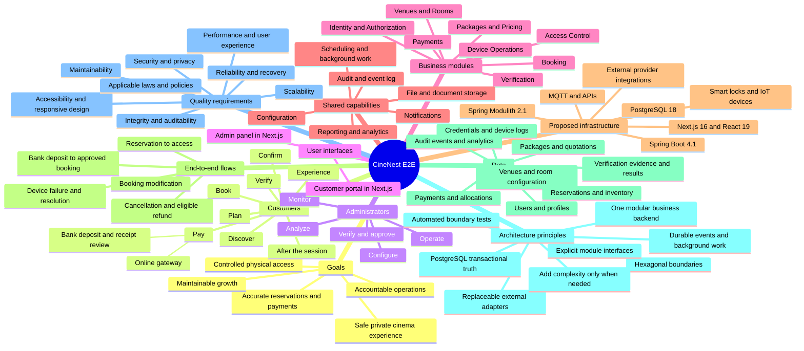

# CineNest: End-to-End Mind Map

**From customer discovery to physical access and operations**

**Architecture direction:** Modular monolith with hexagonal boundaries inside business modules.

> Converted from the supplied CineNest infographic. This is an editable representation of a proposed design, not evidence of an approved stack, completed software, or verified hardware. Obvious image-text artifacts have been normalized. The complete outline below preserves the diagram's main sections; the Mermaid overview provides an editable visual summary.

## Editable Mermaid overview

## 1. Business goals

- Provide a safe, private, and seamless theater-booking experience.
- Ensure accurate reservations and payments.
- Control and monitor physical access.
- Operate efficiently with clear accountability.
- Scale in a controlled and maintainable way.

## 2. People and application entry points

### 2.1 Customers: primary users

- Browse venues and rooms.
- View packages and pricing.
- Make a reservation.
- Pay online or by bank deposit.
- Complete identity verification.
- Receive confirmation and access details.
- Enjoy the experience.

**Application entry point:** Customer Portal, shown as Next.js in the infographic.

### 2.2 Administrators: business users

- Manage venues, rooms, and devices.
- Configure packages and pricing.
- Review and verify payments.
- Review identity documents.
- Monitor bookings and operations.
- Handle exceptions and support.
- View reports and analytics.

**Application entry point:** Admin Panel, shown as Next.js in the infographic.

Both interfaces connect users to the CineNest system and its business modules.

## 3. Customer end-to-end journey

### 3.1 Discover

- View venues, room types, and facilities.
- Explore packages and pricing.
- Check availability.

### 3.2 Plan

- Select venue, room, date, time, and package.
- View the quotation and applicable policies.
- Review the intended booking details.

### 3.3 Book

- Create the reservation request and provisional hold.
- Provide customer details.
- Acknowledge terms and conditions.

### 3.4 Pay

- Pay through an online payment gateway; or
- Deposit or transfer funds and upload bank-payment evidence.
- Wait for payment verification where required.

### 3.5 Verify

- Submit an identity document.
- Complete automated checks or manual review.
- Receive the eligibility decision.

### 3.6 Confirm

- Receive booking confirmation after the applicable payment, verification, and reservation checks.
- Receive confirmation by email/SMS.
- Receive access instructions and credential information, such as a PIN.
- The infographic also shows QR access as a conceptual option, not an established hardware capability.

### 3.7 Experience

- Arrive at the venue and use the authorized access method.
- Enjoy the booked session.
- Receive reminders or support when needed.

### 3.8 After the session

- Receive a receipt and session summary.
- Provide feedback.
- Book again or manage future bookings.

## 4. Administrator end-to-end operations

### 4.1 Configure

- Set up venues and rooms.
- Define packages and pricing.
- Configure operating hours and policies.
- Register and configure devices.

### 4.2 Monitor

- View upcoming bookings.
- Monitor payments and verifications.
- Check device status and access logs.
- Review system health.

### 4.3 Verify and approve

- Review bank-payment evidence and match actual received funds.
- Approve verified payment claims or reject unsupported claims.
- Review identity documents.
- Handle exceptions and manual cases.

### 4.4 Operate

- Support customers.
- Modify or cancel bookings through authorized workflows.
- Revoke or reissue access credentials when permitted.
- Manage maintenance and closures.

### 4.5 Analyze

- View reports and metrics.
- Monitor revenue and usage.
- Identify trends and issues.
- Plan future offerings.

## 5. CineNest business modules

### 5.1 Identity and Authorization

- Customer accounts.
- Administrative users and roles.
- Authentication and sessions.
- Venue access scope.
- Audit and security.

### 5.2 Venues and Rooms

- Venues and locations.
- Room details and facilities.
- Operating hours.
- Room capacity.
- Maintenance information.

### 5.3 Packages and Pricing

- Package versions.
- Included services.
- Duration options.
- Rate rules and discounts where approved.
- Authoritative quotations.

### 5.4 Booking

- Reservation holds.
- Room-inventory control.
- Conflict prevention.
- Confirmed bookings.
- Amendments and cancellations.

### 5.5 Payments

- Payment-gateway integration.
- Bank-payment verification.
- Funds allocation.
- Refunds and reconciliation.
- Payment-status tracking.

### 5.6 Verification

- Identity-document processing.
- Automated checks, such as OCR.
- Manual review by authorized administrators.
- Eligibility decisions.
- Secure evidence storage.

### 5.7 Access Control

- Generate access credentials.
- Manage PINs and any separately approved QR access capability.
- Provision credentials to supported smart locks.
- Manage credential expiry and revocation.
- Track access logs and status.

### 5.8 Device Operations

- Device registration.
- Device configuration.
- MQTT/API integration.
- Telemetry and commands.
- Connection health and failure handling.

## 6. Shared capabilities

- **Notifications:** email and SMS.
- **Audit and event log:** attributable records of relevant actions and events.
- **Configuration:** controlled application settings.
- **Reporting and analytics:** authorized business and operational views.
- **File and document storage:** storage for required business and verification records.
- **Scheduling and background work:** scheduled tasks and reliable follow-up processing.

These labels describe capabilities, not a requirement for independent services or a universal shared module owning other modules' data.

## 7. Infrastructure shown in the infographic

| Area | Depicted technology or integration |
| --- | --- |
| Primary database | PostgreSQL 18 |
| Backend | Spring Boot 4.1 and Spring Modulith 2.1 |
| Frontend | Next.js 16 and React 19 |
| External integrations | Payment providers, SMS/email, OCR, and other approved services |
| Physical integration | Smart locks and IoT devices using supported MQTT/API connections |

**Status:** These are the proposed version lines depicted in the image. This conversion does not approve them, select exact patches, or establish current compatibility. The canonical architecture decision and its approval record remain authoritative.

## 8. Key end-to-end flows

### 8.1 Reservation to access

Browse → Quote → Provisional reservation → Pay → Verify → Confirm → Access

### 8.2 Bank deposit to access

Bank deposit/transfer → Receipt submission → Administrator verifies received funds → Confirm eligible booking → Provision access

### 8.3 Booking modification

Modification request → Availability check → Authorized update → Notify customer

### 8.4 Cancellation

Cancellation request → Apply accepted policy → Refund if applicable → Release reservation inventory

This is a high-level flow, not a requirement to wait for an external refund to settle before releasing a cancelled reservation.

### 8.5 Device failure

Device failure → Alert → Approved manual-access or recovery procedure → Resolution

A manual procedure must be established and tested for the selected hardware; this diagram does not prove such a procedure already exists.

## 9. High-level data flow and information areas

- Users and profiles.
- Venues, rooms, and configuration.
- Packages, pricing, and quotations.
- Reservations and inventory.
- Payments and allocations.
- Verification documents and results.
- Access credentials and device logs.
- Audit records, events, and analytics.

## 10. Architecture principles

- A modular monolith with clear business modules.
- Hexagonal boundaries inside business modules.
- Explicit module interfaces and controlled dependencies.
- PostgreSQL as the transactional source of truth.
- Replaceable adapters for external integrations.
- Durable events and reliable background work.
- Automated architecture and module-boundary tests.
- Keep the design simple; add complexity only when needed.

## 11. Non-functional requirements

- Security and privacy by design.
- Data integrity and auditability.
- Reliable operation and recovery.
- Scalability within the modular backend deployment model.
- Maintainability and clear ownership.
- Good performance and user experience.
- Accessibility and responsive design.
- Compliance with applicable laws and policies, subject to the required reviews and approvals.

## 12. Interpretation notes

- The source is a conceptual infographic, not a definitive workflow contract. Its step numbering does not override approved eligibility checks, payment conditions, or on-site verification requirements.
- A receipt upload is a payment claim, not proof of bank credit. Booking confirmation and access readiness remain separate outcomes.
- The image's early "Book" label mentions a hold or confirmed reservation. Here it is expressed as a provisional reservation; final confirmation follows the required checks.
- The image's truncated access label "Expiry and" is rendered as "expiry and revocation," consistent with the administrator's revoke/reissue actions shown in the same image.
- Garbled labels such as "Reservations," "Device registration," and "Connection health and failure handling" have been normalized for readability.
- This exported mind map does not replace the four maintained knowledge documents or their authoritative registries. Approved rules and implementation status remain in the existing canonical knowledge base.

---

**Source:** Supplied infographic, `wide_detailed_infographic_flowchart_mind_map_on_a.png`.

**Source footer:** CineNest End-to-End Mind Map, v1.0.

**Theme line:** People • Places • Movies • Memorable Experiences
