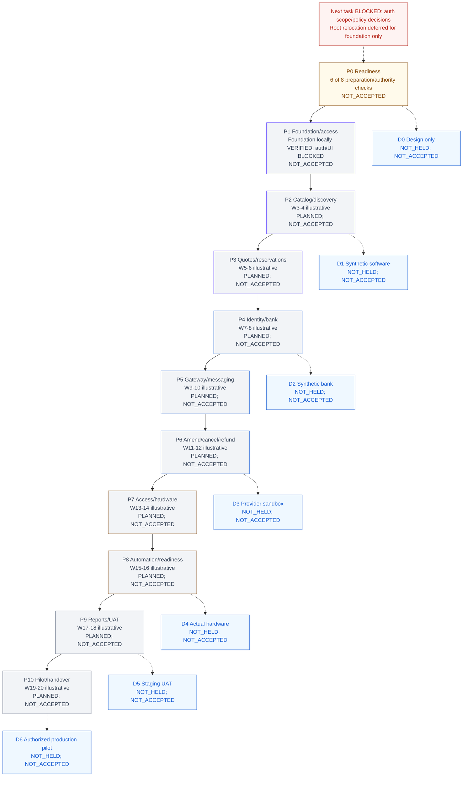

# CineNest Progress

This document owns execution guidance, derived coverage/status summaries, approval queue, verification references and current handoff. [PROJECT](PROJECT.md) owns product rules; [ARCHITECTURE](ARCHITECTURE.md) owns technical decisions; [DESIGN](DESIGN.md) owns UI/charts. Root [AGENTS](../AGENTS.md) is the concise operating entry point. Structured registries remain authoritative for IDs, statuses and dependencies; tables here are projections, not a second manually maintained database.

## Current status and approvals

Current planning direction is S17; the maintained [MVP roadmap](#mvp-roadmap) has74 criteria across P0–P10 and 7 demos, with no software or customer acceptance inferred. The directory-layout request remains blocked before movement by destination `.git` and `knowledge/` collisions; see [inspection](#root-relocation-inspection). Current authoritative root remains nested.

S16 initial-stack approval recorded under existing **CN-DEC-001** after comparison with the actual Initial Stack Brief. Starting root repository/, main → origin/main at `bfc4a3ffd49adb0982cd1f88fa8243f2f0956816`, tracked clean; two unrelated untracked mind-map assets remain unchanged/unpublished. Instructions manually read; automatic loading NOT_VERIFIED. No new task/requirement/test/decision ID or knowledge file.

Current [foundation evidence](#foundation-implementation) records authorized CN-FND-001 local implementation/qualification, VERIFIED/CLOSED. CN-DEC-001 remains VERIFIED/CLOSED; CN-AUTH-001 remains BLOCKED by its own unresolved decisions, not automatically READY. OD-01 broader scope remains open; full future plan NOT_APPROVED. No business feature, provider, live operation or customer acceptance is established.

## Owner-supplied diagram publication

Current owner explicitly authorizes publication of supplied diagrams only. Actual Git root remains repository/, main at baseline `c4fdd64d67a6be6fc2376748c15a3336b8c713f6`; parent is not a Git repository. No folders moved/initialized; no incoming staged or tracked edits and no outgoing local commits. Explicit reviewed path/hash allowlist is in the existing manifest diagramPublication, not a new registry/index/report. Seven families: mind map 1, use cases 5, activities 10, sequences 10, contexts 2, components 2, ER 8 Markdown sources; 11 accompanying PNGs (49 supplied files total).

These are supporting proposed/unverified exports, not new maintained authorities or executable schema/workflows. PROJECT/ARCHITECTURE/DESIGN/PROGRESS remain canonical. Every Mermaid block and all binary assets retained byte-for-byte; 186 broken sibling-link destinations corrected to uniquely matching actual same-family filenames (spaces URL-encoded); labels/prose/diagram code not rewritten; 111 trailing-space hard breaks outside diagram fences replaced with explicit ` ` markup to preserve rendered breaks and pass staged whitespace checks. The ER ZIP was inspected (eight safe original ER sources) but disappeared during this task without any delete/move by this agent; excluded from the reconciled allowlist, not restored/regenerated. No archive published. Initial validators exposed broken links, inventory/no-new-prose guards and illustrative colors; exact export path/hash/type validation now distinguishes these owner-approved supporting assets from canonical UI-token rules without changing token/CSS/approval or coverage checks.

Raster references include superseded or unapproved suggestions (JWT/Redis sessions, Kafka/TimescaleDB, tenant isolation, Refine/Ant Design, OCR authenticity, direct bank connectivity, plaintext credential/evidence fields and simplified money/control transitions). Retain them as illustrative source material: they do not select those technologies/policies or override database sessions, Redis deferral, independent bank evidence, immutable purchases, protected secrets, scoped authorization or physical egress. Corrected Analysis PNGs and detailed Markdown also remain proposals, not approvals. No current architecture/policy/runtime claim inferred from publication.

Review: all 38 Markdown sources have balanced fences and proposed/unverified notices; all relative links resolve; 11 PNGs visually inspected and CRC-checked; the initially present ZIP contained safe unencrypted names and matching original ER sources but is now absent and excluded. No credential-pattern matches or apparent sensitive image data found; largest file 1,918,151 bytes, total supplied bytes about18.2MB; no Git/LFS attributes or custom active hooks found. No repository Mermaid validator, mmdc or local Mermaid package found; full syntax/rendering NOT_VERIFIED and no tools installed. Application/hardware tests NOT_RUN. Current command results/publication state are recorded in existing status.json diagramPublication. Root collision and foundation/qualification/policy gates remain unchanged. Stop after this publication.

Verified diagram publication: primary commit `dff96868a904d29f6709974a222ee1fdd9f640c9` (`docs(knowledge): add CineNest architecture and workflow diagrams`) pushed to origin/main; independent `git ls-remote` matched exactly (both exit0). Worktree clean afterward; 49 supplied files added with no deletions/unrelated changes. Both knowledge validators and staged/unstaged whitespace checks passed. Existing status holds receipt; in-place receipt successor changes no diagrams or approvals. Resolve final current HEAD from Git.

## CN-FND-001 implemented foundation — 2026-10-15

Owner's current instruction explicitly authorizes the recorded foundation implementation and use of the nested repository. Actual starting root `/home/hasitha-wijerathna/Documents/Theater Project/repository`, main → origin/main, HEAD `4bc627781780d26d8c541768d958b18c3269a88d`, clean. CN-DEC-001 was already VERIFIED/CLOSED. Relocation is deferred for this session by explicit instruction; no directory cleanup/move attempted. Source request SHA-256, exact owned-file hashes, commands and environment are in existing execution/status.json foundationImplementation, not another report. Earlier NOT_GRANTED/blocked statements below remain dated historical evidence; this section supersedes them for CN-FND-001 only.

Implemented scope: backend/pom.xml, checksum-pinned Maven wrapper and Java25 enforcement; real Spring Boot entry point; one encapsulated foundation module exposing migration status with a Flyway adapter; a foundation namespace-only migration; explicit deny-all HTTP filter with default generated-user auto-configuration excluded; no auth use cases or product endpoints. Frontend is one Next production-buildable static foundation page consuming the unchanged canonical CSS directly, with pinned Node/npm/dependencies/lockfile, type checking, Biome lint and real server smoke checks. No fake operational statistics or pretend bookings. scripts/verify-foundation.py creates a uniquely named, ephemeral PostgreSQL18.6 container on loopback/random ports and tmpfs, generates temporary test credentials in environment, runs clean backend tests/build and packaged-JAR startup, then stops only its own process/container. No persistent volumes or owner toolchain defaults changed. Scoped read-only-permission GitHub Actions workflow added; no deployment/provider secrets.

Exact local qualification: Ubuntu OpenJDK25.0.4.1+1-1-26.04.4-Ubuntu (packaged GPL/ClassPath-exception notices inspected); wrapper3.3.4, Maven3.9.16 with distribution checksum; Boot4.1.1 parent/BOM and compatible Modulith2.1.1 BOM, Boot-managed Flyway12.4.0 core/PostgreSQL module and JDBC42.7.13; PostgreSQL18.6 pinned image digest; Node24.22.0 downloaded into temporary task tools and checked against official SHA-256; npm11.19.1; Next16.4.1, matched React/react-dom19.3.1, TypeScript5.9.3, Tailwind/@tailwindcss/postcss4.3.3, Biome2.5.15; Boot-managed JUnit6.0.3. CI declares Temurin25.0.4.1+1 separately; local Ubuntu JDK success is not remote Temurin evidence. Database sessions/durable events remain approved direction, not implemented by this foundation. No managed dependency overrides.

Current official sources checked during qualification: [Boot requirements](https://docs.spring.io/spring-boot/system-requirements.html), [Modulith2.1.1 release POM](https://github.com/spring-projects/spring-modulith/blob/2.1.1/pom.xml), [Maven releases](https://maven.apache.org/docs/history.html), [PostgreSQL supported minors](https://www.postgresql.org/support/versioning/), [Flyway PostgreSQL support](https://documentation.red-gate.com/flyway/reference/database-driver-reference/postgresql-database), [Node release table](https://nodejs.org/en/about/previous-releases), [Next installation](https://nextjs.org/docs/app/getting-started/installation), [Tailwind Next integration](https://tailwindcss.com/docs/installation/framework-guides/nextjs), [Biome installation](https://biomejs.dev/installation/quick-start/). Actual Maven Central/npm artifact resolution and builds supplement declared documentation compatibility; no claim of exhaustive security audit or commercial/vendor support contract. The Adoptium API denied access; official Temurin GitHub release metadata supplied CI's exact patch instead.

Repeatable local commands, from this actual Git root with Java25 and Docker available: `DOCKER_HOST=unix:///var/run/docker.sock python3 scripts/verify-foundation.py` (explicit socket needed on this host; script respects DOCKER_HOST elsewhere). Frontend with Node24.22.0/npm11.19.1 on PATH: `cd frontend`, `npm ci`, `npm run build`, `npm run typecheck`, `npm run lint`, `npm test`, `npm audit --audit-level=high`. This session used `/tmp/cinenest-fnd-tools/node-v24.22.0-linux-x64/bin` on command-local PATH. No global install is required by the checked-in code; use an available approved toolchain. Standalone backend settings CINENEST_DB_URL/USER/PASSWORD are mandatory; do not commit their values. Clean builds delete only generated backend/target and npm-ci-owned node_modules; test runner never deletes a pre-existing database or volume. The runner uses random ports; it does not kill unrelated listeners.

Verification: clean backend build/test/database/startup repeated twice, 4 JUnit tests (2 architecture, 2 PostgreSQL/real-HTTP integration), zero failures/skips; packaged JAR startup and denied real request passed. One frontend real production-server smoke test passed; lockfile clean install, production build, explicit TypeScript and lint checks passed, final npm audit zero vulnerabilities. Architecture checks assert one actual foundation module exists, verify Modulith arrangement and prohibit its API from depending on adapter internals; they do not prove future business boundaries. Recovery check exercises no-op repeat migration on the real isolated database and packaged restart over the same migrated schema, not financial/event recovery. Initial failures retained in status: obsolete test getName API fixed to getIdentifier; unavailable Docker desktop socket replaced by explicit system socket; sandbox TypeScript subprocess parse failure passed outside sandbox; newly selected ESLint chain's five high development advisories removed by supported Biome selection, not forced downgrade/managed override; Biome ignore root corrected. No failed check silently excluded.

Acceptance: recorded local skeleton/reproducible build/test DoD met; CN-FND-001 VERIFIED/CLOSED for this scope. Remote CI execution is separately tracked in status.foundationImplementation; workflow presence is not a CI pass. Requirements/test records retain full-feature NOT_VERIFIED/NOT_RUN/NOT_ACCEPTED and add only scoped foundation evidence. P0-C06 now has stack/implementation-authorization evidence; P1-C01 now has local reproducible qualification evidence. P1-C02/C03/C06 remain unchecked: broader business boundaries, session/durable-work persistence, shared UI and whole-phase CI/demo acceptance are not established. P0/P1 phase gates and all held/accepted demo counts unchanged. D0 remains prepared DESIGN ONLY; D1 catalog/admin prerequisites remain unmet. Colorful source graph updated without claiming Mermaid rendering or restoring missing HTML.

Self-review only. Existing validators must preserve every historical requirement/task/dependency/proposal and allow only this request-hashed scoped successor; new code hashes and bounded status guards added, not broad permission for later work. No browser-rendered accessibility audit, business authorization/concurrency/recovery tests, providers, hardware or customer acceptance run. Rollback is a normal scoped Git revert; temporary test services are cleaned by the runner, with no live data migration to undo.

Remote CI first run [38687499707](https://github.com/Hasitha3513/Theater-Project/actions/runs/38687499707) at bdf8595 failed before builds: setup-java v5 rejected four-part version string 25.0.4.1+1. Correction pins the exact official Temurin archive and its SHA-256, using supported jdkfile installation with major-version cache label; no runtime downgrade or floating download. Replacement run outcome is tracked separately in existing status.foundationImplementation.

Remote CI second run [38687790645](https://github.com/Hasitha3513/Theater-Project/actions/runs/38687790645) at dc13a55 passed backend/PostgreSQL/packaged startup and frontend build/type/lint/smoke/audit, then failed knowledge validation because default shallow checkout omitted immutable baseline commits. Workflow now requests full Git history; no validator history/evidence checks removed. Final run outcome remains separate in status.foundationImplementation.

Single next decision: resolve CN-AUTH-001's actual OD-12 single-organization/venue versus SaaS-tenancy scope and applicable exact session/revocation/security policy choices; OD-01 broader providers/libraries stay OPEN. CN-AUTH-001 is not READY merely because foundation passed; do not begin it here.

## Root relocation inspection — blocked before any move

Owner requested actual root `/home/hasitha-wijerathna/Documents/Theater Project`. Inspected nested authoritative root `/home/hasitha-wijerathna/Documents/Theater Project/repository`, main → origin/main at `3d3b610d4f93198eda701c7325d971c21a671254`; staged/unstaged tracked changes empty, two existing untracked mind-map assets retained. Origin fetch/push is `https://github.com/Hasitha3513/Theater-Project.git`. Repository .git is an ordinary directory with one primary worktree; no linked registrations, submodules/gitlinks or symlinks found. Parent and outer knowledge are not Git repositories.

Immediate parent project folders are `repository/` (authoritative Git checkout, current canonical knowledge and instructions) and `knowledge/` (initial pre-clone knowledge copy). All 16 outer files match exact bytes at first immutable commit `16710dcf3e3bfb2453bab24910890279691fc06d`: five still match current counterparts, three same-path files differ from current revisions, eight are historical superseded prose with no current same-path counterpart. No unique outer file content found. Existing hidden parent `.git/.agents/.codex/.aws` are empty read-only directories (0555); no private contents read or disclosed.

Reversible candidate move inventory is nested `.git`, `AGENTS.md`, `docs/`, `knowledge/` → same names in parent using same-filesystem renames, including all hidden/untracked contents, with inverse renames as rollback before further edits. **Not executed:** parent `.git` and `knowledge/` already occupy destination names. User explicitly requires stopping before collisions; no merge/overwrite, repository initialization/clone, deletion or wrapper removal performed. The wrapper is not empty and its primary worktree still points there. Needed resolution: explicit owner disposition/cleanup approval for the exact accounted historical outer knowledge and a supported environment resolution for the empty read-only parent Git placeholder. Do not bypass reserved filesystem permissions or silently replace Git metadata.

Both existing validators and `git diff --check` passed at preflight; these are pre-relocation checks, not evidence relocation succeeded. No pre-existing validation failure found. Approval/qualification/implementation gates remain unchanged; no application/hardware tests run. Record only this inspection and blocker in existing files; no archive, new report/KB/task created. Layout remains nested pending collision resolution.

## Stack approval record and verification

S16 approval matches the original version lines/database-session-recovery responsibilities; npm recording and stable/resolved-qualification conditions explicit. Actual approval scope is owned by [ARCHITECTURE](ARCHITECTURE.md#stack-approval), with historical proposal/research preserved. OD-01 initial subset accepted; broader cloud/provider/library and qualification decisions remain OPEN_DECISION. All 92 requirements/test plans, 28 tasks and 29 decision records retained; original criteria/dependencies and S15 mappings unchanged. S16 approves no role bundle, limit, independent-review/exception/revocation policy, physical/provider outcome or foundation execution. Both validators and unstaged whitespace checks passed; eight in-memory negative controls rejected loss or unauthorized promotion. OD-01 projection mismatch found during validation was corrected from its registry; no check weakened. Current self-review/checks/publication receipt are recorded in existing status.json stackApprovalUpdate; no independent review or new runtime qualification claimed.

Verified publication: primary S16 approval-record commit `0bc10a1f9059df97cb6dbbf233f42af03285abf9` pushed to origin/main and independently matched by `git ls-remote` (both exit0). Staged whitespace check passed. Existing status holds the receipt; this metadata closeout adds no scope or qualification claim. Tracked changes clean after push; both unrelated untracked files remain unchanged/unpublished. Resolve final HEAD from Git.

## Actual CN-FND-001 prerequisite review

**Exact objective:** Selected-stack repository skeleton and CI. **Registry scope:** Only approved local project/module skeleton, safe build/test and scoped CI definition after stack selection. **Excluded:** production/cloud provisioning, provider setup or business feature. Dependency CN-DEC-001; OD-01 remains a recorded gate for qualification/broader unresolved choices. Authority false, work/readiness BLOCKED. Original task fields remain unchanged; prerequisiteEvidence records only S16 direction approval, not readiness.

Expected deliverables within that scope, to be refined/authorized before code: reproducibly pinned local backend modular-monolith and customer/admin frontend skeleton; module/interface boundary definitions and minimal isolated tests; safe build/lint/test commands; scoped CI definition without production secrets/provider deployment; recorded dependency resolution/tool versions/check evidence and history-preserving rollback. No product schemas, real auth/payment/IoT integrations or arbitrary additional libraries inferred. Exact future source/build/test/CI paths remain TBD in the backlog; this is a prerequisite review, not completed deliverables or an already-approved detailed implementation plan.

Remaining conditions: review actual owned paths and skeleton-only acceptance; maintain all business/security/safety boundaries; determine permitted local tool/container installation/downloads, dev-only storage/ports/network and CI permissions. Select and record exact supported stable JDK distribution/licence, Boot/Modulith BOM tuple, Postgres/Flyway PostgreSQL support/JDBC, Maven, Node/npm, Next/React/react-dom/TypeScript/Tailwind and compatible test tools from official sources. No floating/pre-release/independent override; unsupported combination requires owner amendment. Team/toolchain availability, browser floor, complete resolved runtime/build compatibility and isolated PostgreSQL/Testcontainers/migration support remain unverified. No environment check/install/build performed by this approval task.

Acceptance before any VERIFIED foundation claim: repeatable clean install/build; backend unit and module-boundary verification; frontend explicit type/lint/build and appropriate minimal tests; compatible isolated database/Flyway startup checks if included in separately authorized scope; safe CI rerun with no real secrets/data; actual command/exit/output/commit/environment evidence. Original registry plannedChecks is “Actual selected build/lint/unit/module-boundary commands, no production data”; DoD is “Repeatable approved local skeleton and test evidence; no feature-complete claim.” Exact executable commands must be derived from the future approved manifests, not invented now. Application/provider/hardware tests NOT_RUN. Missing source/financial/privacy/roles/safety decisions still gate affected features/launch, without silently blocking an expressly authorized empty skeleton or waiving those decisions.

**Single next approval:** owner separately authorizes CN-FND-001's bounded local project/module skeleton, safe build/test and scoped CI definition, with reviewed owned paths, permitted environment actions, qualification/amendment conditions and skeleton-only acceptance. S16 is not that authorization. Stop after this approval-record unit.

### Foundation start clarification — owner reaffirmation 2026-10-15

Current conversation “OWNER STACK APPROVAL” reaffirms S16's bounded initial direction, matching the actual brief/version-policy comparison in ARCHITECTURE; original research/proposal and all pending policies remain unchanged. Approval is recorded in existing status.stackApprovalUpdate.ownerReaffirmation. No new P0 evidence supports another checkbox: initial direction was already checked, qualification and implementation remain pending; P0 is not accepted.

Actual root remains `/home/hasitha-wijerathna/Documents/Theater Project/repository`, baseline `abbb6f93ade0017ee39f98576298f8f2aa6d5593`, main, clean before this documentation unit. The approved relocation did not execute: sandbox parent `.git` removal returned “Device or resource busy”; outside sandbox the path was absent. No outer copies removed or repository contents moved. This is workspace housekeeping, not a CN-FND-001 registry dependency; deferring it requires an explicit owner sequencing decision, not an inferred waiver.

CN-FND-001 maps PR-UI-001, PR-PKG-001, PR-BANK-001, CN-NFR-02 and CN-NFR-03; these mappings preserve requirements coverage without authorizing package/payment features. P1-C01/C02/C03 reference foundation alongside other tasks; P1-C06 includes CI/shared UI, but its listed tasks are CN-ACCEPT-001/CN-DEC-001/CN-UI-001. Foundation's own registry scope remains local skeleton/build/test/scoped CI only. It cannot complete P1, auth, business migrations or shared controls by itself.

Recorded conflicts for owner review (no dependency edits):
- Handoff says “before root relocation” and prioritizes collision resolution; CN-FND-001 dependencies are only CN-DEC-001. Consequence: recorded workspace sequence is blocked while the task has no relocation edge. Proposed decision: explicitly choose completion of environment/root correction first, or explicitly defer relocation and authorize a reviewed nested-root scope.
- CN-FND-001 says “Only approved local project/module skeleton, safe build/test and scoped CI definition after stack selection”; P1-C03 says “Initial feature migrations, session storage, and durable-work foundations implemented.” Consequence: foundation alone cannot satisfy that broader criterion. Proposed sequencing: accept skeleton evidence only for foundation; retain feature/session migrations for separately authorized owning slices.
- P1-C06 says “Shared UI shell, design tokens, accessibility baseline, CI, and isolated demo environment established”; CN-UI-001 depends on CN-FND-001 and owns “First admin/customer shell and reusable control/card/table primitives, only labelled fixtures.” Consequence: a combined P1 demo cannot be claimed from foundation. Proposed sequencing: foundation CI first, UI and auth tasks only after their dependencies/approvals; review CI trace mapping without silently changing it.
- CN-FND-001 blockingDecisionIds contains OD-01; OD-01 retains both pending exact qualification and broader cloud/provider/library choices. Consequence: initial-stack approval does not close the whole decision. Proposed scope decision: retain OD-01 open; qualify the skeleton's actual dependency tuple while deferring unrelated choices to their affected tasks, with explicit owner acceptance of this interpretation before READY.

Immediate conditions remain bounded path/deliverable/environment/CI approval, current supported-patch verification and reproducible qualification plan, plus separate implementation authority. Java distribution/licence and test tooling must be qualified before use; unsupported lines require owner amendment. Feature-specific role bundles, revocation protocols, financial limits, independent review, privacy/providers/hardware, pilot/staffing/dates remain open at their actual gates and are not universal empty-skeleton prerequisites. No task dependencies, authority, planned tests, requirements, demo acceptance or phase statuses changed. CN-DEC-001 is already VERIFIED/CLOSED.

Required foundation evidence remains clean reproducible install/build, backend unit/module-boundary tests, frontend type/lint/build/minimal tests, isolated PostgreSQL/Flyway checks if included, and safe scoped CI; derive actual commands from authorized manifests. No application tests/install/scaffolding in this session. Current knowledge-check results are in status.stackApprovalUpdate.ownerReaffirmation.

## Authorization update and handoff evidence

[PROJECT](PROJECT.md#authorization-requirements) owns actors/access requirements; [ARCHITECTURE](ARCHITECTURE.md#authorization) owns one technical policy; [DESIGN](DESIGN.md#permission-aware-ui) owns denial/expiry/revocation presentation. CN-NFR-02 retains original criteria/mappings and adds 18 planned authorization scenarios; T-CN-NFR-02 references them rather than duplicating a catalog. CN-AUTH-001 documentationUpdate records S15 only; its implementation status/dependencies/authority stay blocked. All 92 requirement/test records, 28 tasks, 29 open decisions and product NOT_VERIFIED/NOT_ACCEPTED/NOT_RUN statuses remain.

Unresolved gates: role/scope/limits and independent approval OD-18/28, sensitive-purpose/privacy OD-03/05, venue/tenancy OD-12, exact stack qualification/deferred framework details OD-01; exact revocation/cache latency, concurrency protocol and durable-work continuation need explicit design/policy approval. Owners TBD. Existing missing PDFs, quote OD-20/chart mapping OM-06 and physical/financial/provider gaps remain. Exact executable and physical evidence needed is in the retained test-plan record and architecture; no application/hardware tests run. Both knowledge validators and unstaged whitespace check passed; six in-memory negative controls rejected lost original and authorization-specific content. Parent self-review; current commands/results and publication outcome recorded in status.json authorizationUpdate, without a new evidence/report file.

Publication verified: primary authorization documentation commit `c96ae828b4a0ae3df0f32b101ff107fa9613459c` pushed to origin/main, independently matched by `git ls-remote` (both exit0). In-place status receipt records commands/time; closeout introduces no new authority. Tracked changes clean after push, two unrelated untracked artifacts remain unchanged and unpublished. Resolve final HEAD from Git. Staged whitespace check passed.

Baseline design validator initially failed because two unrelated untracked files violated its historical inventory guard. Inventory now distinguishes the exact pre-existing untracked paths/hashes from maintained tracked KB; they are not newly created or approved sources. Their bytes are protected, excluded from generated inventory/active-link review and staging; new files or drift are still rejected. No protected historical/content/status check is removed.

## Execution charter

READ → RECONCILE → SELECT → PLAN → IMPLEMENT → TEST → REVIEW → RECORD. Verify actual Git/worktree and source changes, preserve unrelated work, select one READY authorized bounded change set with acceptance/checks/rollback and required decisions resolved. Read-only guidance stays read-only. If none is eligible, report the exact approval/dependency; do not choose an easier unrelated task or infer scope from a roadmap.

Update the four canonical documents and existing registries in place. New knowledge files require explicit owner approval; future prompts stay in conversation unless a file is requested. This restriction does not prevent application source/tests/migrations in a separately authorized implementation task. One parent writer, no atomic task claim/background execution/native agent framework implied. Bounded independent review only when applicable authorization/instructions permit it; otherwise label self-review.

Use accepted module/interfaces/stack only. Security, a11y, audit, migration/recovery and failure tests accompany each affected slice; no implied provider contracts or physical acceptance. Product/financial/safety constraints belong to PROJECT and ARCHITECTURE; no implementation can waive them. All external operations require their own authorization, private evidence/redacted output and truthful outcome. No production/deployment, real bank/payment/refund/message/device/secret/destructive action authorized by this documentation task.

Record actual command/time/environment/result, scope/limits, review findings and next action in PROGRESS/status.json; retain historical evidence references. Documentation VERIFIED, software test results, provider sandbox, physical verification, business acceptance and publication are distinct. Planned tests are NOT RUN until executed; no private reasoning/secrets in evidence. Missing/moved sources require reconciliation, not invented approval. Preserve source ledger freshness.

Automatic task-owned Git commit/push authority persists after checks/review, respecting branch controls and remote verification. Stage owned files only, non-force/history preserving; Git publication never authorizes stack/policies/deployment/whole plan. No other repo/cloud/attachment sync implied. Stop at one completed unit or required approval.

## Controlled execution plan

[change-sets.json](execution/change-sets.json) is the authoritative bounded plan, including full scope/exclusions, affected modules, DB/API/UI/migration/risk, planned checks, rollback, DoD, approval and evidence. READY requires all prerequisites/tools/authority/necessary decisions. Existing units remain; this display is derived.

<!-- projection:tasks -->
| Task | Phase | Objective | Dependencies | Work / readiness |
|---|---|---|---|---|
| CN-AGENT-SETUP-001 | 0 | Execution workflow setup | None | VERIFIED / CLOSED |
| CN-DEC-001 | 1 | Bounded initial-stack decision brief | CN-AGENT-SETUP-001 | VERIFIED / CLOSED |
| CN-GATE-001 | 1 | Source and accountable policy gate brief | CN-AGENT-SETUP-001 | BLOCKED / BLOCKED |
| CN-FND-001 | 1 | Selected-stack repository skeleton and CI | CN-DEC-001 | VERIFIED / CLOSED |
| CN-UI-001 | 2 | Shared shell and token consumers | CN-FND-001 | BLOCKED / BLOCKED |
| CN-AUTH-001 | 2 | Identity/session and resource scope skeleton | CN-FND-001 | BLOCKED / BLOCKED |
| CN-ROOM-001 | 2 | Catalog and scoped room configuration | CN-AUTH-001, CN-UI-001 | BLOCKED / BLOCKED |
| CN-PKG-001 | 3 | Package drafts and scoped editor | CN-ROOM-001, CN-UI-001 | BLOCKED / BLOCKED |
| CN-PKG-002 | 3 | Immutable package publication/applicability | CN-PKG-001 | BLOCKED / BLOCKED |
| CN-BOOK-001 | 3 | Shared inventory hold/conflict guard | CN-ROOM-001 | BLOCKED / BLOCKED |
| CN-QUOTE-001 | 3 | Exact quote and purchase snapshot contract | CN-PKG-002, CN-BOOK-001 | BLOCKED / BLOCKED |
| CN-VERIFY-001 | 4 | Private booker evidence and eligibility review | CN-AUTH-001, CN-QUOTE-001 | BLOCKED / BLOCKED |
| CN-PAY-GW-001 | 5 | Gateway sandbox attempt/verification slice | CN-QUOTE-001, CN-VERIFY-001 | BLOCKED / BLOCKED |
| CN-PAY-BANK-001 | 5 | Bank request/receipt and durable reviewer work | CN-QUOTE-001, CN-VERIFY-001 | BLOCKED / BLOCKED |
| CN-PAY-BANK-002 | 5 | Bank evidence/allocation and guarded confirmation | CN-PAY-BANK-001 | BLOCKED / BLOCKED |
| CN-REFUND-001 | 5 | Evidence-based refunds and corrections | CN-PAY-GW-001, CN-PAY-BANK-002 | BLOCKED / BLOCKED |
| CN-ACCESS-001 | 6 | Simulated credential scheduling/recovery | CN-PAY-GW-001, CN-PAY-BANK-002 | BLOCKED / BLOCKED |
| CN-IOT-001 | 7 | Simulated device command/observation slice | CN-ACCESS-001 | BLOCKED / BLOCKED |
| CN-OPS-001 | 7 | Room readiness/incident software slice | CN-IOT-001 | BLOCKED / BLOCKED |
| CN-ADMIN-001 | 8 | Read-only scoped account/audit operations | CN-AUTH-001, CN-VERIFY-001 | BLOCKED / BLOCKED |
| CN-NOTIFY-001 | 9 | One notification channel and durable delivery | CN-PAY-BANK-001, CN-ACCESS-001 | BLOCKED / BLOCKED |
| CN-CUSTOMER-001 | 9 | Owned history and support status | CN-ACCESS-001, CN-NOTIFY-001 | BLOCKED / BLOCKED |
| CN-AMEND-001 | 9 | One purchased booking change/extension slice | CN-CUSTOMER-001, CN-QUOTE-001, CN-REFUND-001 | BLOCKED / BLOCKED |
| CN-REPORT-001 | 9 | Core authorized money/booking projection | CN-PAY-GW-001, CN-PAY-BANK-002 | BLOCKED / BLOCKED |
| CN-ENG-001 | 10 | Engagement scope/rule decision brief | CN-REPORT-001 | BLOCKED / BLOCKED |
| CN-ACCEPT-001 | 11 | Integrated evidence and recovery gate | CN-AMEND-001, CN-REPORT-001, CN-OPS-001 | BLOCKED / BLOCKED |
| CN-LAUNCH-001 | 12 | Authorized controlled launch/handover | CN-ACCEPT-001 | BLOCKED / BLOCKED |
| CN-KB-CONSOLIDATE-001 | 0 | Owner-authorized four-document consolidation | CN-DEC-001 | VERIFIED / CLOSED |
<!-- projection-end:tasks -->

## Maintained MVP roadmap — owner-requested planning direction

Fresh baseline: `7ad20d42b4551ba07bd5d728a0cbc1d295e65f94`, main → origin/main, actual root `/home/hasitha-wijerathna/Documents/Theater Project/repository`, tracked/untracked clean. Reconciled 2026-10-15 Asia/Colombo. S17 authorizes planning maintenance only under existing CN-KB-CONSOLIDATE-001; no task, requirement/test, decision, policy or implementation approval added. S16 initial stack direction remains OWNER_APPROVED_INITIAL_DIRECTION; qualification PENDING. CN-FND-001 and CN-AUTH-001 implementation remain BLOCKED/NOT_GRANTED. Diagrams were actually pushed: primary dff96868a904d29f6709974a222ee1fdd9f640c9, verified closeout 7ad20d42b4551ba07bd5d728a0cbc1d295e65f94. No application manifests/code/migrations/tests exist; conceptual ER entities are not tables.

Source reconciliation: HTML `CineNest_MVP_Roadmap.html` was not found in workspace, attachments, Downloads or /tmp. Preview found at `/home/hasitha-wijerathna/Downloads/CineNest_MVP_Roadmap_Preview.png`, visually inspected, not imported/changed; source hash in existing manifest. It shows illustrative weeks 1–20, workstream colors, D1–D6, no committed start date. Original HTML criterion IDs, detailed notes, browser saved entries and interactions cannot be inspected/restored without the HTML. The owner's supplied templates contain exactly 74 criteria, retained verbatim below; Pn-Cnn are local stable planning anchors derived from those template positions, not invented canonical requirement IDs or claimed original HTML IDs. Missing source stays visible; no replacement dashboard, image or runtime service created. Graphical refresh below is dated 2026-10-15 and reviewed against this baseline.

Roll-ups (distinct measures): P0 preparation DOC_VERIFIED 5/8, readiness acceptance NOT_ACCEPTED; P1–P10 accepted 0/10; planning criteria 5/74 checked (documentation preparation only), 69 unchecked; canonical scope 92 requirements and 92 test plans, including 91 product records BLOCKED/NOT_VERIFIED/NOT_ACCEPTED with 91 tests NOT_RUN plus one workflow documentation record/test PASS; existing 28 tasks (three documentation VERIFIED/CLOSED, 25 BLOCKED) ; 29 OPEN_DECISION records, with OD-01 approved initial subset distinct; 18 authorization scenarios PLANNED. Demos held0/7, scopes accepted0/7. None is an overall effort percentage. No approved deferral, schedule, staffing or accepted phase inferred.

P0 means roadmap readiness, not backlog P0 priority. All planning dependency arrows express proposed presentation order, not execution authorization; real change-set dependencies in the registry govern eligibility. All phases require named acceptance reviewer/date, current criterion evidence, satisfied prerequisites/decisions and no blocker before acceptance. Shared requirements may appear repeatedly but are counted once in the 92-record scope total. A criterion checks only its stated scope: P0's recorded authorization requirement does not mark CN-NFR-02 implemented.

Current verification: both knowledge validators and whitespace check passed. Five roadmap and four retained-content/approval in-memory negative controls rejected false/lost state. Existing requirements/test/decision JSON and all 49 published diagram files remain byte-identical to the baseline. New template IDs/coverage/phase/demo/dependency projections checked; full Mermaid and HTML/browser/application/hardware checks remain NOT_RUN. Exact commands/results in existing status.json roadmapMaintenance; self-review only, no new independent or customer acceptance claimed.

Verified roadmap publication: primary commit `ed67d0274049f49f24dafeed00b8193bf20b7513` pushed to origin/main and independently matched by `git ls-remote` (both exit0); tracked/untracked worktree clean afterward. Existing status.json holds exact receipt/check outputs. This in-place closeout changes no phase scope, acceptance or execution authority; resolve final HEAD from Git. Staged whitespace check passed.

### Estimate, staffing and continuous gates

Before implementation, conduct hardware feasibility, provider onboarding, privacy/content-rights and operational-duty planning in P0; do not wait until P7. The 20-week sequence begins only after readiness, assumes two hands-on engineers plus part-time QA/UI support and timely decisions/providers/hardware, and is illustrative. Actual staff, velocity, start date and assigned reviewers are UNKNOWN/TBD; no calendar dates set. Proposed pilot: one venue with at least one representative equipped room, not approved product-scope reduction. Test multi-venue/resource isolation anyway. Re-estimate after task mapping and the first actual development increment. Security/a11y/recovery/financial/safety tests accompany every affected slice; P9 consolidates them.

### Colorful graphical view (same reviewed state)

Workstream accents are decorative; status is separate text and fill. Amber P0 means awaiting decisions, neutral phase fills mean planned/unverified, red gate means execution blocked; blue demonstration markers mean planned reviews, never held or accepted. Green is reserved for verified AND accepted gates, currently none.

### Phase summary and acceptance

| Phase | Window after readiness (illustrative) | Criterion preparation / implementation | Current acceptance | Next gate |
|---|---|---|---|---|
| P0 — Readiness And Owner Decisions | Before start | 5/8 DOC_VERIFIED; not software | NOT_ACCEPTED; reviewer/date unassigned | Resolve readiness and scope authority |
| P1 — Engineering Foundation And Access Baseline | 1–2 | 0/6 implemented/verified | NOT_ACCEPTED; reviewer/date unassigned | Prerequisites, bounded authorization and evidence |
| P2 — Venues, Packages And Customer Discovery | 3–4 | 0/6 implemented/verified | NOT_ACCEPTED; reviewer/date unassigned | Prerequisites, bounded authorization and evidence |
| P3 — Quotes, Availability And Reservations | 5–6 | 0/6 implemented/verified | NOT_ACCEPTED; reviewer/date unassigned | Prerequisites, bounded authorization and evidence |
| P4 — Identity Review And Bank-Deposit Booking | 7–8 | 0/8 implemented/verified | NOT_ACCEPTED; reviewer/date unassigned | Prerequisites, bounded authorization and evidence |
| P5 — Online Payments And Reliable Messaging | 9–10 | 0/6 implemented/verified | NOT_ACCEPTED; reviewer/date unassigned | Prerequisites, bounded authorization and evidence |
| P6 — Amendments, Extensions, Cancellation And Refunds | 11–12 | 0/6 implemented/verified | NOT_ACCEPTED; reviewer/date unassigned | Prerequisites, bounded authorization and evidence |
| P7 — Timed Cinema Access And Hardware Integration | 13–14 | 0/6 implemented/verified | NOT_ACCEPTED; reviewer/date unassigned | Prerequisites, bounded authorization and evidence |
| P8 — Room Automation, Maintenance And Incidents | 15–16 | 0/7 implemented/verified | NOT_ACCEPTED; reviewer/date unassigned | Prerequisites, bounded authorization and evidence |
| P9 — Reports, Hardening And Customer Acceptance | 17–18 | 0/8 implemented/verified | NOT_ACCEPTED; reviewer/date unassigned | Prerequisites, bounded authorization and evidence |
| P10 — Controlled Pilot, Deployment And Handover | 19–20 | 0/7 implemented/verified | NOT_ACCEPTED; reviewer/date unassigned | Prerequisites, bounded authorization and evidence |

### Phase checklists and traceability

Requirement/test/task references below are existing IDs. Detailed rules stay in PROJECT/ARCHITECTURE/DESIGN and the registries; no copied business policy replaces them. Evidence for unchecked implementation items is NOT_RUN/no actual code/test path. Workflow preparation evidence is the retained setup/decision/diagram receipts plus fresh validation; no meeting or product acceptance implied.

#### P0. Readiness And Owner Decisions

Goal/outcome: Establish accountable decisions, reviewed scope and one genuinely executable next unit before implementation. Timing: Before implementation. Responsible roles: Owner/product, architect, policy/physical reviewers; all named owners/reviewers TBD. Presentation dependency: readiness source/owner gates; actual task dependencies below override phase-number assumptions. Blocking decisions: Root collisions; OD-01 qualification, OD-02/03/04/05/06/14/15/18/28/29 and unassigned owners.

- [x] **P0-C01** Execution-agent setup and documentation workflow prepared. — Req: CN-AGENT-WORKFLOW-001; tests: T-CN-AGENT-WORKFLOW-001; tasks: CN-AGENT-SETUP-001, CN-DEC-001, CN-KB-CONSOLIDATE-001. Evidence: DOC_VERIFIED; retained history and current baseline checks only.
- [x] **P0-C02** Four canonical knowledge documents established. — Req: CN-AGENT-WORKFLOW-001; tests: T-CN-AGENT-WORKFLOW-001; tasks: CN-AGENT-SETUP-001, CN-DEC-001, CN-KB-CONSOLIDATE-001. Evidence: DOC_VERIFIED; retained history and current baseline checks only.
- [x] **P0-C03** Hybrid visual direction and scoped RBAC + ABAC requirements recorded. — Req: PR-UI-001, CN-NFR-02; tests: T-CN-NFR-02, T-PR-UI-001; tasks: CN-ACCEPT-001, CN-ADMIN-001, CN-AUTH-001, CN-DEC-001, CN-GATE-001, CN-UI-001, CN-VERIFY-001. Evidence: DOC_VERIFIED; retained history and current baseline checks only.
- [x] **P0-C04** Mind map and all discussed diagram families prepared. — Req: CN-AGENT-WORKFLOW-001; tests: T-CN-AGENT-WORKFLOW-001; tasks: CN-AGENT-SETUP-001, CN-DEC-001, CN-KB-CONSOLIDATE-001. Evidence: DOC_VERIFIED; retained history and current baseline checks only.
- [x] **P0-C05** Current repository, code, diagram publication, and scope mappings verified. — Req: CN-AGENT-WORKFLOW-001; tests: T-CN-AGENT-WORKFLOW-001; tasks: CN-AGENT-SETUP-001, CN-DEC-001, CN-KB-CONSOLIDATE-001. Evidence: DOC_VERIFIED; retained history and current baseline checks only.
- [x] **P0-C06** Stack decision recorded and foundation implementation separately authorized. — Req: CN-AGENT-WORKFLOW-001, CN-NFR-02; tests: T-CN-AGENT-WORKFLOW-001, T-CN-NFR-02; tasks: CN-ACCEPT-001, CN-ADMIN-001, CN-AGENT-SETUP-001, CN-AUTH-001, CN-DEC-001, CN-GATE-001, CN-KB-CONSOLIDATE-001, CN-VERIFY-001. Evidence: DOC_VERIFIED approval and scoped CN-FND-001 owner authority; foundation-implementation.
- [ ] **P0-C07** Early blocking decisions resolved; remaining decisions have owners or explicit owner gaps. — Req: CN-NFR-02, CN-NFR-05; tests: T-CN-NFR-02, T-CN-NFR-05; tasks: CN-ACCEPT-001, CN-ADMIN-001, CN-AUTH-001, CN-GATE-001, CN-LAUNCH-001, CN-OPS-001, CN-VERIFY-001. Evidence: NOT_RUN / no current acceptance evidence.
- [ ] **P0-C08** Pilot scope, capacity, acceptance targets, staffing, demos, and schedule reviewed. — Req: CN-NFR-06; tests: T-CN-NFR-06; tasks: CN-ACCEPT-001, CN-LAUNCH-001. Evidence: NOT_RUN / no current acceptance evidence.

- [ ] **P0-ACCEPT** Phase gate accepted; reviewer/date/build/environment/evidence not assigned. Gate: The starting prerequisites have attributable decisions, the actual repository is understood, and the next task is genuinely executable. Preparation checkboxes do not imply implemented software.

Current status: partial preparation, readiness BLOCKED. Next: resolve root collisions, qualified versions and separate bounded foundation authority; retain all policy/owner gaps.

#### P1. Engineering Foundation And Access Baseline

Goal/outcome: Make a clean checkout build and start with protected identity/session flows and demonstrated ownership/venue denial. Timing: Illustrative weeks 1–2. Depends on P0. Responsible roles: Engineering, security, QA/UI; all named owners/reviewers TBD. Presentation dependency: P0; actual task dependencies below override phase-number assumptions. Blocking decisions: OD-01/03/05/12/18/28; foundation and auth slice authority.

- [x] **P1-C01** Approved versions qualified and reproducible builds established. — Req: CN-NFR-03; tests: T-CN-NFR-03; tasks: CN-ACCEPT-001, CN-FND-001, CN-REPORT-001. Evidence: LOCAL_FOUNDATION_VERIFIED reproducible backend/frontend builds and isolated PostgreSQL; foundation-implementation.
- [ ] **P1-C02** Modular boundaries, persistence ownership, and meaningful ports established. — Req: CN-NFR-02, CN-NFR-03; tests: T-CN-NFR-02, T-CN-NFR-03; tasks: CN-ACCEPT-001, CN-ADMIN-001, CN-AUTH-001, CN-FND-001, CN-GATE-001, CN-REPORT-001, CN-VERIFY-001. Evidence: NOT_RUN / no current acceptance evidence.
- [ ] **P1-C03** Initial feature migrations, session storage, and durable-work foundations implemented. — Req: CN-NFR-02, CN-NFR-03; tests: T-CN-NFR-02, T-CN-NFR-03; tasks: CN-ACCEPT-001, CN-ADMIN-001, CN-AUTH-001, CN-FND-001, CN-GATE-001, CN-REPORT-001, CN-VERIFY-001. Evidence: NOT_RUN / no current acceptance evidence.
- [ ] **P1-C04** Configured sign-in, sessions, logout, and approved admin authentication implemented. — Req: CN-C02, CN-A06; tests: T-CN-A06, T-CN-C02; tasks: CN-ADMIN-001, CN-AUTH-001, CN-VERIFY-001. Evidence: NOT_RUN / no current acceptance evidence.
- [ ] **P1-C05** Initial scoped RBAC + ABAC and negative authorization tests implemented. — Req: CN-NFR-02; tests: T-CN-NFR-02; tasks: CN-ACCEPT-001, CN-ADMIN-001, CN-AUTH-001, CN-GATE-001, CN-VERIFY-001. Evidence: NOT_RUN / no current acceptance evidence.
- [ ] **P1-C06** Shared UI shell, design tokens, accessibility baseline, CI, and isolated demo environment established. — Req: PR-UI-001, CN-NFR-01; tests: T-CN-NFR-01, T-PR-UI-001; tasks: CN-ACCEPT-001, CN-DEC-001, CN-UI-001. Evidence: NOT_RUN / no current acceptance evidence.

- [ ] **P1-ACCEPT** Phase gate accepted; reviewer/date/build/environment/evidence not assigned. Gate: A clean checkout builds and starts. Representative identity/session, ownership, and cross-venue denial tests pass with evidence.

Current status: PARTIAL; CN-FND-001 locally VERIFIED/CLOSED, identity/session/shared UI still BLOCKED/NOT_VERIFIED; P1 NOT_ACCEPTED. Next: resolve the owning auth/UI decisions and authorization before those tasks; do not infer whole-phase completion from foundation.

#### P2. Venues, Packages And Customer Discovery

Goal/outcome: Let scoped staff publish versioned offers that customers can discover without a code release or rewritten purchases. Timing: Illustrative weeks 3–4. Depends on P1. Responsible roles: Catalog/product, engineering, QA/UI; all named owners/reviewers TBD. Presentation dependency: P1; actual task dependencies below override phase-number assumptions. Blocking decisions: OD-11/17/18/19/21/22; rights and physical capacity.

- [ ] **P2-C01** Venue/room configuration, images, facilities, capacity, and operating windows implemented. — Req: CN-C01, CN-A03; tests: T-CN-A03, T-CN-C01; tasks: CN-ROOM-001. Evidence: NOT_RUN / no current acceptance evidence.
- [ ] **P2-C02** Package creation, duplication, editable durations/prices, guest allowances, and extras implemented. — Req: PR-PKG-001, CN-A12, PK-AC01, PK-AC02, PK-AC03; tests: T-CN-A12, T-PK-AC01, T-PK-AC02, T-PK-AC03, T-PR-PKG-001; tasks: CN-AMEND-001, CN-DEC-001, CN-PKG-001, CN-PKG-002, CN-QUOTE-001. Evidence: NOT_RUN / no current acceptance evidence.
- [ ] **P2-C03** Drafts, previews, revision conflicts, publication, scheduling, and deactivation implemented. — Req: PK-AC04, PK-AC05, PK-AC06, PK-AC09, PK-AC11; tests: T-PK-AC04, T-PK-AC05, T-PK-AC06, T-PK-AC09, T-PK-AC11; tasks: CN-PKG-002. Evidence: NOT_RUN / no current acceptance evidence.
- [ ] **P2-C04** Responsive customer landing and room/package discovery implemented. — Req: CN-C01, PR-UI-001; tests: T-CN-C01, T-PR-UI-001; tasks: CN-DEC-001, CN-ROOM-001, CN-UI-001. Evidence: NOT_RUN / no current acceptance evidence.
- [ ] **P2-C05** Admin card/table views, forms, scoped search, and error/empty states implemented. — Req: CN-A04, CN-A10; tests: T-CN-A04, T-CN-A10; tasks: CN-ADMIN-001, CN-ROOM-001, CN-UI-001. Evidence: NOT_RUN / no current acceptance evidence.
- [ ] **P2-C06** Audit history, version preservation, and invalid capacity/duration checks verified. — Req: BR-02, PK-AC03, PK-AC04, PK-AC11; tests: T-BR-02, T-PK-AC03, T-PK-AC04, T-PK-AC11; tasks: CN-BOOK-001, CN-PKG-001, CN-PKG-002. Evidence: NOT_RUN / no current acceptance evidence.

- [ ] **P2-ACCEPT** Phase gate accepted; reviewer/date/build/environment/evidence not assigned. Gate: An authorized administrator changes package details, duration, and price without a code release. The customer catalog shows the published result without rewriting historical purchases.

Current status: PLANNED / execution BLOCKED, implementation NOT_VERIFIED. Next: review actual dependencies and blocking policies, refine the corresponding bounded task and obtain its authority; do not start from the phase label.

#### P3. Quotes, Availability And Reservations

Goal/outcome: Give customers exact accepted quotes and nonconflicting, deadline-controlled reservation inventory. Timing: Illustrative weeks 5–6. Depends on P2. Responsible roles: Booking/pricing engineering and QA; all named owners/reviewers TBD. Presentation dependency: P2; actual task dependencies below override phase-number assumptions. Blocking decisions: OD-09/10/17/19/20/21/22; approved inventory and amendment rules.

- [ ] **P3-C01** Itemized backend quotations, exact monetary calculations, and policy acceptance implemented. — Req: CN-C04, BR-03, BR-04, BR-05, BR-10, PK-AC07, PK-AC10, PK-AC13; tests: T-BR-03, T-BR-04, T-BR-05, T-BR-10, T-CN-C04, T-PK-AC07, T-PK-AC10, T-PK-AC13; tasks: CN-AMEND-001, CN-QUOTE-001. Evidence: NOT_RUN / no current acceptance evidence.
- [ ] **P3-C02** Calendar enforces operating, capacity, duration, cleaning, and maintenance constraints. — Req: BR-01, BR-02, BR-03, BR-06, CN-A03; tests: T-BR-01, T-BR-02, T-BR-03, T-BR-06, T-CN-A03; tasks: CN-BOOK-001, CN-OPS-001, CN-PKG-002, CN-QUOTE-001, CN-ROOM-001. Evidence: NOT_RUN / no current acceptance evidence.
- [ ] **P3-C03** Durable holds and authoritative concurrent-inventory protection implemented. — Req: CN-C03, BR-07; tests: T-BR-07, T-CN-C03; tasks: CN-BOOK-001. Evidence: NOT_RUN / no current acceptance evidence.
- [ ] **P3-C04** Reservation requests, guest parties, and purchased revisions modeled with distinct states. — Req: CN-C03, CN-A02, BR-10; tests: T-BR-10, T-CN-A02, T-CN-C03; tasks: CN-AMEND-001, CN-BOOK-001, CN-QUOTE-001. Evidence: NOT_RUN / no current acceptance evidence.
- [ ] **P3-C05** Hold expiry, abandonment, idempotency, and visible deadlines implemented. — Req: CN-C03, BR-07; tests: T-BR-07, T-CN-C03; tasks: CN-BOOK-001. Evidence: NOT_RUN / no current acceptance evidence.
- [ ] **P3-C06** Own-booking views, competing-booking tests, and cross-customer denial verified. — Req: CN-C08, CN-C03, CN-NFR-02; tests: T-CN-C03, T-CN-C08, T-CN-NFR-02; tasks: CN-ACCEPT-001, CN-ADMIN-001, CN-AMEND-001, CN-AUTH-001, CN-BOOK-001, CN-CUSTOMER-001, CN-GATE-001, CN-VERIFY-001. Evidence: NOT_RUN / no current acceptance evidence.

- [ ] **P3-ACCEPT** Phase gate accepted; reviewer/date/build/environment/evidence not assigned. Gate: Competing customers cannot obtain conflicting inventory. Unpaid, expired, or pending requests are never shown as confirmed.

Current status: PLANNED / execution BLOCKED, implementation NOT_VERIFIED. Next: review actual dependencies and blocking policies, refine the corresponding bounded task and obtain its authority; do not start from the phase label.

#### P4. Identity Review And Bank-Deposit Booking

Goal/outcome: Confirm an eligible bank-funded purchase only after independent credit evidence and duplicate-safe allocation. Timing: Illustrative weeks 7–8. Depends on P3. Responsible roles: Finance, verification/privacy reviewers, engineering and QA; all named owners/reviewers TBD. Presentation dependency: P3; actual task dependencies below override phase-number assumptions. Blocking decisions: OD-03/05/23/24/25/26/27/28/29; S2/S3/S4 missing.

- [ ] **P4-C01** Private ID/receipt uploads, scanning, safe previews, history, and partial-failure recovery implemented. — Req: CN-C05, CN-C10, BP-AC04, BP-AC08; tests: T-BP-AC04, T-BP-AC08, T-CN-C05, T-CN-C10; tasks: CN-PAY-BANK-001, CN-PAY-BANK-002, CN-VERIFY-001. Evidence: NOT_RUN / no current acceptance evidence.
- [ ] **P4-C02** Identity cases, OCR-assisted extraction, corrections, and authorized manual review implemented. — Req: CN-C05, CN-A06; tests: T-CN-A06, T-CN-C05; tasks: CN-ADMIN-001, CN-AUTH-001, CN-VERIFY-001. Evidence: NOT_RUN / no current acceptance evidence.
- [ ] **P4-C03** Required digital eligibility and explicit consent enforced. — Req: BR-08, CN-C02, CN-C05; tests: T-BR-08, T-CN-C02, T-CN-C05; tasks: CN-AUTH-001, CN-VERIFY-001. Evidence: NOT_RUN / no current acceptance evidence.
- [ ] **P4-C04** Versioned bank instructions, exact amounts, references, review hours, and deadlines displayed. — Req: CN-C10, BP-AC06, BP-AC09; tests: T-BP-AC06, T-BP-AC09, T-CN-C10; tasks: CN-PAY-BANK-001, CN-PAY-BANK-002. Evidence: NOT_RUN / no current acceptance evidence.
- [ ] **P4-C05** Durable receipt-review queue and reviewer-notification work implemented. — Req: PR-BANK-001, CN-A13, BP-AC10; tests: T-BP-AC10, T-CN-A13, T-PR-BANK-001; tasks: CN-DEC-001, CN-NOTIFY-001, CN-PAY-BANK-001, CN-PAY-BANK-002, CN-REFUND-001. Evidence: NOT_RUN / no current acceptance evidence.
- [ ] **P4-C06** Scoped bank matching, decisions, verified credits, and duplicate-safe allocation implemented. — Req: CN-A13, BP-AC01, BP-AC03, BP-AC04; tests: T-BP-AC01, T-BP-AC03, T-BP-AC04, T-CN-A13; tasks: CN-NOTIFY-001, CN-PAY-BANK-001, CN-PAY-BANK-002. Evidence: NOT_RUN / no current acceptance evidence.
- [ ] **P4-C07** Late, partial, excess, duplicate, and concurrent-review scenarios handled. — Req: BP-AC02, BP-AC03, BP-AC05, BP-AC07; tests: T-BP-AC02, T-BP-AC03, T-BP-AC05, T-BP-AC07; tasks: CN-PAY-BANK-001, CN-PAY-BANK-002. Evidence: NOT_RUN / no current acceptance evidence.
- [ ] **P4-C08** Eligible bank-funded booking confirms with separate verification, payment, booking, and access states. — Req: PR-BANK-001, CN-A13, CN-C10, BP-AC01, BP-AC11; tests: T-BP-AC01, T-BP-AC11, T-CN-A13, T-CN-C10, T-PR-BANK-001; tasks: CN-ACCESS-001, CN-DEC-001, CN-NOTIFY-001, CN-PAY-BANK-001, CN-PAY-BANK-002, CN-REFUND-001. Evidence: NOT_RUN / no current acceptance evidence.

- [ ] **P4-ACCEPT** Phase gate accepted; reviewer/date/build/environment/evidence not assigned. Gate: An isolated demonstration using clearly labeled synthetic bank records completes the bank-review workflow once. Receipt upload alone cannot verify funds, confirm the booking, or establish access readiness.

Demonstration may use explicitly synthetic bank records and a labeled notification test sink; neither proves real funds or actual delivery.

Current status: PLANNED / execution BLOCKED, implementation NOT_VERIFIED. Next: review actual dependencies and blocking policies, refine the corresponding bounded task and obtain its authority; do not start from the phase label.

#### P5. Online Payments And Reliable Messaging

Goal/outcome: Make gateway payment and messaging outcomes recoverable without duplicate money, bookings or erased commitments. Timing: Illustrative weeks 9–10. Depends on P4. Responsible roles: Finance/provider and messaging reviewers, engineering/QA; all named owners/reviewers TBD. Presentation dependency: P4; actual task dependencies below override phase-number assumptions. Blocking decisions: OD-06/07/23/24/25/28/29; approved gateway and delivery support.

- [ ] **P5-C01** One approved hosted gateway integrated with durable payment-attempt identity. — Req: CN-C06; tests: T-CN-C06; tasks: CN-PAY-GW-001. Evidence: NOT_RUN / no current acceptance evidence.
- [ ] **P5-C02** Authenticated provider results, amount/currency checks, and callback deduplication implemented. — Req: CN-C06, PK-AC08; tests: T-CN-C06, T-PK-AC08; tasks: CN-PAY-GW-001. Evidence: NOT_RUN / no current acceptance evidence.
- [ ] **P5-C03** Pending, unknown, failed, and late outcomes reconciled against accepted requests. — Req: CN-C06, PK-AC08; tests: T-CN-C06, T-PK-AC08; tasks: CN-PAY-GW-001. Evidence: NOT_RUN / no current acceptance evidence.
- [ ] **P5-C04** Bank-plus-gateway duplicate payments resolved without a second reservation. — Req: BP-AC05, CN-C06; tests: T-BP-AC05, T-CN-C06; tasks: CN-PAY-BANK-002, CN-PAY-GW-001. Evidence: NOT_RUN / no current acceptance evidence.
- [ ] **P5-C05** Approved email/SMS delivery, recipient scope, retries, and delivery states implemented. — Req: CN-C07, CN-SUP-01; tests: T-CN-C07, T-CN-SUP-01; tasks: CN-ACCESS-001, CN-CUSTOMER-001, CN-NOTIFY-001, CN-OPS-001. Evidence: NOT_RUN / no current acceptance evidence.
- [ ] **P5-C06** Customer receipts, finance views, and restart recovery verified. — Req: CN-A07, CN-C08, CN-NFR-03; tests: T-CN-A07, T-CN-C08, T-CN-NFR-03; tasks: CN-ACCEPT-001, CN-AMEND-001, CN-CUSTOMER-001, CN-FND-001, CN-PAY-GW-001, CN-REFUND-001, CN-REPORT-001. Evidence: NOT_RUN / no current acceptance evidence.

- [ ] **P5-ACCEPT** Phase gate accepted; reviewer/date/build/environment/evidence not assigned. Gate: The supported gateway sandbox succeeds on valid payments and safely handles forged, duplicate, late, and uncertain outcomes. Messaging failures do not erase committed business state.

Current status: PLANNED / execution BLOCKED, implementation NOT_VERIFIED. Next: review actual dependencies and blocking policies, refine the corresponding bounded task and obtain its authority; do not start from the phase label.

#### P6. Amendments, Extensions, Cancellation And Refunds

Goal/outcome: Support agreed changes/cancellation while protecting the prior valid purchase and truthful refund outcomes. Timing: Illustrative weeks 11–12. Depends on P5. Responsible roles: Finance/product and booking/access engineering/QA; all named owners/reviewers TBD. Presentation dependency: P5; actual task dependencies below override phase-number assumptions. Blocking decisions: OD-07/20/21/24/28; late/unknown money and safe access revisions.

- [ ] **P6-C01** Accepted amendment/cancellation policies and customer-visible consequences implemented. — Req: CN-A02, CN-C08, BR-10; tests: T-BR-10, T-CN-A02, T-CN-C08; tasks: CN-AMEND-001, CN-BOOK-001, CN-CUSTOMER-001, CN-QUOTE-001. Evidence: NOT_RUN / no current acceptance evidence.
- [ ] **P6-C02** Replacement holds, additional payment, and guarded reservation replacement implemented. — Req: CN-A02, PK-AC07, PK-AC13; tests: T-CN-A02, T-PK-AC07, T-PK-AC13; tasks: CN-AMEND-001, CN-BOOK-001, CN-QUOTE-001. Evidence: NOT_RUN / no current acceptance evidence.
- [ ] **P6-C03** Extensions enforce verified funds, current revisions, and following-booking protection. — Req: CN-A02, PK-AC12, BR-06; tests: T-BR-06, T-CN-A02, T-PK-AC12; tasks: CN-ACCESS-001, CN-AMEND-001, CN-BOOK-001, CN-OPS-001. Evidence: NOT_RUN / no current acceptance evidence.
- [ ] **P6-C04** Cancellation preserves safe inventory and durable credential-revocation intent. — Req: CN-A02, CN-O01; tests: T-CN-A02, T-CN-O01; tasks: CN-ACCESS-001, CN-AMEND-001, CN-BOOK-001. Evidence: NOT_RUN / no current acceptance evidence.
- [ ] **P6-C05** Source-linked refund obligations, approvals, destinations, and outgoing attempts implemented. — Req: CN-A07, BP-AC12; tests: T-BP-AC12, T-CN-A07; tasks: CN-PAY-GW-001, CN-REFUND-001. Evidence: NOT_RUN / no current acceptance evidence.
- [ ] **P6-C06** Stale edits, duplicate refunds, mixed-method funds, and delayed access updates tested. — Req: CN-A02, CN-A07, BP-AC05, PK-AC12; tests: T-BP-AC05, T-CN-A02, T-CN-A07, T-PK-AC12; tasks: CN-ACCESS-001, CN-AMEND-001, CN-BOOK-001, CN-PAY-BANK-002, CN-PAY-GW-001, CN-REFUND-001. Evidence: NOT_RUN / no current acceptance evidence.

- [ ] **P6-ACCEPT** Phase gate accepted; reviewer/date/build/environment/evidence not assigned. Gate: The original booking survives until a valid amendment commits. Refund approval and verified repayment remain separate outcomes.

Current status: PLANNED / execution BLOCKED, implementation NOT_VERIFIED. Next: review actual dependencies and blocking policies, refine the corresponding bounded task and obtain its authority; do not start from the phase label.

#### P7. Timed Cinema Access And Hardware Integration

Goal/outcome: Permit eligible guests into the intended room during the purchased window while preserving independent emergency exit. Timing: Illustrative weeks 13–14. Depends on P6. Responsible roles: Qualified hardware/installer, safety/operations and access engineering; all named owners/reviewers TBD. Presentation dependency: P6; actual task dependencies below override phase-number assumptions. Blocking decisions: OD-02/03/04/13; qualified installation/check-in/offline/egress.

- [ ] **P7-C01** Lock/controller capabilities and installation responsibilities qualified. — Req: CN-O01, CN-NFR-05; tests: T-CN-NFR-05, T-CN-O01; tasks: CN-ACCEPT-001, CN-ACCESS-001, CN-GATE-001, CN-LAUNCH-001, CN-OPS-001. Evidence: NOT_RUN / no current acceptance evidence.
- [ ] **P7-C02** Smart-lock ports, controlled test adapters, and selected live adapter implemented. — Req: CN-O01, CN-O04; tests: T-CN-O01, T-CN-O04; tasks: CN-ACCESS-001, CN-IOT-001, CN-OPS-001. Evidence: NOT_RUN / no current acceptance evidence.
- [ ] **P7-C03** Room/revision-bound PINs, protected secrets, and purchased validity windows implemented. — Req: CN-C07, BR-09, PK-AC12; tests: T-BR-09, T-CN-C07, T-PK-AC12; tasks: CN-ACCESS-001, CN-NOTIFY-001. Evidence: NOT_RUN / no current acceptance evidence.
- [ ] **P7-C04** Provisioning evidence, pending/unknown/failure states, retries, and reconciliation implemented. — Req: CN-O01, BP-AC11; tests: T-BP-AC11, T-CN-O01; tasks: CN-ACCESS-001. Evidence: NOT_RUN / no current acceptance evidence.
- [ ] **P7-C05** Approved physically enforced guest-check-in gate implemented. — Req: BR-08, CN-NFR-05; tests: T-BR-08, T-CN-NFR-05; tasks: CN-ACCEPT-001, CN-GATE-001, CN-LAUNCH-001, CN-OPS-001, CN-VERIFY-001. Evidence: NOT_RUN / no current acceptance evidence.
- [ ] **P7-C06** Actual entry, re-entry, expiry, revocation, reboot/offline behavior, and emergency egress verified. — Req: CN-O01, CN-O04, CN-NFR-05; tests: T-CN-NFR-05, T-CN-O01, T-CN-O04; tasks: CN-ACCEPT-001, CN-ACCESS-001, CN-GATE-001, CN-IOT-001, CN-LAUNCH-001, CN-OPS-001. Evidence: NOT_RUN / no current acceptance evidence.

- [ ] **P7-ACCEPT** Phase gate accepted; reviewer/date/build/environment/evidence not assigned. Gate: Software contracts and representative installed hardware have evidence. A simulator cannot close physical or safety acceptance gates.

Physical guest-check-in, offline/reboot/revocation and independent emergency-egress acceptance requires qualified actual installed hardware; simulation never closes this gate.

Current status: PLANNED / execution BLOCKED, implementation NOT_VERIFIED. Next: review actual dependencies and blocking policies, refine the corresponding bounded task and obtain its authority; do not start from the phase label.

#### P8. Room Automation, Maintenance And Incidents

Goal/outcome: Operate, inspect and reset a representative room using fresh physical/readiness evidence rather than timers. Timing: Illustrative weeks 15–16. Depends on P7. Responsible roles: Operations/physical responders, device/booking engineering and QA; all named owners/reviewers TBD. Presentation dependency: P7; actual task dependencies below override phase-number assumptions. Blocking decisions: OD-02/04/10/13/29; accountable reset, maintenance and incidents.

- [ ] **P8-C01** Devices and historical room assignments use authenticated, scoped transport. — Req: CN-O02, CN-A05; tests: T-CN-A05, T-CN-O02; tasks: CN-IOT-001, CN-OPS-001. Evidence: NOT_RUN / no current acceptance evidence.
- [ ] **P8-C02** Supported AC, lighting, projector, scene, timing, and warning functions implemented. — Req: CN-O02, CN-O03; tests: T-CN-O02, T-CN-O03; tasks: CN-IOT-001, CN-OPS-001. Evidence: NOT_RUN / no current acceptance evidence.
- [ ] **P8-C03** Desired, sent, acknowledged, observed, stale, and unknown states distinguished. — Req: CN-A05, CN-O04; tests: T-CN-A05, T-CN-O04; tasks: CN-IOT-001, CN-OPS-001. Evidence: NOT_RUN / no current acceptance evidence.
- [ ] **P8-C04** Guest checks, vacancy observations, cleaning, and readiness evidence recorded. — Req: CN-O03, BR-06, CN-NFR-05; tests: T-BR-06, T-CN-NFR-05, T-CN-O03; tasks: CN-ACCEPT-001, CN-BOOK-001, CN-GATE-001, CN-LAUNCH-001, CN-OPS-001. Evidence: NOT_RUN / no current acceptance evidence.
- [ ] **P8-C05** Maintenance/closure and reopening coordinate with authoritative booking inventory. — Req: CN-A03, CN-O03; tests: T-CN-A03, T-CN-O03; tasks: CN-OPS-001, CN-ROOM-001. Evidence: NOT_RUN / no current acceptance evidence.
- [ ] **P8-C06** Incident intake, ownership, authorized recovery, escalation, and residual obligations implemented. — Req: CN-SUP-01, CN-O04; tests: T-CN-O04, T-CN-SUP-01; tasks: CN-CUSTOMER-001, CN-IOT-001, CN-NOTIFY-001, CN-OPS-001. Evidence: NOT_RUN / no current acceptance evidence.
- [ ] **P8-C07** Real-room failure and recovery rehearsal completed. — Req: CN-NFR-05, CN-O04; tests: T-CN-NFR-05, T-CN-O04; tasks: CN-ACCEPT-001, CN-GATE-001, CN-IOT-001, CN-LAUNCH-001, CN-OPS-001. Evidence: NOT_RUN / no current acceptance evidence.

- [ ] **P8-ACCEPT** Phase gate accepted; reviewer/date/build/environment/evidence not assigned. Gate: A representative equipped room completes entry, session operation, expiry, departure verification, and cleaning/reset. An elapsed timer or single exit event cannot establish readiness.

Current status: PLANNED / execution BLOCKED, implementation NOT_VERIFIED. Next: review actual dependencies and blocking policies, refine the corresponding bounded task and obtain its authority; do not start from the phase label.

#### P9. Reports, Hardening And Customer Acceptance

Goal/outcome: Reconcile scope, reports, authorization and recovery evidence through customer-led UAT before release. Timing: Illustrative weeks 17–18. Depends on P8. Responsible roles: Customer UAT reviewer, security/QA/performance/privacy/finance reviewers; all named owners/reviewers TBD. Presentation dependency: P8; actual task dependencies below override phase-number assumptions. Blocking decisions: OD-05/08/11/14/15/16/28; metric mapping OM-06 and agreed NFR targets.

- [ ] **P9-C01** Dashboards, queues, cards/tables, filters, search, and exports completed. — Req: CN-A01, CN-A04, CN-A06, CN-A08, CN-A09, CN-A10, CN-A11, CN-C09; tests: T-CN-A01, T-CN-A04, T-CN-A06, T-CN-A08, T-CN-A09, T-CN-A10, T-CN-A11, T-CN-C09; tasks: CN-ADMIN-001, CN-AUTH-001, CN-ENG-001, CN-REPORT-001, CN-ROOM-001, CN-UI-001, CN-VERIFY-001. Evidence: NOT_RUN / no current acceptance evidence.
- [ ] **P9-C02** Defined revenue/bookings, status, utilization, channel/add-on, and device charts implemented. — Req: CN-M-REVENUE-BOOKINGS, CN-M-ROOM-OCCUPANCY, CN-M-REVENUE-TREND, CN-M-POPULAR-TIME-SLOTS, CN-M-ROOM-UTILIZATION, CN-M-BOOKING-STATISTICS, CN-M-FINANCIAL-KPIS, CN-M-SYSTEM-IOT-STATUS, CN-M-PAYMENT-ADDON-BREAKDOWN, CN-M-BANK-PAYMENT-REVIEW-FINANCES; tests: T-CN-M-BANK-PAYMENT-REVIEW-FINANCES, T-CN-M-BOOKING-STATISTICS, T-CN-M-FINANCIAL-KPIS, T-CN-M-PAYMENT-ADDON-BREAKDOWN, T-CN-M-POPULAR-TIME-SLOTS, T-CN-M-REVENUE-BOOKINGS, T-CN-M-REVENUE-TREND, T-CN-M-ROOM-OCCUPANCY, T-CN-M-ROOM-UTILIZATION, T-CN-M-SYSTEM-IOT-STATUS; tasks: CN-REPORT-001. Evidence: NOT_RUN / no current acceptance evidence.
- [ ] **P9-C03** Charts, tables, and exports reconciled to authoritative records. — Req: BP-AC13, BN-M01, BN-M02, BN-M03, BN-M04, BN-M05, BN-M06, BN-M07, BN-M08; tests: T-BN-M01, T-BN-M02, T-BN-M03, T-BN-M04, T-BN-M05, T-BN-M06, T-BN-M07, T-BN-M08, T-BP-AC13; tasks: CN-REPORT-001. Evidence: NOT_RUN / no current acceptance evidence.
- [ ] **P9-C04** Full authorization regression includes the existing 18 planned scenarios. — Req: CN-NFR-02; tests: T-CN-NFR-02; tasks: CN-ACCEPT-001, CN-ADMIN-001, CN-AUTH-001, CN-GATE-001, CN-VERIFY-001. Evidence: NOT_RUN / no current acceptance evidence.
- [ ] **P9-C05** Real-database, migration, provider, replay, malformed-input, and E2E checks completed. — Req: CN-NFR-02, CN-NFR-03; tests: T-CN-NFR-02, T-CN-NFR-03; tasks: CN-ACCEPT-001, CN-ADMIN-001, CN-AUTH-001, CN-FND-001, CN-GATE-001, CN-REPORT-001, CN-VERIFY-001. Evidence: NOT_RUN / no current acceptance evidence.
- [ ] **P9-C06** Agreed performance, accessibility, browser, backup/restore, and recovery targets verified. — Req: CN-NFR-01, CN-NFR-04; tests: T-CN-NFR-01, T-CN-NFR-04; tasks: CN-ACCEPT-001, CN-UI-001. Evidence: NOT_RUN / no current acceptance evidence.
- [ ] **P9-C07** Privacy, retention, redaction, support, and required physical procedures rehearsed. — Req: CN-NFR-02, CN-NFR-05, CN-SUP-01; tests: T-CN-NFR-02, T-CN-NFR-05, T-CN-SUP-01; tasks: CN-ACCEPT-001, CN-ADMIN-001, CN-AUTH-001, CN-CUSTOMER-001, CN-GATE-001, CN-LAUNCH-001, CN-NOTIFY-001, CN-OPS-001, CN-VERIFY-001. Evidence: NOT_RUN / no current acceptance evidence.
- [ ] **P9-C08** Customer-led UAT decisions recorded against included requirements. — Req: CN-NFR-06; tests: T-CN-NFR-06; tasks: CN-ACCEPT-001, CN-LAUNCH-001. Evidence: NOT_RUN / no current acceptance evidence.

- [ ] **P9-ACCEPT** Phase gate accepted; reviewer/date/build/environment/evidence not assigned. Gate: Included requirements have fresh evidence and applicable acceptance. No unaccepted critical blocker remains.

Current status: PLANNED / execution BLOCKED, implementation NOT_VERIFIED. Next: review actual dependencies and blocking policies, refine the corresponding bounded task and obtain its authority; do not start from the phase label.

#### P10. Controlled Pilot, Deployment And Handover

Goal/outcome: Complete a separately authorized staffed pilot and accepted operational handover with residual duties visible. Timing: Illustrative weeks 19–20. Depends on P9. Responsible roles: Accountable owner/release, finance, operations, support and customer handover reviewers; all named owners/reviewers TBD. Presentation dependency: P9; actual task dependencies below override phase-number assumptions. Blocking decisions: OD-02/03/04/05/06/07/14/15/28/29; qualified physical/provider/rights, staffing and production go/no-go.

- [ ] **P10-C01** Explicit production go/no-go and provider/hardware readiness approved. — Req: CN-NFR-05, CN-NFR-06; tests: T-CN-NFR-05, T-CN-NFR-06; tasks: CN-ACCEPT-001, CN-GATE-001, CN-LAUNCH-001, CN-OPS-001. Evidence: NOT_RUN / no current acceptance evidence.
- [ ] **P10-C02** Approved deployment, secrets, monitoring, backups, and recovery established. — Req: CN-NFR-04, CN-NFR-06; tests: T-CN-NFR-04, T-CN-NFR-06; tasks: CN-ACCEPT-001, CN-LAUNCH-001. Evidence: NOT_RUN / no current acceptance evidence.
- [ ] **P10-C03** Limited owner-approved pilot operated with responsible staff available. — Req: CN-NFR-05, CN-NFR-06; tests: T-CN-NFR-05, T-CN-NFR-06; tasks: CN-ACCEPT-001, CN-GATE-001, CN-LAUNCH-001, CN-OPS-001. Evidence: NOT_RUN / no current acceptance evidence.
- [ ] **P10-C04** Separately authorized real payment, access, reset, and refund/recovery scenarios evidenced. — Req: CN-NFR-05, CN-A07; tests: T-CN-A07, T-CN-NFR-05; tasks: CN-ACCEPT-001, CN-GATE-001, CN-LAUNCH-001, CN-OPS-001, CN-PAY-GW-001, CN-REFUND-001. Evidence: NOT_RUN / no current acceptance evidence.
- [ ] **P10-C05** Review backlogs, unallocated funds, conflicts, access failures, and restrictions monitored. — Req: BN-M01, BN-M06, CN-O04; tests: T-BN-M01, T-BN-M06, T-CN-O04; tasks: CN-IOT-001, CN-OPS-001, CN-REPORT-001. Evidence: NOT_RUN / no current acceptance evidence.
- [ ] **P10-C06** Finance, verification, operations, and administrators trained with support ownership recorded. — Req: CN-SUP-01, CN-NFR-05; tests: T-CN-NFR-05, T-CN-SUP-01; tasks: CN-ACCEPT-001, CN-CUSTOMER-001, CN-GATE-001, CN-LAUNCH-001, CN-NOTIFY-001, CN-OPS-001. Evidence: NOT_RUN / no current acceptance evidence.
- [ ] **P10-C07** Customer final acceptance, post-launch responsibility, and approved follow-on scope recorded. — Req: CN-NFR-06; tests: T-CN-NFR-06; tasks: CN-ACCEPT-001, CN-LAUNCH-001. Evidence: NOT_RUN / no current acceptance evidence.

- [ ] **P10-ACCEPT** Phase gate accepted; reviewer/date/build/environment/evidence not assigned. Gate: The pilot satisfies its agreed observation criteria and handover is accepted. Remaining nonblocking obligations stay visible.

Current status: PLANNED / execution BLOCKED, implementation NOT_VERIFIED. Next: review actual dependencies and blocking policies, refine the corresponding bounded task and obtain its authority; do not start from the phase label.

### One delivery home for every retained requirement

The stated home is a delivery/closure criterion; preparation-only mentions do not close product scope. Shared criteria support several phases without double-counting. This 92-row projection uses the existing92 requirement/test definitions, not a second requirements registry. CN-C09/CN-A09 engagement scope is UNDECIDED (OD-08); CN-ENG-001 is a decision brief only. No approved-deferred feature recorded; nothing dropped to improve totals. Other product entries remain desired MVP targets at their actual approved/draft/recommended status, not new blanket approvals.

<!-- roadmap:coverage -->
| Requirement | Delivery home criterion | Existing tests | Existing task ownership | Existing evidence/status |
|---|---|---|---|---|
| CN-AGENT-WORKFLOW-001 | P0-C01 | T-CN-AGENT-WORKFLOW-001 | CN-AGENT-SETUP-001, CN-DEC-001, CN-KB-CONSOLIDATE-001 | Documentation PASS only; PROGRESS current-verification/history |
| PR-UI-001 | P1-C06 | T-PR-UI-001 | CN-UI-001, CN-DEC-001 | NOT_RUN / NOT_VERIFIED / NOT_ACCEPTED |
| PR-PKG-001 | P2-C02 | T-PR-PKG-001 | CN-PKG-001, CN-PKG-002, CN-QUOTE-001, CN-AMEND-001, CN-DEC-001 | NOT_RUN / NOT_VERIFIED / NOT_ACCEPTED |
| PR-BANK-001 | P4-C08 | T-PR-BANK-001 | CN-PAY-BANK-001, CN-PAY-BANK-002, CN-REFUND-001, CN-NOTIFY-001, CN-DEC-001 | NOT_RUN / NOT_VERIFIED / NOT_ACCEPTED |
| CN-C01 | P2-C04 | T-CN-C01 | CN-ROOM-001 | NOT_RUN / NOT_VERIFIED / NOT_ACCEPTED |
| CN-C02 | P1-C04 | T-CN-C02 | CN-AUTH-001 | NOT_RUN / NOT_VERIFIED / NOT_ACCEPTED |
| CN-C03 | P3-C03 | T-CN-C03 | CN-BOOK-001 | NOT_RUN / NOT_VERIFIED / NOT_ACCEPTED |
| CN-C04 | P3-C01 | T-CN-C04 | CN-QUOTE-001 | NOT_RUN / NOT_VERIFIED / NOT_ACCEPTED |
| CN-C05 | P4-C03 | T-CN-C05 | CN-VERIFY-001 | NOT_RUN / NOT_VERIFIED / NOT_ACCEPTED |
| CN-C06 | P5-C01 | T-CN-C06 | CN-PAY-GW-001 | NOT_RUN / NOT_VERIFIED / NOT_ACCEPTED |
| CN-C07 | P7-C03 | T-CN-C07 | CN-ACCESS-001, CN-NOTIFY-001 | NOT_RUN / NOT_VERIFIED / NOT_ACCEPTED |
| CN-C08 | P6-C01 | T-CN-C08 | CN-CUSTOMER-001, CN-AMEND-001 | NOT_RUN / NOT_VERIFIED / NOT_ACCEPTED |
| CN-C09 | P9-C01 | T-CN-C09 | CN-ENG-001 | NOT_RUN / NOT_VERIFIED / NOT_ACCEPTED |
| CN-A01 | P9-C01 | T-CN-A01 | CN-REPORT-001 | NOT_RUN / NOT_VERIFIED / NOT_ACCEPTED |
| CN-A02 | P6-C03 | T-CN-A02 | CN-BOOK-001, CN-AMEND-001 | NOT_RUN / NOT_VERIFIED / NOT_ACCEPTED |
| CN-A03 | P2-C01 | T-CN-A03 | CN-ROOM-001 | NOT_RUN / NOT_VERIFIED / NOT_ACCEPTED |
| CN-A04 | P2-C05 | T-CN-A04 | CN-UI-001, CN-ROOM-001 | NOT_RUN / NOT_VERIFIED / NOT_ACCEPTED |
| CN-A05 | P8-C01 | T-CN-A05 | CN-IOT-001, CN-OPS-001 | NOT_RUN / NOT_VERIFIED / NOT_ACCEPTED |
| CN-A06 | P9-C01 | T-CN-A06 | CN-AUTH-001, CN-VERIFY-001, CN-ADMIN-001 | NOT_RUN / NOT_VERIFIED / NOT_ACCEPTED |
| CN-A07 | P6-C05 | T-CN-A07 | CN-PAY-GW-001, CN-REFUND-001 | NOT_RUN / NOT_VERIFIED / NOT_ACCEPTED |
| CN-A08 | P9-C01 | T-CN-A08 | CN-REPORT-001 | NOT_RUN / NOT_VERIFIED / NOT_ACCEPTED |
| CN-A09 | P9-C01 | T-CN-A09 | CN-ENG-001 | NOT_RUN / NOT_VERIFIED / NOT_ACCEPTED |
| CN-A10 | P9-C01 | T-CN-A10 | CN-ADMIN-001 | NOT_RUN / NOT_VERIFIED / NOT_ACCEPTED |
| CN-A11 | P9-C01 | T-CN-A11 | CN-ADMIN-001 | NOT_RUN / NOT_VERIFIED / NOT_ACCEPTED |
| CN-O01 | P6-C04 | T-CN-O01 | CN-ACCESS-001 | NOT_RUN / NOT_VERIFIED / NOT_ACCEPTED |
| CN-O02 | P8-C01 | T-CN-O02 | CN-IOT-001 | NOT_RUN / NOT_VERIFIED / NOT_ACCEPTED |
| CN-O03 | P8-C02 | T-CN-O03 | CN-OPS-001 | NOT_RUN / NOT_VERIFIED / NOT_ACCEPTED |
| CN-O04 | P7-C02 | T-CN-O04 | CN-IOT-001, CN-OPS-001 | NOT_RUN / NOT_VERIFIED / NOT_ACCEPTED |
| CN-A12 | P2-C02 | T-CN-A12 | CN-PKG-001, CN-PKG-002 | NOT_RUN / NOT_VERIFIED / NOT_ACCEPTED |
| CN-C10 | P4-C08 | T-CN-C10 | CN-PAY-BANK-001, CN-PAY-BANK-002 | NOT_RUN / NOT_VERIFIED / NOT_ACCEPTED |
| CN-A13 | P4-C08 | T-CN-A13 | CN-PAY-BANK-001, CN-PAY-BANK-002, CN-NOTIFY-001 | NOT_RUN / NOT_VERIFIED / NOT_ACCEPTED |
| CN-NFR-01 | P9-C06 | T-CN-NFR-01 | CN-UI-001, CN-ACCEPT-001 | NOT_RUN / NOT_VERIFIED / NOT_ACCEPTED |
| CN-NFR-02 | P9-C04 | T-CN-NFR-02 | CN-GATE-001, CN-AUTH-001, CN-VERIFY-001, CN-ADMIN-001, CN-ACCEPT-001 | NOT_RUN / NOT_VERIFIED / NOT_ACCEPTED |
| CN-NFR-03 | P9-C05 | T-CN-NFR-03 | CN-FND-001, CN-REPORT-001, CN-ACCEPT-001 | NOT_RUN / NOT_VERIFIED / NOT_ACCEPTED |
| CN-NFR-04 | P9-C06 | T-CN-NFR-04 | CN-ACCEPT-001 | NOT_RUN / NOT_VERIFIED / NOT_ACCEPTED |
| CN-NFR-05 | P10-C01 | T-CN-NFR-05 | CN-GATE-001, CN-OPS-001, CN-ACCEPT-001, CN-LAUNCH-001 | NOT_RUN / NOT_VERIFIED / NOT_ACCEPTED |
| CN-NFR-06 | P10-C07 | T-CN-NFR-06 | CN-ACCEPT-001, CN-LAUNCH-001 | NOT_RUN / NOT_VERIFIED / NOT_ACCEPTED |
| CN-SUP-01 | P10-C06 | T-CN-SUP-01 | CN-CUSTOMER-001, CN-NOTIFY-001, CN-OPS-001 | NOT_RUN / NOT_VERIFIED / NOT_ACCEPTED |
| BR-01 | P3-C02 | T-BR-01 | CN-BOOK-001 | NOT_RUN / NOT_VERIFIED / NOT_ACCEPTED |
| BR-02 | P2-C06 | T-BR-02 | CN-PKG-002, CN-BOOK-001 | NOT_RUN / NOT_VERIFIED / NOT_ACCEPTED |
| BR-03 | P3-C01 | T-BR-03 | CN-QUOTE-001 | NOT_RUN / NOT_VERIFIED / NOT_ACCEPTED |
| BR-04 | P3-C01 | T-BR-04 | CN-QUOTE-001 | NOT_RUN / NOT_VERIFIED / NOT_ACCEPTED |
| BR-05 | P3-C01 | T-BR-05 | CN-QUOTE-001 | NOT_RUN / NOT_VERIFIED / NOT_ACCEPTED |
| BR-06 | P3-C02 | T-BR-06 | CN-BOOK-001, CN-OPS-001 | NOT_RUN / NOT_VERIFIED / NOT_ACCEPTED |
| BR-07 | P3-C03 | T-BR-07 | CN-BOOK-001 | NOT_RUN / NOT_VERIFIED / NOT_ACCEPTED |
| BR-08 | P4-C03 | T-BR-08 | CN-VERIFY-001 | NOT_RUN / NOT_VERIFIED / NOT_ACCEPTED |
| BR-09 | P7-C03 | T-BR-09 | CN-ACCESS-001 | NOT_RUN / NOT_VERIFIED / NOT_ACCEPTED |
| BR-10 | P3-C01 | T-BR-10 | CN-QUOTE-001, CN-AMEND-001 | NOT_RUN / NOT_VERIFIED / NOT_ACCEPTED |
| PK-AC01 | P2-C02 | T-PK-AC01 | CN-PKG-001 | NOT_RUN / NOT_VERIFIED / NOT_ACCEPTED |
| PK-AC02 | P2-C02 | T-PK-AC02 | CN-PKG-001 | NOT_RUN / NOT_VERIFIED / NOT_ACCEPTED |
| PK-AC03 | P2-C02 | T-PK-AC03 | CN-PKG-001 | NOT_RUN / NOT_VERIFIED / NOT_ACCEPTED |
| PK-AC04 | P2-C03 | T-PK-AC04 | CN-PKG-002 | NOT_RUN / NOT_VERIFIED / NOT_ACCEPTED |
| PK-AC05 | P2-C03 | T-PK-AC05 | CN-PKG-002 | NOT_RUN / NOT_VERIFIED / NOT_ACCEPTED |
| PK-AC06 | P2-C03 | T-PK-AC06 | CN-PKG-002 | NOT_RUN / NOT_VERIFIED / NOT_ACCEPTED |
| PK-AC07 | P3-C01 | T-PK-AC07 | CN-QUOTE-001 | NOT_RUN / NOT_VERIFIED / NOT_ACCEPTED |
| PK-AC08 | P5-C02 | T-PK-AC08 | CN-PAY-GW-001 | NOT_RUN / NOT_VERIFIED / NOT_ACCEPTED |
| PK-AC09 | P2-C03 | T-PK-AC09 | CN-PKG-002 | NOT_RUN / NOT_VERIFIED / NOT_ACCEPTED |
| PK-AC10 | P3-C01 | T-PK-AC10 | CN-QUOTE-001 | NOT_RUN / NOT_VERIFIED / NOT_ACCEPTED |
| PK-AC11 | P2-C03 | T-PK-AC11 | CN-PKG-002 | NOT_RUN / NOT_VERIFIED / NOT_ACCEPTED |
| PK-AC12 | P7-C03 | T-PK-AC12 | CN-ACCESS-001 | NOT_RUN / NOT_VERIFIED / NOT_ACCEPTED |
| PK-AC13 | P3-C01 | T-PK-AC13 | CN-QUOTE-001 | NOT_RUN / NOT_VERIFIED / NOT_ACCEPTED |
| BP-AC01 | P4-C06 | T-BP-AC01 | CN-PAY-BANK-002 | NOT_RUN / NOT_VERIFIED / NOT_ACCEPTED |
| BP-AC02 | P4-C07 | T-BP-AC02 | CN-PAY-BANK-002 | NOT_RUN / NOT_VERIFIED / NOT_ACCEPTED |
| BP-AC03 | P4-C06 | T-BP-AC03 | CN-PAY-BANK-002 | NOT_RUN / NOT_VERIFIED / NOT_ACCEPTED |
| BP-AC04 | P4-C01 | T-BP-AC04 | CN-PAY-BANK-001 | NOT_RUN / NOT_VERIFIED / NOT_ACCEPTED |
| BP-AC05 | P4-C07 | T-BP-AC05 | CN-PAY-BANK-002 | NOT_RUN / NOT_VERIFIED / NOT_ACCEPTED |
| BP-AC06 | P4-C04 | T-BP-AC06 | CN-PAY-BANK-001 | NOT_RUN / NOT_VERIFIED / NOT_ACCEPTED |
| BP-AC07 | P4-C07 | T-BP-AC07 | CN-PAY-BANK-001 | NOT_RUN / NOT_VERIFIED / NOT_ACCEPTED |
| BP-AC08 | P4-C01 | T-BP-AC08 | CN-PAY-BANK-001 | NOT_RUN / NOT_VERIFIED / NOT_ACCEPTED |
| BP-AC09 | P4-C04 | T-BP-AC09 | CN-PAY-BANK-001 | NOT_RUN / NOT_VERIFIED / NOT_ACCEPTED |
| BP-AC10 | P4-C05 | T-BP-AC10 | CN-PAY-BANK-001 | NOT_RUN / NOT_VERIFIED / NOT_ACCEPTED |
| BP-AC11 | P7-C04 | T-BP-AC11 | CN-ACCESS-001 | NOT_RUN / NOT_VERIFIED / NOT_ACCEPTED |
| BP-AC12 | P6-C05 | T-BP-AC12 | CN-REFUND-001 | NOT_RUN / NOT_VERIFIED / NOT_ACCEPTED |
| BP-AC13 | P9-C03 | T-BP-AC13 | CN-REPORT-001 | NOT_RUN / NOT_VERIFIED / NOT_ACCEPTED |
| CN-M-REVENUE-BOOKINGS | P9-C02 | T-CN-M-REVENUE-BOOKINGS | CN-REPORT-001 | NOT_RUN / NOT_VERIFIED / NOT_ACCEPTED |
| CN-M-ROOM-OCCUPANCY | P9-C02 | T-CN-M-ROOM-OCCUPANCY | CN-REPORT-001 | NOT_RUN / NOT_VERIFIED / NOT_ACCEPTED |
| CN-M-REVENUE-TREND | P9-C02 | T-CN-M-REVENUE-TREND | CN-REPORT-001 | NOT_RUN / NOT_VERIFIED / NOT_ACCEPTED |
| CN-M-POPULAR-TIME-SLOTS | P9-C02 | T-CN-M-POPULAR-TIME-SLOTS | CN-REPORT-001 | NOT_RUN / NOT_VERIFIED / NOT_ACCEPTED |
| CN-M-ROOM-UTILIZATION | P9-C02 | T-CN-M-ROOM-UTILIZATION | CN-REPORT-001 | NOT_RUN / NOT_VERIFIED / NOT_ACCEPTED |
| CN-M-BOOKING-STATISTICS | P9-C02 | T-CN-M-BOOKING-STATISTICS | CN-REPORT-001 | NOT_RUN / NOT_VERIFIED / NOT_ACCEPTED |
| CN-M-FINANCIAL-KPIS | P9-C02 | T-CN-M-FINANCIAL-KPIS | CN-REPORT-001 | NOT_RUN / NOT_VERIFIED / NOT_ACCEPTED |
| CN-M-SYSTEM-IOT-STATUS | P9-C02 | T-CN-M-SYSTEM-IOT-STATUS | CN-REPORT-001 | NOT_RUN / NOT_VERIFIED / NOT_ACCEPTED |
| CN-M-PAYMENT-ADDON-BREAKDOWN | P9-C02 | T-CN-M-PAYMENT-ADDON-BREAKDOWN | CN-REPORT-001 | NOT_RUN / NOT_VERIFIED / NOT_ACCEPTED |
| CN-M-BANK-PAYMENT-REVIEW-FINANCES | P9-C02 | T-CN-M-BANK-PAYMENT-REVIEW-FINANCES | CN-REPORT-001 | NOT_RUN / NOT_VERIFIED / NOT_ACCEPTED |
| BN-M01 | P9-C03 | T-BN-M01 | CN-REPORT-001 | NOT_RUN / NOT_VERIFIED / NOT_ACCEPTED |
| BN-M02 | P9-C03 | T-BN-M02 | CN-REPORT-001 | NOT_RUN / NOT_VERIFIED / NOT_ACCEPTED |
| BN-M03 | P9-C03 | T-BN-M03 | CN-REPORT-001 | NOT_RUN / NOT_VERIFIED / NOT_ACCEPTED |
| BN-M04 | P9-C03 | T-BN-M04 | CN-REPORT-001 | NOT_RUN / NOT_VERIFIED / NOT_ACCEPTED |
| BN-M05 | P9-C03 | T-BN-M05 | CN-REPORT-001 | NOT_RUN / NOT_VERIFIED / NOT_ACCEPTED |
| BN-M06 | P9-C03 | T-BN-M06 | CN-REPORT-001 | NOT_RUN / NOT_VERIFIED / NOT_ACCEPTED |
| BN-M07 | P9-C03 | T-BN-M07 | CN-REPORT-001 | NOT_RUN / NOT_VERIFIED / NOT_ACCEPTED |
| BN-M08 | P9-C03 | T-BN-M08 | CN-REPORT-001 | NOT_RUN / NOT_VERIFIED / NOT_ACCEPTED |
<!-- roadmap-end:coverage -->

### Existing task graph and phase presentation conflicts

Backlog integers 1–12 remain original workstream metadata; the P0–P10 presentation does not renumber IDs, change priorities or replace the DAG. This is a projection of all 28 existing tasks. Later-phase dependency or scope mismatch is an open refinement gate, not implicit permission to remove a dependency.

<!-- roadmap:tasks -->
| Existing task | Roadmap scope home | Actual prerequisites | Work/readiness |
|---|---|---|---|
| CN-AGENT-SETUP-001 | P0 | None | VERIFIED / CLOSED |
| CN-DEC-001 | P0 | CN-AGENT-SETUP-001 | VERIFIED / CLOSED |
| CN-GATE-001 | P0 | CN-AGENT-SETUP-001 | BLOCKED / BLOCKED |
| CN-FND-001 | P1 | CN-DEC-001 | VERIFIED / CLOSED |
| CN-UI-001 | P1 | CN-FND-001 | BLOCKED / BLOCKED |
| CN-AUTH-001 | P1 | CN-FND-001 | BLOCKED / BLOCKED |
| CN-ROOM-001 | P2 | CN-AUTH-001, CN-UI-001 | BLOCKED / BLOCKED |
| CN-PKG-001 | P2 | CN-ROOM-001, CN-UI-001 | BLOCKED / BLOCKED |
| CN-PKG-002 | P2 | CN-PKG-001 | BLOCKED / BLOCKED |
| CN-BOOK-001 | P3 | CN-ROOM-001 | BLOCKED / BLOCKED |
| CN-QUOTE-001 | P3 | CN-PKG-002, CN-BOOK-001 | BLOCKED / BLOCKED |
| CN-VERIFY-001 | P4 | CN-AUTH-001, CN-QUOTE-001 | BLOCKED / BLOCKED |
| CN-PAY-GW-001 | P5 | CN-QUOTE-001, CN-VERIFY-001 | BLOCKED / BLOCKED |
| CN-PAY-BANK-001 | P4 | CN-QUOTE-001, CN-VERIFY-001 | BLOCKED / BLOCKED |
| CN-PAY-BANK-002 | P4 | CN-PAY-BANK-001 | BLOCKED / BLOCKED |
| CN-REFUND-001 | P6 | CN-PAY-GW-001, CN-PAY-BANK-002 | BLOCKED / BLOCKED |
| CN-ACCESS-001 | P7 | CN-PAY-GW-001, CN-PAY-BANK-002 | BLOCKED / BLOCKED |
| CN-IOT-001 | P8 | CN-ACCESS-001 | BLOCKED / BLOCKED |
| CN-OPS-001 | P8 | CN-IOT-001 | BLOCKED / BLOCKED |
| CN-ADMIN-001 | P9 | CN-AUTH-001, CN-VERIFY-001 | BLOCKED / BLOCKED |
| CN-NOTIFY-001 | P5 | CN-PAY-BANK-001, CN-ACCESS-001 | BLOCKED / BLOCKED |
| CN-CUSTOMER-001 | P3 | CN-ACCESS-001, CN-NOTIFY-001 | BLOCKED / BLOCKED |
| CN-AMEND-001 | P6 | CN-CUSTOMER-001, CN-QUOTE-001, CN-REFUND-001 | BLOCKED / BLOCKED |
| CN-REPORT-001 | P9 | CN-PAY-GW-001, CN-PAY-BANK-002 | BLOCKED / BLOCKED |
| CN-ENG-001 | P9 | CN-REPORT-001 | BLOCKED / BLOCKED |
| CN-ACCEPT-001 | P9 | CN-AMEND-001, CN-REPORT-001, CN-OPS-001 | BLOCKED / BLOCKED |
| CN-LAUNCH-001 | P10 | CN-ACCEPT-001 | BLOCKED / BLOCKED |
| CN-KB-CONSOLIDATE-001 | P0 | CN-DEC-001 | VERIFIED / CLOSED |
<!-- roadmap-end:tasks -->

Conflicts requiring explicit refinement before any affected execution: CN-NOTIFY-001 (P5) depends on CN-ACCESS-001 (P7); CN-CUSTOMER-001 own-history target (P3) depends on access and notifications; CN-AMEND-001 (P6) depends on that customer task. Bank review P4 can demonstrate durable review work/labeled test sink without claiming the full notification task or live delivery. P7/P8 task scopes are simulated credentials/IoT/room software, not authorized physical integration. P9 CN-REPORT-001 is only one core report and CN-ADMIN-001 read-only scoped administration; full report/chart/admin requirements need further approved scope refinement, not silent feature inflation. CN-ENG-001 is a brief, not engagement implementation. P1 combines CN-FND-001, CN-UI-001 and CN-AUTH-001; foundation alone does not own every migration/auth/UI deliverable. Keep dependencies unchanged; owner must approve a bounded amendment or revised sequence where needed. These gaps mean the 20-week sequence is not a validated executable schedule.

### Customer demonstrations D0–D6

Proposed cadence: customer review every two weeks during actual development, adjusted after capacity/readiness review. No meetings scheduled/invitations sent. All dates, presenters, customer reviewers, builds and environments unassigned unless evidence is later recorded. Held and scope-accepted are separate; customer signoff never replaces qualified finance/physical assurance. Prepare successful AND negative/exception scenarios and record accept/change/block feedback plus outstanding obligations. D0 design review is not running software.

#### D0 — Design and scope walkthrough

Planned trigger: P0 design/scope preparation is available; unresolved P0 implementation/pilot decisions are presented as questions, not concealed or treated as prerequisites for a DESIGN ONLY review. Proposed date TBD; presenter and customer reviewer UNASSIGNED. No meeting scheduled. Evidence class: **DESIGN ONLY**; no running software, provider sandbox, hardware or production pilot. Source baseline `c6a42956291ecb455b6a2929597c36f4fa11ab6b`; the scoped preparation successor is resolved from Git. Application build: NOT_APPLICABLE. Environment: local, read-only repository Markdown/reference images at the actual nested root, with no login/network integrations required. Missing HTML roadmap remains unavailable and is not recreated.

Goal: let the customer review the approved hybrid visual direction, intended booking/admin journey, editable packages and bank-review safeguards; expose decisions requiring accept/change/block feedback. Included requirements: PR-UI-001, PR-PKG-001, PR-BANK-001 and CN-NFR-02; CN-AGENT-WORKFLOW-001 supports evidence traceability. Existing canonical specifications remain authority; this script does not select policies or implement requirements.

Prepared: YES (script and references). Rehearsed: DOCUMENT-NAVIGATION/SCRIPT-CONSISTENCY ONLY, 2026-10-15; no timed spoken, rendered-browser or interactive application rehearsal. Held with customer: NOT_HELD. Accepted by customer: NOT_ACCEPTED. See existing status.demoPreparation for commands/results and limitations.

Proposed agenda: 25 minutes total (estimates, not measured timings). No synthetic application accounts are created or approved by this preparation. Use only spoken fictional labels CUSTOMER_A, CUSTOMER_B, VENUE_A, VENUE_B and DEMO_PACKAGE; no personal identities, real receipts, bank identifiers, credentials, PINs or financial records. Reference image numbers are illustrative design content, never operational metrics.

| Time | Exact demonstration step and source | Expected visible outcome / criteria presented |
|---|---|---|
| 0–3 min | Open this D0 section and the existing colorful Mermaid roadmap source above. State DESIGN ONLY, baseline, absent application and all held/accepted states. | Customer sees scope/evidence distinctions; no phase or software acceptance claimed. Mermaid rendering is unverified; use labeled source if the viewer cannot render it. |
| 3–7 min | Open [DESIGN](DESIGN.md), its reference traceability and the three preserved visual references; walk through cinematic customer surfaces and hybrid admin controls. | PR-UI-001: consistent palette/tokens, responsive layouts, keyboard/contrast requirements and permission-aware states are specified. Images are design references, not live screens or rendered accessibility proof. |
| 7–11 min | Open [PROJECT package requirements](PROJECT.md#package-management). Describe DEMO_PACKAGE duration/price edit, publication and a previously purchased booking retaining its accepted terms. | PR-PKG-001 / PK-AC01–13 are presented as planned acceptance requirements, not passed tests. Customer can identify what may change and what must remain historical; unresolved quote policy remains explicit. |
| 11–15 min | Open [PROJECT bank payments](PROJECT.md#bank-payments); narrate receipt submission, scoped review and independently verified credit before allocation/confirmation. | PR-BANK-001 / BP-AC01–13: receipt is not verified funds; funds are not booking/access readiness. No receipt upload, bank query, money movement or notification actually occurs. |
| 15–19 min | Negative scenario: narrate CUSTOMER_A requesting CUSTOMER_B's booking; then VENUE_A staff attempting VENUE_B bank review. Open [authorization policy](ARCHITECTURE.md#authorization) and [permission-aware UI](DESIGN.md#permission-aware-ui). Ask whether possession of a booking ID or admin login should allow access. | CN-NFR-02: expected backend denial/default deny, no private content shown, scoped grants required. Explain this is a policy walkthrough; there is no executable denial or network request. Exact role bundles/limits/independent review remain open. |
| 19–22 min | Failure/recovery scenario: narrate a submitted receipt with no matching independently verified credit. Return to bank lifecycle requirements; show that approval/confirmation/access cannot be inferred. | Customer identifies the unresolved review/exception policy without inventing thresholds, deadlines, automatic refunds or successful external effects. Restart narrative from “pending independent verification”; no database reset required. |
| 22–25 min | Read the open questions below. Ask for accept/change/block feedback separately for visual direction, proposed journey and outstanding scope choices. | Capture actual reviewer/date and feedback in this existing section only after received; distinguish requirement review from customer/product acceptance. Do not check HELD or SCOPE-ACCEPTED during preparation. |

Acceptance presented: existing PR-UI-001 design/page/accessibility requirements, PR-PKG-001 PK-AC01–13, PR-BANK-001 BP-AC01–13 and CN-NFR-02 ownership/venue-denial scenarios. Present the full canonical criteria, not a reduced substitute; trace planned checks through T-PR-UI-001, T-PR-PKG-001, T-PR-BANK-001 and T-CN-NFR-02. No criterion is executed or accepted by this narrative rehearsal.

Reset/recovery: close the reference views and reopen this D0 agenda at the source baseline; discard spoken scenario assumptions and restart from the stated pending state. Nothing is persisted, seeded, sent or actuated. If a referenced source is missing/changed or the viewer fails, disclose the gap, use existing Markdown source where readable and stop that segment if its content cannot be verified. Do not install tools, regenerate exports or substitute screenshots as live behavior.

Known gaps: no application or executable customer/admin controls (CN-FND-001, CN-UI-001, CN-AUTH-001 and owning feature tasks); no bank/gateway/provider behavior (CN-PAY-BANK-001/002, CN-PAY-GW-001); no physical proof (CN-ACCESS-001/CN-IOT-001/CN-OPS-001). Root relocation remains unresolved but does not prevent this local design review. Original PDFs/knowledge pack, full Mermaid rendering and HTML roadmap remain unavailable/unverified at their existing status. D1 prerequisites are not met; D4 requires actual hardware, not a simulator.

Questions for customer (answers not invented): which journey/visual elements need change; who will review scope and own pending role/privacy/financial decisions; what pilot capacity/staffing and acceptance targets should be reviewed; which quote/review/exception rules need owner resolution before feature work? Existing open decisions retain their actual approval status; no proposed date becomes a commitment.

- [ ] **D0-HELD** Demonstration actually held with date/build/environment/presenter/reviewer and evidence.
- [ ] **D0-SCOPE-ACCEPTED** Authorized scope acceptance with reviewer/date, accept/change/block decision, feedback and follow-up references.

Evidence/feedback: script prepared and local document-navigation checks recorded; no customer feedback received. Presenter/customer/date unassigned; accept/change/block decision NONE. Next demo action: owner identifies presenter/reviewer and agrees a D0 review time through separately authorized coordination; no invitations sent here. At the real meeting, record feedback, affected existing requirement/task/decision and owner/next action in this section; do not infer acceptance from attendance or technical review.

#### D1 — Working catalog and administration

Planned trigger: P2 / illustrative end W4; planned date TBD, actual date NOT_HELD. Evidence class: RUNNING SOFTWARE / synthetic fixtures. Presenter/customer reviewer unassigned; build/commit/environment not available. Script: Change duration/price, publish, inspect customer catalog; deny out-of-scope edit and invalid capacity; verify historical purchase preserved.

- [ ] **D1-HELD** Demonstration actually held with date/build/environment/presenter/reviewer and evidence.
- [ ] **D1-SCOPE-ACCEPTED** Authorized scope acceptance with reviewer/date, accept/change/block decision, feedback and follow-up references.

Evidence/feedback: NONE; outstanding follow-up: approve scope, resolve blockers and perform the appropriately authorized demo.

#### D2 — Bank-deposit booking

Planned trigger: P4 / illustrative end W8; planned date TBD, actual date NOT_HELD. Evidence class: RUNNING SOFTWARE / SYNTHETIC BANK RECORDS. Presenter/customer reviewer unassigned; build/commit/environment not available. Script: Hold, submit receipt/correction, independently match synthetic receiving-bank record, confirm once; reject duplicate allocation. Label notification test sink.

- [ ] **D2-HELD** Demonstration actually held with date/build/environment/presenter/reviewer and evidence.
- [ ] **D2-SCOPE-ACCEPTED** Authorized scope acceptance with reviewer/date, accept/change/block decision, feedback and follow-up references.

Evidence/feedback: NONE; outstanding follow-up: approve scope, resolve blockers and perform the appropriately authorized demo.

#### D3 — Complete commercial lifecycle

Planned trigger: P6 / illustrative end W12; planned date TBD, actual date NOT_HELD. Evidence class: PROVIDER SANDBOX / labeled access simulation. Presenter/customer reviewer unassigned; build/commit/environment not available. Script: Gateway sandbox, duplicate callback, accepted amendment, conflicting extension, cancel and reconcile uncertain refund; approval is not repayment.

- [ ] **D3-HELD** Demonstration actually held with date/build/environment/presenter/reviewer and evidence.
- [ ] **D3-SCOPE-ACCEPTED** Authorized scope acceptance with reviewer/date, accept/change/block decision, feedback and follow-up references.

Evidence/feedback: NONE; outstanding follow-up: approve scope, resolve blockers and perform the appropriately authorized demo.

#### D4 — Real cinema-room operation

Planned trigger: P8 / illustrative end W16; planned date TBD, actual date NOT_HELD. Evidence class: ACTUAL REPRESENTATIVE HARDWARE. Presenter/customer reviewer unassigned; build/commit/environment not available. Script: All-guest check-in, valid entry/controls, connection failure, expiry, independent safe exit, physical inspection and cleaning/reset; no timer-only readiness.

- [ ] **D4-HELD** Demonstration actually held with date/build/environment/presenter/reviewer and evidence.
- [ ] **D4-SCOPE-ACCEPTED** Authorized scope acceptance with reviewer/date, accept/change/block decision, feedback and follow-up references.

Evidence/feedback: NONE; outstanding follow-up: approve scope, resolve blockers and perform the appropriately authorized demo.

#### D5 — Customer-led UAT and release readiness

Planned trigger: P9 / illustrative end W18; planned date TBD, actual date NOT_HELD. Evidence class: INTEGRATED STAGING plus required physical evidence. Presenter/customer reviewer unassigned; build/commit/environment not available. Script: Customer staff perform agreed scenarios without developer database edits; check denial, charts/tables/exports and recovery; record accept/change/block.

- [ ] **D5-HELD** Demonstration actually held with date/build/environment/presenter/reviewer and evidence.
- [ ] **D5-SCOPE-ACCEPTED** Authorized scope acceptance with reviewer/date, accept/change/block decision, feedback and follow-up references.

Evidence/feedback: NONE; outstanding follow-up: approve scope, resolve blockers and perform the appropriately authorized demo.

#### D6 — Controlled pilot and final handover

Planned trigger: P10 / illustrative end W20; planned date TBD, actual date NOT_HELD. Evidence class: AUTHORIZED PRODUCTION PILOT. Presenter/customer reviewer unassigned; build/commit/environment not available. Script: Only separately authorized pilot: financial reconciliation, room turnaround, failures/recovery, staff support/training and handover; retain nonblocking obligations.

- [ ] **D6-HELD** Demonstration actually held with date/build/environment/presenter/reviewer and evidence.
- [ ] **D6-SCOPE-ACCEPTED** Authorized scope acceptance with reviewer/date, accept/change/block decision, feedback and follow-up references.

Evidence/feedback: NONE; outstanding follow-up: approve scope, resolve blockers and perform the appropriately authorized demo.

### Evidence freshness, reopening and maintenance

Store actual requirement/task evidence in their existing authoritative records; update this projection only after reconciliation. A phase acceptance record needs reviewer/date, criterion evidence at a specific commit/environment, actual dependency completion, approved applicable decisions and no critical blocker. Keep old acceptance immutable as history; if source/code/policy/dependency changes invalidate it, mark current acceptance NEEDS_RECHECK, uncheck current phase gate, exclude stale acceptance from roll-ups and show impacted dependent phases. A demonstration being held stays historical even if accepted scope later needs recheck. Browser/local HTML entries are proposals until reviewed; no saved checkbox overrides the registry. Exported Markdown is a reviewable section only, never a replacement for all PROGRESS. No HTML interactions/export/reopening/restore/responsive behavior tested because source HTML is missing; preview not regenerated. Current Mermaid has structural source checks only; no local Mermaid renderer installed.

Supporting diagrams (all seven families already published; do not regenerate): [mind map](CineNest_E2E_Mind_Map.md), [use cases](01_Use%20case_Customer_Booking_and_Account.md), [activity](01_ActivityDiagram_Customer_Booking_and_Online_Payment.md), [sequence](01_Sequence_Diagrams_Customer_Booking_and_Online_Payment.md), [context](01_System_Context_Overview.md), [components](01_Component%20Architecture%20Diagram_Platform_Components_and_Integration_Boundaries.md), [ER](01_ER_Diagrams_Core_Relationship_Overview.md). Full exact supplied inventory remains manifest.diagramPublication; diagrams are not implementation proof. Missing PDFs, chart-field mapping, quote conflicts, unassigned policy/physical owners and root collisions remain visible.

<!-- mvp-roadmap-end -->

## Legacy delivery workstreams (historical crosswalk)

The twelve legacy workstreams below are retained historical source/backlog context, not a second maintained MVP roadmap. The owner-requested [P0–P10 roadmap](#mvp-roadmap) above owns current presentation/checklists/demos; original workstream numbering remains in machine records.

### Delivery status and continuous gates
No phase is claimed started/completed. No schedule, date estimate, deployment or hardware test result is invented. Sequence is S1’s discussed roadmap, not implementation evidence. Security, accessibility, testing, audit, recovery and physical safety run continuously in every relevant phase; phase 11 consolidates evidence rather than postponing those tasks. Dependencies may overlap only after prerequisites/gates are met. Optional scope can be deferred with explicit feature availability, never by false success/default data.

| Phase | Scope | Dependencies / unresolved decisions | Acceptance evidence required |
|---|---|---|---|
| 1 | Architecture, safety review, data foundations and design system | None; authoritative docs and OD-01/02/04/05/11 review | Proposed boundaries/data invariants, risk ownership, active tokens and source/conflict inventory accepted for build |
| 2 | Authentication, accounts, venues and rooms | Phase 1; session/roles/venue scope decisions | Owner/scope denial tests, admin auth, catalog/config/readiness and safe consent hooks |
| 3 | Availability, reservations and pricing | Phase 2; OD-09/10; BR defaults approval | Database concurrency, expiry, buffer/closing boundaries, versioned package configuration/quotes and DEMO fixture totals |
| 4 | Verification and consent | Phase 2–3; OD-03/05 | Private upload/manual exception review, all-guest process, explicit versioned consent and deletion gates |
| 5 | Payments, webhooks and refunds | Phase 3–4; OD-06/07 | Verified/deduped events, late payment/rollback compensation, hosted provider and refund reconciliation |
| 6 | Smart access and PIN lifecycle | Phase 5; OD-02/04 | Paid != installed, window/revoke/re-entry, protected delivery and offline/egress evidence |
| 7 | Room automation and physical operational controls | Phase 6; OD-02/04/13 | Capability-limited commands, ack vs observed, five-minute notice, physical cleaning and emergency intervention |
| 8 | Full administrative operations | Phase 2–7 | Scoped manual bookings/refunds/review/control/export, equivalent room views, versioned settings/Packages & Pricing permissions, atomic publication, immutable purchase snapshots and audit |
| 9 | Notifications, customer dashboard and core reports | Phase 5–8; provider/metric decisions | Delivery failure/support, owner history, separate financial/time bases, report/export consistency |
| 10 | Advanced analytics, loyalty and promotions | Phase 9; OD-08/16 | Approved ledger/attribution rules, reversal/expiry and qualified analytics; may defer optional scope |
| 11 | Integrated security, performance, hardware and recovery acceptance | All preceding active scope; unresolved launch blockers resolved | End-to-end failures, physical safety, load/concurrency, backup restore, privacy and incident drills with evidence |
| 12 | Controlled deployment and venue launch | Phase 11; accountable launch signoff | Limited rollout, monitoring/responders, rollback/compensation runbooks, approved providers/rights and operational clearance |

### Evidence before launch
Use [feature acceptance](PROJECT.md#features), [lifecycle guards](PROJECT.md#business-rules), [security](ARCHITECTURE.md#security-privacy), [IoT](ARCHITECTURE.md#iot-access) and [UX checklist](DESIGN.md#ux-acceptance). Record build/commit, actual tests, environment and responsible reviewer for each acceptance. Docs/manifest validators cannot establish provider support, database invariants, merchant eligibility, physical cleaning or independent egress. Safety/privacy/payment/rights launch blockers cannot be waived by UI completion.

### Documentation-only publication
Historical initial documentation baseline was 16710dc with no AGENTS.md. Current baseline/status/authority now lives in [execution status](PROGRESS.md#prior-status) and [charter](PROGRESS.md#execution-charter); do not treat old snapshot as current. User automatic task-owned Git publication instruction applies separately from feature/production authority. Recheck actual upstream and preserve history/non-force pushes. This roadmap is proposed intent, not an approved code plan; concrete [execution units](PROGRESS.md#execution-plan) need readiness/approval gates. No application/deployment/device operation authorized by this delivery document.

### Package configuration — CN-KB-PACKAGE-CONFIGURATION-001
Phase 3 defines catalog/version/quote/constraint ownership; phase 8 exposes Packages & Pricing within admin Settings. [PK-AC01–13](PROJECT.md#package-management) continuously gate permissions, no-release edits, complete joint publication, operational minimum/capacity, valid/expired quotes, late/duplicate payment, included extras, sold/history preservation and safe purchased amendments. Historical reporting in phase 9 uses purchase snapshots/ledger rather than live catalog. Two-person/threshold/proration/tax/quote-cutoff decisions remain OD-17–22. None of these application/hardware scenarios was tested by this documentation task.

### Bank payment — CN-KB-BANK-PAYMENT-001
Phase 5 extends Payments with bank request/evidence/independent verification and allocation/reconciliation/refund; phase 8 scoped Payments review queue/account-change separation; phase 9 reliable alerts/customer status/bank reports. Existing online path and admin package requirement remain. [BP-AC01–13](PROJECT.md#bank-payments) continuously gate full/partial/excess/wrong money, duplicate/concurrent matching/allocation, mixed gateway/bank, scope/malicious uploads/account changes, accepted quotes/late credit/expired hold/operator delay, notice/access failure and outgoing refund evidence/reporting. Review staffing/lead/deadline/fee/matching/retention policies OD-23–29 must be decided for manual-payment launch. These are future acceptance scenarios, not executed backend/bank/hardware tests; no deployed bank connectivity presumed.

## Coverage and omissions

The full [92 requirement records](execution/requirements.json) and [92 test plans](execution/test-plan.json) retain all 27 product feature IDs, PR-UI-001/PR-PKG-001/PR-BANK-001, BR-01–10, PK-AC01–13, BP-AC01–13, ten chart metric IDs, BN-M01–08 and workflow/NFR/support aliases. Three core product approvals do not approve all linked draft policies. All product work BLOCKED/implementation NOT_VERIFIED/acceptance NOT_ACCEPTED; product tests NOT_RUN. Workflow documentation checks are distinct.

[Source ledger](execution/source-ledger.json) retains actual historical full text/range and visual reviews; original baseline hashes were reconciled with current preserved assets. Current editorial review inspects affected subject sections and existing registries; previous review provenance is not a claim of a new full-range read or automatic host loading. Missing PDFs S2/S3/S4 remain NOT_READ_MISSING, normalized S7 original-filename equivalence unverified. Supporting requests S1/S8/S9/S10/S11 and source register retain actual approval evidence; no new prompt copy created.

[Omissions](execution/omissions.json) preserve OM-01–10: missing sources; pending stack qualification/unapproved implementation plan; absent software/backend tests; unnamed policy/physical owners; quote-honor OD-20 wording; legacy chart DTO mapping OD-16; host auto-loading; engagement rules/deferral; absent CI/recovery environment; absent external/physical/business acceptance. No gap removed from denominator. Check requirement→task→test links, UI/backend scope, failure paths, migration/launch gates and evidence freshness on selection and closeout.

## Verification and evidence

Safe checks from Git root: `python3 knowledge/validate_design_kb.py`, `python3 knowledge/execution/validate_execution.py`, `git diff --check`. Inspect scripts before running; CSS generation is a separate authorized mutation. Current command results and publication snapshot are in existing status.json. No application build/config/tests exist; no application/integration/hardware result claimed.

Historical evidence remains readily available: [setup checks](execution/evidence/checks.json), [source review](execution/evidence/source-review.json), [instruction discovery](execution/evidence/instruction-review.json), [decision checks](execution/evidence/CN-DEC-001-checks.json), [official source/input ledger](execution/evidence/CN-DEC-001-inputs-and-sources.json), [independent decision review](execution/evidence/CN-DEC-001-review.json), [setup publication](execution/evidence/publication.json), [decision publication](execution/evidence/CN-DEC-001-publication.json). Raw source/PDF/image availability and tool tests are separately qualified.

Editorial-stage checks on 2026-10-14: both validators exit0; `git diff --check` exit0. Retained substantive source lines, exact registry payload/statuses, task/feature/decision projections, anchors, source hashes and three visual/token/theme/chart assets checked. Fault injection detected missing PK-AC01 and a false completed task projection. Parent self-review; no independent review claimed this continuation. Exact command/output/timestamps in existing status.json. Missing PDFs are unread/unavailable; historical source review is reused with matched hashes, not represented as a new full-range read. No application/integration/provider/hardware tests run.

Historical verified publication: primary editorial commit `f32b25558d2ff442209a247d3a7c55079b7007af` pushed to origin/main; independent `git ls-remote` returned the same SHA (exit0). Receipt is in existing status.json; this metadata-only successor updates the same files, with no report/session file. Resolve final current HEAD from Git. That editorial publication predates S14 removal and S16 initial-stack approvals; implementation authority remains pending.

Removal-stage checks on 2026-10-14: both validators and `git diff --check` passed. Exactly 34 authorized files removed, zero exceptions/unlisted deletions/new narrative files. Existing source substantive coverage, complete requirement/test/decision payloads, 28-task dependencies/statuses, current instruction/anchor links, immutable originals and protected assets passed. In-memory negative controls rejected missing PK-AC01, altered requirement acceptance, false completed task projection and missing historical reference; no fault was written to disk. Parent self-review; application/hardware tests NOT RUN. Actual command outputs/timestamps and staged check are retained under removalChecks in existing status.json. Authorized primary removal commit `5a33c266b1d3f465233cf1e49ad1865dd45e39ea` was pushed to origin/main and independently matched by `git ls-remote` (both exit0); clean worktree observed afterward. Existing status.json holds the receipt; this in-place metadata closeout records it without adding a report. Resolve final HEAD from Git.

## Approval and verification history

| Record | Preserved decision/evidence |
|---|---|
| ADR-001 / 2026-10-13 | Approved hybrid visual direction from three references; initial workspace/repo empty, original repository URL supplied, user commit/push authority. Current root is repository/, not outer historical KB. Hybrid context is in DESIGN; no asset/content rights inferred. |
| CN-KB-FEATURES-TECH-001 / 6c5ed91 | KB1.0.0: catalog/draft defaults/lifecycles/module proposal and chart1.1 correction. Historical checks covered 24 features/nine charts, token1.0 and three PNGs; no product test or missing-PDF approval. |
| CN-KB-PACKAGE-CONFIGURATION-001 / 79c4269 | KB1.1.0: S8/ADR-003 approves core editable packages; supporting version/quote/constraints/policies recommended/open. PK-AC01–13 future tests; original package feature hash protected. |
| CN-KB-BANK-PAYMENT-001 / a48cc6e | KB1.2.0/chart1.2: S9/ADR-004 approves bank receipt/notified independent review alongside gateway. Six state machines/eight BN metrics and BP-AC01–13 remain future specifications. No bank account/money/provider operation. |
| CN-AGENT-SETUP-001 / c1d2ded; closeout55ee66b | KB1.3.0: persistent controlled workflow, 44 reviewed baseline assets, 92 records/tests and 27 blocked/proposed units. Manual fresh discovery passed; host auto-loading unverified. No app/native setup. |
| CN-DEC-001 / f3ba0e1; closeout75cd23f | KB1.4.0: official-source initial stack brief with actual independent read-only review and document validators. Stack approval pending, implementation not granted; exact support dates/team/project tuple tests limited. |
| CN-KB-CONSOLIDATE-001 / 4a18e66; closeout1d900cd | KB1.5.0: lossless initial grouping and 34 originals retained. Staged whitespace exit2 reached primary commit; formatting corrected, full baseline diff and validators passed at closeout. Prior receipt/check output retained in status.json editorialHistory. Current request edits that grouping rather than claiming it was already concise. |
| CN-KB-CONSOLIDATE-001 / S14 exact removal | KB1.5.2: owner authorizes only 34 listed superseded files; retained current content plus verified immutable commit/path per file; no further document, technology, implementation, policy or live approval. |

| CN-DEC-001 / S16 | KB1.6.1: initial technology direction owner-approved after actual brief comparison; original proposal/research retained; exact qualification pending and CN-FND-001 implementation not granted. |

No ordinary revision copies/archives are created. Commit history provides ordinary revisions; the current documents and retained evidence/source artifacts preserve approval/proof that must stay visible.

Setup acceptance IDs preserved: AG-AC01 baseline/instructions/tools; AG-AC02 reviewed source ledger/missing gaps; AG-AC03 root entry/charter discovery; AG-AC04 approved requirements/task/test mapping; AG-AC05 product/design preservation; AG-AC06 document/link/hash/coverage checks; AG-AC07 actual bounded review/limits; AG-AC08 honest status/handoff/next approval. These verified documentation only, not product acceptance.

## Prior status reference

Historical CN-DEC-001 baseline/status is retained in the decision input ledger and publication receipt above; current status comes from status.json. No historical next-action paragraph overrides the current handoff.

## Prior handoff reference

CN-DEC-001 handoff required owner stack approval and separate CN-FND-001 authority. S16 now approves initial stack direction; separate CN-FND-001 authority and qualification remain pending. S14 removal is complete; the current handoff below supersedes that historical next action.

## Feature validation reference

Historical feature-task checks: source/status/catalog/rule/metric/link/asset/contrast documentation only, no rendered UI/backend/provider/physical verification. Versions/counts are preserved in the history table, not treated as current.

## Package validation reference

Original approved core, source S8/hash, PK-AC01–13 coverage and unchanged tokens/images/chart colors were document-validated; no package API/admin/database/runtime test run.

## Bank validation reference

Original approved core, source S9/hash, six bank state machines, eight BN definitions/BP-AC01–13 and untouched package/visual assets were document-validated; no bank/provider/hardware test run.

## Setup evidence reference

Actual commands/review/publication are in setup checks/source-review/instruction-review/publication JSON above. AG-AC01–08 and scope/limits are preserved in the history table.

## Decision evidence reference

Actual preflight55ee66b, current-source access2026-10-14, compatibility limitations, independent read-only review, exact commands and verified primary f3ba0e1 receipt remain in existing decision evidence JSON above. No installed tuple/application/provider/hardware check claimed.

## Consolidation mapping and historical evidence

The mapping is derived from existing manifest.json. S14 owner authorization covers exactly these 34 files, individual removal only, after existing substantive-content, registry and asset checks passed. Necessary current content remains at the linked destination; detailed original decisions, reports, charter and evidence remain accessible at the exact immutable Git commit/path linked per row. The validator retrieves each original with `git show <commit>:<path>` and verifies its recorded SHA-256. Historical ledger JSON paths are snapshot references at their recorded reviewedRevision/sourceRevision, not active worktree dependencies. No archive, report, task or knowledge file was added. Removal verification and exceptions are recorded in existing status.json.

<!-- projection:mapping -->
| Removed file (repository-relative) | Retained destination | Immutable historical original |
|---|---|---|
| knowledge/product/CINENEST-PRODUCT-SCOPE-AND-FEATURES.md | [knowledge/PROJECT.md#features](PROJECT.md#features) | [original @ 75cd23f](https://github.com/Hasitha3513/Theater-Project/blob/75cd23f25fec8ab9eaee39556e0f5dd274ee7092/knowledge/product/CINENEST-PRODUCT-SCOPE-AND-FEATURES.md) |
| knowledge/product/CINENEST-BUSINESS-RULES-AND-LIFECYCLES.md | [knowledge/PROJECT.md#business-rules](PROJECT.md#business-rules) | [original @ 75cd23f](https://github.com/Hasitha3513/Theater-Project/blob/75cd23f25fec8ab9eaee39556e0f5dd274ee7092/knowledge/product/CINENEST-BUSINESS-RULES-AND-LIFECYCLES.md) |
| knowledge/product/CINENEST-PACKAGE-MANAGEMENT.md | [knowledge/PROJECT.md#package-management](PROJECT.md#package-management) | [original @ 75cd23f](https://github.com/Hasitha3513/Theater-Project/blob/75cd23f25fec8ab9eaee39556e0f5dd274ee7092/knowledge/product/CINENEST-PACKAGE-MANAGEMENT.md) |
| knowledge/product/CINENEST-BANK-DEPOSIT-AND-MANUAL-PAYMENT.md | [knowledge/PROJECT.md#bank-payments](PROJECT.md#bank-payments) | [original @ 75cd23f](https://github.com/Hasitha3513/Theater-Project/blob/75cd23f25fec8ab9eaee39556e0f5dd274ee7092/knowledge/product/CINENEST-BANK-DEPOSIT-AND-MANUAL-PAYMENT.md) |
| knowledge/architecture/CINENEST-TECHNOLOGY-STACK-AND-DECISIONS.md | [knowledge/ARCHITECTURE.md#technology](ARCHITECTURE.md#technology) | [original @ 75cd23f](https://github.com/Hasitha3513/Theater-Project/blob/75cd23f25fec8ab9eaee39556e0f5dd274ee7092/knowledge/architecture/CINENEST-TECHNOLOGY-STACK-AND-DECISIONS.md) |
| knowledge/architecture/CINENEST-SYSTEM-ARCHITECTURE.md | [knowledge/ARCHITECTURE.md#system-architecture](ARCHITECTURE.md#system-architecture) | [original @ 75cd23f](https://github.com/Hasitha3513/Theater-Project/blob/75cd23f25fec8ab9eaee39556e0f5dd274ee7092/knowledge/architecture/CINENEST-SYSTEM-ARCHITECTURE.md) |
| knowledge/architecture/CINENEST-DATA-AND-API-CONTRACTS.md | [knowledge/ARCHITECTURE.md#data-api](ARCHITECTURE.md#data-api) | [original @ 75cd23f](https://github.com/Hasitha3513/Theater-Project/blob/75cd23f25fec8ab9eaee39556e0f5dd274ee7092/knowledge/architecture/CINENEST-DATA-AND-API-CONTRACTS.md) |
| knowledge/security/CINENEST-SECURITY-PRIVACY-COMPLIANCE.md | [knowledge/ARCHITECTURE.md#security-privacy](ARCHITECTURE.md#security-privacy) | [original @ 75cd23f](https://github.com/Hasitha3513/Theater-Project/blob/75cd23f25fec8ab9eaee39556e0f5dd274ee7092/knowledge/security/CINENEST-SECURITY-PRIVACY-COMPLIANCE.md) |
| knowledge/architecture/CINENEST-IOT-ACCESS-AND-FAILURE-MODES.md | [knowledge/ARCHITECTURE.md#iot-access](ARCHITECTURE.md#iot-access) | [original @ 75cd23f](https://github.com/Hasitha3513/Theater-Project/blob/75cd23f25fec8ab9eaee39556e0f5dd274ee7092/knowledge/architecture/CINENEST-IOT-ACCESS-AND-FAILURE-MODES.md) |
| knowledge/CINENEST-DESIGN-DECISION-ADR-002.md | [knowledge/ARCHITECTURE.md#adr-002](ARCHITECTURE.md#adr-002) | [original @ 75cd23f](https://github.com/Hasitha3513/Theater-Project/blob/75cd23f25fec8ab9eaee39556e0f5dd274ee7092/knowledge/CINENEST-DESIGN-DECISION-ADR-002.md) |
| knowledge/CINENEST-DESIGN-DECISION-ADR-003.md | [knowledge/ARCHITECTURE.md#adr-003](ARCHITECTURE.md#adr-003) | [original @ 75cd23f](https://github.com/Hasitha3513/Theater-Project/blob/75cd23f25fec8ab9eaee39556e0f5dd274ee7092/knowledge/CINENEST-DESIGN-DECISION-ADR-003.md) |
| knowledge/CINENEST-DESIGN-DECISION-ADR-004.md | [knowledge/ARCHITECTURE.md#adr-004](ARCHITECTURE.md#adr-004) | [original @ 75cd23f](https://github.com/Hasitha3513/Theater-Project/blob/75cd23f25fec8ab9eaee39556e0f5dd274ee7092/knowledge/CINENEST-DESIGN-DECISION-ADR-004.md) |
| knowledge/decisions/CINENEST-OPEN-DECISIONS-AND-TRACEABILITY.md | [knowledge/ARCHITECTURE.md#open-decisions](ARCHITECTURE.md#open-decisions) | [original @ 75cd23f](https://github.com/Hasitha3513/Theater-Project/blob/75cd23f25fec8ab9eaee39556e0f5dd274ee7092/knowledge/decisions/CINENEST-OPEN-DECISIONS-AND-TRACEABILITY.md) |
| knowledge/decisions/CN-DEC-001-INITIAL-STACK-BRIEF.md | [knowledge/ARCHITECTURE.md#initial-stack-brief](ARCHITECTURE.md#initial-stack-brief) | [original @ 75cd23f](https://github.com/Hasitha3513/Theater-Project/blob/75cd23f25fec8ab9eaee39556e0f5dd274ee7092/knowledge/decisions/CN-DEC-001-INITIAL-STACK-BRIEF.md) |
| knowledge/CINENEST-DESIGN-SYSTEM.md | [knowledge/DESIGN.md#design-system](DESIGN.md#design-system) | [original @ 75cd23f](https://github.com/Hasitha3513/Theater-Project/blob/75cd23f25fec8ab9eaee39556e0f5dd274ee7092/knowledge/CINENEST-DESIGN-SYSTEM.md) |
| knowledge/CINENEST-ADMIN-PAGES.md | [knowledge/DESIGN.md#admin-pages](DESIGN.md#admin-pages) | [original @ 75cd23f](https://github.com/Hasitha3513/Theater-Project/blob/75cd23f25fec8ab9eaee39556e0f5dd274ee7092/knowledge/CINENEST-ADMIN-PAGES.md) |
| knowledge/CINENEST-CUSTOMER-BOOKING-PAGES.md | [knowledge/DESIGN.md#customer-pages](DESIGN.md#customer-pages) | [original @ 75cd23f](https://github.com/Hasitha3513/Theater-Project/blob/75cd23f25fec8ab9eaee39556e0f5dd274ee7092/knowledge/CINENEST-CUSTOMER-BOOKING-PAGES.md) |
| knowledge/CINENEST-CHARTS-AND-METRICS.md | [knowledge/DESIGN.md#charts-metrics](DESIGN.md#charts-metrics) | [original @ 75cd23f](https://github.com/Hasitha3513/Theater-Project/blob/75cd23f25fec8ab9eaee39556e0f5dd274ee7092/knowledge/CINENEST-CHARTS-AND-METRICS.md) |
| knowledge/CINENEST-INTERACTIONS-RESPONSIVE-A11Y.md | [knowledge/DESIGN.md#interactions-a11y](DESIGN.md#interactions-a11y) | [original @ 75cd23f](https://github.com/Hasitha3513/Theater-Project/blob/75cd23f25fec8ab9eaee39556e0f5dd274ee7092/knowledge/CINENEST-INTERACTIONS-RESPONSIVE-A11Y.md) |
| knowledge/CINENEST-DESIGN-DECISION-ADR-001.md | [knowledge/DESIGN.md#adr-001](DESIGN.md#adr-001) | [original @ 75cd23f](https://github.com/Hasitha3513/Theater-Project/blob/75cd23f25fec8ab9eaee39556e0f5dd274ee7092/knowledge/CINENEST-DESIGN-DECISION-ADR-001.md) |
| knowledge/CINENEST-REFERENCE-TRACEABILITY.md | [knowledge/DESIGN.md#reference-traceability](DESIGN.md#reference-traceability) | [original @ 75cd23f](https://github.com/Hasitha3513/Theater-Project/blob/75cd23f25fec8ab9eaee39556e0f5dd274ee7092/knowledge/CINENEST-REFERENCE-TRACEABILITY.md) |
| knowledge/CINENEST-UX-ACCEPTANCE-CHECKLIST.md | [knowledge/DESIGN.md#ux-acceptance](DESIGN.md#ux-acceptance) | [original @ 75cd23f](https://github.com/Hasitha3513/Theater-Project/blob/75cd23f25fec8ab9eaee39556e0f5dd274ee7092/knowledge/CINENEST-UX-ACCEPTANCE-CHECKLIST.md) |
| docs/agents/CINENEST-PROJECT-EXECUTION-AGENT.md | [knowledge/PROGRESS.md#execution-charter](PROGRESS.md#execution-charter) | [original @ 75cd23f](https://github.com/Hasitha3513/Theater-Project/blob/75cd23f25fec8ab9eaee39556e0f5dd274ee7092/docs/agents/CINENEST-PROJECT-EXECUTION-AGENT.md) |
| knowledge/execution/CINENEST-EXECUTION-PLAN.md | [knowledge/PROGRESS.md#execution-plan](PROGRESS.md#execution-plan) | [original @ 75cd23f](https://github.com/Hasitha3513/Theater-Project/blob/75cd23f25fec8ab9eaee39556e0f5dd274ee7092/knowledge/execution/CINENEST-EXECUTION-PLAN.md) |
| knowledge/execution/CINENEST-REQUIREMENTS-TRACEABILITY.md | [knowledge/PROGRESS.md#requirements-traceability](PROGRESS.md#requirements-traceability) | [original @ 75cd23f](https://github.com/Hasitha3513/Theater-Project/blob/75cd23f25fec8ab9eaee39556e0f5dd274ee7092/knowledge/execution/CINENEST-REQUIREMENTS-TRACEABILITY.md) |
| knowledge/execution/CINENEST-EXECUTION-STATUS.md | [knowledge/PROGRESS.md#prior-status](PROGRESS.md#prior-status) | [original @ 75cd23f](https://github.com/Hasitha3513/Theater-Project/blob/75cd23f25fec8ab9eaee39556e0f5dd274ee7092/knowledge/execution/CINENEST-EXECUTION-STATUS.md) |
| knowledge/execution/CINENEST-SESSION-HANDOFF.md | [knowledge/PROGRESS.md#prior-handoff](PROGRESS.md#prior-handoff) | [original @ 75cd23f](https://github.com/Hasitha3513/Theater-Project/blob/75cd23f25fec8ab9eaee39556e0f5dd274ee7092/knowledge/execution/CINENEST-SESSION-HANDOFF.md) |
| knowledge/delivery/CINENEST-IMPLEMENTATION-PHASES-AND-ACCEPTANCE.md | [knowledge/PROGRESS.md#delivery-phases](PROGRESS.md#delivery-phases) | [original @ 75cd23f](https://github.com/Hasitha3513/Theater-Project/blob/75cd23f25fec8ab9eaee39556e0f5dd274ee7092/knowledge/delivery/CINENEST-IMPLEMENTATION-PHASES-AND-ACCEPTANCE.md) |
| knowledge/CHANGELOG.md | [knowledge/PROGRESS.md#version-history](PROGRESS.md#version-history) | [original @ 75cd23f](https://github.com/Hasitha3513/Theater-Project/blob/75cd23f25fec8ab9eaee39556e0f5dd274ee7092/knowledge/CHANGELOG.md) |
| knowledge/CINENEST-VALIDATION-REPORT.md | [knowledge/PROGRESS.md#feature-validation-history](PROGRESS.md#feature-validation-history) | [original @ 75cd23f](https://github.com/Hasitha3513/Theater-Project/blob/75cd23f25fec8ab9eaee39556e0f5dd274ee7092/knowledge/CINENEST-VALIDATION-REPORT.md) |
| knowledge/delivery/CINENEST-PACKAGE-CONFIGURATION-VALIDATION.md | [knowledge/PROGRESS.md#package-validation-history](PROGRESS.md#package-validation-history) | [original @ 75cd23f](https://github.com/Hasitha3513/Theater-Project/blob/75cd23f25fec8ab9eaee39556e0f5dd274ee7092/knowledge/delivery/CINENEST-PACKAGE-CONFIGURATION-VALIDATION.md) |
| knowledge/delivery/CINENEST-BANK-PAYMENT-VALIDATION.md | [knowledge/PROGRESS.md#bank-validation-history](PROGRESS.md#bank-validation-history) | [original @ 75cd23f](https://github.com/Hasitha3513/Theater-Project/blob/75cd23f25fec8ab9eaee39556e0f5dd274ee7092/knowledge/delivery/CINENEST-BANK-PAYMENT-VALIDATION.md) |
| knowledge/execution/evidence/CN-AGENT-SETUP-001.md | [knowledge/PROGRESS.md#setup-evidence-history](PROGRESS.md#setup-evidence-history) | [original @ 75cd23f](https://github.com/Hasitha3513/Theater-Project/blob/75cd23f25fec8ab9eaee39556e0f5dd274ee7092/knowledge/execution/evidence/CN-AGENT-SETUP-001.md) |
| knowledge/execution/evidence/CN-DEC-001.md | [knowledge/PROGRESS.md#decision-evidence-history](PROGRESS.md#decision-evidence-history) | [original @ 75cd23f](https://github.com/Hasitha3513/Theater-Project/blob/75cd23f25fec8ab9eaee39556e0f5dd274ee7092/knowledge/execution/evidence/CN-DEC-001.md) |
<!-- projection-end:mapping -->

## Current handoff and exact next action

Read AGENTS and current sections of the four canonical files plus relevant existing registries; reconcile actual Git/worktree and owner response. Update facts at their assigned owner, link elsewhere and regenerate projections/checks when machine records change. Do not create routine feature/decision/task/session/prompt/report files. Legitimate application source/tests/migrations remain possible only under separate implementation authorization.

**Exact next action: owner resolves CN-AUTH-001 venue/tenancy scope (OD-12) and applicable exact session/revocation policies before that task can become READY.** CN-FND-001 alone is locally VERIFIED/CLOSED under explicit nested-root implementation authority; broader OD-01, other features, customer acceptance and root relocation remain open at their own scopes. See [actual foundation evidence](#foundation-implementation); no next implementation task is silently authorized.
