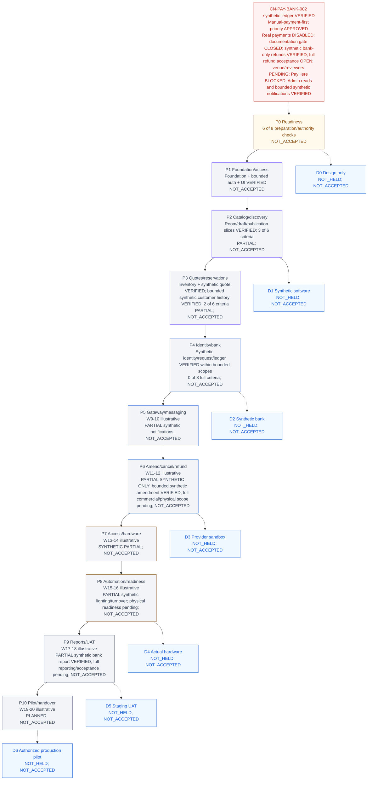

# CineNest Progress

This document owns execution guidance, derived coverage/status summaries, approval queue, verification references and current handoff. [PROJECT](PROJECT.md) owns product rules; [ARCHITECTURE](ARCHITECTURE.md) owns technical decisions; [DESIGN](DESIGN.md) owns UI/charts. Root [AGENTS](../AGENTS.md) is the concise operating entry point. Structured registries remain authoritative for IDs, statuses and dependencies; tables here are projections, not a second manually maintained database.

## Current status and approvals

Owner-approved manual-payment-first five-stage development priority recorded on 2026-10-17; [direction](PROJECT.md#manual-payment-first), [phases and gates](#manual-first-phases). Full MVP and roadmap acceptance counts unchanged; only the approved synthetic bank-only CN-REFUND-001, CN-ACCESS-001 and CN-CUSTOMER-001 task-specific hard dependencies are amended. CN-GATE-001 documentation-only VERIFIED/CLOSED under [approved closure](#gate-documentation-closure); venue/specialist gates remain pending and CN-PAY-GW-001 remains BLOCKED. Current tasks:25 CLOSED,3 BLOCKED,0 READY,0 IN_PROGRESS /28; bounded synthetic Access closure verified at [access evidence](#access-implementation). [CN-REFUND-001 bank-only plan/dependency approval](#refund-readiness-reconciliation) recorded; bounded implementation VERIFIED/CLOSED for synthetic bank-only scope at [refund implementation](#refund-implementation).

CN-ADMIN-001 VERIFIED/CLOSED for bounded synthetic account/audit reads; exact-source CI39024870905 SUCCESS at ff8726c5d91a60534c4cf3915c37317ef6a804ae. [Evidence](#admin-read-implementation). PayHere pending; no dependency edges changed.

CN-PAY-BANK-002 is VERIFIED/CLOSED for the owner-approved synthetic credit/allocation/guarded confirmation slice; [current evidence](#bank-ledger-implementation). Wider commercial policy, real payment and customer acceptance remain open.

CN-PAY-BANK-001 is VERIFIED/CLOSED for [synthetic requests/private receipt review](#bank-request-implementation) after exact-source CI39014691250 SUCCESS at24c127cc234ecd4d1df3943f2821e770ac12dab8. CN-VERIFY-001 is VERIFIED/CLOSED for [approved synthetic manual review](#verification-implementation) after exact-source CI SUCCESS. Real IDs and OCR remain disabled. CN-QUOTE-001 is VERIFIED/CLOSED for [bounded synthetic quotations](#quotation-implementation); CN-BOOK-001 and CN-PKG-002 remain VERIFIED/CLOSED for their inventory/indicative publication scopes. Real commercial issuance, acceptance, checkout, payment and booking confirmation remain disabled. Wider commercial and customer/phase acceptance remain open; current next action is in the [handoff](#current-handoff).

Current planning direction is S17; the maintained [MVP roadmap](#mvp-roadmap) has74 criteria across P0–P10 and 7 demos, with no software or customer acceptance inferred. The directory-layout request remains blocked before movement by destination `.git` and `knowledge/` collisions; see [inspection](#root-relocation-inspection). Current authoritative root remains nested.

S16 initial-stack approval recorded under existing **CN-DEC-001** after comparison with the actual Initial Stack Brief. Starting root repository/, main → origin/main at `bfc4a3ffd49adb0982cd1f88fa8243f2f0956816`, tracked clean; two unrelated untracked mind-map assets remain unchanged/unpublished. Instructions manually read; automatic loading NOT_VERIFIED. No new task/requirement/test/decision ID or knowledge file.

Current [foundation evidence](#foundation-implementation) records authorized CN-FND-001 local implementation/qualification, VERIFIED/CLOSED. CN-DEC-001 remains VERIFIED/CLOSED; CN-AUTH-001 is VERIFIED/CLOSED for the [bounded synthetic account/session scope](#auth-implementation), and CN-UI-001 is VERIFIED/CLOSED for the [shared shell/primitives](#ui-implementation). OD-01 broader scope remains open; full future plan NOT_APPROVED. Full customer workflows, live providers/operations and customer acceptance remain unverified.

## CN-PKG-001 bounded implementation — 2026-10-16

Verified start: clean nested repository/, main → origin/main at 478198fe87fa1e8291b7cf35e5c2339e068b301b. Owner explicitly approves preceding conversation proposal and attached bounded OD-17/18/21/22 policies, plus CN-PKG-001 implementation only; request hash in task.scopeApproval. Actual hard dependencies CN-ROOM-001/CN-UI-001 closed; underlying auth/foundation closed. Recorded scoped approval, reconciled READY, then implemented; no graph edge removed. Four wider decisions remain OPEN_DECISION with boundedPackageApproval, and no later task inherits implementation authority.

Implemented [nine-table/V4/API boundary](ARCHITECTURE.md#package-draft-boundary) and [package UI](DESIGN.md#package-draft-ui). Eight scoped draft operations, saved preview, exact prices/duration/guests/options, immutable history, current grant/capacity/minimum checks, controlled disabled-by-default minimum bootstrap and attributable atomic audit. V1–V3, dependency versions/lock, tokens/theme/charts/images/diagrams unchanged. No publication, customer sales, quotations, booking, payment, refund, IoT or deployment. No actual production policy/actor/service record created.

Local backend harness PASS: 82 tests (16 Pricing integration, 3 Pricing domain, 2 Rooms bootstrap, 19 room integration, 3 room domain, 31 Identity, 3 foundation, 5 architecture), zero failures/skips, real pinned isolated PostgreSQL18.6 and packaged-JAR startup/HTTP denial. Clean V1→V4 and populated V3→V4/repeat, PostgreSQL constraints, immutable records, draft revision concurrency, audit rollback/retry, current authority and policy/room races tested. Existing room upgrade regression explicitly remains V2→V3 via target3; no applied migration edited. Retained Identity missing-audit-table negative-test logs remain expected, not excluded failures.

Frontend build/typecheck/lint PASS, 39 tests (32 regression +7 package exact-money/component/route/security/real-HTTP adapter). Browser: 17 package plus19 shell and17 room groups, seven widths 320/375/640/768/1024/1280/1536. Package checks cover precision rejection, saved-preview limitations, history/duplication, scope/read-only/denied states, missing policy, safe retry, conflict reconciliation, keyboard/Escape and responsive editor; two ignored screenshots visually inspected. Fixed async modal trigger/focus restoration found by browser test; corrected an initially ambiguous precision-error test selector. Responses are explicitly SYNTHETIC; no real provider/physical/customer or WCAG/screen-reader/actual zoom acceptance claimed.

Both knowledge validators and whitespace pass; four in-memory negative controls reject premature closure, unauthorized publication readiness, false full-feature completion and lost policy approval. Final self-review added aggregate header/child locks and a different-actor stale-edit race; no same-account serialization assumption. Clean offline npm ci passed with unchanged lock and zero reported vulnerabilities. Exact-source [CI 38891026188](https://github.com/Hasitha3513/Theater-Project/actions/runs/38891026188) SUCCESS at cc461eb38ed3cf918b8f4fe173300d9267fcba11; all37 owned application hashes match. CN-PKG-001 VERIFIED/CLOSED. P2-C02 checked for the approved draft slice; P2 now2/6 and overall10/74. Source commit pushed to origin/main; final knowledge-only receipt publication/CI verified separately at closeout; publication C03, customer package discovery C04 and full phase/D1 acceptance remain incomplete. Full PR-PKG-001/CN-A12/PK-AC01–03/NFR02 plans retain broader NOT_VERIFIED/NOT_RUN/NOT_ACCEPTED with explicit bounded evidence rather than false end-to-end passes. Rollback retains additive V4 and drafts/history; destructive compensation needs separate approval. Stop after this change set.

## CN-ROOM-001 bounded implementation — 2026-10-16

Verified start: clean nested repository/, main → origin/main at 93e36a188dd245891b6f2cf089a616331a53105b. Current owner attachment explicitly approves the recorded six-table/eleven-endpoint/four-route scope and authorizes only CN-ROOM-001; SHA-256 in task.scopeApproval. Foundation, bounded auth/UI VERIFIED/CLOSED; OD-04/10/14 APPROVED; no additional mandatory policy prerequisite found for this slice. Scope reconciled READY before implementation, no graph edge removed. No other task authorized.

Implemented [owned backend/schema/security boundary](ARCHITECTURE.md#room-implemented-boundary) and [four-route UI](DESIGN.md#room-implemented-ui). V3 additive only; V1/V2, token/theme/chart/reference/diagram bytes and dependency versions/lock unchanged. Six Rooms-owned tables, public catalog, capacity/windows/facilities/image restriction, scoped create/read/edit, configuration audit and expectedVersion checks. Identity public grant port supplies transactionally serialized current authorization; no cross-module SQL or role bypass. No package, pricing, reservation, payment, device or readiness feature. Existing reservation-impact acceptance is explicitly incomplete, not hidden.

Local evidence: isolated pinned PostgreSQL18.6 harness passed 60 tests (19 room integration, 3 domain, 31 Identity, 3 foundation, 4 architecture), no failures/skips, and packaged-JAR startup/HTTP denial. Covers clean and populated V2→V3 upgrades, constraint/unknown-field/unsafe-image/IDOR/CSRF tests, duplicate-code and version races, grant revocation in both lock orders, suspension and failed-audit rollback/retry. Existing V1→V2 regression now explicitly targets V2 rather than accidentally counting V3 as an Identity migration. Expected missing-audit-table failure logs from the retained Identity negative test are not an excluded failure. Frontend clean offline npm ci with existing lock passed; production build/typecheck/lint and 32 tests (2 packaged HTTP regression, 21 existing unit/client, 9 room unit/client/real-HTTP-adapter cases) passed. No new dependencies/toolchain line.

Browser: 17 local SYNTHETIC check groups across 320/375/640/768/1024/1280/1536px, four routes, shared card/table IDs/filters, conflict draft/compare/retry, modal keyboard/Escape/focus, loading/denied/error/retry, local midnight and image fallback. Two ignored screenshots visually inspected; mobile table overflow found and corrected with an explicit regression assertion. No browser exceptions. No actual browser zoom/screen-reader certification, real photos, production identity, booking impacts, hardware/licensing/customer acceptance claimed. Self-review also required explicit grant serialization, read/write mapping and no authority from a typed operational reference.

Both knowledge validators and whitespace passed; three in-memory negative controls rejected premature room closure, unauthorized package readiness and missing scope approval. Exact-source [CI 38884100431](https://github.com/Hasitha3513/Theater-Project/actions/runs/38884100431) completed SUCCESS for efef591cbf36881dd36e360bf4d4c3d333c4584d: full PostgreSQL/backend/architecture/packaged startup, frontend clean install/build/type/lint/tests/audit and knowledge/whitespace. All 38 owned source hashes match that run. CN-ROOM-001 is now VERIFIED/CLOSED; P2-C01 checked for the approved room slice, retaining the no-real-photo/physical-acceptance limitations. Source commit pushed to origin/main; this knowledge-only closure receipt has its final publication SHA resolved from Git. P2-C04/C05 gain room-only evidence but package discovery/full administration and all phase acceptance remain open. P1 2/6, P0 6/8, P2 1/6; total 9/74. D1 NOT_READY because package/catalog lifecycle prerequisites remain absent. Rollback: scoped history-preserving code revert, retain additive V3/data; destructive compensation needs separate approval. No customer demo held/accepted.

## OD-04/10/14 approvals and CN-ROOM-001 scope preparation — 2026-10-16

Verified clean nested root `/home/hasitha-wijerathna/Documents/Theater Project/repository`, main → origin/main, full HEAD `3ad4a17ecfcbb0d52ebc93232f98f6fa0ebc163a`, 0 ahead/behind at inspection. No relocation. Current owner instruction approves decision recording and bounded scope preparation only; exact questions match. OD-04/10/14 now APPROVED, historical original records retained. [PROJECT](PROJECT.md#room-operating-decisions) owns policy: staff-supported operations, separate customer/blocked intervals with conditionally staffed post-close cleaning, restricted media claims pending independent rights verification. Physical/operational/licensing evidence remains NOT_VERIFIED and applicable launch gates remain. No unrelated decision closed.

[CN-ROOM-001 proposal](ARCHITECTURE.md#room-scope-proposal) specifies six proposed tables, eleven endpoints, owned module/Identity port, migrations, contracts, controls, tests and recovery. [UI boundary](DESIGN.md#room-ui-scope-proposal) covers facilities/images, public discovery, venue-scoped administration and equivalent card/table views. Existing task registry owns the proposal inventory. Policy-decision gates reconciled on all explicit dependent task/requirement edges; physical/operational/licensing obligations retained as verificationDecisionIds. No hard task dependency removed, no requirement/task/test ID or count changed. CN-ROOM-001 stays BLOCKED, authorityAvailable=false; separate complete scope approval and implementation authorization are outstanding. No application, migration, token, dependency, diagram/export or asset changes. No new knowledge document.

P0 remains 6/8, P1 2/6, P2–P10 implementation checkboxes unchanged; total 8/74, accepted phases 0/10, demos held/accepted 0/7. D1 NOT_READY; policy/scope preparation is not working software or customer acceptance. Historical UI next-blocker statements below describe their checkpoint and are superseded by this section. Both knowledge validators and whitespace passed; three in-memory negative controls rejected unauthorized READY, false licensing implementation evidence and loss of verification gates. Existing execution/status.json roomScopePreparation records preparation evidence; final publication result is reported in the conversation and resolved from Git, not inferred from intent.

## CN-UI-001 implemented shared shell — 2026-10-16

Owner explicitly authorizes the existing bounded CN-UI-001; attachment request SHA-256 and exact 24 owned source hashes are in existing execution/status.json uiImplementation. Verified start: nested repository/, clean main → origin/main at fd19bc5a02dc7ed598aebb06731001c7b98e674d; foundation/auth VERIFIED/CLOSED and OD-11 APPROVED. This supersedes earlier READY/PLANNED handoff statements for this unit only. No new task, narrative knowledge file or registry.

Implemented one root-owned ApplicationShell for customer/admin routes, cinematic customer header, persistent navy admin sidebar, light workspace, active links and native modal mobile navigation with focus wrapping/Escape/restoration. Added token-consuming Button/Field/Select/Card/Badge/PageHeading/state primitives, clearly isolated synthetic card/table examples sharing one filter/collection, and real-contract account presentation. Exact routes, transport configuration and safety boundaries are owned by [ARCHITECTURE](ARCHITECTURE.md#ui-implemented-boundary); visual scope and limitations are in [DESIGN](DESIGN.md#ui-implemented-baseline). No room/package/booking/payment/report/IoT implementation, operational metrics, role inference, new palette or dependency. Token/theme/chart bytes and package-lock/dependency/version/engine values unchanged; package test script extended only.

Local qualification: checksum-verified existing Node 24.22.0/npm 11.19.1 restored to /tmp, no global install; npm ci, production build, typecheck, lint and all **23 frontend tests** passed (21 unit/component/client/adapter cases; 2 packaged real-HTTP smoke/transport cases). Existing isolated PostgreSQL harness passed **36 backend tests** (31 Identity, 3 architecture, 2 foundation), V1/V2 migration checks and packaged-JAR denial smoke; no backend code or migration changes. **19 browser check groups** passed at 320/375/640/768/1024/1280/1536px over four shell pages, including responsive sidebar visibility, keyboard dialog containment/Escape/focus restore, route activity, card/table filter parity/reset, all request states, busy/disabled behavior, account/logout presentation, skip link and reduced motion. Three ignored screenshots actually viewed; canonical references preserved. Existing token contrast checks remain applicable. Browser session responses and upstream fixture are explicitly SIMULATED; they do not prove live Google sign-in, real admission or production deployment. No screen-reader audit, actual browser zoom, WCAG certification or customer acceptance claimed.

Hostile self-review fixed 320px header overflow, responsive import ordering, mobile Tab wrapping, busy-button width stability and the Next internal-host mismatch that initially denied valid same-origin logout. API transport forwards only the existing three routes and CineNest session cookie, strips unknown account fields/errors, rejects cross-origin logout and retains backend CSRF; no new policy or session store. Tests also corrected asynchronous navigation timing, duplicate fixture-empty selectors and equivalent CSS 0s/0ms assertions. Initial Node hook/test-worker invocation exposed only a file-level count; direct component-suite invocation now visibly executes all 21 named cases. No failed checks excluded or global lint controls weakened.

Task DoD met; CN-UI-001 VERIFIED/CLOSED, exact-source remote CI SUCCESS. P1 remains PARTIAL/NOT_ACCEPTED: C01 complete, C02–C05 partial, C06 is verified for shared shell/token/accessibility-baseline/CI and isolated fixture environment after exact-source CI success. No phase/customer demo acceptance. D1 remains NOT_READY: working room/package/catalog administration still absent. CN-ROOM-001 now has both hard dependencies closed but remains BLOCKED by OD-04/10/14 and its own scope authority; no dependency removed or policy selected. Rollback is a scoped Git revert; no DB/data migration. Stop after this task; next owner action is the recorded room-policy/slice decision.

Verified UI publication: `20fc240c877e316f37a893a101b28dc6d41bbc1f` pushed to origin/main and independently matched. [CI 38875154823](https://github.com/Hasitha3513/Theater-Project/actions/runs/38875154823) completed SUCCESS for that exact source: backend/PostgreSQL/packaged startup, qualified frontend verification, knowledge and whitespace. P1-C06 now checked; current planning roll-up 8/74 (not an effort percentage), P1 2/6, accepted phases 0/10 and demos held/accepted 0/7. This knowledge-only receipt does not change application bytes; final receipt SHA/remote/CI are resolved from Git.

## OD-11 approval / CN-UI-001 readiness — 2026-10-16

Historical decision/readiness checkpoint; current implementation is [above](#ui-implementation). OD-11 approval and exclusions remain authoritative.

Verified actual nested repository root, main → origin/main, HEAD 78e4c74cf1462bcf69b384df045f019d61fafe3f, clean. Exact OD-11 question “Requested source palette differs from checked-in proposed tokens” MATCHES the owner decision. Existing decision APPROVED with historical context retained; [DESIGN](DESIGN.md#od11-approved-baseline) owns the current-token/hybrid baseline, no-library rule, fixture boundaries and separate future migration review. No new ADR, knowledge file, registry or task.

CN-UI-001 **READY / PLANNED**, authority available for its existing bounded scope in a future implementation session. Its sole hard dependency CN-FND-001 is VERIFIED/CLOSED; bounded CN-AUTH-001 is also VERIFIED/CLOSED. OD-11 is removed from active blockingDecisionIds and retained as resolvedDecisionIds for this task and the three affected requirement records. All other task edges and decisions remain unchanged. Approved current dependencies suffice; actual local toolchain availability and rendered checks must be verified during implementation, without installing/replacing frameworks by inference.

Implementation remains NOT_VERIFIED; executable UI tests NOT_RUN. P1-C06 stays unchecked, P1 PARTIAL/NOT_ACCEPTED, D1 NOT_READY; no phase/demo acceptance changes. The current session is decision recording/readiness only, despite the owner's bounded future implementation authorization. Existing status.uiReadinessReconciliation records source/baseline/checks/publication; application, migrations, tokens, styles, images and frontend dependencies are unchanged. Current graph and task projections show UI READY without claiming working software.

Historical decision-only next action (superseded by [implemented UI](#ui-implementation)): implement only the then-READY CN-UI-001 in a future invocation under the preserved baseline; no implementation occurred in that earlier session.

Verified decision publication: primary commit `f38eaa55030564993b24d52ed7f97fb5b216e931` pushed to origin/main and independently matched. [CI run 38870688343](https://github.com/Hasitha3513/Theater-Project/actions/runs/38870688343) completed SUCCESS. This metadata-only receipt adds no application/UX acceptance; final receipt HEAD/remote state are resolved from Git.

## Owner-supplied diagram publication

Current owner explicitly authorizes publication of supplied diagrams only. Actual Git root remains repository/, main at baseline `c4fdd64d67a6be6fc2376748c15a3336b8c713f6`; parent is not a Git repository. No folders moved/initialized; no incoming staged or tracked edits and no outgoing local commits. Explicit reviewed path/hash allowlist is in the existing manifest diagramPublication, not a new registry/index/report. Seven families: mind map 1, use cases 5, activities 10, sequences 10, contexts 2, components 2, ER 8 Markdown sources; 11 accompanying PNGs (49 supplied files total).

These are supporting proposed/unverified exports, not new maintained authorities or executable schema/workflows. PROJECT/ARCHITECTURE/DESIGN/PROGRESS remain canonical. Every Mermaid block and all binary assets retained byte-for-byte; 186 broken sibling-link destinations corrected to uniquely matching actual same-family filenames (spaces URL-encoded); labels/prose/diagram code not rewritten; 111 trailing-space hard breaks outside diagram fences replaced with explicit ` ` markup to preserve rendered breaks and pass staged whitespace checks. The ER ZIP was inspected (eight safe original ER sources) but disappeared during this task without any delete/move by this agent; excluded from the reconciled allowlist, not restored/regenerated. No archive published. Initial validators exposed broken links, inventory/no-new-prose guards and illustrative colors; exact export path/hash/type validation now distinguishes these owner-approved supporting assets from canonical UI-token rules without changing token/CSS/approval or coverage checks.

Raster references include superseded or unapproved suggestions (JWT/Redis sessions, Kafka/TimescaleDB, tenant isolation, Refine/Ant Design, OCR authenticity, direct bank connectivity, plaintext credential/evidence fields and simplified money/control transitions). Retain them as illustrative source material: they do not select those technologies/policies or override database sessions, Redis deferral, independent bank evidence, immutable purchases, protected secrets, scoped authorization or physical egress. Corrected Analysis PNGs and detailed Markdown also remain proposals, not approvals. No current architecture/policy/runtime claim inferred from publication.

Review: all 38 Markdown sources have balanced fences and proposed/unverified notices; all relative links resolve; 11 PNGs visually inspected and CRC-checked; the initially present ZIP contained safe unencrypted names and matching original ER sources but is now absent and excluded. No credential-pattern matches or apparent sensitive image data found; largest file 1,918,151 bytes, total supplied bytes about18.2MB; no Git/LFS attributes or custom active hooks found. No repository Mermaid validator, mmdc or local Mermaid package found; full syntax/rendering NOT_VERIFIED and no tools installed. Application/hardware tests NOT_RUN. Current command results/publication state are recorded in existing status.json diagramPublication. Root collision and foundation/qualification/policy gates remain unchanged. Stop after this publication.

Verified diagram publication: primary commit `dff96868a904d29f6709974a222ee1fdd9f640c9` (`docs(knowledge): add CineNest architecture and workflow diagrams`) pushed to origin/main; independent `git ls-remote` matched exactly (both exit0). Worktree clean afterward; 49 supplied files added with no deletions/unrelated changes. Both knowledge validators and staged/unstaged whitespace checks passed. Existing status holds receipt; in-place receipt successor changes no diagrams or approvals. Resolve final current HEAD from Git.

## CN-FND-001 implemented foundation — 2026-10-15

Owner's current instruction explicitly authorizes the recorded foundation implementation and use of the nested repository. Actual starting root `/home/hasitha-wijerathna/Documents/Theater Project/repository`, main → origin/main, HEAD `4bc627781780d26d8c541768d958b18c3269a88d`, clean. CN-DEC-001 was already VERIFIED/CLOSED. Relocation is deferred for this session by explicit instruction; no directory cleanup/move attempted. Source request SHA-256, exact owned-file hashes, commands and environment are in existing execution/status.json foundationImplementation, not another report. Earlier NOT_GRANTED/blocked statements below remain dated historical evidence; this section supersedes them for CN-FND-001 only.

Implemented scope: backend/pom.xml, checksum-pinned Maven wrapper and Java25 enforcement; real Spring Boot entry point; one encapsulated foundation module exposing migration status with a Flyway adapter; a foundation namespace-only migration; explicit deny-all HTTP filter with default generated-user auto-configuration excluded; no auth use cases or product endpoints. Frontend is one Next production-buildable static foundation page consuming the unchanged canonical CSS directly, with pinned Node/npm/dependencies/lockfile, type checking, Biome lint and real server smoke checks. No fake operational statistics or pretend bookings. scripts/verify-foundation.py creates a uniquely named, ephemeral PostgreSQL18.6 container on loopback/random ports and tmpfs, generates temporary test credentials in environment, runs clean backend tests/build and packaged-JAR startup, then stops only its own process/container. No persistent volumes or owner toolchain defaults changed. Scoped read-only-permission GitHub Actions workflow added; no deployment/provider secrets.

Exact local qualification: Ubuntu OpenJDK25.0.4.1+1-1-26.04.4-Ubuntu (packaged GPL/ClassPath-exception notices inspected); wrapper3.3.4, Maven3.9.16 with distribution checksum; Boot4.1.1 parent/BOM and compatible Modulith2.1.1 BOM, Boot-managed Flyway12.4.0 core/PostgreSQL module and JDBC42.7.13; PostgreSQL18.6 pinned image digest; Node24.22.0 downloaded into temporary task tools and checked against official SHA-256; npm11.19.1; Next16.4.1, matched React/react-dom19.3.1, TypeScript5.9.3, Tailwind/@tailwindcss/postcss4.3.3, Biome2.5.15; Boot-managed JUnit6.0.3. CI declares Temurin25.0.4.1+1 separately; local Ubuntu JDK success is not remote Temurin evidence. Database sessions/durable events remain approved direction, not implemented by this foundation. No managed dependency overrides.

Current official sources checked during qualification: [Boot requirements](https://docs.spring.io/spring-boot/system-requirements.html), [Modulith2.1.1 release POM](https://github.com/spring-projects/spring-modulith/blob/2.1.1/pom.xml), [Maven releases](https://maven.apache.org/docs/history.html), [PostgreSQL supported minors](https://www.postgresql.org/support/versioning/), [Flyway PostgreSQL support](https://documentation.red-gate.com/flyway/reference/database-driver-reference/postgresql-database), [Node release table](https://nodejs.org/en/about/previous-releases), [Next installation](https://nextjs.org/docs/app/getting-started/installation), [Tailwind Next integration](https://tailwindcss.com/docs/installation/framework-guides/nextjs), [Biome installation](https://biomejs.dev/installation/quick-start/). Actual Maven Central/npm artifact resolution and builds supplement declared documentation compatibility; no claim of exhaustive security audit or commercial/vendor support contract. The Adoptium API denied access; official Temurin GitHub release metadata supplied CI's exact patch instead.

Repeatable local commands, from this actual Git root with Java25 and Docker available: `DOCKER_HOST=unix:///var/run/docker.sock python3 scripts/verify-foundation.py` (explicit socket needed on this host; script respects DOCKER_HOST elsewhere). Frontend with Node24.22.0/npm11.19.1 on PATH: `cd frontend`, `npm ci`, `npm run build`, `npm run typecheck`, `npm run lint`, `npm test`, `npm audit --audit-level=high`. This session used `/tmp/cinenest-fnd-tools/node-v24.22.0-linux-x64/bin` on command-local PATH. No global install is required by the checked-in code; use an available approved toolchain. Standalone backend settings CINENEST_DB_URL/USER/PASSWORD are mandatory; do not commit their values. Clean builds delete only generated backend/target and npm-ci-owned node_modules; test runner never deletes a pre-existing database or volume. The runner uses random ports; it does not kill unrelated listeners.

Verification: clean backend build/test/database/startup repeated twice, 4 JUnit tests (2 architecture, 2 PostgreSQL/real-HTTP integration), zero failures/skips; packaged JAR startup and denied real request passed. One frontend real production-server smoke test passed; lockfile clean install, production build, explicit TypeScript and lint checks passed, final npm audit zero vulnerabilities. Architecture checks assert one actual foundation module exists, verify Modulith arrangement and prohibit its API from depending on adapter internals; they do not prove future business boundaries. Recovery check exercises no-op repeat migration on the real isolated database and packaged restart over the same migrated schema, not financial/event recovery. Initial failures retained in status: obsolete test getName API fixed to getIdentifier; unavailable Docker desktop socket replaced by explicit system socket; sandbox TypeScript subprocess parse failure passed outside sandbox; newly selected ESLint chain's five high development advisories removed by supported Biome selection, not forced downgrade/managed override; Biome ignore root corrected. No failed check silently excluded.

Acceptance: recorded local skeleton/reproducible build/test DoD met; CN-FND-001 VERIFIED/CLOSED for this scope. Remote CI execution is separately tracked in status.foundationImplementation; workflow presence is not a CI pass. Requirements/test records retain full-feature NOT_VERIFIED/NOT_RUN/NOT_ACCEPTED and add only scoped foundation evidence. P0-C06 now has stack/implementation-authorization evidence; P1-C01 now has local reproducible qualification evidence. P1-C02/C03/C06 remain unchecked: broader business boundaries, session/durable-work persistence, shared UI and whole-phase CI/demo acceptance are not established. P0/P1 phase gates and all held/accepted demo counts unchanged. D0 remains prepared DESIGN ONLY; D1 catalog/admin prerequisites remain unmet. Colorful source graph updated without claiming Mermaid rendering or restoring missing HTML.

Self-review only. Existing validators must preserve every historical requirement/task/dependency/proposal and allow only this request-hashed scoped successor; new code hashes and bounded status guards added, not broad permission for later work. No browser-rendered accessibility audit, business authorization/concurrency/recovery tests, providers, hardware or customer acceptance run. Rollback is a normal scoped Git revert; temporary test services are cleaned by the runner, with no live data migration to undo.

Remote CI first run [38687499707](https://github.com/Hasitha3513/Theater-Project/actions/runs/38687499707) at bdf8595 failed before builds: setup-java v5 rejected four-part version string 25.0.4.1+1. Correction pins the exact official Temurin archive and its SHA-256, using supported jdkfile installation with major-version cache label; no runtime downgrade or floating download. Replacement run outcome is tracked separately in existing status.foundationImplementation.

Remote CI second run [38687790645](https://github.com/Hasitha3513/Theater-Project/actions/runs/38687790645) at dc13a55 passed backend/PostgreSQL/packaged startup and frontend build/type/lint/smoke/audit, then failed knowledge validation because default shallow checkout omitted immutable baseline commits. Workflow now requests full Git history; no validator history/evidence checks removed. Final run outcome remains separate in status.foundationImplementation.

Verified publication/CI: implementation source commit `aa2bb4e13a9a7bf4e495c856a6f2c8e199c56d15` pushed to origin/main; [full CI run 38689239097](https://github.com/Hasitha3513/Theater-Project/actions/runs/38689239097) completed SUCCESS, including exact Temurin/Node setup, real PostgreSQL/backend tests/packaged startup, frontend build/type/lint/smoke/audit, both knowledge validators and whitespace. Earlier failed runs remain recorded above. This in-place receipt successor changes only knowledge/status validation metadata; resolve its final SHA and remote result from Git. No extra task, customer demonstration or product acceptance follows.

Historical next decision at foundation closeout (now superseded by [bounded auth readiness](#auth-policy-readiness)): OD-12 organization scope is APPROVED; review CN-AUTH-001's applicable exact session/revocation/security policy choices; OD-01 broader providers/libraries stay OPEN. CN-AUTH-001 is not READY merely because foundation passed; do not begin it here.

## CN-AUTH-001 implemented bounded account/session reads — 2026-10-15

Owner explicitly authorized full recorded CN-AUTH-001 scope in the current conversation attachment; its request SHA-256, starting clean main → origin/main at ec355715c1942d060dc58360bded4c1f423a82bc, exact source hashes/checks and scenario mapping are in existing execution/status.json authImplementation. Actual root remains repository/; no relocation. CN-FND-001 VERIFIED/CLOSED, OD-12 APPROVED and bounded OD-01 policy were verified before edits. Original task IDs/scope/exclusions/DoD/dependencies and all broader decision histories are preserved. Earlier READY/NOT_VERIFIED statements below describe the prior decision-only checkpoint and are superseded for this implemented unit by this section.

Implemented V2 after unchanged V1, Identity module, explicitly associated synthetic OIDC admission, framework JDBC sessions/configured expiry/current-session logout, minimum own account read and trusted single-grant venue-scoped account.read. Exact routes/configuration/schema/security semantics are owned by [ARCHITECTURE](ARCHITECTURE.md#auth-implemented-boundary). No production identity admission, passwords, role bundles, staff provisioning, finance, documents, booking, UI or hardware feature. Auth disabled by default; no secret or production expiry value is committed. Rollback is scoped history-preserving code revert; V2 has only additive module-owned tables. Do not delete persisted data or roll back shared schema without a separate approved data/recovery plan; tests create only disposable owned databases.

Verification: full existing harness clean verify against isolated PostgreSQL 18.6 passed **36 tests: 31 identity integration cases, 3 architecture cases and 2 foundation integration cases**, zero failures/errors/skips, then packaged-JAR startup/HTTP deny smoke passed. V1→V2 upgrade, repeat migration/validation, issuer/audience/expiry/nonce/signature/state rejection, unknown/unassociated/no-email-merge/no-production admission, authentication audit outage/recovery, session fixation/expiry/deletion/logout/CSRF/replay, cross-instance session recovery/invalidation, IDOR/opaque errors, permission/scope mismatch/grant stitching, live suspension/revocation/expiry/reassignment and concurrent committed-state visibility are exercised using real HTTP, signed synthetic OIDC and real PostgreSQL. Audit/DTO/cookie/token redaction assertions pass. First run failed an expiry fixture that changed cleanup expiry_time alone; fixture now sets last_access_time too, matching framework expiry. No failure hidden or test excluded. Hostile self-review fixed forged/replayed callback logout of an existing valid session and retains regression; no independent reviewer claimed. Frontend unchanged, so local frontend checks not rerun; full CI outcome/publication recorded separately after push.

Existing 18 authorization scenarios: **partial executable account-read coverage for 1–5, 11–12**; payment/booking/receipt/credential examples in those scenarios are not passed. Scenarios 6–10 and 13–18 remain NOT_RUN, as do full feature scopes for all 18. Future finance/evidence/list/export/service/device/mutation/safety/escalation/durable-work/UI endpoints are absent. Existing CN-C02/CN-A06/CN-NFR-02 and T-* records retain full-feature NOT_VERIFIED/NOT_RUN/NOT_ACCEPTED and add scoped evidence instead of falsely claiming completion. No requirement/task/test/decision IDs added or dropped.

CN-AUTH-001 DoD met for the bounded unit: owner/scope guards demonstrable and administrative policy gaps explicit; VERIFIED/CLOSED. P1 remains PARTIAL/NOT_ACCEPTED: P1-C02–C05 gain scoped evidence but stay unchecked for broader boundaries/durable work/admin authentication/full authorization; P1-C06 needs shared UI. Historical auth closeout: P0 6/8 and overall 7/74 criteria; current UI closeout adds P1-C06 for 8/74; accepted phases and demos remain 0. D0 remains prepared DESIGN ONLY; **D1 NOT_READY** because working catalog/admin/shared shell are missing. No customer demonstration held or accepted. Colorful Mermaid source updated; missing HTML not recreated. Historical next action at auth closeout was blocked UI/OD-11; superseded by [current UI readiness](#ui-readiness). That implementation session stopped after auth.

Verified implementation publication: `7fc0f62fa3db7b29f8be289f73b57d01809bf14a` (`feat(identity): establish scoped account sessions and reads`) pushed to origin/main; independent remote SHA matched, worktree clean. [GitHub Actions 38699715108](https://github.com/Hasitha3513/Theater-Project/actions/runs/38699715108) completed SUCCESS, including real PostgreSQL/backend tests/packaged startup, frontend verification, both knowledge validators and whitespace. This receipt successor changes only existing knowledge/status validation metadata; final receipt SHA/remote state are resolved from Git. No additional task or acceptance follows.

## CN-AUTH-001 final bounded policy approval / readiness — 2026-10-15

Historical decision-only checkpoint; current implementation evidence is [above](#auth-implementation).

Verified actual nested root `/home/hasitha-wijerathna/Documents/Theater Project/repository`, main → origin/main, baseline `3c582a2c13768637432319dbda6c50bc148df95b`, clean. CN-FND-001 is VERIFIED/CLOSED with qualified local/remote evidence; OD-12 is APPROVED. Migration head remains V1__foundation_namespace.sql, HTTP remains deny-all. Prior owner conditional CN-AUTH-001 implementation authorization exists; current owner expressly approves the final bounded policy contract but limits this session to decision recording. Request SHA-256 and source are in the existing OD-01 record and status.authReadinessReconciliation, not a new source/ADR/report file.

Scope comparison MATCHED: all current policy blockers for “First owner/venue scoped session/auth interfaces and permitted account read” are satisfied within explicitly associated synthetic/test accounts. Approved account admission/read, database sessions/configured expiry, per-request eligibility/grant freshness without positive cache, current-session server logout and redacted audit are in [ARCHITECTURE](ARCHITECTURE.md#auth-bounded-policy), with product scope in [PROJECT](PROJECT.md#auth-bounded-scope). No mandatory decision outside this approval was found for this bounded unit. Production values/admission, unrelated providers, documents, finance/independent review/refunds and devices remain deferred at affected feature gates. Do not ask for foundation/OD-12 or the same conditional task authorization again merely because earlier historical fields show BLOCKED/NOT_GRANTED.

Readiness: CN-AUTH-001 **READY / PLANNED**, authority available for bounded future implementation; no active decision blocker within this scope. Its task dependency stays CN-FND-001; original in/out scope, DoD, planned checks and requirement mappings unchanged. Resolved OD-12 remains traceable; OD-01 has an approved bounded scope, not global closure. OD-03/05/18/28 retain OPEN_DECISION and NOT_VERIFIED for their full feature scopes with explicit bounded-auth applicability. Keep unrelated future tasks BLOCKED. Auth-specific dependency/configuration qualification, migration selection after V1, actual tests and hostile review are implementation deliverables, not already completed evidence.

All CN-AUTH-001 executable checks and the 18 authorization scenarios remain NOT_RUN; mapped full requirements remain NOT_VERIFIED/NOT_ACCEPTED. No P1 criterion or phase/demo acceptance newly checked. Colorful source graph/handoff reflect READY auth without implying working software. No application source, migration, manifest/build or executable test file changed; no new narrative knowledge file, registry or decision record. Existing test-plan JSON only adds bounded approval references, not passing results. Validation outcomes/self-review and negative controls are in existing status.authReadinessReconciliation. The unavailable HTML is untouched.

Exact next action: in a future implementation invocation, execute only READY CN-AUTH-001 under the existing bounded authorization and approved contract, then qualify/test/review/record actual results. This decision-recording session stops here without implementing it.

## OD-12 owner decision — 2026-10-15

Historical OD-12 reconciliation: the then-open CN-AUTH-001 policy findings below are superseded by the later [bounded approval/readiness](#auth-policy-readiness); the OD-12 decision itself remains APPROVED.

Verified nested root `/home/hasitha-wijerathna/Documents/Theater Project/repository`, main → origin/main, baseline `38dadd0b66f2950519d4f155e6d2f40e7d2297a8`, clean. Exact existing question: “Multi-venue scope is not an approved multi-tenant/subscription SaaS model”; options “Venue-scoped single organization vs explicit future tenant isolation.” Current owner decision MATCHES; no uncovered material concern found. OD-12 is APPROVED: single operating organization, one or more venues, per-grant permissions/ownership/venue scope; no SaaS tenant product or speculative tenant infrastructure. Original question/options/status context retained in the same decision record. [PROJECT](PROJECT.md#organization-scope) and [ARCHITECTURE](ARCHITECTURE.md#organization-scope) specify product and technical effects.

Removed resolved OD-12 from active blockingDecisionIds for CN-AUTH-001/CN-ADMIN-001 and five requirement records CN-C02/CN-A06/CN-A10/CN-A11/CN-NFR-02; preserved it in resolvedDecisionIds. No task dependency edges, criteria, counts or implementation/acceptance statuses changed. Decision approval is not isolation implementation/test evidence. All diagrams/exports, application files and migrations remain unchanged. Current owner approval source and check evidence are in existing status.od12DecisionUpdate; no new narrative/registry/task/ADR file.

CN-AUTH-001 prerequisite review after resolution:
- CN-FND-001 dependency is VERIFIED/CLOSED, with actual pinned build/database/startup/local and remote CI evidence; do not request foundation approval or qualification again.
- The task still lists OD-01: concrete identity/session mechanism recommendations and their complete dependency/configuration qualification must be accepted for this slice; broader cloud/provider choices are not universal blockers.
- Exact session/eligibility/security behavior remains undecided: expiry/logout/suspension, revocation propagation and freshness/cache/concurrency policy, cookie/SameSite/CSRF behavior, permitted account-read attributes and policy-version/consent handling. No timeout, latency or policy value selected by OD-12.
- Role/permission catalog and applicable venue grants for this slice still require bounded selection; sensitive-purpose/privacy/audit choices (OD-05) apply to disclosed account data. OD-03 identity evidence/on-site processes and OD-18/28 financial limits/independent review gate those affected capabilities if included, not an empty foundation or every possible identity interface. Keep bank/verification/device features excluded from a bounded auth unit.
- RequiredApproval remains “Slice + identity/role/session choices approval”; CN-AUTH-001 stays BLOCKED, no current implementation authorized by this decision-only instruction. Review actual path scope and necessary policy choices before READY; do not broaden the task or treat every open decision as universal.

P0-C07 remains unchecked: other early decisions/owners unresolved. P1 and phase/customer demo acceptance unchanged. Current colorful graph's auth-policy blocker remains accurate; no diagram/export is rewritten for this decision. Next action: owner selects the bounded CN-AUTH-001 identity/session and required policy choices; stop after OD-12 recording. Earlier dated foundation/authorization narratives retain their then-open OD-12 history and are superseded on this question by this section. Self-review only; checks recorded in status.od12DecisionUpdate.

## Root relocation inspection — blocked before any move

Owner requested actual root `/home/hasitha-wijerathna/Documents/Theater Project`. Inspected nested authoritative root `/home/hasitha-wijerathna/Documents/Theater Project/repository`, main → origin/main at `3d3b610d4f93198eda701c7325d971c21a671254`; staged/unstaged tracked changes empty, two existing untracked mind-map assets retained. Origin fetch/push is `https://github.com/Hasitha3513/Theater-Project.git`. Repository .git is an ordinary directory with one primary worktree; no linked registrations, submodules/gitlinks or symlinks found. Parent and outer knowledge are not Git repositories.

Immediate parent project folders are `repository/` (authoritative Git checkout, current canonical knowledge and instructions) and `knowledge/` (initial pre-clone knowledge copy). All 16 outer files match exact bytes at first immutable commit `16710dcf3e3bfb2453bab24910890279691fc06d`: five still match current counterparts, three same-path files differ from current revisions, eight are historical superseded prose with no current same-path counterpart. No unique outer file content found. Existing hidden parent `.git/.agents/.codex/.aws` are empty read-only directories (0555); no private contents read or disclosed.

Reversible candidate move inventory is nested `.git`, `AGENTS.md`, `docs/`, `knowledge/` → same names in parent using same-filesystem renames, including all hidden/untracked contents, with inverse renames as rollback before further edits. **Not executed:** parent `.git` and `knowledge/` already occupy destination names. User explicitly requires stopping before collisions; no merge/overwrite, repository initialization/clone, deletion or wrapper removal performed. The wrapper is not empty and its primary worktree still points there. Needed resolution: explicit owner disposition/cleanup approval for the exact accounted historical outer knowledge and a supported environment resolution for the empty read-only parent Git placeholder. Do not bypass reserved filesystem permissions or silently replace Git metadata.

Both existing validators and `git diff --check` passed at preflight; these are pre-relocation checks, not evidence relocation succeeded. No pre-existing validation failure found. Approval/qualification/implementation gates remain unchanged; no application/hardware tests run. Record only this inspection and blocker in existing files; no archive, new report/KB/task created. Layout remains nested pending collision resolution.

## Stack approval record and verification

S16 approval matches the original version lines/database-session-recovery responsibilities; npm recording and stable/resolved-qualification conditions explicit. Actual approval scope is owned by [ARCHITECTURE](ARCHITECTURE.md#stack-approval), with historical proposal/research preserved. OD-01 initial subset accepted; broader cloud/provider/library and qualification decisions remain OPEN_DECISION. All 92 requirements/test plans, 28 tasks and 29 decision records retained; original criteria/dependencies and S15 mappings unchanged. S16 approves no role bundle, limit, independent-review/exception/revocation policy, physical/provider outcome or foundation execution. Both validators and unstaged whitespace checks passed; eight in-memory negative controls rejected loss or unauthorized promotion. OD-01 projection mismatch found during validation was corrected from its registry; no check weakened. Current self-review/checks/publication receipt are recorded in existing status.json stackApprovalUpdate; no independent review or new runtime qualification claimed.

Verified publication: primary S16 approval-record commit `0bc10a1f9059df97cb6dbbf233f42af03285abf9` pushed to origin/main and independently matched by `git ls-remote` (both exit0). Staged whitespace check passed. Existing status holds the receipt; this metadata closeout adds no scope or qualification claim. Tracked changes clean after push; both unrelated untracked files remain unchanged/unpublished. Resolve final HEAD from Git.

## Actual CN-FND-001 prerequisite review

**Exact objective:** Selected-stack repository skeleton and CI. **Registry scope:** Only approved local project/module skeleton, safe build/test and scoped CI definition after stack selection. **Excluded:** production/cloud provisioning, provider setup or business feature. Dependency CN-DEC-001; OD-01 remains a recorded gate for qualification/broader unresolved choices. Authority false, work/readiness BLOCKED. Original task fields remain unchanged; prerequisiteEvidence records only S16 direction approval, not readiness.

Expected deliverables within that scope, to be refined/authorized before code: reproducibly pinned local backend modular-monolith and customer/admin frontend skeleton; module/interface boundary definitions and minimal isolated tests; safe build/lint/test commands; scoped CI definition without production secrets/provider deployment; recorded dependency resolution/tool versions/check evidence and history-preserving rollback. No product schemas, real auth/payment/IoT integrations or arbitrary additional libraries inferred. Exact future source/build/test/CI paths remain TBD in the backlog; this is a prerequisite review, not completed deliverables or an already-approved detailed implementation plan.

Remaining conditions: review actual owned paths and skeleton-only acceptance; maintain all business/security/safety boundaries; determine permitted local tool/container installation/downloads, dev-only storage/ports/network and CI permissions. Select and record exact supported stable JDK distribution/licence, Boot/Modulith BOM tuple, Postgres/Flyway PostgreSQL support/JDBC, Maven, Node/npm, Next/React/react-dom/TypeScript/Tailwind and compatible test tools from official sources. No floating/pre-release/independent override; unsupported combination requires owner amendment. Team/toolchain availability, browser floor, complete resolved runtime/build compatibility and isolated PostgreSQL/Testcontainers/migration support remain unverified. No environment check/install/build performed by this approval task.

Acceptance before any VERIFIED foundation claim: repeatable clean install/build; backend unit and module-boundary verification; frontend explicit type/lint/build and appropriate minimal tests; compatible isolated database/Flyway startup checks if included in separately authorized scope; safe CI rerun with no real secrets/data; actual command/exit/output/commit/environment evidence. Original registry plannedChecks is “Actual selected build/lint/unit/module-boundary commands, no production data”; DoD is “Repeatable approved local skeleton and test evidence; no feature-complete claim.” Exact executable commands must be derived from the future approved manifests, not invented now. Application/provider/hardware tests NOT_RUN. Missing source/financial/privacy/roles/safety decisions still gate affected features/launch, without silently blocking an expressly authorized empty skeleton or waiving those decisions.

**Single next approval:** owner separately authorizes CN-FND-001's bounded local project/module skeleton, safe build/test and scoped CI definition, with reviewed owned paths, permitted environment actions, qualification/amendment conditions and skeleton-only acceptance. S16 is not that authorization. Stop after this approval-record unit.

### Foundation start clarification — owner reaffirmation 2026-10-15

Current conversation “OWNER STACK APPROVAL” reaffirms S16's bounded initial direction, matching the actual brief/version-policy comparison in ARCHITECTURE; original research/proposal and all pending policies remain unchanged. Approval is recorded in existing status.stackApprovalUpdate.ownerReaffirmation. No new P0 evidence supports another checkbox: initial direction was already checked, qualification and implementation remain pending; P0 is not accepted.

Actual root remains `/home/hasitha-wijerathna/Documents/Theater Project/repository`, baseline `abbb6f93ade0017ee39f98576298f8f2aa6d5593`, main, clean before this documentation unit. The approved relocation did not execute: sandbox parent `.git` removal returned “Device or resource busy”; outside sandbox the path was absent. No outer copies removed or repository contents moved. This is workspace housekeeping, not a CN-FND-001 registry dependency; deferring it requires an explicit owner sequencing decision, not an inferred waiver.

CN-FND-001 maps PR-UI-001, PR-PKG-001, PR-BANK-001, CN-NFR-02 and CN-NFR-03; these mappings preserve requirements coverage without authorizing package/payment features. P1-C01/C02/C03 reference foundation alongside other tasks; P1-C06 includes CI/shared UI, but its listed tasks are CN-ACCEPT-001/CN-DEC-001/CN-UI-001. Foundation's own registry scope remains local skeleton/build/test/scoped CI only. It cannot complete P1, auth, business migrations or shared controls by itself.

Recorded conflicts for owner review (no dependency edits):
- Handoff says “before root relocation” and prioritizes collision resolution; CN-FND-001 dependencies are only CN-DEC-001. Consequence: recorded workspace sequence is blocked while the task has no relocation edge. Proposed decision: explicitly choose completion of environment/root correction first, or explicitly defer relocation and authorize a reviewed nested-root scope.
- CN-FND-001 says “Only approved local project/module skeleton, safe build/test and scoped CI definition after stack selection”; P1-C03 says “Initial feature migrations, session storage, and durable-work foundations implemented.” Consequence: foundation alone cannot satisfy that broader criterion. Proposed sequencing: accept skeleton evidence only for foundation; retain feature/session migrations for separately authorized owning slices.
- P1-C06 says “Shared UI shell, design tokens, accessibility baseline, CI, and isolated demo environment established”; CN-UI-001 depends on CN-FND-001 and owns “First admin/customer shell and reusable control/card/table primitives, only labelled fixtures.” Consequence: a combined P1 demo cannot be claimed from foundation. Proposed sequencing: foundation CI first, UI and auth tasks only after their dependencies/approvals; review CI trace mapping without silently changing it.
- CN-FND-001 blockingDecisionIds contains OD-01; OD-01 retains both pending exact qualification and broader cloud/provider/library choices. Consequence: initial-stack approval does not close the whole decision. Proposed scope decision: retain OD-01 open; qualify the skeleton's actual dependency tuple while deferring unrelated choices to their affected tasks, with explicit owner acceptance of this interpretation before READY.

Immediate conditions remain bounded path/deliverable/environment/CI approval, current supported-patch verification and reproducible qualification plan, plus separate implementation authority. Java distribution/licence and test tooling must be qualified before use; unsupported lines require owner amendment. Feature-specific role bundles, revocation protocols, financial limits, independent review, privacy/providers/hardware, pilot/staffing/dates remain open at their actual gates and are not universal empty-skeleton prerequisites. No task dependencies, authority, planned tests, requirements, demo acceptance or phase statuses changed. CN-DEC-001 is already VERIFIED/CLOSED.

Required foundation evidence remains clean reproducible install/build, backend unit/module-boundary tests, frontend type/lint/build/minimal tests, isolated PostgreSQL/Flyway checks if included, and safe scoped CI; derive actual commands from authorized manifests. No application tests/install/scaffolding in this session. Current knowledge-check results are in status.stackApprovalUpdate.ownerReaffirmation.

## Authorization update and handoff evidence

[PROJECT](PROJECT.md#authorization-requirements) owns actors/access requirements; [ARCHITECTURE](ARCHITECTURE.md#authorization) owns one technical policy; [DESIGN](DESIGN.md#permission-aware-ui) owns denial/expiry/revocation presentation. CN-NFR-02 retains original criteria/mappings and adds 18 planned authorization scenarios; T-CN-NFR-02 references them rather than duplicating a catalog. CN-AUTH-001 documentationUpdate records S15 only; its implementation status/dependencies/authority stay blocked. All 92 requirement/test records, 28 tasks, 29 open decisions and product NOT_VERIFIED/NOT_ACCEPTED/NOT_RUN statuses remain.

Historical gates at the S15 authorization update below: OD-12 has since been [approved](#od12-decision); retain the following then-open findings as evidence.

Unresolved gates: role/scope/limits and independent approval OD-18/28, sensitive-purpose/privacy OD-03/05, venue/tenancy OD-12, exact stack qualification/deferred framework details OD-01; exact revocation/cache latency, concurrency protocol and durable-work continuation need explicit design/policy approval. Owners TBD. Existing missing PDFs, quote OD-20/chart mapping OM-06 and physical/financial/provider gaps remain. Exact executable and physical evidence needed is in the retained test-plan record and architecture; no application/hardware tests run. Both knowledge validators and unstaged whitespace check passed; six in-memory negative controls rejected lost original and authorization-specific content. Parent self-review; current commands/results and publication outcome recorded in status.json authorizationUpdate, without a new evidence/report file.

Publication verified: primary authorization documentation commit `c96ae828b4a0ae3df0f32b101ff107fa9613459c` pushed to origin/main, independently matched by `git ls-remote` (both exit0). In-place status receipt records commands/time; closeout introduces no new authority. Tracked changes clean after push, two unrelated untracked artifacts remain unchanged and unpublished. Resolve final HEAD from Git. Staged whitespace check passed.

Baseline design validator initially failed because two unrelated untracked files violated its historical inventory guard. Inventory now distinguishes the exact pre-existing untracked paths/hashes from maintained tracked KB; they are not newly created or approved sources. Their bytes are protected, excluded from generated inventory/active-link review and staging; new files or drift are still rejected. No protected historical/content/status check is removed.

## Execution charter

READ → RECONCILE → SELECT → PLAN → IMPLEMENT → TEST → REVIEW → RECORD. Verify actual Git/worktree and source changes, preserve unrelated work, select one READY authorized bounded change set with acceptance/checks/rollback and required decisions resolved. Read-only guidance stays read-only. If none is eligible, report the exact approval/dependency; do not choose an easier unrelated task or infer scope from a roadmap.

Update the four canonical documents and existing registries in place. New knowledge files require explicit owner approval; future prompts stay in conversation unless a file is requested. This restriction does not prevent application source/tests/migrations in a separately authorized implementation task. One parent writer, no atomic task claim/background execution/native agent framework implied. Bounded independent review only when applicable authorization/instructions permit it; otherwise label self-review.

Use accepted module/interfaces/stack only. Security, a11y, audit, migration/recovery and failure tests accompany each affected slice; no implied provider contracts or physical acceptance. Product/financial/safety constraints belong to PROJECT and ARCHITECTURE; no implementation can waive them. All external operations require their own authorization, private evidence/redacted output and truthful outcome. No production/deployment, real bank/payment/refund/message/device/secret/destructive action authorized by this documentation task.

Record actual command/time/environment/result, scope/limits, review findings and next action in PROGRESS/status.json; retain historical evidence references. Documentation VERIFIED, software test results, provider sandbox, physical verification, business acceptance and publication are distinct. Planned tests are NOT RUN until executed; no private reasoning/secrets in evidence. Missing/moved sources require reconciliation, not invented approval. Preserve source ledger freshness.

Automatic task-owned Git commit/push authority persists after checks/review, respecting branch controls and remote verification. Stage owned files only, non-force/history preserving; Git publication never authorizes stack/policies/deployment/whole plan. No other repo/cloud/attachment sync implied. Stop at one completed unit or required approval.

## Controlled execution plan

[change-sets.json](execution/change-sets.json) is the authoritative bounded plan, including full scope/exclusions, affected modules, DB/API/UI/migration/risk, planned checks, rollback, DoD, approval and evidence. READY requires all prerequisites/tools/authority/necessary decisions. Existing units remain; this display is derived.

<!-- projection:tasks -->
| Task | Phase | Objective | Dependencies | Work / readiness |
|---|---|---|---|---|
| CN-AGENT-SETUP-001 | 0 | Execution workflow setup | None | VERIFIED / CLOSED |
| CN-DEC-001 | 1 | Bounded initial-stack decision brief | CN-AGENT-SETUP-001 | VERIFIED / CLOSED |
| CN-GATE-001 | 1 | Source and accountable policy gate brief | CN-AGENT-SETUP-001 | VERIFIED / CLOSED |
| CN-FND-001 | 1 | Selected-stack repository skeleton and CI | CN-DEC-001 | VERIFIED / CLOSED |
| CN-UI-001 | 2 | Shared shell and token consumers | CN-FND-001 | VERIFIED / CLOSED |
| CN-AUTH-001 | 2 | Identity/session and resource scope skeleton | CN-FND-001 | VERIFIED / CLOSED |
| CN-ROOM-001 | 2 | Catalog and scoped room configuration | CN-AUTH-001, CN-UI-001 | VERIFIED / CLOSED |
| CN-PKG-001 | 3 | Package drafts and scoped editor | CN-ROOM-001, CN-UI-001 | VERIFIED / CLOSED |
| CN-PKG-002 | 3 | Immutable package publication/applicability | CN-PKG-001 | VERIFIED / CLOSED |
| CN-BOOK-001 | 3 | Shared inventory hold/conflict guard | CN-ROOM-001 | VERIFIED / CLOSED |
| CN-QUOTE-001 | 3 | Exact quote and purchase snapshot contract | CN-PKG-002, CN-BOOK-001 | VERIFIED / CLOSED |
| CN-VERIFY-001 | 4 | Private booker evidence and eligibility review | CN-AUTH-001, CN-QUOTE-001 | VERIFIED / CLOSED |
| CN-PAY-GW-001 | 5 | Gateway sandbox attempt/verification slice | CN-QUOTE-001, CN-VERIFY-001 | BLOCKED / BLOCKED |
| CN-PAY-BANK-001 | 5 | Bank request/receipt and durable reviewer work | CN-QUOTE-001, CN-VERIFY-001 | VERIFIED / CLOSED |
| CN-PAY-BANK-002 | 5 | Bank evidence/allocation and guarded confirmation | CN-PAY-BANK-001 | BLOCKED / BLOCKED |
| CN-REFUND-001 | 5 | Evidence-based refunds and corrections | CN-PAY-BANK-002 | VERIFIED / CLOSED |
| CN-ACCESS-001 | 6 | Simulated credential scheduling/recovery | CN-PAY-BANK-002 | VERIFIED / CLOSED |
| CN-IOT-001 | 7 | Simulated device command/observation slice | CN-ACCESS-001 | VERIFIED / CLOSED |
| CN-OPS-001 | 7 | Room readiness/incident software slice | CN-IOT-001 | VERIFIED / CLOSED |
| CN-ADMIN-001 | 8 | Read-only scoped account/audit operations | CN-AUTH-001, CN-VERIFY-001 | VERIFIED / CLOSED |
| CN-NOTIFY-001 | 9 | One notification channel and durable delivery | CN-PAY-BANK-001, CN-ACCESS-001 | VERIFIED / CLOSED |
| CN-CUSTOMER-001 | 9 | Owned history and support status | CN-ACCESS-001, CN-NOTIFY-001, CN-REFUND-001 | VERIFIED / CLOSED |
| CN-AMEND-001 | 9 | One purchased booking change/extension slice | CN-CUSTOMER-001, CN-QUOTE-001, CN-REFUND-001 | VERIFIED / CLOSED |
| CN-REPORT-001 | 9 | Core authorized money/booking projection | CN-PAY-BANK-002, CN-REFUND-001 | VERIFIED / CLOSED |
| CN-ENG-001 | 10 | Engagement scope/rule decision brief | CN-REPORT-001 | VERIFIED / CLOSED |
| CN-ACCEPT-001 | 11 | Integrated evidence and recovery gate | CN-AMEND-001, CN-REPORT-001, CN-OPS-001 | BLOCKED / BLOCKED |
| CN-LAUNCH-001 | 12 | Authorized controlled launch/handover | CN-ACCEPT-001 | BLOCKED / BLOCKED |
| CN-KB-CONSOLIDATE-001 | 0 | Owner-authorized four-document consolidation | CN-DEC-001 | VERIFIED / CLOSED |
<!-- projection-end:tasks -->

## Maintained MVP roadmap — owner-requested planning direction

Historical S17 planning baseline (preserved): `7ad20d42b4551ba07bd5d728a0cbc1d295e65f94`, main → origin/main, actual root `/home/hasitha-wijerathna/Documents/Theater Project/repository`, tracked/untracked clean. Reconciled 2026-10-15 Asia/Colombo. S17 authorizes planning maintenance only under existing CN-KB-CONSOLIDATE-001; no task, requirement/test, decision, policy or implementation approval added. S16 initial stack direction remains OWNER_APPROVED_INITIAL_DIRECTION; qualification PENDING. CN-FND-001 and CN-AUTH-001 implementation remain BLOCKED/NOT_GRANTED. Diagrams were actually pushed: primary dff96868a904d29f6709974a222ee1fdd9f640c9, verified closeout 7ad20d42b4551ba07bd5d728a0cbc1d295e65f94. No application manifests/code/migrations/tests exist; conceptual ER entities are not tables.

Source reconciliation: HTML `CineNest_MVP_Roadmap.html` was not found in workspace, attachments, Downloads or /tmp. Preview found at `/home/hasitha-wijerathna/Downloads/CineNest_MVP_Roadmap_Preview.png`, visually inspected, not imported/changed; source hash in existing manifest. It shows illustrative weeks 1–20, workstream colors, D1–D6, no committed start date. Original HTML criterion IDs, detailed notes, browser saved entries and interactions cannot be inspected/restored without the HTML. The owner's supplied templates contain exactly 74 criteria, retained verbatim below; Pn-Cnn are local stable planning anchors derived from those template positions, not invented canonical requirement IDs or claimed original HTML IDs. Missing source stays visible; no replacement dashboard, image or runtime service created. Graphical refresh below is dated 2026-10-15 and reviewed against this baseline.

Current roll-ups (distinct measures): P0 preparation6/8; P1 criteria2/6 (C01/C06), C02–C05 partial; P2 criteria3/6; P3 criteria2/6 (C03/C05 bounded inventory); P4–P10 criteria0. Planning criteria13/74 checked,61 unchecked; not an effort percentage. Existing28 tasks:21 VERIFIED/CLOSED,7 BLOCKED,0 READY,0 IN_PROGRESS. Canonical scope92 requirements/92 test plans;91 full product records remain BLOCKED/NOT_VERIFIED/NOT_ACCEPTED with full plans NOT_RUN plus bounded implementation evidence; one workflow documentation plan PASS.29 decisions:24 OPEN_DECISION and OD-04/10/11/12/14 APPROVED; inventory OD-09/21 and other bounded approvals do not close broader decisions. No18/18 authorization claim. Delivery phases accepted0/10; demos held0/7, accepted0/7. D0 historically prepared/document-only rehearsed; D1–D6 preparation outlines, D1 NOT_READY. No customer acceptance, schedule/staffing approval or production authority inferred.

Historical S17 roll-up (superseded by the current roll-up above): Roll-ups (distinct measures): P0 preparation DOC_VERIFIED 5/8, readiness acceptance NOT_ACCEPTED; P1–P10 accepted 0/10; planning criteria 5/74 checked (documentation preparation only), 69 unchecked; canonical scope 92 requirements and 92 test plans, including 91 product records BLOCKED/NOT_VERIFIED/NOT_ACCEPTED with 91 tests NOT_RUN plus one workflow documentation record/test PASS; existing 28 tasks (three documentation VERIFIED/CLOSED, 25 BLOCKED) ; 29 OPEN_DECISION records, with OD-01 approved initial subset distinct; 18 authorization scenarios PLANNED. Demos held0/7, scopes accepted0/7. None is an overall effort percentage. No approved deferral, schedule, staffing or accepted phase inferred.

P0 means roadmap readiness, not backlog P0 priority. All planning dependency arrows express proposed presentation order, not execution authorization; real change-set dependencies in the registry govern eligibility. All phases require named acceptance reviewer/date, current criterion evidence, satisfied prerequisites/decisions and no blocker before acceptance. Shared requirements may appear repeatedly but are counted once in the 92-record scope total. A criterion checks only its stated scope: P0's recorded authorization requirement does not mark CN-NFR-02 implemented.

Current verification: both knowledge validators and whitespace check passed. Five roadmap and four retained-content/approval in-memory negative controls rejected false/lost state. Existing requirements/test/decision JSON and all 49 published diagram files remain byte-identical to the baseline. New template IDs/coverage/phase/demo/dependency projections checked; full Mermaid and HTML/browser/application/hardware checks remain NOT_RUN. Exact commands/results in existing status.json roadmapMaintenance; self-review only, no new independent or customer acceptance claimed.

Verified roadmap publication: primary commit `ed67d0274049f49f24dafeed00b8193bf20b7513` pushed to origin/main and independently matched by `git ls-remote` (both exit0); tracked/untracked worktree clean afterward. Existing status.json holds exact receipt/check outputs. This in-place closeout changes no phase scope, acceptance or execution authority; resolve final HEAD from Git. Staged whitespace check passed.

### Estimate, staffing and continuous gates

Before implementation, conduct hardware feasibility, provider onboarding, privacy/content-rights and operational-duty planning in P0; do not wait until P7. The 20-week sequence begins only after readiness, assumes two hands-on engineers plus part-time QA/UI support and timely decisions/providers/hardware, and is illustrative. Actual staff, velocity, start date and assigned reviewers are UNKNOWN/TBD; no calendar dates set. Proposed pilot: one venue with at least one representative equipped room, not approved product-scope reduction. Test multi-venue/resource isolation anyway. Re-estimate after task mapping and the first actual development increment. Security/a11y/recovery/financial/safety tests accompany every affected slice; P9 consolidates them.

### Colorful graphical view (same reviewed state)

Workstream accents are decorative; status is separate text and fill. Amber P0 means awaiting decisions, neutral phase fills mean planned/unverified, red gate means execution blocked; blue demonstration markers mean planned reviews, never held or accepted. Green is reserved for verified AND accepted gates, currently none.

### Phase summary and acceptance

| Phase | Window after readiness (illustrative) | Criterion preparation / implementation | Current acceptance | Next gate |
|---|---|---|---|---|
| P0 — Readiness And Owner Decisions | Before start | 6/8 DOC_VERIFIED; not software | NOT_ACCEPTED; reviewer/date unassigned | Resolve readiness and scope authority |
| P1 — Engineering Foundation And Access Baseline | 1–2 | 2/6 complete; C02–C05 partial | NOT_ACCEPTED; reviewer/date unassigned | Complete remaining access criteria |
| P2 — Venues, Packages And Customer Discovery | 3–4 | 3/6; room/package discovery and admin partial in C04/C05 | NOT_ACCEPTED; reviewer/date unassigned | Prerequisites, bounded authorization and evidence |
| P3 — Quotes, Availability And Reservations | 5–6 | 2/6; C03/C05 bounded inventory verified | NOT_ACCEPTED; reviewer/date unassigned | Prerequisites, bounded authorization and evidence |
| P4 — Identity Review And Bank-Deposit Booking | 7–8 | 0/8 implemented/verified | NOT_ACCEPTED; reviewer/date unassigned | Prerequisites, bounded authorization and evidence |
| P5 — Online Payments And Reliable Messaging | 9–10 | 0/6 implemented/verified | NOT_ACCEPTED; reviewer/date unassigned | Prerequisites, bounded authorization and evidence |
| P6 — Amendments, Extensions, Cancellation And Refunds | 11–12 | 0/6 implemented/verified | NOT_ACCEPTED; reviewer/date unassigned | Prerequisites, bounded authorization and evidence |
| P7 — Timed Cinema Access And Hardware Integration | 13–14 | 0/6 implemented/verified | NOT_ACCEPTED; reviewer/date unassigned | Prerequisites, bounded authorization and evidence |
| P8 — Room Automation, Maintenance And Incidents | 15–16 | 0/7 implemented/verified | NOT_ACCEPTED; reviewer/date unassigned | Prerequisites, bounded authorization and evidence |
| P9 — Reports, Hardening And Customer Acceptance | 17–18 | 0/8 implemented/verified | NOT_ACCEPTED; reviewer/date unassigned | Prerequisites, bounded authorization and evidence |
| P10 — Controlled Pilot, Deployment And Handover | 19–20 | 0/7 implemented/verified | NOT_ACCEPTED; reviewer/date unassigned | Prerequisites, bounded authorization and evidence |

### Phase checklists and traceability

Requirement/test/task references below are existing IDs. Detailed rules stay in PROJECT/ARCHITECTURE/DESIGN and the registries; no copied business policy replaces them. Evidence for unchecked implementation items is NOT_RUN/no actual code/test path. Workflow preparation evidence is the retained setup/decision/diagram receipts plus fresh validation; no meeting or product acceptance implied.

#### P0. Readiness And Owner Decisions

Goal/outcome: Establish accountable decisions, reviewed scope and one genuinely executable next unit before implementation. Timing: Before implementation. Responsible roles: Owner/product, architect, policy/physical reviewers; all named owners/reviewers TBD. Presentation dependency: readiness source/owner gates; actual task dependencies below override phase-number assumptions. Blocking decisions: Root collisions; broader OD-01, OD-02/03/05/06/15/18/28/29 and unassigned owners. OD-04/10/14 policies approved; physical/operational/licensing evidence remains separate.

- [x] **P0-C01** Execution-agent setup and documentation workflow prepared. — Req: CN-AGENT-WORKFLOW-001; tests: T-CN-AGENT-WORKFLOW-001; tasks: CN-AGENT-SETUP-001, CN-DEC-001, CN-KB-CONSOLIDATE-001. Evidence: DOC_VERIFIED; retained history and current baseline checks only.
- [x] **P0-C02** Four canonical knowledge documents established. — Req: CN-AGENT-WORKFLOW-001; tests: T-CN-AGENT-WORKFLOW-001; tasks: CN-AGENT-SETUP-001, CN-DEC-001, CN-KB-CONSOLIDATE-001. Evidence: DOC_VERIFIED; retained history and current baseline checks only.
- [x] **P0-C03** Hybrid visual direction and scoped RBAC + ABAC requirements recorded. — Req: PR-UI-001, CN-NFR-02; tests: T-CN-NFR-02, T-PR-UI-001; tasks: CN-ACCEPT-001, CN-ADMIN-001, CN-AUTH-001, CN-DEC-001, CN-GATE-001, CN-UI-001, CN-VERIFY-001. Evidence: DOC_VERIFIED; retained history and current baseline checks only.
- [x] **P0-C04** Mind map and all discussed diagram families prepared. — Req: CN-AGENT-WORKFLOW-001; tests: T-CN-AGENT-WORKFLOW-001; tasks: CN-AGENT-SETUP-001, CN-DEC-001, CN-KB-CONSOLIDATE-001. Evidence: DOC_VERIFIED; retained history and current baseline checks only.
- [x] **P0-C05** Current repository, code, diagram publication, and scope mappings verified. — Req: CN-AGENT-WORKFLOW-001; tests: T-CN-AGENT-WORKFLOW-001; tasks: CN-AGENT-SETUP-001, CN-DEC-001, CN-KB-CONSOLIDATE-001. Evidence: DOC_VERIFIED; retained history and current baseline checks only.
- [x] **P0-C06** Stack decision recorded and foundation implementation separately authorized. — Req: CN-AGENT-WORKFLOW-001, CN-NFR-02; tests: T-CN-AGENT-WORKFLOW-001, T-CN-NFR-02; tasks: CN-ACCEPT-001, CN-ADMIN-001, CN-AGENT-SETUP-001, CN-AUTH-001, CN-DEC-001, CN-GATE-001, CN-KB-CONSOLIDATE-001, CN-VERIFY-001. Evidence: DOC_VERIFIED approval and scoped CN-FND-001 owner authority; foundation-implementation.
- [ ] **P0-C07** Early blocking decisions resolved; remaining decisions have owners or explicit owner gaps. — Req: CN-NFR-02, CN-NFR-05; tests: T-CN-NFR-02, T-CN-NFR-05; tasks: CN-ACCEPT-001, CN-ADMIN-001, CN-AUTH-001, CN-GATE-001, CN-LAUNCH-001, CN-OPS-001, CN-VERIFY-001. Evidence: NOT_RUN / no current acceptance evidence.
- [ ] **P0-C08** Pilot scope, capacity, acceptance targets, staffing, demos, and schedule reviewed. — Req: CN-NFR-06; tests: T-CN-NFR-06; tasks: CN-ACCEPT-001, CN-LAUNCH-001. Evidence: NOT_RUN / no current acceptance evidence.

- [ ] **P0-ACCEPT** Phase gate accepted; reviewer/date/build/environment/evidence not assigned. Gate: The starting prerequisites have attributable decisions, the actual repository is understood, and the next task is genuinely executable. Preparation checkboxes do not imply implemented software.

Current status: partial preparation, readiness BLOCKED. Next: resolve root collisions, qualified versions and separate bounded foundation authority; retain all policy/owner gaps.

#### P1. Engineering Foundation And Access Baseline

Goal/outcome: Make a clean checkout build and start with protected identity/session flows and demonstrated ownership/venue denial. Timing: Illustrative weeks 1–2. Depends on P0. Responsible roles: Engineering, security, QA/UI; all named owners/reviewers TBD. Presentation dependency: P0; actual task dependencies below override phase-number assumptions. Blocking decisions: applicable OD-01/03/05/18/28 and auth slice authority; OD-12 approved, foundation complete.

- [x] **P1-C01** Approved versions qualified and reproducible builds established. — Req: CN-NFR-03; tests: T-CN-NFR-03; tasks: CN-ACCEPT-001, CN-FND-001, CN-REPORT-001. Evidence: LOCAL_FOUNDATION_VERIFIED reproducible backend/frontend builds and isolated PostgreSQL; foundation-implementation.
- [ ] **P1-C02** Modular boundaries, persistence ownership, and meaningful ports established. — Req: CN-NFR-02, CN-NFR-03; tests: T-CN-NFR-02, T-CN-NFR-03; tasks: CN-ACCEPT-001, CN-ADMIN-001, CN-AUTH-001, CN-FND-001, CN-GATE-001, CN-REPORT-001, CN-VERIFY-001. Evidence: BOUNDED_AUTH_VERIFIED account/session subset only; auth-implementation; broader criterion NOT_VERIFIED / NOT_ACCEPTED.
- [ ] **P1-C03** Initial feature migrations, session storage, and durable-work foundations implemented. — Req: CN-NFR-02, CN-NFR-03; tests: T-CN-NFR-02, T-CN-NFR-03; tasks: CN-ACCEPT-001, CN-ADMIN-001, CN-AUTH-001, CN-FND-001, CN-GATE-001, CN-REPORT-001, CN-VERIFY-001. Evidence: BOUNDED_AUTH_VERIFIED account/session subset only; auth-implementation; broader criterion NOT_VERIFIED / NOT_ACCEPTED.
- [ ] **P1-C04** Configured sign-in, sessions, logout, and approved admin authentication implemented. — Req: CN-C02, CN-A06; tests: T-CN-A06, T-CN-C02; tasks: CN-ADMIN-001, CN-AUTH-001, CN-VERIFY-001. Evidence: BOUNDED_AUTH_VERIFIED account/session subset only; auth-implementation; broader criterion NOT_VERIFIED / NOT_ACCEPTED.
- [ ] **P1-C05** Initial scoped RBAC + ABAC and negative authorization tests implemented. — Req: CN-NFR-02; tests: T-CN-NFR-02; tasks: CN-ACCEPT-001, CN-ADMIN-001, CN-AUTH-001, CN-GATE-001, CN-VERIFY-001. Evidence: BOUNDED_AUTH_VERIFIED account/session subset only; auth-implementation; broader criterion NOT_VERIFIED / NOT_ACCEPTED.
- [x] **P1-C06** Shared UI shell, design tokens, accessibility baseline, CI, and isolated demo environment established. — Req: PR-UI-001, CN-NFR-01; tests: T-CN-NFR-01, T-PR-UI-001; tasks: CN-ACCEPT-001, CN-DEC-001, CN-UI-001. Evidence: UI_SHELL_VERIFIED shell/token/primitives/browser baseline, isolated fixture environment and exact-source CI 38875154823; ui-implementation.

- [ ] **P1-ACCEPT** Phase gate accepted; reviewer/date/build/environment/evidence not assigned. Gate: A clean checkout builds and starts. Representative identity/session, ownership, and cross-venue denial tests pass with evidence.

Current status: PARTIAL; CN-FND-001 and bounded CN-AUTH-001 VERIFIED/CLOSED, shared UI VERIFIED/CLOSED; P1 NOT_ACCEPTED. C01 and C06 complete (2/6); C02–C05 partial; CN-ROOM-001 is now VERIFIED/CLOSED for its approved slice; remaining P1 criteria stay partial. See auth-implementation for scoped evidence and remaining scenarios.

#### P2. Venues, Packages And Customer Discovery

Goal/outcome: Let scoped staff publish versioned offers that customers can discover without a code release or rewritten purchases. Timing: Illustrative weeks 3–4. Depends on P1. Responsible roles: Catalog/product, engineering, QA/UI; all named owners/reviewers TBD. Presentation dependency: P1; actual task dependencies below override phase-number assumptions. Blocking decisions: OD-17/18/19/21/22; physical capacity/licensing acceptance remains separate. OD-04/10/14 policy choices approved; CN-ROOM-001 VERIFIED/CLOSED with exact-source CI success. OD-11 resolved and CN-UI-001 VERIFIED/CLOSED.

- [x] **P2-C01** Venue/room configuration, images, facilities, capacity, and operating windows implemented. — Req: CN-C01, CN-A03; tests: T-CN-A03, T-CN-C01; tasks: CN-ROOM-001. Evidence: ROOM_SLICE_VERIFIED; room-implementation; real PostgreSQL and exact-source CI; approved-asset restriction/fallback, no physical acceptance.
- [x] **P2-C02** Package creation, duplication, editable durations/prices, guest allowances, and extras implemented. — Req: PR-PKG-001, CN-A12, PK-AC01, PK-AC02, PK-AC03; tests: T-CN-A12, T-PK-AC01, T-PK-AC02, T-PK-AC03, T-PR-PKG-001; tasks: CN-AMEND-001, CN-DEC-001, CN-PKG-001, CN-PKG-002, CN-QUOTE-001. Evidence: PACKAGE_DRAFT_SLICE_VERIFIED; [bounded checks and exact-source CI](#package-draft-implementation). Creation/duplication/durations/prices/guests/extras verified within the draft slice; publication, payable quotes and full requirement/customer acceptance remain open.
- [x] **P2-C03** Drafts, previews, revision conflicts, publication, scheduling, and deactivation implemented. — Req: PK-AC04, PK-AC05, PK-AC06, PK-AC09, PK-AC11; tests: T-PK-AC04, T-PK-AC05, T-PK-AC06, T-PK-AC09, T-PK-AC11; tasks: CN-PKG-002. Evidence: INDICATIVE_PUBLICATION_VERIFIED; [bounded software and exact-source CI](#publication-implementation); full purchase/accepted-quote/reservation tests remain planned and no customer acceptance inferred.
- [ ] **P2-C04** Responsive customer landing and room/package discovery implemented. — Req: CN-C01, PR-UI-001; tests: T-CN-C01, T-PR-UI-001; tasks: CN-DEC-001, CN-ROOM-001, CN-UI-001. Evidence: PARTIAL_ROOM_SLICE_VERIFIED; room-implementation; package discovery or broader administration remains NOT_VERIFIED.
- [ ] **P2-C05** Admin card/table views, forms, scoped search, and error/empty states implemented. — Req: CN-A04, CN-A10; tests: T-CN-A04, T-CN-A10; tasks: CN-ADMIN-001, CN-ROOM-001, CN-UI-001. Evidence: PARTIAL_ROOM_SLICE_VERIFIED; room-implementation; package discovery or broader administration remains NOT_VERIFIED.
- [ ] **P2-C06** Audit history, version preservation, and invalid capacity/duration checks verified. — Req: BR-02, PK-AC03, PK-AC04, PK-AC11; tests: T-BR-02, T-PK-AC03, T-PK-AC04, T-PK-AC11; tasks: CN-BOOK-001, CN-PKG-001, CN-PKG-002. Evidence: NOT_RUN / no current acceptance evidence.

- [ ] **P2-ACCEPT** Phase gate accepted; reviewer/date/build/environment/evidence not assigned. Gate: An authorized administrator changes package details, duration, and price without a code release. The customer catalog shows the published result without rewriting historical purchases.

Current P2 status: PARTIAL / NOT_ACCEPTED; CN-ROOM-001 VERIFIED/CLOSED, P2-C01 complete, C04/C05 partial room evidence. Package tasks remain BLOCKED; no phase or D1 acceptance.

#### P3. Quotes, Availability And Reservations

Goal/outcome: Give customers exact accepted quotes and nonconflicting, deadline-controlled reservation inventory. Timing: Illustrative weeks 5–6. Depends on P2. Responsible roles: Booking/pricing engineering and QA; all named owners/reviewers TBD. Presentation dependency: P2; actual task dependencies below override phase-number assumptions. Blocking decisions: OD-09/17/19/20/21/22; approved inventory and amendment rules. OD-10 policy approved; operational conditions still apply.

- [ ] **P3-C01** Itemized backend quotations, exact monetary calculations, and policy acceptance implemented. — Req: CN-C04, BR-03, BR-04, BR-05, BR-10, PK-AC07, PK-AC10, PK-AC13; tests: T-BR-03, T-BR-04, T-BR-05, T-BR-10, T-CN-C04, T-PK-AC07, T-PK-AC10, T-PK-AC13; tasks: CN-AMEND-001, CN-QUOTE-001. Evidence: SYNTHETIC_QUOTATION_SUBSET_VERIFIED; [bounded evidence](#quotation-implementation); real commercial policy/acceptance remains open.
- [ ] **P3-C02** Calendar enforces operating, capacity, duration, cleaning, and maintenance constraints. — Req: BR-01, BR-02, BR-03, BR-06, CN-A03; tests: T-BR-01, T-BR-02, T-BR-03, T-BR-06, T-CN-A03; tasks: CN-BOOK-001, CN-OPS-001, CN-PKG-002, CN-QUOTE-001, CN-ROOM-001. Evidence: NOT_RUN / no current acceptance evidence.
- [x] **P3-C03** Durable holds and authoritative concurrent-inventory protection implemented. — Req: CN-C03, BR-07; tests: T-BR-07, T-CN-C03; tasks: CN-BOOK-001. Evidence: INVENTORY_SLICE_VERIFIED / PROGRESS inventory-implementation;124 backend/51 frontend tests; exact-source CI SUCCESS; no commercial/customer acceptance.
- [ ] **P3-C04** Reservation requests, guest parties, and purchased revisions modeled with distinct states. — Req: CN-C03, CN-A02, BR-10; tests: T-BR-10, T-CN-A02, T-CN-C03; tasks: CN-AMEND-001, CN-BOOK-001, CN-QUOTE-001. Evidence: NOT_RUN / no current acceptance evidence.
- [x] **P3-C05** Hold expiry, abandonment, idempotency, and visible deadlines implemented. — Req: CN-C03, BR-07; tests: T-BR-07, T-CN-C03; tasks: CN-BOOK-001. Evidence: INVENTORY_SLICE_VERIFIED / PROGRESS inventory-implementation;124 backend/51 frontend tests; exact-source CI SUCCESS; no commercial/customer acceptance.
- [ ] **P3-C06** Own-booking views, competing-booking tests, and cross-customer denial verified. — Req: CN-C08, CN-C03, CN-NFR-02; tests: T-CN-C03, T-CN-C08, T-CN-NFR-02; tasks: CN-ACCEPT-001, CN-ADMIN-001, CN-AMEND-001, CN-AUTH-001, CN-BOOK-001, CN-CUSTOMER-001, CN-GATE-001, CN-VERIFY-001. Evidence: PARTIAL_SYNTHETIC_CUSTOMER_VERIFICATION; [bounded owner-read checks](#customer-implementation); complete amendments/commercial/full authorization acceptance remains open.

- [ ] **P3-ACCEPT** Phase gate accepted; reviewer/date/build/environment/evidence not assigned. Gate: Competing customers cannot obtain conflicting inventory. Unpaid, expired, or pending requests are never shown as confirmed.

Current status: bounded inventory VERIFIED/CLOSED; CN-QUOTE-001 synthetic-only VERIFIED/CLOSED with exact-source CI SUCCESS. P3-C03/C05 checked; P3-C01 remains open for real commercial policy/acceptance and remaining reservation/purchase scope is absent. Phase acceptance stays open. Owner approved quote OD-17/20/22/25 subsets; wider commercial gates remain open. No second implementation authorized.

#### P4. Identity Review And Bank-Deposit Booking

Goal/outcome: Confirm an eligible bank-funded purchase only after independent credit evidence and duplicate-safe allocation. Timing: Illustrative weeks 7–8. Depends on P3. Responsible roles: Finance, verification/privacy reviewers, engineering and QA; all named owners/reviewers TBD. Presentation dependency: P3; actual task dependencies below override phase-number assumptions. Blocking decisions: OD-03/05/23/24/25/26/27/28/29; S2/S3/S4 missing.

- [ ] **P4-C01** Private ID/receipt uploads, scanning, safe previews, history, and partial-failure recovery implemented. — Req: CN-C05, CN-C10, BP-AC04, BP-AC08; tests: T-BP-AC04, T-BP-AC08, T-CN-C05, T-CN-C10; tasks: CN-PAY-BANK-001, CN-PAY-BANK-002, CN-VERIFY-001. Evidence: PARTIAL / approved synthetic bank-request/private receipt/review checks at PROGRESS bank-request-implementation; real commercial/credit/allocation/notification scope remains unverified.
- [ ] **P4-C02** Identity cases, OCR-assisted extraction, corrections, and authorized manual review implemented. — Req: CN-C05, CN-A06; tests: T-CN-A06, T-CN-C05; tasks: CN-ADMIN-001, CN-AUTH-001, CN-VERIFY-001. Evidence: PARTIAL / synthetic manual verification local evidence at PROGRESS verification-implementation; full OCR/real-person/privacy/bank scope remains unverified.
- [ ] **P4-C03** Required digital eligibility and explicit consent enforced. — Req: BR-08, CN-C02, CN-C05; tests: T-BR-08, T-CN-C02, T-CN-C05; tasks: CN-AUTH-001, CN-VERIFY-001. Evidence: PARTIAL / synthetic manual verification local evidence at PROGRESS verification-implementation; full OCR/real-person/privacy/bank scope remains unverified.
- [ ] **P4-C04** Versioned bank instructions, exact amounts, references, review hours, and deadlines displayed. — Req: CN-C10, BP-AC06, BP-AC09; tests: T-BP-AC06, T-BP-AC09, T-CN-C10; tasks: CN-PAY-BANK-001, CN-PAY-BANK-002. Evidence: PARTIAL / approved synthetic bank-request/private receipt/review checks at PROGRESS bank-request-implementation; real commercial/credit/allocation/notification scope remains unverified.
- [ ] **P4-C05** Durable receipt-review queue and reviewer-notification work implemented. — Req: PR-BANK-001, CN-A13, BP-AC10; tests: T-BP-AC10, T-CN-A13, T-PR-BANK-001; tasks: CN-DEC-001, CN-NOTIFY-001, CN-PAY-BANK-001, CN-PAY-BANK-002, CN-REFUND-001. Evidence: PARTIAL / approved synthetic bank-request/private receipt/review checks at PROGRESS bank-request-implementation; real commercial/credit/allocation/notification scope remains unverified.
- [ ] **P4-C06** Scoped bank matching, decisions, verified credits, and duplicate-safe allocation implemented. — Req: CN-A13, BP-AC01, BP-AC03, BP-AC04; tests: T-BP-AC01, T-BP-AC03, T-BP-AC04, T-CN-A13; tasks: CN-NOTIFY-001, CN-PAY-BANK-001, CN-PAY-BANK-002. Evidence: PARTIAL / approved synthetic bank-request/private receipt/review checks at PROGRESS bank-request-implementation; real commercial/credit/allocation/notification scope remains unverified.
- [ ] **P4-C07** Late, partial, excess, duplicate, and concurrent-review scenarios handled. — Req: BP-AC02, BP-AC03, BP-AC05, BP-AC07; tests: T-BP-AC02, T-BP-AC03, T-BP-AC05, T-BP-AC07; tasks: CN-PAY-BANK-001, CN-PAY-BANK-002. Evidence: PARTIAL / approved synthetic bank-request/private receipt/review checks at PROGRESS bank-request-implementation; real commercial/credit/allocation/notification scope remains unverified.
- [ ] **P4-C08** Eligible bank-funded booking confirms with separate verification, payment, booking, and access states. — Req: PR-BANK-001, CN-A13, CN-C10, BP-AC01, BP-AC11; tests: T-BP-AC01, T-BP-AC11, T-CN-A13, T-CN-C10, T-PR-BANK-001; tasks: CN-ACCESS-001, CN-DEC-001, CN-NOTIFY-001, CN-PAY-BANK-001, CN-PAY-BANK-002, CN-REFUND-001. Evidence: PARTIAL / approved synthetic guarded confirmation and retained financial facts at PROGRESS bank-ledger-implementation; commercial/access/customer acceptance remains incomplete.

- [ ] **P4-ACCEPT** Phase gate accepted; reviewer/date/build/environment/evidence not assigned. Gate: An isolated demonstration using clearly labeled synthetic bank records completes the bank-review workflow once. Receipt upload alone cannot verify funds, confirm the booking, or establish access readiness.

Demonstration may use explicitly synthetic bank records and a labeled notification test sink; neither proves real funds or actual delivery.

Current status: PLANNED / execution BLOCKED, implementation NOT_VERIFIED. Next: review actual dependencies and blocking policies, refine the corresponding bounded task and obtain its authority; do not start from the phase label.

#### P5. Online Payments And Reliable Messaging

Goal/outcome: Make gateway payment and messaging outcomes recoverable without duplicate money, bookings or erased commitments. Timing: Illustrative weeks 9–10. Depends on P4. Responsible roles: Finance/provider and messaging reviewers, engineering/QA; all named owners/reviewers TBD. Presentation dependency: P4; actual task dependencies below override phase-number assumptions. Blocking decisions: OD-06/07/23/24/25/28/29; approved gateway and delivery support.

- [ ] **P5-C01** One approved hosted gateway integrated with durable payment-attempt identity. — Req: CN-C06; tests: T-CN-C06; tasks: CN-PAY-GW-001. Evidence: NOT_RUN / no current acceptance evidence.
- [ ] **P5-C02** Authenticated provider results, amount/currency checks, and callback deduplication implemented. — Req: CN-C06, PK-AC08; tests: T-CN-C06, T-PK-AC08; tasks: CN-PAY-GW-001. Evidence: NOT_RUN / no current acceptance evidence.
- [ ] **P5-C03** Pending, unknown, failed, and late outcomes reconciled against accepted requests. — Req: CN-C06, PK-AC08; tests: T-CN-C06, T-PK-AC08; tasks: CN-PAY-GW-001. Evidence: NOT_RUN / no current acceptance evidence.
- [ ] **P5-C04** Bank-plus-gateway duplicate payments resolved without a second reservation. — Req: BP-AC05, CN-C06; tests: T-BP-AC05, T-CN-C06; tasks: CN-PAY-BANK-002, CN-PAY-GW-001. Evidence: NOT_RUN / no current acceptance evidence.
- [ ] **P5-C05** Approved email/SMS delivery, recipient scope, retries, and delivery states implemented. — Req: CN-C07, CN-SUP-01; tests: T-CN-C07, T-CN-SUP-01; tasks: CN-ACCESS-001, CN-CUSTOMER-001, CN-NOTIFY-001, CN-OPS-001. Evidence: PARTIAL / bounded in-app synthetic/local capture checks at [notification evidence](#notification-implementation); external email/SMS/provider and full acceptance remain unverified.
- [ ] **P5-C06** Customer receipts, finance views, and restart recovery verified. — Req: CN-A07, CN-C08, CN-NFR-03; tests: T-CN-A07, T-CN-C08, T-CN-NFR-03; tasks: CN-ACCEPT-001, CN-AMEND-001, CN-CUSTOMER-001, CN-FND-001, CN-PAY-GW-001, CN-REFUND-001, CN-REPORT-001. Evidence: NOT_RUN / no current acceptance evidence.

- [ ] **P5-ACCEPT** Phase gate accepted; reviewer/date/build/environment/evidence not assigned. Gate: The supported gateway sandbox succeeds on valid payments and safely handles forged, duplicate, late, and uncertain outcomes. Messaging failures do not erase committed business state.

Current status: PLANNED / execution BLOCKED, implementation NOT_VERIFIED. Next: review actual dependencies and blocking policies, refine the corresponding bounded task and obtain its authority; do not start from the phase label.

#### P6. Amendments, Extensions, Cancellation And Refunds

Goal/outcome: Support agreed changes/cancellation while protecting the prior valid purchase and truthful refund outcomes. Timing: Illustrative weeks 11–12. Depends on P5. Responsible roles: Finance/product and booking/access engineering/QA; all named owners/reviewers TBD. Presentation dependency: P5; actual task dependencies below override phase-number assumptions. Blocking decisions: OD-07/20/21/24/28; late/unknown money and safe access revisions.

- [ ] **P6-C01** Accepted amendment/cancellation policies and customer-visible consequences implemented. — Req: CN-A02, CN-C08, BR-10; tests: T-BR-10, T-CN-A02, T-CN-C08; tasks: CN-AMEND-001, CN-BOOK-001, CN-CUSTOMER-001, CN-QUOTE-001. Evidence: PARTIAL / approved synthetic reschedule consequences and retained history at [amendment implementation](#amend-implementation); commercial amendments/cancellation and full acceptance remain open.
- [ ] **P6-C02** Replacement holds, additional payment, and guarded reservation replacement implemented. — Req: CN-A02, PK-AC07, PK-AC13; tests: T-CN-A02, T-PK-AC07, T-PK-AC13; tasks: CN-AMEND-001, CN-BOOK-001, CN-QUOTE-001. Evidence: PARTIAL / disjoint target hold and guarded atomic zero-difference replacement at [amendment implementation](#amend-implementation); additional-payment/full commercial lifecycle remains excluded and unaccepted.
- [ ] **P6-C03** Extensions enforce verified funds, current revisions, and following-booking protection. — Req: CN-A02, PK-AC12, BR-06; tests: T-BR-06, T-CN-A02, T-PK-AC12; tasks: CN-ACCESS-001, CN-AMEND-001, CN-BOOK-001, CN-OPS-001. Evidence: NOT_RUN / no current acceptance evidence.
- [ ] **P6-C04** Cancellation preserves safe inventory and durable credential-revocation intent. — Req: CN-A02, CN-O01; tests: T-CN-A02, T-CN-O01; tasks: CN-ACCESS-001, CN-AMEND-001, CN-BOOK-001. Evidence: NOT_RUN / no current acceptance evidence.
- [ ] **P6-C05** Source-linked refund obligations, approvals, destinations, and outgoing attempts implemented. — Req: CN-A07, BP-AC12; tests: T-BP-AC12, T-CN-A07; tasks: CN-PAY-GW-001, CN-REFUND-001. Evidence: PARTIAL / synthetic bank-only checks at [refund implementation](#refund-implementation); full gateway/commercial/mixed-method/access acceptance remains incomplete.
- [ ] **P6-C06** Stale edits, duplicate refunds, mixed-method funds, and delayed access updates tested. — Req: CN-A02, CN-A07, BP-AC05, PK-AC12; tests: T-BP-AC05, T-CN-A02, T-CN-A07, T-PK-AC12; tasks: CN-ACCESS-001, CN-AMEND-001, CN-BOOK-001, CN-PAY-BANK-002, CN-PAY-GW-001, CN-REFUND-001. Evidence: PARTIAL / synthetic stale/idempotency/Access coordination at [amendment implementation](#amend-implementation), plus bank-only refund checks at [refund implementation](#refund-implementation); full gateway/commercial/mixed-method/access acceptance remains incomplete.

- [ ] **P6-ACCEPT** Phase gate accepted; reviewer/date/build/environment/evidence not assigned. Gate: The original booking survives until a valid amendment commits. Refund approval and verified repayment remain separate outcomes.

Current status: PARTIAL SYNTHETIC SOFTWARE VERIFIED; full P6 acceptance BLOCKED / NOT_ACCEPTED. Bounded amendment and unallocated bank-refund slices verified; commercial cancellation/extensions/additional payments/mixed methods/post-issuance Access and remaining policies retain their own gates. All six full phase criteria remain unchecked.

#### P7. Timed Cinema Access And Hardware Integration

Goal/outcome: Permit eligible guests into the intended room during the purchased window while preserving independent emergency exit. Timing: Illustrative weeks 13–14. Depends on P6. Responsible roles: Qualified hardware/installer, safety/operations and access engineering; all named owners/reviewers TBD. Presentation dependency: P6; actual task dependencies below override phase-number assumptions. Blocking decisions: OD-02/03/04/13; qualified installation/check-in/offline/egress.

- [ ] **P7-C01** Lock/controller capabilities and installation responsibilities qualified. — Req: CN-O01, CN-NFR-05; tests: T-CN-NFR-05, T-CN-O01; tasks: CN-ACCEPT-001, CN-ACCESS-001, CN-GATE-001, CN-LAUNCH-001, CN-OPS-001. Evidence: NOT_RUN / no current acceptance evidence.
- [ ] **P7-C02** Smart-lock ports, controlled test adapters, and selected live adapter implemented. — Req: CN-O01, CN-O04; tests: T-CN-O01, T-CN-O04; tasks: CN-ACCESS-001, CN-IOT-001, CN-OPS-001. Evidence: PARTIAL / bounded synthetic Access implementation at [access evidence](#access-implementation); full physical/gateway/amendment/delivery acceptance remains incomplete.
- [ ] **P7-C03** Room/revision-bound PINs, protected secrets, and purchased validity windows implemented. — Req: CN-C07, BR-09, PK-AC12; tests: T-BR-09, T-CN-C07, T-PK-AC12; tasks: CN-ACCESS-001, CN-NOTIFY-001. Evidence: PARTIAL / bounded synthetic Access implementation at [access evidence](#access-implementation); full physical/gateway/amendment/delivery acceptance remains incomplete.
- [ ] **P7-C04** Provisioning evidence, pending/unknown/failure states, retries, and reconciliation implemented. — Req: CN-O01, BP-AC11; tests: T-BP-AC11, T-CN-O01; tasks: CN-ACCESS-001. Evidence: PARTIAL / bounded synthetic Access implementation at [access evidence](#access-implementation); full physical/gateway/amendment/delivery acceptance remains incomplete.
- [ ] **P7-C05** Approved physically enforced guest-check-in gate implemented. — Req: BR-08, CN-NFR-05; tests: T-BR-08, T-CN-NFR-05; tasks: CN-ACCEPT-001, CN-GATE-001, CN-LAUNCH-001, CN-OPS-001, CN-VERIFY-001. Evidence: NOT_RUN / no current acceptance evidence.
- [ ] **P7-C06** Actual entry, re-entry, expiry, revocation, reboot/offline behavior, and emergency egress verified. — Req: CN-O01, CN-O04, CN-NFR-05; tests: T-CN-NFR-05, T-CN-O01, T-CN-O04; tasks: CN-ACCEPT-001, CN-ACCESS-001, CN-GATE-001, CN-IOT-001, CN-LAUNCH-001, CN-OPS-001. Evidence: NOT_RUN / no current acceptance evidence.

- [ ] **P7-ACCEPT** Phase gate accepted; reviewer/date/build/environment/evidence not assigned. Gate: Software contracts and representative installed hardware have evidence. A simulator cannot close physical or safety acceptance gates.

Physical guest-check-in, offline/reboot/revocation and independent emergency-egress acceptance requires qualified actual installed hardware; simulation never closes this gate.

Current status: PARTIAL synthetic Access implementation;0/6 full criteria, P7 NOT_ACCEPTED. Qualified hardware/check-in/offline/egress, notification/amendment and gateway acceptance remain open. No phase or demo accepted.

#### P8. Room Automation, Maintenance And Incidents

Goal/outcome: Operate, inspect and reset a representative room using fresh physical/readiness evidence rather than timers. Timing: Illustrative weeks 15–16. Depends on P7. Responsible roles: Operations/physical responders, device/booking engineering and QA; all named owners/reviewers TBD. Presentation dependency: P7; actual task dependencies below override phase-number assumptions. Blocking decisions: OD-02/04/10/13/29; accountable reset, maintenance and incidents.

- [ ] **P8-C01** Devices and historical room assignments use authenticated, scoped transport. — Req: CN-O02, CN-A05; tests: T-CN-A05, T-CN-O02; tasks: CN-IOT-001, CN-OPS-001. Evidence: PARTIAL_SYNTHETIC_IOT_AND_OPERATIONS / [lighting evidence](#iot-implementation) and [turnover evidence](#ops-implementation); full physical/incident/warning/phase acceptance remains outstanding.
- [ ] **P8-C02** Supported AC, lighting, projector, scene, timing, and warning functions implemented. — Req: CN-O02, CN-O03; tests: T-CN-O02, T-CN-O03; tasks: CN-IOT-001, CN-OPS-001. Evidence: PARTIAL_SYNTHETIC_IOT_AND_OPERATIONS / [lighting evidence](#iot-implementation) and [turnover evidence](#ops-implementation); full physical/incident/warning/phase acceptance remains outstanding.
- [ ] **P8-C03** Desired, sent, acknowledged, observed, stale, and unknown states distinguished. — Req: CN-A05, CN-O04; tests: T-CN-A05, T-CN-O04; tasks: CN-IOT-001, CN-OPS-001. Evidence: PARTIAL_SYNTHETIC_IOT_AND_OPERATIONS / [lighting evidence](#iot-implementation) and [turnover evidence](#ops-implementation); full physical/incident/warning/phase acceptance remains outstanding.
- [ ] **P8-C04** Guest checks, vacancy observations, cleaning, and readiness evidence recorded. — Req: CN-O03, BR-06, CN-NFR-05; tests: T-BR-06, T-CN-NFR-05, T-CN-O03; tasks: CN-ACCEPT-001, CN-BOOK-001, CN-GATE-001, CN-LAUNCH-001, CN-OPS-001. Evidence: NOT_RUN / no current acceptance evidence.
- [ ] **P8-C05** Maintenance/closure and reopening coordinate with authoritative booking inventory. — Req: CN-A03, CN-O03; tests: T-CN-A03, T-CN-O03; tasks: CN-OPS-001, CN-ROOM-001. Evidence: NOT_RUN / no current acceptance evidence.
- [ ] **P8-C06** Incident intake, ownership, authorized recovery, escalation, and residual obligations implemented. — Req: CN-SUP-01, CN-O04; tests: T-CN-O04, T-CN-SUP-01; tasks: CN-CUSTOMER-001, CN-IOT-001, CN-NOTIFY-001, CN-OPS-001. Evidence: PARTIAL_SYNTHETIC_IOT_AND_OPERATIONS / [lighting evidence](#iot-implementation) and [turnover evidence](#ops-implementation); full physical/incident/warning/phase acceptance remains outstanding.
- [ ] **P8-C07** Real-room failure and recovery rehearsal completed. — Req: CN-NFR-05, CN-O04; tests: T-CN-NFR-05, T-CN-O04; tasks: CN-ACCEPT-001, CN-GATE-001, CN-IOT-001, CN-LAUNCH-001, CN-OPS-001. Evidence: NOT_RUN / no current acceptance evidence.

- [ ] **P8-ACCEPT** Phase gate accepted; reviewer/date/build/environment/evidence not assigned. Gate: A representative equipped room completes entry, session operation, expiry, departure verification, and cleaning/reset. An elapsed timer or single exit event cannot establish readiness.

Current status: PLANNED / execution BLOCKED, implementation NOT_VERIFIED. Next: review actual dependencies and blocking policies, refine the corresponding bounded task and obtain its authority; do not start from the phase label.

#### P9. Reports, Hardening And Customer Acceptance

Goal/outcome: Reconcile scope, reports, authorization and recovery evidence through customer-led UAT before release. Timing: Illustrative weeks 17–18. Depends on P8. Responsible roles: Customer UAT reviewer, security/QA/performance/privacy/finance reviewers; all named owners/reviewers TBD. Presentation dependency: P8; actual task dependencies below override phase-number assumptions. Blocking decisions: OD-05/08/11/14/15/16/28; metric mapping OM-06 and agreed NFR targets.

- [ ] **P9-C01** Dashboards, queues, cards/tables, filters, search, and exports completed. — Req: CN-A01, CN-A04, CN-A06, CN-A08, CN-A09, CN-A10, CN-A11, CN-C09; tests: T-CN-A01, T-CN-A04, T-CN-A06, T-CN-A08, T-CN-A09, T-CN-A10, T-CN-A11, T-CN-C09; tasks: CN-ADMIN-001, CN-AUTH-001, CN-ENG-001, CN-REPORT-001, CN-ROOM-001, CN-UI-001, CN-VERIFY-001. Evidence: PARTIAL_SYNTHETIC_BANK_REPORT / [bounded evidence](#report-bank-implementation);exports,remaining charts,commercial recognition and full acceptance remain outstanding.
- [ ] **P9-C02** Defined revenue/bookings, status, utilization, channel/add-on, and device charts implemented. — Req: CN-M-REVENUE-BOOKINGS, CN-M-ROOM-OCCUPANCY, CN-M-REVENUE-TREND, CN-M-POPULAR-TIME-SLOTS, CN-M-ROOM-UTILIZATION, CN-M-BOOKING-STATISTICS, CN-M-FINANCIAL-KPIS, CN-M-SYSTEM-IOT-STATUS, CN-M-PAYMENT-ADDON-BREAKDOWN, CN-M-BANK-PAYMENT-REVIEW-FINANCES; tests: T-CN-M-BANK-PAYMENT-REVIEW-FINANCES, T-CN-M-BOOKING-STATISTICS, T-CN-M-FINANCIAL-KPIS, T-CN-M-PAYMENT-ADDON-BREAKDOWN, T-CN-M-POPULAR-TIME-SLOTS, T-CN-M-REVENUE-BOOKINGS, T-CN-M-REVENUE-TREND, T-CN-M-ROOM-OCCUPANCY, T-CN-M-ROOM-UTILIZATION, T-CN-M-SYSTEM-IOT-STATUS; tasks: CN-REPORT-001. Evidence: PARTIAL_SYNTHETIC_BANK_REPORT / [bounded evidence](#report-bank-implementation);exports,remaining charts,commercial recognition and full acceptance remain outstanding.
- [ ] **P9-C03** Charts, tables, and exports reconciled to authoritative records. — Req: BP-AC13, BN-M01, BN-M02, BN-M03, BN-M04, BN-M05, BN-M06, BN-M07, BN-M08; tests: T-BN-M01, T-BN-M02, T-BN-M03, T-BN-M04, T-BN-M05, T-BN-M06, T-BN-M07, T-BN-M08, T-BP-AC13; tasks: CN-REPORT-001. Evidence: PARTIAL_SYNTHETIC_BANK_REPORT / [bounded evidence](#report-bank-implementation);exports,remaining charts,commercial recognition and full acceptance remain outstanding.
- [ ] **P9-C04** Full authorization regression includes the existing 18 planned scenarios. — Req: CN-NFR-02; tests: T-CN-NFR-02; tasks: CN-ACCEPT-001, CN-ADMIN-001, CN-AUTH-001, CN-GATE-001, CN-VERIFY-001. Evidence: NOT_RUN / no current acceptance evidence.
- [ ] **P9-C05** Real-database, migration, provider, replay, malformed-input, and E2E checks completed. — Req: CN-NFR-02, CN-NFR-03; tests: T-CN-NFR-02, T-CN-NFR-03; tasks: CN-ACCEPT-001, CN-ADMIN-001, CN-AUTH-001, CN-FND-001, CN-GATE-001, CN-REPORT-001, CN-VERIFY-001. Evidence: NOT_RUN / no current acceptance evidence.
- [ ] **P9-C06** Agreed performance, accessibility, browser, backup/restore, and recovery targets verified. — Req: CN-NFR-01, CN-NFR-04; tests: T-CN-NFR-01, T-CN-NFR-04; tasks: CN-ACCEPT-001, CN-UI-001. Evidence: NOT_RUN / no current acceptance evidence.
- [ ] **P9-C07** Privacy, retention, redaction, support, and required physical procedures rehearsed. — Req: CN-NFR-02, CN-NFR-05, CN-SUP-01; tests: T-CN-NFR-02, T-CN-NFR-05, T-CN-SUP-01; tasks: CN-ACCEPT-001, CN-ADMIN-001, CN-AUTH-001, CN-CUSTOMER-001, CN-GATE-001, CN-LAUNCH-001, CN-NOTIFY-001, CN-OPS-001, CN-VERIFY-001. Evidence: NOT_RUN / no current acceptance evidence.
- [ ] **P9-C08** Customer-led UAT decisions recorded against included requirements. — Req: CN-NFR-06; tests: T-CN-NFR-06; tasks: CN-ACCEPT-001, CN-LAUNCH-001. Evidence: NOT_RUN / no current acceptance evidence.

- [ ] **P9-ACCEPT** Phase gate accepted; reviewer/date/build/environment/evidence not assigned. Gate: Included requirements have fresh evidence and applicable acceptance. No unaccepted critical blocker remains.

Current status: PLANNED / execution BLOCKED, implementation NOT_VERIFIED. Next: review actual dependencies and blocking policies, refine the corresponding bounded task and obtain its authority; do not start from the phase label.

#### P10. Controlled Pilot, Deployment And Handover

Goal/outcome: Complete a separately authorized staffed pilot and accepted operational handover with residual duties visible. Timing: Illustrative weeks 19–20. Depends on P9. Responsible roles: Accountable owner/release, finance, operations, support and customer handover reviewers; all named owners/reviewers TBD. Presentation dependency: P9; actual task dependencies below override phase-number assumptions. Blocking decisions: OD-02/03/04/05/06/07/14/15/28/29; qualified physical/provider/rights, staffing and production go/no-go.

- [ ] **P10-C01** Explicit production go/no-go and provider/hardware readiness approved. — Req: CN-NFR-05, CN-NFR-06; tests: T-CN-NFR-05, T-CN-NFR-06; tasks: CN-ACCEPT-001, CN-GATE-001, CN-LAUNCH-001, CN-OPS-001. Evidence: NOT_RUN / no current acceptance evidence.
- [ ] **P10-C02** Approved deployment, secrets, monitoring, backups, and recovery established. — Req: CN-NFR-04, CN-NFR-06; tests: T-CN-NFR-04, T-CN-NFR-06; tasks: CN-ACCEPT-001, CN-LAUNCH-001. Evidence: NOT_RUN / no current acceptance evidence.
- [ ] **P10-C03** Limited owner-approved pilot operated with responsible staff available. — Req: CN-NFR-05, CN-NFR-06; tests: T-CN-NFR-05, T-CN-NFR-06; tasks: CN-ACCEPT-001, CN-GATE-001, CN-LAUNCH-001, CN-OPS-001. Evidence: NOT_RUN / no current acceptance evidence.
- [ ] **P10-C04** Separately authorized real payment, access, reset, and refund/recovery scenarios evidenced. — Req: CN-NFR-05, CN-A07; tests: T-CN-A07, T-CN-NFR-05; tasks: CN-ACCEPT-001, CN-GATE-001, CN-LAUNCH-001, CN-OPS-001, CN-PAY-GW-001, CN-REFUND-001. Evidence: NOT_RUN / no current acceptance evidence.
- [ ] **P10-C05** Review backlogs, unallocated funds, conflicts, access failures, and restrictions monitored. — Req: BN-M01, BN-M06, CN-O04; tests: T-BN-M01, T-BN-M06, T-CN-O04; tasks: CN-IOT-001, CN-OPS-001, CN-REPORT-001. Evidence: NOT_RUN / no current acceptance evidence.
- [ ] **P10-C06** Finance, verification, operations, and administrators trained with support ownership recorded. — Req: CN-SUP-01, CN-NFR-05; tests: T-CN-NFR-05, T-CN-SUP-01; tasks: CN-ACCEPT-001, CN-CUSTOMER-001, CN-GATE-001, CN-LAUNCH-001, CN-NOTIFY-001, CN-OPS-001. Evidence: NOT_RUN / no current acceptance evidence.
- [ ] **P10-C07** Customer final acceptance, post-launch responsibility, and approved follow-on scope recorded. — Req: CN-NFR-06; tests: T-CN-NFR-06; tasks: CN-ACCEPT-001, CN-LAUNCH-001. Evidence: NOT_RUN / no current acceptance evidence.

- [ ] **P10-ACCEPT** Phase gate accepted; reviewer/date/build/environment/evidence not assigned. Gate: The pilot satisfies its agreed observation criteria and handover is accepted. Remaining nonblocking obligations stay visible.

Current status: PLANNED / execution BLOCKED, implementation NOT_VERIFIED. Next: review actual dependencies and blocking policies, refine the corresponding bounded task and obtain its authority; do not start from the phase label.

### One delivery home for every retained requirement

The stated home is a delivery/closure criterion; preparation-only mentions do not close product scope. Shared criteria support several phases without double-counting. This 92-row projection uses the existing92 requirement/test definitions, not a second requirements registry. CN-C09/CN-A09 execution is explicitly deferred for initial commercial release under OD-08; CN-ENG-001 closes its decision brief only. Full requirements remain; nothing dropped to improve totals. Other product entries remain desired MVP targets at their actual approved/draft/recommended status, not new blanket approvals.

<!-- roadmap:coverage -->
| Requirement | Delivery home criterion | Existing tests | Existing task ownership | Existing evidence/status |
|---|---|---|---|---|
| CN-AGENT-WORKFLOW-001 | P0-C01 | T-CN-AGENT-WORKFLOW-001 | CN-AGENT-SETUP-001, CN-DEC-001, CN-KB-CONSOLIDATE-001 | Documentation PASS only; PROGRESS current-verification/history |
| PR-UI-001 | P1-C06 | T-PR-UI-001 | CN-UI-001, CN-DEC-001 | NOT_RUN / NOT_VERIFIED / NOT_ACCEPTED |
| PR-PKG-001 | P2-C02 | T-PR-PKG-001 | CN-PKG-001, CN-PKG-002, CN-QUOTE-001, CN-AMEND-001, CN-DEC-001 | NOT_RUN / NOT_VERIFIED / NOT_ACCEPTED |
| PR-BANK-001 | P4-C08 | T-PR-BANK-001 | CN-PAY-BANK-001, CN-PAY-BANK-002, CN-REFUND-001, CN-NOTIFY-001, CN-DEC-001 | NOT_RUN / NOT_VERIFIED / NOT_ACCEPTED |
| CN-C01 | P2-C04 | T-CN-C01 | CN-ROOM-001 | NOT_RUN / NOT_VERIFIED / NOT_ACCEPTED |
| CN-C02 | P1-C04 | T-CN-C02 | CN-AUTH-001 | NOT_RUN / NOT_VERIFIED / NOT_ACCEPTED |
| CN-C03 | P3-C03 | T-CN-C03 | CN-BOOK-001 | NOT_RUN / NOT_VERIFIED / NOT_ACCEPTED |
| CN-C04 | P3-C01 | T-CN-C04 | CN-QUOTE-001 | NOT_RUN / NOT_VERIFIED / NOT_ACCEPTED |
| CN-C05 | P4-C03 | T-CN-C05 | CN-VERIFY-001 | NOT_RUN / NOT_VERIFIED / NOT_ACCEPTED |
| CN-C06 | P5-C01 | T-CN-C06 | CN-PAY-GW-001 | NOT_RUN / NOT_VERIFIED / NOT_ACCEPTED |
| CN-C07 | P7-C03 | T-CN-C07 | CN-ACCESS-001, CN-NOTIFY-001 | NOT_RUN / NOT_VERIFIED / NOT_ACCEPTED |
| CN-C08 | P6-C01 | T-CN-C08 | CN-CUSTOMER-001, CN-AMEND-001 | NOT_RUN / NOT_VERIFIED / NOT_ACCEPTED |
| CN-C09 | P9-C01 | T-CN-C09 | CN-ENG-001 | NOT_RUN / NOT_VERIFIED / NOT_ACCEPTED |
| CN-A01 | P9-C01 | T-CN-A01 | CN-REPORT-001 | NOT_RUN / NOT_VERIFIED / NOT_ACCEPTED |
| CN-A02 | P6-C03 | T-CN-A02 | CN-BOOK-001, CN-AMEND-001 | NOT_RUN / NOT_VERIFIED / NOT_ACCEPTED |
| CN-A03 | P2-C01 | T-CN-A03 | CN-ROOM-001 | NOT_RUN / NOT_VERIFIED / NOT_ACCEPTED |
| CN-A04 | P2-C05 | T-CN-A04 | CN-UI-001, CN-ROOM-001 | NOT_RUN / NOT_VERIFIED / NOT_ACCEPTED |
| CN-A05 | P8-C01 | T-CN-A05 | CN-IOT-001, CN-OPS-001 | NOT_RUN / NOT_VERIFIED / NOT_ACCEPTED |
| CN-A06 | P9-C01 | T-CN-A06 | CN-AUTH-001, CN-VERIFY-001, CN-ADMIN-001 | NOT_RUN / NOT_VERIFIED / NOT_ACCEPTED |
| CN-A07 | P6-C05 | T-CN-A07 | CN-PAY-GW-001, CN-REFUND-001 | NOT_RUN / NOT_VERIFIED / NOT_ACCEPTED |
| CN-A08 | P9-C01 | T-CN-A08 | CN-REPORT-001 | NOT_RUN / NOT_VERIFIED / NOT_ACCEPTED |
| CN-A09 | P9-C01 | T-CN-A09 | CN-ENG-001 | NOT_RUN / NOT_VERIFIED / NOT_ACCEPTED |
| CN-A10 | P9-C01 | T-CN-A10 | CN-ADMIN-001 | NOT_RUN / NOT_VERIFIED / NOT_ACCEPTED |
| CN-A11 | P9-C01 | T-CN-A11 | CN-ADMIN-001 | NOT_RUN / NOT_VERIFIED / NOT_ACCEPTED |
| CN-O01 | P6-C04 | T-CN-O01 | CN-ACCESS-001 | NOT_RUN / NOT_VERIFIED / NOT_ACCEPTED |
| CN-O02 | P8-C01 | T-CN-O02 | CN-IOT-001 | NOT_RUN / NOT_VERIFIED / NOT_ACCEPTED |
| CN-O03 | P8-C02 | T-CN-O03 | CN-OPS-001 | NOT_RUN / NOT_VERIFIED / NOT_ACCEPTED |
| CN-O04 | P7-C02 | T-CN-O04 | CN-IOT-001, CN-OPS-001 | NOT_RUN / NOT_VERIFIED / NOT_ACCEPTED |
| CN-A12 | P2-C02 | T-CN-A12 | CN-PKG-001, CN-PKG-002 | NOT_RUN / NOT_VERIFIED / NOT_ACCEPTED |
| CN-C10 | P4-C08 | T-CN-C10 | CN-PAY-BANK-001, CN-PAY-BANK-002 | NOT_RUN / NOT_VERIFIED / NOT_ACCEPTED |
| CN-A13 | P4-C08 | T-CN-A13 | CN-PAY-BANK-001, CN-PAY-BANK-002, CN-NOTIFY-001 | NOT_RUN / NOT_VERIFIED / NOT_ACCEPTED |
| CN-NFR-01 | P9-C06 | T-CN-NFR-01 | CN-UI-001, CN-ACCEPT-001 | NOT_RUN / NOT_VERIFIED / NOT_ACCEPTED |
| CN-NFR-02 | P9-C04 | T-CN-NFR-02 | CN-GATE-001, CN-AUTH-001, CN-VERIFY-001, CN-ADMIN-001, CN-ACCEPT-001 | NOT_RUN / NOT_VERIFIED / NOT_ACCEPTED |
| CN-NFR-03 | P9-C05 | T-CN-NFR-03 | CN-FND-001, CN-REPORT-001, CN-ACCEPT-001 | NOT_RUN / NOT_VERIFIED / NOT_ACCEPTED |
| CN-NFR-04 | P9-C06 | T-CN-NFR-04 | CN-ACCEPT-001 | NOT_RUN / NOT_VERIFIED / NOT_ACCEPTED |
| CN-NFR-05 | P10-C01 | T-CN-NFR-05 | CN-GATE-001, CN-OPS-001, CN-ACCEPT-001, CN-LAUNCH-001 | NOT_RUN / NOT_VERIFIED / NOT_ACCEPTED |
| CN-NFR-06 | P10-C07 | T-CN-NFR-06 | CN-ACCEPT-001, CN-LAUNCH-001 | NOT_RUN / NOT_VERIFIED / NOT_ACCEPTED |
| CN-SUP-01 | P10-C06 | T-CN-SUP-01 | CN-CUSTOMER-001, CN-NOTIFY-001, CN-OPS-001 | NOT_RUN / NOT_VERIFIED / NOT_ACCEPTED |
| BR-01 | P3-C02 | T-BR-01 | CN-BOOK-001 | NOT_RUN / NOT_VERIFIED / NOT_ACCEPTED |
| BR-02 | P2-C06 | T-BR-02 | CN-PKG-002, CN-BOOK-001 | NOT_RUN / NOT_VERIFIED / NOT_ACCEPTED |
| BR-03 | P3-C01 | T-BR-03 | CN-QUOTE-001 | NOT_RUN / NOT_VERIFIED / NOT_ACCEPTED |
| BR-04 | P3-C01 | T-BR-04 | CN-QUOTE-001 | NOT_RUN / NOT_VERIFIED / NOT_ACCEPTED |
| BR-05 | P3-C01 | T-BR-05 | CN-QUOTE-001 | NOT_RUN / NOT_VERIFIED / NOT_ACCEPTED |
| BR-06 | P3-C02 | T-BR-06 | CN-BOOK-001, CN-OPS-001 | NOT_RUN / NOT_VERIFIED / NOT_ACCEPTED |
| BR-07 | P3-C03 | T-BR-07 | CN-BOOK-001 | NOT_RUN / NOT_VERIFIED / NOT_ACCEPTED |
| BR-08 | P4-C03 | T-BR-08 | CN-VERIFY-001 | NOT_RUN / NOT_VERIFIED / NOT_ACCEPTED |
| BR-09 | P7-C03 | T-BR-09 | CN-ACCESS-001 | NOT_RUN / NOT_VERIFIED / NOT_ACCEPTED |
| BR-10 | P3-C01 | T-BR-10 | CN-QUOTE-001, CN-AMEND-001 | NOT_RUN / NOT_VERIFIED / NOT_ACCEPTED |
| PK-AC01 | P2-C02 | T-PK-AC01 | CN-PKG-001 | NOT_RUN / NOT_VERIFIED / NOT_ACCEPTED |
| PK-AC02 | P2-C02 | T-PK-AC02 | CN-PKG-001 | NOT_RUN / NOT_VERIFIED / NOT_ACCEPTED |
| PK-AC03 | P2-C02 | T-PK-AC03 | CN-PKG-001 | NOT_RUN / NOT_VERIFIED / NOT_ACCEPTED |
| PK-AC04 | P2-C03 | T-PK-AC04 | CN-PKG-002 | NOT_RUN / NOT_VERIFIED / NOT_ACCEPTED |
| PK-AC05 | P2-C03 | T-PK-AC05 | CN-PKG-002 | NOT_RUN / NOT_VERIFIED / NOT_ACCEPTED |
| PK-AC06 | P2-C03 | T-PK-AC06 | CN-PKG-002 | NOT_RUN / NOT_VERIFIED / NOT_ACCEPTED |
| PK-AC07 | P3-C01 | T-PK-AC07 | CN-QUOTE-001 | NOT_RUN / NOT_VERIFIED / NOT_ACCEPTED |
| PK-AC08 | P5-C02 | T-PK-AC08 | CN-PAY-GW-001 | NOT_RUN / NOT_VERIFIED / NOT_ACCEPTED |
| PK-AC09 | P2-C03 | T-PK-AC09 | CN-PKG-002 | NOT_RUN / NOT_VERIFIED / NOT_ACCEPTED |
| PK-AC10 | P3-C01 | T-PK-AC10 | CN-QUOTE-001 | NOT_RUN / NOT_VERIFIED / NOT_ACCEPTED |
| PK-AC11 | P2-C03 | T-PK-AC11 | CN-PKG-002 | NOT_RUN / NOT_VERIFIED / NOT_ACCEPTED |
| PK-AC12 | P7-C03 | T-PK-AC12 | CN-ACCESS-001 | NOT_RUN / NOT_VERIFIED / NOT_ACCEPTED |
| PK-AC13 | P3-C01 | T-PK-AC13 | CN-QUOTE-001 | NOT_RUN / NOT_VERIFIED / NOT_ACCEPTED |
| BP-AC01 | P4-C06 | T-BP-AC01 | CN-PAY-BANK-002 | NOT_RUN / NOT_VERIFIED / NOT_ACCEPTED |
| BP-AC02 | P4-C07 | T-BP-AC02 | CN-PAY-BANK-002 | NOT_RUN / NOT_VERIFIED / NOT_ACCEPTED |
| BP-AC03 | P4-C06 | T-BP-AC03 | CN-PAY-BANK-002 | NOT_RUN / NOT_VERIFIED / NOT_ACCEPTED |
| BP-AC04 | P4-C01 | T-BP-AC04 | CN-PAY-BANK-001 | NOT_RUN / NOT_VERIFIED / NOT_ACCEPTED |
| BP-AC05 | P4-C07 | T-BP-AC05 | CN-PAY-BANK-002 | NOT_RUN / NOT_VERIFIED / NOT_ACCEPTED |
| BP-AC06 | P4-C04 | T-BP-AC06 | CN-PAY-BANK-001 | NOT_RUN / NOT_VERIFIED / NOT_ACCEPTED |
| BP-AC07 | P4-C07 | T-BP-AC07 | CN-PAY-BANK-001 | NOT_RUN / NOT_VERIFIED / NOT_ACCEPTED |
| BP-AC08 | P4-C01 | T-BP-AC08 | CN-PAY-BANK-001 | NOT_RUN / NOT_VERIFIED / NOT_ACCEPTED |
| BP-AC09 | P4-C04 | T-BP-AC09 | CN-PAY-BANK-001 | NOT_RUN / NOT_VERIFIED / NOT_ACCEPTED |
| BP-AC10 | P4-C05 | T-BP-AC10 | CN-PAY-BANK-001 | NOT_RUN / NOT_VERIFIED / NOT_ACCEPTED |
| BP-AC11 | P7-C04 | T-BP-AC11 | CN-ACCESS-001 | NOT_RUN / NOT_VERIFIED / NOT_ACCEPTED |
| BP-AC12 | P6-C05 | T-BP-AC12 | CN-REFUND-001 | NOT_RUN / NOT_VERIFIED / NOT_ACCEPTED |
| BP-AC13 | P9-C03 | T-BP-AC13 | CN-REPORT-001 | NOT_RUN / NOT_VERIFIED / NOT_ACCEPTED |
| CN-M-REVENUE-BOOKINGS | P9-C02 | T-CN-M-REVENUE-BOOKINGS | CN-REPORT-001 | NOT_RUN / NOT_VERIFIED / NOT_ACCEPTED |
| CN-M-ROOM-OCCUPANCY | P9-C02 | T-CN-M-ROOM-OCCUPANCY | CN-REPORT-001 | NOT_RUN / NOT_VERIFIED / NOT_ACCEPTED |
| CN-M-REVENUE-TREND | P9-C02 | T-CN-M-REVENUE-TREND | CN-REPORT-001 | NOT_RUN / NOT_VERIFIED / NOT_ACCEPTED |
| CN-M-POPULAR-TIME-SLOTS | P9-C02 | T-CN-M-POPULAR-TIME-SLOTS | CN-REPORT-001 | NOT_RUN / NOT_VERIFIED / NOT_ACCEPTED |
| CN-M-ROOM-UTILIZATION | P9-C02 | T-CN-M-ROOM-UTILIZATION | CN-REPORT-001 | NOT_RUN / NOT_VERIFIED / NOT_ACCEPTED |
| CN-M-BOOKING-STATISTICS | P9-C02 | T-CN-M-BOOKING-STATISTICS | CN-REPORT-001 | NOT_RUN / NOT_VERIFIED / NOT_ACCEPTED |
| CN-M-FINANCIAL-KPIS | P9-C02 | T-CN-M-FINANCIAL-KPIS | CN-REPORT-001 | NOT_RUN / NOT_VERIFIED / NOT_ACCEPTED |
| CN-M-SYSTEM-IOT-STATUS | P9-C02 | T-CN-M-SYSTEM-IOT-STATUS | CN-REPORT-001 | NOT_RUN / NOT_VERIFIED / NOT_ACCEPTED |
| CN-M-PAYMENT-ADDON-BREAKDOWN | P9-C02 | T-CN-M-PAYMENT-ADDON-BREAKDOWN | CN-REPORT-001 | NOT_RUN / NOT_VERIFIED / NOT_ACCEPTED |
| CN-M-BANK-PAYMENT-REVIEW-FINANCES | P9-C02 | T-CN-M-BANK-PAYMENT-REVIEW-FINANCES | CN-REPORT-001 | NOT_RUN / NOT_VERIFIED / NOT_ACCEPTED |
| BN-M01 | P9-C03 | T-BN-M01 | CN-REPORT-001 | NOT_RUN / NOT_VERIFIED / NOT_ACCEPTED |
| BN-M02 | P9-C03 | T-BN-M02 | CN-REPORT-001 | NOT_RUN / NOT_VERIFIED / NOT_ACCEPTED |
| BN-M03 | P9-C03 | T-BN-M03 | CN-REPORT-001 | NOT_RUN / NOT_VERIFIED / NOT_ACCEPTED |
| BN-M04 | P9-C03 | T-BN-M04 | CN-REPORT-001 | NOT_RUN / NOT_VERIFIED / NOT_ACCEPTED |
| BN-M05 | P9-C03 | T-BN-M05 | CN-REPORT-001 | NOT_RUN / NOT_VERIFIED / NOT_ACCEPTED |
| BN-M06 | P9-C03 | T-BN-M06 | CN-REPORT-001 | NOT_RUN / NOT_VERIFIED / NOT_ACCEPTED |
| BN-M07 | P9-C03 | T-BN-M07 | CN-REPORT-001 | NOT_RUN / NOT_VERIFIED / NOT_ACCEPTED |
| BN-M08 | P9-C03 | T-BN-M08 | CN-REPORT-001 | NOT_RUN / NOT_VERIFIED / NOT_ACCEPTED |
<!-- roadmap-end:coverage -->

### Existing task graph and phase presentation conflicts

Backlog integers 1–12 remain original workstream metadata; the P0–P10 presentation does not renumber IDs, change priorities or replace the DAG. This is a projection of all 28 existing tasks. Later-phase dependency or scope mismatch is an open refinement gate, not implicit permission to remove a dependency.

<!-- roadmap:tasks -->
| Existing task | Roadmap scope home | Actual prerequisites | Work/readiness |
|---|---|---|---|
| CN-AGENT-SETUP-001 | P0 | None | VERIFIED / CLOSED |
| CN-DEC-001 | P0 | CN-AGENT-SETUP-001 | VERIFIED / CLOSED |
| CN-GATE-001 | P0 | CN-AGENT-SETUP-001 | VERIFIED / CLOSED |
| CN-FND-001 | P1 | CN-DEC-001 | VERIFIED / CLOSED |
| CN-UI-001 | P1 | CN-FND-001 | VERIFIED / CLOSED |
| CN-AUTH-001 | P1 | CN-FND-001 | VERIFIED / CLOSED |
| CN-ROOM-001 | P2 | CN-AUTH-001, CN-UI-001 | VERIFIED / CLOSED |
| CN-PKG-001 | P2 | CN-ROOM-001, CN-UI-001 | VERIFIED / CLOSED |
| CN-PKG-002 | P2 | CN-PKG-001 | VERIFIED / CLOSED |
| CN-BOOK-001 | P3 | CN-ROOM-001 | VERIFIED / CLOSED |
| CN-QUOTE-001 | P3 | CN-PKG-002, CN-BOOK-001 | VERIFIED / CLOSED |
| CN-VERIFY-001 | P4 | CN-AUTH-001, CN-QUOTE-001 | VERIFIED / CLOSED |
| CN-PAY-GW-001 | P5 | CN-QUOTE-001, CN-VERIFY-001 | BLOCKED / BLOCKED |
| CN-PAY-BANK-001 | P4 | CN-QUOTE-001, CN-VERIFY-001 | VERIFIED / CLOSED |
| CN-PAY-BANK-002 | P4 | CN-PAY-BANK-001 | BLOCKED / BLOCKED |
| CN-REFUND-001 | P6 | CN-PAY-BANK-002 | VERIFIED / CLOSED |
| CN-ACCESS-001 | P7 | CN-PAY-BANK-002 | VERIFIED / CLOSED |
| CN-IOT-001 | P8 | CN-ACCESS-001 | VERIFIED / CLOSED |
| CN-OPS-001 | P8 | CN-IOT-001 | BLOCKED / BLOCKED |
| CN-ADMIN-001 | P9 | CN-AUTH-001, CN-VERIFY-001 | VERIFIED / CLOSED |
| CN-NOTIFY-001 | P5 | CN-PAY-BANK-001, CN-ACCESS-001 | VERIFIED / CLOSED |
| CN-CUSTOMER-001 | P3 | CN-ACCESS-001, CN-NOTIFY-001, CN-REFUND-001 | VERIFIED / CLOSED |
| CN-AMEND-001 | P6 | CN-CUSTOMER-001, CN-QUOTE-001, CN-REFUND-001 | VERIFIED / CLOSED |
| CN-REPORT-001 | P9 | CN-PAY-GW-001, CN-PAY-BANK-002 | BLOCKED / BLOCKED |
| CN-ENG-001 | P9 | CN-REPORT-001 | VERIFIED / CLOSED |
| CN-ACCEPT-001 | P9 | CN-AMEND-001, CN-REPORT-001, CN-OPS-001 | BLOCKED / BLOCKED |
| CN-LAUNCH-001 | P10 | CN-ACCEPT-001 | BLOCKED / BLOCKED |
| CN-KB-CONSOLIDATE-001 | P0 | CN-DEC-001 | VERIFIED / CLOSED |
<!-- roadmap-end:tasks -->

Conflicts requiring explicit refinement before any affected execution: CN-NOTIFY-001 (P5) depends on CN-ACCESS-001 (P7); CN-CUSTOMER-001 own-history target (P3) depends on access and notifications; CN-AMEND-001 (P6) depends on that customer task. Bank review P4 can demonstrate durable review work/labeled test sink without claiming the full notification task or live delivery. P7/P8 task scopes are simulated credentials/IoT/room software, not authorized physical integration. P9 CN-REPORT-001 is only one core report and CN-ADMIN-001 read-only scoped administration; full report/chart/admin requirements need further approved scope refinement, not silent feature inflation. CN-ENG-001 is a brief, not engagement implementation. P1 combines CN-FND-001, CN-UI-001 and CN-AUTH-001; foundation alone does not own every migration/auth/UI deliverable. Keep dependencies unchanged; owner must approve a bounded amendment or revised sequence where needed. These gaps mean the 20-week sequence is not a validated executable schedule.

### Customer demonstrations D0–D6

Proposed cadence: customer review every two weeks during actual development, adjusted after capacity/readiness review. No meetings scheduled/invitations sent. All dates, presenters, customer reviewers, builds and environments unassigned unless evidence is later recorded. Held and scope-accepted are separate; customer signoff never replaces qualified finance/physical assurance. Prepare successful AND negative/exception scenarios and record accept/change/block feedback plus outstanding obligations. D0 design review is not running software.

#### D0 — Design and scope walkthrough

**D0 DESIGN REVIEW — NOT HELD / NOT ACCEPTED**

Current preparation refresh authorized by the owner's 2026-10-19 instruction and attached CN-ACCEPT-001 D0 preparation task. Documentation only: no running application, meeting, scheduling, new rehearsal, feature, commercial policy or acceptance is authorized. Prepared: YES, REFRESHED. Historical rehearsal: document-navigation/script consistency only on2026-10-15; not a timed spoken, rendered or integrated rehearsal. Refreshed content has structural/traceability checks only. Held: NOT_HELD. Accepted: NOT_ACCEPTED. CN-ACCEPT-001 remains BLOCKED.

Evidence class: **DESIGN ONLY**. Source baseline: d55e853da8044c59ec253e79e56c38f4db0dd95f, main→origin/main, actual nested repository/ root. This refresh's final publication SHA is resolved from Git, not a self-referential claim. Application build: NOT_APPLICABLE to this review. Environment: read-only local Markdown, preserved references and existing evidence receipts. Application manifests and source now exist; their presence is not production qualification. No account is signed in, fixture seeded, API called, payment submitted, message sent or device controlled by D0 preparation.

Historical provenance: [previous D0 script at d55e853](https://github.com/Hasitha3513/Theater-Project/blob/d55e853da8044c59ec253e79e56c38f4db0dd95f/knowledge/PROGRESS.md#customer-demonstrations) preserves the original script and source baseline c6a42956291ecb455b6a2929597c36f4fa11ab6b. execution/status.json demoPreparation is the dated2026-10-15 receipt, not a fresh rehearsal. Its checks and absent-software statements must not be presented as today's implementation state. S2–S4 originals are now owner-confirmed historical evidence:26/14/12 pages, registered hashes and reconciliation at [PROJECT](PROJECT.md#recovered-source-reconciliation). This refresh does not close OD-15, certify translation/legal equivalence or approve historical source proposals. Root relocation and missing HTML roadmap are not prerequisites for this read-only review; no HTML recreated. Existing diagrams remain proposed exports, not tested runtime/hardware evidence; full Mermaid rendering remains unverified here.

**Objective and included scope.** Present CineNest's private-cinema vision, consistent hybrid customer/admin design, package editability, booking/purchase-state protection, manual-payment-first strategy and staff-supported operating model. Explain the modular monolith, current synthetic capabilities and missing real-world evidence. Seek actual customer accept/change/block feedback later, without treating design feedback as full product acceptance. Primary requirements presented remain PR-UI-001, PR-PKG-001/PK-AC01–13, PR-BANK-001/BP-AC01–13 and CN-NFR-02; contextual journeys reference the remaining canonical requirements without narrowing their commitments. Full92 requirements/92 plans and74 roadmap criteria remain intact.

**Source navigation.** [PROJECT](PROJECT.md) owns product/business rules, [ARCHITECTURE](ARCHITECTURE.md#system-architecture) owns module boundaries, [data/API](ARCHITECTURE.md#data-api), [authorization](ARCHITECTURE.md#authorization) and [security/privacy](ARCHITECTURE.md#security-privacy); [DESIGN](DESIGN.md) owns tokens, reference images, pages, charts and accessibility. Use existing [context diagram](01_System_Context_Overview.md), existing diagram links through [knowledge index](README.md) and the preserved colorful roadmap above; do not redraw/export diagrams. Current facts override older proposed diagram entity/stack names. Review [manual-payment direction](PROJECT.md#manual-payment-first), [accountability](PROJECT.md#accountability-appointments), [engagement deferrals](PROJECT.md#engagement-execution-deferral) and existing requirement/test registries.

**Evidence vocabulary.** DESIGNED means specified; IMPLEMENTED means a bounded code path exists; TECHNICALLY VERIFIED means its recorded tests/CI cover that boundary; SYNTHETIC ONLY means no genuine external/physical effect. NOT IMPLEMENTED, NOT ACCEPTED and PRODUCTION BLOCKED stay explicit. None of these states implies another. Full requirements remain92 NOT_VERIFIED/NOT_ACCEPTED;91 full plans NOT_RUN and one documentation-workflow plan PASS. Use receipts below as historical evidence, not tests executed by this refresh.

| Domain / closed task coverage (25 total) | Bounded evidence to present | Restrictions and missing acceptance |
|---|---|---|
| Governance/foundation: CN-AGENT-SETUP-001,CN-DEC-001,CN-KB-CONSOLIDATE-001,CN-GATE-001,CN-FND-001 | [Foundation](#foundation-implementation), [source/accountability closure](#gate-documentation-closure); approved build/CI/knowledge/source structure | Documentation closures are not venue/specialist or production acceptance; automatic host registration unverified |
| Shared frontend: CN-UI-001 | [Shell/token/primitives](#ui-implementation), bounded responsive/keyboard/CI receipts | Full screen-reader/zoom/business-flow accessibility and customer acceptance missing |
| Authentication/authorization: CN-AUTH-001,CN-ADMIN-001 | [Account/session](#auth-implementation), [scoped account/audit reads](#admin-read-implementation) | Synthetic baseline; full18-scenario authorization plan/production policies not accepted |
| Venues/rooms: CN-ROOM-001 | [Room catalog/configuration](#room-implementation) | No installed-room, photo-rights or physical acceptance inferred |
| Packages: CN-PKG-001,CN-PKG-002 | [Draft editing](#package-draft-implementation), [indicative publication](#publication-implementation) | No complete commercial sale/accepted-purchase lifecycle acceptance |
| Inventory/quotes: CN-BOOK-001,CN-QUOTE-001 | [Durable inventory](#inventory-implementation), [synthetic exact quotes](#quotation-implementation) | 10-minute approved hold within recorded scope; real commercial issuance disabled; no invented production defaults |
| Identity verification: CN-VERIFY-001 | [Synthetic manual cases](#verification-implementation) | Real ID processing/OCR/admission disabled or unapproved |
| Bank payments: CN-PAY-BANK-001/002 | [Private claims/review](#bank-request-implementation), [synthetic credit/allocation/confirmation](#bank-ledger-implementation) | No real bank credit, receiving-bank authority or commercial qualification |
| Refunds: CN-REFUND-001 | [Synthetic bank-only refund evidence](#refund-implementation) | Approval not repayment; real disbursement and full cancellation/mixed-channel scope unqualified |
| Customer self-service: CN-CUSTOMER-001 | [Owner history/status](#customer-implementation) | Synthetic-only; no completed commercial end-to-end acceptance |
| Amendments: CN-AMEND-001 | [Zero-difference synthetic reschedule](#amend-implementation) | No full extension/cancellation/additional-payment implementation claim |
| Access: CN-ACCESS-001 | [Simulated credential scheduling/recovery](#access-implementation) | No actual lock installation, entry or egress qualification |
| Notifications: CN-NOTIFY-001 | [Synthetic in-app/local capture](#notification-implementation) | Live email/SMS disabled; no delivery guarantee |
| IoT: CN-IOT-001 | [Synthetic lighting](#iot-implementation) | No actual equipment actuation; ACK is not observed physical effect |
| Operations: CN-OPS-001 | [Synthetic turnover/checklists/exceptions](#ops-implementation) | Occupancy UNKNOWN, physical readiness UNVERIFIED; no automatic inventory/readiness certification |
| Reporting: CN-REPORT-001 | [Synthetic bank balances](#report-bank-implementation) | Not real financial reports/recognized revenue; remaining charts/exports incomplete |
| Engagement: CN-ENG-001 | [Owner decision brief closure](#engagement-decision-closure) | Loyalty/referrals/promotions initial-release execution deferred; no rewards implemented or full-MVP waiver |

**Architecture explanation.** Approved Java25/Boot4.1.1/Modulith2.1.1 modular monolith with meaningful public interfaces/hexagonal boundaries; PostgreSQL18.6/Flyway through V17 and pinned Next16.4.1/React19.3.1/TypeScript5.9.3 frontend. Modules own operational data; frontend does not duplicate business rules or confer authority. Single organization, matching owner/venue RBAC+ABAC grant, no unrestricted administrator bypass or grant stitching. Database sessions and bounded durable work/audit/retry paths are implemented within their receipts; centralized operational monitoring, complete restore/recovery/performance qualification and production hosting remain separate. Synthetic adapters are not real provider/device qualification. No new infrastructure selected here.

### Design-level customer journey

| Step | Current bounded behavior to describe | Commercial/physical limitation |
|---|---|---|
| 1 Authentication | Configured account/session identity and current eligibility checks | Production provider/account lifecycle acceptance pending |
| 2 Room/package selection | Scoped room catalog and versioned indicative package publication | Complete customer discovery/design acceptance pending |
| 3 Availability/quotation | Backend constraints and exact synthetic quote snapshot | Full maintenance/commercial policy qualification incomplete |
| 4 Reservation hold | Durable interval guard, expiry and visible deadline | Hold is not purchased/paid booking or physical readiness |
| 5 Identity eligibility | Synthetic manual reviewer decision | No real documents/OCR or all-guest admission approval |
| 6 Bank claim | Private synthetic evidence and receipt-review state | Upload/review is not bank credit |
| 7 Independent credit | Separate synthetic bank-record verification and scoped allocation | Real receiving-bank authority, independent reviewer/process pending |
| 8 Confirmation | Guarded synthetic confirmation, distinct funds/allocation/booking states | Not real payment, access installation or commercial acceptance |
| 9 History | Owner-only synthetic booking/status view | Full customer service/lifecycle acceptance pending |
| 10 Access | Synthetic credential bound to approved booking/revision/window | No physical installation/entry or raw PIN shown in D0 |
| 11 Notification | Durable synthetic in-app/local capture status | No real message/delivery claim |
| 12 Rescheduling | Bounded same-room/owner/venue zero-difference replacement | No paid extension/cancellation/full commercial amendment claim |
| 13 Refund status | Synthetic obligation/approval/outgoing evidence states | Approval and synthetic completion are not genuine repayment |
| 14 Handover | Synthetic operation/checklist/incident assertions | Staff inspection/occupancy/cleaning/maintenance and physical safety still required |

**Administration journey.** Narrate scoped room/package edits, separate publication authority and immutable history; synthetic identity and bank-review queues; independently evidenced credit/allocation; owner/venue-restricted account/audit/report reads; amendment/refund state separation; simulated access/lighting/turnover exception handling. Review capability-specific receipts above. No navigation/card implies a feature is complete. Receiving-bank changes, role administration, financial overrides and production device operation are not granted by this review. Unavailable features remain unavailable and synthetic warnings remain visible in future software demonstrations.

### Proposed review agenda — estimates only

Estimated45 minutes, not a booked duration or measured rehearsal. Presenter Hasitha Wijerathna CONFIRMED; DESIGN ONLY scope AGREED; customer reviewer/date remain PENDING. Use spoken fictional labels CUSTOMER_A/CUSTOMER_B,VENUE_A/VENUE_B,DEMO_PACKAGE only; no actual accounts, names, receipts, bank identifiers, identity documents, tokens or PINs. Mockup numbers remain illustrative, not operational metrics.

| Time | Exact design-review step | Expected visible outcome / requirement boundary |
|---|---|---|
| 0–5 min | Open this D0 section and roadmap; state source baseline, DESIGN ONLY and unheld/unaccepted state | Product vision and evidence distinctions understood;13/74 is not product acceptance |
| 5–10 min | Open DESIGN and three preserved images; narrate cinematic customer and dark-sidebar/light-workspace admin design | PR-UI-001, responsive/keyboard/contrast expectations presented; no rendered accessibility claim |
| 10–16 min | Open ARCHITECTURE system/data/auth sections and existing context/module/ER/sequence references through index | Approved monolith, ownership, sessions, PostgreSQL/V17, grants, durable work/audit and proposed diagrams distinguished |
| 16–25 min | Walk the14-step customer narrative and immutable package/purchase history | PR-PKG-001,bank and booking criteria explained; current synthetic subset separated from full plans |
| 25–32 min | Walk the administration narrative and capability evidence table | Scoped capabilities, partial reporting, simulator limitations and engagement deferrals disclosed |
| 32–36 min | Denied-action narrative: CUSTOMER_A requests CUSTOMER_B history; Venue A finance plus Venue B operations attempts Venue B finance | Expected backend denial; unrelated grants cannot combine. No API call or executable-denial evidence generated |
| 36–40 min | Failure narrative: receipt accepted but no verified credit; then refund approved with no independent outgoing evidence | No booking/access/repayment success inferred. Restart narration from pending verification; preserve obligations |
| 40–45 min | Read pending decisions, D1–D6 overview and feedback fields | Customer can later record accept/change/block by requirement; no meeting, feedback or acceptance fabricated now |

Acceptance criteria presented are the full canonical requirements, including PK-AC01–13/BP-AC01–13 and ownership/venue denial, not a reduced substitute. T-PR-UI-001,T-PR-PKG-001,T-PR-BANK-001,T-CN-NFR-02 and other mapped plans remain at actual status. Describing a test is not executing or passing it.

**Reset/recovery.** Close document views and reopen this source section; discard spoken assumptions and restart at pending verification. No database/process/fixture reset needed or authorized. If a source/reference cannot be opened or a diagram cannot render, disclose it, use labelled existing source where readable and stop that segment if unverifiable. Do not install tools, regenerate artifacts, start applications or substitute screenshots as live evidence.

**Non-negotiable acceptance boundaries.** Synthetic bank credits are not real bank credits; receipt review is not verified payment; refund approval is not repayment; synthetic refund completion is not genuine repayment. Simulator provisioning is not installation; IoT acknowledgment is not physical operation. Booking/session times establish neither occupancy nor readiness. Physical occupancy remains UNKNOWN and physical readiness UNVERIFIED. Emergency egress needs independent physical qualification and cannot depend on software/network/payment/credentials. Production labels cannot replace synthetic warnings before corresponding real operations are qualified.

**Remaining gates and questions.** Initial venue and scoped staff appointments; independent finance reviewer/allocator; qualified privacy/legal and physical-safety reviewers; OD-02 hardware/offline/egress,OD-03 all-guest admission/identity,OD-05 data purposes/provider/region/retention/deletion/access and OD-15 source-status reconciliation. Existing S2–S4 verification is not a reason to claim these policies accepted. Receiving-bank authority,real bank-credit procedure,commercial quote/confirmation/refunds,full18 authorization scenarios,actual backup/restore/RPO/RTO,performance and screen-reader/zoom/accessibility qualification,customer-led UAT and production launch authority remain outstanding. No new values or legal conclusions selected.

Ask the customer later: which journey/visual items need change; what initial venue/capacity/staffing and measurable acceptance targets should be reviewed; who will review/own follow-up actions (presenter now confirmed); which commercial/privacy/admission policies need qualified approval; how should an initial-release acceptance boundary address deferred gateway/engagement while preserving full MVP commitments? Loyalty/referrals/promotions remain deferred execution, not accepted features or a waiver. No policies, participant identities, dates or answers are invented.

**Roadmap and later demos.** P0 6/8,P1 2/6,P2 3/6,P3 2/6,P4 0/8,P5 0/6,P6 0/6,P7 0/6,P8 0/7,P9 0/8,P10 0/7=13/74;25 VERIFIED/CLOSED,3 BLOCKED,0 READY,0 IN_PROGRESS /28. No checkbox advanced. D1 working catalog/admin remains NOT_READY; D2 synthetic bank booking remains NOT_READY pending integrated preparation/evidence. D3 provider-sandbox commercial lifecycle,D4 actual representative hardware,D5 customer-led staging UAT,D6 separately authorized production pilot remain outlines. No substitution of D0 for D1 or simulator for D4. D0–D6 held/accepted counts remain0/7;PayHere deferred/BLOCKED.

| Participant / evidence field | Current value |
|---|---|
| Confirmed D0 presenter | Hasitha Wijerathna — CONFIRMED by explicit owner reply on2026-10-19 |
| Customer reviewer | PENDING NAMED APPOINTMENT; reviewer identity and review authority not supplied |
| Actual date/time/schedule | PENDING / NOT SCHEDULED |
| Review scope / confirmation source | SCOPE AGREED by explicit owner reply “Approve the proposed scope” on2026-10-19; DESIGN ONLY |
| Scheduling authorization | PENDING / NOT GRANTED; no meeting date/time selected or calendar event created |
| Review evidence reference | PENDING; no customer meeting/recording |
| Customer accept/change/block feedback | PENDING; NONE RECEIVED |
| Action owner / requirement-task-decision ID / due date / follow-up evidence | PENDING; no action assigned by fictional feedback |

**Participant and scope registration — 2026-10-19.** Starting registration baseline2e6902210d18974af6c65bc139ed1cd25a046da7. Owner explicitly answered “Confirm Hasitha Wijerathna” to the D0 presenter question and “Approve the proposed scope” to the DESIGN ONLY scope question. Hasitha Wijerathna is CONFIRMED as D0 presenter effective this recorded confirmation date, responsible for presenting the agreed design/scope material, accurate evidence labels, current gaps and customer-feedback prompts. Presenter authority does not extend to customer acceptance, independent review, commercial/legal/safety signoff, policy changes or production authorization. No authority is inferred from management roles. Approval source: current owner confirmation replies to the pending D0 presenter/scope questions. Customer reviewer explicitly remains PENDING NAMED APPOINTMENT, with customer relationship,review responsibility,accept/change/block authority and applicable scope still unsupplied; do not assign the presenter as independent reviewer.

Agreed D0 scope, **SCOPE AGREED / DESIGN ONLY**: business objectives; customer booking journey; administration workflows; modular-monolith architecture and scoped authentication/RBAC/ABAC; current synthetic implementation; manual-payment-first strategy,payment/refund boundaries; inventory,quotations and bounded amendments; access/IoT simulation; room operations/readiness restrictions; notifications/reporting; deferred loyalty/referrals/promotions; outstanding commercial policies,physical-safety requirements and full acceptance gaps; P0–P10 roadmap; D1–D6 expectations; customer feedback/required changes. This confirms the previously proposed scope only; timings remain estimates and no meeting or acceptance is approved.

**D0 SCHEDULING BLOCKED:** presenter CONFIRMED,scope AGREED,but named authorized customer reviewer is PENDING. Formal scheduling additionally requires a separate explicit instruction with agreed date,time and participants. Review schedule PENDING / NOT SCHEDULED; scheduling authority NOT GRANTED. No calendar event,demonstration or acceptance occurred. The prior proposal-only registration is preserved at [2e69022](https://github.com/Hasitha3513/Theater-Project/blob/2e6902210d18974af6c65bc139ed1cd25a046da7/knowledge/PROGRESS.md#customer-demonstrations); older status.demoPreparation remains a dated historical receipt,not current participant confirmation.

D0 remains DESIGN ONLY / NOT_HELD / NOT_ACCEPTED; CN-ACCEPT-001 remains BLOCKED. No roadmap checkbox, requirement/test status, decision, task dependency or commercial/physical/legal/production gate changed. PayHere deferred/BLOCKED; real banking, identity processing, hardware operations and production deployment remain disabled/unapproved. No customer acceptance, new rehearsal or qualified reviewer appointment implied. Registration checks: knowledge validation and isolated committed-next-env execution validation PASS;92/92 traceability,28-task dependency consistency,all74 criterion/14 demo signoffs and whitespace PASS. Four isolated governance negative controls reject false D0 held/accepted, premature P0-C08 and CN-ACCEPT closure. Primary execution retains the two unrelated next-env integrity findings; validators unchanged. No rehearsal or application checks executed. Commit/remote/exact-source CI receipts reported in conversation.

Feedback capture for the actual separately authorized review: requirement/topic=[PENDING]; reviewer/date=[PENDING]; evidence class/source baseline=[PENDING]; accept/change/block=[PENDING]; exact feedback=[PENDING]; affected existing task/decision=[PENDING]; owner/accepted action/due date=[PENDING]; verification/follow-up=[PENDING]. These fields are unfilled templates, not recorded customer outcomes. Technical reviewers cannot substitute for the customer or qualified specialist.

- [ ] **D0-HELD** Demonstration actually held with date/build/environment/presenter/reviewer and evidence.
- [ ] **D0-SCOPE-ACCEPTED** Authorized scope acceptance with reviewer/date, accept/change/block decision, feedback and follow-up references.

Preparation outcome: REFRESHED documentation; no new rehearsal,meeting,scheduling or acceptance. Existing status.demoPreparation remains historical, with no fabricated new check receipt. Current preparation authority/evidence is this section. Validation/publication results are recorded under [refresh verification](#d0-refresh-verification). Next action: owner appoints the customer reviewer with relationship,responsibility,accept/change/block authority and review scope; scheduling/holding still requires separate explicit authorization.

#### D1 — Working catalog and administration

Planned trigger: P2 / illustrative end W4; planned date TBD, actual date NOT_HELD. Evidence class: RUNNING SOFTWARE / synthetic fixtures. Presenter/customer reviewer unassigned; build/commit/environment not available. Script: Change duration/price, publish, inspect customer catalog; deny out-of-scope edit and invalid capacity; verify historical purchase preserved.

- [ ] **D1-HELD** Demonstration actually held with date/build/environment/presenter/reviewer and evidence.
- [ ] **D1-SCOPE-ACCEPTED** Authorized scope acceptance with reviewer/date, accept/change/block decision, feedback and follow-up references.

Evidence/feedback: NONE; outstanding follow-up: approve scope, resolve blockers and perform the appropriately authorized demo.

#### D2 — Bank-deposit booking

Planned trigger: P4 / illustrative end W8; planned date TBD, actual date NOT_HELD. Evidence class: RUNNING SOFTWARE / SYNTHETIC BANK RECORDS. Presenter/customer reviewer unassigned; build/commit/environment not available. Script: Hold, submit receipt/correction, independently match synthetic receiving-bank record, confirm once; reject duplicate allocation. Label notification test sink.

- [ ] **D2-HELD** Demonstration actually held with date/build/environment/presenter/reviewer and evidence.
- [ ] **D2-SCOPE-ACCEPTED** Authorized scope acceptance with reviewer/date, accept/change/block decision, feedback and follow-up references.

Evidence/feedback: NONE; outstanding follow-up: approve scope, resolve blockers and perform the appropriately authorized demo.

#### D3 — Complete commercial lifecycle

Planned trigger: P6 / illustrative end W12; planned date TBD, actual date NOT_HELD. Evidence class: PROVIDER SANDBOX / labeled access simulation. Presenter/customer reviewer unassigned; build/commit/environment not available. Script: Gateway sandbox, duplicate callback, accepted amendment, conflicting extension, cancel and reconcile uncertain refund; approval is not repayment.

- [ ] **D3-HELD** Demonstration actually held with date/build/environment/presenter/reviewer and evidence.
- [ ] **D3-SCOPE-ACCEPTED** Authorized scope acceptance with reviewer/date, accept/change/block decision, feedback and follow-up references.

Evidence/feedback: NONE; outstanding follow-up: approve scope, resolve blockers and perform the appropriately authorized demo.

#### D4 — Real cinema-room operation

Planned trigger: P8 / illustrative end W16; planned date TBD, actual date NOT_HELD. Evidence class: ACTUAL REPRESENTATIVE HARDWARE. Presenter/customer reviewer unassigned; build/commit/environment not available. Script: All-guest check-in, valid entry/controls, connection failure, expiry, independent safe exit, physical inspection and cleaning/reset; no timer-only readiness.

- [ ] **D4-HELD** Demonstration actually held with date/build/environment/presenter/reviewer and evidence.
- [ ] **D4-SCOPE-ACCEPTED** Authorized scope acceptance with reviewer/date, accept/change/block decision, feedback and follow-up references.

Evidence/feedback: NONE; outstanding follow-up: approve scope, resolve blockers and perform the appropriately authorized demo.

#### D5 — Customer-led UAT and release readiness

Planned trigger: P9 / illustrative end W18; planned date TBD, actual date NOT_HELD. Evidence class: INTEGRATED STAGING plus required physical evidence. Presenter/customer reviewer unassigned; build/commit/environment not available. Script: Customer staff perform agreed scenarios without developer database edits; check denial, charts/tables/exports and recovery; record accept/change/block.

- [ ] **D5-HELD** Demonstration actually held with date/build/environment/presenter/reviewer and evidence.
- [ ] **D5-SCOPE-ACCEPTED** Authorized scope acceptance with reviewer/date, accept/change/block decision, feedback and follow-up references.

Evidence/feedback: NONE; outstanding follow-up: approve scope, resolve blockers and perform the appropriately authorized demo.

#### D6 — Controlled pilot and final handover

Planned trigger: P10 / illustrative end W20; planned date TBD, actual date NOT_HELD. Evidence class: AUTHORIZED PRODUCTION PILOT. Presenter/customer reviewer unassigned; build/commit/environment not available. Script: Only separately authorized pilot: financial reconciliation, room turnaround, failures/recovery, staff support/training and handover; retain nonblocking obligations.

- [ ] **D6-HELD** Demonstration actually held with date/build/environment/presenter/reviewer and evidence.
- [ ] **D6-SCOPE-ACCEPTED** Authorized scope acceptance with reviewer/date, accept/change/block decision, feedback and follow-up references.

Evidence/feedback: NONE; outstanding follow-up: approve scope, resolve blockers and perform the appropriately authorized demo.

### Evidence freshness, reopening and maintenance

Store actual requirement/task evidence in their existing authoritative records; update this projection only after reconciliation. A phase acceptance record needs reviewer/date, criterion evidence at a specific commit/environment, actual dependency completion, approved applicable decisions and no critical blocker. Keep old acceptance immutable as history; if source/code/policy/dependency changes invalidate it, mark current acceptance NEEDS_RECHECK, uncheck current phase gate, exclude stale acceptance from roll-ups and show impacted dependent phases. A demonstration being held stays historical even if accepted scope later needs recheck. Browser/local HTML entries are proposals until reviewed; no saved checkbox overrides the registry. Exported Markdown is a reviewable section only, never a replacement for all PROGRESS. No HTML interactions/export/reopening/restore/responsive behavior tested because source HTML is missing; preview not regenerated. Current Mermaid has structural source checks only; no local Mermaid renderer installed.

Supporting diagrams (all seven families already published; do not regenerate): [mind map](CineNest_E2E_Mind_Map.md), [use cases](01_Use%20case_Customer_Booking_and_Account.md), [activity](01_ActivityDiagram_Customer_Booking_and_Online_Payment.md), [sequence](01_Sequence_Diagrams_Customer_Booking_and_Online_Payment.md), [context](01_System_Context_Overview.md), [components](01_Component%20Architecture%20Diagram_Platform_Components_and_Integration_Boundaries.md), [ER](01_ER_Diagrams_Core_Relationship_Overview.md). Full exact supplied inventory remains manifest.diagramPublication; diagrams are not implementation proof. Missing PDFs, chart-field mapping, quote conflicts, unassigned policy/physical owners and root collisions remain visible.

<!-- mvp-roadmap-end -->

## Legacy delivery workstreams (historical crosswalk)

The twelve legacy workstreams below are retained historical source/backlog context, not a second maintained MVP roadmap. The owner-requested [P0–P10 roadmap](#mvp-roadmap) above owns current presentation/checklists/demos; original workstream numbering remains in machine records.

### Delivery status and continuous gates
No phase is claimed started/completed. No schedule, date estimate, deployment or hardware test result is invented. Sequence is S1’s discussed roadmap, not implementation evidence. Security, accessibility, testing, audit, recovery and physical safety run continuously in every relevant phase; phase 11 consolidates evidence rather than postponing those tasks. Dependencies may overlap only after prerequisites/gates are met. Optional scope can be deferred with explicit feature availability, never by false success/default data.

| Phase | Scope | Dependencies / unresolved decisions | Acceptance evidence required |
|---|---|---|---|
| 1 | Architecture, safety review, data foundations and design system | None; authoritative docs and OD-01/02/04/05/11 review | Proposed boundaries/data invariants, risk ownership, active tokens and source/conflict inventory accepted for build |
| 2 | Authentication, accounts, venues and rooms | Phase 1; session/roles/venue scope decisions | Owner/scope denial tests, admin auth, catalog/config/readiness and safe consent hooks |
| 3 | Availability, reservations and pricing | Phase 2; OD-09/10; BR defaults approval | Database concurrency, expiry, buffer/closing boundaries, versioned package configuration/quotes and DEMO fixture totals |
| 4 | Verification and consent | Phase 2–3; OD-03/05 | Private upload/manual exception review, all-guest process, explicit versioned consent and deletion gates |
| 5 | Payments, webhooks and refunds | Phase 3–4; OD-06/07 | Verified/deduped events, late payment/rollback compensation, hosted provider and refund reconciliation |
| 6 | Smart access and PIN lifecycle | Phase 5; OD-02/04 | Paid != installed, window/revoke/re-entry, protected delivery and offline/egress evidence |
| 7 | Room automation and physical operational controls | Phase 6; OD-02/04/13 | Capability-limited commands, ack vs observed, five-minute notice, physical cleaning and emergency intervention |
| 8 | Full administrative operations | Phase 2–7 | Scoped manual bookings/refunds/review/control/export, equivalent room views, versioned settings/Packages & Pricing permissions, atomic publication, immutable purchase snapshots and audit |
| 9 | Notifications, customer dashboard and core reports | Phase 5–8; provider/metric decisions | Delivery failure/support, owner history, separate financial/time bases, report/export consistency |
| 10 | Advanced analytics, loyalty and promotions | Phase 9; OD-08/16 | Approved ledger/attribution rules, reversal/expiry and qualified analytics; may defer optional scope |
| 11 | Integrated security, performance, hardware and recovery acceptance | All preceding active scope; unresolved launch blockers resolved | End-to-end failures, physical safety, load/concurrency, backup restore, privacy and incident drills with evidence |
| 12 | Controlled deployment and venue launch | Phase 11; accountable launch signoff | Limited rollout, monitoring/responders, rollback/compensation runbooks, approved providers/rights and operational clearance |

### Evidence before launch
Use [feature acceptance](PROJECT.md#features), [lifecycle guards](PROJECT.md#business-rules), [security](ARCHITECTURE.md#security-privacy), [IoT](ARCHITECTURE.md#iot-access) and [UX checklist](DESIGN.md#ux-acceptance). Record build/commit, actual tests, environment and responsible reviewer for each acceptance. Docs/manifest validators cannot establish provider support, database invariants, merchant eligibility, physical cleaning or independent egress. Safety/privacy/payment/rights launch blockers cannot be waived by UI completion.

### Documentation-only publication
Historical initial documentation baseline was 16710dc with no AGENTS.md. Current baseline/status/authority now lives in [execution status](PROGRESS.md#prior-status) and [charter](PROGRESS.md#execution-charter); do not treat old snapshot as current. User automatic task-owned Git publication instruction applies separately from feature/production authority. Recheck actual upstream and preserve history/non-force pushes. This roadmap is proposed intent, not an approved code plan; concrete [execution units](PROGRESS.md#execution-plan) need readiness/approval gates. No application/deployment/device operation authorized by this delivery document.

### Package configuration — CN-KB-PACKAGE-CONFIGURATION-001
Phase 3 defines catalog/version/quote/constraint ownership; phase 8 exposes Packages & Pricing within admin Settings. [PK-AC01–13](PROJECT.md#package-management) continuously gate permissions, no-release edits, complete joint publication, operational minimum/capacity, valid/expired quotes, late/duplicate payment, included extras, sold/history preservation and safe purchased amendments. Historical reporting in phase 9 uses purchase snapshots/ledger rather than live catalog. Two-person/threshold/proration/tax/quote-cutoff decisions remain OD-17–22. None of these application/hardware scenarios was tested by this documentation task.

### Bank payment — CN-KB-BANK-PAYMENT-001
Phase 5 extends Payments with bank request/evidence/independent verification and allocation/reconciliation/refund; phase 8 scoped Payments review queue/account-change separation; phase 9 reliable alerts/customer status/bank reports. Existing online path and admin package requirement remain. [BP-AC01–13](PROJECT.md#bank-payments) continuously gate full/partial/excess/wrong money, duplicate/concurrent matching/allocation, mixed gateway/bank, scope/malicious uploads/account changes, accepted quotes/late credit/expired hold/operator delay, notice/access failure and outgoing refund evidence/reporting. Review staffing/lead/deadline/fee/matching/retention policies OD-23–29 must be decided for manual-payment launch. These are future acceptance scenarios, not executed backend/bank/hardware tests; no deployed bank connectivity presumed.

## Coverage and omissions

The full [92 requirement records](execution/requirements.json) and [92 test plans](execution/test-plan.json) retain all 27 product feature IDs, PR-UI-001/PR-PKG-001/PR-BANK-001, BR-01–10, PK-AC01–13, BP-AC01–13, ten chart metric IDs, BN-M01–08 and workflow/NFR/support aliases. Three core product approvals do not approve all linked draft policies. All product work BLOCKED/implementation NOT_VERIFIED/acceptance NOT_ACCEPTED; product tests NOT_RUN. Workflow documentation checks are distinct.

[Source ledger](execution/source-ledger.json) retains actual historical full text/range and visual reviews; original baseline hashes were reconciled with current preserved assets. Current editorial review inspects affected subject sections and existing registries; previous review provenance is not a claim of a new full-range read or automatic host loading. Missing PDFs S2/S3/S4 remain NOT_READ_MISSING, normalized S7 original-filename equivalence unverified. Supporting requests S1/S8/S9/S10/S11 and source register retain actual approval evidence; no new prompt copy created.

[Omissions](execution/omissions.json) preserve OM-01–10: missing sources; pending stack qualification/unapproved implementation plan; absent software/backend tests; unnamed policy/physical owners; quote-honor OD-20 wording; legacy chart DTO mapping OD-16; host auto-loading; engagement rules/deferral; absent CI/recovery environment; absent external/physical/business acceptance. No gap removed from denominator. Check requirement→task→test links, UI/backend scope, failure paths, migration/launch gates and evidence freshness on selection and closeout.

## Verification and evidence

Safe checks from Git root: `python3 knowledge/validate_design_kb.py`, `python3 knowledge/execution/validate_execution.py`, `git diff --check`. Inspect scripts before running; CSS generation is a separate authorized mutation. Current command results and publication snapshot are in existing status.json. No application build/config/tests exist; no application/integration/hardware result claimed.

Historical evidence remains readily available: [setup checks](execution/evidence/checks.json), [source review](execution/evidence/source-review.json), [instruction discovery](execution/evidence/instruction-review.json), [decision checks](execution/evidence/CN-DEC-001-checks.json), [official source/input ledger](execution/evidence/CN-DEC-001-inputs-and-sources.json), [independent decision review](execution/evidence/CN-DEC-001-review.json), [setup publication](execution/evidence/publication.json), [decision publication](execution/evidence/CN-DEC-001-publication.json). Raw source/PDF/image availability and tool tests are separately qualified.

Editorial-stage checks on 2026-10-14: both validators exit0; `git diff --check` exit0. Retained substantive source lines, exact registry payload/statuses, task/feature/decision projections, anchors, source hashes and three visual/token/theme/chart assets checked. Fault injection detected missing PK-AC01 and a false completed task projection. Parent self-review; no independent review claimed this continuation. Exact command/output/timestamps in existing status.json. Missing PDFs are unread/unavailable; historical source review is reused with matched hashes, not represented as a new full-range read. No application/integration/provider/hardware tests run.

Historical verified publication: primary editorial commit `f32b25558d2ff442209a247d3a7c55079b7007af` pushed to origin/main; independent `git ls-remote` returned the same SHA (exit0). Receipt is in existing status.json; this metadata-only successor updates the same files, with no report/session file. Resolve final current HEAD from Git. That editorial publication predates S14 removal and S16 initial-stack approvals; implementation authority remains pending.

Removal-stage checks on 2026-10-14: both validators and `git diff --check` passed. Exactly 34 authorized files removed, zero exceptions/unlisted deletions/new narrative files. Existing source substantive coverage, complete requirement/test/decision payloads, 28-task dependencies/statuses, current instruction/anchor links, immutable originals and protected assets passed. In-memory negative controls rejected missing PK-AC01, altered requirement acceptance, false completed task projection and missing historical reference; no fault was written to disk. Parent self-review; application/hardware tests NOT RUN. Actual command outputs/timestamps and staged check are retained under removalChecks in existing status.json. Authorized primary removal commit `5a33c266b1d3f465233cf1e49ad1865dd45e39ea` was pushed to origin/main and independently matched by `git ls-remote` (both exit0); clean worktree observed afterward. Existing status.json holds the receipt; this in-place metadata closeout records it without adding a report. Resolve final HEAD from Git.

## Approval and verification history

| Record | Preserved decision/evidence |
|---|---|
| ADR-001 / 2026-10-13 | Approved hybrid visual direction from three references; initial workspace/repo empty, original repository URL supplied, user commit/push authority. Current root is repository/, not outer historical KB. Hybrid context is in DESIGN; no asset/content rights inferred. |
| CN-KB-FEATURES-TECH-001 / 6c5ed91 | KB1.0.0: catalog/draft defaults/lifecycles/module proposal and chart1.1 correction. Historical checks covered 24 features/nine charts, token1.0 and three PNGs; no product test or missing-PDF approval. |
| CN-KB-PACKAGE-CONFIGURATION-001 / 79c4269 | KB1.1.0: S8/ADR-003 approves core editable packages; supporting version/quote/constraints/policies recommended/open. PK-AC01–13 future tests; original package feature hash protected. |
| CN-KB-BANK-PAYMENT-001 / a48cc6e | KB1.2.0/chart1.2: S9/ADR-004 approves bank receipt/notified independent review alongside gateway. Six state machines/eight BN metrics and BP-AC01–13 remain future specifications. No bank account/money/provider operation. |
| CN-AGENT-SETUP-001 / c1d2ded; closeout55ee66b | KB1.3.0: persistent controlled workflow, 44 reviewed baseline assets, 92 records/tests and 27 blocked/proposed units. Manual fresh discovery passed; host auto-loading unverified. No app/native setup. |
| CN-DEC-001 / f3ba0e1; closeout75cd23f | KB1.4.0: official-source initial stack brief with actual independent read-only review and document validators. Stack approval pending, implementation not granted; exact support dates/team/project tuple tests limited. |
| CN-KB-CONSOLIDATE-001 / 4a18e66; closeout1d900cd | KB1.5.0: lossless initial grouping and 34 originals retained. Staged whitespace exit2 reached primary commit; formatting corrected, full baseline diff and validators passed at closeout. Prior receipt/check output retained in status.json editorialHistory. Current request edits that grouping rather than claiming it was already concise. |
| CN-KB-CONSOLIDATE-001 / S14 exact removal | KB1.5.2: owner authorizes only 34 listed superseded files; retained current content plus verified immutable commit/path per file; no further document, technology, implementation, policy or live approval. |

| CN-DEC-001 / S16 | KB1.6.1: initial technology direction owner-approved after actual brief comparison; original proposal/research retained; exact qualification pending and CN-FND-001 implementation not granted. |

No ordinary revision copies/archives are created. Commit history provides ordinary revisions; the current documents and retained evidence/source artifacts preserve approval/proof that must stay visible.

Setup acceptance IDs preserved: AG-AC01 baseline/instructions/tools; AG-AC02 reviewed source ledger/missing gaps; AG-AC03 root entry/charter discovery; AG-AC04 approved requirements/task/test mapping; AG-AC05 product/design preservation; AG-AC06 document/link/hash/coverage checks; AG-AC07 actual bounded review/limits; AG-AC08 honest status/handoff/next approval. These verified documentation only, not product acceptance.

## Prior status reference

Historical CN-DEC-001 baseline/status is retained in the decision input ledger and publication receipt above; current status comes from status.json. No historical next-action paragraph overrides the current handoff.

## Prior handoff reference

CN-DEC-001 handoff required owner stack approval and separate CN-FND-001 authority. S16 now approves initial stack direction; separate CN-FND-001 authority and qualification remain pending. S14 removal is complete; the current handoff below supersedes that historical next action.

## Feature validation reference

Historical feature-task checks: source/status/catalog/rule/metric/link/asset/contrast documentation only, no rendered UI/backend/provider/physical verification. Versions/counts are preserved in the history table, not treated as current.

## Package validation reference

Original approved core, source S8/hash, PK-AC01–13 coverage and unchanged tokens/images/chart colors were document-validated; no package API/admin/database/runtime test run.

## Bank validation reference

Original approved core, source S9/hash, six bank state machines, eight BN definitions/BP-AC01–13 and untouched package/visual assets were document-validated; no bank/provider/hardware test run.

## Setup evidence reference

Actual commands/review/publication are in setup checks/source-review/instruction-review/publication JSON above. AG-AC01–08 and scope/limits are preserved in the history table.

## Decision evidence reference

Actual preflight55ee66b, current-source access2026-10-14, compatibility limitations, independent read-only review, exact commands and verified primary f3ba0e1 receipt remain in existing decision evidence JSON above. No installed tuple/application/provider/hardware check claimed.

## Consolidation mapping and historical evidence

The mapping is derived from existing manifest.json. S14 owner authorization covers exactly these 34 files, individual removal only, after existing substantive-content, registry and asset checks passed. Necessary current content remains at the linked destination; detailed original decisions, reports, charter and evidence remain accessible at the exact immutable Git commit/path linked per row. The validator retrieves each original with `git show <commit>:<path>` and verifies its recorded SHA-256. Historical ledger JSON paths are snapshot references at their recorded reviewedRevision/sourceRevision, not active worktree dependencies. No archive, report, task or knowledge file was added. Removal verification and exceptions are recorded in existing status.json.

<!-- projection:mapping -->
| Removed file (repository-relative) | Retained destination | Immutable historical original |
|---|---|---|
| knowledge/product/CINENEST-PRODUCT-SCOPE-AND-FEATURES.md | [knowledge/PROJECT.md#features](PROJECT.md#features) | [original @ 75cd23f](https://github.com/Hasitha3513/Theater-Project/blob/75cd23f25fec8ab9eaee39556e0f5dd274ee7092/knowledge/product/CINENEST-PRODUCT-SCOPE-AND-FEATURES.md) |
| knowledge/product/CINENEST-BUSINESS-RULES-AND-LIFECYCLES.md | [knowledge/PROJECT.md#business-rules](PROJECT.md#business-rules) | [original @ 75cd23f](https://github.com/Hasitha3513/Theater-Project/blob/75cd23f25fec8ab9eaee39556e0f5dd274ee7092/knowledge/product/CINENEST-BUSINESS-RULES-AND-LIFECYCLES.md) |
| knowledge/product/CINENEST-PACKAGE-MANAGEMENT.md | [knowledge/PROJECT.md#package-management](PROJECT.md#package-management) | [original @ 75cd23f](https://github.com/Hasitha3513/Theater-Project/blob/75cd23f25fec8ab9eaee39556e0f5dd274ee7092/knowledge/product/CINENEST-PACKAGE-MANAGEMENT.md) |
| knowledge/product/CINENEST-BANK-DEPOSIT-AND-MANUAL-PAYMENT.md | [knowledge/PROJECT.md#bank-payments](PROJECT.md#bank-payments) | [original @ 75cd23f](https://github.com/Hasitha3513/Theater-Project/blob/75cd23f25fec8ab9eaee39556e0f5dd274ee7092/knowledge/product/CINENEST-BANK-DEPOSIT-AND-MANUAL-PAYMENT.md) |
| knowledge/architecture/CINENEST-TECHNOLOGY-STACK-AND-DECISIONS.md | [knowledge/ARCHITECTURE.md#technology](ARCHITECTURE.md#technology) | [original @ 75cd23f](https://github.com/Hasitha3513/Theater-Project/blob/75cd23f25fec8ab9eaee39556e0f5dd274ee7092/knowledge/architecture/CINENEST-TECHNOLOGY-STACK-AND-DECISIONS.md) |
| knowledge/architecture/CINENEST-SYSTEM-ARCHITECTURE.md | [knowledge/ARCHITECTURE.md#system-architecture](ARCHITECTURE.md#system-architecture) | [original @ 75cd23f](https://github.com/Hasitha3513/Theater-Project/blob/75cd23f25fec8ab9eaee39556e0f5dd274ee7092/knowledge/architecture/CINENEST-SYSTEM-ARCHITECTURE.md) |
| knowledge/architecture/CINENEST-DATA-AND-API-CONTRACTS.md | [knowledge/ARCHITECTURE.md#data-api](ARCHITECTURE.md#data-api) | [original @ 75cd23f](https://github.com/Hasitha3513/Theater-Project/blob/75cd23f25fec8ab9eaee39556e0f5dd274ee7092/knowledge/architecture/CINENEST-DATA-AND-API-CONTRACTS.md) |
| knowledge/security/CINENEST-SECURITY-PRIVACY-COMPLIANCE.md | [knowledge/ARCHITECTURE.md#security-privacy](ARCHITECTURE.md#security-privacy) | [original @ 75cd23f](https://github.com/Hasitha3513/Theater-Project/blob/75cd23f25fec8ab9eaee39556e0f5dd274ee7092/knowledge/security/CINENEST-SECURITY-PRIVACY-COMPLIANCE.md) |
| knowledge/architecture/CINENEST-IOT-ACCESS-AND-FAILURE-MODES.md | [knowledge/ARCHITECTURE.md#iot-access](ARCHITECTURE.md#iot-access) | [original @ 75cd23f](https://github.com/Hasitha3513/Theater-Project/blob/75cd23f25fec8ab9eaee39556e0f5dd274ee7092/knowledge/architecture/CINENEST-IOT-ACCESS-AND-FAILURE-MODES.md) |
| knowledge/CINENEST-DESIGN-DECISION-ADR-002.md | [knowledge/ARCHITECTURE.md#adr-002](ARCHITECTURE.md#adr-002) | [original @ 75cd23f](https://github.com/Hasitha3513/Theater-Project/blob/75cd23f25fec8ab9eaee39556e0f5dd274ee7092/knowledge/CINENEST-DESIGN-DECISION-ADR-002.md) |
| knowledge/CINENEST-DESIGN-DECISION-ADR-003.md | [knowledge/ARCHITECTURE.md#adr-003](ARCHITECTURE.md#adr-003) | [original @ 75cd23f](https://github.com/Hasitha3513/Theater-Project/blob/75cd23f25fec8ab9eaee39556e0f5dd274ee7092/knowledge/CINENEST-DESIGN-DECISION-ADR-003.md) |
| knowledge/CINENEST-DESIGN-DECISION-ADR-004.md | [knowledge/ARCHITECTURE.md#adr-004](ARCHITECTURE.md#adr-004) | [original @ 75cd23f](https://github.com/Hasitha3513/Theater-Project/blob/75cd23f25fec8ab9eaee39556e0f5dd274ee7092/knowledge/CINENEST-DESIGN-DECISION-ADR-004.md) |
| knowledge/decisions/CINENEST-OPEN-DECISIONS-AND-TRACEABILITY.md | [knowledge/ARCHITECTURE.md#open-decisions](ARCHITECTURE.md#open-decisions) | [original @ 75cd23f](https://github.com/Hasitha3513/Theater-Project/blob/75cd23f25fec8ab9eaee39556e0f5dd274ee7092/knowledge/decisions/CINENEST-OPEN-DECISIONS-AND-TRACEABILITY.md) |
| knowledge/decisions/CN-DEC-001-INITIAL-STACK-BRIEF.md | [knowledge/ARCHITECTURE.md#initial-stack-brief](ARCHITECTURE.md#initial-stack-brief) | [original @ 75cd23f](https://github.com/Hasitha3513/Theater-Project/blob/75cd23f25fec8ab9eaee39556e0f5dd274ee7092/knowledge/decisions/CN-DEC-001-INITIAL-STACK-BRIEF.md) |
| knowledge/CINENEST-DESIGN-SYSTEM.md | [knowledge/DESIGN.md#design-system](DESIGN.md#design-system) | [original @ 75cd23f](https://github.com/Hasitha3513/Theater-Project/blob/75cd23f25fec8ab9eaee39556e0f5dd274ee7092/knowledge/CINENEST-DESIGN-SYSTEM.md) |
| knowledge/CINENEST-ADMIN-PAGES.md | [knowledge/DESIGN.md#admin-pages](DESIGN.md#admin-pages) | [original @ 75cd23f](https://github.com/Hasitha3513/Theater-Project/blob/75cd23f25fec8ab9eaee39556e0f5dd274ee7092/knowledge/CINENEST-ADMIN-PAGES.md) |
| knowledge/CINENEST-CUSTOMER-BOOKING-PAGES.md | [knowledge/DESIGN.md#customer-pages](DESIGN.md#customer-pages) | [original @ 75cd23f](https://github.com/Hasitha3513/Theater-Project/blob/75cd23f25fec8ab9eaee39556e0f5dd274ee7092/knowledge/CINENEST-CUSTOMER-BOOKING-PAGES.md) |
| knowledge/CINENEST-CHARTS-AND-METRICS.md | [knowledge/DESIGN.md#charts-metrics](DESIGN.md#charts-metrics) | [original @ 75cd23f](https://github.com/Hasitha3513/Theater-Project/blob/75cd23f25fec8ab9eaee39556e0f5dd274ee7092/knowledge/CINENEST-CHARTS-AND-METRICS.md) |
| knowledge/CINENEST-INTERACTIONS-RESPONSIVE-A11Y.md | [knowledge/DESIGN.md#interactions-a11y](DESIGN.md#interactions-a11y) | [original @ 75cd23f](https://github.com/Hasitha3513/Theater-Project/blob/75cd23f25fec8ab9eaee39556e0f5dd274ee7092/knowledge/CINENEST-INTERACTIONS-RESPONSIVE-A11Y.md) |
| knowledge/CINENEST-DESIGN-DECISION-ADR-001.md | [knowledge/DESIGN.md#adr-001](DESIGN.md#adr-001) | [original @ 75cd23f](https://github.com/Hasitha3513/Theater-Project/blob/75cd23f25fec8ab9eaee39556e0f5dd274ee7092/knowledge/CINENEST-DESIGN-DECISION-ADR-001.md) |
| knowledge/CINENEST-REFERENCE-TRACEABILITY.md | [knowledge/DESIGN.md#reference-traceability](DESIGN.md#reference-traceability) | [original @ 75cd23f](https://github.com/Hasitha3513/Theater-Project/blob/75cd23f25fec8ab9eaee39556e0f5dd274ee7092/knowledge/CINENEST-REFERENCE-TRACEABILITY.md) |
| knowledge/CINENEST-UX-ACCEPTANCE-CHECKLIST.md | [knowledge/DESIGN.md#ux-acceptance](DESIGN.md#ux-acceptance) | [original @ 75cd23f](https://github.com/Hasitha3513/Theater-Project/blob/75cd23f25fec8ab9eaee39556e0f5dd274ee7092/knowledge/CINENEST-UX-ACCEPTANCE-CHECKLIST.md) |
| docs/agents/CINENEST-PROJECT-EXECUTION-AGENT.md | [knowledge/PROGRESS.md#execution-charter](PROGRESS.md#execution-charter) | [original @ 75cd23f](https://github.com/Hasitha3513/Theater-Project/blob/75cd23f25fec8ab9eaee39556e0f5dd274ee7092/docs/agents/CINENEST-PROJECT-EXECUTION-AGENT.md) |
| knowledge/execution/CINENEST-EXECUTION-PLAN.md | [knowledge/PROGRESS.md#execution-plan](PROGRESS.md#execution-plan) | [original @ 75cd23f](https://github.com/Hasitha3513/Theater-Project/blob/75cd23f25fec8ab9eaee39556e0f5dd274ee7092/knowledge/execution/CINENEST-EXECUTION-PLAN.md) |
| knowledge/execution/CINENEST-REQUIREMENTS-TRACEABILITY.md | [knowledge/PROGRESS.md#requirements-traceability](PROGRESS.md#requirements-traceability) | [original @ 75cd23f](https://github.com/Hasitha3513/Theater-Project/blob/75cd23f25fec8ab9eaee39556e0f5dd274ee7092/knowledge/execution/CINENEST-REQUIREMENTS-TRACEABILITY.md) |
| knowledge/execution/CINENEST-EXECUTION-STATUS.md | [knowledge/PROGRESS.md#prior-status](PROGRESS.md#prior-status) | [original @ 75cd23f](https://github.com/Hasitha3513/Theater-Project/blob/75cd23f25fec8ab9eaee39556e0f5dd274ee7092/knowledge/execution/CINENEST-EXECUTION-STATUS.md) |
| knowledge/execution/CINENEST-SESSION-HANDOFF.md | [knowledge/PROGRESS.md#prior-handoff](PROGRESS.md#prior-handoff) | [original @ 75cd23f](https://github.com/Hasitha3513/Theater-Project/blob/75cd23f25fec8ab9eaee39556e0f5dd274ee7092/knowledge/execution/CINENEST-SESSION-HANDOFF.md) |
| knowledge/delivery/CINENEST-IMPLEMENTATION-PHASES-AND-ACCEPTANCE.md | [knowledge/PROGRESS.md#delivery-phases](PROGRESS.md#delivery-phases) | [original @ 75cd23f](https://github.com/Hasitha3513/Theater-Project/blob/75cd23f25fec8ab9eaee39556e0f5dd274ee7092/knowledge/delivery/CINENEST-IMPLEMENTATION-PHASES-AND-ACCEPTANCE.md) |
| knowledge/CHANGELOG.md | [knowledge/PROGRESS.md#version-history](PROGRESS.md#version-history) | [original @ 75cd23f](https://github.com/Hasitha3513/Theater-Project/blob/75cd23f25fec8ab9eaee39556e0f5dd274ee7092/knowledge/CHANGELOG.md) |
| knowledge/CINENEST-VALIDATION-REPORT.md | [knowledge/PROGRESS.md#feature-validation-history](PROGRESS.md#feature-validation-history) | [original @ 75cd23f](https://github.com/Hasitha3513/Theater-Project/blob/75cd23f25fec8ab9eaee39556e0f5dd274ee7092/knowledge/CINENEST-VALIDATION-REPORT.md) |
| knowledge/delivery/CINENEST-PACKAGE-CONFIGURATION-VALIDATION.md | [knowledge/PROGRESS.md#package-validation-history](PROGRESS.md#package-validation-history) | [original @ 75cd23f](https://github.com/Hasitha3513/Theater-Project/blob/75cd23f25fec8ab9eaee39556e0f5dd274ee7092/knowledge/delivery/CINENEST-PACKAGE-CONFIGURATION-VALIDATION.md) |
| knowledge/delivery/CINENEST-BANK-PAYMENT-VALIDATION.md | [knowledge/PROGRESS.md#bank-validation-history](PROGRESS.md#bank-validation-history) | [original @ 75cd23f](https://github.com/Hasitha3513/Theater-Project/blob/75cd23f25fec8ab9eaee39556e0f5dd274ee7092/knowledge/delivery/CINENEST-BANK-PAYMENT-VALIDATION.md) |
| knowledge/execution/evidence/CN-AGENT-SETUP-001.md | [knowledge/PROGRESS.md#setup-evidence-history](PROGRESS.md#setup-evidence-history) | [original @ 75cd23f](https://github.com/Hasitha3513/Theater-Project/blob/75cd23f25fec8ab9eaee39556e0f5dd274ee7092/knowledge/execution/evidence/CN-AGENT-SETUP-001.md) |
| knowledge/execution/evidence/CN-DEC-001.md | [knowledge/PROGRESS.md#decision-evidence-history](PROGRESS.md#decision-evidence-history) | [original @ 75cd23f](https://github.com/Hasitha3513/Theater-Project/blob/75cd23f25fec8ab9eaee39556e0f5dd274ee7092/knowledge/execution/evidence/CN-DEC-001.md) |
<!-- projection-end:mapping -->

## Current handoff and exact next action

Current handoff: CN-ENG-001 documentation brief VERIFIED/CLOSED under [owner deferral](#engagement-decision-closure);25 CLOSED/3 BLOCKED/0 READY/0 IN_PROGRESS /28;13/74 unchanged. No feature acceptance or automatic READY. Next: review remaining runtime/helper/task/image/enforcement qualification gates after the [inert controller subset](ARCHITECTURE.md#inert-controller-implementation);pure code is implemented,operational authority is absent and no runtime prerequisite is closed. Option C remains ACTIVE:host qualification deferred. Option B is preferred and CONDITIONALLY DESIGN-APPROVED;no implementation/provisioning/tooling/probe execution authorized. Recovery scope,contract and qualification plan are approved; tooling/execution NOT_GRANTED and operator/key-custodian/independent recovery reviewer appointments PENDING. D0 presenter CONFIRMED and scope AGREED; customer reviewer remains PENDING and scheduling BLOCKED with no scheduling/holding authorization. Prior reporting handoff (historical): CN-REPORT-001 VERIFIED/CLOSED only for synthetic bank-credit balance snapshot reporting after exact-source [CI39204444484 SUCCESS](https://github.com/Hasitha3513/Theater-Project/actions/runs/39204444484) at0bf4bb38c9ffbdbe8a92afa7d8dde6aa54f451bb. [Evidence](#report-bank-implementation).24 CLOSED/4 BLOCKED/0 READY/0 IN_PROGRESS /28;13/74 unchanged. No downstream task automatically READY. Next action: read-only CN-ACCEPT-001 gate review after [engagement documentation closure](#engagement-decision-closure). Exports/full charts/recognition/OM-06 wider mapping and production finance remain open;PayHere deferred/BLOCKED.

Read AGENTS and current sections of the four canonical files plus relevant existing registries; reconcile actual Git/worktree and owner response. Update facts at their assigned owner, link elsewhere and regenerate projections/checks when machine records change. Do not create routine feature/decision/task/session/prompt/report files. Legitimate application source/tests/migrations remain possible only under separate implementation authorization.

**CN-PAY-BANK-002 VERIFIED/CLOSED** only for approved synthetic credit/allocation/guarded confirmation; [evidence](#bank-ledger-implementation). Exact source f3b0578faefc2495637b4dbcd99d39e0df4e3913, CI39018785460 SUCCESS. Preserve unrelated next-env.d.ts. Bounded OD-24/27/28/29 approvals do not close wider commercial/staffing/refund/financial policies. Real payments/commercial confirmation/refunds/live delivery/hardware remain disabled. CN-ADMIN-001 VERIFIED/CLOSED for bounded synthetic reads; PayHere qualification remains pending. Next after admin closure: review CN-GATE-001 sources/owners; no next implementation authority. D1/D2 NOT_READY; no phase/customer acceptance.

## CN-PKG-002 implementation — 2026-10-16

Start main/origin main at61c2fd5f444a1a3ee2f5231eb34760c02a3d3a14, clean. All five hard/transitive prerequisites VERIFIED/CLOSED, V4 current. Owner approves bounded OD17/18/19/21/22 plus exact reviewed scope, including indicative-only offers and deferred full purchase/quote acceptance. Task reconciled READY then IN_PROGRESS. No unrelated dependency removed. Scoped task VERIFIED/CLOSED after exact-source CI below; no phase/demo acceptance claimed.

Publication local evidence: backend102 tests (17 publication integration,3 publication time/hash, retained82 regression including5 architecture), failures/errors/skips0; real isolated PostgreSQL18.6, cleanV1-V5/populatedV4-V5/repeat, concurrent independent publishers, half-open adjacency/conflicts, exact immutable snapshot/rate, self/wrong-venue/revoked/suspended/stitched authority, CSRF/private-field denial, required-audit rollback, durable activation/replay/retry and current room/policy/service invalidation. Replacement requires both publish and deactivate; preview hash binds its target/revision as well as content/scope/dates/reason. Audit metadata retains command-key/actor/hash/publication receipts transactionally; no production actors, policies or service records created.

Frontend build/typecheck/lint and44 tests PASS; browser17 publication+17 draft+17 room+19 shell groups (70 total), seven existing widths, labelled synthetic responses. Publication tests include denial/conflict/review/publish/withdraw, failed-activation retry/scheduled state and service recovery; screenshots inspected, no actual WCAG/screen-reader/zoom/customer certification. Initial upgrade-test target and synthetic membership failures corrected without weakening assertions; malformed-response room regression fixed with safe client contract validation; screenshot stale publication-unavailable copy corrected. Final self-review tightened withdrawal authorization and persistent idempotency receipts. No dependency/token/style/diagram/reference changes. Both knowledge validators and whitespace must pass after final manifest refresh. Exact-source CI SUCCESS; task VERIFIED/CLOSED, P2-C03 checked; P2 now3/6 and overall11/74. V5 rollback disables commands/workers, retains schema/history/pending work and uses history-preserving revert; recovery reconciles before resumption. D1 NOT_READY: historical purchase portion needs actual quote/booking endpoints and full rehearsal; no demo held/accepted.

Final knowledge/whitespace PASS; four in-memory negative controls reject premature publication closure, unauthorized booking readiness, false full purchase acceptance and lost bounded approval. No files created by negative checks. The initial source gate was withheld until corrected-source CI below.

Final isolation review: automatic polling is disabled in test-only YAML across cached Spring contexts, avoiding unrelated scheduler threads racing synthetic fixtures. Activation/recovery tests explicitly drive the real transactional service; packaged runtime worker configuration remains unchanged. Follow-up test-only source received successful CI before closure.

Audit review correction: publish/replace/activate/withdraw/retry/invalidation events now link their exact publication_id in the same transaction. PostgreSQL assertion checks withdrawal attribution; audit-failure rollback remains exercised. Prior source and isolation CI passed; corrected-source CI also passed before closure.

Exact corrected-source [CI 38918676186](https://github.com/Hasitha3513/Theater-Project/actions/runs/38918676186) SUCCESS at b8c66da85e688169c847afb0527cba8d866a2383; all33 owned application/test hashes match. Source commits and corrections pushed to origin/main. This knowledge-only closure receipt will have its own final SHA/CI verified separately. CN-PKG-002 VERIFIED/CLOSED for indicative-only publication; P2 3/6, overall11/74; nine tasks closed,19 blocked,zero READY. D1 NOT_READY; no held/accepted demo or phase acceptance. Broader OD17/18/19/21/22 and OD20/25 commercial gates remain at their owning scopes. Next prerequisite review is CN-BOOK-001 OD09/21 and bounded authority; no new implementation authorized.

## Local development script maintenance — 2026-10-16

Owner's latest explicit task requests four root launchers and no unrelated business implementation. Baseline nested repository main/origin main00164620cb03487e9dd74722e4763d12dce99ec2, clean,0 ahead/behind. Applicable instructions/canonical governance, charter/handoff, current registries, qualified pins/configuration and existing harness/CI commands inspected. No supplied starter files were present in this invocation; existing repository commands were authoritative. The same message also approves the preceding CN-BOOK-001 proposal; that authorization is retained here for a separate readiness-reconciliation/implementation invocation. No CN-BOOK-001 decision/task status, V6 or business code changed in this script-only task; do not request the same owner approval again.

Supported commands and requirements are owned by [ARCHITECTURE](ARCHITECTURE.md#local-development-workflow). Added Run.sh, Run-backend.sh, Run-frontend.sh and Run-verify.sh with executable modes and shared checks/supervision; added isolated launcher tests. Existing harness and npm scripts preserved. The only frontend configuration change is agentRules:false, avoiding framework-created duplicate instructions. During live smoke, default Turbopack failed with missing dev build manifests; launcher switched to the already-qualified Webpack. Next's smoke-generated instruction file was removed by its documented agentRules:false behavior; no owner file was removed. Its generated dev type references are restored by the normal production build, not by launcher cleanup.

Evidence: bash -n all four scripts;14 isolated smoke tests (valid preflight, help/invalid args from /tmp, missing credentials, remote targets, production overrides, version mismatch, port collision without killing owner, exit propagation, TERM and sibling cleanup). Actual frontend dev launcher from /tmp returns HTTP200 with Webpack and TERM releases its owned port. Run-verify.sh --offline passes existing102 backend tests/real isolated PostgreSQL migrations/architecture/packaged startup and44 frontend tests/build/typecheck/lint, both knowledge validators/whitespace. Online audit NOT RUN locally in npm offline mode; existing CI performs it. Backend dev launcher was preflight/contract checked; no owner development DB credentials were supplied, so no claim of that live DB startup. No new application dependencies, providers, production operations, physical/customer demonstration or roadmap completion. Historical feature receipts/source hashes remain intact; exact next-config exception preserves the rest of its baseline configuration. Task-scoped publication/final CI pending.

MVP unchanged: P0 6/8;P1 2/6;P2 3/6;P3 0/6;P4 0/8;P5 0/6;P6 0/6;P7 0/6;P8 0/7;P9 0/8;P10 0/7;11/74;9 closed,19 blocked,0 READY,0 IN_PROGRESS in the existing feature registry.92 requirements/92 test plans; no phase accepted; D0 historical preparation/document-only rehearsal, D1–D6 outlines only,all0held/0accepted. Current CN-BOOK-001 owner authorization awaits separate reconciliation; no feature gate silently changed.

Final local checks PASS:14 launcher tests including rapid child failure and sibling shutdown; complete Run-verify.sh --offline succeeded after the documented config exception and production type regeneration. Existing CI gains only a launcher-contract test step; all its prior commands/pins remain unchanged. Feature registry/roadmap/demo states unchanged. Publication authorized for this maintenance scope; stop after push and exact-final CI verification.

Local workflow source [CI 38923682178](https://github.com/Hasitha3513/Theater-Project/actions/runs/38923682178) SUCCESS at 01db4b153d0a402fc968b385ae84c4318da15992, including the14 launcher tests, existing102 backend/44 frontend tests and online audit/knowledge/whitespace. Source pushed to origin/main. This maintenance receipt has its final commit/remote tip/CI verified separately in conversation; no feature or demo acceptance changed.

## CN-BOOK-001 bounded inventory implementation

Baseline main/origin/main53d0e8ea713888d213ff85c157f73924a9b78778, zero ahead/behind. Existing frontend/next-env.d.ts development-types change is unrelated and preserved. Prior direct owner approval (retained above) covers OD-09/21 subsets, OD-10 application, five-table/five-operation inventory scope, V6/btree_gist and implementation (A–F APPROVED). Current owner reply explicitly selects implementation over attachment's reconciliation-only restriction. CN-ROOM-001 hard dependency VERIFIED/CLOSED; foundation/auth/UI/package tasks also verified. CN-BOOK-001 READY then IN_PROGRESS, no other task authorized. [Approved boundary](ARCHITECTURE.md#inventory-boundary). No completed test/phase/demo claimed yet.

Implemented the approved five-table additive V6/five-operation boundary, public Rooms constraints, current locking eligibility and exact inventory.read scope, database exclusion including cleaning, durable original-command replay, terminal lifecycle, atomic audit and retryable reconciliation. Existing token/dependency values, V1–V5 and diagrams unchanged. Creation disabled without explicit server enable/rate/provenance; initial configurable TTL600. No production configuration/admission or live operations performed.

Local checks:124 backend tests (17 inventory integration,4 inventory domain,6 architecture; all regressions), real isolated pinned PostgreSQL18.6 clean V1–V6/populated V5–V6/repeat, packaged startup and protected HTTP denial PASS; zero failures/skips.51 frontend tests including7 inventory/real-HTTP transport checks, production build/typecheck/lint PASS.15 inventory SYNTHETIC browser groups cover inquiry/conflict/denial, unknown-outcome same-key retry, release and7 widths320/375/640/768/1024/1280/1536; browser fixture screenshots reviewed, no real customer/physical acceptance.14 launcher contracts PASS with socket access. Initial numeric assertion and session-expiry fixture corrected; sandbox-only Docker/socket/build restrictions retried with approved access. Full host/process crash certification and screen-reader/zoom certification not claimed; service recreation and interrupted audit/worker recovery exercised.

Pre-existing next-env.d.ts development type imports fail the strict foundation source validator in the untouched worktree. Production builds generate the tracked production form; verification runs against that generated form and restores the pre-existing bytes afterward. The unrelated delta is excluded from task staging; validator checks are not weakened. Final ./Run-verify.sh --offline PASS: locked clean install,124 backend/51 frontend tests, build/type/lint,14 launcher contracts, both knowledge validators and whitespace. Four in-memory negative controls reject premature closure, unauthorized quote READY, lost OD-09 approval and false full requirement verification. Local npm audit explicitly NOT_RUN in offline mode; existing CI retains online audit. Exact-source CI SUCCESS (receipt below). Roadmap now13/74 after bounded closure; D1 NOT_READY (quote/booking purchase portion absent), all demonstrations0held/0accepted, no phase accepted.

Final browser regression: existing shell19, room17, package-draft17 and publication17 SYNTHETIC groups PASS alongside15 inventory groups. Active-hold desktop/mobile screenshots visually reviewed; no new token/style/dependency or physical/customer acceptance.

Closure: [exact-source CI38934373590](https://github.com/Hasitha3513/Theater-Project/actions/runs/38934373590) SUCCESS for cbd6f07f6bfdef5384cdf66a2d12c4b7feefaf93; all35 owned source/test hashes match. Source commit and verified origin/main SHA are separate from this documentation-only closure receipt. CN-BOOK-001 VERIFIED/CLOSED; P3-C03/C05 checked, P3 now2/6 and overall13/74.10 tasks closed,18 blocked,zero READY/in progress;92 requirements/92 full plans and broader approval/acceptance statuses preserved. D1 NOT_READY, all demos0held/0accepted, no phase accepted. Application source and migrations unchanged in closure. Rollback retains V6/history/outstanding blocks; disable create/polling, history-preserving revert and reconcile before recovery. Existing next-env.d.ts delta preserved/unpublished; strict untouched-worktree validator exception remains documented. Final receipt commit/remote tip and its CI verified separately in the conversation.

## CN-QUOTE-001 synthetic implementation — VERIFIED/CLOSED

Starting main/origin/main13a27464a281205f897670cc6593cbddbb1f3ecd; seven prerequisites VERIFIED/CLOSED, migration headV6. Current owner attachment51bdfb3e-a05e-4f12-acb7-59f4ec9d5bd5 approves bounded synthetic OD17/20/22/25 and seven-table/four-operation scope. Recorded READY then IN_PROGRESS; exact task DoD permits explicitly synthetic accepted versioned snapshots/channel basis, not commercial purchase acceptance. Wider decisions remain OPEN and no other task authorized.

Pre-existing frontend/next-env.d.ts dev-type imports preserved byte-for-byte and excluded from staging. Isolated detached validation checkout at/tmp/cinenest-quote-validation-13a2746 passes both baseline knowledge validators and whitespace; live generated file untouched. Pre-publication checkpoint: application source/checks completed locally, CI/closure pending then; verified closure below supersedes that checkpoint. No phase or demo acceptance claim. Real commercial issuance/acceptance/checkout/payment/confirmation disabled.

Implemented seven Pricing-owned V7 tables, four explicit quote operations and synthetic itemized customer UI using existing tokens/dependencies. Pricing owns immutable versioned quote/acceptance/audit; Booking public hold facts preserve ownership, original expiry and operational guard. Current eligible synthetic accounts and exactly the explicit synthetic-quotation test profile plus configured enabled/profile/tax/provenance/rate are required; default controller absent and commands fail closed. SYNTHETIC_FIXED_MINOR_V1 is an explicit fixed-minor development fixture, not a commercial tax model. BANK/GATEWAY zero CineNest-added fees are versioned, with external costs not represented. No new production seed, Booking/Payments table, purchased request or payment interface.

Evidence:144 backend tests (13 quote PostgreSQL/HTTP integration,6 quote arithmetic/domain,7 architecture), zero failures/errors/skips; pinned real PostgreSQL18.6 cleanV1–V7, populatedV6–V7 preserves retained inventory, repeat, exact snapshots, immutable database guards, owner/suspension/CSRF/client-total denials, original-hold expiry including a lock wait, concurrent same-key/revision/accept/release, ordinary withdrawal/rate preservation, required-audit rollback/retry and service recreation. Frontend locked install/build/type/lint and56 tests (5 quote) PASS in isolated checkout;14 quote +85 existing shell/room/package/publication/inventory SYNTHETIC browser groups PASS at320/375/640/768/1024/1280/1536. Desktop/mobile screenshots reviewed; contrast issue corrected with existing description-list styling, no token/CSS change. Browser data is intercepted synthetic evidence; no real commercial/provider/bank/customer acceptance. Actual screen-reader/zoom and full host-crash certification not claimed.

V1–V6, tokens, dependencies/lock, reference images and diagrams unchanged. Full92 requirement/92 test-plan statuses and all18 planned authorization scenarios retained; quote evidence is bounded and no purchased-report/payment test promoted to PASS. P3-C01 stays unchecked while real commercial acceptance/tax remain open;13/74 criteria unchanged and no phase accepted. D1 NOT_READY, allD0–D6 zeroheld/zeroaccepted. Rollback disables quote commands before normal history-preserving code revert, retainsV7/accepted synthetic history/audit and requires reconciliation before resumption. No destructive down migration or live operation. Self-review completed; final isolated ./Run-verify.sh --offline PASS including144 backend/56 frontend tests,14 launcher contracts, build/type/lint, both knowledge validators and whitespace. Six in-memory negative controls reject premature closure, lost bounded approval, false full requirement acceptance, unauthorized next-task readiness, commercial enablement and generated-file allowlist escape. No independent/customer acceptance claimed. npm audit NOT_RUN locally in offline mode; existing CI retains online audit. Source publication and exact-source CI remain pending. ./Run.sh check/live development startup not run: owner development database credentials were not supplied; isolated harness uses only its generated disposable test credentials.

Closure — 2026-10-17: [exact-source CI38949110859](https://github.com/Hasitha3513/Theater-Project/actions/runs/38949110859) SUCCESS at0933a577dafc75dc485f3d8262251184a5aad6f6; all27 owned source/test hashes match. Source pushed to origin/main and independently matched. CI includes backend/PostgreSQL/architecture/packaged startup, frontend build/type/lint/tests/online audit,14 launcher contracts, knowledge and whitespace. CN-QUOTE-001 VERIFIED/CLOSED only for approved synthetic quote snapshot/acceptance scope. Wider OD17/20/22/25 and full requirement/test acceptance remain open; real issuance/acceptance/checkout/payment/confirmation disabled. P3-C01 remains unchecked; P3 stays2/6 and overall13/74.11 tasks closed,17 blocked,zero READY/in progress;92 requirements/92 full plans preserved; no phase/demo held or accepted. CN-VERIFY-001 remains BLOCKED by OD-03/05 and its own scope/implementation authority; no automatic READY transition. Existing generated frontend/next-env.d.ts delta remains present/unpublished; untouched-live validator still reports exactly its two pre-existing integrity failures, while isolated checks and CI pass without weakening them. Final closure commit/remote/CI verified separately in conversation; no application bytes changed by this receipt. Stop after this change set.

## CN-VERIFY-001 synthetic manual review — VERIFIED/CLOSED

Baseline main/origin/main069a3f3ec9e8713bbfa4d6e683ac8ff1747918f9 independently matched remotely. Eight prerequisite tasks VERIFIED/CLOSED; current V7, quotations synthetic-only. Owner attachment e2d7b00c-1b4f-440f-8088-8f14d876e033 matches the registered bounded task. OD-03/05 bounded approvals recorded; global real/physical/privacy decisions remain OPEN. Task reconciled READY then IN_PROGRESS for only the approved eight-table/ten-operation synthetic manual-review slice. Existing next-env.d.ts change remains untouched/unstaged; isolated validation required. No implementation, tests, CI or acceptance claimed by this checkpoint. P0–P10 and demonstrations unchanged.

Local checkpoint:165 backend tests (12 verification PostgreSQL/HTTP integration,8 evidence/domain,8 architecture),62 frontend tests (6 verification),21 synthetic browser groups at all seven widths PASS before final isolated rerun. PopulatedV7→V8/repeat, current permissions/owner/venue/self-review/CSRF, concurrent decisions, immutable history/audit rollback, scanner failure/lease retry, retention/deletion failure and orphan recovery exercised. No real IDs/OCR/provider, production scanning, physical/customer acceptance or full18 authorization pass claimed. Browser desktop/mobile screenshots inspected; existing tokens/dependencies unchanged. CI/source publication pending; full task closure withheld.

Final isolated ./Run-verify.sh --offline PASS:165 backend/62 frontend tests,14 launcher contracts, packaged-JAR denial, clean V1–V8 and populatedV7–V8/repeat, production frontend build/typecheck/lint, both knowledge validators and whitespace. npm audit explicitly NOT_RUN locally in offline mode; existing CI retains online audit. Six in-memory negative controls reject premature closure, lost OD-03 approval, false full requirement verification, unauthorized next READY, real-data enablement and generated-file allowlist escape. Untouched live validator reports only the two pre-existing next-env.d.ts failures; no checks were disabled. Current source reviewed; publication and CI pending, no task closure yet.

Browser regression complete: retained shell19/rooms17/package drafts17/publication17/inventory15/quotations14 plus verification21 groups all PASS (120 total) using existing installed Playwright and labelled synthetic intercepted data. Screenshots reviewed; no actual screen-reader/zoom, customer meeting, provider, bank or physical admission certification. Final source/registry diff reviewed; 41 application/test paths and existing canonical/control updates only, V1–V7/tokens/dependencies/lock/diagrams unchanged.

Pre-publication review added explicit second-image completion/third-image denial and positive JPEG coverage; pending rerun now167 backend cases (13 verification integration,9 evidence/domain). Earlier165-case passes above remain historical evidence. Appending a second image before decision returns the case to SUBMITTED/PROCESSING and invalidates stale reviewer revisions; no decision is preserved as current approval of unreviewed added evidence.

Final corrected source: ./Run-verify.sh --offline PASS with167 backend tests (13 Verification integration,9 evidence/domain,8 architecture; all regressions),62 frontend tests,14 launcher contracts, both knowledge validators/whitespace and packaged startup. Two-image customer/reviewer browser flow retains21 verification groups; prior99 retained groups passed. Application processing remains disabled by default and rejects arbitrary configured real-document hashes. Source and exact-source CI pending; closure still withheld.

Publication checkpoint: initial source94842872486df102b4b2cdef873f2121d84a3626 pushed to origin/main and remote matched; CI39005809283 pending at this checkpoint. Final cleanup review tightened orphan discovery to the CineNest object namespace and tests preservation of unrelated UUID-named files. No unrelated file was deleted. Corrected source must pass checks/CI before closure; initial-source CI alone cannot close it.

Cleanup correction local evidence: all167 backend cases and packaged startup PASS in the isolated real PostgreSQL harness, including an old unrelated UUID-named file preserved byte-for-byte while a CineNest orphan is removed. Initial source CI39005809283 SUCCESS at94842872486df102b4b2cdef873f2121d84a3626; corrected-source CI remains required before closure. Frontend source and its62 tests/120 browser groups unchanged by this cleanup correction.

Corrected-source CI39006059554 FAILED at e64e1c2b1d870c26e3cd6ec50c503d32d32e8cd8: existing PublicationIntegrationTest searched the entire JSON for999; a random command UUID contained999 although the retained rate was123. This is a false-positive assertion, not an observed pricing mutation. Replaced only that assertion with exact parsed snapshot basePriceMinor12345/unitPriceMinor123 and list cardinality checks; original rate mutation and immutable-publication assertions retained. No product pricing code/policy changed, no failure hidden. The additional existing regression-test path is explicitly included in the42-path source allowlist. A new source CI pass remains mandatory; closure withheld.

Exact-field regression repair: isolated backend/PostgreSQL harness PASS167 tests, zero failures/errors/skips, including17 publication and13 verification integration cases, plus packaged startup. Both knowledge validators and whitespace PASS in isolation. The failed CI remains recorded; no production source, dependency, policy or acceptance changed by the test assertion repair.

Recovery self-review added durable attempt fencing: only the current RUNNING attempt may finalize success/failure, a completed work item cannot be reclaimed merely because its former lease expired, and evidence is re-read after the request lock. A real two-worker test reclaims an expired lease, completes the newer scan, then releases the old failed scanner and requires the newer DONE/REVIEW_REQUIRED result to survive. This is within approved durable recovery, no schema/policy change. Corrected168-case backend check and new exact-source CI required before closure.

Worker fencing local evidence PASS168 backend tests (14 Verification integration,9 evidence/domain,8 architecture), zero failures/errors/skips, real PostgreSQL and packaged startup. Prior frontend62/launcher14/browser120 checks remain applicable to byte-identical frontend/launcher source. The earlier full ./Run-verify.sh invocation ran167 backend tests; the final168-case result is from the subsequent backend harness, not a relabelled old invocation. CI39006382651 SUCCESS at021c5e450c61dc9a19d91f2ebc95174af633e31c proves the rate-field repair; final fenced source still requires its own CI before closure.

Final privacy-state review clears selected File references, upload progress and consent when protected case state is cleared, and clears the file on a new request generation. Browser regression selects an unsubmitted fixture, denies the refresh, restores the synthetic session and requires a new explicit file selection; no retained file can silently carry into another request/account presentation. Required checks rerun before publication.

Latest complete ./Run-verify.sh --offline PASS on final app source:168 backend/62 frontend tests,14 launcher contracts, build/type/lint, packaged startup, PostgreSQL clean/upgrade/repeat, both knowledge validators and whitespace. Final21-group verification browser PASS includes selected-file clearing on denial/restored presentation and both-image/third-image controls; retained99 groups remain PASS on unchanged source. Six negative controls rerun against the final42-path source guard, all rejected correctly. No app changes remain planned; final source CI and documentation closure still pending.

Closure — 2026-10-17: [exact final app-source CI39007098318](https://github.com/Hasitha3513/Theater-Project/actions/runs/39007098318) SUCCESS at7f504e85d50084ccfcae3716cc2a6b771f83a1b9; all42 owned application/test hashes match. Normal pushes independently matched origin/main. Includes168 backend/62 frontend tests, pinned real PostgreSQL18.6 cleanV1–V8/populatedV7–V8/repeat,8 architecture checks, packaged HTTP denial, online npm audit,14 launcher contracts and both knowledge/whitespace validators. Local browser120 groups at seven widths includes21 Verification groups and retained99 regressions; screenshots reviewed. Six final in-memory negative controls reject premature closure, lost approval, false full acceptance, unauthorized next READY, real processing and generated-file allowlist escape. One CI false-positive publication assertion failure is preserved above with its exact-field correction and successful successor receipts. No unreported failure omitted.

CN-VERIFY-001 VERIFIED/CLOSED only for the approved synthetic manual-review DoD: eight V8 tables, ten operations, private encrypted namespaced evidence, current scoped human review, history/resubmission, positive configured test deadlines and retryable cleanup/attempt fencing. Real IDs/OCR/commercial booking/payment/physical admission remain disabled or outside scope. Full92 requirements/92 plans and18 authorization scenarios not promoted; production privacy/provider/region/real retention, all-guest originals/staffing/physical acceptance remain open. P4-C01/C02/C03 retain partial evidence and unchecked full criteria; P4 stays0/8, no phase acceptance.

Current MVP: P0 6/8;P1 2/6;P2 3/6;P3 2/6;P4 0/8;P5 0/6;P6 0/6;P7 0/6;P8 0/7;P9 0/8;P10 0/7;13/74.12 tasks VERIFIED/CLOSED,16 BLOCKED,0 READY/IN_PROGRESS of28;92 requirements/92 full test plans. Accepted phases0/10; demos0held/0accepted of7. D0 historical design preparation/document-only rehearsal; D1 NOT_READY; D2–D6 outlines only. Next: CN-PAY-BANK-001 bounded scope and OD-23/24/25/26/28/29 review, no implementation. Unrelated next-env.d.ts bytes remain untouched/unpublished. Rollback disables commands first, retainsV8/decisions/audit/outstanding work and uses history-preserving code revert; cleanup/reconciliation remains required, no destructive down migration. Final knowledge-only receipt SHA/remote tip/CI verified separately in conversation; no application change in closure. STOP.

## CN-PAY-BANK-001 synthetic bank request/review — VERIFIED/CLOSED

Readiness history at start: owner attachment aef4fd7c-aef4-4391-8fb1-812b64a05b2a explicitly approves the preceding bounded scope and OD-23/24/25/26/28/29 policies. Both recorded prerequisites CN-QUOTE-001 and CN-VERIFY-001 are VERIFIED/CLOSED; supporting foundation/auth/UI/room/package/inventory tasks are also VERIFIED/CLOSED. Starting HEAD f257460b156249b377c87a007480f039e542f986, main tracking origin/main,0/0 local upstream. Existing unrelated frontend/next-env.d.ts preserved. V8 baseline confirmed. Scope matches registered request/shared durable hold/private receipt/status/notification queue; BANK-002 financial operations excluded. Task READY and authorized, implementation IN_PROGRESS; no executed acceptance or closure claimed. Broader decisions remain OPEN.

Local verification — CN-PAY-BANK-001: 197 backend tests PASS (18 bank integration,10 bank evidence/domain,9 architecture,160 retained checks),0 failures/errors/skips. Real pinned PostgreSQL18.6 cleanV1–V9/populatedV8–V9/repeat and constraints PASS. Covers atomic Booking conversion rollback on audit failure, overlap protection, owner/venue/self-review/grant stitching/revocation/CSRF, immutable terms/history, changed-payload/replay, quarantine/private previews, expiry/late claims, cleanup, concurrent decisions, current eligibility after a row-lock wait, attempt fencing and two actual fresh worker-process starts across shutdown with durable notification intent. No live delivery or bank operation.

Frontend: 68 tests PASS (6 bank), production build/typecheck/lint PASS; 155 intercepted browser groups PASS (35 bank,120 retained) at320/375/640/768/1024/1280/1536. Watermarked synthetic receipt, mobile/desktop screenshots reviewed; keyboard/reflow/denial/conflict/private-state checks PASS. Browser interceptions are not real backend/bank evidence. Actual screen-reader/zoom and production/WCAG certification NOT_RUN.

Run.sh check PASS with existing private local development configuration, no service/database connection started. Run-verify.sh default PASS in task-owned /tmp/cinenest-bank-validation-f257460 with online npm audit0 vulnerabilities,14 launcher checks and both knowledge validators; latest separate backend harness supersedes its earlier194-test run with197 tests. Live checkout retains only the two known next-env source-integrity failures; file SHA256 0f70629890b72a0a82e91972cc032c04b658b26c265373cb711cf576bfbf8fcc unchanged. Isolated source hashes match the50 approved application/test paths; generated owner file excluded. Whitespace PASS. Seven in-memory negative controls reject lost approval, premature closure, global policy promotion, real payments, generated-file allowlist escape, full acceptance and invented CI.

Introduced failures corrected before publication: initial Java generic/compound-var compile errors; duplicate Spring component names given bank-specific names; cached-context PostgreSQL exhaustion fixed with a bounded new test pool/context release. Initial browser keyboard assertion was replaced with an explicit labelled-control Tab sequence; final fixtures use the actual watermarked image and configured display facts. Review additionally fixed empty-claim timeliness, post-lock eligibility freshness and ambiguous delimiter hashing; regression evidence above. Earlier results are not presented as final passing evidence.

Application scope: additive V9 nine exact approved tables, twelve customer/reviewer API operations, /bank and /admin/bank using existing tokens/components, closed synthetic fixture admission/encrypted private namespaced storage, current scoped grants and no self-review/admin bypass, Booking-owned bounded shared hold conversion and Payments-owned durable work with disabled live delivery. No actual receiving account, credit/ledger/allocation/refund/confirmation implementation. All wider decisions remain OPEN and full92 requirements/92 plans stay unaccepted. P4-C01/C04/C05/C06/C07 have partial synthetic evidence only; P4 remains0/8 and overall13/74. D2 NOT_READY without BANK-002/remaining eligibility/commercial and actual demo prerequisites.

Pre-publication checkpoint (superseded by closure below): publication pending exact-source CI; task stays IN_PROGRESS/READY until success. Rollback disables new requests/upload/review commands first, retainsV9/history/audit/pending cleanup/reconciliation and uses normal code revert; no destructive down migration. No next implementation authorized.

Closure — 2026-10-17: [exact source CI39014691250](https://github.com/Hasitha3513/Theater-Project/actions/runs/39014691250) SUCCESS at24c127cc234ecd4d1df3943f2821e770ac12dab8; all50 approved application/test hashes match the published source. Normal push independently matched origin/main. CN-PAY-BANK-001 VERIFIED/CLOSED only for its approved synthetic DoD; claim/review and durable queue behavior verified, accepted terms protected. Includes197 backend/68 frontend tests,155 browser groups,14 launchers, pinned PostgreSQL18.6 migration/concurrency/audit/actual worker-restart recovery, online audit0 vulnerabilities, architecture and isolated knowledge/whitespace checks. Full requirements/plans and phase/customer acceptance remain incomplete.

Current MVP: P0 6/8;P1 2/6;P2 3/6;P3 2/6;P4 0/8;P5 0/6;P6 0/6;P7 0/6;P8 0/7;P9 0/8;P10 0/7;13/74.13 tasks VERIFIED/CLOSED,15 BLOCKED,0 READY/IN_PROGRESS of28;92 requirements/92 full test plans. Accepted phases0/10; demos0held/0accepted of7. D0 historical design preparation/document-only rehearsal; D1/D2 NOT_READY; D3–D6 outlines only. BANK-002 remains BLOCKED by its own scope authorization and OD-24/27/28/29, including independent credit/matching/allocation controls; no dependency removed or next task implementation authorized. Wider OD-23/24/25/26/28/29 commercial clocks/fees/privacy/roles/staffing/compensation remain OPEN.

Final knowledge-only closure receipt is verified separately in conversation; no application source changes after the successful source CI. Retain compatible maintenance worker/storage keys for pending cleanup/reconciliation before any code backout; disabling commands alone must not silently abandon evidence. Unrelated next-env.d.ts remains untouched/unpublished. STOP after this change set.

## CN-PAY-BANK-002 approved synthetic ledger — VERIFIED/CLOSED

Owner attachment 5030b7c9-38bf-4189-9705-39caebae3640 approves reviewed OD-24/27/28/29 bounded policies/schema/API/UI/tests/rollback; original broader decision statuses/history retained. Verified baseline main/origin/main89b9cd42e693277037275641cf44d0ebd1f884c5, V9, ten prerequisites VERIFIED/CLOSED; existing next-env.d.ts delta untouched. CN-PAY-BANK-002 READY then authorized IN_PROGRESS. No implementation/tests/CI/closure claimed at this checkpoint; no real payment/commercial confirmation/live operation permitted. Scope in ARCHITECTURE bank-ledger-boundary. MVP remains13/74, no phase/demo acceptance or D2 readiness.

Local checkpoint: real PostgreSQL18.6 cleanV1–V10/populatedV9–V10/repeat,211 backend cases including32 Bank integration (14 new ledger checks),9 architecture, audit rollback, mixed/partial/excess, concurrent final allocation, independent reversal and two fresh financial worker-process starts PASS before final review refinements. Prior fixture association/timestamp conversion/insufficient fixture amount failures were corrected rather than bypassed. Frontend build/type/lint and72 tests PASS;70 intercepted Bank browser groups (35 new finance,35 retained) at320/375/640/768/1024/1280/1536 PASS; mobile/desktop screenshots reviewed. These are synthetic UI/API evidence, not real bank/provider/customer acceptance. Final review adds explicit source-reversal shortfall, actual allocating actor on Booking audit and current entitlement/freshness checks; final complete verification remains required. No new dependencies/tokens or V1–V9 edits.

Pre-final full ./Run-verify.sh PASS with211 backend/72 frontend cases,14 launcher contracts, production build/type/lint, online npm audit0 vulnerabilities, both knowledge validators and whitespace. Subsequent named-ledger-port refactor adds one architecture enforcement check; final212-case complete run required before source publication.70 Bank browser groups PASS (35 finance/35 retained); other120 retained browser groups still require this task's regression run. No screen-reader/zoom/full WCAG/provider/bank/physical/customer acceptance claimed.

Final review: named Payments ledger operations keep SQL inside JdbcLedgerRepository; the application cannot inject JDBC/concrete adapters and Booking cannot depend on Pricing/Payments. Full ./Run-verify.sh PASS212 backend cases (32 Bank integration,14 ledger additions;10 architecture),72 frontend,14 launchers, online audit0 vulnerabilities, production build/type/lint and both knowledge/whitespace checks. All190 intercepted browser groups PASS (70 Bank incl35 finance,120 retained); desktop/mobile screenshots reviewed. Eight in-memory negative controls PASS. ./Run.sh check PASS with existing private development configuration; no connections/services started or values exposed. A final backend-only rerun follows the safe finance request-revision projection repair, which lets allocators operate without receipt-evidence access; frontend/launcher source is unchanged. All real bank/confirmation/refund/notification/hardware operations remain disabled.

Release review corrected protected finance-field clearing on venue/operation change and401/403/404 denial, retained request revisions for finance users without receipt access, explicit UTC timestamp serialization, allocation-failure resolution after database/audit errors, and exact allocator attribution/active inventory update checks. Complete release Run-verify.sh PASS212/72/14 plus audit/build/type/lint/knowledge; final backend-only harness PASS212 on the UTC/source projection repair. A new privacy browser assertion initially observed the loading state before the denial response; it now waits for the finance panel's actual denied alert before asserting empty private fields. No assertion or security guard removed. Final browser result/negative controls/publication pending at this checkpoint.

Final local source evidence: backend harness PASS212, zero failures/errors/skips, including32 Bank integration/14 ledger additions and10 architecture checks, real PostgreSQL18.6 clean/upgrade/repeat, constraints, independent source and correction controls, direct API denials, concurrency, transactional audit rollback, durable worker restart and packaged HTTP denial. Final70-group Bank browser PASS includes actual denied-alert synchronization and all private field clearing; retained120 groups passed on unchanged corresponding source (190 total). Frontend72, build/type/lint, launcher14, Run.sh check, online audit0 and both isolated validators PASS. Eight final in-memory negative controls reject loss of policy/authority, premature closure, global approval, real payment enablement, requirement loss, fabricated CI and generated-file escape. Desktop/mobile screenshots inspected. All required local checks complete; source publication/exact-source CI pending; task closure withheld.

MVP remains13/74 full criteria,13 VERIFIED/CLOSED,14 BLOCKED,1 IN_PROGRESS/READY of28;92 requirements/92 full test plans with full financial/access/customer acceptance incomplete. P4 remains0/8 full criteria with synthetic ledger/confirmation evidence only. No phase or demonstration held/accepted; D1/D2 NOT_READY. Rollback disables ledger commands/allocation first, retains V10/credits/allocations/corrections/booking history/audit/exceptions and compatible maintenance, no destructive down migration. Next after verified closure: review CN-PAY-GW-001 and OD-06/07/20, no next implementation authority.

Closure — 2026-10-17: [exact-source CI39018785460](https://github.com/Hasitha3513/Theater-Project/actions/runs/39018785460) SUCCESS at f3b0578faefc2495637b4dbcd99d39e0df4e3913; all34 approved application/test hashes match. Source pushed normally to origin/main and independently matched. CN-PAY-BANK-002 VERIFIED/CLOSED only for approved synthetic DoD: independent retained credit evidence, capped/deduplicated partial/top-up/mixed allocations and one guarded eligible synthetic booking. Ten V10 tables, eleven new finance/Booking HTTP operations plus safe existing owner status, six exact synthetic capabilities and named owner ports. No V1–V9/token/dependency/diagram changes.

Evidence:212 backend cases (32 Bank integration/14 ledger,10 architecture),72 frontend cases,190 browser groups (final70 Bank/35 new finance plus120 retained),14 launcher contracts, real PostgreSQL18.6 clean/upgrade/repeat/constraints/concurrency/audit rollback/two financial worker-process starts, packaged denial, build/type/lint, online audit0, both isolated knowledge validators and whitespace. Eight final in-memory negative controls reject unsafe approval/status/source changes. Final source rerun covers UTC/projection changes; the earlier full Run-verify.sh receipt remains accurately distinguished. Main checkout retains exactly two pre-existing next-env integrity failures; no checks weakened. Actual screen-reader/zoom/full WCAG/real bank/provider/physical/customer acceptance NOT_RUN.

P0 6/8;P1 2/6;P2 3/6;P3 2/6;P4 0/8;P5 0/6;P6 0/6;P7 0/6;P8 0/7;P9 0/8;P10 0/7;13/74.14 tasks VERIFIED/CLOSED,14 BLOCKED,0 READY/IN_PROGRESS of28;92 requirements/92 full plans preserved, full acceptance incomplete. Accepted phases0/10; demos0held/0accepted of7. D0 historical design preparation/document-only rehearsal; D1/D2 NOT_READY; D3–D6 outlines only. D2 script/rehearsal and customer acceptance remain separate; no demonstration readiness inferred. Wider OD-24/27/28/29 commercial decisions remain OPEN; real payments, commercial confirmation, refunds, live delivery and hardware disabled.

Rollback first disables new ledger commands/allocation, preserves V10 migration on the compatible classpath as well as schema/history/credits/allocations/corrections/bookings/audit/exceptions/outstanding work, and keeps scoped maintenance available before a history-preserving application backout. No destructive down migration or automatic financial-history cleanup. Source reversal leaves booking history intact and exposes shortfall/resolution. Final knowledge-only receipt/remote/CI verified separately in conversation; no application source change after exact-source CI. Next: review CN-PAY-GW-001 bounded provider-sandbox scope and OD-06/07/20. No next implementation authorized. STOP.

## CN-PAY-GW-001 — owner policy recording and sandbox qualification

2026-10-17 starting HEAD `18c4b3c6913d952d1c64bd619b695431d03bb6c6`, nested repository/, main → origin/main, 0/0 against local upstream. Existing frontend/next-env.d.ts modification preserved unstaged. All eleven requested foundation-through-bank dependencies VERIFIED/CLOSED for their bounded scopes; exact gateway hard dependencies remain CN-QUOTE-001 and CN-VERIFY-001. V10 unchanged, no V11 or application change.

Bounded OD-06/07/20 and prior-review scope approved by current owner instruction/attachment; [canonical policy, architecture and qualification](ARCHITECTURE.md#gateway-sandbox-policy). Global OD-06/07/20 remain OPEN_DECISION; earlier approvals unchanged. This session records/qualifies only because the required sandbox access is unavailable; no implementation and no simulator substitution. CN-PAY-GW-001 remains BLOCKED, tests NOT_RUN; scope approval does not establish provider compatibility or completion.

Qualification: official documentation DOCUMENTED/ACCESSIBLE. Current environment and existing local development configuration contain no PayHere/gateway credential keys (values not emitted); domain/callback and authenticated sandbox access NOT_VERIFIED/BLOCKED. No provider payment, public endpoint/tunnel, new account or credentials created. External secret stores are not assumed. Exact next action: provide private PayHere sandbox configuration and a registered sandbox domain/public callback for authenticated checkout/notification/retrieval qualification. Real payments/commercial confirmation/refunds/live messages/hardware remain DISABLED.

MVP unchanged: P0 6/8; P1 2/6; P2 3/6; P3 2/6; P4 0/8; P5 0/6; P6 0/6; P7 0/6; P8 0/7; P9 0/8; P10 0/7 =13/74. 14 VERIFIED/CLOSED,14 BLOCKED,0 READY,0 IN_PROGRESS /28;92 requirements/92 full test plans, no new executed product tests. D0 historical prepared/document rehearsal; D1/D2 NOT_READY; D3–D6 outlines;0/7 held/accepted,0/10 delivery phases accepted.

Validation: design validator PASS; primary execution validator reports only the two pre-existing next-env.d.ts integrity findings. Both validators PASS in the existing isolated checkout after unchanged tracked-byte comparison and synchronization of only seven owned metadata files; whitespace PASS. No application or provider-sandbox tests run. Documentation publication/remote/CI outcome reported separately in conversation. STOP before implementation.

## CN-ADMIN-001 implementation

Starting e5b3d58434b3e4aa8ff41f1d813af7700d6f0d47 main/origin main,0/0, nested authoritative root. Owner approval a05eb028-208e-4fe1-9310-1728833e5ed7 recorded for bounded OD-05/18/28; [approved contract](ARCHITECTURE.md#admin-read-boundary). Prerequisites VERIFIED/CLOSED, READY then IN_PROGRESS. No dependency edge changed. PayHere remains BLOCKED/pending. Unrelated next-env.d.ts remains unstaged/unchanged.

One Identity append-only read-audit table V11, four GET operations, safe Verification owner port and /admin/accounts existing-shell UI. No role/account/financial mutations, exports, real identity processing, production payments, notifications or hardware. Full requirement acceptance remains incomplete. Local checks PASS; exact-source CI verified below. P0-P10 full criteria remain13/74; P1 broader authorization and P9 acceptance not inferred. D1/D2 NOT_READY; no customer demonstration held/accepted. Next after bounded closure: CN-GATE-001 source/accountable-owner review; no next implementation authority.

Admin local evidence:220 backend tests including7 admin integration and11 architecture,75 frontend tests including3 new,63 new synthetic browser groups across320/375/640/768/1024/1280/1536 plus190 existing regressions,14 launcher tests and4 in-memory negative controls. Real PostgreSQL18.6 cleanV1-V11, populatedV10-V11/repeat/append-only/audit rollback; historical bankV9-V10 test explicitly targets10 and retains its one-migration assertion. Source review corrected PERMIT-to-ALLOW projection; final backend rerun recorded separately from the earlier full Run-verify.sh pass. Build/type/lint/npm audit0, Run.sh check (no services), packaged HTTP denial, knowledge/whitespace PASS in matched isolated checkout. Primary execution retains exactly2 pre-existing next-env integrity failures; no check weakened. Introduced test helper/type/timestamp errors, test-context connection exhaustion and browser label/style issues corrected before publication. No real provider/personal-data/financial/hardware/customer or full a11y acceptance.

Before exact-source CI closure, the15th task was IN_PROGRESS:14 VERIFIED/CLOSED,13 BLOCKED,1 IN_PROGRESS/READY /28. Full criteria remain13/74; P1-C02-C05 and P9 audit/security acceptance only advance partial evidence, no phase checkbox closed. D1/D2 remain NOT_READY; D0 design prepared/document rehearsal, D3-D6 outlines;0/7 held/accepted and0/10 delivery phases accepted. Next after admin closure: review CN-GATE-001 missing sources/accountable owners; PayHere remains pending and no next implementation authorized.

Admin verified closure: exact-source ff8726c5d91a60534c4cf3915c37317ef6a804ae pushed to origin/main and independently matched; CI39024870905 SUCCESS. Final backend rerun after PERMIT mapping and denial-attribution fixes:220 tests/7 admin/11 architecture,0 failures/errors/skips; packaged migrated startup and HTTP denial PASS.75 frontend/3 new,63 admin+190 retained browser groups,14 launcher,4 negative controls, default Run-verify.sh/build/type/lint/audit0/knowledge/whitespace evidence retained. No application change after exact-source CI. Endpoint activation remains opt-in; real personal data, payments, exports and production remain disabled. Four GET operations and admin access audit only; no full authorization/customer acceptance.

15 VERIFIED/CLOSED,13 BLOCKED,0 READY,0 IN_PROGRESS /28.92 requirements/92 full plans retained; full acceptance statuses unchanged. P0 6/8,P1 2/6,P2 3/6,P3 2/6,P4 0/8,P5 0/6,P6 0/6,P7 0/6,P8 0/7,P9 0/8,P10 0/7=13/74;0/10 accepted delivery phases. D0 historical design prepared/document rehearsal; D1/D2 NOT_READY,D3-D6 outlines;0/7 held/accepted. No further independent READY implementation exists: CN-GATE-001 needs sources/accountable owners, others retain gateway and policy dependencies. Next action: review CN-GATE-001 source/owner gaps. PayHere remains pending. Primary next-env modification preserved unstaged; final documentation commit/remote/CI verified separately in conversation. Rollback disables admin reads and retains V11/audit/history with compatible support, no destructive down migration. STOP.

## Approved five-stage development priority — manual payments first

Owner authorization: current explicit 2026-10-17 instruction approves recording the previously proposed five-stage direction and scoped documentation publication only. [PROJECT owns the business direction](PROJECT.md#manual-payment-first); [ARCHITECTURE owns dependency impact](ARCHITECTURE.md#manual-first-dependency-impact). No new roadmap copy or task ID is created. Existing P0-P10, D0-D6,92 requirements,92 full test plans,28 change sets and every dependency edge remain authoritative and unchanged. This table is an execution-priority overlay, not a new acceptance denominator or an executable alternative graph.

| Approved priority stage | Intended outcome | Required gates before execution/acceptance |
|---|---|---|
| 1. Source and accountability readiness | Reconcile original sources and record accountable owners | CN-GATE-001 documentation VERIFIED/CLOSED; verified S2-S4 and named management accountability recorded; venue/specialist appointment and qualified operational acceptance remain pending external gates |
| 2. Commercial manual-payment readiness | Qualify manual bank operations beyond existing synthetic software | Commercial quotation/tax/fee, real identity/privacy, approved bank instructions, independent credit evidence, financial separation/staff coverage/deadlines, retention/scanning, late-funds/refund and notification policies/evidence |
| 3. Manual-payment booking and customer services | Coordinate eligible funded bookings, support/status, notifications and access scheduling | Existing task gates; separate task-by-task approval of any manual alternative for REFUND/ACCESS/REPORT; no automatic edge replacement, real provider or device authority |
| 4. Physical operations and customer acceptance | Representative room qualification, customer UAT and separately authorized pilot | Actual safety/hardware/operations evidence, staffing/responders, customer reviewers and production authorization; simulations cannot substitute |
| 5. Hosted online payment gateway integration | Add the retained hosted online path alongside manual payments | CN-PAY-GW-001 remains BLOCKED on PayHere sandbox access/qualification; existing bounded approvals retained; gateway-specific and combined-method tests and acceptance still required |

Stage4 describes priority, not permission to bypass current gateway-dependent acceptance/launch edges. Until separately approved task-level alternatives exist, the current graph can block stages3/4 despite this strategic order. No new task becomes READY here. No full MVP feature, gateway obligation or physical/financial/customer acceptance is cancelled or declared complete. P0-C07/C08 remain open; this direction alone supplies neither sources/named owners nor approved pilot capacity/staffing/targets/schedule.

Demonstrations remain D0 design/scope, D1 working catalog/admin, D2 synthetic bank-deposit booking, D3 commercial lifecycle/gateway sandbox, D4 actual representative hardware, D5 customer-led UAT and D6 separately authorized production pilot/handover. No renaming, held/accepted record or readiness change. D3 gateway content remains required; alternative manual-first demonstration/pilot acceptance would need separate approval.

Recording baseline main/origin main at001228c35b4bdd2c2d3b55c486ae232fd2e9dc11, nested authoritative root; unrelated next-env.d.ts preserved unstaged. No application/migration/token/dependency or existing requirement/task/decision/test payload change. CN-GATE-001 and CN-PAY-GW-001 remain BLOCKED; real payments and production remain disabled. Current next action is source/owner input review for CN-GATE-001, not implementation or dependency editing. Verification/publication outcome is reported in conversation.

MVP unchanged: P0 6/8,P1 2/6,P2 3/6,P3 2/6,P4 0/8,P5 0/6,P6 0/6,P7 0/6,P8 0/7,P9 0/8,P10 0/7 =13/74;15 VERIFIED/CLOSED,13 BLOCKED,0 READY,0 IN_PROGRESS /28;92 requirements/92 full plans. D0 prepared/document-rehearsed,D1/D2 NOT_READY,D3-D6 outlines;0/7 held/accepted and0/10 accepted delivery phases. STOP after this documentation change.

Validation for this direction record: design/whitespace PASS; both knowledge validators PASS in the existing isolated checkout after baseline tracked-byte equality and synchronization of only the four owned documentation paths. Primary execution retains exactly the two pre-existing next-env.d.ts integrity findings. Existing task/decision/requirement/test/status/source registries are byte-identical to the starting HEAD, so all dependencies, counts and approvals remain intact. No application tests rerun for this documentation-only change; exact commit/remote/CI outcome reported in conversation.

## CN-GATE-001 source confirmation and reconciliation — 2026-10-17

Baseline main/origin/main at571ab68254f0ca985f6c9e63591403b86be5c6ae. Owner confirms exact S2/S3/S4 historical PDFs and authorizes registration/reconciliation only. [Source register](sources/cinenest-source-register.json) owns paths/hashes/pages; [PROJECT reconciliation](PROJECT.md#recovered-source-reconciliation) owns source conflicts and superseding approval context. Previous missing-source statements are historical, not current availability.

CN-GATE-001 remains BLOCKED with unchanged OD-03/05/15 and task dependencies. Required named appointments remain source custody; admission/operations; privacy accountability; qualified privacy/legal review; physical safety; cleaning/maintenance; manual-payment finance with independent verification/allocation controls. No appointment, final policy, READY/CLOSED status or launch acceptance inferred. Manual-payment-first retained; PayHere BLOCKED. No application/migration/dependency changes. Two owner DOCX files remain untracked/unpublished and unrelated next-env.d.ts modification preserved.

Validation: primary knowledge validator PASS; primary execution validator reports only the two pre-existing next-env.d.ts protection failures. Both validators PASS in the existing isolated checkout with scoped changes and unchanged committed application files; whitespace PASS. Publication/CI result reported in conversation. Source-only rollback uses a normal reviewed revert; originals remain owner evidence, no destructive cleanup.

MVP unchanged: P0 6/8,P1 2/6,P2 3/6,P3 2/6,P4 0/8,P5 0/6,P6 0/6,P7 0/6,P8 0/7,P9 0/8,P10 0/7 =13/74;15 CLOSED,13 BLOCKED,0 READY,0 IN_PROGRESS /28;92 requirements/92 test plans. D0 prepared/document-rehearsed,D1/D2 NOT_READY,D3-D6 outlines;0/7 held/accepted,0/10 accepted delivery phases. Current handoff: appoint the seven accountable roles; no implementation authority.

## CN-GATE-001 partial owner-role acceptance — 2026-10-17

Baseline main/origin/main6f7864460b45a30ee6e0b93967dc88574ded62f5. [Accountability record](PROJECT.md#accountability-appointments) records the owner's explicit acceptance of five roles without inventing their name, venue or decision authority. Named/venue-scoped appointment completion remains pending. Qualified privacy/legal, physical-safety and independent finance reviewers remain PENDING. Earlier all-unassigned records are historical; accepted role intent is now recorded. Current handoff: obtain full name, venue applicability and role-specific authority/reserved-review boundaries.

CN-GATE-001 BLOCKED; OD-03/05/15 unresolved portions and task/requirement/dependency/status records unchanged. Confirmed S2–S4 source records and manual-payment-first retained; PayHere BLOCKED. No application, real payments, production or acceptance change. No new knowledge file. Existing next-env.d.ts and two untracked DOCX companions preserved. Validation/publication outcome reported in conversation.

MVP unchanged: P0 6/8,P1 2/6,P2 3/6,P3 2/6,P4 0/8,P5 0/6,P6 0/6,P7 0/6,P8 0/7,P9 0/8,P10 0/7 =13/74;15 CLOSED,13 BLOCKED,0 READY,0 IN_PROGRESS /28;92 requirements/92 test plans. D0 prepared/document-rehearsed,D1/D2 NOT_READY,D3-D6 outlines;0/7 held/accepted,0/10 accepted delivery phases.

Appointment-record validation: primary design/whitespace PASS; primary execution retains only the two pre-existing next-env.d.ts findings. Both validators PASS in the existing isolated checkout with scoped documentation changes. No application tests required for this record-only change.

## CN-GATE-001 bounded accountability authority approval — 2026-10-17

Baseline main/origin/main7a92dc497744b5594b8e3771132a4b6f5e2ed85f. Owner “CINENEST — OWNER ACCOUNTABILITY APPROVAL” accepts latest five-role authority/delegation/escalation and independent-review restrictions. [Current appointment authority](PROJECT.md#accountability-appointments) owns responsibilities; status.ownerAccountabilityApproval records approval metadata. Source custody PROJECT-WIDE; effective recorded approval date2026-10-17. Personal name and initial venue supplied only as placeholders; no actual name/venue invented. Earlier authority-pending wording is superseded for approved boundaries, not for identity/venue or reviewers.

CN-GATE-001 remains BLOCKED, not READY/CLOSED: its named-owner in-scope/required supplied-owner evidence is incomplete; qualified privacy/legal, physical-safety and independent finance appointments PENDING. Documentation closure does not require completed production or hardware acceptance. OD-03/05/15 policies not automatically closed. Source registrations, manual-payment-first, PayHere BLOCKED and all task/requirement/dependency/status counts preserved. No application/grant/real financial/identity/physical authority. Current handoff: supply actual owner name and initial venue scope; reviewer appointments remain separately pending.

MVP unchanged: P0 6/8,P1 2/6,P2 3/6,P3 2/6,P4 0/8,P5 0/6,P6 0/6,P7 0/6,P8 0/7,P9 0/8,P10 0/7 =13/74;15 CLOSED,13 BLOCKED,0 READY,0 IN_PROGRESS /28;92 requirements/92 test plans. D0 prepared/document-rehearsed,D1/D2 NOT_READY,D3-D6 outlines;0/7 held/accepted,0/10 accepted delivery phases. Unrelated next-env.d.ts and two DOCX companions preserved. Validation/publication reported in conversation; no implementation.

Approval-record validation: primary knowledge/whitespace PASS; primary execution retains only the two pre-existing next-env.d.ts protection findings. Both validators PASS in temporary HEAD snapshot overlaid with scoped changes; two isolated negative controls rejected unauthorized production authority and premature CN-GATE-001 READY. No application tests needed for documentation-only changes. Publication/CI outcome reported in conversation.

## CN-GATE-001 final named management registration — 2026-10-17

Baseline main/origin/main dd25273ed47b80bfdfe8fd2eb4962e9d2a46ff89. Direct owner inline confirmation supplies **Hasitha Wijerathna** and **VENUE ASSIGNMENT PENDING**, superseding the attachment’s unconfirmed-name premise; no repeated confirmation requested. [Current accountability record](PROJECT.md#accountability-appointments) names all five management roles and preserves approved boundaries/effective date17 October2026. Source custody PROJECT-WIDE; venue-specific operating authority remains pending, not all-venue authority. Status ownerAccountabilityApproval updated with direct confirmation and immutable prior-record reference.

S2–S4 hashes rechecked and match registered AVAILABLE sources; reconciliation/precedence retained. Qualified privacy/legal, physical-safety and independent finance reviewers PENDING. No real ID, money, production or physical authority. Manual-payment-first retained; PayHere deferred/BLOCKED. No task/requirement/decision/test payload or dependency change.

DoD reassessment: exact documentation DoD makes sources/gates explicit, but task in-scope named safety decision-owner wording and supplied-owner approval do not expressly classify unfilled safety/other specialist appointments as downstream-only. Identity blocker resolved. CN-GATE-001 remains BLOCKED pending separate owner clarification of documentation closure with explicitly pending venue/specialists; no claim that completed physical/legal/commercial acceptance is needed for the brief. Proposed clarification is in PROJECT, not approved or applied. P0-C07/phase acceptance unchanged. Current next action: owner reviews this narrow closure-scope clarification; no implementation authority.

MVP unchanged: P0 6/8,P1 2/6,P2 3/6,P3 2/6,P4 0/8,P5 0/6,P6 0/6,P7 0/6,P8 0/7,P9 0/8,P10 0/7 =13/74;15 CLOSED,13 BLOCKED,0 READY,0 IN_PROGRESS /28;92 requirements/92 test plans. D0 prepared/document-rehearsed,D1/D2 NOT_READY,D3-D6 outlines;0/7 held/accepted,0/10 accepted delivery phases. Existing unrelated next-env.d.ts and two DOCX companions preserved. Checks/publication reported in conversation.

Named-registration validation: primary knowledge and whitespace PASS; primary execution retains only two pre-existing next-env.d.ts findings. Both validators PASS in isolated exact HEAD with owned changes; negative controls reject unauthorized production authority and premature READY. No application/migration change or application tests needed. Final-source CI/publication verified separately in conversation.

## CN-GATE-001 documentation-only closure — 2026-10-17

Starting main/origin/main88d5746ed1a4cb987dee56d4579380984a876e63. Owner explicitly approves the [documentation closure interpretation](PROJECT.md#accountability-appointments), without waiving any outstanding venue, specialist, legal/privacy, physical, financial or production evidence. Existing five management roles/approved boundaries assigned to Hasitha Wijerathna; source custody PROJECT-WIDE; effective17 October2026; venue PENDING. Qualified privacy/legal, physical-safety and independent finance reviewers PENDING. No all-venue/application authority or self-review exception. S2(26 pages),S3(14),S4(12) hashes match registered original evidence; historical provenance/reconciliation and later-policy precedence retained.

DoD “Missing/available sources and accountable launch gates explicit” verified: available originals plus conflict review, named management accountability, explicit downstream appointment/evidence gates, closed CN-AGENT-SETUP-001 dependency and current owner interpretation/recording authority. No remaining independent documentation gate found under that approval. Authoritative task CN-GATE-001 VERIFIED/CLOSED; approval/evidence attached. OD-03/05/15 remain OPEN with downstream unresolved portions, not automatically approved. All task dependency edges, requirement/test-plan acceptance, real ID/money/physical/production restrictions and manual-payment-first direction preserved. PayHere deferred/BLOCKED.

P0-C07 evaluated separately and stays unchecked: broader early policy/accountability decisions remain incomplete; this task closure does not establish phase/pilot acceptance. P0 remains6/8, P0-C08 open and P0 NOT_ACCEPTED. No task newly READY. Existing graph/task projection refreshed without rewriting dated history. Current handoff: read-only review of bank-only CN-REFUND-001 scope and possible task-specific dependency proposal; actual edges remain until owner approval. No feature implementation authorized by this closure.

MVP: P0 6/8,P1 2/6,P2 3/6,P3 2/6,P4 0/8,P5 0/6,P6 0/6,P7 0/6,P8 0/7,P9 0/8,P10 0/7 =13/74. Recalculated authoritative task totals16 VERIFIED/CLOSED,12 BLOCKED,0 READY,0 IN_PROGRESS /28;92 requirements/92 test plans, no full acceptance change. D0 prepared/document-rehearsed,D1/D2 NOT_READY,D3-D6 outlines;0/7 held/accepted,0/10 accepted delivery phases. Source/task/appointment/governance checks, isolated validation and publication/CI results reported in conversation. Unrelated next-env.d.ts and two untracked DOCX companions preserved.

Closure validation: primary knowledge/whitespace PASS; primary execution retains only the two pre-existing next-env.d.ts findings. Both validators PASS in isolated exact starting HEAD with scoped changes. Seven negative controls reject lost closure approval, invented specialist completion, production authority, dependency removal, global OD-05 approval, automatic P0-C07 acceptance and PDF hash loss. No application tests needed for documentation-only edits; final-source CI/publication verified separately in conversation.

## CN-REFUND-001 bounded bank-only approvals/readiness — 2026-10-17

Baseline main/origin/main6befd9c3da3b898fbc3f8f5bf6823580aaa54291. Owner attachment52fba128-5ee2-427a-bf2b-e14421ad555f explicitly approves [bounded OD-07/28 policy](PROJECT.md#refund-bank-only-policy), [schema/API/financial architecture](ARCHITECTURE.md#refund-bank-only-scope) and UI/test/rollback plan, selecting recording/readiness only. BANK-001/BANK-002 VERIFIED/CLOSED for synthetic scope; no genuine funds established. V11 source head; V12 planned, not created. No application/migration/dependency installation or real financial operation.

Exactly one hard edge changed: REFUND removes GW from hard implementation prerequisites and retains BANK-002. The existing REFUND record preserves historical [GW,BANK-002] and deferredAcceptanceDependencies GW for gateway-refund execution/full acceptance, requirement/test IDs and NOT_IMPLEMENTED status. Full requirement dependencies/tests unchanged; no other task edge changed. Custom JSON registries support explicit scoped metadata and strict successor validation with both dependency classes; no lost source of truth/new registry required. Wider OD-07/28 remain OPEN; old bounded approvals preserved. No PayHere, gateway refund or mixed-method acceptance claimed.

Readiness: hard dependency and bounded policies/scope satisfied, infrastructure plan uses existing pinned PostgreSQL/CI harness; required runtime/config preflight remains at actual execution. Current owner instruction explicitly withholds implementation authorization, required by READY governance. Therefore REFUND BLOCKED, authorityAvailable=false, no READY transition; remaining immediate gate is separate bounded synthetic implementation authorization. Real venue/specialists/commercial limits/providers remain downstream, not universal synthetic-test blockers. Full DoD unchanged; no implementation/test PASS/full requirement or phase acceptance claimed. P6-C05/C06 remain unchecked. Current next action: owner separately authorizes approved bounded implementation.

MVP unchanged: P0 6/8,P1 2/6,P2 3/6,P3 2/6,P4 0/8,P5 0/6,P6 0/6,P7 0/6,P8 0/7,P9 0/8,P10 0/7 =13/74;16 CLOSED,12 BLOCKED,0 READY,0 IN_PROGRESS /28;92 requirements/92 test plans. D0 prepared/document-rehearsed,D1/D2 NOT_READY,D3-D6 outlines;0/7 held/accepted,0/10 accepted delivery phases. Manual-payment-first retained; PayHere deferred/BLOCKED; existing next-env.d.ts/two DOCX companions preserved. Checks and publication/CI reported in conversation.

Refund approval validation: primary knowledge/whitespace PASS; primary execution retains only two pre-existing next-env.d.ts findings. Both validators PASS in isolated exact baseline plus owned changes. Nine negative controls reject lost deferred gateway obligation, unrelated edge removal, premature READY, production authority, global OD-07 closure, lost full gateway coverage, false test PASS, lost historical edges and unauthorized V12. Migration control now exits with a clean FAIL diagnostic before incompatible historical replay, not a traceback. Application/launcher source and V1-V11 unchanged; no business tests marked run. Publication/final-source CI reported in conversation.

## CN-REFUND-001 synthetic bank-only implementation — 2026-10-17

Starting nested root main/origin/main at d4cf681531c73ff32b586447ed6ce0b2089b4423, ahead/behind0/0. Current owner instruction/attachment9cc7b569-fe73-44e6-9ca7-7052cca6fb06 provides separate bounded implementation authority; prior policy/V12/API/UI approvals retained. BANK-002 VERIFIED/CLOSED, hard dependency satisfied; PayHere deferred/BLOCKED and deferred gateway acceptance dependency intact. No other task edge, full92 requirements/92 plans or denominator changed. Venue/specialists and commercial policies are downstream gates, not synthetic-fixture prerequisites. Authoritative task VERIFIED/CLOSED only for its approved bounded synthetic bank-only DoD after exact-source CI SUCCESS. No full refund requirement or P6 acceptance follows.

V12 seven Payments tables and immutable decisions/destinations/attempts/evidence/command responses; exact minor strings; source/request/owner/venue/currency binding; shared PostgreSQL allocation/refund balance guard. Customer /refunds and finance /admin/refunds reuse current tokens, primitives and bounded existing transport. Eight approved APIs, current backend owner/venue capabilities, CSRF, independence, revision/idempotency, transactional financial audit, safe errors/no-store. Approval is not repayment; unknown keeps commitment and prohibits retry/withdrawal; evidence/reconciliation is controlled simulation only. Explicit fixture payer mapping is not inferred from receiving-account identity. Real refunds, gateway, commercial cancellation, allocated funds, notifications and Booking mutation remain disabled/excluded. No dependency installation into application manifests or framework/token change.

Verification: final backend239/239 PASS on pinned actual PostgreSQL18.6, including clean V1–12/repeat, populated V11→12, preserved targeted V10→11 regression, architecture, exact/partial/full/excess balances, allocation/refund and approval races, reversal freeze, immutable facts, audit rollback, two child-process restarts retaining unknown work, ownership/venue/current grants/revocation/stitching/CSRF/destination/independence and separately recorded/verified outgoing evidence. Frontend80/80 unit/transport/render tests, isolated production build/typecheck/lint PASS. Intercepted browser rehearsal30 refund desktop/mobile/keyboard/lifecycle/unknown/denied/conflict/empty groups; bank70 groups across seven widths and account/audit63 groups PASS, not real API/provider/bank/customer evidence. Run.sh check PASS from another directory using existing private local configuration (no service started); launcher14 contracts PASS. Seven isolated governance negative controls reject lost implementation authority/deferred gateway, unrelated edge change, real-money authority, premature closure, false full acceptance and source-integrity change. Primary design/whitespace PASS; primary execution retains exactly two pre-existing next-env.d.ts integrity findings; both validators PASS in exact isolated source. Run-verify PASS (including npm audit and launcher14 contracts); final backend-only corrections independently reverified with the complete PostgreSQL/backend harness239/239 and packaged startup. Exact-source CI SUCCESS for 6a2aa84986d8bd76621ee9eddee7f36e3eeda167: [run 39051062796](https://github.com/Hasitha3513/Theater-Project/actions/runs/39051062796).

Self-review corrected conflict classification and the older upgrade test's latest-version assumption; added immutable policy snapshot and explicit cross-account status denial; separated personally recorded outgoing fixture evidence from independent verification; bound the closed source fixture to its explicit original-payer account; verified rollback on command-persistence failure without leaking an internal error. Earlier passing evidence was reopened after those source changes and replaced by final scoped checks. A test-only lint warning was fixed; the sandbox-restricted initial frontend run was not counted as a pass. Node24.22.0 archive checksum checked with npm11.19.1 and Java25; no application dependency selected/changed. Source receipts/hashes retained in existing status.refundImplementation. No real destination, repayment, provider qualification or customer acceptance inferred.

P6-C05/C06 retain full gateway/commercial/mixed-method/access acceptance gaps and remain unchecked; partial synthetic evidence links here. All phase criteria unchanged: P0 6/8,P1 2/6,P2 3/6,P3 2/6,P4 0/8,P5 0/6,P6 0/6,P7 0/6,P8 0/7,P9 0/8,P10 0/7 =13/74. D0 prepared/document-rehearsed; D1/D2 NOT_READY; D3-D6 outlines,0/7 held/accepted and0/10 delivery phases accepted. No readiness inflation. Unrelated next-env.d.ts and both DOCX companions preserved unstaged. Rollback: disable refund commands/attempts; retain V12/history/work and compatible allocation guard; forward fix, no destructive down migration. Recalculated current task totals:17 VERIFIED/CLOSED,11 BLOCKED,0 READY,0 IN_PROGRESS /28. No independently READY successor arises from this closure; ACCESS retains GW and AMEND retains CUSTOMER prerequisites. Next action: read-only review of CN-ACCESS-001 bank-only scope and retained gateway dependency. Publication/final documentation CI verified in conversation.

Bounded DoD evaluation: “Approval distinct from outgoing completion; receipt facts preserved” is satisfied by independently authorized approval/reservation, personally recorded outgoing fixture then separate independent verification, retained unknown commitments/recovery, immutable source credit/allocation/audit and no receipt-to-payment inference. Closure is synthetic software evidence only. Commercial cancellation/allocated-booking refunds, real disbursement/destination qualification, PayHere/gateway and full P6 remain open; no production authorization. Source publication6a2aa84986d8bd76621ee9eddee7f36e3eeda167 verified at origin/main; closing documentation publication and exact final-source CI are reported separately in conversation.

## CN-ACCESS-001 bounded approvals/readiness — 2026-10-18

Starting nested root main/origin/main ced1ee7d16215315927f28a996e3dccac96cd2bb, ahead/behind0/0. Owner attachment a4b10ac1-ca52-4cb3-9189-beac04e0fb0c approves bounded policy/schema/API/UI and task-specific dependency amendment. Inline implementation wording conflicted; owner explicitly clarified **Record approvals and reassess readiness only**. No implementation authority, feature code, V13, dependency installation or live operation. [Policy](PROJECT.md#access-bank-only-policy), [architecture](ARCHITECTURE.md#access-bank-only-scope), [UI](DESIGN.md#access-simulation-ui) own the approved design.

AUTH, BOOK, QUOTE, VERIFY, BANK-001/BANK-002 and REFUND remain VERIFIED/CLOSED only for their bounded synthetic scopes and existing exact-source evidence. BANK-002 owns independently verified synthetic allocations and guarded confirmation; real funds/admission not established. Current Flyway head V12. CN-ACCESS-001 objective, in/out scope, four requirement mappings and DoD preserved. Only hard GW edge removed for this bank-only slice, with exact historical dependencies and explicit deferred gateway-backed execution/full-acceptance obligation. Full92 requirements/92 test plans and all unrelated edges unchanged. OD-02 remains globally OPEN with bounded approval, physical compatibility/outage/re-entry/revocation/clocks/power/egress and reviewer gates retained.

Readiness: BANK-002 hard dependency satisfied; bounded OD-02 policies and five-record V13/eight API/UI/test/rollback specification approved. Separate implementation authorization is the sole immediate remaining start gate. Task authorityAvailable=false, readiness/workStatus=BLOCKED; no software tests marked passed, no full requirement or phase acceptance. Venue, specialist, physical/provider and commercial evidence remain downstream gates rather than universal simulator prerequisites.

MVP unchanged: P0 6/8,P1 2/6,P2 3/6,P3 2/6,P4 0/8,P5 0/6,P6 0/6,P7 0/6,P8 0/7,P9 0/8,P10 0/7 =13/74;17 CLOSED,11 BLOCKED,0 READY,0 IN_PROGRESS /28;92 requirements/92 test plans. D0 prepared/document-rehearsed,D1/D2 NOT_READY,D3-D6 outlines;0/7 held/accepted,0/10 delivery phases accepted. Manual-payment-first, PayHere deferred/BLOCKED, pending venue/specialists and unrelated next-env.d.ts/two DOCX companions preserved. Current next action: obtain separate bounded CN-ACCESS-001 implementation authorization. Validation and publication receipts reported in conversation.

Access approval validation: primary knowledge and whitespace PASS; primary execution retains exactly the two pre-existing next-env.d.ts integrity findings. Both validators PASS in an isolated exact committed-source snapshot overlaid only with task-owned knowledge changes; all other tracked source bytes matched the primary except intentionally retained committed next-env.d.ts. Nine negative controls rejected lost deferred gateway obligation, unrelated dependency removal, premature READY, lost historical edges, global OD-02 closure, lost full requirement coverage, false full-test PASS, real door authority and unauthorized V13. No application tests required or marked run for this documentation-only session. Publication and exact-source CI results are reported separately in conversation.

## CN-ACCESS-001 synthetic bank-only implementation — 2026-10-18

Starting nested root main/origin/main23512e5502ebdfbf29cf7e0a66c532b8bd214cb8. Separate owner inline authorization/attachment fafad47b-3401-4902-af63-7ca426db46f1 resolves the sole immediate implementation authority gate. BANK-002 VERIFIED/CLOSED, hard dependency satisfied; approved scope/OD-02 and deferred gateway-backed execution/full acceptance retained. Task READY for bounded execution, IN_PROGRESS until actual checks and exact-source CI qualify closure. No other task edges changed, no unrelated policy resolved, no live financial/device/production authority.

Access owns additive V13 access_credential/command/attempt/work/audit. BookingAccess provides purchased context; AccessFunding provides allocated synthetic-bank eligibility, Identity current SELF/venue grants and Verification current synthetic evidence. Eight approved backend operations, corresponding bounded frontend routes, /access and /admin/access; explicit 32-byte opaque single-use tokens with authenticated versioned encryption/hash, one-time owner disclosure, redacted idempotency/audit, current eligibility, authoritative window, version/revision locking, database attempts/rate bounds, simulator evidence and controlled unknown reconciliation. No hardware/provider network path. Existing dependencies/tokens and V1–V12 retained.

Verification evidence is recorded below after actual execution. PostgreSQL tests use disposable isolated18.6, not development/production data. Controlled test-only clock adapter exercises start-inclusive/end-exclusive and cleanup boundaries; production time remains PostgreSQL clock_timestamp. Intercepted UI rehearsals are labelled presentation evidence, separate from real HTTP/DB integration. Earlier failing runs were reopened: fixed test-only clock restoration, repeated ACTIVE revision writes and credential-version concurrency binding; no failing run is counted as PASS. Existing unrelated next-env.d.ts and two DOCX companions remain unstaged.

Full T-CN-C07/T-CN-O01/T-BP-AC11/T-PK-AC12 remain NOT_RUN for complete future scope; code tests map only the executed synthetic subset. No cancellation/amendment, notification delivery, actual hardware/re-entry/offline/clocks/power/egress, real admission, provider or production acceptance. OD-02 globally OPEN and physical-safety reviewer PENDING. Unrelated excess returns preserve funded-booking access; a consumed confirmed hold is not treated as unconverted expiry. Durable unknown work requires explicit reconciliation before retry/reissue.

P7-C02/C03/C04 have partial synthetic evidence only; all P7 criteria remain unchecked because selected live adapter, complete delivery/amendments and physical proof remain absent. D1/D2 NOT_READY; D3 lacks provider sandbox and full lifecycle; D4 requires actual hardware; D5/D6 retain their separate gates. No demonstration held/accepted or downstream task automatically READY. MVP criteria unchanged P0 6/8,P1 2/6,P2 3/6,P3 2/6,P4 0/8,P5 0/6,P6 0/6,P7 0/6,P8 0/7,P9 0/8,P10 0/7 =13/74;92 requirements/92 plans. Manual-payment-first and deferred PayHere retained.

Rollback: disable Access commands/worker, retain all V13 history/work/revocations and required key versions, compatible revert or reviewed forward fix only. No destructive down migration or real-device compensation claim. Publication and exact final-source CI reported in conversation; no deployment.

Final reviewed application checks:264/264 backend PASS,72 BankIntegration tests,13 architecture tests and2 AccessPolicy tests;0 failures/errors/skips. Pinned PostgreSQL18.6 clean V1→V13/repeat, populated V12→V13 with data retention, historical V11→V12 regression, constraints, current eligibility/owner/venue/grants, independently verified allocations, unallocated excess return, single-use/old-token rejection, concurrent issue/reissue/consume, version conflicts, unknown reconciliation, two fresh application processes preserving durable unknown work, audit rollback, bounded attempts/rates/config denial, server-window boundaries and private retention all PASS. JDK secure-random1000-token uniqueness/32-byte decoding, AES-GCM binding, redacted secret/audit/command/log checks PASS; not an independent cryptographic/security certification. Packaged application startup and real HTTP denial PASS.

Frontend85/85 tests, isolated production build/typecheck/lint PASS;32 intercepted Access groups across1440/768/390/320 widths,30 refund,70 bank and63 admin browser regression groups PASS. Keyboard reveal/hide, one-time private display, responsive wrapping, consumed/reissued/unknown/reconcile/revoke and denied/conflict/empty scenarios exercised. These are intercepted presentation rehearsals; real application boundary assertions are the separate HTTP/PostgreSQL suite.14 launcher contracts PASS outside sandbox socket restrictions; npm audit0 vulnerabilities. Initial sandbox-only subprocess/socket failures were rerun under approved isolation, not counted as passes. A wrong admin browser script filename was corrected to the existing admin-browser.mjs and the actual63-group regression passed.

Self-review added explicit expectedVersion alongside expectedRevision for every mutation, prevented UNKNOWN reissue bypass, preserved redacted simulator outcome history, and added direct funding-port insufficiency/scope/currency and old-secret rejection checks. Test assertion-overload/expired-hold fixture errors were corrected before the final264-test PASS; earlier262-test evidence was superseded by this full reviewed run. No later application source changes are authorized by these receipts without reopening evidence.

Governance closeout checks: primary knowledge/whitespace PASS; primary execution retains exactly the two pre-existing next-env.d.ts protection findings. Both validators PASS in an exact isolated committed-source snapshot overlaid with all owned changes; tracked source bytes and all39 owned application hashes match, excluding the unrelated next-env.d.ts committed-byte isolation. Ten negative controls reject lost implementation authority, unrelated dependency removal, lost deferred gateway obligation, real-door authority, premature closure without exact CI, false full-test PASS, global OD-02 closure, historical V12 modification, owned-source integrity change and unauthorized V14. Scoped source publication remains IN_PROGRESS until exact-source CI SUCCESS; source/closeout receipts are reported in conversation.

Bounded DoD closure: “Software behavior verified only with simulator; physical gate remains open” is satisfied by the actual264-test PostgreSQL/backend suite,85 frontend tests,195 intercepted browser groups(32 Access/30 refund/70 bank/63 admin),14 launcher contracts,10 governance negative controls and exact-source CI SUCCESS for05ad25908d320b0d4a90a9c5cf7ae3da10183131: [run39111005350](https://github.com/Hasitha3513/Theater-Project/actions/runs/39111005350). The prior IN_PROGRESS checkpoint is superseded only for this bounded software task. CN-ACCESS-001 VERIFIED/CLOSED,18 CLOSED/10 BLOCKED/0 READY/0 IN_PROGRESS /28. All39 owned application hashes match that CI source. No full requirement/test acceptance or P7 criterion promoted;13/74 remains unchanged and0/7 demonstrations held/accepted. No downstream task automatically READY: IOT retains OD-01/02/13 and its own simulator scope authority; NOTIFY retains OD-01/05/29 channel/privacy approval and authority; CUSTOMER retains NOTIFY and its own decisions. Next action: read-only review of CN-NOTIFY-001 bounded channel/privacy scope and its recorded OD-01/05/29 gates. No task implementation follows this closeout. PayHere deferred/BLOCKED, venue and qualified privacy/legal/physical-safety/independent finance appointments PENDING. Source S2–S4/history and existing dependencies retained.

Closure-record validation uses the same source hashes and unchanged application files. The source CI above verifies the actual implementation; final documentation CI/publication receipts are reported separately in conversation. Unrelated next-env.d.ts and both DOCX companions remain untouched and unstaged.

## CN-NOTIFY-001 bounded approvals/readiness — 2026-10-18

Baseline nested repository main/origin/main96a2eb0ebcec784aac9e62b13a0fa3404a798a3b, ahead/behind0/0, Flyway V13. Owner attachment1db81f84-416d-436b-924d-c8919d0d7255 approves the latest synthetic notification proposal; inline implementation wording conflicted. Owner explicitly clarified **Record approvals and reassess readiness only**. Policy approval retained; implementation NOT_GRANTED. No application, V14, dependency installation or live message. [Policy](PROJECT.md#notification-synthetic-policy), [architecture/contracts](ARCHITECTURE.md#notification-synthetic-scope), [UI](DESIGN.md#notification-synthetic-ui) own the approved bounded facts; existing decision/task/status registries record provenance.

CN-NOTIFY-001 remains the original task: “One notification channel and durable delivery”; in-scope “One approved sandbox channel/templated protected link and queue recovery slice”; exclusion “No real customer messages or raw evidence/PIN attachments”; unchanged DoD “Delivery failure does not delete review or change payment truth”. Required channel/sandbox/privacy design approved for IN_APP_SYNTHETIC with LOCAL_CAPTURE_SIMULATOR, configured synthetic recipients, current scoped authority, minimal safe references, explicit positive test-only expiry/retention/attempt/retry/rate configuration, independent delivery/inbox/read semantics and fail-closed recovery. BANK-001 and ACCESS VERIFIED/CLOSED; hard dependencies stay exactly [CN-PAY-BANK-001,CN-ACCESS-001]. No other edge changed; full92 requirements/92 plans and gateway obligations unchanged.

Source feasibility: Payments has committed claim/review facts and a ReviewerNotice dry-run seam returning DELIVERY_DISABLED, not a delivered-message contract. Access has versioned simulator/lifecycle facts; no shared Notifications event contract/module exists yet. Narrow typed owner handoff with durable after-commit processing is approved design only. General account notices, Ledger/Booking confirmation, reminders, Refund/cancellation/amendment, physical alerts and production channels are excluded from this initial slice without cancelling their full requirements. Global OD-01/05/29 remain OPEN; prior bounded approvals/evidence preserved. No real staffing/SLAs/compensation, legal retention, personal-data/provider/region qualification or appointments invented.

Readiness: bounded decisions and six-record V14/eight API/UI/test/rollback specification approved; hard dependencies satisfied. Separate implementation authority is the sole immediate remaining gate. authorityAvailable=false, readiness/workStatus=BLOCKED. DoD not implemented/verified, no notification test PASS, full CN-C07/CN-A13/CN-SUP-01 acceptance and P5/P7 acceptance unchanged. Production staffing/qualified privacy/provider/venue gates remain downstream, not universal requirements for synthetic fixtures.

MVP unchanged: P0 6/8,P1 2/6,P2 3/6,P3 2/6,P4 0/8,P5 0/6,P6 0/6,P7 0/6,P8 0/7,P9 0/8,P10 0/7 =13/74;18 CLOSED,10 BLOCKED,0 READY,0 IN_PROGRESS /28;92 requirements/92 test plans. D0 prepared/document-rehearsed,D1/D2 NOT_READY,D3-D6 outlines;0/7 held/accepted and0/10 accepted delivery phases. Manual-payment-first retained; PayHere deferred/BLOCKED. Unrelated next-env.d.ts and two untracked DOCX companions preserved. Current next action: obtain separate bounded CN-NOTIFY-001 implementation authorization. Validation/publication and exact-source CI reported in conversation.

Notification approval validation: primary knowledge/whitespace PASS; primary execution retains exactly the two pre-existing next-env.d.ts protection findings. Both validators PASS in the safely reused isolated committed-source snapshot, verified byte-for-byte against starting HEAD before overlay and then against all current tracked bytes except the unrelated next-env.d.ts committed-byte isolation. Ten governance negative controls reject premature READY, lost bounded approval, dependency removal, unrelated task change, live messaging enablement, global OD-05 closure, false full notification test PASS, lost gateway requirement coverage, application source modification and unauthorized V14. No notification application tests were run or marked passed. Existing application/migrations/tokens/dependencies and both DOCX companions remain unchanged; final publication/exact-source CI results reported in conversation.

## CN-NOTIFY-001 bounded synthetic implementation — 2026-10-18

Separate owner attachment32fb5987-00ae-45c8-b370-048f03b37017 authorizes the previously approved scope. Baseline f285607b37c5f6da4c409442f4ec2e8781ae786e, main/origin/main,0/0; V13. Both direct dependencies VERIFIED/CLOSED; bounded OD-01/05/29 approvals retained. Historical readiness-only approval remains accurate for that earlier session. Authority now granted; task IN_PROGRESS, checks and exact-source CI pending. No dependency changes, production transports, real data/payments/devices or customer/phase acceptance authorized.

Implementation adds Notifications-owned V14 records, typed source-transaction handoff from Payments and Access, Identity recipient resolution, local capture queue/recovery and protected synthetic inbox/admin views. Existing eight operation contracts at [architecture](ARCHITECTURE.md#notification-synthetic-scope) remain the boundary. Fixed versioned messages never contain receipt/identity evidence, bank details or credentials; metadata admin access does not expose private bodies. Check results will be recorded only after execution. Rollback disables worker/control, retains history/unresolved work/source facts; compatible revert or forward fix, no destructive down migration or blind resend.

Full MVP criteria remain13/74;92 requirements/92 full test plans remain unaccepted. Demonstrations0/7 held/accepted; D0 prepared/document rehearsed, D1/D2 NOT_READY, D3-D6 outlines. Manual-payment-first retained; PayHere deferred/BLOCKED. Unrelated next-env.d.ts and both DOCX files preserved. Next action: complete bounded checks and exact-source CI.

Local verification completed for the reviewed44-file application receipt:288 backend tests (93 Bank/Access/notification PostgreSQL integration,14 architecture,2 notification-policy),0 failures/errors/skips; clean V1→V14, populated V13→V14 and repeat migration/startup, actual notification-enabled worker process restart, atomic source handoff/rollback, ownership/venue/grant-stitching/revocation/CSRF/rate/revision/idempotency, duplicate events, lease fencing/unknown reconciliation, expiry and source supersession, immutable evidence and completed-review failure isolation. Test-only PostgreSQL18.6 container disposed by the approved verifier; packaged real HTTP denial PASS. First-run test fixture/signature defects were corrected, then final regression completed; no mock delivery claim.

Frontend clean install with qualified Node24.22.0/npm11.19.1, production build, typecheck, strict lint,89 tests and npm audit (0 vulnerabilities) PASS in an isolated snapshot preserving the primary next-env change.223 intercepted browser groups PASS:28 Notifications at1440/768/390/320,32 Access,30 Refund,70 Bank at seven widths,63 Admin. Browser coverage includes keyboard, layout/detail wrapping, safe link/read/count/paging, redacted admin controls, unknown/retry/reconcile, context clearing, denial/conflict/empty and no browser persistent data. Adding navigation exposed a1024px header overflow; wrapped shared navigation fixes it, verified by existing Bank regression. Presentation fixtures are not genuine provider or physical evidence.

Both knowledge validators PASS in the isolated task-source snapshot using committed next-env; primary design and whitespace PASS, primary execution retains exactly the two pre-existing next-env integrity findings.11 governance negative controls reject lost authority/dependencies/task/requirements/tests, live transport, missing owned receipts, false closure, historical migration drift and unapproved V15.14 launcher contracts PASS. Existing source/decision/requirement/test/dependency histories retained and no validation protection removed. Current source reviewed locally; publish IN_PROGRESS, verify exact-source CI, then consider bounded task closure. No phase criterion or demonstration automatically accepted. Unassigned recipients remain redacted unresolved work; expired/superseded notices suppressed; unknowns without durable capture evidence cannot be blindly retried. Production transport/privacy/retention/staffing/venue/specialist acceptance remains separate.

Bounded closure: registered DoD “Delivery failure does not delete review or change payment truth” is satisfied by the actual completed-review failure-isolation and immutable/source-transaction/recovery tests above, local checks and exact-source [CI39118432048 SUCCESS](https://github.com/Hasitha3513/Theater-Project/actions/runs/39118432048) at aefc4629d50fb19429c608ea9bbd44bd43432d62. All44 owned application hashes match that CI source. CN-NOTIFY-001 VERIFIED/CLOSED only for the authorized synthetic slice; preceding IN_PROGRESS checkpoint is historical. No dependency edge changed and no downstream task automatically READY: CN-CUSTOMER-001 retains its own OD-07/20/28 and scope/authority gates. Final documentation-source CI is verified separately after publishing this receipt; no deployment.

Current MVP: P0 6/8,P1 2/6,P2 3/6,P3 2/6,P4 0/8,P5 0/6,P6 0/6,P7 0/6,P8 0/7,P9 0/8,P10 0/7 =13/74;19 CLOSED,9 BLOCKED,0 READY,0 IN_PROGRESS /28.92 full requirements/92 full test plans remain unaccepted;0/10 delivery phases accepted. D0 prepared/document-rehearsed,D1/D2 NOT_READY,D3-D6 outlines;0/7 demonstrations held/accepted. Global OD-01/05/29, live provider delivery/privacy/retention/staffing qualification, venue/specialists/physical/commercial gates remain pending. Manual-payment-first retained and PayHere deferred/BLOCKED. Unrelated next-env.d.ts and two untracked DOCX companions preserved. Exactly one next action: read-only CN-CUSTOMER-001 scope/decision review; no further implementation authorized by this invocation.

## CN-CUSTOMER-001 bounded approvals/readiness — 2026-10-18

Verified nested repository main/origin/main at de213bfe67a48075c2aa8d668bab5b8c53c35476, tracking ahead/behind0/0, Flyway V14; unrelated next-env.d.ts and two untracked DOCX companions retained. Owner attachmentcec635bf-b205-4ca9-a861-6947a88d9ddd approves the latest bounded review and expressly selects recording/readiness only; inline implementation wording conflicted. Owner clarified **Record approvals and reassess readiness only**. Policy/scope/dependency approvals retained, implementation NOT_GRANTED; no application/API/UI/migration/infrastructure authorized in this session.

[Business policy](PROJECT.md#customer-bank-only-policy), [architecture/contracts/tests/rollback](ARCHITECTURE.md#customer-bank-only-scope) and [UI](DESIGN.md#customer-bank-only-ui) own the approved facts. Existing registered objective/scope/exclusion/requirements/DoD retained: “Historical purchase shown; unresolved state never false success”. Bounded OD-07/20/28 and support/privacy interpretation satisfied without closing the global decisions or full support acceptance. Upcoming/current/past remain display groups; pending requests never become bookings; receipt review/verified funding/confirmation/refund/Access/notification states remain separate.

Approved dependency change is exactly [CN-ACCESS-001,CN-NOTIFY-001] → [CN-ACCESS-001,CN-NOTIFY-001,CN-REFUND-001], all three VERIFIED/CLOSED for bounded synthetic capabilities. Original task edges preserved in historicalImplementationDependencies; no other edge changed, no PayHere prerequisite added and no requirement/test dependency removed. CN-AMEND-001 retains its own policy/scope/dependency gates. Full CN-C08/CN-SUP-01, OD-29 support staffing/escalation and wider OD-07/20/28 remain unaccepted. No new task IDs, sources of truth or knowledge files.

CN-CUSTOMER-001 stays BLOCKED because the repository READY rule also requires implementation authorization, expressly withheld by the clarified current instruction. Remaining gate: **Separate bounded synthetic CN-CUSTOMER-001 implementation authorization**. No application tests executed or planned tests marked passed. Existing completed upstream evidence remains historical technical verification, not commercial/customer/provider/physical acceptance. Readiness/validation/publication evidence recorded in existing registries and conversation.

MVP unchanged: P0 6/8,P1 2/6,P2 3/6,P3 2/6,P4 0/8,P5 0/6,P6 0/6,P7 0/6,P8 0/7,P9 0/8,P10 0/7 =13/74;19 CLOSED,9 BLOCKED,0 READY,0 IN_PROGRESS /28;92 requirements/92 full test plans. D0 prepared/document-rehearsed,D1/D2 NOT_READY,D3-D6 outlines;0/7 held/accepted and0/10 delivery phases accepted. Manual-payment-first retained; PayHere deferred/BLOCKED. Venue/specialist appointments and all synthetic-only restrictions remain. Next action: obtain separate bounded CN-CUSTOMER-001 implementation authorization.

Validation for this approval-only successor: design/knowledge and execution validators PASS in the approved isolated snapshot with committed next-env.d.ts; four negative controls reject implementation authority, premature READY, removed refund dependency and altered historical scope. Primary execution retains only the two pre-existing next-env.d.ts integrity findings; unrelated file preserved. Git whitespace PASS. Application tests not run for this documentation-only session; final-source CI/publication result reported in conversation.

## CN-CUSTOMER-001 bounded synthetic implementation — 2026-10-18

Separate owner attachment5c0c34f5-bf45-4f67-9f68-7687f547a88f explicitly authorizes the approved slice; no repeated policy approval. Baseline9b1a361870f24f5f2611d0e1e14179bd101d4076,main/origin/main,0/0,V14. ACCESS/NOTIFY/REFUND VERIFIED/CLOSED, bounded OD-07/20/28 approvals and original DoD retained. READY prerequisites verified, then IN_PROGRESS. Historical recording-only authority remains accurate for its earlier session.

Implemented GET /api/bookings, GET /api/bank/requests and GET /api/bank/requests/{id}/refunds, /bookings and /bookings/[id]. Booking owns typed redacted purchased history; Payments owns request/credit/allocation/refund projections; current Identity eligibility/ownership enforced at each boundary. Existing scoped staff detail remains intact without widening customer lists. No new table/migration, financial mutation, shared datastore, dependencies, live support or provider/device operation. V1–V14 unchanged. Pending request/receipt review/verified synthetic credit/allocated funds/simulated confirmation/refund/Access/Notifications remain distinct. Backend computes money/status; browser only formats exact minor strings and display groups using source observation time.

Full CN-C08/CN-SUP-01 and T-CN-NFR-02 acceptance stays outstanding. No cancellation/amendment/commercial policy inferred. Source-derived support reasons/status and safe protected workspace navigation do not file a ticket, promise staffing/SLA or imply delivery, issue/reveal or physical admission. Compatible code/route rollback retains all purchased/financial history; no destructive down migration. Manual-payment-first retained; PayHere deferred/BLOCKED, real payments/refunds/ID/live messaging/doors/production disabled, venue/specialists pending. Checks/publication evidence appended after execution; no phase or demonstration accepted.

Final local source verification:297/297 backend tests PASS,102 PostgreSQL BankIntegration tests including9 new customer cases,14 architecture checks;0 failures/errors/skips. Pinned PostgreSQL18.6, clean/repeat V1→V14 compatibility and existing populated-upgrade regressions, exact owned queries/pagination/tie ordering/forged owner or venue/no staff-directory expansion, current session/logout/suspension/direct API denial, purchased snapshot immutability/revision1, independently verified matched credit versus receipt/allocation, refund approval/unknown/no-real-repayment, parent ownership and concurrent independent approval reads all PASS. Financial history unchanged by reads; real HTTP packaged startup denial PASS. Earlier failures exposed missing route authentication wiring and old unimplemented-route assertions; corrected to current disabled-capability401/unconfigured503 semantics while preserving unsupported-action denial, then reran the full suite. No skipped or placeholder PASS claims.

Qualified Node24.22.0/npm11.19.1 clean install, production build, typecheck, strict lint and95 frontend tests PASS in the approved isolated snapshot preserving primary next-env.d.ts. Initial system npm9 engine mismatch failed closed; qualified local toolchain rerun passed, no versions/dependencies changed. npm audit0 vulnerabilities.32 customer intercepted browser groups at1440/768/390/320 plus223 existing Notifications/Access/Refund/Bank/Admin groups PASS; keyboard, exact purchased amount/venue-local window, separate unconfirmed requests, refund approval/unknown/simulated completion, pagination/loading/empty/denied, protected links/no mutations, no persistent browser storage and late-response clearing after session change verified. Mobile render inspected; presentation interception is not a live finance/provider/customer acceptance claim.14 launcher contracts PASS.

Primary design/whitespace PASS; primary execution has exactly the two pre-existing next-env integrity findings. Both knowledge validators PASS in isolated task source with committed next-env bytes.12 governance negative controls reject missing authority, removed/unrelated dependencies, false closure, enabled real money, missing owned source receipts, lost full requirements/test plans, global OD-07 closure, application integrity drift, historical V14 modification and unauthorized V15. Exact originals restored after negative checks; no validation control removed. Full92 requirements/92 test plans unchanged; bounded test mappings recorded in existing status.customerImplementation, not full test-plan PASS.

P3-C06 gains partial synthetic history/denial evidence only and remains unchecked; all phase criteria remain13/74.19 CLOSED,8 BLOCKED,0 idle READY,1 IN_PROGRESS /28 pending exact-source CI. D0 stays prepared/document-rehearsed (refresh before reuse); D1/D2 NOT_READY; D3–D6 outlines,0/7 held/accepted,0/10 accepted delivery phases. No demonstration prerequisites automatically satisfied by this software slice. CN-AMEND-001 retains its own policy/scope gates and unchanged dependencies; no next task automatically READY. Publish this reviewed source IN_PROGRESS, verify exact-source CI, then assess bounded DoD “Historical purchase shown; unresolved state never false success”. Unrelated next-env.d.ts and both DOCX companions remain untouched and unstaged.

Bounded DoD closure: “Historical purchase shown; unresolved state never false success” is satisfied by the actual owned snapshot/status/denial/concurrency tests above and exact-source [CI39134613516 SUCCESS](https://github.com/Hasitha3513/Theater-Project/actions/runs/39134613516) at29f91a27f17a43d73d66b41b141e43cd8a9884b0. All33 reviewed application file hashes match that source. CN-CUSTOMER-001 VERIFIED/CLOSED only for the approved synthetic slice; prior IN_PROGRESS checkpoints remain historical. Final documentation CI is verified separately after publication. No application source changes during this closure receipt.

Current MVP: P0 6/8,P1 2/6,P2 3/6,P3 2/6,P4 0/8,P5 0/6,P6 0/6,P7 0/6,P8 0/7,P9 0/8,P10 0/7 =13/74;20 VERIFIED/CLOSED,8 BLOCKED,0 READY,0 IN_PROGRESS /28;92 requirements/92 full test plans retained, full acceptance NOT_ACCEPTED. P3-C06 retains partial evidence without completion. D0 prepared/document-rehearsed,D1/D2 NOT_READY,D3–D6 outlines,0/7 demonstrations held/accepted and0/10 accepted delivery phases. Manual-payment-first retained; PayHere deferred/BLOCKED. Venue/specialists, full CN-C08/CN-SUP-01, commercial OD-07/20/28 and production/provider/physical acceptance remain outstanding. CN-AMEND-001 now has its three hard predecessors closed but remains BLOCKED on its own OD-07/20/21/24 and bounded scope/authority gates; no dependency changes or automatic READY. Exactly one next action: read-only review of CN-AMEND-001 bounded scope and its actual policy gates. Unrelated next-env.d.ts and two untracked DOCX companions preserved; no deployment.

## CN-AMEND-001 bounded approvals/readiness — 2026-10-18

Verified repository main/origin/main at b07ef7d2dd4a8182853d6fc1532d772eb1e2a98a,tracking0/0,V14; unrelated next-env.d.ts and two DOCX companions retained. Owner inline/attachment031b3bde-78b5-47cb-8d37-bc7163711434 match the latest read-only proposal and expressly authorize recording/readiness only; implementation NOT_GRANTED. [Policy](PROJECT.md#amend-synthetic-policy),[architecture/schema/APIs/tests/rollback](ARCHITECTURE.md#amend-synthetic-scope),[UI](DESIGN.md#amend-synthetic-ui) own approved facts. No application,API,UI,V15,infrastructure or commercial operation authorized in this session.

Original registered objective/scope/exclusion/DoD/requirement IDs retained, including “Original purchase history retained with safe accepted revision”. Bounded OD-07/20/21/24 approvals resolve this synthetic-slice policy gates only; all four remain globally OPEN with prior approvals/history intact. Scope exactly one1→2 same-owner/venue/room/duration/package/guests/add-ons,zero monetary difference,pre-both-start,disjoint replacement,no credential ever issued. Inventory/financial/Access/notification distinctions and immutable original history preserved. PK-AC12 and T-PK-AC12 gain explicit bounded planned-evidence association with CN-AMEND-001; existing full Access ownership,wording,gateway/OD-02/dependencies/test coverage and full NOT_ACCEPTED/NOT_RUN statuses unchanged. No task/requirement/test/decision count changed.

Hard dependencies remain exactly [CN-CUSTOMER-001,CN-QUOTE-001,CN-REFUND-001],each VERIFIED/CLOSED. Access,Notifications and bank foundations remain transitive,not new or removed edges. No direct/transitive PayHere hard prerequisite added. Bounded schema/API/UI/test/rollback scope approved as design only; no V15 or implementation evidence. Sole immediate remaining gate: **Separate bounded synthetic CN-AMEND-001 implementation authorization**. authorityAvailable=false,readiness/workStatus=BLOCKED. No implementation tests run or planned tests marked passed; full customer/booking/PK-AC12/physical/commercial acceptance remains pending.

Current MVP unchanged: P0 6/8,P1 2/6,P2 3/6,P3 2/6,P4 0/8,P5 0/6,P6 0/6,P7 0/6,P8 0/7,P9 0/8,P10 0/7 =13/74;20 VERIFIED/CLOSED,8 BLOCKED,0 READY,0 IN_PROGRESS /28;92 requirements/92 full test plans. D0 prepared/document-rehearsed,D1/D2 NOT_READY,D3–D6 outlines;0/7 held/accepted and0/10 accepted delivery phases. Manual-payment-first retained,PayHere deferred/BLOCKED; venue/specialists and real operations remain gated. Next action: obtain separate bounded synthetic CN-AMEND-001 implementation authorization. Validation/publication/exact-source CI reported after execution.

Approval validation: primary design/whitespace PASS; primary execution retains exactly the two pre-existing next-env.d.ts integrity findings. Both validators PASS in an existing isolated snapshot verified byte-for-byte against starting committed HEAD before overlay of exactly11 reviewed KB paths.14 governance negative controls reject premature READY,implementation authority,removed/unrelated dependency edges,global OD-07 closure,lost bounded OD-20 or historical OD-21 approval,lost Access full ownership,false full test PASS,lost scoped mapping,real payments enablement,application edits,historical V14 drift and unauthorized V15. Snapshot originals restored after each negative check. No application test run or implementation PASS claimed in this governance-only session. Full requirement/test/decision/task counts and all dependency arrays preserved; no application/migration/token/dependency changes or new knowledge files. Final task-owned publication and exact final-source CI results reported in conversation.

## CN-AMEND-001 bounded synthetic implementation — 2026-10-18

Separate owner implementation authorization attachmentbdf9e9b5-02cc-40c7-a5d0-b37a97eecb7e, SHA2564449a1fba53cfc34bd8be7966c7c37d9734a2194e676cdc1b616b6f80aa87df0. Baseline94acd3fe0e434cd85db152ba16a9c1b1f0f65892,main/origin/main,0/0,V14. Three hard predecessors VERIFIED/CLOSED, bounded policy/scope approval retained; no repeated approval or edge changes. READY gates reconciled then IN_PROGRESS. Earlier recording-only statements describe that historical session.

Implementation and tests are in progress; no verified closure, CI or demonstration claimed. [Approved business limits](PROJECT.md#amend-synthetic-policy), [technical boundary](ARCHITECTURE.md#amend-synthetic-scope) and [UI](DESIGN.md#amend-synthetic-ui) retained. Real payments/refunds/door control/live messaging/production disabled; PayHere deferred/BLOCKED. Existing next-env.d.ts and two unmanaged DOCX companions untouched/unstaged.

MVP criteria unchanged: P0 6/8,P1 2/6,P2 3/6,P3 2/6,P4 0/8,P5 0/6,P6 0/6,P7 0/6,P8 0/7,P9 0/8,P10 0/7 =13/74.20 CLOSED,7 BLOCKED,0 idle READY,1 IN_PROGRESS /28;92 requirements/92 full test plans, full acceptance NOT_ACCEPTED. D0 prepared/document-rehearsed,D1/D2 NOT_READY,D3-D6 outlines;0/7 held/accepted and0/10 accepted delivery phases. Next action: complete bounded amendment verification and exact-source CI.

Implementation evidence checkpoint: V15 is additive, V1–V14 byte-identical. Booking owns three amendment tables and revision2; deferred constraints reject incomplete inventory replacement. One same-owner/venue/room/duration/version/selection zero-difference operation only. Original booking/funding/verification association retained; replacement quote separate. Access-owned never-issued guard shares the existing booking lock with issuance. Payments guard checks original independent allocation/current verification and disputes, preserving excess-credit refund commitments. One AMENDMENT_CONFIRMED durable source event participates in the commit; Notifications owns later intent resolution and delivery. Four approved APIs and existing booking-detail extension implemented, disabled by default and synthetic-profile-only.

Executed local backend evidence:325 tests,130 BankIntegration tests including28 new amendment cases and14 architecture checks, zero failures/errors/skips. Real PostgreSQL18.6 clean V1→V15, populated V14→V15/repeat migration and packaged startup/HTTP denial passed. Covers1→2 atomic replacement/current detail-list-Access reads, one-success maximum, idempotent concurrent creation/confirmation, issuance race, seven prior credential states, owner/CSRF/forged scope, stale/hash/payload conflict, expiry/withdrawal, audit-fault rollback/retry, fresh-process pending/confirmed recovery, disqualifying funding, unverified receipt, nonzero guest/line change, immutable allocations/refund reservation, current minimum and withdrawn version, notification dedupe/delivery-failure isolation and deferred partial-commit denial. Existing inventory races and bank/refund/Access/Notifications regressions retained. Synthetic fixtures and local browser interception prove software behavior only.

Frontend build/typecheck/lint and105 tests passed in the approved isolated copy with committed next-env.d.ts.64 customer/amendment intercepted browser groups passed at1440/768/390/320px, including32 amendment-specific groups and32 retained customer groups; this is presentation rehearsal, not live integration. Mobile screenshot /tmp/cinenest-amend-mobile.png visually inspected. No browser zoom/screen-reader certification claimed.14 launcher contracts passed. Primary execution validator retains exactly the two pre-existing next-env.d.ts integrity findings; isolated exact-source validation and governance negatives are required before publication. Final browser regression, governance and exact-source CI receipts follow only after execution. No closure claimed by this checkpoint.

Reviewed final-source local checkpoint:325 backend tests/130 BankIntegration/28 amendment cases/14 architecture checks,105 frontend tests plus production build/typecheck/lint,287 intercepted browser groups(64 customer/amendment,28 Notifications,32 Access,30 refund,70 bank,63 admin),14 launcher contracts and16 governance negative controls PASS. Browser runner initially referenced an absent admin-reads-browser.mjs; the verified existing admin-browser.mjs was run successfully separately; no skipped administration evidence. Two early new-test fixture/compile issues and the earlier upgrade target-count issue were corrected, then the complete final-source backend suite passed. Whitespace clean. Primary next-env.d.ts SHA256 remains0f70629890b72a0a82e91972cc032c04b658b26c265373cb711cf576bfbf8fcc; its two existing execution-integrity findings remain visible. Isolated verification uses committed next-env.d.ts and exact owned source bytes. No validator relaxed: unauthorized source,extra migration/API/dependency,history/global-policy/full-acceptance drift and premature closure are rejected before historical replay. Both unmanaged DOCX hashes unchanged.

All local gates satisfied for scoped source publication; CN-AMEND-001 remains IN_PROGRESS pending exact-source CI and bounded DoD closure. No phase criterion or demonstration promoted;13/74,92 requirements/92 full test plans and existing edges retained. Full OD-07/20/21/24,commercial/venue/specialist/physical/privacy/production acceptance remain separate. PayHere deferred/BLOCKED. Next action: publish reviewed source, verify exact-source CI, then assess only the bounded registered DoD.

Bounded closure receipt: registered DoD “Original purchase history retained with safe accepted revision” is satisfied by the immutable revision1/revision2, atomic inventory/rollback/recovery/funding/Access/notification evidence above and exact-source [CI39147723761 SUCCESS](https://github.com/Hasitha3513/Theater-Project/actions/runs/39147723761) at659fbd4dc18f38810e9e83a6143ea77de090c7ed. Job steps verified: backend/PostgreSQL/architecture/packaged startup, frontend clean install/build/typecheck/lint/105 tests/dependency audit, launcher contracts, knowledge validators and whitespace. All32 owned application hashes match that CI source. CN-AMEND-001 VERIFIED/CLOSED for this synthetic slice only; preceding IN_PROGRESS checkpoints remain historical. Closure publication contains documentation/status receipts only; its exact-source final CI is verified separately after push.

Current MVP: P0 6/8,P1 2/6,P2 3/6,P3 2/6,P4 0/8,P5 0/6,P6 0/6,P7 0/6,P8 0/7,P9 0/8,P10 0/7 =13/74.21 VERIFIED/CLOSED,7 BLOCKED,0 READY,0 IN_PROGRESS /28.92 requirements/92 full test plans retained;91 full product records remain unaccepted and the existing documentation plan remains separate. P6-C01/C02/C06 gain partial evidence only; no commercial/physical/phase acceptance inferred. D0 prepared/document-rehearsed (refresh before reuse),D1/D2 NOT_READY,D3-D6 outlines;0/7 demonstrations held/accepted and0/10 accepted delivery phases. No next task automatically READY. Dependencies unchanged; broader OD-07/20/21/24, venue/specialists, real financial/identity/physical/privacy/production acceptance remain pending. Manual-payment-first retained, PayHere deferred/BLOCKED. Unrelated next-env.d.ts and both unmanaged DOCX files preserved and unstaged. Exactly one next action: read-only review of CN-IOT-001 simulator scope and OD-01/02/13 gates; no implementation follows this closeout.

## CN-IOT-001 bounded approval/readiness — 2026-10-18

Verified nested root main/origin/main at104d84c2ebea166d974c0e6775ffa976310d246e,0/0,V15; unrelated next-env.d.ts and two untracked DOCX companions preserved. Owner inline approval and attachment9a452227-ca2d-4d1c-af01-7e74489141d2 match the latest reviewed lighting slice and explicitly select “Record approvals and reassess readiness only”. Request hash in task/decisions/status. Bounded OD-01/02/13 APPROVED; all three globally OPEN with prior history intact. [Business policy](PROJECT.md#iot-synthetic-policy),[approved architecture/API/persistence/tests/rollback](ARCHITECTURE.md#iot-synthetic-scope),[staff UI](DESIGN.md#iot-synthetic-ui).

CN-ACCESS-001 VERIFIED/CLOSED; all hard/transitive prerequisites satisfied,no gateway dependency. Existing graph unchanged. Task objective/in/out scope,requirement IDs and DoD retained. Approved one LIGHT_SET_STATE ON/OFF simulator,distinct desired/acknowledged/observed states,durable uncertainty/expiry/reconciliation,current booking/Access/authority binding,additive design and five APIs. No code,migration,frontend,dependency,token or diagram changes. No tests marked passed. CN-IOT-001 remains BLOCKED,authorityAvailable=false; sole remaining immediate gate: separate bounded implementation authorization. Venue/specialists,global OD-01/02/13 and physical/commercial production acceptance remain downstream gates.

MVP unchanged: P0 6/8,P1 2/6,P2 3/6,P3 2/6,P4 0/8,P5 0/6,P6 0/6,P7 0/6,P8 0/7,P9 0/8,P10 0/7 =13/74;21 VERIFIED/CLOSED,7 BLOCKED,0 READY,0 IN_PROGRESS /28;92 requirements/92 full test plans retained. D0 prepared/document-rehearsed(refresh before reuse),D1/D2 NOT_READY,D3-D6 outlines;0/7 held/accepted,0/10 accepted delivery phases. Existing colorful roadmap remains accurate and unchanged. Manual-payment-first and PayHere deferred/BLOCKED retained. Primary knowledge/whitespace PASS; primary execution retains exactly two pre-existing next-env.d.ts integrity findings. Both validators PASS in an isolated committed-source snapshot overlaid with all owned knowledge changes; all other tracked bytes match. Eight in-memory negative controls reject premature READY,lost dependency,lost authority gate,real equipment authority,global OD-02 closure,PayHere readiness,false full-test PASS and lost requirement. No simulator/physical/customer evidence fabricated. Publication/exact-source CI reported separately in conversation. Exactly one next action: obtain separate bounded synthetic CN-IOT-001 implementation authorization.

## CN-IOT-001 implementation — 2026-10-18

Separate owner attachment fbeb2cd0-09c6-4160-b862-583cd0e6a1c0 grants previously withheld bounded implementation authority. Baseline cb4f7bbca657fac6eff362b6b22f57c437b9689a,main/origin/main,V15; Access VERIFIED/CLOSED and bounded OD-01/02/13 approvals confirmed. Task READY then IN_PROGRESS; no dependency edges changed. Actual tests/exact-source CI pending; no closure or phase acceptance. Real equipment disabled,PayHere deferred/BLOCKED; unrelated next-env.d.ts and two DOCX companions retained.

Local verification completed 2026-10-19:346 backend tests,including150 bank integration tests with20 IoT cases and15 architecture checks;failures/errors/skips0. Real isolated pinned PostgreSQL18.6 cleanV1→V16,populatedV15→V16/repeat/constraints,packaged-JAR startup and real HTTP denial PASS. Five staff APIs use current venue-matched read plus distinct mutation grants,CSRF,version/idempotency/correlation,current Booking/Access eligibility and atomic audit. Access DeviceAccess owns credential/funding/verification facts and shared booking lock; IoT never reads foreign tables. No physical/network adapter exists.

New PostgreSQL cases exercise ACK without observation,ON/OFF with independent observations,stale/out-of-order observations,UNKNOWN/no blind retry,post-TTL result lookup without dispatch,expiry worker,offline/disabled states,missing configuration/rates,history guards,idempotency/changed-payload replay,concurrency,wrong venue/revoked/read-missing/stitched authorization,CSRF/direct API denial,current eligibility,audit rollback,fresh-process restart,amendment race and real revision2 binding/stale revision1 denial. Reconciliation retains binding/current eligibility and purchased-window guards; unqualified UNKNOWN remains unresolved and blocks new commands,never a false success or implicit reset. No timer or acknowledgment establishes occupancy,cleaning,readiness or safe egress.

Qualified frontend build/typecheck/lint and109 tests PASS.49 new intercepted synthetic IoT browser groups at320/375/640/768/1024/1280/1536px plus64 customer/amendment and32 Access groups PASS;responsive populated states,scope clearing,loading/empty/denied/unconfigured/conflict,unknown reconciliation,keyboard/result focus and no physical claims. Two ignored screenshots visually reviewed;duplicate headings and result focus corrected. No screen-reader/zoom/WCAG certification or customer/physical acceptance. All14 launcher contracts PASS. Governance primary knowledge/whitespace PASS;primary execution retains only two pre-existing next-env integrity findings. Exact committed-next-env isolation preserves all other tracked/owned bytes;both validators and16 in-memory negative controls PASS before publication. No validator controls weakened.

Initial JDBC optional-row API/UI required-prop/permission-vocabulary and rate-fixture findings corrected;old V14→V15 amendment upgrade now explicitly targets15 while the new IoT upgrade tests16. Review also distinguishes expired dispatch from UNKNOWN result lookup,and requires current read authority before mutations that return device history. V1–V15,dependencies/toolchain/lock,tokens/images/diagrams/source PDFs unchanged. Unrelated next-env.d.ts restored byte-for-byte after build generation;both DOCX companions untouched and unstaged.

CN-IOT-001 remains IN_PROGRESS until exact-source CI SUCCESS and bounded DoD review. P8-C01/C02/C03/C06 gain partial synthetic evidence only;all P8 checkboxes/full acceptance stay open and graphical roadmap is PARTIAL/NOT_ACCEPTED. All phase counts remain13/74;92 full requirements/92 full plans retain actual status. D0 prepared/document-rehearsed(refresh before reuse),D1/D2 NOT_READY,D3-D6 outlines,0/7 held/accepted,0/10 delivery phases accepted. Rollback disables new commands and retains V16,assignments,desired/observed/attempt/UNKNOWN/reconciliation/audit history;compatible code rollback or reviewed forward fix only. No next implementation automatically authorized. PayHere deferred/BLOCKED;global OD-01/02/13,venue/specialist/provider/privacy/physical/production gates remain open.

Bounded DoD closure: “Unknown never OFF/available; simulator evidence qualified” is satisfied by346 PostgreSQL/backend tests(150 Bank integration,20 IoT,15 architecture),109 frontend tests,49 new IoT plus96 affected customer/Access browser groups,14 launcher contracts,16 governance negative controls and exact-source [CI39155271379 SUCCESS](https://github.com/Hasitha3513/Theater-Project/actions/runs/39155271379) at88f50c53bcdb0844b65758d2d221580349255f90. All30 owned source hashes match. Prior IN_PROGRESS checkpoints remain historical. CN-IOT-001 VERIFIED/CLOSED only for synthetic software;all full physical/device/occupancy/production requirements and full test plans remain unaccepted. Unknown outcomes never become inferred OFF/available/ready;acknowledgement never sets observed state;no physical equipment or egress control exists.

Current MVP: P0 6/8,P1 2/6,P2 3/6,P3 2/6,P4 0/8,P5 0/6,P6 0/6,P7 0/6,P8 0/7,P9 0/8,P10 0/7 =13/74.22 VERIFIED/CLOSED,6 BLOCKED,0 READY,0 IN_PROGRESS /28;92 requirements/92 full test plans retained. P8-C01/C02/C03/C06 remain partial/unchecked and graphical roadmap NOT_ACCEPTED;no phase acceptance. D0 prepared/document-rehearsed(refresh before reuse),D1/D2 NOT_READY,D3-D6 outlines;0/7 held/accepted,0/10 accepted delivery phases. Global OD-01/02/13 remain OPEN;venue/qualified specialists,physical occupancy/egress/device compatibility,privacy/legal/commercial/provider/production evidence remain separate gates. Manual-payment-first and PayHere deferred/BLOCKED unchanged. Existing edges unchanged;CN-OPS-001 remains BLOCKED on its own scope/OD-13/29/authority. No next task automatically READY. Unrelated next-env.d.ts and both DOCX companions preserved unstaged. Exactly one next action: read-only review CN-OPS-001 bounded readiness/incident scope and OD-13/29 gates. Final receipt SHA/remote/CI reported in conversation;no further implementation authorized.

## CN-OPS-001 bounded approval/readiness — 2026-10-19

Start main/origin/main8b5bb2467e034a52efb21946abfab59aeef70a7b,0 ahead/behind,V16. Owner attachment234b31a6-28fa-487a-8609-fb6d88620901 explicitly selects recording/readiness only. [Policy](PROJECT.md#ops-synthetic-policy), [approved technical scope and closure interpretation](ARCHITECTURE.md#ops-synthetic-scope), [UI](DESIGN.md#ops-synthetic-ui). CN-IOT-001 VERIFIED/CLOSED; unchanged sole hard dependency satisfied. Bounded OD-13/29 approvals recorded; both globally OPEN. CN-OPS-001 remains BLOCKED: separate implementation authorization NOT_GRANTED. No source, migration, API/UI, token or dependency changes. No planned test marked passed.

Original DoD preserved with explicit owner-approved synthetic documentation/software interpretation; actual venue/staff/qualified safety/physical inspection/procedures remain downstream acceptance gates. Hasitha's management boundaries, pending venue/specialists, manual-payment-first and deferred/BLOCKED PayHere preserved. Requirements/test plans92/92 unchanged; task counts22 CLOSED/6 BLOCKED/0 READY/0 IN_PROGRESS /28; criteria13/74 and demonstrations unchanged. Validation: knowledge and isolated committed-next-env execution checks required; primary next-env integrity findings remain unrelated and preserved. Actual publication/CI receipt reported in conversation. Next action: obtain separate bounded CN-OPS-001 implementation authorization.

Verified this invocation: design/knowledge validation PASS; isolated committed-next-env execution/status validation PASS including unchanged graph/92 requirements/92 tests/source/application checks; three negative controls rejected unauthorized authority, dependency and READY promotion. Primary execution retains exactly two pre-existing next-env integrity failures. Git whitespace PASS. No application checks run because no application changed. No new knowledge file created.

## CN-OPS-001 bounded synthetic implementation — 2026-10-19

Start main/origin/main cdf93324800e366e207e67c82a8b3a068dd28d5d,0 ahead/behind,V16; unrelated next-env and two DOCX preserved. Owner attachment2cf3fc9d-4024-46f8-9e8e-71dd7b326ce8 grants approved scope only. Sole dependency CN-IOT-001 VERIFIED/CLOSED; scoped OD-13/29/closure approvals preserved. Task reconciled READY then IN_PROGRESS; no dependency changed. [Implemented contracts](ARCHITECTURE.md#ops-synthetic-scope), [policy](PROJECT.md#ops-synthetic-policy), [UI](DESIGN.md#ops-synthetic-ui).

Additive V17, four Rooms-owned records, public consumer-owned fact read adapters, explicit versioned synthetic checklist, attributed staff lifecycle, unresolved exceptions, command replay/fingerprint/version guards and immutable audit. No physical/inventory/credential/device/payment/notification mutation or production operation. Unknown occupancy and unverified physical readiness persist after case resolution. Disable new mutations for rollback; retain read access/evidence and forward-remediate, never destructive data rollback.

Verification in progress; exact-source receipts required before closure. Current task23rd unit IN_PROGRESS,22 CLOSED/5 BLOCKED/1 IN_PROGRESS/0 READY /28;13/74 unchanged. P8 operational criteria have only partial synthetic evidence and remain unchecked, all full requirements/test plans unaccepted; D0 needs refresh before reuse,D1/D2 NOT_READY,D3-D6 outlines,0/7 held/accepted. Venue/staff/qualified review/physical inspection/operating procedures remain downstream gates; manual-payment-first/PayHere deferred remain unchanged. No demonstration held or accepted by this work.

Local verification PASS:366 backend tests,0 failures/errors/skips including Rooms turnover unit tests, BankIntegrationTest operations tests and FoundationArchitectureTest owner/port checks. Real PostgreSQL18.6 cleanV1–V17,populatedV16–V17/repeat,actual-process restart,concurrent replay/stale decisions,immutable evidence/checklist version binding/composite venue-room constraints,audit rollback,CSRF,scoped denial/suspension/revocation/grant stitching,valid/invalid Booking/IoT source references.112 frontend tests,typecheck,lint,production build PASS.63 operations browser groups across7 widths plus49 affected IoT regression groups PASS(intercepted synthetic API fixtures,not hardware).14 launcher contracts PASS;isolated committed-next-env execution PASS and11 governance negative controls rejected unauthorized authority/dependency/DoD/safety/acceptance/source changes. Design validator and whitespace PASS. Primary next-env findings preserved; no screen-reader/full WCAG/physical/customer acceptance claimed. Mobile375 and desktop1280 screenshots inspected,ignored cache only. Exact-source CI pending; keep task IN_PROGRESS until actual CI receipt.

Bounded closure: CN-OPS-001 VERIFIED/CLOSED after exact-source [CI39197922110 SUCCESS](https://github.com/Hasitha3513/Theater-Project/actions/runs/39197922110) at4d5b98e7561f6397ab7a167b67ed9151b8b382d7;all23 owned source/test hashes match.366 backend,112 frontend,112 combined browser groups,14 launcher contracts and11 governance negative controls passed; no full test plan or product/physical acceptance promoted. Historical IN_PROGRESS checkpoints above retained. Original DoD and owner-approved synthetic closure interpretation preserved: actual physical clearance still needs identified venue, authorized venue staff, qualified review, inspection evidence and approved procedures. Occupancy UNKNOWN/readiness UNVERIFIED; no inventory/device/credential/financial/live-message mutation.

Current MVP: P0 6/8,P1 2/6,P2 3/6,P3 2/6,P4 0/8,P5 0/6,P6 0/6,P7 0/6,P8 0/7,P9 0/8,P10 0/7 =13/74.23 VERIFIED/CLOSED,5 BLOCKED,0 READY,0 IN_PROGRESS /28;92 requirements/92 full test plans retained. P7/P8 evidence remains partial/unchecked;0 accepted delivery phases. D0 prepared/document-rehearsed(refresh before reuse),D1/D2 NOT_READY,D3-D6 outlines,0/7 held/accepted;simulated operations do not qualify D4 hardware. OD-13/29 globally OPEN,venue/qualified specialists/legal/privacy/physical/commercial/production gates remain separate. Manual-payment-first and PayHere deferred/BLOCKED unchanged. Primary next-env integrity findings and two untracked DOCX companions preserved. Final closure commit/remote/CI receipt reported in conversation. Next action: read-only review CN-REPORT-001 bounded bank-only scope, OD-16 and required gateway dependency amendment.

## CN-REPORT-001 bounded approval/readiness — 2026-10-19

Start main/origin/main d09586acc402bc19f6548c132364a127ea4c3b49,0 ahead/behind,V17; unrelated next-env/two DOCX preserved. Owner attachment9a0a5ae3-8e0f-4b87-ad64-c26728c3c9de explicitly approves recording/readiness only. [Policy](PROJECT.md#report-bank-synthetic-policy), [scope/metrics/OM-06/dependency design](ARCHITECTURE.md#report-bank-synthetic-scope), [UI](DESIGN.md#report-bank-synthetic-ui). Bounded OD-16 approved, globally OPEN; OM-06 bounded V12 mapping approved/not implemented, wider gap OPEN.

Only CN-REPORT-001 hard edges amended: [CN-PAY-GW-001,CN-PAY-BANK-002] → [CN-PAY-BANK-002,CN-REFUND-001]. Both VERIFIED/CLOSED; historical edges preserved and gateway explicitly deferred for execution/full acceptance. Full requirement/test dependencies retained. CN-ENG-001/CN-ACCEPT-001 and all unrelated edges/statuses unchanged. CN-REPORT-001 remains BLOCKED solely on separate implementation authorization NOT_GRANTED; no task automatically READY. Original DoD retained with approved bounded metric definitions and explicit remaining-chart/export exclusions.

No application/API/UI source or V1–V17 migration/token/dependency package changed, no new knowledge file, no financial operation. Full92 requirements/92 plans and all22 reporting mappings retained; no planned test passed, no acceptance promoted. Counts23 CLOSED/5 BLOCKED/0 READY/0 IN_PROGRESS /28;13/74 unchanged. D0 prepared/document-rehearsed(refresh before reuse),D1/D2 NOT_READY,D3-D6 outlines;0/7 held/accepted. Manual-payment-first,PayHere deferred/BLOCKED and venue/specialist/real-financial/physical/production gates retained. Next action: obtain separate bounded synthetic CN-REPORT-001 implementation authorization. Publication receipt/final-source CI reported in conversation.

Verified this approval invocation: design/knowledge validator PASS; isolated committed-next-env execution/status validator PASS;12 governance negative controls rejected unauthorized READY/authority,missing Refund/deferred gateway/history,unrelated edges,global OD-16/OM-06 closure,migration/acceptance/source/phase promotion. Current hard graph acyclic with both prerequisites VERIFIED; source/application/migration/dependency-package/token files and92 requirement/92 test-plan bytes unchanged. Git whitespace PASS. Primary execution retains exactly two known unrelated next-env integrity failures; original next-env and both DOCX hashes preserved. No application checks or feature execution claimed.

## CN-REPORT-001 synthetic bank reconciliation implementation — 2026-10-19

Start main/origin/main8d669e72c45748c43f5405f076886c54af7d605e,0 ahead/behind,V17. Owner attachment9fa5036c-0274-4825-9591-d16ceb075448 grants only approved bounded implementation. CN-PAY-BANK-002/CN-REFUND-001 VERIFIED/CLOSED; deferred gateway acceptance and prior amendment preserved. Task reconciled READY then IN_PROGRESS; no dependency changed. [Implemented contract/metrics](ARCHITECTURE.md#report-bank-synthetic-scope), [policy](PROJECT.md#report-bank-synthetic-policy), [UI](DESIGN.md#report-bank-synthetic-ui).

Payments owns financial query/math; Reporting composes public owner ports; source records unchanged except governed GENERATED/DENIED audit in existing bank_audit. No migration,V1–V17 unchanged. Complete-population summary and rows share REPEATABLE_READ snapshot; exact minor-unit strings,null unavailable allocation,protected drilldown,current scope checks before/after snapshot. No export,recognition,utilization,gateway,real financial operation or financial-command change.

Verification in progress; exact-source CI required before bounded closure.23 CLOSED/4 BLOCKED/1 IN_PROGRESS/0 READY /28;13/74 unchanged. P9 report criteria partial synthetic evidence only,all unchecked/full charts,exports and acceptance retained.92 requirements/92 plans preserved; no full planned test passed. D0 prepared/document-rehearsed(refresh before reuse),D1/D2 NOT_READY,D3-D6 outlines,0/7 held/accepted. Production finance/venue/specialist/OD-16/wider OM-06/gateway acceptance remain separate. Preserve unrelated next-env/two DOCX. Next action: finish required verification and exact-source CI before bounded closure.

Local verification PASS:391 backend tests(186 Bank integration,17 architecture,3 exact-money unit,2 report-controller/DST/config tests;25 new reporting checks),0 failures/errors/skips. Real PostgreSQL18.6,clean/repeat V1–V17 and retained prior upgrade checks,real HTTP/packaged startup; controlled allocation/refund commits between summary and row queries preserve one snapshot; next requests see new effects; report permission revocation committed during snapshot prevents response. Verified duplicate movements,partial/confirmed/UNKNOWN/failed refund commitments,missing verification/negative invariants,dispute eligibility,date/currency/pagination,redaction,denied/access audit/audit failure,no financial mutation or export.116 frontend tests,build,typecheck,lint PASS;70 intercepted synthetic browser groups across7 widths PASS;375/1280 screenshots inspected.14 launcher contracts PASS;knowledge and isolated committed-next-env execution PASS;12 governance negative controls rejected authority/dependency/safety/full acceptance/source/schema drift. Primary execution retains exactly two unrelated next-env integrity findings;original bytes/two DOCX preserved. An initial malformed denied-command fixture was corrected to exercise valid-command authorization;final suite passed. Browser fixtures are not banking/customer acceptance;no formal screen-reader/WCAG qualification. Exact-source CI pending;keep IN_PROGRESS until actual receipt.

Bounded DoD closure: “Only authoritative safe metrics, further charts refined before READY” satisfied for owner-approved synthetic balances only by391 backend tests,116 frontend tests,70 browser groups,14 launcher contracts,12 governance negative controls and exact-source [CI39204444484 SUCCESS](https://github.com/Hasitha3513/Theater-Project/actions/runs/39204444484) at0bf4bb38c9ffbdbe8a92afa7d8dde6aa54f451bb.All25 owned source/test hashes match. Previous IN_PROGRESS receipts retained as history. OM-06 V12 bounded mapping VERIFIED with separate evidence;original approval checkpoint/wider OPEN gap retained. No schema/migration/dependency/financial command change. No full requirement/test-plan/phase/demo/production acceptance promoted.

Current MVP: P0 6/8,P1 2/6,P2 3/6,P3 2/6,P4 0/8,P5 0/6,P6 0/6,P7 0/6,P8 0/7,P9 0/8,P10 0/7 =13/74.24 VERIFIED/CLOSED,4 BLOCKED,0 READY,0 IN_PROGRESS /28;92 requirements/92 full test plans retained. P9-C01/C02/C03 remain partial/unchecked;0 accepted delivery phases. D0 prepared/document-rehearsed(refresh before reuse),D1/D2 NOT_READY,D3-D6 outlines;0/7 held/accepted. CN-ENG-001/CN-ACCEPT-001 not automatically READY. OD-16/wider OM-06,exports,gateway/mixed-channel,recognized revenue/utilization,qualified venue/staff/finance/production gates remain open. Manual-payment-first and PayHere deferred/BLOCKED unchanged. Existing next-env/two DOCX unchanged/unpublished. Final closure SHA/remote/CI reported in conversation. Next action: read-only review CN-ENG-001 bounded scope and OD-08 gates.

## CN-ENG-001 documentation-only brief — 2026-10-19

Starting HEAD6e2f04cc8c344a1df81b4683e06c7b60412a8a98, nested repository/, main→origin/main,0 ahead/behind; V17 unchanged. Owner explicitly authorizes current conversation/attached Customer Engagement Decision Brief preparation only. [PROJECT decision matrix](PROJECT.md#engagement-decision-brief) is the maintained option/rule owner; [ARCHITECTURE feasibility](ARCHITECTURE.md#engagement-feasibility) and [DESIGN boundary](DESIGN.md#engagement-presentation-boundary) add no implementation authority. No option/rate/cap/expiry/deferral selected. Task's exact objective/scope/DoD preserved: engagement decision brief, explicit approve/defer still required. CN-REPORT-001 prerequisite VERIFIED/CLOSED; no direct/transitive PayHere hard dependency; no graph amendment needed or made.

Preparation is complete as documentation, but CN-ENG-001 remains BLOCKED; authority for this brief does not satisfy its outstanding owner rule/scope decision or grant feature implementation authority. OD-08 OPEN_DECISION; OM-08 and CN-C09/CN-A09 remain blocked/unaccepted, both full plans NOT_RUN. Machine registries remain unchanged because no readiness/acceptance transition occurred; this canonical section records the bounded preparation authorization and evidence. No new narrative file, application source, migration, API, UI, token or dependency changed. Full92 requirements/92 plans/28 tasks and all dependency edges preserved. No production or synthetic reward execution; manual-payment-first and PayHere deferred/BLOCKED retained.

Counts remain24 VERIFIED/CLOSED,4 BLOCKED,0 READY,0 IN_PROGRESS /28;13/74 criteria. P0 6/8,P1 2/6,P2 3/6,P3 2/6,P4 0/8,P5 0/6,P6 0/6,P7 0/6,P8 0/7,P9 0/8,P10 0/7. No phase acceptance or demo checkbox advanced. D0 prepared/document-rehearsed(refresh before reuse),D1/D2 NOT_READY,D3–D6 outlines;0/7 held/accepted. Qualified reviewers/venue and commercial/physical/production gates remain pending. Unrelated next-env modification and two untracked DOCX preserved and excluded from publication.

Next action: owner selects DEFER EXECUTION or completes APPROVE RULES schedule independently for loyalty, referrals and promotions. Final validation/publication receipts follow here after actual checks; publication is not approval.

Validation: design/knowledge and isolated committed-next-env execution/status validators PASS; whitespace PASS. Three isolated governance negative controls reject premature CN-ENG closure, removal of its reporting dependency and unapproved OD-08 approval. Task/requirement/test registries remain byte-identical; no planned product test passed. Primary execution retains the two pre-existing next-env checksum/protected-source failures. Isolated checkout excludes unrelated DOCX and preserves committed application bytes; no validator weakened. No application tests rerun for this documentation-only change. Commit/remote/final-source CI receipts are reported in conversation after publication.

## CN-ENG-001 owner decision and bounded documentation closure — 2026-10-19

Starting ca7f70edc984a9c109b4d1d7cfe70f0fb4cfcabd, nested repository/,main→origin/main,0 ahead/behind;V17 unchanged. Current owner instruction explicitly approves DEFER EXECUTION separately for loyalty rewards,customer referral rewards,promotional discounts in initial commercial release. [Business authority](PROJECT.md#engagement-execution-deferral); [prior brief](#engagement-brief-preparation) retained as historical preparation, including its then-pending statuses. OD-08's “Defer feature or approve versioned eligibility/rates/caps” permits this choice; APPROVED for deferral only, NOT_VERIFIED implementation, future policies unapproved.

Exact CN-ENG-001 DoD “Explicit approve/defer decision remains required” now satisfied by three explicit owner decisions and the prepared option/abuse/reversal/acceptance proposal. CN-REPORT-001 prerequisite VERIFIED/CLOSED; no other mandatory brief gate identified. CN-ENG-001 VERIFIED/CLOSED for documentation decision brief only, no earning/feature implementation. CN-C09/CN-A09 remain NOT_VERIFIED/NOT_ACCEPTED with full plans NOT_RUN. OM-08 now OPEN for future reactivation/rules/implementation, preserving its prior missing-deferral history in Git. No task edge changed; no task automatically READY. P9-C01 and all phase/demo checkboxes stay open at their existing state. Full release acceptance cannot silently exclude engagement: any release waiver needs separate approval.

Counts:25 VERIFIED/CLOSED,3 BLOCKED(CN-PAY-GW-001,CN-ACCEPT-001,CN-LAUNCH-001),0 READY,0 IN_PROGRESS /28;92 requirements/92 plans retained. P0 6/8,P1 2/6,P2 3/6,P3 2/6,P4 0/8,P5 0/6,P6 0/6,P7 0/6,P8 0/7,P9 0/8,P10 0/7=13/74. D0 prepared/document-rehearsed(refresh before reuse),D1/D2 NOT_READY,D3–D6 outlines;0/7 held/accepted. No production,policy,venue,specialist,financial or physical acceptance implied. Manual-payment-first preserved;PayHere deferred/BLOCKED. Unrelated next-env and two DOCX preserved/unpublished. No application source,migration,dependency,token or feature changed.

Next action: read-only review of CN-ACCEPT-001 prerequisites and remaining acceptance gates; PayHere deferred/BLOCKED. Validation and publication evidence reported after actual checks; no product test promoted.

Verification: knowledge/design validator PASS; isolated committed-next-env execution validator PASS; seven governance negative controls reject removed dependencies,false feature implementation,unapproved reward policy status,accepted requirement,passed planned test,application mutation and premature phase acceptance. Registry traceability/count/acyclic checks and whitespace PASS; all92 plans retained unchanged. Primary execution retains only the two pre-existing next-env integrity findings. No validator weakened: exact allowed successor is checked before replay of historical receipts. Publication and final-source CI reported in conversation.

## CN-NFR-04 synthetic recovery scope preparation — 2026-10-19

Starting a00e91ac0fde1d099d0e0134d47553475cb391a8, nested repository/,main→origin/main,0 ahead/behind,V17. Current owner attachment authorizes documentation-only capability assessment,isolated environment/procedure,reconciliation/failure matrix,unselected recovery objectives,evidence and cleanup preparation. [ARCHITECTURE plan](ARCHITECTURE.md#synthetic-recovery-qualification-plan) is the single technical owner; PROJECT/DESIGN remain existing business/UI authorities. No backup,restore,application,container,fixture or recovery script was created/run. Existing harness migration/startup/worker-restart receipts are not restore evidence. Separate encrypted Verification/Payments evidence and key dependencies must be reconciled with the database cut.

Proposed16-case matrix A–P remains ALL NOT_RUN. No RPO,RTO,frequency,retention,provider,production role/security policy or commercial recovery target selected. No full plan/test/requirement/phase/demo passed. CN-NFR-04 BLOCKED/NOT_VERIFIED/NOT_ACCEPTED;T-CN-NFR-04 NOT_RUN;CN-ACCEPT-001 BLOCKED. Its hard dependencies CN-AMEND-001,CN-REPORT-001,CN-OPS-001 remain VERIFIED/CLOSED;no dependency amended. OD-01/05 still qualify recovery;OD-02/03/05/15 and qualified physical/business/legal/integrated evidence remain broader acceptance gates. Backup/restore preparation is independent of PayHere and the pending D0 reviewer;full acceptance is not.

92 requirements/92 full plans,28 tasks and74 criteria retained unchanged. Counts25 VERIFIED/CLOSED,3 BLOCKED,0 READY,0 IN_PROGRESS;P0 6/8,P1 2/6,P2 3/6,P3 2/6,P4 0/8,P5 0/6,P6 0/6,P7 0/6,P8 0/7,P9 0/8,P10 0/7=13/74. D0 presenter confirmed/scope agreed/customer reviewer pending/scheduling blocked,DESIGN ONLY/NOT_HELD/NOT_ACCEPTED;D1/D2 NOT_READY,D3–D6 outlines;0/7 held/accepted. Manual-payment-first and PayHere deferred/BLOCKED retained. Initial venue,specialist reviewers and real financial/identity/physical/production gates remain pending. Unrelated next-env/two DOCX preserved and unpublished. Existing registries retain actual statuses and historical receipts;this canonical section records preparation authority without granting execution.

Next action: owner reviews/approves the proposed bounded method,resource/fixture/configuration/role/key/cleanup scope and separately authorizes recovery tooling/execution if desired. Unapproved objectives can support only explicitly authorized exploratory observations,not a full CN-NFR-04 pass. No operational acceptance implied.

Preparation verification: knowledge validator PASS; isolated committed-next-env execution/status validator PASS;92/92 traceability,28-node dependency consistency,unchanged74 criterion/14 demo signoffs and whitespace PASS. Six isolated governance negative controls reject premature CN-NFR-04 verification/acceptance,T-CN-NFR-04 PASS,CN-ACCEPT closure,dependency removal and recovery criterion acceptance.16 proposed failure cases accounted for;all recovery cases remain NOT_RUN. No recovery tooling,backup,restore or database operation executed. Primary execution retains only the two pre-existing next-env checksum/protected-source findings;unrelated next-env and both DOCX hashes unchanged. Validators and all machine registries remain unchanged. Commit/remote/final-source CI receipts are reported in conversation after publication;existing regression CI is not recovery acceptance.

## D0 documentation refresh verification — 2026-10-19

Owner authorized existing D0 preparation refresh only at starting d55e853da8044c59ec253e79e56c38f4db0dd95f. Current script/source/capability/journey/feedback fields updated in place; historical script and2026-10-15 receipt remain attributable. No new narrative file,application/migration,policy,task dependency,requirement/test status,phase/demo checkbox or scheduling change. CN-ACCEPT-001 remains BLOCKED;D0 DESIGN ONLY/NOT_HELD/NOT_ACCEPTED. Other canonical documents remain their business/technical/design authorities; only PROGRESS and its manifest checksum require changes. Primary execution reports the preserved unrelated next-env integrity findings. Knowledge/design validator PASS; isolated committed-next-env execution/status validator PASS;92/92 traceability and28-node dependency checks PASS; all74 roadmap criteria/14 demo signoffs unchanged; whitespace PASS. Six isolated negative controls reject false D0 held/accepted, premature CN-ACCEPT closure, removed dependency, false planned-test pass and application mutation. No application tests,rendered or timed rehearsal,customer review or physical checks executed in this refresh. Validators unchanged. Publication/final-source CI reported in conversation.

## CN-NFR-04 bounded design approval and readiness — 2026-10-19

Verified start ff3576d9fef12790f545fe3297d6fe29d59ce45b,nested repository/,main→origin/main,0 ahead/behind,V17. Current owner attachment SHA-256 550d1cfea92f8227be77ec31d3a1c839b06330313ad679b231d671b8100c8ac3 explicitly approves [existing synthetic recovery design](ARCHITECTURE.md#synthetic-recovery-qualification-plan),including logical archive,isolated source/target and protected evidence/key coordination,domain/financial integrity and16-case matrix,while selecting recording/readiness only. Previous [scope preparation](#synthetic-recovery-preparation) and proposal at ff3576d remain historical;current approval supersedes pending METHOD approval only. It approves no numerical objectives,production backup architecture,policy or operation.

Separate stages: scope APPROVED;tooling implementation NOT_GRANTED;database/backup/restore execution NOT_GRANTED;all recovery tests NOT_RUN;actual recovery evidence NOT_AVAILABLE;full requirement NOT_VERIFIED/NOT_ACCEPTED. Approved safety design is not an actual fixture/resource/role/key/cleanup run allowlist. Remaining concrete prerequisites: fixture identities/state expectations,disposable source/target resource/provenance boundaries,restricted roles/grants,test-key custody,approved evidence/redaction/reviewer authority,ownership-checked cleanup/failure custody,and separate tooling/execution authority. Exact RPO/RTO/frequency/retention/storage/owner/failover questions are in ARCHITECTURE;none answered here. Future measured duration is not an approved RTO.

CN-NFR-04 remains BLOCKED/NOT_VERIFIED/NOT_ACCEPTED,T-CN-NFR-04 NOT_RUN,CN-ACCEPT-001 BLOCKED;no registered task READY,no dependency edge or full requirement/test-plan/roadmap/demo acceptance changed. Existing machine records retain their exact states/history;this canonical record owns the bounded readiness reconciliation. D0 presenter CONFIRMED/scope AGREED/customer reviewer PENDING,scheduling BLOCKED,DESIGN ONLY/NOT_HELD/NOT_ACCEPTED. PayHere deferred/BLOCKED;manual-payment-first,venue/specialist and real financial/identity/physical/production gates retained.

MVP unchanged: P0 6/8,P1 2/6,P2 3/6,P3 2/6,P4 0/8,P5 0/6,P6 0/6,P7 0/6,P8 0/7,P9 0/8,P10 0/7=13/74;25 VERIFIED/CLOSED,3 BLOCKED,0 READY,0 IN_PROGRESS /28;92 requirements/92 full plans. D1/D2 NOT_READY,D3–D6 outlines;0/7 held/accepted. No recovery tooling,backup,restore,fixture/container/database or application/migration changes. Unrelated next-env/two DOCX preserved/unpublished. Approval-record validation: knowledge validator PASS; isolated committed-next-env execution/status validator PASS;92/92 traceability,28-node dependencies,16 retained failure cases and unchanged74 criterion/14 demo signoffs PASS;whitespace PASS. Six isolated controls reject premature requirement verification/acceptance,test PASS,task closure,dependency removal and recovery criterion completion. Matrix counting explicitly excludes the separate six-stage approval table. Primary execution retains the two known next-env integrity findings;unrelated file hashes preserved. Validators and machine registries unchanged. Commit/remote/final-source CI reported in conversation;no recovery evidence inferred.

Next action: prepare the concrete synthetic recovery execution specification for separate owner approval,without implementing tooling or executing backup/restore.

## CN-NFR-04 concrete execution specification preparation — 2026-10-19

Verified start1bee18ca3ec97ecadbb4cf60f175202d1a78c2cf,nested repository/,main→origin/main,0 ahead/behind,V17. Owner authorizes documentation-only concrete specification. [ARCHITECTURE](ARCHITECTURE.md#synthetic-recovery-execution-specification) now owns proposed run/scenario identities,source/target/isolated-runner/network/file boundaries,restricted roles,specific synthetic relationships/amount assertions,coordinated archive/evidence/key handling,ordered restore and A–P procedure deltas,tooling/evidence/cleanup proposal. All names are proposals;no run identifier,credential,key,configuration,resource,script or database was created. No preflight,backup,restore,scenario or application execution performed locally. Existing resource/harness/worker source inspected;test-runner image compatibility,GnuPG version/integrity behavior,relation grant allowlist and exact fixture feasibility remain qualification conditions,not assumed support.

The approved general method/test design remains APPROVED. This concrete contract is PROPOSED FOR OWNER APPROVAL;tooling implementation and synthetic execution remain NOT_GRANTED. No new task ID or dependency edge. CN-NFR-04 remains NOT_VERIFIED/NOT_ACCEPTED,T-CN-NFR-04 NOT_RUN,CN-ACCEPT-001 BLOCKED.16 existing scenarios retained,ALL NOT_RUN;no additional mandatory scenario or numerical production objective selected. Test arithmetic values and resource names are labelled synthetic proposals only. Identity/venue,history,financial UNKNOWN,replay/cleanup and real-operation restrictions preserved.

92 requirements/92 plans/28 tasks/74 criteria and all acceptance statuses preserved.25 VERIFIED/CLOSED,3 BLOCKED,0 READY,0 IN_PROGRESS;P0 6/8,P1 2/6,P2 3/6,P3 2/6,P4 0/8,P5 0/6,P6 0/6,P7 0/6,P8 0/7,P9 0/8,P10 0/7=13/74. D0 confirmed presenter/agreed scope/customer reviewer pending/scheduling blocked,DESIGN ONLY/NOT_HELD/NOT_ACCEPTED;D1/D2 NOT_READY,D3–D6 outlines;0/7 held/accepted. PayHere deferred/BLOCKED;manual-payment-first,venue/specialist/commercial/privacy/physical/production gates unchanged. Existing machine registries retain exact statuses and historical evidence;this preparation authority is recorded here. Unrelated next-env/two DOCX preserved/unpublished.

Next action: owner reviews and approves/amends the proposed concrete execution contract;no tooling or execution starts without its separate explicit authorization. Preparation checks: knowledge and isolated committed-next-env execution validators PASS;92/92 traceability,28-node graph,16 matching A–P procedure IDs,unchanged74 criterion/14 demo signoffs and whitespace PASS. Six isolated controls reject premature requirement verification/acceptance,test PASS,task closure,dependency removal and recovery criterion acceptance. Existing synthetic source keys inspected;main10000/disputed50000 fixtures use supported bank-only source identities. Primary execution retains the two known next-env integrity failures;unrelated hashes preserved. Validators and registries unchanged. Commit/remote/final-source CI receipts reported in conversation;all recovery scenarios remain NOT_RUN.

## CN-NFR-04 concrete technical-contract approval — 2026-10-19

Verified start d155f163bc47f7cb1b070d99d5f67e7f7428781c,nested repository/,main→origin/main,0 ahead/behind,V17. Owner explicitly approves the [concrete technical contract](ARCHITECTURE.md#synthetic-recovery-execution-specification),not tooling or execution; approval source/hash and current seven-stage authority view are owned there. The preceding preparation entry is historical and its request for contract approval is superseded only by this bounded decision.

Approved: disposable synthetic source/target/runner/network/private archive/evidence/test-key boundaries,identity/ownership checks,fail-closed preflight,logical snapshot/restore and coordinated encrypted objects,restricted roles,domain/financial reconciliation,A–P procedures and redacted evidence/owned cleanup. Runner/GnuPG remain candidates requiring version/compatibility qualification before implementation/execution. No tool installed,script implemented,run identifier/key generated,resource provisioned,preflight or recovery scenario executed. Operator,test-key custodian and independent recovery evidence reviewer all PENDING;management/presenter appointments do not assign them. Tooling implementation and synthetic execution NOT_GRANTED;all16 scenarios NOT_RUN;independent evidence NOT_AVAILABLE. CN-NFR-04 NOT_VERIFIED/NOT_ACCEPTED,T-CN-NFR-04 NOT_RUN,CN-ACCEPT-001 BLOCKED. Production objectives and commercial/qualified acceptance remain unapproved.

All machine task/decision/requirement/test/status records and dependency edges remain unchanged. MVP: P0 6/8,P1 2/6,P2 3/6,P3 2/6,P4 0/8,P5 0/6,P6 0/6,P7 0/6,P8 0/7,P9 0/8,P10 0/7=13/74;25 VERIFIED/CLOSED,3 BLOCKED,0 READY,0 IN_PROGRESS /28;92 requirements/92 plans. D0 DESIGN ONLY,confirmed presenter/agreed scope,customer reviewer pending,scheduling blocked,NOT_HELD/NOT_ACCEPTED;D1/D2 NOT_READY,D3–D6 outlines;0/7 held/accepted. Manual-payment-first retained,PayHere deferred/BLOCKED;venue/specialist/real-operation gates retained. Unrelated next-env/two DOCX preserved and excluded from publication.

Validation: knowledge validator PASS; execution/status validator PASS in isolated committed-next-env checkout. Primary execution retains only the two pre-existing next-env checksum/protected-source failures.92/92 bidirectional requirement/test traceability,28-node acyclic dependency graph,unchanged machine registry bytes and all74 criteria/14 demo signoffs,PASS. Both16-row A–P matrices retained NOT_RUN. Six isolated governance negative controls reject premature requirement verification/acceptance,test PASS,task closure,dependency removal and roadmap acceptance. Whitespace PASS;validators unchanged. These are documentation/governance checks,not recovery scenario execution. Commit/remote/exact-source CI receipts are reported in the conversation. Next action: approve a bounded tooling-qualification plan before any tooling implementation or synthetic execution.

## Synthetic recovery tooling-qualification plan preparation — 2026-10-19

Verified start b9e9fceb8b665b2719d95600c0451c8d71017fd0,nested repository/,main→origin/main,0 ahead/behind,V17. Owner authorizes documentation-only preparation for approval. [ARCHITECTURE](ARCHITECTURE.md#synthetic-recovery-tooling-qualification) owns the proposed PostgreSQL/runner/GnuPG qualification criteria,tool inventory limits,custody/separation responsibilities,negative preflight matrix,smallest tooling boundaries,A–P dependency mapping,threat/stop/evidence/rollback controls and future authority sequence. Prior technical execution contract remains APPROVED;this new plan remains PROPOSED FOR OWNER APPROVAL. No tooling/probe/crypto/database/container/backup/restore/scenario execution or software installation was performed. GnuPG file presence only observed;actual version/support/integrity remains unqualified. Existing foundation harness source is not a recovery harness: published loopback port/inherited environment must not be reused unchanged.

Operator,test-key custodian,independent evidence reviewer all PENDING. Tooling implementation/synthetic execution NOT_GRANTED;A–P all NOT_RUN;independent evidence NOT_AVAILABLE;CN-NFR-04 NOT_VERIFIED/NOT_ACCEPTED,T-CN-NFR-04 NOT_RUN,CN-ACCEPT-001 BLOCKED. Full production RPO/RTO,retention/storage/crypto/failover and commercial/qualified acceptance remain unapproved. No machine registry/task dependency/status or roadmap checkbox changes. Manual-payment-first retained;PayHere deferred/BLOCKED. D0 DESIGN ONLY,NOT_HELD/NOT_ACCEPTED,reviewer/scheduling pending;other demonstration and acceptance gates unchanged. Unrelated next-env/two DOCX preserved/unpublished.

Validation: knowledge validator PASS; execution/status validator PASS in an isolated checkout using committed next-env. Primary execution reports only the two preserved next-env checksum/protected-source findings.92/92 bidirectional traceability,28-node acyclic graph,unchanged machine registry bytes and74 criterion/14 demonstration signoffs,PASS. Six isolated governance negative controls reject premature verification,acceptance,test PASS,task closure,dependency removal and roadmap acceptance. Both16-row A–P matrices and all16 qualification mappings retained,NOT_RUN;whitespace PASS. No recovery or tooling qualification test executed. Commit/remote/exact-source CI receipts reported in conversation. Next action: approve or amend the proposed bounded tooling-qualification plan;implementation and execution remain separately gated.

## Recovery tooling-qualification plan approval — 2026-10-19

Verified start d79233c37f3a6c4459417b3f08f487a3b151dde0,nested repository/,main→origin/main,0 ahead/behind,V17. Owner explicitly approves the existing bounded [tooling-qualification plan](ARCHITECTURE.md#synthetic-recovery-tooling-qualification);approval provenance and current eight-stage view are owned there. The preceding proposal/preparation record remains historical. PostgreSQL18.6 tool/server compatibility,restricted roles/extensions and strict archive/error handling;isolated runner/provenance/network/storage/resource controls;GnuPG candidate/integrity/custody/redaction criteria;negative preflight checks and minimal future tooling components are approved design only. No criteria,scenario outcomes,task dependencies or acceptance requirements relaxed.

Readiness: recovery scope,execution contract and qualification plan APPROVED. Separate limited qualification-probe authority is missing;candidate versions/provenance/compatibility and exact test budgets remain unqualified/unselected. The next coding session additionally requires qualified candidates and explicit bounded tooling-only implementation authority;no automatic installation or fallback. Execution requires its own accepted named operator,key custodian and independent recovery reviewer plus explicit approved resource/run/scenario/key/evidence/cleanup authority. All three appointments remain PENDING;their existing competence,separation/access restrictions retained. Tooling implementation and synthetic execution NOT_GRANTED;all16 A–P scenarios NOT_RUN,independent evidence NOT_AVAILABLE. CN-NFR-04 NOT_VERIFIED/NOT_ACCEPTED,T-CN-NFR-04 NOT_RUN,CN-ACCEPT-001 BLOCKED. No recovery tool,probe,key,container,database,backup,restore or scenario executed/created;no application/configuration/migration changes.

All92 requirements/92 plans,28 tasks and dependency edges preserved;25 VERIFIED/CLOSED,3 BLOCKED,0 READY,0 IN_PROGRESS. P0 6/8,P1 2/6,P2 3/6,P3 2/6,P4 0/8,P5 0/6,P6 0/6,P7 0/6,P8 0/7,P9 0/8,P10 0/7=13/74. D0 DESIGN ONLY,confirmed presenter/agreed scope,customer reviewer/scheduling pending,NOT_HELD/NOT_ACCEPTED;D1/D2 NOT_READY,D3–D6 outlines;0/7 held/accepted. Manual-payment-first retained,PayHere deferred/BLOCKED;venue/specialist/production recovery objectives/commercial/physical/privacy/financial acceptance gates unchanged. Unrelated next-env/two DOCX preserved and excluded from publication. Machine registries unchanged because no task/requirement/test status transition is justified.

Validation: knowledge validator PASS; execution/status validator PASS in isolated committed-next-env checkout. Primary execution retains only the two existing next-env checksum/protected-source findings.92/92 bidirectional traceability,28-node acyclic dependency graph,unchanged machine registry bytes and all74 criterion/14 demonstration signoffs,PASS. Both16-row A–P matrices and16 tooling mappings retained NOT_RUN. Six isolated governance negative controls reject premature requirement verification/acceptance,test PASS,task closure,dependency removal and roadmap acceptance. Whitespace PASS;no validator weakened. These are documentation/governance checks,not tool qualification or recovery scenario execution. Commit/remote/exact-source CI receipts reported in conversation. Next action: authorize a bounded non-database tool-qualification session with explicit probes,private test inputs,budgets and cleanup;no tooling implementation or recovery execution implied.

## Non-database recovery qualification evidence — 2026-10-19

Verified start8bb16e5e0c97d4643622573c1cf0c63595a29305,nested repository/,main→origin/main,0 ahead/behind,V17. Owner authorizes one bounded non-database session,not tooling implementation. [ARCHITECTURE](ARCHITECTURE.md#recovery-nondatabase-qualification-findings) owns exact versions,commands/categories,fixture/evidence/budget/cleanup and qualification gaps. Read-only versions and private synthetic-file probes executed;no pg_dump/pg_restore call,database connection,container/network change,installation or recovery scenario. PostgreSQL clients MISSING;runner/runtime isolation UNVERIFIED. GnuPG Ubuntu security-package provenance matched;corrected private no-agent encryption exits2,so that path stopped. No fallback agent launched,no limits relaxed. Dependent crypto cases NOT_RUN. Eleven preflight tests NOT_RUN because tooling does not exist;no mock pass claim. Qualification check tally5 PASS/1 FAIL/16 NOT_RUN,distinct from all16 A–P NOT_RUN and governance checks. Exact owned nonrecursive private-root cleanup verified;no plaintext/ciphertext/test secret published.

Limited probe authority is consumed by this session;recovery scope/contract/qualification-plan approvals retained. Next gate is a bounded agent-lifecycle/process-budget amendment and unresolved PostgreSQL/runner qualification,then separate tooling-only implementation authority. No automatic appointment or READY transition. Operator,test-key custodian,independent recovery reviewer PENDING;CN-NFR-04 NOT_VERIFIED/NOT_ACCEPTED,T-CN-NFR-04 NOT_RUN,CN-ACCEPT-001 BLOCKED. No full recovery,commercial/privacy/physical/legal/financial/production target or acceptance claim.

MVP unchanged:P0 6/8,P1 2/6,P2 3/6,P3 2/6,P4 0/8,P5 0/6,P6 0/6,P7 0/6,P8 0/7,P9 0/8,P10 0/7=13/74;25 VERIFIED/CLOSED,3 BLOCKED,0 READY,0 IN_PROGRESS /28;92 requirements/92 plans. All graph edges,acceptance checkboxes/statuses and historical evidence retained. D0 DESIGN ONLY,NOT_HELD/NOT_ACCEPTED,presenter confirmed/scope agreed,customer reviewer/scheduling pending;D1/D2 NOT_READY,D3–D6 outlines;0/7 held/accepted. Manual-payment-first and PayHere deferred/BLOCKED retained. Unrelated next-env/two DOCX preserved/unpublished.

Validation: knowledge validator PASS; execution/status validator PASS in isolated committed-next-env checkout. Primary execution retains only the two pre-existing next-env checksum/protected-source findings.92/92 bidirectional requirement/test traceability,28-node acyclic graph,unchanged registry bytes and74 criterion/14 demonstration signoffs,PASS. Six isolated governance negative controls reject premature verification,acceptance,test PASS,task closure,dependency removal and roadmap acceptance. Both16-row A–P matrices retained NOT_RUN;whitespace PASS. No validators weakened;unrelated source/DOCX hashes preserved. These checks are separate from the bounded tool-probe tally. Commit/remote/exact-source CI receipts reported in conversation. Next action: review a bounded GnuPG agent-lifecycle/process-budget amendment before further encryption qualification.

## Resumed GnuPG qualification — 2026-10-19

Verified start35cf9be15858a8236ada6c242d9f10649204549f,nested repository/,main→origin/main,0 ahead/behind,V17. Owner approves the bounded supervised-agent/max3-process amendment for one resumed session. [ARCHITECTURE](ARCHITECTURE.md#recovery-gpg-resumed-findings) owns exact authority,versions,probe outcomes,limits,lifecycle/cleanup evidence and remaining socket issue. GnuPG/agent2.4.8 observed;restricted socket binding denied,permission-escalated preflight then reported a socket outside the approved private root and refused launch. No crypto subprocess ran. Resumed tally1 PASS(cleanup),2 FAIL(startup/confinement gates),9 NOT_RUN(crypto checks);version/governance inventory excluded. No integrity/authenticity pass implied. Initial generic controller wording was not actual MDC evidence;corrected interpretation recorded. All owned temporary roots removed,exact startup children reaped,no sockets/helpers or persistent processes remain. No user-agent/socket takeover,host changes,installation,harness,DB/container/network,backup/restore or A–P execution.

The one-session authority is consumed. Runtime socket confinement remains blocking;no outside-root runtime permission is inferred. PostgreSQL clients remain missing;runner and GnuPG qualification incomplete. Operator,test-key custodian,independent reviewer PENDING. CN-NFR-04 NOT_VERIFIED/NOT_ACCEPTED,T-CN-NFR-04 NOT_RUN,CN-ACCEPT-001 BLOCKED. All16 A–P and11 unimplemented preflight behavior tests remain NOT_RUN. Source/venue/specialist/commercial/physical/privacy/financial/production targets and acceptance remain separate. Manual-payment-first retained;PayHere deferred/BLOCKED.

MVP unchanged:P0 6/8,P1 2/6,P2 3/6,P3 2/6,P4 0/8,P5 0/6,P6 0/6,P7 0/6,P8 0/7,P9 0/8,P10 0/7=13/74;25 VERIFIED/CLOSED,3 BLOCKED,0 READY,0 IN_PROGRESS /28;92 requirements/92 plans. Dependencies,requirement/task/test statuses,74 criterion/14 demonstration signoffs and historical evidence retained. D0 DESIGN ONLY,NOT_HELD/NOT_ACCEPTED,presenter confirmed/scope agreed,customer reviewer/scheduling pending;D1/D2 NOT_READY,D3–D6 outlines;0/7 held/accepted. Unrelated next-env/two DOCX preserved/unpublished.

Validation: knowledge validator PASS; execution/status validator PASS in isolated committed-next-env checkout. Primary execution reports only the two preserved next-env checksum/protected-source findings.92/92 bidirectional traceability,28-node acyclic dependency graph,unchanged machine registry bytes and74 criterion/14 demonstration signoffs,PASS. Six isolated governance negative controls reject premature verification,acceptance,test PASS,task closure,dependency removal and roadmap acceptance. Both16-row A–P matrices retained NOT_RUN;whitespace PASS;validators unchanged. Unrelated source/DOCX hashes preserved. Governance checks are distinct from failed GnuPG qualification gates. Commit/remote/exact-source CI receipts reported in conversation. Next action: review a bounded runtime-socket confinement amendment before resuming GnuPG qualification.

## Two-location qualification attempt — 2026-10-19, STOPPED

Verified start236551a77e02967de5b226864e3b6f9fa4fe07f2,nested repository/,main→origin/main,0 ahead/behind,V17. Owner approves existing two-location runtime amendment and one resumed GnuPG-only session. [ARCHITECTURE](ARCHITECTURE.md#recovery-two-location-findings) owns authority/hash,observations,exact retained directory paths and limitations. Unprivileged UID1000 tool permission used for outside-workspace runtime access;no security bypass/host modification. GnuPG/agent2.4.8;preflight found an existing reported socket directory after inspection and stopped. No agent or crypto probe started. Missing before-snapshot/exact-path receipt means creation ownership cannot be attributed. This is a preflight execution defect,not new architecture approval. Own temporary home removed;three audited empty private runtime directories left untouched because ownership attribution is unproven. Complete two-location cleanup is NOT_VERIFIED;no fabricated pass. Tally0 PASS/1 FAIL/10 NOT_RUN,excluding version/governance inventory and verified home disposal.

The one-session authority is consumed. Corrected preflight needs before/after runtime metadata and retained exact paths before assertions under renewed bounded authority;no ownership guessing or automatic cleanup of unknown directories. No further probes after STOP. No installation,harness,DB/container/backup/restore or A–P operation. Tooling/recovery execution NOT_GRANTED. Operator,key custodian,independent reviewer PENDING;GnuPG/runner UNQUALIFIED,PostgreSQL clients missing;CN-NFR-04 NOT_VERIFIED/NOT_ACCEPTED,T-CN-NFR-04 NOT_RUN,CN-ACCEPT-001 BLOCKED. Manual-payment-first and PayHere deferred/BLOCKED retained.

MVP unchanged:P0 6/8,P1 2/6,P2 3/6,P3 2/6,P4 0/8,P5 0/6,P6 0/6,P7 0/6,P8 0/7,P9 0/8,P10 0/7=13/74;25 VERIFIED/CLOSED,3 BLOCKED,0 READY,0 IN_PROGRESS /28;92 requirements/92 plans. Existing edges,statuses,acceptance checkboxes and historical receipts retained. D0 DESIGN ONLY,NOT_HELD/NOT_ACCEPTED,presenter confirmed/scope agreed,customer reviewer/scheduling pending;D1/D2 NOT_READY,D3–D6 outlines;0/7 held/accepted. All16 A–P and11 unimplemented preflight behavior cases remain NOT_RUN. Unrelated next-env/two DOCX preserved/unpublished;venue/specialist/production targets and full acceptance remain separate.

Validation: knowledge validator PASS; execution/status validator PASS in isolated committed-next-env checkout. Primary execution retains only the two known next-env checksum/protected-source findings.92/92 bidirectional traceability,28-node acyclic graph,unchanged machine registry bytes and74 criterion/14 demonstration signoffs,PASS. Six isolated governance negative controls reject premature verification,acceptance,test PASS,task closure,dependency removal and roadmap acceptance. Both16-row A–P matrices retained NOT_RUN;whitespace PASS;validators unchanged. Unrelated source/DOCX hashes preserved. Governance checks do not qualify crypto or establish runtime ownership. Commit/remote/exact-source CI receipts reported in conversation. Next action: authorize one corrected qualification attempt with runtime state captured before invoking GnuPG;existing policies and limits remain unchanged.

## Corrected GnuPG baseline attempt — 2026-10-19, STOPPED

Verified start e511e78d38eb5b54ce73bba41630e53d44620a8e,nested repository/,main→origin/main,0 ahead/behind,V17. Owner authorizes one corrected attempt with authoritative pre-invocation runtime baseline. [ARCHITECTURE](ARCHITECTURE.md#recovery-corrected-preflight-findings) owns authority/hash,run/home timestamps and inode receipts,before/after baseline,exact new retained socket directory and limitations. Runtime baseline captured BEFORE any GnuPG command. Three pre-existing unowned directories preserved identity/entry metadata unchanged. Fresh private home created,then first/only gpgconf inspection returned a newly appearing exact hash directory. Under explicit appearance-alone-is-insufficient rule,the controller refused adoption and stopped before agent/crypto. No repeat of missing-baseline error;remaining blocker is verifiable creator provenance. No unchanged retry recommended.

Tally0 PASS/1 FAIL/10 NOT_RUN,excluding metadata checks/home disposal/governance. No agent or crypto probe executed;all16 A–P and11 unimplemented preflight behavior cases remain NOT_RUN. Own home/root removed and no child/helper remains. New retained empty runtime path /run/user/1000/gnupg/d.id8pdsxkjquyb51zc1axnhzp remains untouched;complete two-location cleanup NOT_VERIFIED. All three earlier directories/shared parents/user sockets left untouched. Limits preserved;no installation,tracing helper,harness,DB/container/backup/restore or host-policy change. One-session authority consumed.

GnuPG/runner qualification incomplete,PostgreSQL clients missing. Operator,key custodian,independent reviewer PENDING;CN-NFR-04 NOT_VERIFIED/NOT_ACCEPTED,T-CN-NFR-04 NOT_RUN,CN-ACCEPT-001 BLOCKED. Tooling/recovery execution NOT_GRANTED,manual-payment-first and PayHere deferred/BLOCKED retained. MVP unchanged:P0 6/8,P1 2/6,P2 3/6,P3 2/6,P4 0/8,P5 0/6,P6 0/6,P7 0/6,P8 0/7,P9 0/8,P10 0/7=13/74;25 VERIFIED/CLOSED,3 BLOCKED,0 READY,0 IN_PROGRESS /28;92 requirements/92 plans. Existing dependencies/statuses/acceptance checkboxes/historical receipts preserved. D0 DESIGN ONLY,NOT_HELD/NOT_ACCEPTED,presenter confirmed/scope agreed,reviewer/scheduling pending;D1/D2 NOT_READY,D3–D6 outlines;0/7 held/accepted. Unrelated next-env/two DOCX preserved/unpublished. Production objectives and qualified/commercial/physical/privacy/financial acceptance remain separate.

Validation: knowledge validator PASS; execution/status validator PASS in isolated committed-next-env checkout. Primary execution retains only the two known next-env checksum/protected-source findings.92/92 bidirectional traceability,28-node acyclic dependency graph,unchanged registry bytes and74 criterion/14 demonstration signoffs,PASS. Six isolated governance negative controls reject premature verification,acceptance,test PASS,task closure,dependency removal and roadmap acceptance. Both16-row A–P matrices retained NOT_RUN;whitespace PASS;validators unchanged. Unrelated source/DOCX hashes preserved. Governance checks do not prove crypto qualification or retained-directory ownership. Commit/remote/exact-source CI receipts reported in conversation. Next action: read-only review of a verifiable explicit socket-directory creation protocol before another qualification attempt.

## Atomic GnuPG qualification — 2026-10-19, SUPERVISION BLOCKED

Verified start5954b88c5f79fed80ba62d561e521e1de493ec9b,nested repository/,main→origin/main,0 ahead/behind,V17. Owner approves one atomic-creation attempt under unchanged limits. [ARCHITECTURE](ARCHITECTURE.md#recovery-atomic-qualification-findings) owns approval/hash,baseline,build/version,exact controller mkdir/descriptor/inode receipt,matching GnuPG resolution,failed agent lifecycle and verified final absence. Four unresolved directories preserved. Atomic provenance/resolution PASS;candidate daemon+no-detach unexpectedly forked actual agent22896 from launcher22894. Controller stopped before crypto. Initial cleanup checked launcher only and deleted owned files before actual-agent absence;provisional cleanup PASS is rejected. Follow-up found22896 already absent;later audit confirmed no run processes/sockets and both owned paths gone. Final disposal verified,but required supervision/reaping/order FAILED;continuous process-bound enforcement not qualified. No repetition/changed-mode probe after STOP.

A–J0 PASS/1 FAIL/9 NOT_RUN;separate gates2 PASS/1 FAIL;combined13 checks2 PASS/2 FAIL/9 NOT_RUN. No crypto probe or integrity/authenticity qualification. All16 A–P and11 unimplemented preflight cases remain NOT_RUN. No persistent resource from this run;four prior unknown directories remain untouched. Limits unchanged;known fork chain<=3 processes,actual continuous enforcement unverified;child absent within conservative<53s bound,not launcher0.011s lifetime. No installation,harness,DB/container/network/backup/restore,production or acceptance operation. One-session authority consumed.

GnuPG/runner remain unqualified,PostgreSQL clients missing;operator,key custodian,independent reviewer PENDING. CN-NFR-04 NOT_VERIFIED/NOT_ACCEPTED,T-CN-NFR-04 NOT_RUN,CN-ACCEPT-001 BLOCKED. Tooling/recovery execution NOT_GRANTED,manual-payment-first and PayHere deferred/BLOCKED retained. MVP unchanged:P0 6/8,P1 2/6,P2 3/6,P3 2/6,P4 0/8,P5 0/6,P6 0/6,P7 0/6,P8 0/7,P9 0/8,P10 0/7=13/74;25 VERIFIED/CLOSED,3 BLOCKED,0 READY,0 IN_PROGRESS /28;92 requirements/92 plans. Existing graph/statuses/criteria/demo signoffs/history retained. D0 DESIGN ONLY,NOT_HELD/NOT_ACCEPTED,presenter confirmed/scope agreed,reviewer/scheduling pending;D1/D2 NOT_READY,D3–D6 outlines;0/7 held/accepted. Unrelated next-env/two DOCX preserved/unpublished. Venue/specialist/commercial/privacy/physical/financial/production targets and acceptance remain separate.

Validation: knowledge validator PASS; execution/status PASS in isolated committed-next-env checkout. Primary execution retains only the two known unrelated next-env checksum/protected-source findings. Bidirectional92/92 traceability,28-node acyclic graph,unchanged registry bytes and74 criterion/14 demonstration signoffs PASS. Six isolated governance negative controls rejected premature implementation verification,acceptance,test PASS,task closure,dependency removal and roadmap acceptance. Both16-row A–P matrices retained NOT_RUN;whitespace PASS;validators unchanged. Governance checks do not qualify cryptography or lifecycle supervision. Commit/remote/exact-source CI receipts reported in conversation. Next action: read-only review of a genuinely foreground agent/socket-descriptor lifecycle before another qualification attempt.

## Isolated GnuPG runtime specification preparation — 2026-10-19

Verified start0704c457117095e5d1214f31f4f4b69608bc133a,main→origin/main,0 ahead/behind,nested repository/. Owner explicitly selects Option C now and documentation-only Option B preparation. [ARCHITECTURE](ARCHITECTURE.md#isolated-gpg-runtime-specification) owns the concrete PROPOSED sandbox/process/FD/identity/containment/time/storage/cleanup/test/evidence contract. No runtime selected as qualified. Exact image/engine/helper accounting,kernel filter/ABI support,thread ceiling and external deadline feasibility remain gates;no disguised relaxation of three-process accounting. Proposed15s shutdown reservation fits within60s and requires separate specification approval. Host attempts deferred;four unresolved host directories excluded and untouched,no current-state reinspection claimed.

No GnuPG,crypto probe,container,installation,host-security change,tool implementation,DB,backup/restore or A–P execution. Existing failed agent/cleanup evidence retained. Operator,test-key custodian,independent reviewer PENDING;CN-NFR-04 NOT_VERIFIED/NOT_ACCEPTED,T-CN-NFR-04 NOT_RUN,CN-ACCEPT-001 BLOCKED. All16 A–P and11 unimplemented preflight cases NOT_RUN. All92 requirements/92 plans,28 tasks/dependencies and74 acceptance criteria preserved. Manual-payment-first retained;PayHere deferred/BLOCKED. No application,token,migration,decision-registry or execution-registry change. Unrelated next-env and both DOCX preserved/unpublished.

Validation: knowledge PASS;isolated committed-next-env execution/status PASS;primary execution retains only the two known unrelated next-env findings.92/92 bidirectional traceability,28-node acyclic graph,unchanged registry bytes and74 criterion/14 demonstration signoffs PASS. Six isolated governance negative controls rejected premature verification,acceptance,test PASS,task closure,dependency removal and recovery acceptance. Both16-row A–P matrices retained NOT_RUN;whitespace PASS;validators unchanged. These checks validate documentation,not runtime feasibility. Next action: owner reviews the proposed isolated-runtime specification;approval does not authorize implementation or execution.

## Option B conditional design approval — 2026-10-19

Verified startda3c7882e233f3dc6f652fee54ebed40e5835154,main→origin/main,0 ahead/behind,nested repository/. [ARCHITECTURE](ARCHITECTURE.md#isolated-gpg-conditional-design-approval) owns exact owner approval/hash,readiness classification,process/thread/task distinction,FD3/lifecycle assessment and minimal inert future implementation candidate. Option B PREFERRED/CONDITIONALLY DESIGN-APPROVED for further qualification/planning only;Option C ACTIVE,host attempts deferred. Runtime implementation/execution NOT_AUTHORIZED,GnuPG qualification INCOMPLETE. No runtime inspection/provisioning/GnuPG/crypto/container/install/host-security/DB/backup/restore/A–P action. All negative lifecycle/security controls NOT_RUN;four historical directories untouched/unadopted,provenance unresolved.

Exact runtime/image/host capabilities/helper and thread accounting,filter ABI,no-helper FD handoff,outer deadline and actual cleanup remain unqualified. 15s shutdown reserve remains design candidate within60s,not measurement. Operator/key custodian/independent reviewer PENDING;PostgreSQL recovery clients MISSING/UNQUALIFIED per existing evidence. CN-NFR-04 NOT_VERIFIED/NOT_ACCEPTED,T-CN-NFR-04 NOT_RUN,CN-ACCEPT-001 BLOCKED;all16 A–P and11 unimplemented preflight cases NOT_RUN. Requirements92/test plans92,tasks28,edges,74 criteria and demo signoffs unchanged;manual-payment-first and PayHere deferred/BLOCKED retained. Unrelated next-env/two DOCX preserved/unpublished.

Validation: knowledge PASS;isolated committed-next-env execution/status PASS;primary execution retains only the two known unrelated next-env checksum/protected-source findings.92/92 bidirectional traceability,28-node acyclic dependency graph,unchanged registry bytes and74 criterion/14 demo signoffs PASS. Six isolated governance negative controls rejected premature implementation verification,acceptance,test PASS,task closure,dependency removal and roadmap acceptance. Both16-row A–P matrices retained NOT_RUN;whitespace PASS;validators unchanged. These are documentation checks,not lifecycle/security qualification. Next action: authorize only a read-only exact-runtime/helper/thread/ABI/deadline feasibility inventory before implementation planning can become approval-ready.

## Option B runtime accounting/image decision preparation — 2026-10-19

Verified start1f9aefec438da1465d688cba3ecad6786ecae69d,main→origin/main,0 ahead/behind,nested repository/. Owner authorizes documentation-only recording of preceding read-only inventory plus concrete accounting/image proposal. [ARCHITECTURE](ARCHITECTURE.md#isolated-gpg-accounting-image-proposal) owns authority/hash,observed versions/security/rootless/images/processes,proposed workload/shared/helper/thread accounting,candidate Ubuntu lineage and immutable build/provenance criteria,security readiness and bounded inert implementation candidate. Inventory is historical evidence at this same source,not newly executed runtime qualification. Three workload processes unchanged;separate3-helper ceiling/shared-daemon exclusion are PROPOSED,not approved;thread ceilings UNSELECTED. IMAGE SELECTION PENDING;no fabricated digest or PostgreSQL/other-project image substitution.

Option C ACTIVE;Option B preferred/conditionally design-approved only. Implementation,provisioning,install,container,GnuPG/crypto,host security,DB,backup/restore,A–P or acceptance NOT_AUTHORIZED. No runtime/host inspection repeated. Four unresolved directories untouched;operator/key custodian/independent reviewer PENDING. CN-NFR-04 NOT_VERIFIED/NOT_ACCEPTED,T-CN-NFR-04 NOT_RUN,CN-ACCEPT-001 BLOCKED;all16 A–P and11 preflight cases NOT_RUN. Existing92/92 coverage,28 tasks/edges,74 criteria and demo signoffs retained;manual-payment-first and PayHere deferred/BLOCKED preserved. Unrelated next-env and both DOCX preserved/unpublished.

Validation: knowledge PASS;isolated committed-next-env execution/status PASS;primary execution retains only the two known unrelated next-env findings.92/92 bidirectional traceability,28-node acyclic graph,unchanged machine registry bytes and74 criterion/14 demonstration signoffs PASS. Six isolated governance negative controls reject premature verification,acceptance,test PASS,task closure,dependency removal and roadmap acceptance. Both16-row A–P matrices retained NOT_RUN;whitespace PASS;validators unchanged. Unrelated hashes preserved. These checks are documentation governance,not image/runtime/security qualification. Next action: owner reviews accounting/helper-budget and image-strategy choices;no implementation or runtime execution follows automatically.

## Conditional runtime accounting/image principles approval — 2026-10-19

Verified start6b54a02b01dd1b63a41f9a6f442eb3418039250f,main→origin/main,0 ahead/behind,nested repository/. [ARCHITECTURE](ARCHITECTURE.md#isolated-gpg-accounting-image-design-decision) owns owner instruction/hash and precise principles-versus-numerical-limits-versus-unverified-controls distinction. Docker/runc preferred installed candidate,qualification PENDING. Three workload slots unchanged. Accounting classes approved as design;shared services not run-owned or modifiable. Proposed3-host-helper ceiling NOT_APPROVED,no helper allowance;thread/task ceilings PENDING,hard admission UNQUALIFIED. Image criteria conditionally approved,exact selection/digest PENDING,pull/build/execute NOT_AUTHORIZED. Security/FD3/lifecycle actual behavior UNVERIFIED. Inert controller subset DESIGN CANDIDATE ONLY,NOT_IMPLEMENTATION_AUTHORIZED.

Option C ACTIVE,host attempts deferred;no runtime inspection,implementation,provisioning,container,GnuPG,install,host-security,DB,backup/restore or acceptance action. Four unresolved directories untouched;operator/key custodian/independent reviewer PENDING;PayHere deferred/BLOCKED,manual-payment-first retained. CN-NFR-04 NOT_VERIFIED/NOT_ACCEPTED,T-CN-NFR-04 NOT_RUN,CN-ACCEPT-001 BLOCKED;A–P and11 preflight behavior cases NOT_RUN;production RPO/RTO unapproved. Existing92 requirements/92 plans,28 tasks/edges,74 criteria/demo signoffs preserved. Unrelated next-env/two DOCX preserved/unpublished.

Validation: knowledge PASS;isolated committed-next-env execution/status PASS;primary execution retains only the two known unrelated next-env findings.92/92 bidirectional traceability,28-node acyclic graph,unchanged registry bytes and74 criterion/14 demonstration signoffs PASS. Six isolated governance negative controls reject premature verification,acceptance,test PASS,task closure,dependency removal and roadmap acceptance. Both16-row A–P matrices retained NOT_RUN;whitespace PASS;validators unchanged. Unrelated hashes preserved;documentation checks do not qualify runtime capabilities. Next action: owner decides separate bounded inert preflight/resource-ledger/refusal-test implementation authority,with any prerequisite/sequencing exception explicit and all runtime execution still prohibited.

## Scoped inert-only CI classification — 2026-10-19

Verified start14c4602b8b3a6002756fb1b04dd282c313a44c16,main→origin/main,0 ahead/behind,nested repository/. Owner clarifies CI PATH ONLY;controller remains unimplemented. [ARCHITECTURE](ARCHITECTURE.md#inert-ci-classification-boundary) owns authority,exact trusted-base/diff/allowlist/matrix/security contracts,script/test boundaries and limitations. Modified foundation workflow plus classifier,classifier tests and six in-memory governance controls. Same verify job and full application commands preserved. No local application/launcher/PostgreSQL/container tests invoked. Owner's explicit CI-only exception permits existing synthetic integration checks in GitHub Actions for this workflow change. Branch-protection API403,settings UNVERIFIED;no protection altered.

Focused evidence:8 classifier/workflow test methods PASS including category matrix,shared dependency/migration/security/unknown paths,A/M/D/rename/type/symlink behavior,missing base and Git errors,NUL parsing and trusted-policy/job contracts. Future inert source absent;AST policy is a static guard,not controller/runtime qualification. Six governance fault injections PASS. YAML structure,permissions/job identity,workflow bash syntax and Python AST syntax PASS. No new dependency installed;actionlint unavailable. Final local validation:classifier8 methods PASS,six in-memory controls PASS;workflow YAML/bash and Python AST checks PASS;isolated committed-next-env knowledge/execution validators PASS,including exact-source successor checks and historical replay. Primary retains only two known unrelated next-env findings.92/92 traceability,28-node acyclic graph,unchanged74 criterion/14 demo signoffs PASS;whitespace PASS. No protected-check settings claimed;API403 limitation retained.

Option C ACTIVE;Option B conditional design only;inert controller NOT_IMPLEMENTED. CN-NFR-04 NOT_VERIFIED/NOT_ACCEPTED,T-CN-NFR-04 NOT_RUN,CN-ACCEPT-001 BLOCKED;all16 A–P and11 preflight behavior cases NOT_RUN. Appointments PENDING;PayHere deferred/BLOCKED. Requirements92/plans92,tasks28,all edges,74 criteria/demo signoffs preserved;manual-payment-first unchanged. No local GnuPG/container/DB/image/backup/restore/runtime/security/production operation;four directories untouched. Unrelated next-env/two DOCX preserved/unpublished. Next action: owner separately authorizes the inert controller subset;this CI change grants no controller/runtime authority.

## Inert controller implementation — 2026-10-19

Verified startf3de8840a412c8a8068b0d889a85fea2d233f639,main→origin/main,0 ahead/behind,nested repository/. Owner grants one inert code subset;[ARCHITECTURE](ARCHITECTURE.md#inert-controller-implementation) owns approval/hash,component/state/refusal/accounting/budget/non-operational contracts and rollback. Added scripts/verify-recovery.py and scripts/test-recovery.py;no workflow/classifier edit. Pure frozen models,typed reasons,accumulating preflight and immutable ownership ledger implemented. Result cannot grant operational authorization. Current unresolved real prerequisite fixture refuses.13 focused methods PASS with labelled A–Y refusals,additional malformed/boundary/state/shared/cleanup-order checks;8 existing CI classifier/static architecture methods PASS. No dependency installed or operational adapter/CLI added.

Exact source-ownership validation extended for only the2 approved source hashes/approval anchor;prior CI/application/historical safeguards retained. This existing validator change selects CI_OR_GOVERNANCE/full CI rather than forcing INERT_ONLY;remote synthetic integration is explicitly allowed by owner. Local app/DB/Docker/GnuPG/image/provisioning/security/backup/restore operations NOT_RUN. Final local validation:13 focused inert methods and8 existing classifier/static architecture methods PASS;six in-memory governance controls PASS;isolated committed-next-env knowledge/execution validators PASS. Primary retains only the two known next-env checksum/protected-source findings.92/92 bidirectional traceability,28-node acyclic graph,unchanged74 criterion/14 demo signoffs and whitespace PASS;workflow/classifier/CI test source bytes unchanged. Source CI outcome reported against exact commit;no operational acceptance inferred.

Controller subset IMPLEMENTED after focused tests;CN-NFR-04 NOT_VERIFIED/NOT_ACCEPTED,T-CN-NFR-04 NOT_RUN,CN-ACCEPT-001 BLOCKED. Option C ACTIVE,host qualification deferred;runtime execution NOT_AUTHORIZED,GnuPG INCOMPLETE. All16 A–P and11 operational preflight cases NOT_RUN. Appointments PENDING;PayHere deferred/BLOCKED,manual-payment-first retained. Requirements92/test plans92,tasks28/edges,74 criteria/demo signoffs unchanged. Four unresolved directories and unrelated next-env/two DOCX preserved/unpublished. Next action: read-only review of remaining runtime/helper/task/image/enforcement prerequisites;no runtime execution authorized.
