# CineNest Progress

This document owns execution guidance, derived coverage/status summaries, approval queue, verification references and current handoff. [PROJECT](PROJECT.md) owns product rules; [ARCHITECTURE](ARCHITECTURE.md) owns technical decisions; [DESIGN](DESIGN.md) owns UI/charts. Root [AGENTS](../AGENTS.md) is the concise operating entry point. Structured registries remain authoritative for IDs, statuses and dependencies; tables here are projections, not a second manually maintained database.

## Current status and approvals

Current [Week1 checkpoint](#release1-week1-booking-gate):**BOUNDED_SOFTWARE_GATE_PASS**;commercial banking,physical access and customer launch remain unqualified.

Current bounded verification:CN-R1-CUSTOMER-BOOKING-RECOVERY-001;[40-group real-stack evidence](#release1-customer-recovery). No new formal/product/launch acceptance.

CN-R1-BOOKING-JOURNEY-E2E-001 locally verified synthetic Release1 Day2;[37-scenario evidence](#release1-booking-journey). Publication CI pending at source checkpoint;no real-bank/physical/customer-launch acceptance.

Release1 planning priority is recorded at [delivery slice](#release1-delivery) and [owner direction](PROJECT.md#release1-owner-priority). This current planning overlay supersedes only next-work priority;all historical implementation receipts and acceptance counts below remain intact. No customer launch authorized.

CN-E2E-EXTENSION-RESERVATION-001 current real-backend verification;[evidence](#extension-reservation-e2e). Historical CN-MVP-KNOWLEDGE-TRACEABILITY-001 reconciliation;[matrix/evidence](#mvp-knowledge-traceability). Historical CN-EXTENSION-RESERVATION-FE-001 bounded owner reservation UI;[evidence](#extension-reservation-frontend). Historical CN-EXTENSION-RESERVATION-RECOVERY-READ-001 bounded owner recovery read;[evidence](#extension-reservation-recovery). Historical CN-EXTENSION-PREVIEW-FE-001 bounded customer preview;[evidence](#extension-preview-frontend). Historical CN-CI-EMPTY-DIFF-VALIDATION-001 controlled governance recovery;[current evidence](#ci-empty-diff-recovery). Historical functional slice:CN-EXTENSION-CONTEXT-PORT-001 bounded owner-context implementation and [remaining MVP workstreams](#remaining-mvp-implementation). [Current evidence](#extension-context-port). Historical CN-KNOWLEDGE-SYNC-001 synchronization at [evidence](#knowledge-sync-001). Historical functional implementation: CN-BOOKING-EXTENSION-RESERVATION-BE-001 bounded backend; [evidence](#extension-reservation). Historical CN-BOOKING-EXTENSION-PREVIEW-001 bounded backend implementation;[current evidence](#extension-preview). Historical CN-BOOKING-CANCELLATION-FE-001 bounded customer/staff frontend implementation; [current evidence](#synthetic-cancellation-frontend). No roadmap checkbox or full requirement acceptance changes.

P2-C06 alone is OWNER_APPROVED_CLOSED on 2026-10-22; [bounded approval and evidence](#p2-c06-closure). Current roadmap:15/74 checked (20.3%),59 unchecked; P2:4/6. Full P2 phase, full package acceptance and all92 formal requirements remain NOT_ACCEPTED.

P1-C03 alone is OWNER_APPROVED_CLOSED on 2026-10-22; [bounded foundation evidence and exclusions](#p1-c03-closure). At the P1-C03 closure, roadmap:14/74 checked (18.9%),60 unchecked; P1:3/6. Full P1 phase and all92 formal requirements remain NOT_ACCEPTED.

Owner-approved manual-payment-first five-stage development priority recorded on 2026-10-17; [direction](PROJECT.md#manual-payment-first), [phases and gates](#manual-first-phases). Full MVP and roadmap acceptance counts unchanged; only the approved synthetic bank-only CN-REFUND-001, CN-ACCESS-001 and CN-CUSTOMER-001 task-specific hard dependencies are amended. CN-GATE-001 documentation-only VERIFIED/CLOSED under [approved closure](#gate-documentation-closure); venue/specialist gates remain pending and CN-PAY-GW-001 remains BLOCKED. Current tasks:25 CLOSED,3 BLOCKED,0 READY,0 IN_PROGRESS /28; bounded synthetic Access closure verified at [access evidence](#access-implementation). [CN-REFUND-001 bank-only plan/dependency approval](#refund-readiness-reconciliation) recorded; bounded implementation VERIFIED/CLOSED for synthetic bank-only scope at [refund implementation](#refund-implementation).

CN-ADMIN-001 VERIFIED/CLOSED for bounded synthetic account/audit reads; exact-source CI39024870905 SUCCESS at ff8726c5d91a60534c4cf3915c37317ef6a804ae. [Evidence](#admin-read-implementation). PayHere pending; no dependency edges changed.

CN-PAY-BANK-002 is VERIFIED/CLOSED for the owner-approved synthetic credit/allocation/guarded confirmation slice; [current evidence](#bank-ledger-implementation). Wider commercial policy, real payment and customer acceptance remain open.

CN-PAY-BANK-001 is VERIFIED/CLOSED for [synthetic requests/private receipt review](#bank-request-implementation) after exact-source CI39014691250 SUCCESS at24c127cc234ecd4d1df3943f2821e770ac12dab8. CN-VERIFY-001 is VERIFIED/CLOSED for [approved synthetic manual review](#verification-implementation) after exact-source CI SUCCESS. Real IDs and OCR remain disabled. CN-QUOTE-001 is VERIFIED/CLOSED for [bounded synthetic quotations](#quotation-implementation); CN-BOOK-001 and CN-PKG-002 remain VERIFIED/CLOSED for their inventory/indicative publication scopes. Real commercial issuance, acceptance, checkout, payment and booking confirmation remain disabled. Wider commercial and customer/phase acceptance remain open; current next action is in the [handoff](#current-handoff).

Current planning direction is S17; the maintained [MVP roadmap](#mvp-roadmap) has74 criteria across P0–P10 and 7 demos, with no software or customer acceptance inferred. The directory-layout request remains blocked before movement by destination `.git` and `knowledge/` collisions; see [inspection](#root-relocation-inspection). Current authoritative root remains nested.

S16 initial-stack approval recorded under existing **CN-DEC-001** after comparison with the actual Initial Stack Brief. Starting root repository/, main → origin/main at `bfc4a3ffd49adb0982cd1f88fa8243f2f0956816`, tracked clean; two unrelated untracked mind-map assets remain unchanged/unpublished. Instructions manually read; automatic loading NOT_VERIFIED. No new task/requirement/test/decision ID or knowledge file.

Current [foundation evidence](#foundation-implementation) records authorized CN-FND-001 local implementation/qualification, VERIFIED/CLOSED. CN-DEC-001 remains VERIFIED/CLOSED; CN-AUTH-001 is VERIFIED/CLOSED for the [bounded synthetic account/session scope](#auth-implementation), and CN-UI-001 is VERIFIED/CLOSED for the [shared shell/primitives](#ui-implementation). OD-01 broader scope remains open; full future plan NOT_APPROVED. Full customer workflows, live providers/operations and customer acceptance remain unverified.

## CN-PKG-001 bounded implementation — 2026-10-16

Verified start: clean nested repository/, main → origin/main at 478198fe87fa1e8291b7cf35e5c2339e068b301b. Owner explicitly approves preceding conversation proposal and attached bounded OD-17/18/21/22 policies, plus CN-PKG-001 implementation only; request hash in task.scopeApproval. Actual hard dependencies CN-ROOM-001/CN-UI-001 closed; underlying auth/foundation closed. Recorded scoped approval, reconciled READY, then implemented; no graph edge removed. Four wider decisions remain OPEN_DECISION with boundedPackageApproval, and no later task inherits implementation authority.

Implemented [nine-table/V4/API boundary](ARCHITECTURE.md#package-draft-boundary) and [package UI](DESIGN.md#package-draft-ui). Eight scoped draft operations, saved preview, exact prices/duration/guests/options, immutable history, current grant/capacity/minimum checks, controlled disabled-by-default minimum bootstrap and attributable atomic audit. V1–V3, dependency versions/lock, tokens/theme/charts/images/diagrams unchanged. No publication, customer sales, quotations, booking, payment, refund, IoT or deployment. No actual production policy/actor/service record created.

Local backend harness PASS: 82 tests (16 Pricing integration, 3 Pricing domain, 2 Rooms bootstrap, 19 room integration, 3 room domain, 31 Identity, 3 foundation, 5 architecture), zero failures/skips, real pinned isolated PostgreSQL18.6 and packaged-JAR startup/HTTP denial. Clean V1→V4 and populated V3→V4/repeat, PostgreSQL constraints, immutable records, draft revision concurrency, audit rollback/retry, current authority and policy/room races tested. Existing room upgrade regression explicitly remains V2→V3 via target3; no applied migration edited. Retained Identity missing-audit-table negative-test logs remain expected, not excluded failures.

Frontend build/typecheck/lint PASS, 39 tests (32 regression +7 package exact-money/component/route/security/real-HTTP adapter). Browser: 17 package plus19 shell and17 room groups, seven widths 320/375/640/768/1024/1280/1536. Package checks cover precision rejection, saved-preview limitations, history/duplication, scope/read-only/denied states, missing policy, safe retry, conflict reconciliation, keyboard/Escape and responsive editor; two ignored screenshots visually inspected. Fixed async modal trigger/focus restoration found by browser test; corrected an initially ambiguous precision-error test selector. Responses are explicitly SYNTHETIC; no real provider/physical/customer or WCAG/screen-reader/actual zoom acceptance claimed.

Both knowledge validators and whitespace pass; four in-memory negative controls reject premature closure, unauthorized publication readiness, false full-feature completion and lost policy approval. Final self-review added aggregate header/child locks and a different-actor stale-edit race; no same-account serialization assumption. Clean offline npm ci passed with unchanged lock and zero reported vulnerabilities. Exact-source [CI 38891026188](https://github.com/Hasitha3513/Theater-Project/actions/runs/38891026188) SUCCESS at cc461eb38ed3cf918b8f4fe173300d9267fcba11; all37 owned application hashes match. CN-PKG-001 VERIFIED/CLOSED. P2-C02 checked for the approved draft slice; P2 now2/6 and overall10/74. Source commit pushed to origin/main; final knowledge-only receipt publication/CI verified separately at closeout; publication C03, customer package discovery C04 and full phase/D1 acceptance remain incomplete. Full PR-PKG-001/CN-A12/PK-AC01–03/NFR02 plans retain broader NOT_VERIFIED/NOT_RUN/NOT_ACCEPTED with explicit bounded evidence rather than false end-to-end passes. Rollback retains additive V4 and drafts/history; destructive compensation needs separate approval. Stop after this change set.

## CN-ROOM-001 bounded implementation — 2026-10-16

Verified start: clean nested repository/, main → origin/main at 93e36a188dd245891b6f2cf089a616331a53105b. Current owner attachment explicitly approves the recorded six-table/eleven-endpoint/four-route scope and authorizes only CN-ROOM-001; SHA-256 in task.scopeApproval. Foundation, bounded auth/UI VERIFIED/CLOSED; OD-04/10/14 APPROVED; no additional mandatory policy prerequisite found for this slice. Scope reconciled READY before implementation, no graph edge removed. No other task authorized.

Implemented [owned backend/schema/security boundary](ARCHITECTURE.md#room-implemented-boundary) and [four-route UI](DESIGN.md#room-implemented-ui). V3 additive only; V1/V2, token/theme/chart/reference/diagram bytes and dependency versions/lock unchanged. Six Rooms-owned tables, public catalog, capacity/windows/facilities/image restriction, scoped create/read/edit, configuration audit and expectedVersion checks. Identity public grant port supplies transactionally serialized current authorization; no cross-module SQL or role bypass. No package, pricing, reservation, payment, device or readiness feature. Existing reservation-impact acceptance is explicitly incomplete, not hidden.

Local evidence: isolated pinned PostgreSQL18.6 harness passed 60 tests (19 room integration, 3 domain, 31 Identity, 3 foundation, 4 architecture), no failures/skips, and packaged-JAR startup/HTTP denial. Covers clean and populated V2→V3 upgrades, constraint/unknown-field/unsafe-image/IDOR/CSRF tests, duplicate-code and version races, grant revocation in both lock orders, suspension and failed-audit rollback/retry. Existing V1→V2 regression now explicitly targets V2 rather than accidentally counting V3 as an Identity migration. Expected missing-audit-table failure logs from the retained Identity negative test are not an excluded failure. Frontend clean offline npm ci with existing lock passed; production build/typecheck/lint and 32 tests (2 packaged HTTP regression, 21 existing unit/client, 9 room unit/client/real-HTTP-adapter cases) passed. No new dependencies/toolchain line.

Browser: 17 local SYNTHETIC check groups across 320/375/640/768/1024/1280/1536px, four routes, shared card/table IDs/filters, conflict draft/compare/retry, modal keyboard/Escape/focus, loading/denied/error/retry, local midnight and image fallback. Two ignored screenshots visually inspected; mobile table overflow found and corrected with an explicit regression assertion. No browser exceptions. No actual browser zoom/screen-reader certification, real photos, production identity, booking impacts, hardware/licensing/customer acceptance claimed. Self-review also required explicit grant serialization, read/write mapping and no authority from a typed operational reference.

Both knowledge validators and whitespace passed; three in-memory negative controls rejected premature room closure, unauthorized package readiness and missing scope approval. Exact-source [CI 38884100431](https://github.com/Hasitha3513/Theater-Project/actions/runs/38884100431) completed SUCCESS for efef591cbf36881dd36e360bf4d4c3d333c4584d: full PostgreSQL/backend/architecture/packaged startup, frontend clean install/build/type/lint/tests/audit and knowledge/whitespace. All 38 owned source hashes match that run. CN-ROOM-001 is now VERIFIED/CLOSED; P2-C01 checked for the approved room slice, retaining the no-real-photo/physical-acceptance limitations. Source commit pushed to origin/main; this knowledge-only closure receipt has its final publication SHA resolved from Git. P2-C04/C05 gain room-only evidence but package discovery/full administration and all phase acceptance remain open. P1 2/6, P0 6/8, P2 1/6; total 9/74. D1 NOT_READY because package/catalog lifecycle prerequisites remain absent. Rollback: scoped history-preserving code revert, retain additive V3/data; destructive compensation needs separate approval. No customer demo held/accepted.

## OD-04/10/14 approvals and CN-ROOM-001 scope preparation — 2026-10-16

Verified clean nested root `/home/hasitha-wijerathna/Documents/Theater Project/repository`, main → origin/main, full HEAD `3ad4a17ecfcbb0d52ebc93232f98f6fa0ebc163a`, 0 ahead/behind at inspection. No relocation. Current owner instruction approves decision recording and bounded scope preparation only; exact questions match. OD-04/10/14 now APPROVED, historical original records retained. [PROJECT](PROJECT.md#room-operating-decisions) owns policy: staff-supported operations, separate customer/blocked intervals with conditionally staffed post-close cleaning, restricted media claims pending independent rights verification. Physical/operational/licensing evidence remains NOT_VERIFIED and applicable launch gates remain. No unrelated decision closed.

[CN-ROOM-001 proposal](ARCHITECTURE.md#room-scope-proposal) specifies six proposed tables, eleven endpoints, owned module/Identity port, migrations, contracts, controls, tests and recovery. [UI boundary](DESIGN.md#room-ui-scope-proposal) covers facilities/images, public discovery, venue-scoped administration and equivalent card/table views. Existing task registry owns the proposal inventory. Policy-decision gates reconciled on all explicit dependent task/requirement edges; physical/operational/licensing obligations retained as verificationDecisionIds. No hard task dependency removed, no requirement/task/test ID or count changed. CN-ROOM-001 stays BLOCKED, authorityAvailable=false; separate complete scope approval and implementation authorization are outstanding. No application, migration, token, dependency, diagram/export or asset changes. No new knowledge document.

P0 remains 6/8, P1 2/6, P2–P10 implementation checkboxes unchanged; total 8/74, accepted phases 0/10, demos held/accepted 0/7. D1 NOT_READY; policy/scope preparation is not working software or customer acceptance. Historical UI next-blocker statements below describe their checkpoint and are superseded by this section. Both knowledge validators and whitespace passed; three in-memory negative controls rejected unauthorized READY, false licensing implementation evidence and loss of verification gates. Existing execution/status.json roomScopePreparation records preparation evidence; final publication result is reported in the conversation and resolved from Git, not inferred from intent.

## CN-UI-001 implemented shared shell — 2026-10-16

Owner explicitly authorizes the existing bounded CN-UI-001; attachment request SHA-256 and exact 24 owned source hashes are in existing execution/status.json uiImplementation. Verified start: nested repository/, clean main → origin/main at fd19bc5a02dc7ed598aebb06731001c7b98e674d; foundation/auth VERIFIED/CLOSED and OD-11 APPROVED. This supersedes earlier READY/PLANNED handoff statements for this unit only. No new task, narrative knowledge file or registry.

Implemented one root-owned ApplicationShell for customer/admin routes, cinematic customer header, persistent navy admin sidebar, light workspace, active links and native modal mobile navigation with focus wrapping/Escape/restoration. Added token-consuming Button/Field/Select/Card/Badge/PageHeading/state primitives, clearly isolated synthetic card/table examples sharing one filter/collection, and real-contract account presentation. Exact routes, transport configuration and safety boundaries are owned by [ARCHITECTURE](ARCHITECTURE.md#ui-implemented-boundary); visual scope and limitations are in [DESIGN](DESIGN.md#ui-implemented-baseline). No room/package/booking/payment/report/IoT implementation, operational metrics, role inference, new palette or dependency. Token/theme/chart bytes and package-lock/dependency/version/engine values unchanged; package test script extended only.

Local qualification: checksum-verified existing Node 24.22.0/npm 11.19.1 restored to /tmp, no global install; npm ci, production build, typecheck, lint and all **23 frontend tests** passed (21 unit/component/client/adapter cases; 2 packaged real-HTTP smoke/transport cases). Existing isolated PostgreSQL harness passed **36 backend tests** (31 Identity, 3 architecture, 2 foundation), V1/V2 migration checks and packaged-JAR denial smoke; no backend code or migration changes. **19 browser check groups** passed at 320/375/640/768/1024/1280/1536px over four shell pages, including responsive sidebar visibility, keyboard dialog containment/Escape/focus restore, route activity, card/table filter parity/reset, all request states, busy/disabled behavior, account/logout presentation, skip link and reduced motion. Three ignored screenshots actually viewed; canonical references preserved. Existing token contrast checks remain applicable. Browser session responses and upstream fixture are explicitly SIMULATED; they do not prove live Google sign-in, real admission or production deployment. No screen-reader audit, actual browser zoom, WCAG certification or customer acceptance claimed.

Hostile self-review fixed 320px header overflow, responsive import ordering, mobile Tab wrapping, busy-button width stability and the Next internal-host mismatch that initially denied valid same-origin logout. API transport forwards only the existing three routes and CineNest session cookie, strips unknown account fields/errors, rejects cross-origin logout and retains backend CSRF; no new policy or session store. Tests also corrected asynchronous navigation timing, duplicate fixture-empty selectors and equivalent CSS 0s/0ms assertions. Initial Node hook/test-worker invocation exposed only a file-level count; direct component-suite invocation now visibly executes all 21 named cases. No failed checks excluded or global lint controls weakened.

Task DoD met; CN-UI-001 VERIFIED/CLOSED, exact-source remote CI SUCCESS. P1 remains PARTIAL/NOT_ACCEPTED: C01 complete, C02–C05 partial, C06 is verified for shared shell/token/accessibility-baseline/CI and isolated fixture environment after exact-source CI success. No phase/customer demo acceptance. D1 remains NOT_READY: working room/package/catalog administration still absent. CN-ROOM-001 now has both hard dependencies closed but remains BLOCKED by OD-04/10/14 and its own scope authority; no dependency removed or policy selected. Rollback is a scoped Git revert; no DB/data migration. Stop after this task; next owner action is the recorded room-policy/slice decision.

Verified UI publication: `20fc240c877e316f37a893a101b28dc6d41bbc1f` pushed to origin/main and independently matched. [CI 38875154823](https://github.com/Hasitha3513/Theater-Project/actions/runs/38875154823) completed SUCCESS for that exact source: backend/PostgreSQL/packaged startup, qualified frontend verification, knowledge and whitespace. P1-C06 now checked; current planning roll-up 8/74 (not an effort percentage), P1 2/6, accepted phases 0/10 and demos held/accepted 0/7. This knowledge-only receipt does not change application bytes; final receipt SHA/remote/CI are resolved from Git.

## OD-11 approval / CN-UI-001 readiness — 2026-10-16

Historical decision/readiness checkpoint; current implementation is [above](#ui-implementation). OD-11 approval and exclusions remain authoritative.

Verified actual nested repository root, main → origin/main, HEAD 78e4c74cf1462bcf69b384df045f019d61fafe3f, clean. Exact OD-11 question “Requested source palette differs from checked-in proposed tokens” MATCHES the owner decision. Existing decision APPROVED with historical context retained; [DESIGN](DESIGN.md#od11-approved-baseline) owns the current-token/hybrid baseline, no-library rule, fixture boundaries and separate future migration review. No new ADR, knowledge file, registry or task.

CN-UI-001 **READY / PLANNED**, authority available for its existing bounded scope in a future implementation session. Its sole hard dependency CN-FND-001 is VERIFIED/CLOSED; bounded CN-AUTH-001 is also VERIFIED/CLOSED. OD-11 is removed from active blockingDecisionIds and retained as resolvedDecisionIds for this task and the three affected requirement records. All other task edges and decisions remain unchanged. Approved current dependencies suffice; actual local toolchain availability and rendered checks must be verified during implementation, without installing/replacing frameworks by inference.

Implementation remains NOT_VERIFIED; executable UI tests NOT_RUN. P1-C06 stays unchecked, P1 PARTIAL/NOT_ACCEPTED, D1 NOT_READY; no phase/demo acceptance changes. The current session is decision recording/readiness only, despite the owner's bounded future implementation authorization. Existing status.uiReadinessReconciliation records source/baseline/checks/publication; application, migrations, tokens, styles, images and frontend dependencies are unchanged. Current graph and task projections show UI READY without claiming working software.

Historical decision-only next action (superseded by [implemented UI](#ui-implementation)): implement only the then-READY CN-UI-001 in a future invocation under the preserved baseline; no implementation occurred in that earlier session.

Verified decision publication: primary commit `f38eaa55030564993b24d52ed7f97fb5b216e931` pushed to origin/main and independently matched. [CI run 38870688343](https://github.com/Hasitha3513/Theater-Project/actions/runs/38870688343) completed SUCCESS. This metadata-only receipt adds no application/UX acceptance; final receipt HEAD/remote state are resolved from Git.

## Owner-supplied diagram publication

Current owner explicitly authorizes publication of supplied diagrams only. Actual Git root remains repository/, main at baseline `c4fdd64d67a6be6fc2376748c15a3336b8c713f6`; parent is not a Git repository. No folders moved/initialized; no incoming staged or tracked edits and no outgoing local commits. Explicit reviewed path/hash allowlist is in the existing manifest diagramPublication, not a new registry/index/report. Seven families: mind map 1, use cases 5, activities 10, sequences 10, contexts 2, components 2, ER 8 Markdown sources; 11 accompanying PNGs (49 supplied files total).

These are supporting proposed/unverified exports, not new maintained authorities or executable schema/workflows. PROJECT/ARCHITECTURE/DESIGN/PROGRESS remain canonical. Every Mermaid block and all binary assets retained byte-for-byte; 186 broken sibling-link destinations corrected to uniquely matching actual same-family filenames (spaces URL-encoded); labels/prose/diagram code not rewritten; 111 trailing-space hard breaks outside diagram fences replaced with explicit ` ` markup to preserve rendered breaks and pass staged whitespace checks. The ER ZIP was inspected (eight safe original ER sources) but disappeared during this task without any delete/move by this agent; excluded from the reconciled allowlist, not restored/regenerated. No archive published. Initial validators exposed broken links, inventory/no-new-prose guards and illustrative colors; exact export path/hash/type validation now distinguishes these owner-approved supporting assets from canonical UI-token rules without changing token/CSS/approval or coverage checks.

Raster references include superseded or unapproved suggestions (JWT/Redis sessions, Kafka/TimescaleDB, tenant isolation, Refine/Ant Design, OCR authenticity, direct bank connectivity, plaintext credential/evidence fields and simplified money/control transitions). Retain them as illustrative source material: they do not select those technologies/policies or override database sessions, Redis deferral, independent bank evidence, immutable purchases, protected secrets, scoped authorization or physical egress. Corrected Analysis PNGs and detailed Markdown also remain proposals, not approvals. No current architecture/policy/runtime claim inferred from publication.

Review: all 38 Markdown sources have balanced fences and proposed/unverified notices; all relative links resolve; 11 PNGs visually inspected and CRC-checked; the initially present ZIP contained safe unencrypted names and matching original ER sources but is now absent and excluded. No credential-pattern matches or apparent sensitive image data found; largest file 1,918,151 bytes, total supplied bytes about18.2MB; no Git/LFS attributes or custom active hooks found. No repository Mermaid validator, mmdc or local Mermaid package found; full syntax/rendering NOT_VERIFIED and no tools installed. Application/hardware tests NOT_RUN. Current command results/publication state are recorded in existing status.json diagramPublication. Root collision and foundation/qualification/policy gates remain unchanged. Stop after this publication.

Verified diagram publication: primary commit `dff96868a904d29f6709974a222ee1fdd9f640c9` (`docs(knowledge): add CineNest architecture and workflow diagrams`) pushed to origin/main; independent `git ls-remote` matched exactly (both exit0). Worktree clean afterward; 49 supplied files added with no deletions/unrelated changes. Both knowledge validators and staged/unstaged whitespace checks passed. Existing status holds receipt; in-place receipt successor changes no diagrams or approvals. Resolve final current HEAD from Git.

## CN-FND-001 implemented foundation — 2026-10-15

Owner's current instruction explicitly authorizes the recorded foundation implementation and use of the nested repository. Actual starting root `/home/hasitha-wijerathna/Documents/Theater Project/repository`, main → origin/main, HEAD `4bc627781780d26d8c541768d958b18c3269a88d`, clean. CN-DEC-001 was already VERIFIED/CLOSED. Relocation is deferred for this session by explicit instruction; no directory cleanup/move attempted. Source request SHA-256, exact owned-file hashes, commands and environment are in existing execution/status.json foundationImplementation, not another report. Earlier NOT_GRANTED/blocked statements below remain dated historical evidence; this section supersedes them for CN-FND-001 only.

Implemented scope: backend/pom.xml, checksum-pinned Maven wrapper and Java25 enforcement; real Spring Boot entry point; one encapsulated foundation module exposing migration status with a Flyway adapter; a foundation namespace-only migration; explicit deny-all HTTP filter with default generated-user auto-configuration excluded; no auth use cases or product endpoints. Frontend is one Next production-buildable static foundation page consuming the unchanged canonical CSS directly, with pinned Node/npm/dependencies/lockfile, type checking, Biome lint and real server smoke checks. No fake operational statistics or pretend bookings. scripts/verify-foundation.py creates a uniquely named, ephemeral PostgreSQL18.6 container on loopback/random ports and tmpfs, generates temporary test credentials in environment, runs clean backend tests/build and packaged-JAR startup, then stops only its own process/container. No persistent volumes or owner toolchain defaults changed. Scoped read-only-permission GitHub Actions workflow added; no deployment/provider secrets.

Exact local qualification: Ubuntu OpenJDK25.0.4.1+1-1-26.04.4-Ubuntu (packaged GPL/ClassPath-exception notices inspected); wrapper3.3.4, Maven3.9.16 with distribution checksum; Boot4.1.1 parent/BOM and compatible Modulith2.1.1 BOM, Boot-managed Flyway12.4.0 core/PostgreSQL module and JDBC42.7.13; PostgreSQL18.6 pinned image digest; Node24.22.0 downloaded into temporary task tools and checked against official SHA-256; npm11.19.1; Next16.4.1, matched React/react-dom19.3.1, TypeScript5.9.3, Tailwind/@tailwindcss/postcss4.3.3, Biome2.5.15; Boot-managed JUnit6.0.3. CI declares Temurin25.0.4.1+1 separately; local Ubuntu JDK success is not remote Temurin evidence. Database sessions/durable events remain approved direction, not implemented by this foundation. No managed dependency overrides.

Current official sources checked during qualification: [Boot requirements](https://docs.spring.io/spring-boot/system-requirements.html), [Modulith2.1.1 release POM](https://github.com/spring-projects/spring-modulith/blob/2.1.1/pom.xml), [Maven releases](https://maven.apache.org/docs/history.html), [PostgreSQL supported minors](https://www.postgresql.org/support/versioning/), [Flyway PostgreSQL support](https://documentation.red-gate.com/flyway/reference/database-driver-reference/postgresql-database), [Node release table](https://nodejs.org/en/about/previous-releases), [Next installation](https://nextjs.org/docs/app/getting-started/installation), [Tailwind Next integration](https://tailwindcss.com/docs/installation/framework-guides/nextjs), [Biome installation](https://biomejs.dev/installation/quick-start/). Actual Maven Central/npm artifact resolution and builds supplement declared documentation compatibility; no claim of exhaustive security audit or commercial/vendor support contract. The Adoptium API denied access; official Temurin GitHub release metadata supplied CI's exact patch instead.

Repeatable local commands, from this actual Git root with Java25 and Docker available: `DOCKER_HOST=unix:///var/run/docker.sock python3 scripts/verify-foundation.py` (explicit socket needed on this host; script respects DOCKER_HOST elsewhere). Frontend with Node24.22.0/npm11.19.1 on PATH: `cd frontend`, `npm ci`, `npm run build`, `npm run typecheck`, `npm run lint`, `npm test`, `npm audit --audit-level=high`. This session used `/tmp/cinenest-fnd-tools/node-v24.22.0-linux-x64/bin` on command-local PATH. No global install is required by the checked-in code; use an available approved toolchain. Standalone backend settings CINENEST_DB_URL/USER/PASSWORD are mandatory; do not commit their values. Clean builds delete only generated backend/target and npm-ci-owned node_modules; test runner never deletes a pre-existing database or volume. The runner uses random ports; it does not kill unrelated listeners.

Verification: clean backend build/test/database/startup repeated twice, 4 JUnit tests (2 architecture, 2 PostgreSQL/real-HTTP integration), zero failures/skips; packaged JAR startup and denied real request passed. One frontend real production-server smoke test passed; lockfile clean install, production build, explicit TypeScript and lint checks passed, final npm audit zero vulnerabilities. Architecture checks assert one actual foundation module exists, verify Modulith arrangement and prohibit its API from depending on adapter internals; they do not prove future business boundaries. Recovery check exercises no-op repeat migration on the real isolated database and packaged restart over the same migrated schema, not financial/event recovery. Initial failures retained in status: obsolete test getName API fixed to getIdentifier; unavailable Docker desktop socket replaced by explicit system socket; sandbox TypeScript subprocess parse failure passed outside sandbox; newly selected ESLint chain's five high development advisories removed by supported Biome selection, not forced downgrade/managed override; Biome ignore root corrected. No failed check silently excluded.

Acceptance: recorded local skeleton/reproducible build/test DoD met; CN-FND-001 VERIFIED/CLOSED for this scope. Remote CI execution is separately tracked in status.foundationImplementation; workflow presence is not a CI pass. Requirements/test records retain full-feature NOT_VERIFIED/NOT_RUN/NOT_ACCEPTED and add only scoped foundation evidence. P0-C06 now has stack/implementation-authorization evidence; P1-C01 now has local reproducible qualification evidence. P1-C02/C03/C06 remain unchecked: broader business boundaries, session/durable-work persistence, shared UI and whole-phase CI/demo acceptance are not established. P0/P1 phase gates and all held/accepted demo counts unchanged. D0 remains prepared DESIGN ONLY; D1 catalog/admin prerequisites remain unmet. Colorful source graph updated without claiming Mermaid rendering or restoring missing HTML.

Self-review only. Existing validators must preserve every historical requirement/task/dependency/proposal and allow only this request-hashed scoped successor; new code hashes and bounded status guards added, not broad permission for later work. No browser-rendered accessibility audit, business authorization/concurrency/recovery tests, providers, hardware or customer acceptance run. Rollback is a normal scoped Git revert; temporary test services are cleaned by the runner, with no live data migration to undo.

Remote CI first run [38687499707](https://github.com/Hasitha3513/Theater-Project/actions/runs/38687499707) at bdf8595 failed before builds: setup-java v5 rejected four-part version string 25.0.4.1+1. Correction pins the exact official Temurin archive and its SHA-256, using supported jdkfile installation with major-version cache label; no runtime downgrade or floating download. Replacement run outcome is tracked separately in existing status.foundationImplementation.

Remote CI second run [38687790645](https://github.com/Hasitha3513/Theater-Project/actions/runs/38687790645) at dc13a55 passed backend/PostgreSQL/packaged startup and frontend build/type/lint/smoke/audit, then failed knowledge validation because default shallow checkout omitted immutable baseline commits. Workflow now requests full Git history; no validator history/evidence checks removed. Final run outcome remains separate in status.foundationImplementation.

Verified publication/CI: implementation source commit `aa2bb4e13a9a7bf4e495c856a6f2c8e199c56d15` pushed to origin/main; [full CI run 38689239097](https://github.com/Hasitha3513/Theater-Project/actions/runs/38689239097) completed SUCCESS, including exact Temurin/Node setup, real PostgreSQL/backend tests/packaged startup, frontend build/type/lint/smoke/audit, both knowledge validators and whitespace. Earlier failed runs remain recorded above. This in-place receipt successor changes only knowledge/status validation metadata; resolve its final SHA and remote result from Git. No extra task, customer demonstration or product acceptance follows.

Historical next decision at foundation closeout (now superseded by [bounded auth readiness](#auth-policy-readiness)): OD-12 organization scope is APPROVED; review CN-AUTH-001's applicable exact session/revocation/security policy choices; OD-01 broader providers/libraries stay OPEN. CN-AUTH-001 is not READY merely because foundation passed; do not begin it here.

## CN-AUTH-001 implemented bounded account/session reads — 2026-10-15

Owner explicitly authorized full recorded CN-AUTH-001 scope in the current conversation attachment; its request SHA-256, starting clean main → origin/main at ec355715c1942d060dc58360bded4c1f423a82bc, exact source hashes/checks and scenario mapping are in existing execution/status.json authImplementation. Actual root remains repository/; no relocation. CN-FND-001 VERIFIED/CLOSED, OD-12 APPROVED and bounded OD-01 policy were verified before edits. Original task IDs/scope/exclusions/DoD/dependencies and all broader decision histories are preserved. Earlier READY/NOT_VERIFIED statements below describe the prior decision-only checkpoint and are superseded for this implemented unit by this section.

Implemented V2 after unchanged V1, Identity module, explicitly associated synthetic OIDC admission, framework JDBC sessions/configured expiry/current-session logout, minimum own account read and trusted single-grant venue-scoped account.read. Exact routes/configuration/schema/security semantics are owned by [ARCHITECTURE](ARCHITECTURE.md#auth-implemented-boundary). No production identity admission, passwords, role bundles, staff provisioning, finance, documents, booking, UI or hardware feature. Auth disabled by default; no secret or production expiry value is committed. Rollback is scoped history-preserving code revert; V2 has only additive module-owned tables. Do not delete persisted data or roll back shared schema without a separate approved data/recovery plan; tests create only disposable owned databases.

Verification: full existing harness clean verify against isolated PostgreSQL 18.6 passed **36 tests: 31 identity integration cases, 3 architecture cases and 2 foundation integration cases**, zero failures/errors/skips, then packaged-JAR startup/HTTP deny smoke passed. V1→V2 upgrade, repeat migration/validation, issuer/audience/expiry/nonce/signature/state rejection, unknown/unassociated/no-email-merge/no-production admission, authentication audit outage/recovery, session fixation/expiry/deletion/logout/CSRF/replay, cross-instance session recovery/invalidation, IDOR/opaque errors, permission/scope mismatch/grant stitching, live suspension/revocation/expiry/reassignment and concurrent committed-state visibility are exercised using real HTTP, signed synthetic OIDC and real PostgreSQL. Audit/DTO/cookie/token redaction assertions pass. First run failed an expiry fixture that changed cleanup expiry_time alone; fixture now sets last_access_time too, matching framework expiry. No failure hidden or test excluded. Hostile self-review fixed forged/replayed callback logout of an existing valid session and retains regression; no independent reviewer claimed. Frontend unchanged, so local frontend checks not rerun; full CI outcome/publication recorded separately after push.

Existing 18 authorization scenarios: **partial executable account-read coverage for 1–5, 11–12**; payment/booking/receipt/credential examples in those scenarios are not passed. Scenarios 6–10 and 13–18 remain NOT_RUN, as do full feature scopes for all 18. Future finance/evidence/list/export/service/device/mutation/safety/escalation/durable-work/UI endpoints are absent. Existing CN-C02/CN-A06/CN-NFR-02 and T-* records retain full-feature NOT_VERIFIED/NOT_RUN/NOT_ACCEPTED and add scoped evidence instead of falsely claiming completion. No requirement/task/test/decision IDs added or dropped.

CN-AUTH-001 DoD met for the bounded unit: owner/scope guards demonstrable and administrative policy gaps explicit; VERIFIED/CLOSED. P1 remains PARTIAL/NOT_ACCEPTED: P1-C02–C05 gain scoped evidence but stay unchecked for broader boundaries/durable work/admin authentication/full authorization; P1-C06 needs shared UI. Historical auth closeout: P0 6/8 and overall 7/74 criteria; current UI closeout adds P1-C06 for 8/74; accepted phases and demos remain 0. D0 remains prepared DESIGN ONLY; **D1 NOT_READY** because working catalog/admin/shared shell are missing. No customer demonstration held or accepted. Colorful Mermaid source updated; missing HTML not recreated. Historical next action at auth closeout was blocked UI/OD-11; superseded by [current UI readiness](#ui-readiness). That implementation session stopped after auth.

Verified implementation publication: `7fc0f62fa3db7b29f8be289f73b57d01809bf14a` (`feat(identity): establish scoped account sessions and reads`) pushed to origin/main; independent remote SHA matched, worktree clean. [GitHub Actions 38699715108](https://github.com/Hasitha3513/Theater-Project/actions/runs/38699715108) completed SUCCESS, including real PostgreSQL/backend tests/packaged startup, frontend verification, both knowledge validators and whitespace. This receipt successor changes only existing knowledge/status validation metadata; final receipt SHA/remote state are resolved from Git. No additional task or acceptance follows.

## CN-AUTH-001 final bounded policy approval / readiness — 2026-10-15

Historical decision-only checkpoint; current implementation evidence is [above](#auth-implementation).

Verified actual nested root `/home/hasitha-wijerathna/Documents/Theater Project/repository`, main → origin/main, baseline `3c582a2c13768637432319dbda6c50bc148df95b`, clean. CN-FND-001 is VERIFIED/CLOSED with qualified local/remote evidence; OD-12 is APPROVED. Migration head remains V1__foundation_namespace.sql, HTTP remains deny-all. Prior owner conditional CN-AUTH-001 implementation authorization exists; current owner expressly approves the final bounded policy contract but limits this session to decision recording. Request SHA-256 and source are in the existing OD-01 record and status.authReadinessReconciliation, not a new source/ADR/report file.

Scope comparison MATCHED: all current policy blockers for “First owner/venue scoped session/auth interfaces and permitted account read” are satisfied within explicitly associated synthetic/test accounts. Approved account admission/read, database sessions/configured expiry, per-request eligibility/grant freshness without positive cache, current-session server logout and redacted audit are in [ARCHITECTURE](ARCHITECTURE.md#auth-bounded-policy), with product scope in [PROJECT](PROJECT.md#auth-bounded-scope). No mandatory decision outside this approval was found for this bounded unit. Production values/admission, unrelated providers, documents, finance/independent review/refunds and devices remain deferred at affected feature gates. Do not ask for foundation/OD-12 or the same conditional task authorization again merely because earlier historical fields show BLOCKED/NOT_GRANTED.

Readiness: CN-AUTH-001 **READY / PLANNED**, authority available for bounded future implementation; no active decision blocker within this scope. Its task dependency stays CN-FND-001; original in/out scope, DoD, planned checks and requirement mappings unchanged. Resolved OD-12 remains traceable; OD-01 has an approved bounded scope, not global closure. OD-03/05/18/28 retain OPEN_DECISION and NOT_VERIFIED for their full feature scopes with explicit bounded-auth applicability. Keep unrelated future tasks BLOCKED. Auth-specific dependency/configuration qualification, migration selection after V1, actual tests and hostile review are implementation deliverables, not already completed evidence.

All CN-AUTH-001 executable checks and the 18 authorization scenarios remain NOT_RUN; mapped full requirements remain NOT_VERIFIED/NOT_ACCEPTED. No P1 criterion or phase/demo acceptance newly checked. Colorful source graph/handoff reflect READY auth without implying working software. No application source, migration, manifest/build or executable test file changed; no new narrative knowledge file, registry or decision record. Existing test-plan JSON only adds bounded approval references, not passing results. Validation outcomes/self-review and negative controls are in existing status.authReadinessReconciliation. The unavailable HTML is untouched.

Exact next action: in a future implementation invocation, execute only READY CN-AUTH-001 under the existing bounded authorization and approved contract, then qualify/test/review/record actual results. This decision-recording session stops here without implementing it.

## OD-12 owner decision — 2026-10-15

Historical OD-12 reconciliation: the then-open CN-AUTH-001 policy findings below are superseded by the later [bounded approval/readiness](#auth-policy-readiness); the OD-12 decision itself remains APPROVED.

Verified nested root `/home/hasitha-wijerathna/Documents/Theater Project/repository`, main → origin/main, baseline `38dadd0b66f2950519d4f155e6d2f40e7d2297a8`, clean. Exact existing question: “Multi-venue scope is not an approved multi-tenant/subscription SaaS model”; options “Venue-scoped single organization vs explicit future tenant isolation.” Current owner decision MATCHES; no uncovered material concern found. OD-12 is APPROVED: single operating organization, one or more venues, per-grant permissions/ownership/venue scope; no SaaS tenant product or speculative tenant infrastructure. Original question/options/status context retained in the same decision record. [PROJECT](PROJECT.md#organization-scope) and [ARCHITECTURE](ARCHITECTURE.md#organization-scope) specify product and technical effects.

Removed resolved OD-12 from active blockingDecisionIds for CN-AUTH-001/CN-ADMIN-001 and five requirement records CN-C02/CN-A06/CN-A10/CN-A11/CN-NFR-02; preserved it in resolvedDecisionIds. No task dependency edges, criteria, counts or implementation/acceptance statuses changed. Decision approval is not isolation implementation/test evidence. All diagrams/exports, application files and migrations remain unchanged. Current owner approval source and check evidence are in existing status.od12DecisionUpdate; no new narrative/registry/task/ADR file.

CN-AUTH-001 prerequisite review after resolution:
- CN-FND-001 dependency is VERIFIED/CLOSED, with actual pinned build/database/startup/local and remote CI evidence; do not request foundation approval or qualification again.
- The task still lists OD-01: concrete identity/session mechanism recommendations and their complete dependency/configuration qualification must be accepted for this slice; broader cloud/provider choices are not universal blockers.
- Exact session/eligibility/security behavior remains undecided: expiry/logout/suspension, revocation propagation and freshness/cache/concurrency policy, cookie/SameSite/CSRF behavior, permitted account-read attributes and policy-version/consent handling. No timeout, latency or policy value selected by OD-12.
- Role/permission catalog and applicable venue grants for this slice still require bounded selection; sensitive-purpose/privacy/audit choices (OD-05) apply to disclosed account data. OD-03 identity evidence/on-site processes and OD-18/28 financial limits/independent review gate those affected capabilities if included, not an empty foundation or every possible identity interface. Keep bank/verification/device features excluded from a bounded auth unit.
- RequiredApproval remains “Slice + identity/role/session choices approval”; CN-AUTH-001 stays BLOCKED, no current implementation authorized by this decision-only instruction. Review actual path scope and necessary policy choices before READY; do not broaden the task or treat every open decision as universal.

P0-C07 remains unchecked: other early decisions/owners unresolved. P1 and phase/customer demo acceptance unchanged. Current colorful graph's auth-policy blocker remains accurate; no diagram/export is rewritten for this decision. Next action: owner selects the bounded CN-AUTH-001 identity/session and required policy choices; stop after OD-12 recording. Earlier dated foundation/authorization narratives retain their then-open OD-12 history and are superseded on this question by this section. Self-review only; checks recorded in status.od12DecisionUpdate.

## Root relocation inspection — blocked before any move

Owner requested actual root `/home/hasitha-wijerathna/Documents/Theater Project`. Inspected nested authoritative root `/home/hasitha-wijerathna/Documents/Theater Project/repository`, main → origin/main at `3d3b610d4f93198eda701c7325d971c21a671254`; staged/unstaged tracked changes empty, two existing untracked mind-map assets retained. Origin fetch/push is `https://github.com/Hasitha3513/Theater-Project.git`. Repository .git is an ordinary directory with one primary worktree; no linked registrations, submodules/gitlinks or symlinks found. Parent and outer knowledge are not Git repositories.

Immediate parent project folders are `repository/` (authoritative Git checkout, current canonical knowledge and instructions) and `knowledge/` (initial pre-clone knowledge copy). All 16 outer files match exact bytes at first immutable commit `16710dcf3e3bfb2453bab24910890279691fc06d`: five still match current counterparts, three same-path files differ from current revisions, eight are historical superseded prose with no current same-path counterpart. No unique outer file content found. Existing hidden parent `.git/.agents/.codex/.aws` are empty read-only directories (0555); no private contents read or disclosed.

Reversible candidate move inventory is nested `.git`, `AGENTS.md`, `docs/`, `knowledge/` → same names in parent using same-filesystem renames, including all hidden/untracked contents, with inverse renames as rollback before further edits. **Not executed:** parent `.git` and `knowledge/` already occupy destination names. User explicitly requires stopping before collisions; no merge/overwrite, repository initialization/clone, deletion or wrapper removal performed. The wrapper is not empty and its primary worktree still points there. Needed resolution: explicit owner disposition/cleanup approval for the exact accounted historical outer knowledge and a supported environment resolution for the empty read-only parent Git placeholder. Do not bypass reserved filesystem permissions or silently replace Git metadata.

Both existing validators and `git diff --check` passed at preflight; these are pre-relocation checks, not evidence relocation succeeded. No pre-existing validation failure found. Approval/qualification/implementation gates remain unchanged; no application/hardware tests run. Record only this inspection and blocker in existing files; no archive, new report/KB/task created. Layout remains nested pending collision resolution.

## Stack approval record and verification

S16 approval matches the original version lines/database-session-recovery responsibilities; npm recording and stable/resolved-qualification conditions explicit. Actual approval scope is owned by [ARCHITECTURE](ARCHITECTURE.md#stack-approval), with historical proposal/research preserved. OD-01 initial subset accepted; broader cloud/provider/library and qualification decisions remain OPEN_DECISION. All 92 requirements/test plans, 28 tasks and 29 decision records retained; original criteria/dependencies and S15 mappings unchanged. S16 approves no role bundle, limit, independent-review/exception/revocation policy, physical/provider outcome or foundation execution. Both validators and unstaged whitespace checks passed; eight in-memory negative controls rejected loss or unauthorized promotion. OD-01 projection mismatch found during validation was corrected from its registry; no check weakened. Current self-review/checks/publication receipt are recorded in existing status.json stackApprovalUpdate; no independent review or new runtime qualification claimed.

Verified publication: primary S16 approval-record commit `0bc10a1f9059df97cb6dbbf233f42af03285abf9` pushed to origin/main and independently matched by `git ls-remote` (both exit0). Staged whitespace check passed. Existing status holds the receipt; this metadata closeout adds no scope or qualification claim. Tracked changes clean after push; both unrelated untracked files remain unchanged/unpublished. Resolve final HEAD from Git.

## Actual CN-FND-001 prerequisite review

**Exact objective:** Selected-stack repository skeleton and CI. **Registry scope:** Only approved local project/module skeleton, safe build/test and scoped CI definition after stack selection. **Excluded:** production/cloud provisioning, provider setup or business feature. Dependency CN-DEC-001; OD-01 remains a recorded gate for qualification/broader unresolved choices. Authority false, work/readiness BLOCKED. Original task fields remain unchanged; prerequisiteEvidence records only S16 direction approval, not readiness.

Expected deliverables within that scope, to be refined/authorized before code: reproducibly pinned local backend modular-monolith and customer/admin frontend skeleton; module/interface boundary definitions and minimal isolated tests; safe build/lint/test commands; scoped CI definition without production secrets/provider deployment; recorded dependency resolution/tool versions/check evidence and history-preserving rollback. No product schemas, real auth/payment/IoT integrations or arbitrary additional libraries inferred. Exact future source/build/test/CI paths remain TBD in the backlog; this is a prerequisite review, not completed deliverables or an already-approved detailed implementation plan.

Remaining conditions: review actual owned paths and skeleton-only acceptance; maintain all business/security/safety boundaries; determine permitted local tool/container installation/downloads, dev-only storage/ports/network and CI permissions. Select and record exact supported stable JDK distribution/licence, Boot/Modulith BOM tuple, Postgres/Flyway PostgreSQL support/JDBC, Maven, Node/npm, Next/React/react-dom/TypeScript/Tailwind and compatible test tools from official sources. No floating/pre-release/independent override; unsupported combination requires owner amendment. Team/toolchain availability, browser floor, complete resolved runtime/build compatibility and isolated PostgreSQL/Testcontainers/migration support remain unverified. No environment check/install/build performed by this approval task.

Acceptance before any VERIFIED foundation claim: repeatable clean install/build; backend unit and module-boundary verification; frontend explicit type/lint/build and appropriate minimal tests; compatible isolated database/Flyway startup checks if included in separately authorized scope; safe CI rerun with no real secrets/data; actual command/exit/output/commit/environment evidence. Original registry plannedChecks is “Actual selected build/lint/unit/module-boundary commands, no production data”; DoD is “Repeatable approved local skeleton and test evidence; no feature-complete claim.” Exact executable commands must be derived from the future approved manifests, not invented now. Application/provider/hardware tests NOT_RUN. Missing source/financial/privacy/roles/safety decisions still gate affected features/launch, without silently blocking an expressly authorized empty skeleton or waiving those decisions.

**Single next approval:** owner separately authorizes CN-FND-001's bounded local project/module skeleton, safe build/test and scoped CI definition, with reviewed owned paths, permitted environment actions, qualification/amendment conditions and skeleton-only acceptance. S16 is not that authorization. Stop after this approval-record unit.

### Foundation start clarification — owner reaffirmation 2026-10-15

Current conversation “OWNER STACK APPROVAL” reaffirms S16's bounded initial direction, matching the actual brief/version-policy comparison in ARCHITECTURE; original research/proposal and all pending policies remain unchanged. Approval is recorded in existing status.stackApprovalUpdate.ownerReaffirmation. No new P0 evidence supports another checkbox: initial direction was already checked, qualification and implementation remain pending; P0 is not accepted.

Actual root remains `/home/hasitha-wijerathna/Documents/Theater Project/repository`, baseline `abbb6f93ade0017ee39f98576298f8f2aa6d5593`, main, clean before this documentation unit. The approved relocation did not execute: sandbox parent `.git` removal returned “Device or resource busy”; outside sandbox the path was absent. No outer copies removed or repository contents moved. This is workspace housekeeping, not a CN-FND-001 registry dependency; deferring it requires an explicit owner sequencing decision, not an inferred waiver.

CN-FND-001 maps PR-UI-001, PR-PKG-001, PR-BANK-001, CN-NFR-02 and CN-NFR-03; these mappings preserve requirements coverage without authorizing package/payment features. P1-C01/C02/C03 reference foundation alongside other tasks; P1-C06 includes CI/shared UI, but its listed tasks are CN-ACCEPT-001/CN-DEC-001/CN-UI-001. Foundation's own registry scope remains local skeleton/build/test/scoped CI only. It cannot complete P1, auth, business migrations or shared controls by itself.

Recorded conflicts for owner review (no dependency edits):
- Handoff says “before root relocation” and prioritizes collision resolution; CN-FND-001 dependencies are only CN-DEC-001. Consequence: recorded workspace sequence is blocked while the task has no relocation edge. Proposed decision: explicitly choose completion of environment/root correction first, or explicitly defer relocation and authorize a reviewed nested-root scope.
- CN-FND-001 says “Only approved local project/module skeleton, safe build/test and scoped CI definition after stack selection”; P1-C03 says “Initial feature migrations, session storage, and durable-work foundations implemented.” Consequence: foundation alone cannot satisfy that broader criterion. Proposed sequencing: accept skeleton evidence only for foundation; retain feature/session migrations for separately authorized owning slices.
- P1-C06 says “Shared UI shell, design tokens, accessibility baseline, CI, and isolated demo environment established”; CN-UI-001 depends on CN-FND-001 and owns “First admin/customer shell and reusable control/card/table primitives, only labelled fixtures.” Consequence: a combined P1 demo cannot be claimed from foundation. Proposed sequencing: foundation CI first, UI and auth tasks only after their dependencies/approvals; review CI trace mapping without silently changing it.
- CN-FND-001 blockingDecisionIds contains OD-01; OD-01 retains both pending exact qualification and broader cloud/provider/library choices. Consequence: initial-stack approval does not close the whole decision. Proposed scope decision: retain OD-01 open; qualify the skeleton's actual dependency tuple while deferring unrelated choices to their affected tasks, with explicit owner acceptance of this interpretation before READY.

Immediate conditions remain bounded path/deliverable/environment/CI approval, current supported-patch verification and reproducible qualification plan, plus separate implementation authority. Java distribution/licence and test tooling must be qualified before use; unsupported lines require owner amendment. Feature-specific role bundles, revocation protocols, financial limits, independent review, privacy/providers/hardware, pilot/staffing/dates remain open at their actual gates and are not universal empty-skeleton prerequisites. No task dependencies, authority, planned tests, requirements, demo acceptance or phase statuses changed. CN-DEC-001 is already VERIFIED/CLOSED.

Required foundation evidence remains clean reproducible install/build, backend unit/module-boundary tests, frontend type/lint/build/minimal tests, isolated PostgreSQL/Flyway checks if included, and safe scoped CI; derive actual commands from authorized manifests. No application tests/install/scaffolding in this session. Current knowledge-check results are in status.stackApprovalUpdate.ownerReaffirmation.

## Authorization update and handoff evidence

[PROJECT](PROJECT.md#authorization-requirements) owns actors/access requirements; [ARCHITECTURE](ARCHITECTURE.md#authorization) owns one technical policy; [DESIGN](DESIGN.md#permission-aware-ui) owns denial/expiry/revocation presentation. CN-NFR-02 retains original criteria/mappings and adds 18 planned authorization scenarios; T-CN-NFR-02 references them rather than duplicating a catalog. CN-AUTH-001 documentationUpdate records S15 only; its implementation status/dependencies/authority stay blocked. All 92 requirement/test records, 28 tasks, 29 open decisions and product NOT_VERIFIED/NOT_ACCEPTED/NOT_RUN statuses remain.

Historical gates at the S15 authorization update below: OD-12 has since been [approved](#od12-decision); retain the following then-open findings as evidence.

Unresolved gates: role/scope/limits and independent approval OD-18/28, sensitive-purpose/privacy OD-03/05, venue/tenancy OD-12, exact stack qualification/deferred framework details OD-01; exact revocation/cache latency, concurrency protocol and durable-work continuation need explicit design/policy approval. Owners TBD. Existing missing PDFs, quote OD-20/chart mapping OM-06 and physical/financial/provider gaps remain. Exact executable and physical evidence needed is in the retained test-plan record and architecture; no application/hardware tests run. Both knowledge validators and unstaged whitespace check passed; six in-memory negative controls rejected lost original and authorization-specific content. Parent self-review; current commands/results and publication outcome recorded in status.json authorizationUpdate, without a new evidence/report file.

Publication verified: primary authorization documentation commit `c96ae828b4a0ae3df0f32b101ff107fa9613459c` pushed to origin/main, independently matched by `git ls-remote` (both exit0). In-place status receipt records commands/time; closeout introduces no new authority. Tracked changes clean after push, two unrelated untracked artifacts remain unchanged and unpublished. Resolve final HEAD from Git. Staged whitespace check passed.

Baseline design validator initially failed because two unrelated untracked files violated its historical inventory guard. Inventory now distinguishes the exact pre-existing untracked paths/hashes from maintained tracked KB; they are not newly created or approved sources. Their bytes are protected, excluded from generated inventory/active-link review and staging; new files or drift are still rejected. No protected historical/content/status check is removed.

## Execution charter

READ → RECONCILE → SELECT → PLAN → IMPLEMENT → TEST → REVIEW → RECORD. Verify actual Git/worktree and source changes, preserve unrelated work, select one READY authorized bounded change set with acceptance/checks/rollback and required decisions resolved. Read-only guidance stays read-only. If none is eligible, report the exact approval/dependency; do not choose an easier unrelated task or infer scope from a roadmap.

Update the four canonical documents and existing registries in place. New knowledge files require explicit owner approval; future prompts stay in conversation unless a file is requested. This restriction does not prevent application source/tests/migrations in a separately authorized implementation task. One parent writer, no atomic task claim/background execution/native agent framework implied. Bounded independent review only when applicable authorization/instructions permit it; otherwise label self-review.

Use accepted module/interfaces/stack only. Security, a11y, audit, migration/recovery and failure tests accompany each affected slice; no implied provider contracts or physical acceptance. Product/financial/safety constraints belong to PROJECT and ARCHITECTURE; no implementation can waive them. All external operations require their own authorization, private evidence/redacted output and truthful outcome. No production/deployment, real bank/payment/refund/message/device/secret/destructive action authorized by this documentation task.

Record actual command/time/environment/result, scope/limits, review findings and next action in PROGRESS/status.json; retain historical evidence references. Documentation VERIFIED, software test results, provider sandbox, physical verification, business acceptance and publication are distinct. Planned tests are NOT RUN until executed; no private reasoning/secrets in evidence. Missing/moved sources require reconciliation, not invented approval. Preserve source ledger freshness.

Automatic task-owned Git commit/push authority persists after checks/review, respecting branch controls and remote verification. Stage owned files only, non-force/history preserving; Git publication never authorizes stack/policies/deployment/whole plan. No other repo/cloud/attachment sync implied. Stop at one completed unit or required approval.

## Controlled execution plan

[change-sets.json](execution/change-sets.json) is the authoritative bounded plan, including full scope/exclusions, affected modules, DB/API/UI/migration/risk, planned checks, rollback, DoD, approval and evidence. READY requires all prerequisites/tools/authority/necessary decisions. Existing units remain; this display is derived.

<!-- projection:tasks -->
| Task | Phase | Objective | Dependencies | Work / readiness |
|---|---|---|---|---|
| CN-AGENT-SETUP-001 | 0 | Execution workflow setup | None | VERIFIED / CLOSED |
| CN-DEC-001 | 1 | Bounded initial-stack decision brief | CN-AGENT-SETUP-001 | VERIFIED / CLOSED |
| CN-GATE-001 | 1 | Source and accountable policy gate brief | CN-AGENT-SETUP-001 | VERIFIED / CLOSED |
| CN-FND-001 | 1 | Selected-stack repository skeleton and CI | CN-DEC-001 | VERIFIED / CLOSED |
| CN-UI-001 | 2 | Shared shell and token consumers | CN-FND-001 | VERIFIED / CLOSED |
| CN-AUTH-001 | 2 | Identity/session and resource scope skeleton | CN-FND-001 | VERIFIED / CLOSED |
| CN-ROOM-001 | 2 | Catalog and scoped room configuration | CN-AUTH-001, CN-UI-001 | VERIFIED / CLOSED |
| CN-PKG-001 | 3 | Package drafts and scoped editor | CN-ROOM-001, CN-UI-001 | VERIFIED / CLOSED |
| CN-PKG-002 | 3 | Immutable package publication/applicability | CN-PKG-001 | VERIFIED / CLOSED |
| CN-BOOK-001 | 3 | Shared inventory hold/conflict guard | CN-ROOM-001 | VERIFIED / CLOSED |
| CN-QUOTE-001 | 3 | Exact quote and purchase snapshot contract | CN-PKG-002, CN-BOOK-001 | VERIFIED / CLOSED |
| CN-VERIFY-001 | 4 | Private booker evidence and eligibility review | CN-AUTH-001, CN-QUOTE-001 | VERIFIED / CLOSED |
| CN-PAY-GW-001 | 5 | Gateway sandbox attempt/verification slice | CN-QUOTE-001, CN-VERIFY-001 | BLOCKED / BLOCKED |
| CN-PAY-BANK-001 | 5 | Bank request/receipt and durable reviewer work | CN-QUOTE-001, CN-VERIFY-001 | VERIFIED / CLOSED |
| CN-PAY-BANK-002 | 5 | Bank evidence/allocation and guarded confirmation | CN-PAY-BANK-001 | VERIFIED / CLOSED |
| CN-REFUND-001 | 5 | Evidence-based refunds and corrections | CN-PAY-BANK-002 | VERIFIED / CLOSED |
| CN-ACCESS-001 | 6 | Simulated credential scheduling/recovery | CN-PAY-BANK-002 | VERIFIED / CLOSED |
| CN-IOT-001 | 7 | Simulated device command/observation slice | CN-ACCESS-001 | VERIFIED / CLOSED |
| CN-OPS-001 | 7 | Room readiness/incident software slice | CN-IOT-001 | VERIFIED / CLOSED |
| CN-ADMIN-001 | 8 | Read-only scoped account/audit operations | CN-AUTH-001, CN-VERIFY-001 | VERIFIED / CLOSED |
| CN-NOTIFY-001 | 9 | One notification channel and durable delivery | CN-PAY-BANK-001, CN-ACCESS-001 | VERIFIED / CLOSED |
| CN-CUSTOMER-001 | 9 | Owned history and support status | CN-ACCESS-001, CN-NOTIFY-001, CN-REFUND-001 | VERIFIED / CLOSED |
| CN-AMEND-001 | 9 | One purchased booking change/extension slice | CN-CUSTOMER-001, CN-QUOTE-001, CN-REFUND-001 | VERIFIED / CLOSED |
| CN-REPORT-001 | 9 | Core authorized money/booking projection | CN-PAY-BANK-002, CN-REFUND-001 | VERIFIED / CLOSED |
| CN-ENG-001 | 10 | Engagement scope/rule decision brief | CN-REPORT-001 | VERIFIED / CLOSED |
| CN-ACCEPT-001 | 11 | Integrated evidence and recovery gate | CN-AMEND-001, CN-REPORT-001, CN-OPS-001 | BLOCKED / BLOCKED |
| CN-LAUNCH-001 | 12 | Authorized controlled launch/handover | CN-ACCEPT-001 | BLOCKED / BLOCKED |
| CN-KB-CONSOLIDATE-001 | 0 | Owner-authorized four-document consolidation | CN-DEC-001 | VERIFIED / CLOSED |
<!-- projection-end:tasks -->

## Maintained MVP roadmap — owner-requested planning direction

Historical S17 planning baseline (preserved): `7ad20d42b4551ba07bd5d728a0cbc1d295e65f94`, main → origin/main, actual root `/home/hasitha-wijerathna/Documents/Theater Project/repository`, tracked/untracked clean. Reconciled 2026-10-15 Asia/Colombo. S17 authorizes planning maintenance only under existing CN-KB-CONSOLIDATE-001; no task, requirement/test, decision, policy or implementation approval added. S16 initial stack direction remains OWNER_APPROVED_INITIAL_DIRECTION; qualification PENDING. CN-FND-001 and CN-AUTH-001 implementation remain BLOCKED/NOT_GRANTED. Diagrams were actually pushed: primary dff96868a904d29f6709974a222ee1fdd9f640c9, verified closeout 7ad20d42b4551ba07bd5d728a0cbc1d295e65f94. No application manifests/code/migrations/tests exist; conceptual ER entities are not tables.

Source reconciliation: HTML `CineNest_MVP_Roadmap.html` was not found in workspace, attachments, Downloads or /tmp. Preview found at `/home/hasitha-wijerathna/Downloads/CineNest_MVP_Roadmap_Preview.png`, visually inspected, not imported/changed; source hash in existing manifest. It shows illustrative weeks 1–20, workstream colors, D1–D6, no committed start date. Original HTML criterion IDs, detailed notes, browser saved entries and interactions cannot be inspected/restored without the HTML. The owner's supplied templates contain exactly 74 criteria, retained verbatim below; Pn-Cnn are local stable planning anchors derived from those template positions, not invented canonical requirement IDs or claimed original HTML IDs. Missing source stays visible; no replacement dashboard, image or runtime service created. Graphical refresh below is dated 2026-10-15 and reviewed against this baseline.

Current roll-ups (distinct measures): P0 preparation6/8; P1 criteria3/6 (C01/C03/C06), C02/C04/C05 partial; P2 criteria4/6 (C01/C02/C03/C06); P3 criteria2/6 (C03/C05 bounded inventory); P4–P10 criteria0. Planning criteria15/74 checked (20.3%),59 unchecked; not an effort percentage. Existing28 tasks:25 VERIFIED/CLOSED,3 BLOCKED,0 READY,0 IN_PROGRESS. Canonical scope92 requirements/92 test plans;91 full product records remain BLOCKED/NOT_VERIFIED/NOT_ACCEPTED with full plans NOT_RUN plus bounded implementation evidence; one workflow documentation plan PASS.29 decisions:23 OPEN_DECISION and OD-04/08/10/11/12/14 APPROVED; inventory OD-09/21 and other bounded approvals do not close broader decisions. No18/18 authorization claim. Delivery phases accepted0/10; demos held0/7, accepted0/7. D0 historically prepared/document-only rehearsed; D1–D6 preparation outlines, D1 NOT_READY. No customer acceptance, schedule/staffing approval or production authority inferred.

Historical S17 roll-up (superseded by the current roll-up above): Roll-ups (distinct measures): P0 preparation DOC_VERIFIED 5/8, readiness acceptance NOT_ACCEPTED; P1–P10 accepted 0/10; planning criteria 5/74 checked (documentation preparation only), 69 unchecked; canonical scope 92 requirements and 92 test plans, including 91 product records BLOCKED/NOT_VERIFIED/NOT_ACCEPTED with 91 tests NOT_RUN plus one workflow documentation record/test PASS; existing 28 tasks (three documentation VERIFIED/CLOSED, 25 BLOCKED) ; 29 OPEN_DECISION records, with OD-01 approved initial subset distinct; 18 authorization scenarios PLANNED. Demos held0/7, scopes accepted0/7. None is an overall effort percentage. No approved deferral, schedule, staffing or accepted phase inferred.

P0 means roadmap readiness, not backlog P0 priority. All planning dependency arrows express proposed presentation order, not execution authorization; real change-set dependencies in the registry govern eligibility. All phases require named acceptance reviewer/date, current criterion evidence, satisfied prerequisites/decisions and no blocker before acceptance. Shared requirements may appear repeatedly but are counted once in the 92-record scope total. A criterion checks only its stated scope: P0's recorded authorization requirement does not mark CN-NFR-02 implemented.

Current verification: both knowledge validators and whitespace check passed. Five roadmap and four retained-content/approval in-memory negative controls rejected false/lost state. Existing requirements/test/decision JSON and all 49 published diagram files remain byte-identical to the baseline. New template IDs/coverage/phase/demo/dependency projections checked; full Mermaid and HTML/browser/application/hardware checks remain NOT_RUN. Exact commands/results in existing status.json roadmapMaintenance; self-review only, no new independent or customer acceptance claimed.

Verified roadmap publication: primary commit `ed67d0274049f49f24dafeed00b8193bf20b7513` pushed to origin/main and independently matched by `git ls-remote` (both exit0); tracked/untracked worktree clean afterward. Existing status.json holds exact receipt/check outputs. This in-place closeout changes no phase scope, acceptance or execution authority; resolve final HEAD from Git. Staged whitespace check passed.

### Estimate, staffing and continuous gates

Before implementation, conduct hardware feasibility, provider onboarding, privacy/content-rights and operational-duty planning in P0; do not wait until P7. The 20-week sequence begins only after readiness, assumes two hands-on engineers plus part-time QA/UI support and timely decisions/providers/hardware, and is illustrative. Actual staff, velocity, start date and assigned reviewers are UNKNOWN/TBD; no calendar dates set. Proposed pilot: one venue with at least one representative equipped room, not approved product-scope reduction. Test multi-venue/resource isolation anyway. Re-estimate after task mapping and the first actual development increment. Security/a11y/recovery/financial/safety tests accompany every affected slice; P9 consolidates them.

### Colorful graphical view (same reviewed state)

Workstream accents are decorative; status is separate text and fill. Amber P0 means awaiting decisions, neutral phase fills mean planned/unverified, red gate means execution blocked; blue demonstration markers mean planned reviews, never held or accepted. Green is reserved for verified AND accepted gates, currently none.

```mermaid
flowchart TB
  G["CN-PAY-BANK-002 synthetic ledger VERIFIED<br/>Manual-payment-first priority APPROVED<br/>Real payments DISABLED; documentation gate CLOSED; synthetic bank-only refunds VERIFIED; full refund acceptance OPEN; venue/reviewers PENDING; PayHere BLOCKED; Admin reads and bounded synthetic notifications VERIFIED"]
  P0["P0 Readiness<br/>6 of 8 preparation/authority checks<br/>NOT_ACCEPTED"]
  P1["P1 Foundation/access<br/>Foundation + bounded auth + UI VERIFIED; 3 of 6 criteria (C01/C03/C06)<br/>Shell/discovery/original illustrative assets;bounded grant/capability policy + managed grant backend read and inspection UI; acceptance unchanged<br/>NOT_ACCEPTED"]
  P2["P2 Catalog/discovery<br/>Room/draft/publication slices VERIFIED; landing-to-catalog connected; audit/version/capacity/duration evidence owner-approved; 4 of 6 criteria<br/>PARTIAL; NOT_ACCEPTED"]
  P3["P3 Quotes/reservations<br/>Inventory + synthetic quote VERIFIED; bounded read-only calendar/customer UI and real calendar-to-hold E2E; guided booking sections, bounded synthetic customer history,exact request and simulated booking navigation; 2 of 6 criteria<br/>PARTIAL; NOT_ACCEPTED"]
  P4["P4 Identity/bank/guest roster<br/>Synthetic identity/request/ledger,customer handoff,contextual receipts and exact staff review navigation within bounded scopes; partial real E2E, booking detail/URL safety/session,quotation,hold,identity rejection and lost receipt acknowledgement verified;staff roster read integrated; 24 synthetic groups PASS; full acceptance remains open<br/>0 of 8 full criteria; NOT_ACCEPTED"]
  P5["P5 Gateway/messaging<br/>W9-10 illustrative<br/>PARTIAL synthetic notifications; NOT_ACCEPTED"]
  P6["P6 Amend/cancel/refund<br/>W11-12 illustrative<br/>PARTIAL SYNTHETIC ONLY;bounded amendment/cancellation/extension reservation UI and32-group real-backend campaign verified;staff booking/refund context reads implemented; full commercial/physical scope pending; NOT_ACCEPTED"]
  P7["P7 Access/hardware<br/>W13-14 illustrative<br/>SYNTHETIC PARTIAL; exact staff booking access read and contextual staff UI locally verified; no physical authority; NOT_ACCEPTED"]
  P8["P8 Automation/readiness<br/>W15-16 illustrative<br/>PARTIAL synthetic lighting/turnover/booking-context UI/queue paging/maintenance impact read/UI; physical readiness pending; NOT_ACCEPTED"]
  P9["P9 Reports/UAT<br/>W17-18 illustrative<br/>PARTIAL synthetic bank report + protected admin summary + Booking-owned synthetic confirmation reporting; full reporting/acceptance pending; NOT_ACCEPTED"]
  P10["P10 Pilot/handover<br/>W19-20 illustrative<br/>PLANNED; NOT_ACCEPTED"]
  G -.-> P0
  P0 --> P1 --> P2 --> P3 --> P4 --> P5 --> P6 --> P7 --> P8 --> P9 --> P10
  D0["D0 Design only<br/>NOT_HELD; NOT_ACCEPTED"]
  D1["D1 Synthetic software<br/>NOT_HELD; NOT_ACCEPTED"]
  D2["D2 Synthetic bank<br/>NOT_HELD; NOT_ACCEPTED"]
  D3["D3 Provider sandbox<br/>NOT_HELD; NOT_ACCEPTED"]
  D4["D4 Actual hardware<br/>NOT_HELD; NOT_ACCEPTED"]
  D5["D5 Staging UAT<br/>NOT_HELD; NOT_ACCEPTED"]
  D6["D6 Authorized production pilot<br/>NOT_HELD; NOT_ACCEPTED"]
  P0 -.-> D0
  P2 -.-> D1
  P4 -.-> D2
  P6 -.-> D3
  P8 -.-> D4
  P9 -.-> D5
  P10 -.-> D6
  classDef readiness fill:#FFFAEB,color:#854A0E,stroke:#854A0E;
  classDef foundation fill:#F2F4F7,color:#344054,stroke:#5135FF;
  classDef financial fill:#F2F4F7,color:#344054,stroke:#175CD3;
  classDef physical fill:#F2F4F7,color:#344054,stroke:#854A0E;
  classDef release fill:#F2F4F7,color:#344054,stroke:#667085;
  classDef blocked fill:#FEF3F2,color:#B42318,stroke:#B42318;
  classDef demo fill:#EFF8FF,color:#175CD3,stroke:#175CD3;
  class P0 readiness;
  class P1,P2,P3 foundation;
  class P4,P5,P6 financial;
  class P7,P8 physical;
  class P9,P10 release;
  class G blocked;
  class D0,D1,D2,D3,D4,D5,D6 demo;
```

### Phase summary and acceptance

| Phase | Window after readiness (illustrative) | Criterion preparation / implementation | Current acceptance | Next gate |
|---|---|---|---|---|
| P0 — Readiness And Owner Decisions | Before start | 6/8 DOC_VERIFIED; not software | NOT_ACCEPTED; reviewer/date unassigned | Resolve readiness and scope authority |
| P1 — Engineering Foundation And Access Baseline | 1–2 | 3/6 complete; C02/C04/C05 partial | NOT_ACCEPTED; reviewer/date unassigned | Complete remaining access criteria |
| P2 — Venues, Packages And Customer Discovery | 3–4 | 4/6; C01/C02/C03/C06 complete; C04/C05 partial | NOT_ACCEPTED; reviewer/date unassigned | Prerequisites, bounded authorization and evidence |
| P3 — Quotes, Availability And Reservations | 5–6 | 2/6; C03/C05 bounded inventory verified | NOT_ACCEPTED; reviewer/date unassigned | Prerequisites, bounded authorization and evidence |
| P4 — Identity Review And Bank-Deposit Booking | 7–8 | 0/8 owner-closed criteria; bounded implementation exists | NOT_ACCEPTED; reviewer/date unassigned | Prerequisites, bounded authorization and evidence |
| P5 — Online Payments And Reliable Messaging | 9–10 | 0/6 owner-closed criteria; bounded implementation exists | NOT_ACCEPTED; reviewer/date unassigned | Prerequisites, bounded authorization and evidence |
| P6 — Amendments, Extensions, Cancellation And Refunds | 11–12 | 0/6 owner-closed criteria; bounded implementation exists | NOT_ACCEPTED; reviewer/date unassigned | Prerequisites, bounded authorization and evidence |
| P7 — Timed Cinema Access And Hardware Integration | 13–14 | 0/6 owner-closed criteria; bounded implementation exists | NOT_ACCEPTED; reviewer/date unassigned | Prerequisites, bounded authorization and evidence |
| P8 — Room Automation, Maintenance And Incidents | 15–16 | 0/7 owner-closed criteria; bounded implementation evidence is separate | NOT_ACCEPTED; reviewer/date unassigned | Prerequisites, bounded authorization and evidence |
| P9 — Reports, Hardening And Customer Acceptance | 17–18 | 0/8 owner-closed criteria; bounded implementation exists | NOT_ACCEPTED; reviewer/date unassigned | Prerequisites, bounded authorization and evidence |
| P10 — Controlled Pilot, Deployment And Handover | 19–20 | 0/7 owner-closed criteria; bounded implementation evidence is separate | NOT_ACCEPTED; reviewer/date unassigned | Prerequisites, bounded authorization and evidence |

### Phase checklists and traceability

Requirement/test/task references below are existing IDs. Detailed rules stay in PROJECT/ARCHITECTURE/DESIGN and the registries; no copied business policy replaces them. Unchecked means not owner-closed for the full stated criterion; bounded source/tests may already exist. Read linked implementation evidence and full-plan outcomes separately; an unchecked criterion is not proof of absent code. Workflow preparation evidence is the retained setup/decision/diagram receipts plus fresh validation; no meeting or product acceptance implied.

#### P0. Readiness And Owner Decisions

Goal/outcome: Establish accountable decisions, reviewed scope and one genuinely executable next unit before implementation. Timing: Before implementation. Responsible roles: Owner/product, architect, policy/physical reviewers; all named owners/reviewers TBD. Presentation dependency: readiness source/owner gates; actual task dependencies below override phase-number assumptions. Blocking decisions: Root collisions; broader OD-01, OD-02/03/05/06/15/18/28/29 and unassigned owners. OD-04/10/14 policies approved; physical/operational/licensing evidence remains separate.

- [x] **P0-C01** Execution-agent setup and documentation workflow prepared. — Req: CN-AGENT-WORKFLOW-001; tests: T-CN-AGENT-WORKFLOW-001; tasks: CN-AGENT-SETUP-001, CN-DEC-001, CN-KB-CONSOLIDATE-001. Evidence: DOC_VERIFIED; retained history and current baseline checks only.
- [x] **P0-C02** Four canonical knowledge documents established. — Req: CN-AGENT-WORKFLOW-001; tests: T-CN-AGENT-WORKFLOW-001; tasks: CN-AGENT-SETUP-001, CN-DEC-001, CN-KB-CONSOLIDATE-001. Evidence: DOC_VERIFIED; retained history and current baseline checks only.
- [x] **P0-C03** Hybrid visual direction and scoped RBAC + ABAC requirements recorded. — Req: PR-UI-001, CN-NFR-02; tests: T-CN-NFR-02, T-PR-UI-001; tasks: CN-ACCEPT-001, CN-ADMIN-001, CN-AUTH-001, CN-DEC-001, CN-GATE-001, CN-UI-001, CN-VERIFY-001. Evidence: DOC_VERIFIED; retained history and current baseline checks only.
- [x] **P0-C04** Mind map and all discussed diagram families prepared. — Req: CN-AGENT-WORKFLOW-001; tests: T-CN-AGENT-WORKFLOW-001; tasks: CN-AGENT-SETUP-001, CN-DEC-001, CN-KB-CONSOLIDATE-001. Evidence: DOC_VERIFIED; retained history and current baseline checks only.
- [x] **P0-C05** Current repository, code, diagram publication, and scope mappings verified. — Req: CN-AGENT-WORKFLOW-001; tests: T-CN-AGENT-WORKFLOW-001; tasks: CN-AGENT-SETUP-001, CN-DEC-001, CN-KB-CONSOLIDATE-001. Evidence: DOC_VERIFIED; retained history and current baseline checks only.
- [x] **P0-C06** Stack decision recorded and foundation implementation separately authorized. — Req: CN-AGENT-WORKFLOW-001, CN-NFR-02; tests: T-CN-AGENT-WORKFLOW-001, T-CN-NFR-02; tasks: CN-ACCEPT-001, CN-ADMIN-001, CN-AGENT-SETUP-001, CN-AUTH-001, CN-DEC-001, CN-GATE-001, CN-KB-CONSOLIDATE-001, CN-VERIFY-001. Evidence: DOC_VERIFIED approval and scoped CN-FND-001 owner authority; foundation-implementation.
- [ ] **P0-C07** Early blocking decisions resolved; remaining decisions have owners or explicit owner gaps. — Req: CN-NFR-02, CN-NFR-05; tests: T-CN-NFR-02, T-CN-NFR-05; tasks: CN-ACCEPT-001, CN-ADMIN-001, CN-AUTH-001, CN-GATE-001, CN-LAUNCH-001, CN-OPS-001, CN-VERIFY-001. Evidence: NOT_RUN / no current acceptance evidence.
- [ ] **P0-C08** Pilot scope, capacity, acceptance targets, staffing, demos, and schedule reviewed. — Req: CN-NFR-06; tests: T-CN-NFR-06; tasks: CN-ACCEPT-001, CN-LAUNCH-001. Evidence: NOT_RUN / no current acceptance evidence.

- [ ] **P0-ACCEPT** Phase gate accepted; reviewer/date/build/environment/evidence not assigned. Gate: The starting prerequisites have attributable decisions, the actual repository is understood, and the next task is genuinely executable. Preparation checkboxes do not imply implemented software.

Current status: Foundation/version qualification is implemented and source-qualified;the authoritative root remains nested repository/ and relocation collision is a separate housekeeping gap. P0 acceptance remains open for policy/owner/pilot gaps. Earlier foundation-authority request is historical;next functional candidate is the bounded extension E2E unit after separate execution authority.

#### P1. Engineering Foundation And Access Baseline

Goal/outcome: Make a clean checkout build and start with protected identity/session flows and demonstrated ownership/venue denial. Timing: Illustrative weeks 1–2. Depends on P0. Responsible roles: Engineering, security, QA/UI; all named owners/reviewers TBD. Presentation dependency: P0; actual task dependencies below override phase-number assumptions. Blocking decisions: applicable OD-01/03/05/18/28 and auth slice authority; OD-12 approved, foundation complete.

- [x] **P1-C01** Approved versions qualified and reproducible builds established. — Req: CN-NFR-03; tests: T-CN-NFR-03; tasks: CN-ACCEPT-001, CN-FND-001, CN-REPORT-001. Evidence: LOCAL_FOUNDATION_VERIFIED reproducible backend/frontend builds and isolated PostgreSQL; foundation-implementation.
- [ ] **P1-C02** Modular boundaries, persistence ownership, and meaningful ports established. — Req: CN-NFR-02, CN-NFR-03; tests: T-CN-NFR-02, T-CN-NFR-03; tasks: CN-ACCEPT-001, CN-ADMIN-001, CN-AUTH-001, CN-FND-001, CN-GATE-001, CN-REPORT-001, CN-VERIFY-001. Evidence: BOUNDED_AUTH_VERIFIED account/session subset only; auth-implementation; broader criterion NOT_VERIFIED / NOT_ACCEPTED. Current source evidence:11module declarations,public ports,module-owned DDL and architecture tests at [traceability](#mvp-knowledge-traceability);broader criterion remains unchecked and requires explicit owner closure.
- [x] **P1-C03** Initial feature migrations, session storage, and durable-work foundations implemented. — Req: CN-NFR-02, CN-NFR-03; tests: T-CN-NFR-02, T-CN-NFR-03; tasks: CN-ACCEPT-001, CN-ADMIN-001, CN-AUTH-001, CN-FND-001, CN-GATE-001, CN-REPORT-001, CN-VERIFY-001. Evidence: OWNER_APPROVED_CLOSED on 2026-10-22 for the exact initial-foundations wording; source 656d093b953d3b9556b3e7a71812530d2f814cdd and exact-source CI39767953720 SUCCESS; [clause-by-clause evidence and exclusions](#p1-c03-closure). Full requirement and phase acceptance unchanged.
- [ ] **P1-C04** Configured sign-in, sessions, logout, and approved admin authentication implemented. — Req: CN-C02, CN-A06; tests: T-CN-A06, T-CN-C02; tasks: CN-ADMIN-001, CN-AUTH-001, CN-VERIFY-001. Evidence: BOUNDED_AUTH_VERIFIED account/session subset only; auth-implementation; broader criterion NOT_VERIFIED / NOT_ACCEPTED.
- [ ] **P1-C05** Initial scoped RBAC + ABAC and negative authorization tests implemented. — Req: CN-NFR-02; tests: T-CN-NFR-02; tasks: CN-ACCEPT-001, CN-ADMIN-001, CN-AUTH-001, CN-GATE-001, CN-VERIFY-001. Evidence: BOUNDED_AUTH_VERIFIED account/session subset only; auth-implementation; broader criterion NOT_VERIFIED / NOT_ACCEPTED. Bounded [grant policy](#scoped-grant-admin-policy) approved; grant-mutation administration remains separately gated. Named [identity.grant.read capability approval](#identity-grant-read-approval) resolved the policy gate; the bounded backend inspection is now implemented without runtime assignments. [Managed-grant read implementation](#managed-grant-read-implementation) adds independent scoped inspection/audit and denial/race evidence only;full criterion unchanged. [Protected frontend subset](#managed-grant-inspection-frontend) adds bounded inspection only;full acceptance unchanged.
- [x] **P1-C06** Shared UI shell, design tokens, accessibility baseline, CI, and isolated demo environment established. — Req: PR-UI-001, CN-NFR-01; tests: T-CN-NFR-01, T-PR-UI-001; tasks: CN-ACCEPT-001, CN-DEC-001, CN-UI-001. Evidence: UI_SHELL_VERIFIED shell/token/primitives/browser baseline, isolated fixture environment and exact-source CI 38875154823; ui-implementation.

- [ ] **P1-ACCEPT** Phase gate accepted; reviewer/date/build/environment/evidence not assigned. Gate: A clean checkout builds and starts. Representative identity/session, ownership, and cross-venue denial tests pass with evidence.

Current status: PARTIAL; CN-FND-001 and bounded CN-AUTH-001 VERIFIED/CLOSED, shared UI VERIFIED/CLOSED; P1 NOT_ACCEPTED. C01, C03 and C06 complete (3/6); C02/C04/C05 partial; CN-ROOM-001 is now VERIFIED/CLOSED for its approved slice; remaining P1 criteria stay partial. See auth-implementation for scoped evidence and remaining scenarios.

#### P2. Venues, Packages And Customer Discovery

Goal/outcome: Let scoped staff publish versioned offers that customers can discover without a code release or rewritten purchases. Timing: Illustrative weeks 3–4. Depends on P1. Responsible roles: Catalog/product, engineering, QA/UI; all named owners/reviewers TBD. Presentation dependency: P1; actual task dependencies below override phase-number assumptions. Blocking decisions: OD-17/18/19/21/22; physical capacity/licensing acceptance remains separate. OD-04/10/14 policy choices approved; CN-ROOM-001 VERIFIED/CLOSED with exact-source CI success. OD-11 resolved and CN-UI-001 VERIFIED/CLOSED.

- [x] **P2-C01** Venue/room configuration, images, facilities, capacity, and operating windows implemented. — Req: CN-C01, CN-A03; tests: T-CN-A03, T-CN-C01; tasks: CN-ROOM-001. Evidence: ROOM_SLICE_VERIFIED; room-implementation; real PostgreSQL and exact-source CI; approved-asset restriction/fallback, no physical acceptance.
- [x] **P2-C02** Package creation, duplication, editable durations/prices, guest allowances, and extras implemented. — Req: PR-PKG-001, CN-A12, PK-AC01, PK-AC02, PK-AC03; tests: T-CN-A12, T-PK-AC01, T-PK-AC02, T-PK-AC03, T-PR-PKG-001; tasks: CN-AMEND-001, CN-DEC-001, CN-PKG-001, CN-PKG-002, CN-QUOTE-001. Evidence: PACKAGE_DRAFT_SLICE_VERIFIED; [bounded checks and exact-source CI](#package-draft-implementation). Creation/duplication/durations/prices/guests/extras verified within the draft slice; publication, payable quotes and full requirement/customer acceptance remain open.
- [x] **P2-C03** Drafts, previews, revision conflicts, publication, scheduling, and deactivation implemented. — Req: PK-AC04, PK-AC05, PK-AC06, PK-AC09, PK-AC11; tests: T-PK-AC04, T-PK-AC05, T-PK-AC06, T-PK-AC09, T-PK-AC11; tasks: CN-PKG-002. Evidence: INDICATIVE_PUBLICATION_VERIFIED; [bounded software and exact-source CI](#publication-implementation); full purchase/accepted-quote/reservation tests remain planned and no customer acceptance inferred.
- [ ] **P2-C04** Responsive customer landing and room/package discovery implemented. — Req: CN-C01, PR-UI-001; tests: T-CN-C01, T-PR-UI-001; tasks: CN-DEC-001, CN-ROOM-001, CN-UI-001. Evidence: PARTIAL_ROOM_AND_LANDING_INTEGRATION; [room evidence](#room-implementation),[indicative publication](#publication-implementation) and [landing integration](#ui-flow-005-implementation). Bounded synthetic software checks do not establish complete discovery/customer acceptance; criterion remains open.
- [ ] **P2-C05** Admin card/table views, forms, scoped search, and error/empty states implemented. — Req: CN-A04, CN-A10; tests: T-CN-A04, T-CN-A10; tasks: CN-ADMIN-001, CN-ROOM-001, CN-UI-001. Evidence: PARTIAL_ROOM_SLICE_VERIFIED; room-implementation; package discovery or broader administration remains NOT_VERIFIED.
- [x] **P2-C06** Audit history, version preservation, and invalid capacity/duration checks verified. — Req: BR-02, PK-AC03, PK-AC04, PK-AC11; tests: T-BR-02, T-PK-AC03, T-PK-AC04, T-PK-AC11; tasks: CN-BOOK-001, CN-PKG-001, CN-PKG-002. Evidence: OWNER_APPROVED_CLOSED on 2026-10-22 for the exact bounded software criterion; source e871c46ef06f47dfd6da5f0b42a290ed1b0ca3ed and exact-source CI39770919606 COMPLETED/SUCCESS attempt1; [four-clause evidence and scope exclusions](#p2-c06-closure). Full requirements, package and phase acceptance unchanged.

- [ ] **P2-ACCEPT** Phase gate accepted; reviewer/date/build/environment/evidence not assigned. Gate: An authorized administrator changes package details, duration, and price without a code release. The customer catalog shows the published result without rewriting historical purchases.

Current P2 status: PARTIAL / NOT_ACCEPTED; CN-ROOM-001, CN-PKG-001 and CN-PKG-002 VERIFIED/CLOSED for their approved bounded slices. C01/C02/C03/C06 complete (4/6); C04/C05 partial; no full package, phase or D1 acceptance. P2-C06 owner approval and exact-source evidence are recorded below.

#### P3. Quotes, Availability And Reservations

Goal/outcome: Give customers exact accepted quotes and nonconflicting, deadline-controlled reservation inventory. Timing: Illustrative weeks 5–6. Depends on P2. Responsible roles: Booking/pricing engineering and QA; all named owners/reviewers TBD. Presentation dependency: P2; actual task dependencies below override phase-number assumptions. Blocking decisions: OD-09/17/19/20/21/22; approved inventory and amendment rules. OD-10 policy approved; operational conditions still apply.

- [ ] **P3-C01** Itemized backend quotations, exact monetary calculations, and policy acceptance implemented. — Req: CN-C04, BR-03, BR-04, BR-05, BR-10, PK-AC07, PK-AC10, PK-AC13; tests: T-BR-03, T-BR-04, T-BR-05, T-BR-10, T-CN-C04, T-PK-AC07, T-PK-AC10, T-PK-AC13; tasks: CN-AMEND-001, CN-QUOTE-001. Evidence: SYNTHETIC_QUOTATION_SUBSET_VERIFIED; [bounded evidence](#quotation-implementation); real commercial policy/acceptance remains open.
- [ ] **P3-C02** Calendar enforces operating, capacity, duration, cleaning, and maintenance constraints. — Req: BR-01, BR-02, BR-03, BR-06, CN-A03; tests: T-BR-01, T-BR-02, T-BR-03, T-BR-06, T-CN-A03; tasks: CN-BOOK-001, CN-OPS-001, CN-PKG-002, CN-QUOTE-001, CN-ROOM-001. Evidence: BOUNDED_READ_ONLY_CALENDAR_AND_UI / [backend](#availability-calendar-backend),[customer UI](#customer-availability-calendar-ui),[real calendar-to-hold E2E](#calendar-hold-e2e);full physical and requirement acceptance outstanding.
- [x] **P3-C03** Durable holds and authoritative concurrent-inventory protection implemented. — Req: CN-C03, BR-07; tests: T-BR-07, T-CN-C03; tasks: CN-BOOK-001. Evidence: INVENTORY_SLICE_VERIFIED / PROGRESS inventory-implementation;124 backend/51 frontend tests; exact-source CI SUCCESS; no commercial/customer acceptance.
- [ ] **P3-C04** Reservation requests, guest parties, and purchased revisions modeled with distinct states. — Req: CN-C03, CN-A02, BR-10; tests: T-BR-10, T-CN-A02, T-CN-C03; tasks: CN-AMEND-001, CN-BOOK-001, CN-QUOTE-001. Evidence: NOT_RUN / no current acceptance evidence. Bounded [staff roster read](#staff-guest-roster-implementation) adds protected synthetic registration visibility only;full acceptance remains open. Explicit [admin bank summary](#admin-bank-summary) now reuses approved synthetic report totals;broader dashboards,exports and acceptance remain open.
- [x] **P3-C05** Hold expiry, abandonment, idempotency, and visible deadlines implemented. — Req: CN-C03, BR-07; tests: T-BR-07, T-CN-C03; tasks: CN-BOOK-001. Evidence: INVENTORY_SLICE_VERIFIED / PROGRESS inventory-implementation;124 backend/51 frontend tests; exact-source CI SUCCESS; no commercial/customer acceptance.
- [ ] **P3-C06** Own-booking views, competing-booking tests, and cross-customer denial verified. — Req: CN-C08, CN-C03, CN-NFR-02; tests: T-CN-C03, T-CN-C08, T-CN-NFR-02; tasks: CN-ACCEPT-001, CN-ADMIN-001, CN-AMEND-001, CN-AUTH-001, CN-BOOK-001, CN-CUSTOMER-001, CN-GATE-001, CN-VERIFY-001. Evidence: PARTIAL_SYNTHETIC_CUSTOMER_VERIFICATION; [bounded owner-read checks](#customer-implementation); complete amendments/commercial/full authorization acceptance remains open. Additional bounded [Release1 pending-journey E2E](#release1-booking-journey) verifies owner denial,current inventory/quote binding and concurrent negative requests;full criterion remains unchecked. Additional [customer recovery](#release1-customer-recovery) verifies explicit history/refresh/original-command and session denial;no criterion closure.

- [ ] **P3-ACCEPT** Phase gate accepted; reviewer/date/build/environment/evidence not assigned. Gate: Competing customers cannot obtain conflicting inventory. Unpaid, expired, or pending requests are never shown as confirmed.

Current status: bounded inventory VERIFIED/CLOSED; CN-QUOTE-001 synthetic-only VERIFIED/CLOSED with exact-source CI SUCCESS. P3-C03/C05 checked; P3-C01 remains open for real commercial policy/acceptance. Later bounded simulated purchases,history and extension reservations exist at [customer evidence](#customer-implementation) and [extension reservation evidence](#extension-reservation);broader reservation/purchase scope remains partial. Phase acceptance stays open. Owner approved quote OD-17/20/22/25 subsets; wider commercial gates remain open. No second implementation authorized.

#### P4. Identity Review And Bank-Deposit Booking

Goal/outcome: Confirm an eligible bank-funded purchase only after independent credit evidence and duplicate-safe allocation. Timing: Illustrative weeks 7–8. Depends on P3. Responsible roles: Finance, verification/privacy reviewers, engineering and QA; all named owners/reviewers TBD. Presentation dependency: P3; actual task dependencies below override phase-number assumptions. Blocking decisions: OD-03/05/23/24/25/26/27/28/29. S2/S3/S4 are recovered historical draft sources;[source reconciliation](PROJECT.md#recovered-source-reconciliation) does not resolve their remaining policy gates.

- [ ] **P4-C01** Private ID/receipt uploads, scanning, safe previews, history, and partial-failure recovery implemented. — Req: CN-C05, CN-C10, BP-AC04, BP-AC08; tests: T-BP-AC04, T-BP-AC08, T-CN-C05, T-CN-C10; tasks: CN-PAY-BANK-001, CN-PAY-BANK-002, CN-VERIFY-001. Evidence: PARTIAL / approved synthetic bank-request/private receipt/review checks at PROGRESS bank-request-implementation; real commercial/credit/allocation/notification scope remains unverified. Bounded [contextual receipt/navigation/retry evidence](#bank-evidence-context-implementation) adds synthetic UI coverage only;full criterion stays open. [Real synthetic E2E attempt](#synthetic-e2e-implementation) reached claim/receipt submission;confirmation/detail scenario failed and remaining scenarios were not admitted. Historical [booking remediation](#e2e-booking-failure-remediation) verified detail/history;historical [URL-safety remediation](#e2e-safe-urls-remediation) reached20/0/4;historical [expired-quote case](#e2e-expired-quote-verification) reached21/0/3;historical [invalid-hold case](#e2e-invalid-hold-verification) reached22/0/2;historical [rejected-verification case](#e2e-rejected-verification) reaches23 PASS/0 FAIL/1 NOT_RUN;current [uncertain-upload case](#e2e-uncertain-upload) reaches24 PASS/0 FAIL/0 NOT_RUN;bounded synthetic campaign complete,full criterion remains open.
- [ ] **P4-C02** Identity cases, OCR-assisted extraction, corrections, and authorized manual review implemented. — Req: CN-C05, CN-A06; tests: T-CN-A06, T-CN-C05; tasks: CN-ADMIN-001, CN-AUTH-001, CN-VERIFY-001. Evidence: PARTIAL / synthetic manual verification local evidence at PROGRESS verification-implementation; full OCR/real-person/privacy/bank scope remains unverified.
- [ ] **P4-C03** Required digital eligibility and explicit consent enforced. Bounded [synthetic guest roster](#guest-roster-implementation) is registration only,not admission/age approval. — Req: BR-08, CN-C02, CN-C05; tests: T-BR-08, T-CN-C02, T-CN-C05; tasks: CN-AUTH-001, CN-VERIFY-001. Evidence: PARTIAL / synthetic manual verification local evidence at PROGRESS verification-implementation; full OCR/real-person/privacy/bank scope remains unverified. Bounded [staff roster read](#staff-guest-roster-implementation) adds protected synthetic registration visibility only;full acceptance remains open.
- [ ] **P4-C04** Versioned bank instructions, exact amounts, references, review hours, and deadlines displayed. — Req: CN-C10, BP-AC06, BP-AC09; tests: T-BP-AC06, T-BP-AC09, T-CN-C10; tasks: CN-PAY-BANK-001, CN-PAY-BANK-002. Evidence: PARTIAL / approved synthetic bank-request/private receipt/review checks at PROGRESS bank-request-implementation; real commercial/credit/allocation/notification scope remains unverified.
- [ ] **P4-C05** Durable receipt-review queue and reviewer-notification work implemented. — Req: PR-BANK-001, CN-A13, BP-AC10; tests: T-BP-AC10, T-CN-A13, T-PR-BANK-001; tasks: CN-DEC-001, CN-NOTIFY-001, CN-PAY-BANK-001, CN-PAY-BANK-002, CN-REFUND-001. Evidence: PARTIAL / approved synthetic bank-request/private receipt/review checks at PROGRESS bank-request-implementation; real commercial/credit/allocation/notification scope remains unverified.
- [ ] **P4-C06** Scoped bank matching, decisions, verified credits, and duplicate-safe allocation implemented. — Req: CN-A13, BP-AC01, BP-AC03, BP-AC04; tests: T-BP-AC01, T-BP-AC03, T-BP-AC04, T-CN-A13; tasks: CN-NOTIFY-001, CN-PAY-BANK-001, CN-PAY-BANK-002. Evidence: PARTIAL / approved synthetic bank-request/private receipt/review checks at PROGRESS bank-request-implementation; real commercial/credit/allocation/notification scope remains unverified.
- [ ] **P4-C07** Late, partial, excess, duplicate, and concurrent-review scenarios handled. — Req: BP-AC02, BP-AC03, BP-AC05, BP-AC07; tests: T-BP-AC02, T-BP-AC03, T-BP-AC05, T-BP-AC07; tasks: CN-PAY-BANK-001, CN-PAY-BANK-002. Evidence: PARTIAL / approved synthetic bank-request/private receipt/review checks at PROGRESS bank-request-implementation; real commercial/credit/allocation/notification scope remains unverified.
- [ ] **P4-C08** Eligible bank-funded booking confirms with separate verification, payment, booking, and access states. — Req: PR-BANK-001, CN-A13, CN-C10, BP-AC01, BP-AC11; tests: T-BP-AC01, T-BP-AC11, T-CN-A13, T-CN-C10, T-PR-BANK-001; tasks: CN-ACCESS-001, CN-DEC-001, CN-NOTIFY-001, CN-PAY-BANK-001, CN-PAY-BANK-002, CN-REFUND-001. Evidence: PARTIAL / approved synthetic guarded confirmation and retained financial facts at PROGRESS bank-ledger-implementation; commercial/access/customer acceptance remains incomplete.

- [ ] **P4-ACCEPT** Phase gate accepted; reviewer/date/build/environment/evidence not assigned. Gate: An isolated demonstration using clearly labeled synthetic bank records completes the bank-review workflow once. Receipt upload alone cannot verify funds, confirm the booking, or establish access readiness.

Demonstration may use explicitly synthetic bank records and a labeled notification test sink; neither proves real funds or actual delivery.

Current status: PARTIAL bounded synthetic software exists; full phase acceptance remains NOT_ACCEPTED. See [current implementation evidence](#knowledge-sync-001) and the linked feature receipts. Remaining physical/commercial/policy gates require separate authority; the phase label grants none.

#### P5. Online Payments And Reliable Messaging

Goal/outcome: Make gateway payment and messaging outcomes recoverable without duplicate money, bookings or erased commitments. Timing: Illustrative weeks 9–10. Depends on P4. Responsible roles: Finance/provider and messaging reviewers, engineering/QA; all named owners/reviewers TBD. Presentation dependency: P4; actual task dependencies below override phase-number assumptions. Blocking decisions: OD-06/07/23/24/25/28/29; approved gateway and delivery support.

- [ ] **P5-C01** One approved hosted gateway integrated with durable payment-attempt identity. — Req: CN-C06; tests: T-CN-C06; tasks: CN-PAY-GW-001. Evidence: NOT_RUN / no current acceptance evidence.
- [ ] **P5-C02** Authenticated provider results, amount/currency checks, and callback deduplication implemented. — Req: CN-C06, PK-AC08; tests: T-CN-C06, T-PK-AC08; tasks: CN-PAY-GW-001. Evidence: NOT_RUN / no current acceptance evidence.
- [ ] **P5-C03** Pending, unknown, failed, and late outcomes reconciled against accepted requests. — Req: CN-C06, PK-AC08; tests: T-CN-C06, T-PK-AC08; tasks: CN-PAY-GW-001. Evidence: NOT_RUN / no current acceptance evidence.
- [ ] **P5-C04** Bank-plus-gateway duplicate payments resolved without a second reservation. — Req: BP-AC05, CN-C06; tests: T-BP-AC05, T-CN-C06; tasks: CN-PAY-BANK-002, CN-PAY-GW-001. Evidence: NOT_RUN / no current acceptance evidence.
- [ ] **P5-C05** Approved email/SMS delivery, recipient scope, retries, and delivery states implemented. — Req: CN-C07, CN-SUP-01; tests: T-CN-C07, T-CN-SUP-01; tasks: CN-ACCESS-001, CN-CUSTOMER-001, CN-NOTIFY-001, CN-OPS-001. Evidence: PARTIAL / bounded in-app synthetic/local capture checks at [notification evidence](#notification-implementation); external email/SMS/provider and full acceptance remain unverified.
- [ ] **P5-C06** Customer receipts, finance views, and restart recovery verified. — Req: CN-A07, CN-C08, CN-NFR-03; tests: T-CN-A07, T-CN-C08, T-CN-NFR-03; tasks: CN-ACCEPT-001, CN-AMEND-001, CN-CUSTOMER-001, CN-FND-001, CN-PAY-GW-001, CN-REFUND-001, CN-REPORT-001. Evidence: NOT_RUN / no current acceptance evidence.

- [ ] **P5-ACCEPT** Phase gate accepted; reviewer/date/build/environment/evidence not assigned. Gate: The supported gateway sandbox succeeds on valid payments and safely handles forged, duplicate, late, and uncertain outcomes. Messaging failures do not erase committed business state.

Current status: PARTIAL bounded synthetic notification/durable-work software exists;[notification evidence](#notification-implementation). Hosted gateway execution remains deferred/BLOCKED;real provider delivery and full P5 acceptance remain NOT_VERIFIED/NOT_ACCEPTED. Independent notification evidence does not qualify gateway settlement.

#### P6. Amendments, Extensions, Cancellation And Refunds

Goal/outcome: Support agreed changes/cancellation while protecting the prior valid purchase and truthful refund outcomes. Timing: Illustrative weeks 11–12. Depends on P5. Responsible roles: Finance/product and booking/access engineering/QA; all named owners/reviewers TBD. Presentation dependency: P5; actual task dependencies below override phase-number assumptions. Blocking decisions: OD-07/20/21/24/28; late/unknown money and safe access revisions.

- [ ] **P6-C01** Accepted amendment/cancellation policies and customer-visible consequences implemented. — Req: CN-A02, CN-C08, BR-10; tests: T-BR-10, T-CN-A02, T-CN-C08; tasks: CN-AMEND-001, CN-BOOK-001, CN-CUSTOMER-001, CN-QUOTE-001. Evidence: PARTIAL / approved synthetic reschedule consequences and retained history at [amendment implementation](#amend-implementation); commercial amendments/cancellation and full acceptance remain open. Bounded backend cancellation evidence: [synthetic cancellation](#synthetic-cancellation);full criterion remains unchecked. Customer/staff [cancellation frontend](#synthetic-cancellation-frontend) adds bounded software evidence only. Real-backend [extension reservation E2E](#extension-reservation-e2e) verifies bounded temporary coverage only;full criterion remains unchecked.
- [ ] **P6-C02** Replacement holds, additional payment, and guarded reservation replacement implemented. — Req: CN-A02, PK-AC07, PK-AC13; tests: T-CN-A02, T-PK-AC07, T-PK-AC13; tasks: CN-AMEND-001, CN-BOOK-001, CN-QUOTE-001. Evidence: PARTIAL / disjoint target hold and guarded atomic zero-difference replacement at [amendment implementation](#amend-implementation); additional-payment/full commercial lifecycle remains excluded and unaccepted. Bounded [extension preview](#extension-preview) adds observation/pricing only;no reservation,funding or commit. Bounded [extension reservation](#extension-reservation) protects only temporary additional coverage;funding/purchased commit/full acceptance excluded.
- [ ] **P6-C03** Extensions enforce verified funds, current revisions, and following-booking protection. — Req: CN-A02, PK-AC12, BR-06; tests: T-BR-06, T-CN-A02, T-PK-AC12; tasks: CN-ACCESS-001, CN-AMEND-001, CN-BOOK-001, CN-OPS-001. Evidence: NOT_RUN / no current acceptance evidence. Bounded [extension preview](#extension-preview) adds observation/pricing only;no reservation,funding or commit. Bounded [extension reservation](#extension-reservation) protects only temporary additional coverage;funding/purchased commit/full acceptance excluded.
- [ ] **P6-C04** Cancellation preserves safe inventory and durable credential-revocation intent. — Req: CN-A02, CN-O01; tests: T-CN-A02, T-CN-O01; tasks: CN-ACCESS-001, CN-AMEND-001, CN-BOOK-001. Evidence: PARTIAL / [never-issued synthetic cancellation](#synthetic-cancellation) releases current purchased inventory;issued-credential revocation and full acceptance remain open. Customer/staff [cancellation frontend](#synthetic-cancellation-frontend) adds bounded software evidence only.
- [ ] **P6-C05** Source-linked refund obligations, approvals, destinations, and outgoing attempts implemented. — Req: CN-A07, BP-AC12; tests: T-BP-AC12, T-CN-A07; tasks: CN-PAY-GW-001, CN-REFUND-001. Evidence: PARTIAL / exact staff booking refund backend plus [protected frontend context](#booking-refund-context-implementation) at [contract evidence](#staff-booking-refund-contract), plus synthetic bank-only checks at [refund implementation](#refund-implementation); full gateway/commercial/mixed-method/access acceptance remains incomplete. Bounded backend cancellation evidence: [synthetic cancellation](#synthetic-cancellation);full criterion remains unchecked. Customer/staff [cancellation frontend](#synthetic-cancellation-frontend) adds bounded software evidence only.
- [ ] **P6-C06** Stale edits, duplicate refunds, mixed-method funds, and delayed access updates tested. — Req: CN-A02, CN-A07, BP-AC05, PK-AC12; tests: T-BP-AC05, T-CN-A02, T-CN-A07, T-PK-AC12; tasks: CN-ACCESS-001, CN-AMEND-001, CN-BOOK-001, CN-PAY-BANK-002, CN-PAY-GW-001, CN-REFUND-001. Evidence: PARTIAL / synthetic stale/idempotency/Access coordination at [amendment implementation](#amend-implementation), plus bank-only refund checks at [refund implementation](#refund-implementation); full gateway/commercial/mixed-method/access acceptance remains incomplete. Bounded backend cancellation evidence: [synthetic cancellation](#synthetic-cancellation);full criterion remains unchecked. Customer/staff [cancellation frontend](#synthetic-cancellation-frontend) adds bounded software evidence only. Bounded [extension preview](#extension-preview) adds observation/pricing only;no reservation,funding or commit. Bounded [extension reservation](#extension-reservation) protects only temporary additional coverage;funding/purchased commit/full acceptance excluded.

- [ ] **P6-ACCEPT** Phase gate accepted; reviewer/date/build/environment/evidence not assigned. Gate: The original booking survives until a valid amendment commits. Refund approval and verified repayment remain separate outcomes.

Current status: PARTIAL SYNTHETIC SOFTWARE VERIFIED; full P6 acceptance BLOCKED / NOT_ACCEPTED. Bounded amendment and unallocated bank-refund slices verified; commercial cancellation/extensions/additional payments/mixed methods/post-issuance Access and remaining policies retain their own gates. All six full phase criteria remain unchecked.

#### P7. Timed Cinema Access And Hardware Integration

Goal/outcome: Permit eligible guests into the intended room during the purchased window while preserving independent emergency exit. Timing: Illustrative weeks 13–14. Depends on P6. Responsible roles: Qualified hardware/installer, safety/operations and access engineering; all named owners/reviewers TBD. Presentation dependency: P6; actual task dependencies below override phase-number assumptions. Blocking decisions: OD-02/03/04/13; qualified installation/check-in/offline/egress.

- [ ] **P7-C01** Lock/controller capabilities and installation responsibilities qualified. — Req: CN-O01, CN-NFR-05; tests: T-CN-NFR-05, T-CN-O01; tasks: CN-ACCEPT-001, CN-ACCESS-001, CN-GATE-001, CN-LAUNCH-001, CN-OPS-001. Evidence: NOT_RUN / no current acceptance evidence.
- [ ] **P7-C02** Smart-lock ports, controlled test adapters, and selected live adapter implemented. — Req: CN-O01, CN-O04; tests: T-CN-O01, T-CN-O04; tasks: CN-ACCESS-001, CN-IOT-001, CN-OPS-001. Evidence: PARTIAL / bounded synthetic Access implementation at [access evidence](#access-implementation); full physical/gateway/amendment/delivery acceptance remains incomplete.
- [ ] **P7-C03** Room/revision-bound PINs, protected secrets, and purchased validity windows implemented. — Req: CN-C07, BR-09, PK-AC12; tests: T-BR-09, T-CN-C07, T-PK-AC12; tasks: CN-ACCESS-001, CN-NOTIFY-001. Evidence: PARTIAL / bounded synthetic Access implementation at [access evidence](#access-implementation); full physical/gateway/amendment/delivery acceptance remains incomplete. Bounded [staff booking access read](#staff-booking-access-contract) adds exact protected status observation;full criterion remains open. [Booking-to-access UI](#booking-access-context-implementation) now integrates that exact read;full acceptance unchanged.
- [ ] **P7-C04** Provisioning evidence, pending/unknown/failure states, retries, and reconciliation implemented. — Req: CN-O01, BP-AC11; tests: T-BP-AC11, T-CN-O01; tasks: CN-ACCESS-001. Evidence: PARTIAL / bounded synthetic Access implementation at [access evidence](#access-implementation); full physical/gateway/amendment/delivery acceptance remains incomplete. Bounded [staff booking access read](#staff-booking-access-contract) adds exact protected status observation;full criterion remains open. [Booking-to-access UI](#booking-access-context-implementation) now integrates that exact read;full acceptance unchanged.
- [ ] **P7-C05** Approved physically enforced guest-check-in gate implemented. — Req: BR-08, CN-NFR-05; tests: T-BR-08, T-CN-NFR-05; tasks: CN-ACCEPT-001, CN-GATE-001, CN-LAUNCH-001, CN-OPS-001, CN-VERIFY-001. Evidence: NOT_RUN / no current acceptance evidence.
- [ ] **P7-C06** Actual entry, re-entry, expiry, revocation, reboot/offline behavior, and emergency egress verified. — Req: CN-O01, CN-O04, CN-NFR-05; tests: T-CN-NFR-05, T-CN-O01, T-CN-O04; tasks: CN-ACCEPT-001, CN-ACCESS-001, CN-GATE-001, CN-IOT-001, CN-LAUNCH-001, CN-OPS-001. Evidence: NOT_RUN / no current acceptance evidence.

- [ ] **P7-ACCEPT** Phase gate accepted; reviewer/date/build/environment/evidence not assigned. Gate: Software contracts and representative installed hardware have evidence. A simulator cannot close physical or safety acceptance gates.

Physical guest-check-in, offline/reboot/revocation and independent emergency-egress acceptance requires qualified actual installed hardware; simulation never closes this gate.

Current status: PARTIAL synthetic Access implementation;0/6 full criteria, P7 NOT_ACCEPTED. Qualified hardware/check-in/offline/egress, notification/amendment and gateway acceptance remain open. No phase or demo accepted.

#### P8. Room Automation, Maintenance And Incidents

Goal/outcome: Operate, inspect and reset a representative room using fresh physical/readiness evidence rather than timers. Timing: Illustrative weeks 15–16. Depends on P7. Responsible roles: Operations/physical responders, device/booking engineering and QA; all named owners/reviewers TBD. Presentation dependency: P7; actual task dependencies below override phase-number assumptions. Blocking decisions: OD-02/04/10/13/29; accountable reset, maintenance and incidents.

- [ ] **P8-C01** Devices and historical room assignments use authenticated, scoped transport. — Req: CN-O02, CN-A05; tests: T-CN-A05, T-CN-O02; tasks: CN-IOT-001, CN-OPS-001. Evidence: PARTIAL_SYNTHETIC_IOT_AND_OPERATIONS / [lighting evidence](#iot-implementation) and [turnover evidence](#ops-implementation); full physical/incident/warning/phase acceptance remains outstanding.
- [ ] **P8-C02** Supported AC, lighting, projector, scene, timing, and warning functions implemented. — Req: CN-O02, CN-O03; tests: T-CN-O02, T-CN-O03; tasks: CN-IOT-001, CN-OPS-001. Evidence: PARTIAL_SYNTHETIC_IOT_AND_OPERATIONS / [lighting evidence](#iot-implementation) and [turnover evidence](#ops-implementation); full physical/incident/warning/phase acceptance remains outstanding.
- [ ] **P8-C03** Desired, sent, acknowledged, observed, stale, and unknown states distinguished. — Req: CN-A05, CN-O04; tests: T-CN-A05, T-CN-O04; tasks: CN-IOT-001, CN-OPS-001. Evidence: PARTIAL_SYNTHETIC_IOT_AND_OPERATIONS / [lighting evidence](#iot-implementation) and [turnover evidence](#ops-implementation); full physical/incident/warning/phase acceptance remains outstanding.
- [ ] **P8-C04** Guest checks, vacancy observations, cleaning, and readiness evidence recorded. — Req: CN-O03, BR-06, CN-NFR-05; tests: T-BR-06, T-CN-NFR-05, T-CN-O03; tasks: CN-ACCEPT-001, CN-BOOK-001, CN-GATE-001, CN-LAUNCH-001, CN-OPS-001. Evidence: NOT_RUN / no current acceptance evidence.
- [ ] **P8-C05** Maintenance/closure and reopening coordinate with authoritative booking inventory. — Req: CN-A03, CN-O03; tests: T-CN-A03, T-CN-O03; tasks: CN-OPS-001, CN-ROOM-001. Evidence: NOT_RUN / no current acceptance evidence. [Bounded maintenance-impact read](#maintenance-impact-read) adds observational conflict evidence only;closure/reopening and formal acceptance remain unimplemented/unaccepted. [Independent frontend preview](#maintenance-impact-frontend) preserves inventory-only boundaries.
- [ ] **P8-C06** Incident intake, ownership, authorized recovery, escalation, and residual obligations implemented. — Req: CN-SUP-01, CN-O04; tests: T-CN-O04, T-CN-SUP-01; tasks: CN-CUSTOMER-001, CN-IOT-001, CN-NOTIFY-001, CN-OPS-001. Evidence: PARTIAL_SYNTHETIC_IOT_AND_OPERATIONS / [venue queue pagination](#operations-queue-pagination),[exact booking Operations read](#staff-booking-operations-contract),[protected frontend context](#booking-operations-context-implementation), [lighting evidence](#iot-implementation) and [turnover evidence](#ops-implementation); full physical/incident/warning/phase acceptance remains outstanding.
- [ ] **P8-C07** Real-room failure and recovery rehearsal completed. — Req: CN-NFR-05, CN-O04; tests: T-CN-NFR-05, T-CN-O04; tasks: CN-ACCEPT-001, CN-GATE-001, CN-IOT-001, CN-LAUNCH-001, CN-OPS-001. Evidence: NOT_RUN / no current acceptance evidence.

- [ ] **P8-ACCEPT** Phase gate accepted; reviewer/date/build/environment/evidence not assigned. Gate: A representative equipped room completes entry, session operation, expiry, departure verification, and cleaning/reset. An elapsed timer or single exit event cannot establish readiness.

Current status: PARTIAL bounded synthetic software exists; full phase acceptance remains NOT_ACCEPTED. See [current implementation evidence](#knowledge-sync-001) and the linked feature receipts. Remaining physical/commercial/policy gates require separate authority; the phase label grants none.

#### P9. Reports, Hardening And Customer Acceptance

Goal/outcome: Reconcile scope, reports, authorization and recovery evidence through customer-led UAT before release. Timing: Illustrative weeks 17–18. Depends on P8. Responsible roles: Customer UAT reviewer, security/QA/performance/privacy/finance reviewers; all named owners/reviewers TBD. Presentation dependency: P8; actual task dependencies below override phase-number assumptions. Blocking decisions: OD-05/08/11/14/15/16/28; metric mapping OM-06 and agreed NFR targets.

- [ ] **P9-C01** Dashboards, queues, cards/tables, filters, search, and exports completed. — Req: CN-A01, CN-A04, CN-A06, CN-A08, CN-A09, CN-A10, CN-A11, CN-C09; tests: T-CN-A01, T-CN-A04, T-CN-A06, T-CN-A08, T-CN-A09, T-CN-A10, T-CN-A11, T-CN-C09; tasks: CN-ADMIN-001, CN-AUTH-001, CN-ENG-001, CN-REPORT-001, CN-ROOM-001, CN-UI-001, CN-VERIFY-001. Evidence: PARTIAL_SYNTHETIC_BANK_REPORT / [bounded bank evidence](#report-bank-implementation) and [synthetic confirmation subset](#synthetic-booking-confirmation-report);exports,creation-cohort/full statistics,remaining charts,commercial recognition and full acceptance remain outstanding. Bounded [staff roster read](#staff-guest-roster-implementation) adds protected synthetic registration visibility only;full acceptance remains open.
- [ ] **P9-C02** Defined revenue/bookings, status, utilization, channel/add-on, and device charts implemented. — Req: CN-M-REVENUE-BOOKINGS, CN-M-ROOM-OCCUPANCY, CN-M-REVENUE-TREND, CN-M-POPULAR-TIME-SLOTS, CN-M-ROOM-UTILIZATION, CN-M-BOOKING-STATISTICS, CN-M-FINANCIAL-KPIS, CN-M-SYSTEM-IOT-STATUS, CN-M-PAYMENT-ADDON-BREAKDOWN, CN-M-BANK-PAYMENT-REVIEW-FINANCES; tests: T-CN-M-BANK-PAYMENT-REVIEW-FINANCES, T-CN-M-BOOKING-STATISTICS, T-CN-M-FINANCIAL-KPIS, T-CN-M-PAYMENT-ADDON-BREAKDOWN, T-CN-M-POPULAR-TIME-SLOTS, T-CN-M-REVENUE-BOOKINGS, T-CN-M-REVENUE-TREND, T-CN-M-ROOM-OCCUPANCY, T-CN-M-ROOM-UTILIZATION, T-CN-M-SYSTEM-IOT-STATUS; tasks: CN-REPORT-001. Evidence: PARTIAL_SYNTHETIC_BANK_REPORT / [bounded evidence](#report-bank-implementation);exports,remaining charts,commercial recognition and full acceptance remain outstanding. Current bounded [confirmation report](#synthetic-booking-confirmation-report) and [popular reserved starts](#popular-session-starts) are implemented;createdAt full statistics,configured bands,remaining metrics,exports and full acceptance are still outstanding.
- [ ] **P9-C03** Charts, tables, and exports reconciled to authoritative records. — Req: BP-AC13, BN-M01, BN-M02, BN-M03, BN-M04, BN-M05, BN-M06, BN-M07, BN-M08; tests: T-BN-M01, T-BN-M02, T-BN-M03, T-BN-M04, T-BN-M05, T-BN-M06, T-BN-M07, T-BN-M08, T-BP-AC13; tasks: CN-REPORT-001. Evidence: PARTIAL_SYNTHETIC_BANK_REPORT / [bounded evidence](#report-bank-implementation);exports,remaining charts,commercial recognition and full acceptance remain outstanding.
- [ ] **P9-C04** Full authorization regression includes the existing 18 planned scenarios. — Req: CN-NFR-02; tests: T-CN-NFR-02; tasks: CN-ACCEPT-001, CN-ADMIN-001, CN-AUTH-001, CN-GATE-001, CN-VERIFY-001. Evidence: NOT_RUN / no current acceptance evidence. Bounded [grant policy](#scoped-grant-admin-policy) recorded;full18-scenario campaign acceptance remains open. Named [capability approval](#identity-grant-read-approval) adds no executed authorization or acceptance evidence. [Bounded grant-read regressions](#managed-grant-read-implementation) do not replace formal18-scenario authorization acceptance. [Protected frontend subset](#managed-grant-inspection-frontend) adds bounded inspection only;full acceptance unchanged.
- [ ] **P9-C05** Real-database, migration, provider, replay, malformed-input, and E2E checks completed. — Req: CN-NFR-02, CN-NFR-03; tests: T-CN-NFR-02, T-CN-NFR-03; tasks: CN-ACCEPT-001, CN-ADMIN-001, CN-AUTH-001, CN-FND-001, CN-GATE-001, CN-REPORT-001, CN-VERIFY-001. Evidence: NOT_RUN / no current acceptance evidence.
- [ ] **P9-C06** Agreed performance, accessibility, browser, backup/restore, and recovery targets verified. — Req: CN-NFR-01, CN-NFR-04; tests: T-CN-NFR-01, T-CN-NFR-04; tasks: CN-ACCEPT-001, CN-UI-001. Evidence: NOT_RUN / no current acceptance evidence.
- [ ] **P9-C07** Privacy, retention, redaction, support, and required physical procedures rehearsed. — Req: CN-NFR-02, CN-NFR-05, CN-SUP-01; tests: T-CN-NFR-02, T-CN-NFR-05, T-CN-SUP-01; tasks: CN-ACCEPT-001, CN-ADMIN-001, CN-AUTH-001, CN-CUSTOMER-001, CN-GATE-001, CN-LAUNCH-001, CN-NOTIFY-001, CN-OPS-001, CN-VERIFY-001. Evidence: NOT_RUN / no current acceptance evidence.
- [ ] **P9-C08** Customer-led UAT decisions recorded against included requirements. — Req: CN-NFR-06; tests: T-CN-NFR-06; tasks: CN-ACCEPT-001, CN-LAUNCH-001. Evidence: NOT_RUN / no current acceptance evidence.

- [ ] **P9-ACCEPT** Phase gate accepted; reviewer/date/build/environment/evidence not assigned. Gate: Included requirements have fresh evidence and applicable acceptance. No unaccepted critical blocker remains.

Current status: PARTIAL bounded synthetic software exists; full phase acceptance remains NOT_ACCEPTED. See [current implementation evidence](#knowledge-sync-001) and the linked feature receipts. Remaining physical/commercial/policy gates require separate authority; the phase label grants none.

#### P10. Controlled Pilot, Deployment And Handover

Goal/outcome: Complete a separately authorized staffed pilot and accepted operational handover with residual duties visible. Timing: Illustrative weeks 19–20. Depends on P9. Responsible roles: Accountable owner/release, finance, operations, support and customer handover reviewers; all named owners/reviewers TBD. Presentation dependency: P9; actual task dependencies below override phase-number assumptions. Blocking decisions: OD-02/03/04/05/06/07/14/15/28/29; qualified physical/provider/rights, staffing and production go/no-go.

- [ ] **P10-C01** Explicit production go/no-go and provider/hardware readiness approved. — Req: CN-NFR-05, CN-NFR-06; tests: T-CN-NFR-05, T-CN-NFR-06; tasks: CN-ACCEPT-001, CN-GATE-001, CN-LAUNCH-001, CN-OPS-001. Evidence: NOT_RUN / no current acceptance evidence.
- [ ] **P10-C02** Approved deployment, secrets, monitoring, backups, and recovery established. — Req: CN-NFR-04, CN-NFR-06; tests: T-CN-NFR-04, T-CN-NFR-06; tasks: CN-ACCEPT-001, CN-LAUNCH-001. Evidence: NOT_RUN / no current acceptance evidence.
- [ ] **P10-C03** Limited owner-approved pilot operated with responsible staff available. — Req: CN-NFR-05, CN-NFR-06; tests: T-CN-NFR-05, T-CN-NFR-06; tasks: CN-ACCEPT-001, CN-GATE-001, CN-LAUNCH-001, CN-OPS-001. Evidence: NOT_RUN / no current acceptance evidence.
- [ ] **P10-C04** Separately authorized real payment, access, reset, and refund/recovery scenarios evidenced. — Req: CN-NFR-05, CN-A07; tests: T-CN-A07, T-CN-NFR-05; tasks: CN-ACCEPT-001, CN-GATE-001, CN-LAUNCH-001, CN-OPS-001, CN-PAY-GW-001, CN-REFUND-001. Evidence: NOT_RUN / no current acceptance evidence.
- [ ] **P10-C05** Review backlogs, unallocated funds, conflicts, access failures, and restrictions monitored. — Req: BN-M01, BN-M06, CN-O04; tests: T-BN-M01, T-BN-M06, T-CN-O04; tasks: CN-IOT-001, CN-OPS-001, CN-REPORT-001. Evidence: NOT_RUN / no current acceptance evidence.
- [ ] **P10-C06** Finance, verification, operations, and administrators trained with support ownership recorded. — Req: CN-SUP-01, CN-NFR-05; tests: T-CN-NFR-05, T-CN-SUP-01; tasks: CN-ACCEPT-001, CN-CUSTOMER-001, CN-GATE-001, CN-LAUNCH-001, CN-NOTIFY-001, CN-OPS-001. Evidence: NOT_RUN / no current acceptance evidence.
- [ ] **P10-C07** Customer final acceptance, post-launch responsibility, and approved follow-on scope recorded. — Req: CN-NFR-06; tests: T-CN-NFR-06; tasks: CN-ACCEPT-001, CN-LAUNCH-001. Evidence: NOT_RUN / no current acceptance evidence.

- [ ] **P10-ACCEPT** Phase gate accepted; reviewer/date/build/environment/evidence not assigned. Gate: The pilot satisfies its agreed observation criteria and handover is accepted. Remaining nonblocking obligations stay visible.

Current status: PLANNED / execution BLOCKED, implementation NOT_VERIFIED. Next: review actual dependencies and blocking policies, refine the corresponding bounded task and obtain its authority; do not start from the phase label.

### One delivery home for every retained requirement

The stated home is a delivery/closure criterion; preparation-only mentions do not close product scope. Shared criteria support several phases without double-counting. This 92-row projection uses the existing92 requirement/test definitions, not a second requirements registry. CN-C09/CN-A09 execution is explicitly deferred for initial commercial release under OD-08; CN-ENG-001 closes its decision brief only. Full requirements remain; nothing dropped to improve totals. Other product entries remain desired MVP targets at their actual approved/draft/recommended status, not new blanket approvals.

<!-- roadmap:coverage -->
| Requirement | Delivery home criterion | Existing tests | Existing task ownership | Existing evidence/status |
|---|---|---|---|---|
| CN-AGENT-WORKFLOW-001 | P0-C01 | T-CN-AGENT-WORKFLOW-001 | CN-AGENT-SETUP-001, CN-DEC-001, CN-KB-CONSOLIDATE-001 | Documentation PASS only; PROGRESS current-verification/history |
| PR-UI-001 | P1-C06 | T-PR-UI-001 | CN-UI-001, CN-DEC-001 | NOT_RUN / NOT_VERIFIED / NOT_ACCEPTED |
| PR-PKG-001 | P2-C02 | T-PR-PKG-001 | CN-PKG-001, CN-PKG-002, CN-QUOTE-001, CN-AMEND-001, CN-DEC-001 | NOT_RUN / NOT_VERIFIED / NOT_ACCEPTED |
| PR-BANK-001 | P4-C08 | T-PR-BANK-001 | CN-PAY-BANK-001, CN-PAY-BANK-002, CN-REFUND-001, CN-NOTIFY-001, CN-DEC-001 | NOT_RUN / NOT_VERIFIED / NOT_ACCEPTED |
| CN-C01 | P2-C04 | T-CN-C01 | CN-ROOM-001 | NOT_RUN / NOT_VERIFIED / NOT_ACCEPTED |
| CN-C02 | P1-C04 | T-CN-C02 | CN-AUTH-001 | NOT_RUN / NOT_VERIFIED / NOT_ACCEPTED |
| CN-C03 | P3-C03 | T-CN-C03 | CN-BOOK-001 | NOT_RUN / NOT_VERIFIED / NOT_ACCEPTED |
| CN-C04 | P3-C01 | T-CN-C04 | CN-QUOTE-001 | NOT_RUN / NOT_VERIFIED / NOT_ACCEPTED |
| CN-C05 | P4-C03 | T-CN-C05 | CN-VERIFY-001 | NOT_RUN / NOT_VERIFIED / NOT_ACCEPTED |
| CN-C06 | P5-C01 | T-CN-C06 | CN-PAY-GW-001 | NOT_RUN / NOT_VERIFIED / NOT_ACCEPTED |
| CN-C07 | P7-C03 | T-CN-C07 | CN-ACCESS-001, CN-NOTIFY-001 | NOT_RUN / NOT_VERIFIED / NOT_ACCEPTED |
| CN-C08 | P6-C01 | T-CN-C08 | CN-CUSTOMER-001, CN-AMEND-001 | NOT_RUN / NOT_VERIFIED / NOT_ACCEPTED |
| CN-C09 | P9-C01 | T-CN-C09 | CN-ENG-001 | NOT_RUN / NOT_VERIFIED / NOT_ACCEPTED |
| CN-A01 | P9-C01 | T-CN-A01 | CN-REPORT-001 | NOT_RUN / NOT_VERIFIED / NOT_ACCEPTED |
| CN-A02 | P6-C03 | T-CN-A02 | CN-BOOK-001, CN-AMEND-001 | NOT_RUN / NOT_VERIFIED / NOT_ACCEPTED |
| CN-A03 | P2-C01 | T-CN-A03 | CN-ROOM-001 | NOT_RUN / NOT_VERIFIED / NOT_ACCEPTED |
| CN-A04 | P2-C05 | T-CN-A04 | CN-UI-001, CN-ROOM-001 | NOT_RUN / NOT_VERIFIED / NOT_ACCEPTED |
| CN-A05 | P8-C01 | T-CN-A05 | CN-IOT-001, CN-OPS-001 | NOT_RUN / NOT_VERIFIED / NOT_ACCEPTED |
| CN-A06 | P9-C01 | T-CN-A06 | CN-AUTH-001, CN-VERIFY-001, CN-ADMIN-001 | NOT_RUN / NOT_VERIFIED / NOT_ACCEPTED |
| CN-A07 | P6-C05 | T-CN-A07 | CN-PAY-GW-001, CN-REFUND-001 | NOT_RUN / NOT_VERIFIED / NOT_ACCEPTED |
| CN-A08 | P9-C01 | T-CN-A08 | CN-REPORT-001 | NOT_RUN / NOT_VERIFIED / NOT_ACCEPTED |
| CN-A09 | P9-C01 | T-CN-A09 | CN-ENG-001 | NOT_RUN / NOT_VERIFIED / NOT_ACCEPTED |
| CN-A10 | P9-C01 | T-CN-A10 | CN-ADMIN-001 | NOT_RUN / NOT_VERIFIED / NOT_ACCEPTED |
| CN-A11 | P9-C01 | T-CN-A11 | CN-ADMIN-001 | NOT_RUN / NOT_VERIFIED / NOT_ACCEPTED |
| CN-O01 | P6-C04 | T-CN-O01 | CN-ACCESS-001 | NOT_RUN / NOT_VERIFIED / NOT_ACCEPTED |
| CN-O02 | P8-C01 | T-CN-O02 | CN-IOT-001 | NOT_RUN / NOT_VERIFIED / NOT_ACCEPTED |
| CN-O03 | P8-C02 | T-CN-O03 | CN-OPS-001 | NOT_RUN / NOT_VERIFIED / NOT_ACCEPTED |
| CN-O04 | P7-C02 | T-CN-O04 | CN-IOT-001, CN-OPS-001 | NOT_RUN / NOT_VERIFIED / NOT_ACCEPTED |
| CN-A12 | P2-C02 | T-CN-A12 | CN-PKG-001, CN-PKG-002 | NOT_RUN / NOT_VERIFIED / NOT_ACCEPTED |
| CN-C10 | P4-C08 | T-CN-C10 | CN-PAY-BANK-001, CN-PAY-BANK-002 | NOT_RUN / NOT_VERIFIED / NOT_ACCEPTED |
| CN-A13 | P4-C08 | T-CN-A13 | CN-PAY-BANK-001, CN-PAY-BANK-002, CN-NOTIFY-001 | NOT_RUN / NOT_VERIFIED / NOT_ACCEPTED |
| CN-NFR-01 | P9-C06 | T-CN-NFR-01 | CN-UI-001, CN-ACCEPT-001 | NOT_RUN / NOT_VERIFIED / NOT_ACCEPTED |
| CN-NFR-02 | P9-C04 | T-CN-NFR-02 | CN-GATE-001, CN-AUTH-001, CN-VERIFY-001, CN-ADMIN-001, CN-ACCEPT-001 | NOT_RUN / NOT_VERIFIED / NOT_ACCEPTED |
| CN-NFR-03 | P9-C05 | T-CN-NFR-03 | CN-FND-001, CN-REPORT-001, CN-ACCEPT-001 | NOT_RUN / NOT_VERIFIED / NOT_ACCEPTED |
| CN-NFR-04 | P9-C06 | T-CN-NFR-04 | CN-ACCEPT-001 | NOT_RUN / NOT_VERIFIED / NOT_ACCEPTED |
| CN-NFR-05 | P10-C01 | T-CN-NFR-05 | CN-GATE-001, CN-OPS-001, CN-ACCEPT-001, CN-LAUNCH-001 | NOT_RUN / NOT_VERIFIED / NOT_ACCEPTED |
| CN-NFR-06 | P10-C07 | T-CN-NFR-06 | CN-ACCEPT-001, CN-LAUNCH-001 | NOT_RUN / NOT_VERIFIED / NOT_ACCEPTED |
| CN-SUP-01 | P10-C06 | T-CN-SUP-01 | CN-CUSTOMER-001, CN-NOTIFY-001, CN-OPS-001 | NOT_RUN / NOT_VERIFIED / NOT_ACCEPTED |
| BR-01 | P3-C02 | T-BR-01 | CN-BOOK-001 | NOT_RUN / NOT_VERIFIED / NOT_ACCEPTED |
| BR-02 | P2-C06 | T-BR-02 | CN-PKG-002, CN-BOOK-001 | NOT_RUN / NOT_VERIFIED / NOT_ACCEPTED |
| BR-03 | P3-C01 | T-BR-03 | CN-QUOTE-001 | NOT_RUN / NOT_VERIFIED / NOT_ACCEPTED |
| BR-04 | P3-C01 | T-BR-04 | CN-QUOTE-001 | NOT_RUN / NOT_VERIFIED / NOT_ACCEPTED |
| BR-05 | P3-C01 | T-BR-05 | CN-QUOTE-001 | NOT_RUN / NOT_VERIFIED / NOT_ACCEPTED |
| BR-06 | P3-C02 | T-BR-06 | CN-BOOK-001, CN-OPS-001 | NOT_RUN / NOT_VERIFIED / NOT_ACCEPTED |
| BR-07 | P3-C03 | T-BR-07 | CN-BOOK-001 | NOT_RUN / NOT_VERIFIED / NOT_ACCEPTED |
| BR-08 | P4-C03 | T-BR-08 | CN-VERIFY-001 | NOT_RUN / NOT_VERIFIED / NOT_ACCEPTED |
| BR-09 | P7-C03 | T-BR-09 | CN-ACCESS-001 | NOT_RUN / NOT_VERIFIED / NOT_ACCEPTED |
| BR-10 | P3-C01 | T-BR-10 | CN-QUOTE-001, CN-AMEND-001 | NOT_RUN / NOT_VERIFIED / NOT_ACCEPTED |
| PK-AC01 | P2-C02 | T-PK-AC01 | CN-PKG-001 | NOT_RUN / NOT_VERIFIED / NOT_ACCEPTED |
| PK-AC02 | P2-C02 | T-PK-AC02 | CN-PKG-001 | NOT_RUN / NOT_VERIFIED / NOT_ACCEPTED |
| PK-AC03 | P2-C02 | T-PK-AC03 | CN-PKG-001 | NOT_RUN / NOT_VERIFIED / NOT_ACCEPTED |
| PK-AC04 | P2-C03 | T-PK-AC04 | CN-PKG-002 | NOT_RUN / NOT_VERIFIED / NOT_ACCEPTED |
| PK-AC05 | P2-C03 | T-PK-AC05 | CN-PKG-002 | NOT_RUN / NOT_VERIFIED / NOT_ACCEPTED |
| PK-AC06 | P2-C03 | T-PK-AC06 | CN-PKG-002 | NOT_RUN / NOT_VERIFIED / NOT_ACCEPTED |
| PK-AC07 | P3-C01 | T-PK-AC07 | CN-QUOTE-001 | NOT_RUN / NOT_VERIFIED / NOT_ACCEPTED |
| PK-AC08 | P5-C02 | T-PK-AC08 | CN-PAY-GW-001 | NOT_RUN / NOT_VERIFIED / NOT_ACCEPTED |
| PK-AC09 | P2-C03 | T-PK-AC09 | CN-PKG-002 | NOT_RUN / NOT_VERIFIED / NOT_ACCEPTED |
| PK-AC10 | P3-C01 | T-PK-AC10 | CN-QUOTE-001 | NOT_RUN / NOT_VERIFIED / NOT_ACCEPTED |
| PK-AC11 | P2-C03 | T-PK-AC11 | CN-PKG-002 | NOT_RUN / NOT_VERIFIED / NOT_ACCEPTED |
| PK-AC12 | P7-C03 | T-PK-AC12 | CN-ACCESS-001 | NOT_RUN / NOT_VERIFIED / NOT_ACCEPTED |
| PK-AC13 | P3-C01 | T-PK-AC13 | CN-QUOTE-001 | NOT_RUN / NOT_VERIFIED / NOT_ACCEPTED |
| BP-AC01 | P4-C06 | T-BP-AC01 | CN-PAY-BANK-002 | NOT_RUN / NOT_VERIFIED / NOT_ACCEPTED |
| BP-AC02 | P4-C07 | T-BP-AC02 | CN-PAY-BANK-002 | NOT_RUN / NOT_VERIFIED / NOT_ACCEPTED |
| BP-AC03 | P4-C06 | T-BP-AC03 | CN-PAY-BANK-002 | NOT_RUN / NOT_VERIFIED / NOT_ACCEPTED |
| BP-AC04 | P4-C01 | T-BP-AC04 | CN-PAY-BANK-001 | NOT_RUN / NOT_VERIFIED / NOT_ACCEPTED |
| BP-AC05 | P4-C07 | T-BP-AC05 | CN-PAY-BANK-002 | NOT_RUN / NOT_VERIFIED / NOT_ACCEPTED |
| BP-AC06 | P4-C04 | T-BP-AC06 | CN-PAY-BANK-001 | NOT_RUN / NOT_VERIFIED / NOT_ACCEPTED |
| BP-AC07 | P4-C07 | T-BP-AC07 | CN-PAY-BANK-001 | NOT_RUN / NOT_VERIFIED / NOT_ACCEPTED |
| BP-AC08 | P4-C01 | T-BP-AC08 | CN-PAY-BANK-001 | NOT_RUN / NOT_VERIFIED / NOT_ACCEPTED |
| BP-AC09 | P4-C04 | T-BP-AC09 | CN-PAY-BANK-001 | NOT_RUN / NOT_VERIFIED / NOT_ACCEPTED |
| BP-AC10 | P4-C05 | T-BP-AC10 | CN-PAY-BANK-001 | NOT_RUN / NOT_VERIFIED / NOT_ACCEPTED |
| BP-AC11 | P7-C04 | T-BP-AC11 | CN-ACCESS-001 | NOT_RUN / NOT_VERIFIED / NOT_ACCEPTED |
| BP-AC12 | P6-C05 | T-BP-AC12 | CN-REFUND-001 | NOT_RUN / NOT_VERIFIED / NOT_ACCEPTED |
| BP-AC13 | P9-C03 | T-BP-AC13 | CN-REPORT-001 | NOT_RUN / NOT_VERIFIED / NOT_ACCEPTED |
| CN-M-REVENUE-BOOKINGS | P9-C02 | T-CN-M-REVENUE-BOOKINGS | CN-REPORT-001 | NOT_RUN / NOT_VERIFIED / NOT_ACCEPTED |
| CN-M-ROOM-OCCUPANCY | P9-C02 | T-CN-M-ROOM-OCCUPANCY | CN-REPORT-001 | NOT_RUN / NOT_VERIFIED / NOT_ACCEPTED |
| CN-M-REVENUE-TREND | P9-C02 | T-CN-M-REVENUE-TREND | CN-REPORT-001 | NOT_RUN / NOT_VERIFIED / NOT_ACCEPTED |
| CN-M-POPULAR-TIME-SLOTS | P9-C02 | T-CN-M-POPULAR-TIME-SLOTS | CN-REPORT-001 | NOT_RUN / NOT_VERIFIED / NOT_ACCEPTED |
| CN-M-ROOM-UTILIZATION | P9-C02 | T-CN-M-ROOM-UTILIZATION | CN-REPORT-001 | NOT_RUN / NOT_VERIFIED / NOT_ACCEPTED |
| CN-M-BOOKING-STATISTICS | P9-C02 | T-CN-M-BOOKING-STATISTICS | CN-REPORT-001 | NOT_RUN / NOT_VERIFIED / NOT_ACCEPTED |
| CN-M-FINANCIAL-KPIS | P9-C02 | T-CN-M-FINANCIAL-KPIS | CN-REPORT-001 | NOT_RUN / NOT_VERIFIED / NOT_ACCEPTED |
| CN-M-SYSTEM-IOT-STATUS | P9-C02 | T-CN-M-SYSTEM-IOT-STATUS | CN-REPORT-001 | NOT_RUN / NOT_VERIFIED / NOT_ACCEPTED |
| CN-M-PAYMENT-ADDON-BREAKDOWN | P9-C02 | T-CN-M-PAYMENT-ADDON-BREAKDOWN | CN-REPORT-001 | NOT_RUN / NOT_VERIFIED / NOT_ACCEPTED |
| CN-M-BANK-PAYMENT-REVIEW-FINANCES | P9-C02 | T-CN-M-BANK-PAYMENT-REVIEW-FINANCES | CN-REPORT-001 | NOT_RUN / NOT_VERIFIED / NOT_ACCEPTED |
| BN-M01 | P9-C03 | T-BN-M01 | CN-REPORT-001 | NOT_RUN / NOT_VERIFIED / NOT_ACCEPTED |
| BN-M02 | P9-C03 | T-BN-M02 | CN-REPORT-001 | NOT_RUN / NOT_VERIFIED / NOT_ACCEPTED |
| BN-M03 | P9-C03 | T-BN-M03 | CN-REPORT-001 | NOT_RUN / NOT_VERIFIED / NOT_ACCEPTED |
| BN-M04 | P9-C03 | T-BN-M04 | CN-REPORT-001 | NOT_RUN / NOT_VERIFIED / NOT_ACCEPTED |
| BN-M05 | P9-C03 | T-BN-M05 | CN-REPORT-001 | NOT_RUN / NOT_VERIFIED / NOT_ACCEPTED |
| BN-M06 | P9-C03 | T-BN-M06 | CN-REPORT-001 | NOT_RUN / NOT_VERIFIED / NOT_ACCEPTED |
| BN-M07 | P9-C03 | T-BN-M07 | CN-REPORT-001 | NOT_RUN / NOT_VERIFIED / NOT_ACCEPTED |
| BN-M08 | P9-C03 | T-BN-M08 | CN-REPORT-001 | NOT_RUN / NOT_VERIFIED / NOT_ACCEPTED |
<!-- roadmap-end:coverage -->

### Existing task graph and phase presentation conflicts

Backlog integers 1–12 remain original workstream metadata; the P0–P10 presentation does not renumber IDs, change priorities or replace the DAG. This is a projection of all 28 existing tasks. Later-phase dependency or scope mismatch is an open refinement gate, not implicit permission to remove a dependency.

<!-- roadmap:tasks -->
| Existing task | Roadmap scope home | Actual prerequisites | Work/readiness |
|---|---|---|---|
| CN-AGENT-SETUP-001 | P0 | — | VERIFIED / CLOSED |
| CN-DEC-001 | P0 | CN-AGENT-SETUP-001 | VERIFIED / CLOSED |
| CN-GATE-001 | P0 | CN-AGENT-SETUP-001 | VERIFIED / CLOSED |
| CN-FND-001 | P1 | CN-DEC-001 | VERIFIED / CLOSED |
| CN-UI-001 | P1 | CN-FND-001 | VERIFIED / CLOSED |
| CN-AUTH-001 | P1 | CN-FND-001 | VERIFIED / CLOSED |
| CN-ROOM-001 | P2 | CN-AUTH-001, CN-UI-001 | VERIFIED / CLOSED |
| CN-PKG-001 | P2 | CN-ROOM-001, CN-UI-001 | VERIFIED / CLOSED |
| CN-PKG-002 | P2 | CN-PKG-001 | VERIFIED / CLOSED |
| CN-BOOK-001 | P3 | CN-ROOM-001 | VERIFIED / CLOSED |
| CN-QUOTE-001 | P3 | CN-PKG-002, CN-BOOK-001 | VERIFIED / CLOSED |
| CN-VERIFY-001 | P4 | CN-AUTH-001, CN-QUOTE-001 | VERIFIED / CLOSED |
| CN-PAY-GW-001 | P5 | CN-QUOTE-001, CN-VERIFY-001 | BLOCKED / BLOCKED |
| CN-PAY-BANK-001 | P4 | CN-QUOTE-001, CN-VERIFY-001 | VERIFIED / CLOSED |
| CN-PAY-BANK-002 | P4 | CN-PAY-BANK-001 | VERIFIED / CLOSED |
| CN-REFUND-001 | P6 | CN-PAY-BANK-002 | VERIFIED / CLOSED |
| CN-ACCESS-001 | P7 | CN-PAY-BANK-002 | VERIFIED / CLOSED |
| CN-IOT-001 | P8 | CN-ACCESS-001 | VERIFIED / CLOSED |
| CN-OPS-001 | P8 | CN-IOT-001 | VERIFIED / CLOSED |
| CN-ADMIN-001 | P9 | CN-AUTH-001, CN-VERIFY-001 | VERIFIED / CLOSED |
| CN-NOTIFY-001 | P5 | CN-PAY-BANK-001, CN-ACCESS-001 | VERIFIED / CLOSED |
| CN-CUSTOMER-001 | P3 | CN-ACCESS-001, CN-NOTIFY-001, CN-REFUND-001 | VERIFIED / CLOSED |
| CN-AMEND-001 | P6 | CN-CUSTOMER-001, CN-QUOTE-001, CN-REFUND-001 | VERIFIED / CLOSED |
| CN-REPORT-001 | P9 | CN-PAY-BANK-002, CN-REFUND-001 | VERIFIED / CLOSED |
| CN-ENG-001 | P9 | CN-REPORT-001 | VERIFIED / CLOSED |
| CN-ACCEPT-001 | P9 | CN-AMEND-001, CN-REPORT-001, CN-OPS-001 | BLOCKED / BLOCKED |
| CN-LAUNCH-001 | P10 | CN-ACCEPT-001 | BLOCKED / BLOCKED |
| CN-KB-CONSOLIDATE-001 | P0 | CN-DEC-001 | VERIFIED / CLOSED |
<!-- roadmap-end:tasks -->

Conflicts requiring explicit refinement before any affected execution: CN-NOTIFY-001 (P5) depends on CN-ACCESS-001 (P7); CN-CUSTOMER-001 own-history target (P3) depends on access and notifications; CN-AMEND-001 (P6) depends on that customer task. Bank review P4 can demonstrate durable review work/labeled test sink without claiming the full notification task or live delivery. P7/P8 task scopes are simulated credentials/IoT/room software, not authorized physical integration. P9 CN-REPORT-001 is only one core report and CN-ADMIN-001 read-only scoped administration; full report/chart/admin requirements need further approved scope refinement, not silent feature inflation. CN-ENG-001 is a brief, not engagement implementation. P1 combines CN-FND-001, CN-UI-001 and CN-AUTH-001; foundation alone does not own every migration/auth/UI deliverable. Keep dependencies unchanged; owner must approve a bounded amendment or revised sequence where needed. These gaps mean the 20-week sequence is not a validated executable schedule.

### Customer demonstrations D0–D6

Proposed cadence: customer review every two weeks during actual development, adjusted after capacity/readiness review. No meetings scheduled/invitations sent. All dates, presenters, customer reviewers, builds and environments unassigned unless evidence is later recorded. Held and scope-accepted are separate; customer signoff never replaces qualified finance/physical assurance. Prepare successful AND negative/exception scenarios and record accept/change/block feedback plus outstanding obligations. D0 design review is not running software.

#### D0 — Design and scope walkthrough

**D0 DESIGN REVIEW — NOT HELD / NOT ACCEPTED**

Current preparation refresh authorized by the owner's 2026-10-19 instruction and attached CN-ACCEPT-001 D0 preparation task. Documentation only: no running application, meeting, scheduling, new rehearsal, feature, commercial policy or acceptance is authorized. Prepared: YES, REFRESHED. Historical rehearsal: document-navigation/script consistency only on2026-10-15; not a timed spoken, rendered or integrated rehearsal. Refreshed content has structural/traceability checks only. Held: NOT_HELD. Accepted: NOT_ACCEPTED. CN-ACCEPT-001 remains BLOCKED.

Evidence class: **DESIGN ONLY**. Source baseline: d55e853da8044c59ec253e79e56c38f4db0dd95f, main→origin/main, actual nested repository/ root. This refresh's final publication SHA is resolved from Git, not a self-referential claim. Application build: NOT_APPLICABLE to this review. Environment: read-only local Markdown, preserved references and existing evidence receipts. Application manifests and source now exist; their presence is not production qualification. No account is signed in, fixture seeded, API called, payment submitted, message sent or device controlled by D0 preparation.

Historical provenance: [previous D0 script at d55e853](https://github.com/Hasitha3513/Theater-Project/blob/d55e853da8044c59ec253e79e56c38f4db0dd95f/knowledge/PROGRESS.md#customer-demonstrations) preserves the original script and source baseline c6a42956291ecb455b6a2929597c36f4fa11ab6b. execution/status.json demoPreparation is the dated2026-10-15 receipt, not a fresh rehearsal. Its checks and absent-software statements must not be presented as today's implementation state. S2–S4 originals are now owner-confirmed historical evidence:26/14/12 pages, registered hashes and reconciliation at [PROJECT](PROJECT.md#recovered-source-reconciliation). This refresh does not close OD-15, certify translation/legal equivalence or approve historical source proposals. Root relocation and missing HTML roadmap are not prerequisites for this read-only review; no HTML recreated. Existing diagrams remain proposed exports, not tested runtime/hardware evidence; full Mermaid rendering remains unverified here.

**Objective and included scope.** Present CineNest's private-cinema vision, consistent hybrid customer/admin design, package editability, booking/purchase-state protection, manual-payment-first strategy and staff-supported operating model. Explain the modular monolith, current synthetic capabilities and missing real-world evidence. Seek actual customer accept/change/block feedback later, without treating design feedback as full product acceptance. Primary requirements presented remain PR-UI-001, PR-PKG-001/PK-AC01–13, PR-BANK-001/BP-AC01–13 and CN-NFR-02; contextual journeys reference the remaining canonical requirements without narrowing their commitments. Full92 requirements/92 plans and74 roadmap criteria remain intact.

**Source navigation.** [PROJECT](PROJECT.md) owns product/business rules, [ARCHITECTURE](ARCHITECTURE.md#system-architecture) owns module boundaries, [data/API](ARCHITECTURE.md#data-api), [authorization](ARCHITECTURE.md#authorization) and [security/privacy](ARCHITECTURE.md#security-privacy); [DESIGN](DESIGN.md) owns tokens, reference images, pages, charts and accessibility. Use existing [context diagram](01_System_Context_Overview.md), existing diagram links through [knowledge index](README.md) and the preserved colorful roadmap above; do not redraw/export diagrams. Current facts override older proposed diagram entity/stack names. Review [manual-payment direction](PROJECT.md#manual-payment-first), [accountability](PROJECT.md#accountability-appointments), [engagement deferrals](PROJECT.md#engagement-execution-deferral) and existing requirement/test registries.

**Evidence vocabulary.** DESIGNED means specified; IMPLEMENTED means a bounded code path exists; TECHNICALLY VERIFIED means its recorded tests/CI cover that boundary; SYNTHETIC ONLY means no genuine external/physical effect. NOT IMPLEMENTED, NOT ACCEPTED and PRODUCTION BLOCKED stay explicit. None of these states implies another. Full requirements remain92 NOT_VERIFIED/NOT_ACCEPTED;91 full plans NOT_RUN and one documentation-workflow plan PASS. Use receipts below as historical evidence, not tests executed by this refresh.

| Domain / closed task coverage (25 total) | Bounded evidence to present | Restrictions and missing acceptance |
|---|---|---|
| Governance/foundation: CN-AGENT-SETUP-001,CN-DEC-001,CN-KB-CONSOLIDATE-001,CN-GATE-001,CN-FND-001 | [Foundation](#foundation-implementation), [source/accountability closure](#gate-documentation-closure); approved build/CI/knowledge/source structure | Documentation closures are not venue/specialist or production acceptance; automatic host registration unverified |
| Shared frontend: CN-UI-001 | [Shell/token/primitives](#ui-implementation), bounded responsive/keyboard/CI receipts | Full screen-reader/zoom/business-flow accessibility and customer acceptance missing |
| Authentication/authorization: CN-AUTH-001,CN-ADMIN-001 | [Account/session](#auth-implementation), [scoped account/audit reads](#admin-read-implementation) | Synthetic baseline; full18-scenario authorization plan/production policies not accepted |
| Venues/rooms: CN-ROOM-001 | [Room catalog/configuration](#room-implementation) | No installed-room, photo-rights or physical acceptance inferred |
| Packages: CN-PKG-001,CN-PKG-002 | [Draft editing](#package-draft-implementation), [indicative publication](#publication-implementation) | No complete commercial sale/accepted-purchase lifecycle acceptance |
| Inventory/quotes: CN-BOOK-001,CN-QUOTE-001 | [Durable inventory](#inventory-implementation), [synthetic exact quotes](#quotation-implementation) | 10-minute approved hold within recorded scope; real commercial issuance disabled; no invented production defaults |
| Identity verification: CN-VERIFY-001 | [Synthetic manual cases](#verification-implementation) | Real ID processing/OCR/admission disabled or unapproved |
| Bank payments: CN-PAY-BANK-001/002 | [Private claims/review](#bank-request-implementation), [synthetic credit/allocation/confirmation](#bank-ledger-implementation) | No real bank credit, receiving-bank authority or commercial qualification |
| Refunds: CN-REFUND-001 | [Synthetic bank-only refund evidence](#refund-implementation) | Approval not repayment; real disbursement and full cancellation/mixed-channel scope unqualified |
| Customer self-service: CN-CUSTOMER-001 | [Owner history/status](#customer-implementation) | Synthetic-only; no completed commercial end-to-end acceptance |
| Amendments: CN-AMEND-001 | [Zero-difference synthetic reschedule](#amend-implementation) | No full extension/cancellation/additional-payment implementation claim |
| Access: CN-ACCESS-001 | [Simulated credential scheduling/recovery](#access-implementation) | No actual lock installation, entry or egress qualification |
| Notifications: CN-NOTIFY-001 | [Synthetic in-app/local capture](#notification-implementation) | Live email/SMS disabled; no delivery guarantee |
| IoT: CN-IOT-001 | [Synthetic lighting](#iot-implementation) | No actual equipment actuation; ACK is not observed physical effect |
| Operations: CN-OPS-001 | [Synthetic turnover/checklists/exceptions](#ops-implementation) | Occupancy UNKNOWN, physical readiness UNVERIFIED; no automatic inventory/readiness certification |
| Reporting: CN-REPORT-001 | [Synthetic bank balances](#report-bank-implementation) | Not real financial reports/recognized revenue; remaining charts/exports incomplete |
| Engagement: CN-ENG-001 | [Owner decision brief closure](#engagement-decision-closure) | Loyalty/referrals/promotions initial-release execution deferred; no rewards implemented or full-MVP waiver |

**Architecture explanation.** Approved Java25/Boot4.1.1/Modulith2.1.1 modular monolith with meaningful public interfaces/hexagonal boundaries; PostgreSQL18.6/Flyway through V17 and pinned Next16.4.1/React19.3.1/TypeScript5.9.3 frontend. Modules own operational data; frontend does not duplicate business rules or confer authority. Single organization, matching owner/venue RBAC+ABAC grant, no unrestricted administrator bypass or grant stitching. Database sessions and bounded durable work/audit/retry paths are implemented within their receipts; centralized operational monitoring, complete restore/recovery/performance qualification and production hosting remain separate. Synthetic adapters are not real provider/device qualification. No new infrastructure selected here.

### Design-level customer journey

| Step | Current bounded behavior to describe | Commercial/physical limitation |
|---|---|---|
| 1 Authentication | Configured account/session identity and current eligibility checks | Production provider/account lifecycle acceptance pending |
| 2 Room/package selection | Scoped room catalog and versioned indicative package publication | Complete customer discovery/design acceptance pending |
| 3 Availability/quotation | Backend constraints and exact synthetic quote snapshot | Full maintenance/commercial policy qualification incomplete |
| 4 Reservation hold | Durable interval guard, expiry and visible deadline | Hold is not purchased/paid booking or physical readiness |
| 5 Identity eligibility | Synthetic manual reviewer decision | No real documents/OCR or all-guest admission approval |
| 6 Bank claim | Private synthetic evidence and receipt-review state | Upload/review is not bank credit |
| 7 Independent credit | Separate synthetic bank-record verification and scoped allocation | Real receiving-bank authority, independent reviewer/process pending |
| 8 Confirmation | Guarded synthetic confirmation, distinct funds/allocation/booking states | Not real payment, access installation or commercial acceptance |
| 9 History | Owner-only synthetic booking/status view | Full customer service/lifecycle acceptance pending |
| 10 Access | Synthetic credential bound to approved booking/revision/window | No physical installation/entry or raw PIN shown in D0 |
| 11 Notification | Durable synthetic in-app/local capture status | No real message/delivery claim |
| 12 Rescheduling | Bounded same-room/owner/venue zero-difference replacement | No paid extension/cancellation/full commercial amendment claim |
| 13 Refund status | Synthetic obligation/approval/outgoing evidence states | Approval and synthetic completion are not genuine repayment |
| 14 Handover | Synthetic operation/checklist/incident assertions | Staff inspection/occupancy/cleaning/maintenance and physical safety still required |

**Administration journey.** Narrate scoped room/package edits, separate publication authority and immutable history; synthetic identity and bank-review queues; independently evidenced credit/allocation; owner/venue-restricted account/audit/report reads; amendment/refund state separation; simulated access/lighting/turnover exception handling. Review capability-specific receipts above. No navigation/card implies a feature is complete. Receiving-bank changes, role administration, financial overrides and production device operation are not granted by this review. Unavailable features remain unavailable and synthetic warnings remain visible in future software demonstrations.

### Proposed review agenda — estimates only

Estimated45 minutes, not a booked duration or measured rehearsal. Presenter Hasitha Wijerathna CONFIRMED; DESIGN ONLY scope AGREED; customer reviewer/date remain PENDING. Use spoken fictional labels CUSTOMER_A/CUSTOMER_B,VENUE_A/VENUE_B,DEMO_PACKAGE only; no actual accounts, names, receipts, bank identifiers, identity documents, tokens or PINs. Mockup numbers remain illustrative, not operational metrics.

| Time | Exact design-review step | Expected visible outcome / requirement boundary |
|---|---|---|
| 0–5 min | Open this D0 section and roadmap; state source baseline, DESIGN ONLY and unheld/unaccepted state | Product vision and evidence distinctions understood;13/74 is not product acceptance |
| 5–10 min | Open DESIGN and three preserved images; narrate cinematic customer and dark-sidebar/light-workspace admin design | PR-UI-001, responsive/keyboard/contrast expectations presented; no rendered accessibility claim |
| 10–16 min | Open ARCHITECTURE system/data/auth sections and existing context/module/ER/sequence references through index | Approved monolith, ownership, sessions, PostgreSQL/V17, grants, durable work/audit and proposed diagrams distinguished |
| 16–25 min | Walk the14-step customer narrative and immutable package/purchase history | PR-PKG-001,bank and booking criteria explained; current synthetic subset separated from full plans |
| 25–32 min | Walk the administration narrative and capability evidence table | Scoped capabilities, partial reporting, simulator limitations and engagement deferrals disclosed |
| 32–36 min | Denied-action narrative: CUSTOMER_A requests CUSTOMER_B history; Venue A finance plus Venue B operations attempts Venue B finance | Expected backend denial; unrelated grants cannot combine. No API call or executable-denial evidence generated |
| 36–40 min | Failure narrative: receipt accepted but no verified credit; then refund approved with no independent outgoing evidence | No booking/access/repayment success inferred. Restart narration from pending verification; preserve obligations |
| 40–45 min | Read pending decisions, D1–D6 overview and feedback fields | Customer can later record accept/change/block by requirement; no meeting, feedback or acceptance fabricated now |

Acceptance criteria presented are the full canonical requirements, including PK-AC01–13/BP-AC01–13 and ownership/venue denial, not a reduced substitute. T-PR-UI-001,T-PR-PKG-001,T-PR-BANK-001,T-CN-NFR-02 and other mapped plans remain at actual status. Describing a test is not executing or passing it.

**Reset/recovery.** Close document views and reopen this source section; discard spoken assumptions and restart at pending verification. No database/process/fixture reset needed or authorized. If a source/reference cannot be opened or a diagram cannot render, disclose it, use labelled existing source where readable and stop that segment if unverifiable. Do not install tools, regenerate artifacts, start applications or substitute screenshots as live evidence.

**Non-negotiable acceptance boundaries.** Synthetic bank credits are not real bank credits; receipt review is not verified payment; refund approval is not repayment; synthetic refund completion is not genuine repayment. Simulator provisioning is not installation; IoT acknowledgment is not physical operation. Booking/session times establish neither occupancy nor readiness. Physical occupancy remains UNKNOWN and physical readiness UNVERIFIED. Emergency egress needs independent physical qualification and cannot depend on software/network/payment/credentials. Production labels cannot replace synthetic warnings before corresponding real operations are qualified.

**Remaining gates and questions.** Initial venue and scoped staff appointments; independent finance reviewer/allocator; qualified privacy/legal and physical-safety reviewers; OD-02 hardware/offline/egress,OD-03 all-guest admission/identity,OD-05 data purposes/provider/region/retention/deletion/access and OD-15 source-status reconciliation. Existing S2–S4 verification is not a reason to claim these policies accepted. Receiving-bank authority,real bank-credit procedure,commercial quote/confirmation/refunds,full18 authorization scenarios,actual backup/restore/RPO/RTO,performance and screen-reader/zoom/accessibility qualification,customer-led UAT and production launch authority remain outstanding. No new values or legal conclusions selected.

Ask the customer later: which journey/visual items need change; what initial venue/capacity/staffing and measurable acceptance targets should be reviewed; who will review/own follow-up actions (presenter now confirmed); which commercial/privacy/admission policies need qualified approval; how should an initial-release acceptance boundary address deferred gateway/engagement while preserving full MVP commitments? Loyalty/referrals/promotions remain deferred execution, not accepted features or a waiver. No policies, participant identities, dates or answers are invented.

**Roadmap and later demos.** P0 6/8,P1 2/6,P2 3/6,P3 2/6,P4 0/8,P5 0/6,P6 0/6,P7 0/6,P8 0/7,P9 0/8,P10 0/7=13/74;25 VERIFIED/CLOSED,3 BLOCKED,0 READY,0 IN_PROGRESS /28. No checkbox advanced. D1 working catalog/admin remains NOT_READY; D2 synthetic bank booking remains NOT_READY pending integrated preparation/evidence. D3 provider-sandbox commercial lifecycle,D4 actual representative hardware,D5 customer-led staging UAT,D6 separately authorized production pilot remain outlines. No substitution of D0 for D1 or simulator for D4. D0–D6 held/accepted counts remain0/7;PayHere deferred/BLOCKED.

| Participant / evidence field | Current value |
|---|---|
| Confirmed D0 presenter | Hasitha Wijerathna — CONFIRMED by explicit owner reply on2026-10-19 |
| Customer reviewer | PENDING NAMED APPOINTMENT; reviewer identity and review authority not supplied |
| Actual date/time/schedule | PENDING / NOT SCHEDULED |
| Review scope / confirmation source | SCOPE AGREED by explicit owner reply “Approve the proposed scope” on2026-10-19; DESIGN ONLY |
| Scheduling authorization | PENDING / NOT GRANTED; no meeting date/time selected or calendar event created |
| Review evidence reference | PENDING; no customer meeting/recording |
| Customer accept/change/block feedback | PENDING; NONE RECEIVED |
| Action owner / requirement-task-decision ID / due date / follow-up evidence | PENDING; no action assigned by fictional feedback |

**Participant and scope registration — 2026-10-19.** Starting registration baseline2e6902210d18974af6c65bc139ed1cd25a046da7. Owner explicitly answered “Confirm Hasitha Wijerathna” to the D0 presenter question and “Approve the proposed scope” to the DESIGN ONLY scope question. Hasitha Wijerathna is CONFIRMED as D0 presenter effective this recorded confirmation date, responsible for presenting the agreed design/scope material, accurate evidence labels, current gaps and customer-feedback prompts. Presenter authority does not extend to customer acceptance, independent review, commercial/legal/safety signoff, policy changes or production authorization. No authority is inferred from management roles. Approval source: current owner confirmation replies to the pending D0 presenter/scope questions. Customer reviewer explicitly remains PENDING NAMED APPOINTMENT, with customer relationship,review responsibility,accept/change/block authority and applicable scope still unsupplied; do not assign the presenter as independent reviewer.

Agreed D0 scope, **SCOPE AGREED / DESIGN ONLY**: business objectives; customer booking journey; administration workflows; modular-monolith architecture and scoped authentication/RBAC/ABAC; current synthetic implementation; manual-payment-first strategy,payment/refund boundaries; inventory,quotations and bounded amendments; access/IoT simulation; room operations/readiness restrictions; notifications/reporting; deferred loyalty/referrals/promotions; outstanding commercial policies,physical-safety requirements and full acceptance gaps; P0–P10 roadmap; D1–D6 expectations; customer feedback/required changes. This confirms the previously proposed scope only; timings remain estimates and no meeting or acceptance is approved.

**D0 SCHEDULING BLOCKED:** presenter CONFIRMED,scope AGREED,but named authorized customer reviewer is PENDING. Formal scheduling additionally requires a separate explicit instruction with agreed date,time and participants. Review schedule PENDING / NOT SCHEDULED; scheduling authority NOT GRANTED. No calendar event,demonstration or acceptance occurred. The prior proposal-only registration is preserved at [2e69022](https://github.com/Hasitha3513/Theater-Project/blob/2e6902210d18974af6c65bc139ed1cd25a046da7/knowledge/PROGRESS.md#customer-demonstrations); older status.demoPreparation remains a dated historical receipt,not current participant confirmation.

D0 remains DESIGN ONLY / NOT_HELD / NOT_ACCEPTED; CN-ACCEPT-001 remains BLOCKED. No roadmap checkbox, requirement/test status, decision, task dependency or commercial/physical/legal/production gate changed. PayHere deferred/BLOCKED; real banking, identity processing, hardware operations and production deployment remain disabled/unapproved. No customer acceptance, new rehearsal or qualified reviewer appointment implied. Registration checks: knowledge validation and isolated committed-next-env execution validation PASS;92/92 traceability,28-task dependency consistency,all74 criterion/14 demo signoffs and whitespace PASS. Four isolated governance negative controls reject false D0 held/accepted, premature P0-C08 and CN-ACCEPT closure. Primary execution retains the two unrelated next-env integrity findings; validators unchanged. No rehearsal or application checks executed. Commit/remote/exact-source CI receipts reported in conversation.

Feedback capture for the actual separately authorized review: requirement/topic=[PENDING]; reviewer/date=[PENDING]; evidence class/source baseline=[PENDING]; accept/change/block=[PENDING]; exact feedback=[PENDING]; affected existing task/decision=[PENDING]; owner/accepted action/due date=[PENDING]; verification/follow-up=[PENDING]. These fields are unfilled templates, not recorded customer outcomes. Technical reviewers cannot substitute for the customer or qualified specialist.

- [ ] **D0-HELD** Demonstration actually held with date/build/environment/presenter/reviewer and evidence.
- [ ] **D0-SCOPE-ACCEPTED** Authorized scope acceptance with reviewer/date, accept/change/block decision, feedback and follow-up references.

Preparation outcome: REFRESHED documentation; no new rehearsal,meeting,scheduling or acceptance. Existing status.demoPreparation remains historical, with no fabricated new check receipt. Current preparation authority/evidence is this section. Validation/publication results are recorded under [refresh verification](#d0-refresh-verification). Next action: owner appoints the customer reviewer with relationship,responsibility,accept/change/block authority and review scope; scheduling/holding still requires separate explicit authorization.

#### D1 — Working catalog and administration

Planned trigger: P2 / illustrative end W4; planned date TBD, actual date NOT_HELD. Evidence class: RUNNING SOFTWARE / synthetic fixtures. Presenter/customer reviewer unassigned; build/commit/environment not available. Script: Change duration/price, publish, inspect customer catalog; deny out-of-scope edit and invalid capacity; verify historical purchase preserved.

- [ ] **D1-HELD** Demonstration actually held with date/build/environment/presenter/reviewer and evidence.
- [ ] **D1-SCOPE-ACCEPTED** Authorized scope acceptance with reviewer/date, accept/change/block decision, feedback and follow-up references.

Evidence/feedback: NONE; outstanding follow-up: approve scope, resolve blockers and perform the appropriately authorized demo.

#### D2 — Bank-deposit booking

Planned trigger: P4 / illustrative end W8; planned date TBD, actual date NOT_HELD. Evidence class: RUNNING SOFTWARE / SYNTHETIC BANK RECORDS. Presenter/customer reviewer unassigned; build/commit/environment not available. Script: Hold, submit receipt/correction, independently match synthetic receiving-bank record, confirm once; reject duplicate allocation. Label notification test sink.

- [ ] **D2-HELD** Demonstration actually held with date/build/environment/presenter/reviewer and evidence.
- [ ] **D2-SCOPE-ACCEPTED** Authorized scope acceptance with reviewer/date, accept/change/block decision, feedback and follow-up references.

Evidence/feedback: NONE; outstanding follow-up: approve scope, resolve blockers and perform the appropriately authorized demo.

#### D3 — Complete commercial lifecycle

Planned trigger: P6 / illustrative end W12; planned date TBD, actual date NOT_HELD. Evidence class: PROVIDER SANDBOX / labeled access simulation. Presenter/customer reviewer unassigned; build/commit/environment not available. Script: Gateway sandbox, duplicate callback, accepted amendment, conflicting extension, cancel and reconcile uncertain refund; approval is not repayment.

- [ ] **D3-HELD** Demonstration actually held with date/build/environment/presenter/reviewer and evidence.
- [ ] **D3-SCOPE-ACCEPTED** Authorized scope acceptance with reviewer/date, accept/change/block decision, feedback and follow-up references.

Evidence/feedback: NONE; outstanding follow-up: approve scope, resolve blockers and perform the appropriately authorized demo.

#### D4 — Real cinema-room operation

Planned trigger: P8 / illustrative end W16; planned date TBD, actual date NOT_HELD. Evidence class: ACTUAL REPRESENTATIVE HARDWARE. Presenter/customer reviewer unassigned; build/commit/environment not available. Script: All-guest check-in, valid entry/controls, connection failure, expiry, independent safe exit, physical inspection and cleaning/reset; no timer-only readiness.

- [ ] **D4-HELD** Demonstration actually held with date/build/environment/presenter/reviewer and evidence.
- [ ] **D4-SCOPE-ACCEPTED** Authorized scope acceptance with reviewer/date, accept/change/block decision, feedback and follow-up references.

Evidence/feedback: NONE; outstanding follow-up: approve scope, resolve blockers and perform the appropriately authorized demo.

#### D5 — Customer-led UAT and release readiness

Planned trigger: P9 / illustrative end W18; planned date TBD, actual date NOT_HELD. Evidence class: INTEGRATED STAGING plus required physical evidence. Presenter/customer reviewer unassigned; build/commit/environment not available. Script: Customer staff perform agreed scenarios without developer database edits; check denial, charts/tables/exports and recovery; record accept/change/block.

- [ ] **D5-HELD** Demonstration actually held with date/build/environment/presenter/reviewer and evidence.
- [ ] **D5-SCOPE-ACCEPTED** Authorized scope acceptance with reviewer/date, accept/change/block decision, feedback and follow-up references.

Evidence/feedback: NONE; outstanding follow-up: approve scope, resolve blockers and perform the appropriately authorized demo.

#### D6 — Controlled pilot and final handover

Planned trigger: P10 / illustrative end W20; planned date TBD, actual date NOT_HELD. Evidence class: AUTHORIZED PRODUCTION PILOT. Presenter/customer reviewer unassigned; build/commit/environment not available. Script: Only separately authorized pilot: financial reconciliation, room turnaround, failures/recovery, staff support/training and handover; retain nonblocking obligations.

- [ ] **D6-HELD** Demonstration actually held with date/build/environment/presenter/reviewer and evidence.
- [ ] **D6-SCOPE-ACCEPTED** Authorized scope acceptance with reviewer/date, accept/change/block decision, feedback and follow-up references.

Evidence/feedback: NONE; outstanding follow-up: approve scope, resolve blockers and perform the appropriately authorized demo.

### Evidence freshness, reopening and maintenance

Store actual requirement/task evidence in their existing authoritative records; update this projection only after reconciliation. A phase acceptance record needs reviewer/date, criterion evidence at a specific commit/environment, actual dependency completion, approved applicable decisions and no critical blocker. Keep old acceptance immutable as history; if source/code/policy/dependency changes invalidate it, mark current acceptance NEEDS_RECHECK, uncheck current phase gate, exclude stale acceptance from roll-ups and show impacted dependent phases. A demonstration being held stays historical even if accepted scope later needs recheck. Browser/local HTML entries are proposals until reviewed; no saved checkbox overrides the registry. Exported Markdown is a reviewable section only, never a replacement for all PROGRESS. No HTML interactions/export/reopening/restore/responsive behavior tested because source HTML is missing; preview not regenerated. Current Mermaid has structural source checks only; no local Mermaid renderer installed.

Supporting diagrams (all seven families already published; do not regenerate): [mind map](CineNest_E2E_Mind_Map.md), [use cases](01_Use%20case_Customer_Booking_and_Account.md), [activity](01_ActivityDiagram_Customer_Booking_and_Online_Payment.md), [sequence](01_Sequence_Diagrams_Customer_Booking_and_Online_Payment.md), [context](01_System_Context_Overview.md), [components](01_Component%20Architecture%20Diagram_Platform_Components_and_Integration_Boundaries.md), [ER](01_ER_Diagrams_Core_Relationship_Overview.md). Full exact supplied inventory remains manifest.diagramPublication; diagrams are not implementation proof. Missing PDFs, chart-field mapping, quote conflicts, unassigned policy/physical owners and root collisions remain visible.

<!-- mvp-roadmap-end -->

## Legacy delivery workstreams (historical crosswalk)

The twelve legacy workstreams below are retained historical source/backlog context, not a second maintained MVP roadmap. The owner-requested [P0–P10 roadmap](#mvp-roadmap) above owns current presentation/checklists/demos; original workstream numbering remains in machine records.

### Delivery status and continuous gates
No phase is claimed started/completed. No schedule, date estimate, deployment or hardware test result is invented. Sequence is S1’s discussed roadmap, not implementation evidence. Security, accessibility, testing, audit, recovery and physical safety run continuously in every relevant phase; phase 11 consolidates evidence rather than postponing those tasks. Dependencies may overlap only after prerequisites/gates are met. Optional scope can be deferred with explicit feature availability, never by false success/default data.

| Phase | Scope | Dependencies / unresolved decisions | Acceptance evidence required |
|---|---|---|---|
| 1 | Architecture, safety review, data foundations and design system | None; authoritative docs and OD-01/02/04/05/11 review | Proposed boundaries/data invariants, risk ownership, active tokens and source/conflict inventory accepted for build |
| 2 | Authentication, accounts, venues and rooms | Phase 1; session/roles/venue scope decisions | Owner/scope denial tests, admin auth, catalog/config/readiness and safe consent hooks |
| 3 | Availability, reservations and pricing | Phase 2; OD-09/10; BR defaults approval | Database concurrency, expiry, buffer/closing boundaries, versioned package configuration/quotes and DEMO fixture totals |
| 4 | Verification and consent | Phase 2–3; OD-03/05 | Private upload/manual exception review, all-guest process, explicit versioned consent and deletion gates |
| 5 | Payments, webhooks and refunds | Phase 3–4; OD-06/07 | Verified/deduped events, late payment/rollback compensation, hosted provider and refund reconciliation |
| 6 | Smart access and PIN lifecycle | Phase 5; OD-02/04 | Paid != installed, window/revoke/re-entry, protected delivery and offline/egress evidence |
| 7 | Room automation and physical operational controls | Phase 6; OD-02/04/13 | Capability-limited commands, ack vs observed, five-minute notice, physical cleaning and emergency intervention |
| 8 | Full administrative operations | Phase 2–7 | Scoped manual bookings/refunds/review/control/export, equivalent room views, versioned settings/Packages & Pricing permissions, atomic publication, immutable purchase snapshots and audit |
| 9 | Notifications, customer dashboard and core reports | Phase 5–8; provider/metric decisions | Delivery failure/support, owner history, separate financial/time bases, report/export consistency |
| 10 | Advanced analytics, loyalty and promotions | Phase 9; OD-08/16 | Approved ledger/attribution rules, reversal/expiry and qualified analytics; may defer optional scope |
| 11 | Integrated security, performance, hardware and recovery acceptance | All preceding active scope; unresolved launch blockers resolved | End-to-end failures, physical safety, load/concurrency, backup restore, privacy and incident drills with evidence |
| 12 | Controlled deployment and venue launch | Phase 11; accountable launch signoff | Limited rollout, monitoring/responders, rollback/compensation runbooks, approved providers/rights and operational clearance |

### Evidence before launch
Use [feature acceptance](PROJECT.md#features), [lifecycle guards](PROJECT.md#business-rules), [security](ARCHITECTURE.md#security-privacy), [IoT](ARCHITECTURE.md#iot-access) and [UX checklist](DESIGN.md#ux-acceptance). Record build/commit, actual tests, environment and responsible reviewer for each acceptance. Docs/manifest validators cannot establish provider support, database invariants, merchant eligibility, physical cleaning or independent egress. Safety/privacy/payment/rights launch blockers cannot be waived by UI completion.

### Documentation-only publication
Historical initial documentation baseline was 16710dc with no AGENTS.md. Current baseline/status/authority now lives in [execution status](PROGRESS.md#prior-status) and [charter](PROGRESS.md#execution-charter); do not treat old snapshot as current. User automatic task-owned Git publication instruction applies separately from feature/production authority. Recheck actual upstream and preserve history/non-force pushes. This roadmap is proposed intent, not an approved code plan; concrete [execution units](PROGRESS.md#execution-plan) need readiness/approval gates. No application/deployment/device operation authorized by this delivery document.

### Package configuration — CN-KB-PACKAGE-CONFIGURATION-001
Phase 3 defines catalog/version/quote/constraint ownership; phase 8 exposes Packages & Pricing within admin Settings. [PK-AC01–13](PROJECT.md#package-management) continuously gate permissions, no-release edits, complete joint publication, operational minimum/capacity, valid/expired quotes, late/duplicate payment, included extras, sold/history preservation and safe purchased amendments. Historical reporting in phase 9 uses purchase snapshots/ledger rather than live catalog. Two-person/threshold/proration/tax/quote-cutoff decisions remain OD-17–22. None of these application/hardware scenarios was tested by this documentation task.

### Bank payment — CN-KB-BANK-PAYMENT-001
Phase 5 extends Payments with bank request/evidence/independent verification and allocation/reconciliation/refund; phase 8 scoped Payments review queue/account-change separation; phase 9 reliable alerts/customer status/bank reports. Existing online path and admin package requirement remain. [BP-AC01–13](PROJECT.md#bank-payments) continuously gate full/partial/excess/wrong money, duplicate/concurrent matching/allocation, mixed gateway/bank, scope/malicious uploads/account changes, accepted quotes/late credit/expired hold/operator delay, notice/access failure and outgoing refund evidence/reporting. Review staffing/lead/deadline/fee/matching/retention policies OD-23–29 must be decided for manual-payment launch. These are future acceptance scenarios, not executed backend/bank/hardware tests; no deployed bank connectivity presumed.

## Coverage and omissions

The full [92 requirement records](execution/requirements.json) and [92 test plans](execution/test-plan.json) retain all 27 product feature IDs, PR-UI-001/PR-PKG-001/PR-BANK-001, BR-01–10, PK-AC01–13, BP-AC01–13, ten chart metric IDs, BN-M01–08 and workflow/NFR/support aliases. Three core product approvals do not approve all linked draft policies. All product work BLOCKED/implementation NOT_VERIFIED/acceptance NOT_ACCEPTED; product tests NOT_RUN. Workflow documentation checks are distinct.

[Source ledger](execution/source-ledger.json) retains actual historical full text/range and visual reviews; original baseline hashes were reconciled with current preserved assets. Current editorial review inspects affected subject sections and existing registries; previous review provenance is not a claim of a new full-range read or automatic host loading. Missing PDFs S2/S3/S4 remain NOT_READ_MISSING, normalized S7 original-filename equivalence unverified. Supporting requests S1/S8/S9/S10/S11 and source register retain actual approval evidence; no new prompt copy created.

[Omissions](execution/omissions.json) preserve OM-01–10: missing sources; pending stack qualification/unapproved implementation plan; absent software/backend tests; unnamed policy/physical owners; quote-honor OD-20 wording; legacy chart DTO mapping OD-16; host auto-loading; engagement rules/deferral; absent CI/recovery environment; absent external/physical/business acceptance. No gap removed from denominator. Check requirement→task→test links, UI/backend scope, failure paths, migration/launch gates and evidence freshness on selection and closeout.

## Verification and evidence

Safe checks from Git root: `python3 knowledge/validate_design_kb.py`, `python3 knowledge/execution/validate_execution.py`, `git diff --check`. Inspect scripts before running; CSS generation is a separate authorized mutation. Current command results and publication snapshot are in existing status.json. No application build/config/tests exist; no application/integration/hardware result claimed.

Historical evidence remains readily available: [setup checks](execution/evidence/checks.json), [source review](execution/evidence/source-review.json), [instruction discovery](execution/evidence/instruction-review.json), [decision checks](execution/evidence/CN-DEC-001-checks.json), [official source/input ledger](execution/evidence/CN-DEC-001-inputs-and-sources.json), [independent decision review](execution/evidence/CN-DEC-001-review.json), [setup publication](execution/evidence/publication.json), [decision publication](execution/evidence/CN-DEC-001-publication.json). Raw source/PDF/image availability and tool tests are separately qualified.

Editorial-stage checks on 2026-10-14: both validators exit0; `git diff --check` exit0. Retained substantive source lines, exact registry payload/statuses, task/feature/decision projections, anchors, source hashes and three visual/token/theme/chart assets checked. Fault injection detected missing PK-AC01 and a false completed task projection. Parent self-review; no independent review claimed this continuation. Exact command/output/timestamps in existing status.json. Missing PDFs are unread/unavailable; historical source review is reused with matched hashes, not represented as a new full-range read. No application/integration/provider/hardware tests run.

Historical verified publication: primary editorial commit `f32b25558d2ff442209a247d3a7c55079b7007af` pushed to origin/main; independent `git ls-remote` returned the same SHA (exit0). Receipt is in existing status.json; this metadata-only successor updates the same files, with no report/session file. Resolve final current HEAD from Git. That editorial publication predates S14 removal and S16 initial-stack approvals; implementation authority remains pending.

Removal-stage checks on 2026-10-14: both validators and `git diff --check` passed. Exactly 34 authorized files removed, zero exceptions/unlisted deletions/new narrative files. Existing source substantive coverage, complete requirement/test/decision payloads, 28-task dependencies/statuses, current instruction/anchor links, immutable originals and protected assets passed. In-memory negative controls rejected missing PK-AC01, altered requirement acceptance, false completed task projection and missing historical reference; no fault was written to disk. Parent self-review; application/hardware tests NOT RUN. Actual command outputs/timestamps and staged check are retained under removalChecks in existing status.json. Authorized primary removal commit `5a33c266b1d3f465233cf1e49ad1865dd45e39ea` was pushed to origin/main and independently matched by `git ls-remote` (both exit0); clean worktree observed afterward. Existing status.json holds the receipt; this in-place metadata closeout records it without adding a report. Resolve final HEAD from Git.

## Approval and verification history

| Record | Preserved decision/evidence |
|---|---|
| ADR-001 / 2026-10-13 | Approved hybrid visual direction from three references; initial workspace/repo empty, original repository URL supplied, user commit/push authority. Current root is repository/, not outer historical KB. Hybrid context is in DESIGN; no asset/content rights inferred. |
| CN-KB-FEATURES-TECH-001 / 6c5ed91 | KB1.0.0: catalog/draft defaults/lifecycles/module proposal and chart1.1 correction. Historical checks covered 24 features/nine charts, token1.0 and three PNGs; no product test or missing-PDF approval. |
| CN-KB-PACKAGE-CONFIGURATION-001 / 79c4269 | KB1.1.0: S8/ADR-003 approves core editable packages; supporting version/quote/constraints/policies recommended/open. PK-AC01–13 future tests; original package feature hash protected. |
| CN-KB-BANK-PAYMENT-001 / a48cc6e | KB1.2.0/chart1.2: S9/ADR-004 approves bank receipt/notified independent review alongside gateway. Six state machines/eight BN metrics and BP-AC01–13 remain future specifications. No bank account/money/provider operation. |
| CN-AGENT-SETUP-001 / c1d2ded; closeout55ee66b | KB1.3.0: persistent controlled workflow, 44 reviewed baseline assets, 92 records/tests and 27 blocked/proposed units. Manual fresh discovery passed; host auto-loading unverified. No app/native setup. |
| CN-DEC-001 / f3ba0e1; closeout75cd23f | KB1.4.0: official-source initial stack brief with actual independent read-only review and document validators. Stack approval pending, implementation not granted; exact support dates/team/project tuple tests limited. |
| CN-KB-CONSOLIDATE-001 / 4a18e66; closeout1d900cd | KB1.5.0: lossless initial grouping and 34 originals retained. Staged whitespace exit2 reached primary commit; formatting corrected, full baseline diff and validators passed at closeout. Prior receipt/check output retained in status.json editorialHistory. Current request edits that grouping rather than claiming it was already concise. |
| CN-KB-CONSOLIDATE-001 / S14 exact removal | KB1.5.2: owner authorizes only 34 listed superseded files; retained current content plus verified immutable commit/path per file; no further document, technology, implementation, policy or live approval. |

| CN-DEC-001 / S16 | KB1.6.1: initial technology direction owner-approved after actual brief comparison; original proposal/research retained; exact qualification pending and CN-FND-001 implementation not granted. |

No ordinary revision copies/archives are created. Commit history provides ordinary revisions; the current documents and retained evidence/source artifacts preserve approval/proof that must stay visible.

Setup acceptance IDs preserved: AG-AC01 baseline/instructions/tools; AG-AC02 reviewed source ledger/missing gaps; AG-AC03 root entry/charter discovery; AG-AC04 approved requirements/task/test mapping; AG-AC05 product/design preservation; AG-AC06 document/link/hash/coverage checks; AG-AC07 actual bounded review/limits; AG-AC08 honest status/handoff/next approval. These verified documentation only, not product acceptance.

## Prior status reference

Historical CN-DEC-001 baseline/status is retained in the decision input ledger and publication receipt above; current status comes from status.json. No historical next-action paragraph overrides the current handoff.

## Prior handoff reference

CN-DEC-001 handoff required owner stack approval and separate CN-FND-001 authority. S16 now approves initial stack direction; separate CN-FND-001 authority and qualification remain pending. S14 removal is complete; the current handoff below supersedes that historical next action.

## Feature validation reference

Historical feature-task checks: source/status/catalog/rule/metric/link/asset/contrast documentation only, no rendered UI/backend/provider/physical verification. Versions/counts are preserved in the history table, not treated as current.

## Package validation reference

Original approved core, source S8/hash, PK-AC01–13 coverage and unchanged tokens/images/chart colors were document-validated; no package API/admin/database/runtime test run.

## Bank validation reference

Original approved core, source S9/hash, six bank state machines, eight BN definitions/BP-AC01–13 and untouched package/visual assets were document-validated; no bank/provider/hardware test run.

## Setup evidence reference

Actual commands/review/publication are in setup checks/source-review/instruction-review/publication JSON above. AG-AC01–08 and scope/limits are preserved in the history table.

## Decision evidence reference

Actual preflight55ee66b, current-source access2026-10-14, compatibility limitations, independent read-only review, exact commands and verified primary f3ba0e1 receipt remain in existing decision evidence JSON above. No installed tuple/application/provider/hardware check claimed.

## Consolidation mapping and historical evidence

The mapping is derived from existing manifest.json. S14 owner authorization covers exactly these 34 files, individual removal only, after existing substantive-content, registry and asset checks passed. Necessary current content remains at the linked destination; detailed original decisions, reports, charter and evidence remain accessible at the exact immutable Git commit/path linked per row. The validator retrieves each original with `git show <commit>:<path>` and verifies its recorded SHA-256. Historical ledger JSON paths are snapshot references at their recorded reviewedRevision/sourceRevision, not active worktree dependencies. No archive, report, task or knowledge file was added. Removal verification and exceptions are recorded in existing status.json.

<!-- projection:mapping -->
| Removed file (repository-relative) | Retained destination | Immutable historical original |
|---|---|---|
| knowledge/product/CINENEST-PRODUCT-SCOPE-AND-FEATURES.md | [knowledge/PROJECT.md#features](PROJECT.md#features) | [original @ 75cd23f](https://github.com/Hasitha3513/Theater-Project/blob/75cd23f25fec8ab9eaee39556e0f5dd274ee7092/knowledge/product/CINENEST-PRODUCT-SCOPE-AND-FEATURES.md) |
| knowledge/product/CINENEST-BUSINESS-RULES-AND-LIFECYCLES.md | [knowledge/PROJECT.md#business-rules](PROJECT.md#business-rules) | [original @ 75cd23f](https://github.com/Hasitha3513/Theater-Project/blob/75cd23f25fec8ab9eaee39556e0f5dd274ee7092/knowledge/product/CINENEST-BUSINESS-RULES-AND-LIFECYCLES.md) |
| knowledge/product/CINENEST-PACKAGE-MANAGEMENT.md | [knowledge/PROJECT.md#package-management](PROJECT.md#package-management) | [original @ 75cd23f](https://github.com/Hasitha3513/Theater-Project/blob/75cd23f25fec8ab9eaee39556e0f5dd274ee7092/knowledge/product/CINENEST-PACKAGE-MANAGEMENT.md) |
| knowledge/product/CINENEST-BANK-DEPOSIT-AND-MANUAL-PAYMENT.md | [knowledge/PROJECT.md#bank-payments](PROJECT.md#bank-payments) | [original @ 75cd23f](https://github.com/Hasitha3513/Theater-Project/blob/75cd23f25fec8ab9eaee39556e0f5dd274ee7092/knowledge/product/CINENEST-BANK-DEPOSIT-AND-MANUAL-PAYMENT.md) |
| knowledge/architecture/CINENEST-TECHNOLOGY-STACK-AND-DECISIONS.md | [knowledge/ARCHITECTURE.md#technology](ARCHITECTURE.md#technology) | [original @ 75cd23f](https://github.com/Hasitha3513/Theater-Project/blob/75cd23f25fec8ab9eaee39556e0f5dd274ee7092/knowledge/architecture/CINENEST-TECHNOLOGY-STACK-AND-DECISIONS.md) |
| knowledge/architecture/CINENEST-SYSTEM-ARCHITECTURE.md | [knowledge/ARCHITECTURE.md#system-architecture](ARCHITECTURE.md#system-architecture) | [original @ 75cd23f](https://github.com/Hasitha3513/Theater-Project/blob/75cd23f25fec8ab9eaee39556e0f5dd274ee7092/knowledge/architecture/CINENEST-SYSTEM-ARCHITECTURE.md) |
| knowledge/architecture/CINENEST-DATA-AND-API-CONTRACTS.md | [knowledge/ARCHITECTURE.md#data-api](ARCHITECTURE.md#data-api) | [original @ 75cd23f](https://github.com/Hasitha3513/Theater-Project/blob/75cd23f25fec8ab9eaee39556e0f5dd274ee7092/knowledge/architecture/CINENEST-DATA-AND-API-CONTRACTS.md) |
| knowledge/security/CINENEST-SECURITY-PRIVACY-COMPLIANCE.md | [knowledge/ARCHITECTURE.md#security-privacy](ARCHITECTURE.md#security-privacy) | [original @ 75cd23f](https://github.com/Hasitha3513/Theater-Project/blob/75cd23f25fec8ab9eaee39556e0f5dd274ee7092/knowledge/security/CINENEST-SECURITY-PRIVACY-COMPLIANCE.md) |
| knowledge/architecture/CINENEST-IOT-ACCESS-AND-FAILURE-MODES.md | [knowledge/ARCHITECTURE.md#iot-access](ARCHITECTURE.md#iot-access) | [original @ 75cd23f](https://github.com/Hasitha3513/Theater-Project/blob/75cd23f25fec8ab9eaee39556e0f5dd274ee7092/knowledge/architecture/CINENEST-IOT-ACCESS-AND-FAILURE-MODES.md) |
| knowledge/CINENEST-DESIGN-DECISION-ADR-002.md | [knowledge/ARCHITECTURE.md#adr-002](ARCHITECTURE.md#adr-002) | [original @ 75cd23f](https://github.com/Hasitha3513/Theater-Project/blob/75cd23f25fec8ab9eaee39556e0f5dd274ee7092/knowledge/CINENEST-DESIGN-DECISION-ADR-002.md) |
| knowledge/CINENEST-DESIGN-DECISION-ADR-003.md | [knowledge/ARCHITECTURE.md#adr-003](ARCHITECTURE.md#adr-003) | [original @ 75cd23f](https://github.com/Hasitha3513/Theater-Project/blob/75cd23f25fec8ab9eaee39556e0f5dd274ee7092/knowledge/CINENEST-DESIGN-DECISION-ADR-003.md) |
| knowledge/CINENEST-DESIGN-DECISION-ADR-004.md | [knowledge/ARCHITECTURE.md#adr-004](ARCHITECTURE.md#adr-004) | [original @ 75cd23f](https://github.com/Hasitha3513/Theater-Project/blob/75cd23f25fec8ab9eaee39556e0f5dd274ee7092/knowledge/CINENEST-DESIGN-DECISION-ADR-004.md) |
| knowledge/decisions/CINENEST-OPEN-DECISIONS-AND-TRACEABILITY.md | [knowledge/ARCHITECTURE.md#open-decisions](ARCHITECTURE.md#open-decisions) | [original @ 75cd23f](https://github.com/Hasitha3513/Theater-Project/blob/75cd23f25fec8ab9eaee39556e0f5dd274ee7092/knowledge/decisions/CINENEST-OPEN-DECISIONS-AND-TRACEABILITY.md) |
| knowledge/decisions/CN-DEC-001-INITIAL-STACK-BRIEF.md | [knowledge/ARCHITECTURE.md#initial-stack-brief](ARCHITECTURE.md#initial-stack-brief) | [original @ 75cd23f](https://github.com/Hasitha3513/Theater-Project/blob/75cd23f25fec8ab9eaee39556e0f5dd274ee7092/knowledge/decisions/CN-DEC-001-INITIAL-STACK-BRIEF.md) |
| knowledge/CINENEST-DESIGN-SYSTEM.md | [knowledge/DESIGN.md#design-system](DESIGN.md#design-system) | [original @ 75cd23f](https://github.com/Hasitha3513/Theater-Project/blob/75cd23f25fec8ab9eaee39556e0f5dd274ee7092/knowledge/CINENEST-DESIGN-SYSTEM.md) |
| knowledge/CINENEST-ADMIN-PAGES.md | [knowledge/DESIGN.md#admin-pages](DESIGN.md#admin-pages) | [original @ 75cd23f](https://github.com/Hasitha3513/Theater-Project/blob/75cd23f25fec8ab9eaee39556e0f5dd274ee7092/knowledge/CINENEST-ADMIN-PAGES.md) |
| knowledge/CINENEST-CUSTOMER-BOOKING-PAGES.md | [knowledge/DESIGN.md#customer-pages](DESIGN.md#customer-pages) | [original @ 75cd23f](https://github.com/Hasitha3513/Theater-Project/blob/75cd23f25fec8ab9eaee39556e0f5dd274ee7092/knowledge/CINENEST-CUSTOMER-BOOKING-PAGES.md) |
| knowledge/CINENEST-CHARTS-AND-METRICS.md | [knowledge/DESIGN.md#charts-metrics](DESIGN.md#charts-metrics) | [original @ 75cd23f](https://github.com/Hasitha3513/Theater-Project/blob/75cd23f25fec8ab9eaee39556e0f5dd274ee7092/knowledge/CINENEST-CHARTS-AND-METRICS.md) |
| knowledge/CINENEST-INTERACTIONS-RESPONSIVE-A11Y.md | [knowledge/DESIGN.md#interactions-a11y](DESIGN.md#interactions-a11y) | [original @ 75cd23f](https://github.com/Hasitha3513/Theater-Project/blob/75cd23f25fec8ab9eaee39556e0f5dd274ee7092/knowledge/CINENEST-INTERACTIONS-RESPONSIVE-A11Y.md) |
| knowledge/CINENEST-DESIGN-DECISION-ADR-001.md | [knowledge/DESIGN.md#adr-001](DESIGN.md#adr-001) | [original @ 75cd23f](https://github.com/Hasitha3513/Theater-Project/blob/75cd23f25fec8ab9eaee39556e0f5dd274ee7092/knowledge/CINENEST-DESIGN-DECISION-ADR-001.md) |
| knowledge/CINENEST-REFERENCE-TRACEABILITY.md | [knowledge/DESIGN.md#reference-traceability](DESIGN.md#reference-traceability) | [original @ 75cd23f](https://github.com/Hasitha3513/Theater-Project/blob/75cd23f25fec8ab9eaee39556e0f5dd274ee7092/knowledge/CINENEST-REFERENCE-TRACEABILITY.md) |
| knowledge/CINENEST-UX-ACCEPTANCE-CHECKLIST.md | [knowledge/DESIGN.md#ux-acceptance](DESIGN.md#ux-acceptance) | [original @ 75cd23f](https://github.com/Hasitha3513/Theater-Project/blob/75cd23f25fec8ab9eaee39556e0f5dd274ee7092/knowledge/CINENEST-UX-ACCEPTANCE-CHECKLIST.md) |
| docs/agents/CINENEST-PROJECT-EXECUTION-AGENT.md | [knowledge/PROGRESS.md#execution-charter](PROGRESS.md#execution-charter) | [original @ 75cd23f](https://github.com/Hasitha3513/Theater-Project/blob/75cd23f25fec8ab9eaee39556e0f5dd274ee7092/docs/agents/CINENEST-PROJECT-EXECUTION-AGENT.md) |
| knowledge/execution/CINENEST-EXECUTION-PLAN.md | [knowledge/PROGRESS.md#execution-plan](PROGRESS.md#execution-plan) | [original @ 75cd23f](https://github.com/Hasitha3513/Theater-Project/blob/75cd23f25fec8ab9eaee39556e0f5dd274ee7092/knowledge/execution/CINENEST-EXECUTION-PLAN.md) |
| knowledge/execution/CINENEST-REQUIREMENTS-TRACEABILITY.md | [knowledge/PROGRESS.md#requirements-traceability](PROGRESS.md#requirements-traceability) | [original @ 75cd23f](https://github.com/Hasitha3513/Theater-Project/blob/75cd23f25fec8ab9eaee39556e0f5dd274ee7092/knowledge/execution/CINENEST-REQUIREMENTS-TRACEABILITY.md) |
| knowledge/execution/CINENEST-EXECUTION-STATUS.md | [knowledge/PROGRESS.md#prior-status](PROGRESS.md#prior-status) | [original @ 75cd23f](https://github.com/Hasitha3513/Theater-Project/blob/75cd23f25fec8ab9eaee39556e0f5dd274ee7092/knowledge/execution/CINENEST-EXECUTION-STATUS.md) |
| knowledge/execution/CINENEST-SESSION-HANDOFF.md | [knowledge/PROGRESS.md#prior-handoff](PROGRESS.md#prior-handoff) | [original @ 75cd23f](https://github.com/Hasitha3513/Theater-Project/blob/75cd23f25fec8ab9eaee39556e0f5dd274ee7092/knowledge/execution/CINENEST-SESSION-HANDOFF.md) |
| knowledge/delivery/CINENEST-IMPLEMENTATION-PHASES-AND-ACCEPTANCE.md | [knowledge/PROGRESS.md#delivery-phases](PROGRESS.md#delivery-phases) | [original @ 75cd23f](https://github.com/Hasitha3513/Theater-Project/blob/75cd23f25fec8ab9eaee39556e0f5dd274ee7092/knowledge/delivery/CINENEST-IMPLEMENTATION-PHASES-AND-ACCEPTANCE.md) |
| knowledge/CHANGELOG.md | [knowledge/PROGRESS.md#version-history](PROGRESS.md#version-history) | [original @ 75cd23f](https://github.com/Hasitha3513/Theater-Project/blob/75cd23f25fec8ab9eaee39556e0f5dd274ee7092/knowledge/CHANGELOG.md) |
| knowledge/CINENEST-VALIDATION-REPORT.md | [knowledge/PROGRESS.md#feature-validation-history](PROGRESS.md#feature-validation-history) | [original @ 75cd23f](https://github.com/Hasitha3513/Theater-Project/blob/75cd23f25fec8ab9eaee39556e0f5dd274ee7092/knowledge/CINENEST-VALIDATION-REPORT.md) |
| knowledge/delivery/CINENEST-PACKAGE-CONFIGURATION-VALIDATION.md | [knowledge/PROGRESS.md#package-validation-history](PROGRESS.md#package-validation-history) | [original @ 75cd23f](https://github.com/Hasitha3513/Theater-Project/blob/75cd23f25fec8ab9eaee39556e0f5dd274ee7092/knowledge/delivery/CINENEST-PACKAGE-CONFIGURATION-VALIDATION.md) |
| knowledge/delivery/CINENEST-BANK-PAYMENT-VALIDATION.md | [knowledge/PROGRESS.md#bank-validation-history](PROGRESS.md#bank-validation-history) | [original @ 75cd23f](https://github.com/Hasitha3513/Theater-Project/blob/75cd23f25fec8ab9eaee39556e0f5dd274ee7092/knowledge/delivery/CINENEST-BANK-PAYMENT-VALIDATION.md) |
| knowledge/execution/evidence/CN-AGENT-SETUP-001.md | [knowledge/PROGRESS.md#setup-evidence-history](PROGRESS.md#setup-evidence-history) | [original @ 75cd23f](https://github.com/Hasitha3513/Theater-Project/blob/75cd23f25fec8ab9eaee39556e0f5dd274ee7092/knowledge/execution/evidence/CN-AGENT-SETUP-001.md) |
| knowledge/execution/evidence/CN-DEC-001.md | [knowledge/PROGRESS.md#decision-evidence-history](PROGRESS.md#decision-evidence-history) | [original @ 75cd23f](https://github.com/Hasitha3513/Theater-Project/blob/75cd23f25fec8ab9eaee39556e0f5dd274ee7092/knowledge/execution/evidence/CN-DEC-001.md) |
<!-- projection-end:mapping -->

## Current handoff and exact next action

Current Week1 handoff:[gate evidence](#release1-week1-booking-gate). Next target CN-R1-ROOM-BLOCK-CONTRACT-001 remains G-ROOM-BLOCK-gated;no implementation authority or launch approval inferred. Historical handoffs below retain scope.

Current recovery handoff:[evidence](#release1-customer-recovery). Verify exact-source publication CI,then separately authorize **CN-R1-BOOKING-WEEK1-GATE-001**. Preserve unresolved external gates as NOT_READY;historical handoffs below retain scope.

Current Day2 handoff:[pending-journey evidence](#release1-booking-journey);verify exact-source publication CI,then separately authorize **CN-R1-CUSTOMER-BOOKING-RECOVERY-001**. Day3 external finance/privacy/hardware inputs remain required;independent authorized software verification may proceed. Historical planning/implementation handoffs below retain their scope.

Current planning handoff:request separate bounded authority for **CN-R1-BOOKING-JOURNEY-E2E-001**,reusing admitted real-stack synthetic contracts. [Release1](#release1-delivery) is dependency-gated;do not start real-money,hardware,extension funding or deployment from this plan. Historical handoffs below retain their dated scope.

Current handoff:CN-E2E-EXTENSION-RESERVATION-001;next CN-E2E-CANCELLATION-001 after exact-source CI and separate bounded authorization. Historical handoff:CN-MVP-KNOWLEDGE-TRACEABILITY-001;verify exact-source CI,then CN-E2E-EXTENSION-RESERVATION-001 under separate bounded execution authority;no further general audit. Historical handoff:CN-EXTENSION-RESERVATION-FE-001;verify exact-source CI,then separately authorize CN-E2E-EXTENSION-RESERVATION-001 real-backend browser verification. Funding remains policy-gated. Historical handoff: CN-EXTENSION-RESERVATION-RECOVERY-READ-001;verify successor exact-source CI,then resume CN-EXTENSION-RESERVATION-FE-001 only under its retained scope. Historical handoff: CN-EXTENSION-PREVIEW-FE-001;verify exact-source CI before claiming qualification. Next separately authorized candidate:CN-EXTENSION-RESERVATION-FE-001,existing-API customer reservation/status/withdrawal UI only;funding remains policy-gated. Historical handoff: CN-CI-EMPTY-DIFF-VALIDATION-001;[governance recovery](#ci-empty-diff-recovery). Next feature after exact-source CI SUCCESS:CN-EXTENSION-PREVIEW-FE-001. Historical functional handoff: CN-EXTENSION-CONTEXT-PORT-001; [implementation](#extension-context-port). Historical baseline publication blocker: CI39983888347 COMPLETED/FAILURE at651a37b040971c2e1575bf856cb577634004c933;Knowledge and whitespace reports an empty Git-diff token as an unrelated file. Current bounded recovery is CN-CI-EMPTY-DIFF-VALIDATION-001,not funding;the local correction awaits actual successor CI. After successful CI,the proposed independent feature candidate remains CN-EXTENSION-PREVIEW-FE-001. Historical handoff: CN-KNOWLEDGE-SYNC-001; [synchronization evidence](#knowledge-sync-001). Its then-recommended CN-EXTENSION-FUNDING-PREP-001 remains policy-gated; no funding authority is granted. Historical handoff: CN-BOOKING-EXTENSION-RESERVATION-BE-001;[evidence](#extension-reservation);verify final exact-source CI. Historical handoff: CN-BOOKING-EXTENSION-PREVIEW-001;[evidence](#extension-preview);verify final exact-source CI. Historical handoff: CN-BOOKING-CANCELLATION-FE-001 customer/staff implementation;[evidence](#synthetic-cancellation-frontend);verify final exact-source CI. Historical handoff: CN-BOOKING-CANCELLATION-001 local implementation and governed publication;[evidence](#synthetic-cancellation);verify final exact-source CI. Historical handoff: CN-POPULAR-SLOTS-001 local implementation and governed publication;[evidence](#popular-session-starts);verify new exact-source CI. Historical handoff: CN-BOOKING-COHORT-METRICS-001 bounded reporting implementation; [evidence](#synthetic-booking-confirmation-report);verify final exact-source publication CI. Historical handoff: CN-P2-C06-CLOSURE-RECORD-001 owner-authorized documentation-only criterion closure; [evidence](#p2-c06-closure). Verify this documentation commit's exact-source publication CI. Historical handoff: CN-P1-C03-CLOSURE-RECORD-001 owner-authorized documentation-only criterion closure; [evidence](#p1-c03-closure). Verify exact-source publication CI for this documentation commit. Historical handoff: CN-FUTURE-FEATURES-BACKLOG-001 documentation-only register setup;[evidence](#future-features-backlog). Historical handoff: CN-MAINTENANCE-IMPACT-FE-001 bounded frontend verification/publication;[evidence](#maintenance-impact-frontend). Historical handoff: CN-MAINTENANCE-IMPACT-READ-001 bounded backend verification/publication;[evidence](#maintenance-impact-read). Historical handoff: CN-SCOPED-GRANT-INSPECTION-FE-001 bounded frontend verification/publication;[evidence](#managed-grant-inspection-frontend). Historical handoff: CN-SCOPED-GRANT-READ-001 bounded backend read locally verified;verify exact-source publication CI;[evidence](#managed-grant-read-implementation). Historical handoff: CN-IDENTITY-GRANT-READ-APPROVAL-001 capability gate recorded as satisfied;retained bounded CN-SCOPED-GRANT-READ-001 implementation is subsequent work after baseline/CI/technical readiness checks;[evidence](#identity-grant-read-approval). Historical handoff: CN-SCOPED-GRANT-ADMIN-POLICY-APPROVAL-001 bounded policy recorded;CN-SCOPED-GRANT-READ-001 is proposed only and awaits separate implementation-scope authority;[evidence](#scoped-grant-admin-policy). Historical handoff: CN-ADMIN-BANK-SUMMARY-001 bounded dashboard summary locally verified;verify scoped publication/exact-source CI;[evidence](#admin-bank-summary). Historical handoff: CN-E2E-CALENDAR-HOLD-001 enhanced real-backend campaign24 PASS/0 FAIL/0 NOT_RUN;verify scoped publication/exact-source CI;[evidence](#calendar-hold-e2e). Historical handoff: CN-CI-REVIEW-WINDOW-FAILURE-001 test-fixture correction locally verified;verify scoped publication/exact-source CI;[evidence](#review-window-ci-remediation). Historical handoff: CN-CUSTOMER-AVAILABILITY-CALENDAR-UI-001 bounded frontend locally verified;verify scoped publication/exact-source CI;[evidence](#customer-availability-calendar-ui). Historical handoff: CN-AVAILABILITY-CALENDAR-BE-001 backend/proxy locally verified;verify scoped publication/exact-source CI;[evidence](#availability-calendar-backend). Historical handoff: CN-OPERATIONS-QUEUE-PAGINATION-001 venue queue proxy correction locally verified;verify scoped publication/exact-source CI;[evidence](#operations-queue-pagination). Historical handoff: CN-BOOKING-OPERATIONS-CONTEXT-001 protected frontend read locally verified;verify scoped publication/exact-source CI;[evidence](#booking-operations-context-implementation). Historical handoff: CN-STAFF-BOOKING-OPERATIONS-CONTRACT-001 bounded backend read locally verified;verify exact-source publication CI;[evidence](#staff-booking-operations-contract). Historical handoff: CN-BOOKING-REFUND-CONTEXT-001 frontend read integration locally verified;verify exact-source publication CI;[evidence](#booking-refund-context-implementation). Historical handoff: CN-STAFF-BOOKING-REFUND-CONTRACT-001 bounded backend read locally verified;verify exact-source publication CI;[evidence](#staff-booking-refund-contract). Historical handoff: CN-BOOKING-ACCESS-CONTEXT-001 frontend integration locally verified;[evidence](#booking-access-context-implementation);verify exact-source publication CI. Historical handoff: CN-STAFF-BOOKING-ACCESS-CONTRACT-001 backend contract published;exact-source CI39582712862 SUCCESS verified. Historical handoff: CN-STAFF-GUEST-ROSTER-001 bounded protected read-only panel implemented;[evidence](#staff-guest-roster-implementation);exact-source CI39569436593 SUCCESS verified. Historical handoff: CN-E2E-UNCERTAIN-UPLOAD-001 target verified;24 PASS/0 FAIL/0 NOT_RUN bounded synthetic campaign;[current evidence](#e2e-uncertain-upload). Full acceptance unchanged;verify final exact-source publication CI. Historical handoff: CN-E2E-REJECTED-VERIFICATION-001 target verified;campaign23 PASS/0 FAIL/1 NOT_RUN remains INCOMPLETE;[current evidence](#e2e-rejected-verification). Historical handoff: CN-E2E-INVALID-HOLD-001 target verified;campaign22 PASS/0 FAIL/2 NOT_RUN remains INCOMPLETE;[current evidence](#e2e-invalid-hold-verification). Historical handoff: CN-E2E-EXPIRED-QUOTE-001 target verified;campaign21 PASS/0 FAIL/3 NOT_RUN remains INCOMPLETE;[current evidence](#e2e-expired-quote-verification). Historical handoff: CN-E2E-SAFE-URLS-001 target repaired;campaign20 PASS/0 FAIL/4 NOT_RUN remains INCOMPLETE;[current evidence](#e2e-safe-urls-remediation). Historical handoff: CN-E2E-BOOKING-FAILURE-001 target repaired;campaign18 PASS/1 FAIL/5 NOT_RUN remains OPEN; [evidence](#e2e-booking-failure-remediation). Historical handoff: CN-FE-EXPERIENCE-001J package/room presentation implemented;[evidence](#frontend-experience-001j). Historical handoff: CN-FE-EXPERIENCE-001I operations/report/forms presentation implemented;[evidence](#frontend-experience-001i). Historical handoff: CN-FE-EXPERIENCE-001H admin navigation presentation implemented;[evidence](#frontend-experience-001h). Historical handoff: CN-FE-EXPERIENCE-001G customer history presentation implemented;[evidence](#frontend-experience-001g). Historical handoff: CN-FE-EXPERIENCE-001F banking presentation implemented;[evidence](#frontend-experience-001f). Historical handoff: CN-FE-EXPERIENCE-001E verification presentation implemented;[evidence](#frontend-experience-001e). Historical handoff: CN-FE-EXPERIENCE-001D guided booking presentation implemented;[evidence](#frontend-experience-001d). Historical handoff: owner-authorized premium cinema illustrative assets integrated;[evidence](#premium-cinema-assets). Historical handoff: CN-FE-EXPERIENCE-001C bounded customer cinema catalog/detail modernization;[evidence](#frontend-experience-001c). Historical handoff: CN-FE-EXPERIENCE-001B bounded shared-state modernization;[evidence](#frontend-experience-001b). Historical handoff: CN-FE-EXPERIENCE-001A bounded shell/navigation/home presentation;[evidence](#frontend-experience-001a). Historical handoff: CN-BOOKING-ADMIN-FE-001 bounded staff booking list/detail/proxy implementation; [evidence](#staff-booking-frontend-implementation). Exact backend CI39408237721 COMPLETED/SUCCESS at99e825ec8991fc62335d420896f3a50ea527d28d verified before edits. Historical handoff: CN-BOOKING-ADMIN-BE-001 approved Booking-owned synthetic staff read contracts/V19; [evidence](#staff-booking-read-implementation). Prerequisite exact-source CI39402115512 COMPLETED/SUCCESS at01c73d27037a5973b0eeb3951361f2dcd71ea4fe. Historical handoff: CN-ADMIN-REVIEW-CONTEXT-001 bounded frontend exact staff review navigation; [evidence](#admin-review-context-implementation). Guest exact-source CI39397596158 COMPLETED/SUCCESS atbfde74c980452f2a92670f8995d449b605b7a301; full backend/frontend/governance verified. Historical handoff: CN-GUEST-REGISTRATION-001 approved synthetic roster implementation;final qualification/publication evidence at [guest roster](#guest-roster-implementation). Existing E2E failure remains OPEN and independent. Historical handoff: CN-SYNTHETIC-E2E-001 opt-in harness implemented; ONE real execution consumed,14 groups PASS,1 FAIL,9 NOT_RUN. Confirmation/detail failure remains unqualified; no rerun authorized in this invocation. [Evidence](#synthetic-e2e-implementation). Next: separately authorize a bounded diagnostic rerun after reviewing the failure and final harness changes. Historical handoff: CN-BANK-EVIDENCE-CONTEXT-001 contextual synthetic claim/receipt integration implemented under owner authority; qualification/publication evidence below. [Current evidence](#bank-evidence-context-implementation). Prerequisite CI39376769458 COMPLETED/SUCCESS ate55450a1a3e66030f34947455cd9dc6928ca484f,including backend PostgreSQL,frontend,launcher and governance. Historical handoff: CN-UI-FLOW-005 landing-to-existing-catalog integration implemented and locally checked under owner authority; publication CI PENDING until verified. [Current evidence](#ui-flow-005-implementation). Prerequisite CI39374052483 COMPLETED/SUCCESS atd850793cddf54e213384b1286ef30cf4d69bc143,including backend PostgreSQL,frontend,launcher and governance. Historical handoff: CN-UI-FLOW-004 simulated-confirmation-to-booking navigation implemented under explicit owner authority; final qualification/publication evidence below. [Current evidence](#ui-flow-004-implementation). Prerequisite CI39371866547 COMPLETED/SUCCESS at61a9685e08f73e46a499cd914af842ad5d8a3b53,including backend PostgreSQL,frontend and governance. Historical handoff: CN-UI-FLOW-003 exact owned-request navigation implemented under owner authority; local qualification and publication evidence below. [Current evidence](#ui-flow-003-implementation). Prerequisite CI39369656169 COMPLETED/SUCCESS at6e9d833070d0cbba1ab37068ec44ad6027af221b; full backend,frontend,launcher and governance checks passed. Historical handoff: CN-UI-FLOW-002 verification-to-bank context implemented and locally checked under owner authority; its publication CI PENDING. [Current handoff evidence](#ui-flow-002-implementation). CN-BANK-HANDOFF-001 exact-source CI39301592319 COMPLETED/SUCCESS at7a52544e8fc1400afeacfb9f5c357178bb05f66f. Historical publication handoff: backend readiness was implemented and locally checked while its CI was PENDING. [Bank handoff evidence](#bank-handoff-implementation). CN-UI-FLOW-001 exact-source CI39297920501 COMPLETED/SUCCESS at1c1cc57ced53d3e2ed469148ec107ed84c88d4fa. Historical handoff: CN-UI-FLOW-001 frontend handoff implemented under owner authority after backend7f64e34 exact-source CI39286392998 COMPLETED/SUCCESS; frontend CI was PENDING when first published. [Current evidence](#ui-flow-001-implementation). CN-UI-FLOW-002 is now implemented for the authorized synthetic context handoff; full requirements and later customer-service gaps remain open. Historical handoff: CN-QUOTE-ELIGIBILITY-001 backend-only handoff successor was awaiting CI when first published. Recovery qualification is a separate workstream and does not globally block independent MVP development. [Contract/evidence](#verification-handoff-implementation). Historical handoff: CN-ENG-001 documentation brief VERIFIED/CLOSED under [owner deferral](#engagement-decision-closure);25 CLOSED/3 BLOCKED/0 READY/0 IN_PROGRESS /28;13/74 unchanged. No feature acceptance or automatic READY. Next: review remaining runtime/helper/task/image/enforcement qualification gates after the [inert controller subset](ARCHITECTURE.md#inert-controller-implementation);pure code is implemented,operational authority is absent and no runtime prerequisite is closed. Option C remains ACTIVE:host qualification deferred. Option B is preferred and CONDITIONALLY DESIGN-APPROVED;no implementation/provisioning/tooling/probe execution authorized. Recovery scope,contract and qualification plan are approved; tooling/execution NOT_GRANTED and operator/key-custodian/independent recovery reviewer appointments PENDING. D0 presenter CONFIRMED and scope AGREED; customer reviewer remains PENDING and scheduling BLOCKED with no scheduling/holding authorization. Prior reporting handoff (historical): CN-REPORT-001 VERIFIED/CLOSED only for synthetic bank-credit balance snapshot reporting after exact-source [CI39204444484 SUCCESS](https://github.com/Hasitha3513/Theater-Project/actions/runs/39204444484) at0bf4bb38c9ffbdbe8a92afa7d8dde6aa54f451bb. [Evidence](#report-bank-implementation).24 CLOSED/4 BLOCKED/0 READY/0 IN_PROGRESS /28;13/74 unchanged. No downstream task automatically READY. Next action: read-only CN-ACCEPT-001 gate review after [engagement documentation closure](#engagement-decision-closure). Exports/full charts/recognition/OM-06 wider mapping and production finance remain open;PayHere deferred/BLOCKED.

Read AGENTS and current sections of the four canonical files plus relevant existing registries; reconcile actual Git/worktree and owner response. Update facts at their assigned owner, link elsewhere and regenerate projections/checks when machine records change. Do not create routine feature/decision/task/session/prompt/report files. Legitimate application source/tests/migrations remain possible only under separate implementation authorization.

**CN-PAY-BANK-002 VERIFIED/CLOSED** only for approved synthetic credit/allocation/guarded confirmation; [evidence](#bank-ledger-implementation). Exact source f3b0578faefc2495637b4dbcd99d39e0df4e3913, CI39018785460 SUCCESS. Preserve unrelated next-env.d.ts. Bounded OD-24/27/28/29 approvals do not close wider commercial/staffing/refund/financial policies. Real payments/commercial confirmation/refunds/live delivery/hardware remain disabled. CN-ADMIN-001 VERIFIED/CLOSED for bounded synthetic reads; PayHere qualification remains pending. Next after admin closure: review CN-GATE-001 sources/owners; no next implementation authority. D1/D2 NOT_READY; no phase/customer acceptance.

## CN-PKG-002 implementation — 2026-10-16

Start main/origin main at61c2fd5f444a1a3ee2f5231eb34760c02a3d3a14, clean. All five hard/transitive prerequisites VERIFIED/CLOSED, V4 current. Owner approves bounded OD17/18/19/21/22 plus exact reviewed scope, including indicative-only offers and deferred full purchase/quote acceptance. Task reconciled READY then IN_PROGRESS. No unrelated dependency removed. Scoped task VERIFIED/CLOSED after exact-source CI below; no phase/demo acceptance claimed.

Publication local evidence: backend102 tests (17 publication integration,3 publication time/hash, retained82 regression including5 architecture), failures/errors/skips0; real isolated PostgreSQL18.6, cleanV1-V5/populatedV4-V5/repeat, concurrent independent publishers, half-open adjacency/conflicts, exact immutable snapshot/rate, self/wrong-venue/revoked/suspended/stitched authority, CSRF/private-field denial, required-audit rollback, durable activation/replay/retry and current room/policy/service invalidation. Replacement requires both publish and deactivate; preview hash binds its target/revision as well as content/scope/dates/reason. Audit metadata retains command-key/actor/hash/publication receipts transactionally; no production actors, policies or service records created.

Frontend build/typecheck/lint and44 tests PASS; browser17 publication+17 draft+17 room+19 shell groups (70 total), seven existing widths, labelled synthetic responses. Publication tests include denial/conflict/review/publish/withdraw, failed-activation retry/scheduled state and service recovery; screenshots inspected, no actual WCAG/screen-reader/zoom/customer certification. Initial upgrade-test target and synthetic membership failures corrected without weakening assertions; malformed-response room regression fixed with safe client contract validation; screenshot stale publication-unavailable copy corrected. Final self-review tightened withdrawal authorization and persistent idempotency receipts. No dependency/token/style/diagram/reference changes. Both knowledge validators and whitespace must pass after final manifest refresh. Exact-source CI SUCCESS; task VERIFIED/CLOSED, P2-C03 checked; P2 now3/6 and overall11/74. V5 rollback disables commands/workers, retains schema/history/pending work and uses history-preserving revert; recovery reconciles before resumption. D1 NOT_READY: historical purchase portion needs actual quote/booking endpoints and full rehearsal; no demo held/accepted.

Final knowledge/whitespace PASS; four in-memory negative controls reject premature publication closure, unauthorized booking readiness, false full purchase acceptance and lost bounded approval. No files created by negative checks. The initial source gate was withheld until corrected-source CI below.

Final isolation review: automatic polling is disabled in test-only YAML across cached Spring contexts, avoiding unrelated scheduler threads racing synthetic fixtures. Activation/recovery tests explicitly drive the real transactional service; packaged runtime worker configuration remains unchanged. Follow-up test-only source received successful CI before closure.

Audit review correction: publish/replace/activate/withdraw/retry/invalidation events now link their exact publication_id in the same transaction. PostgreSQL assertion checks withdrawal attribution; audit-failure rollback remains exercised. Prior source and isolation CI passed; corrected-source CI also passed before closure.

Exact corrected-source [CI 38918676186](https://github.com/Hasitha3513/Theater-Project/actions/runs/38918676186) SUCCESS at b8c66da85e688169c847afb0527cba8d866a2383; all33 owned application/test hashes match. Source commits and corrections pushed to origin/main. This knowledge-only closure receipt will have its own final SHA/CI verified separately. CN-PKG-002 VERIFIED/CLOSED for indicative-only publication; P2 3/6, overall11/74; nine tasks closed,19 blocked,zero READY. D1 NOT_READY; no held/accepted demo or phase acceptance. Broader OD17/18/19/21/22 and OD20/25 commercial gates remain at their owning scopes. Next prerequisite review is CN-BOOK-001 OD09/21 and bounded authority; no new implementation authorized.

## Local development script maintenance — 2026-10-16

Owner's latest explicit task requests four root launchers and no unrelated business implementation. Baseline nested repository main/origin main00164620cb03487e9dd74722e4763d12dce99ec2, clean,0 ahead/behind. Applicable instructions/canonical governance, charter/handoff, current registries, qualified pins/configuration and existing harness/CI commands inspected. No supplied starter files were present in this invocation; existing repository commands were authoritative. The same message also approves the preceding CN-BOOK-001 proposal; that authorization is retained here for a separate readiness-reconciliation/implementation invocation. No CN-BOOK-001 decision/task status, V6 or business code changed in this script-only task; do not request the same owner approval again.

Supported commands and requirements are owned by [ARCHITECTURE](ARCHITECTURE.md#local-development-workflow). Added Run.sh, Run-backend.sh, Run-frontend.sh and Run-verify.sh with executable modes and shared checks/supervision; added isolated launcher tests. Existing harness and npm scripts preserved. The only frontend configuration change is agentRules:false, avoiding framework-created duplicate instructions. During live smoke, default Turbopack failed with missing dev build manifests; launcher switched to the already-qualified Webpack. Next's smoke-generated instruction file was removed by its documented agentRules:false behavior; no owner file was removed. Its generated dev type references are restored by the normal production build, not by launcher cleanup.

Evidence: bash -n all four scripts;14 isolated smoke tests (valid preflight, help/invalid args from /tmp, missing credentials, remote targets, production overrides, version mismatch, port collision without killing owner, exit propagation, TERM and sibling cleanup). Actual frontend dev launcher from /tmp returns HTTP200 with Webpack and TERM releases its owned port. Run-verify.sh --offline passes existing102 backend tests/real isolated PostgreSQL migrations/architecture/packaged startup and44 frontend tests/build/typecheck/lint, both knowledge validators/whitespace. Online audit NOT RUN locally in npm offline mode; existing CI performs it. Backend dev launcher was preflight/contract checked; no owner development DB credentials were supplied, so no claim of that live DB startup. No new application dependencies, providers, production operations, physical/customer demonstration or roadmap completion. Historical feature receipts/source hashes remain intact; exact next-config exception preserves the rest of its baseline configuration. Task-scoped publication/final CI pending.

MVP unchanged: P0 6/8;P1 2/6;P2 3/6;P3 0/6;P4 0/8;P5 0/6;P6 0/6;P7 0/6;P8 0/7;P9 0/8;P10 0/7;11/74;9 closed,19 blocked,0 READY,0 IN_PROGRESS in the existing feature registry.92 requirements/92 test plans; no phase accepted; D0 historical preparation/document-only rehearsal, D1–D6 outlines only,all0held/0accepted. Current CN-BOOK-001 owner authorization awaits separate reconciliation; no feature gate silently changed.

Final local checks PASS:14 launcher tests including rapid child failure and sibling shutdown; complete Run-verify.sh --offline succeeded after the documented config exception and production type regeneration. Existing CI gains only a launcher-contract test step; all its prior commands/pins remain unchanged. Feature registry/roadmap/demo states unchanged. Publication authorized for this maintenance scope; stop after push and exact-final CI verification.

Local workflow source [CI 38923682178](https://github.com/Hasitha3513/Theater-Project/actions/runs/38923682178) SUCCESS at 01db4b153d0a402fc968b385ae84c4318da15992, including the14 launcher tests, existing102 backend/44 frontend tests and online audit/knowledge/whitespace. Source pushed to origin/main. This maintenance receipt has its final commit/remote tip/CI verified separately in conversation; no feature or demo acceptance changed.

## CN-BOOK-001 bounded inventory implementation

Baseline main/origin/main53d0e8ea713888d213ff85c157f73924a9b78778, zero ahead/behind. Existing frontend/next-env.d.ts development-types change is unrelated and preserved. Prior direct owner approval (retained above) covers OD-09/21 subsets, OD-10 application, five-table/five-operation inventory scope, V6/btree_gist and implementation (A–F APPROVED). Current owner reply explicitly selects implementation over attachment's reconciliation-only restriction. CN-ROOM-001 hard dependency VERIFIED/CLOSED; foundation/auth/UI/package tasks also verified. CN-BOOK-001 READY then IN_PROGRESS, no other task authorized. [Approved boundary](ARCHITECTURE.md#inventory-boundary). No completed test/phase/demo claimed yet.

Implemented the approved five-table additive V6/five-operation boundary, public Rooms constraints, current locking eligibility and exact inventory.read scope, database exclusion including cleaning, durable original-command replay, terminal lifecycle, atomic audit and retryable reconciliation. Existing token/dependency values, V1–V5 and diagrams unchanged. Creation disabled without explicit server enable/rate/provenance; initial configurable TTL600. No production configuration/admission or live operations performed.

Local checks:124 backend tests (17 inventory integration,4 inventory domain,6 architecture; all regressions), real isolated pinned PostgreSQL18.6 clean V1–V6/populated V5–V6/repeat, packaged startup and protected HTTP denial PASS; zero failures/skips.51 frontend tests including7 inventory/real-HTTP transport checks, production build/typecheck/lint PASS.15 inventory SYNTHETIC browser groups cover inquiry/conflict/denial, unknown-outcome same-key retry, release and7 widths320/375/640/768/1024/1280/1536; browser fixture screenshots reviewed, no real customer/physical acceptance.14 launcher contracts PASS with socket access. Initial numeric assertion and session-expiry fixture corrected; sandbox-only Docker/socket/build restrictions retried with approved access. Full host/process crash certification and screen-reader/zoom certification not claimed; service recreation and interrupted audit/worker recovery exercised.

Pre-existing next-env.d.ts development type imports fail the strict foundation source validator in the untouched worktree. Production builds generate the tracked production form; verification runs against that generated form and restores the pre-existing bytes afterward. The unrelated delta is excluded from task staging; validator checks are not weakened. Final ./Run-verify.sh --offline PASS: locked clean install,124 backend/51 frontend tests, build/type/lint,14 launcher contracts, both knowledge validators and whitespace. Four in-memory negative controls reject premature closure, unauthorized quote READY, lost OD-09 approval and false full requirement verification. Local npm audit explicitly NOT_RUN in offline mode; existing CI retains online audit. Exact-source CI SUCCESS (receipt below). Roadmap now13/74 after bounded closure; D1 NOT_READY (quote/booking purchase portion absent), all demonstrations0held/0accepted, no phase accepted.

Final browser regression: existing shell19, room17, package-draft17 and publication17 SYNTHETIC groups PASS alongside15 inventory groups. Active-hold desktop/mobile screenshots visually reviewed; no new token/style/dependency or physical/customer acceptance.

Closure: [exact-source CI38934373590](https://github.com/Hasitha3513/Theater-Project/actions/runs/38934373590) SUCCESS for cbd6f07f6bfdef5384cdf66a2d12c4b7feefaf93; all35 owned source/test hashes match. Source commit and verified origin/main SHA are separate from this documentation-only closure receipt. CN-BOOK-001 VERIFIED/CLOSED; P3-C03/C05 checked, P3 now2/6 and overall13/74.10 tasks closed,18 blocked,zero READY/in progress;92 requirements/92 full plans and broader approval/acceptance statuses preserved. D1 NOT_READY, all demos0held/0accepted, no phase accepted. Application source and migrations unchanged in closure. Rollback retains V6/history/outstanding blocks; disable create/polling, history-preserving revert and reconcile before recovery. Existing next-env.d.ts delta preserved/unpublished; strict untouched-worktree validator exception remains documented. Final receipt commit/remote tip and its CI verified separately in the conversation.

## CN-QUOTE-001 synthetic implementation — VERIFIED/CLOSED

Starting main/origin/main13a27464a281205f897670cc6593cbddbb1f3ecd; seven prerequisites VERIFIED/CLOSED, migration headV6. Current owner attachment51bdfb3e-a05e-4f12-acb7-59f4ec9d5bd5 approves bounded synthetic OD17/20/22/25 and seven-table/four-operation scope. Recorded READY then IN_PROGRESS; exact task DoD permits explicitly synthetic accepted versioned snapshots/channel basis, not commercial purchase acceptance. Wider decisions remain OPEN and no other task authorized.

Pre-existing frontend/next-env.d.ts dev-type imports preserved byte-for-byte and excluded from staging. Isolated detached validation checkout at/tmp/cinenest-quote-validation-13a2746 passes both baseline knowledge validators and whitespace; live generated file untouched. Pre-publication checkpoint: application source/checks completed locally, CI/closure pending then; verified closure below supersedes that checkpoint. No phase or demo acceptance claim. Real commercial issuance/acceptance/checkout/payment/confirmation disabled.

Implemented seven Pricing-owned V7 tables, four explicit quote operations and synthetic itemized customer UI using existing tokens/dependencies. Pricing owns immutable versioned quote/acceptance/audit; Booking public hold facts preserve ownership, original expiry and operational guard. Current eligible synthetic accounts and exactly the explicit synthetic-quotation test profile plus configured enabled/profile/tax/provenance/rate are required; default controller absent and commands fail closed. SYNTHETIC_FIXED_MINOR_V1 is an explicit fixed-minor development fixture, not a commercial tax model. BANK/GATEWAY zero CineNest-added fees are versioned, with external costs not represented. No new production seed, Booking/Payments table, purchased request or payment interface.

Evidence:144 backend tests (13 quote PostgreSQL/HTTP integration,6 quote arithmetic/domain,7 architecture), zero failures/errors/skips; pinned real PostgreSQL18.6 cleanV1–V7, populatedV6–V7 preserves retained inventory, repeat, exact snapshots, immutable database guards, owner/suspension/CSRF/client-total denials, original-hold expiry including a lock wait, concurrent same-key/revision/accept/release, ordinary withdrawal/rate preservation, required-audit rollback/retry and service recreation. Frontend locked install/build/type/lint and56 tests (5 quote) PASS in isolated checkout;14 quote +85 existing shell/room/package/publication/inventory SYNTHETIC browser groups PASS at320/375/640/768/1024/1280/1536. Desktop/mobile screenshots reviewed; contrast issue corrected with existing description-list styling, no token/CSS change. Browser data is intercepted synthetic evidence; no real commercial/provider/bank/customer acceptance. Actual screen-reader/zoom and full host-crash certification not claimed.

V1–V6, tokens, dependencies/lock, reference images and diagrams unchanged. Full92 requirement/92 test-plan statuses and all18 planned authorization scenarios retained; quote evidence is bounded and no purchased-report/payment test promoted to PASS. P3-C01 stays unchecked while real commercial acceptance/tax remain open;13/74 criteria unchanged and no phase accepted. D1 NOT_READY, allD0–D6 zeroheld/zeroaccepted. Rollback disables quote commands before normal history-preserving code revert, retainsV7/accepted synthetic history/audit and requires reconciliation before resumption. No destructive down migration or live operation. Self-review completed; final isolated ./Run-verify.sh --offline PASS including144 backend/56 frontend tests,14 launcher contracts, build/type/lint, both knowledge validators and whitespace. Six in-memory negative controls reject premature closure, lost bounded approval, false full requirement acceptance, unauthorized next-task readiness, commercial enablement and generated-file allowlist escape. No independent/customer acceptance claimed. npm audit NOT_RUN locally in offline mode; existing CI retains online audit. Source publication and exact-source CI remain pending. ./Run.sh check/live development startup not run: owner development database credentials were not supplied; isolated harness uses only its generated disposable test credentials.

Closure — 2026-10-17: [exact-source CI38949110859](https://github.com/Hasitha3513/Theater-Project/actions/runs/38949110859) SUCCESS at0933a577dafc75dc485f3d8262251184a5aad6f6; all27 owned source/test hashes match. Source pushed to origin/main and independently matched. CI includes backend/PostgreSQL/architecture/packaged startup, frontend build/type/lint/tests/online audit,14 launcher contracts, knowledge and whitespace. CN-QUOTE-001 VERIFIED/CLOSED only for approved synthetic quote snapshot/acceptance scope. Wider OD17/20/22/25 and full requirement/test acceptance remain open; real issuance/acceptance/checkout/payment/confirmation disabled. P3-C01 remains unchecked; P3 stays2/6 and overall13/74.11 tasks closed,17 blocked,zero READY/in progress;92 requirements/92 full plans preserved; no phase/demo held or accepted. CN-VERIFY-001 remains BLOCKED by OD-03/05 and its own scope/implementation authority; no automatic READY transition. Existing generated frontend/next-env.d.ts delta remains present/unpublished; untouched-live validator still reports exactly its two pre-existing integrity failures, while isolated checks and CI pass without weakening them. Final closure commit/remote/CI verified separately in conversation; no application bytes changed by this receipt. Stop after this change set.

## CN-VERIFY-001 synthetic manual review — VERIFIED/CLOSED

Baseline main/origin/main069a3f3ec9e8713bbfa4d6e683ac8ff1747918f9 independently matched remotely. Eight prerequisite tasks VERIFIED/CLOSED; current V7, quotations synthetic-only. Owner attachment e2d7b00c-1b4f-440f-8088-8f14d876e033 matches the registered bounded task. OD-03/05 bounded approvals recorded; global real/physical/privacy decisions remain OPEN. Task reconciled READY then IN_PROGRESS for only the approved eight-table/ten-operation synthetic manual-review slice. Existing next-env.d.ts change remains untouched/unstaged; isolated validation required. No implementation, tests, CI or acceptance claimed by this checkpoint. P0–P10 and demonstrations unchanged.

Local checkpoint:165 backend tests (12 verification PostgreSQL/HTTP integration,8 evidence/domain,8 architecture),62 frontend tests (6 verification),21 synthetic browser groups at all seven widths PASS before final isolated rerun. PopulatedV7→V8/repeat, current permissions/owner/venue/self-review/CSRF, concurrent decisions, immutable history/audit rollback, scanner failure/lease retry, retention/deletion failure and orphan recovery exercised. No real IDs/OCR/provider, production scanning, physical/customer acceptance or full18 authorization pass claimed. Browser desktop/mobile screenshots inspected; existing tokens/dependencies unchanged. CI/source publication pending; full task closure withheld.

Final isolated ./Run-verify.sh --offline PASS:165 backend/62 frontend tests,14 launcher contracts, packaged-JAR denial, clean V1–V8 and populatedV7–V8/repeat, production frontend build/typecheck/lint, both knowledge validators and whitespace. npm audit explicitly NOT_RUN locally in offline mode; existing CI retains online audit. Six in-memory negative controls reject premature closure, lost OD-03 approval, false full requirement verification, unauthorized next READY, real-data enablement and generated-file allowlist escape. Untouched live validator reports only the two pre-existing next-env.d.ts failures; no checks were disabled. Current source reviewed; publication and CI pending, no task closure yet.

Browser regression complete: retained shell19/rooms17/package drafts17/publication17/inventory15/quotations14 plus verification21 groups all PASS (120 total) using existing installed Playwright and labelled synthetic intercepted data. Screenshots reviewed; no actual screen-reader/zoom, customer meeting, provider, bank or physical admission certification. Final source/registry diff reviewed; 41 application/test paths and existing canonical/control updates only, V1–V7/tokens/dependencies/lock/diagrams unchanged.

Pre-publication review added explicit second-image completion/third-image denial and positive JPEG coverage; pending rerun now167 backend cases (13 verification integration,9 evidence/domain). Earlier165-case passes above remain historical evidence. Appending a second image before decision returns the case to SUBMITTED/PROCESSING and invalidates stale reviewer revisions; no decision is preserved as current approval of unreviewed added evidence.

Final corrected source: ./Run-verify.sh --offline PASS with167 backend tests (13 Verification integration,9 evidence/domain,8 architecture; all regressions),62 frontend tests,14 launcher contracts, both knowledge validators/whitespace and packaged startup. Two-image customer/reviewer browser flow retains21 verification groups; prior99 retained groups passed. Application processing remains disabled by default and rejects arbitrary configured real-document hashes. Source and exact-source CI pending; closure still withheld.

Publication checkpoint: initial source94842872486df102b4b2cdef873f2121d84a3626 pushed to origin/main and remote matched; CI39005809283 pending at this checkpoint. Final cleanup review tightened orphan discovery to the CineNest object namespace and tests preservation of unrelated UUID-named files. No unrelated file was deleted. Corrected source must pass checks/CI before closure; initial-source CI alone cannot close it.

Cleanup correction local evidence: all167 backend cases and packaged startup PASS in the isolated real PostgreSQL harness, including an old unrelated UUID-named file preserved byte-for-byte while a CineNest orphan is removed. Initial source CI39005809283 SUCCESS at94842872486df102b4b2cdef873f2121d84a3626; corrected-source CI remains required before closure. Frontend source and its62 tests/120 browser groups unchanged by this cleanup correction.

Corrected-source CI39006059554 FAILED at e64e1c2b1d870c26e3cd6ec50c503d32d32e8cd8: existing PublicationIntegrationTest searched the entire JSON for999; a random command UUID contained999 although the retained rate was123. This is a false-positive assertion, not an observed pricing mutation. Replaced only that assertion with exact parsed snapshot basePriceMinor12345/unitPriceMinor123 and list cardinality checks; original rate mutation and immutable-publication assertions retained. No product pricing code/policy changed, no failure hidden. The additional existing regression-test path is explicitly included in the42-path source allowlist. A new source CI pass remains mandatory; closure withheld.

Exact-field regression repair: isolated backend/PostgreSQL harness PASS167 tests, zero failures/errors/skips, including17 publication and13 verification integration cases, plus packaged startup. Both knowledge validators and whitespace PASS in isolation. The failed CI remains recorded; no production source, dependency, policy or acceptance changed by the test assertion repair.

Recovery self-review added durable attempt fencing: only the current RUNNING attempt may finalize success/failure, a completed work item cannot be reclaimed merely because its former lease expired, and evidence is re-read after the request lock. A real two-worker test reclaims an expired lease, completes the newer scan, then releases the old failed scanner and requires the newer DONE/REVIEW_REQUIRED result to survive. This is within approved durable recovery, no schema/policy change. Corrected168-case backend check and new exact-source CI required before closure.

Worker fencing local evidence PASS168 backend tests (14 Verification integration,9 evidence/domain,8 architecture), zero failures/errors/skips, real PostgreSQL and packaged startup. Prior frontend62/launcher14/browser120 checks remain applicable to byte-identical frontend/launcher source. The earlier full ./Run-verify.sh invocation ran167 backend tests; the final168-case result is from the subsequent backend harness, not a relabelled old invocation. CI39006382651 SUCCESS at021c5e450c61dc9a19d91f2ebc95174af633e31c proves the rate-field repair; final fenced source still requires its own CI before closure.

Final privacy-state review clears selected File references, upload progress and consent when protected case state is cleared, and clears the file on a new request generation. Browser regression selects an unsubmitted fixture, denies the refresh, restores the synthetic session and requires a new explicit file selection; no retained file can silently carry into another request/account presentation. Required checks rerun before publication.

Latest complete ./Run-verify.sh --offline PASS on final app source:168 backend/62 frontend tests,14 launcher contracts, build/type/lint, packaged startup, PostgreSQL clean/upgrade/repeat, both knowledge validators and whitespace. Final21-group verification browser PASS includes selected-file clearing on denial/restored presentation and both-image/third-image controls; retained99 groups remain PASS on unchanged source. Six negative controls rerun against the final42-path source guard, all rejected correctly. No app changes remain planned; final source CI and documentation closure still pending.

Closure — 2026-10-17: [exact final app-source CI39007098318](https://github.com/Hasitha3513/Theater-Project/actions/runs/39007098318) SUCCESS at7f504e85d50084ccfcae3716cc2a6b771f83a1b9; all42 owned application/test hashes match. Normal pushes independently matched origin/main. Includes168 backend/62 frontend tests, pinned real PostgreSQL18.6 cleanV1–V8/populatedV7–V8/repeat,8 architecture checks, packaged HTTP denial, online npm audit,14 launcher contracts and both knowledge/whitespace validators. Local browser120 groups at seven widths includes21 Verification groups and retained99 regressions; screenshots reviewed. Six final in-memory negative controls reject premature closure, lost approval, false full acceptance, unauthorized next READY, real processing and generated-file allowlist escape. One CI false-positive publication assertion failure is preserved above with its exact-field correction and successful successor receipts. No unreported failure omitted.

CN-VERIFY-001 VERIFIED/CLOSED only for the approved synthetic manual-review DoD: eight V8 tables, ten operations, private encrypted namespaced evidence, current scoped human review, history/resubmission, positive configured test deadlines and retryable cleanup/attempt fencing. Real IDs/OCR/commercial booking/payment/physical admission remain disabled or outside scope. Full92 requirements/92 plans and18 authorization scenarios not promoted; production privacy/provider/region/real retention, all-guest originals/staffing/physical acceptance remain open. P4-C01/C02/C03 retain partial evidence and unchecked full criteria; P4 stays0/8, no phase acceptance.

Current MVP: P0 6/8;P1 2/6;P2 3/6;P3 2/6;P4 0/8;P5 0/6;P6 0/6;P7 0/6;P8 0/7;P9 0/8;P10 0/7;13/74.12 tasks VERIFIED/CLOSED,16 BLOCKED,0 READY/IN_PROGRESS of28;92 requirements/92 full test plans. Accepted phases0/10; demos0held/0accepted of7. D0 historical design preparation/document-only rehearsal; D1 NOT_READY; D2–D6 outlines only. Next: CN-PAY-BANK-001 bounded scope and OD-23/24/25/26/28/29 review, no implementation. Unrelated next-env.d.ts bytes remain untouched/unpublished. Rollback disables commands first, retainsV8/decisions/audit/outstanding work and uses history-preserving code revert; cleanup/reconciliation remains required, no destructive down migration. Final knowledge-only receipt SHA/remote tip/CI verified separately in conversation; no application change in closure. STOP.

## CN-PAY-BANK-001 synthetic bank request/review — VERIFIED/CLOSED

Readiness history at start: owner attachment aef4fd7c-aef4-4391-8fb1-812b64a05b2a explicitly approves the preceding bounded scope and OD-23/24/25/26/28/29 policies. Both recorded prerequisites CN-QUOTE-001 and CN-VERIFY-001 are VERIFIED/CLOSED; supporting foundation/auth/UI/room/package/inventory tasks are also VERIFIED/CLOSED. Starting HEAD f257460b156249b377c87a007480f039e542f986, main tracking origin/main,0/0 local upstream. Existing unrelated frontend/next-env.d.ts preserved. V8 baseline confirmed. Scope matches registered request/shared durable hold/private receipt/status/notification queue; BANK-002 financial operations excluded. Task READY and authorized, implementation IN_PROGRESS; no executed acceptance or closure claimed. Broader decisions remain OPEN.

Local verification — CN-PAY-BANK-001: 197 backend tests PASS (18 bank integration,10 bank evidence/domain,9 architecture,160 retained checks),0 failures/errors/skips. Real pinned PostgreSQL18.6 cleanV1–V9/populatedV8–V9/repeat and constraints PASS. Covers atomic Booking conversion rollback on audit failure, overlap protection, owner/venue/self-review/grant stitching/revocation/CSRF, immutable terms/history, changed-payload/replay, quarantine/private previews, expiry/late claims, cleanup, concurrent decisions, current eligibility after a row-lock wait, attempt fencing and two actual fresh worker-process starts across shutdown with durable notification intent. No live delivery or bank operation.

Frontend: 68 tests PASS (6 bank), production build/typecheck/lint PASS; 155 intercepted browser groups PASS (35 bank,120 retained) at320/375/640/768/1024/1280/1536. Watermarked synthetic receipt, mobile/desktop screenshots reviewed; keyboard/reflow/denial/conflict/private-state checks PASS. Browser interceptions are not real backend/bank evidence. Actual screen-reader/zoom and production/WCAG certification NOT_RUN.

Run.sh check PASS with existing private local development configuration, no service/database connection started. Run-verify.sh default PASS in task-owned /tmp/cinenest-bank-validation-f257460 with online npm audit0 vulnerabilities,14 launcher checks and both knowledge validators; latest separate backend harness supersedes its earlier194-test run with197 tests. Live checkout retains only the two known next-env source-integrity failures; file SHA256 0f70629890b72a0a82e91972cc032c04b658b26c265373cb711cf576bfbf8fcc unchanged. Isolated source hashes match the50 approved application/test paths; generated owner file excluded. Whitespace PASS. Seven in-memory negative controls reject lost approval, premature closure, global policy promotion, real payments, generated-file allowlist escape, full acceptance and invented CI.

Introduced failures corrected before publication: initial Java generic/compound-var compile errors; duplicate Spring component names given bank-specific names; cached-context PostgreSQL exhaustion fixed with a bounded new test pool/context release. Initial browser keyboard assertion was replaced with an explicit labelled-control Tab sequence; final fixtures use the actual watermarked image and configured display facts. Review additionally fixed empty-claim timeliness, post-lock eligibility freshness and ambiguous delimiter hashing; regression evidence above. Earlier results are not presented as final passing evidence.

Application scope: additive V9 nine exact approved tables, twelve customer/reviewer API operations, /bank and /admin/bank using existing tokens/components, closed synthetic fixture admission/encrypted private namespaced storage, current scoped grants and no self-review/admin bypass, Booking-owned bounded shared hold conversion and Payments-owned durable work with disabled live delivery. No actual receiving account, credit/ledger/allocation/refund/confirmation implementation. All wider decisions remain OPEN and full92 requirements/92 plans stay unaccepted. P4-C01/C04/C05/C06/C07 have partial synthetic evidence only; P4 remains0/8 and overall13/74. D2 NOT_READY without BANK-002/remaining eligibility/commercial and actual demo prerequisites.

Pre-publication checkpoint (superseded by closure below): publication pending exact-source CI; task stays IN_PROGRESS/READY until success. Rollback disables new requests/upload/review commands first, retainsV9/history/audit/pending cleanup/reconciliation and uses normal code revert; no destructive down migration. No next implementation authorized.

Closure — 2026-10-17: [exact source CI39014691250](https://github.com/Hasitha3513/Theater-Project/actions/runs/39014691250) SUCCESS at24c127cc234ecd4d1df3943f2821e770ac12dab8; all50 approved application/test hashes match the published source. Normal push independently matched origin/main. CN-PAY-BANK-001 VERIFIED/CLOSED only for its approved synthetic DoD; claim/review and durable queue behavior verified, accepted terms protected. Includes197 backend/68 frontend tests,155 browser groups,14 launchers, pinned PostgreSQL18.6 migration/concurrency/audit/actual worker-restart recovery, online audit0 vulnerabilities, architecture and isolated knowledge/whitespace checks. Full requirements/plans and phase/customer acceptance remain incomplete.

Current MVP: P0 6/8;P1 2/6;P2 3/6;P3 2/6;P4 0/8;P5 0/6;P6 0/6;P7 0/6;P8 0/7;P9 0/8;P10 0/7;13/74.13 tasks VERIFIED/CLOSED,15 BLOCKED,0 READY/IN_PROGRESS of28;92 requirements/92 full test plans. Accepted phases0/10; demos0held/0accepted of7. D0 historical design preparation/document-only rehearsal; D1/D2 NOT_READY; D3–D6 outlines only. BANK-002 remains BLOCKED by its own scope authorization and OD-24/27/28/29, including independent credit/matching/allocation controls; no dependency removed or next task implementation authorized. Wider OD-23/24/25/26/28/29 commercial clocks/fees/privacy/roles/staffing/compensation remain OPEN.

Final knowledge-only closure receipt is verified separately in conversation; no application source changes after the successful source CI. Retain compatible maintenance worker/storage keys for pending cleanup/reconciliation before any code backout; disabling commands alone must not silently abandon evidence. Unrelated next-env.d.ts remains untouched/unpublished. STOP after this change set.

## CN-PAY-BANK-002 approved synthetic ledger — VERIFIED/CLOSED

Owner attachment 5030b7c9-38bf-4189-9705-39caebae3640 approves reviewed OD-24/27/28/29 bounded policies/schema/API/UI/tests/rollback; original broader decision statuses/history retained. Verified baseline main/origin/main89b9cd42e693277037275641cf44d0ebd1f884c5, V9, ten prerequisites VERIFIED/CLOSED; existing next-env.d.ts delta untouched. CN-PAY-BANK-002 READY then authorized IN_PROGRESS. No implementation/tests/CI/closure claimed at this checkpoint; no real payment/commercial confirmation/live operation permitted. Scope in ARCHITECTURE bank-ledger-boundary. MVP remains13/74, no phase/demo acceptance or D2 readiness.

Local checkpoint: real PostgreSQL18.6 cleanV1–V10/populatedV9–V10/repeat,211 backend cases including32 Bank integration (14 new ledger checks),9 architecture, audit rollback, mixed/partial/excess, concurrent final allocation, independent reversal and two fresh financial worker-process starts PASS before final review refinements. Prior fixture association/timestamp conversion/insufficient fixture amount failures were corrected rather than bypassed. Frontend build/type/lint and72 tests PASS;70 intercepted Bank browser groups (35 new finance,35 retained) at320/375/640/768/1024/1280/1536 PASS; mobile/desktop screenshots reviewed. These are synthetic UI/API evidence, not real bank/provider/customer acceptance. Final review adds explicit source-reversal shortfall, actual allocating actor on Booking audit and current entitlement/freshness checks; final complete verification remains required. No new dependencies/tokens or V1–V9 edits.

Pre-final full ./Run-verify.sh PASS with211 backend/72 frontend cases,14 launcher contracts, production build/type/lint, online npm audit0 vulnerabilities, both knowledge validators and whitespace. Subsequent named-ledger-port refactor adds one architecture enforcement check; final212-case complete run required before source publication.70 Bank browser groups PASS (35 finance/35 retained); other120 retained browser groups still require this task's regression run. No screen-reader/zoom/full WCAG/provider/bank/physical/customer acceptance claimed.

Final review: named Payments ledger operations keep SQL inside JdbcLedgerRepository; the application cannot inject JDBC/concrete adapters and Booking cannot depend on Pricing/Payments. Full ./Run-verify.sh PASS212 backend cases (32 Bank integration,14 ledger additions;10 architecture),72 frontend,14 launchers, online audit0 vulnerabilities, production build/type/lint and both knowledge/whitespace checks. All190 intercepted browser groups PASS (70 Bank incl35 finance,120 retained); desktop/mobile screenshots reviewed. Eight in-memory negative controls PASS. ./Run.sh check PASS with existing private development configuration; no connections/services started or values exposed. A final backend-only rerun follows the safe finance request-revision projection repair, which lets allocators operate without receipt-evidence access; frontend/launcher source is unchanged. All real bank/confirmation/refund/notification/hardware operations remain disabled.

Release review corrected protected finance-field clearing on venue/operation change and401/403/404 denial, retained request revisions for finance users without receipt access, explicit UTC timestamp serialization, allocation-failure resolution after database/audit errors, and exact allocator attribution/active inventory update checks. Complete release Run-verify.sh PASS212/72/14 plus audit/build/type/lint/knowledge; final backend-only harness PASS212 on the UTC/source projection repair. A new privacy browser assertion initially observed the loading state before the denial response; it now waits for the finance panel's actual denied alert before asserting empty private fields. No assertion or security guard removed. Final browser result/negative controls/publication pending at this checkpoint.

Final local source evidence: backend harness PASS212, zero failures/errors/skips, including32 Bank integration/14 ledger additions and10 architecture checks, real PostgreSQL18.6 clean/upgrade/repeat, constraints, independent source and correction controls, direct API denials, concurrency, transactional audit rollback, durable worker restart and packaged HTTP denial. Final70-group Bank browser PASS includes actual denied-alert synchronization and all private field clearing; retained120 groups passed on unchanged corresponding source (190 total). Frontend72, build/type/lint, launcher14, Run.sh check, online audit0 and both isolated validators PASS. Eight final in-memory negative controls reject loss of policy/authority, premature closure, global approval, real payment enablement, requirement loss, fabricated CI and generated-file escape. Desktop/mobile screenshots inspected. All required local checks complete; source publication/exact-source CI pending; task closure withheld.

MVP remains13/74 full criteria,13 VERIFIED/CLOSED,14 BLOCKED,1 IN_PROGRESS/READY of28;92 requirements/92 full test plans with full financial/access/customer acceptance incomplete. P4 remains0/8 full criteria with synthetic ledger/confirmation evidence only. No phase or demonstration held/accepted; D1/D2 NOT_READY. Rollback disables ledger commands/allocation first, retains V10/credits/allocations/corrections/booking history/audit/exceptions and compatible maintenance, no destructive down migration. Next after verified closure: review CN-PAY-GW-001 and OD-06/07/20, no next implementation authority.

Closure — 2026-10-17: [exact-source CI39018785460](https://github.com/Hasitha3513/Theater-Project/actions/runs/39018785460) SUCCESS at f3b0578faefc2495637b4dbcd99d39e0df4e3913; all34 approved application/test hashes match. Source pushed normally to origin/main and independently matched. CN-PAY-BANK-002 VERIFIED/CLOSED only for approved synthetic DoD: independent retained credit evidence, capped/deduplicated partial/top-up/mixed allocations and one guarded eligible synthetic booking. Ten V10 tables, eleven new finance/Booking HTTP operations plus safe existing owner status, six exact synthetic capabilities and named owner ports. No V1–V9/token/dependency/diagram changes.

Evidence:212 backend cases (32 Bank integration/14 ledger,10 architecture),72 frontend cases,190 browser groups (final70 Bank/35 new finance plus120 retained),14 launcher contracts, real PostgreSQL18.6 clean/upgrade/repeat/constraints/concurrency/audit rollback/two financial worker-process starts, packaged denial, build/type/lint, online audit0, both isolated knowledge validators and whitespace. Eight final in-memory negative controls reject unsafe approval/status/source changes. Final source rerun covers UTC/projection changes; the earlier full Run-verify.sh receipt remains accurately distinguished. Main checkout retains exactly two pre-existing next-env integrity failures; no checks weakened. Actual screen-reader/zoom/full WCAG/real bank/provider/physical/customer acceptance NOT_RUN.

P0 6/8;P1 2/6;P2 3/6;P3 2/6;P4 0/8;P5 0/6;P6 0/6;P7 0/6;P8 0/7;P9 0/8;P10 0/7;13/74.14 tasks VERIFIED/CLOSED,14 BLOCKED,0 READY/IN_PROGRESS of28;92 requirements/92 full plans preserved, full acceptance incomplete. Accepted phases0/10; demos0held/0accepted of7. D0 historical design preparation/document-only rehearsal; D1/D2 NOT_READY; D3–D6 outlines only. D2 script/rehearsal and customer acceptance remain separate; no demonstration readiness inferred. Wider OD-24/27/28/29 commercial decisions remain OPEN; real payments, commercial confirmation, refunds, live delivery and hardware disabled.

Rollback first disables new ledger commands/allocation, preserves V10 migration on the compatible classpath as well as schema/history/credits/allocations/corrections/bookings/audit/exceptions/outstanding work, and keeps scoped maintenance available before a history-preserving application backout. No destructive down migration or automatic financial-history cleanup. Source reversal leaves booking history intact and exposes shortfall/resolution. Final knowledge-only receipt/remote/CI verified separately in conversation; no application source change after exact-source CI. Next: review CN-PAY-GW-001 bounded provider-sandbox scope and OD-06/07/20. No next implementation authorized. STOP.

## CN-PAY-GW-001 — owner policy recording and sandbox qualification

2026-10-17 starting HEAD `18c4b3c6913d952d1c64bd619b695431d03bb6c6`, nested repository/, main → origin/main, 0/0 against local upstream. Existing frontend/next-env.d.ts modification preserved unstaged. All eleven requested foundation-through-bank dependencies VERIFIED/CLOSED for their bounded scopes; exact gateway hard dependencies remain CN-QUOTE-001 and CN-VERIFY-001. V10 unchanged, no V11 or application change.

Bounded OD-06/07/20 and prior-review scope approved by current owner instruction/attachment; [canonical policy, architecture and qualification](ARCHITECTURE.md#gateway-sandbox-policy). Global OD-06/07/20 remain OPEN_DECISION; earlier approvals unchanged. This session records/qualifies only because the required sandbox access is unavailable; no implementation and no simulator substitution. CN-PAY-GW-001 remains BLOCKED, tests NOT_RUN; scope approval does not establish provider compatibility or completion.

Qualification: official documentation DOCUMENTED/ACCESSIBLE. Current environment and existing local development configuration contain no PayHere/gateway credential keys (values not emitted); domain/callback and authenticated sandbox access NOT_VERIFIED/BLOCKED. No provider payment, public endpoint/tunnel, new account or credentials created. External secret stores are not assumed. Exact next action: provide private PayHere sandbox configuration and a registered sandbox domain/public callback for authenticated checkout/notification/retrieval qualification. Real payments/commercial confirmation/refunds/live messages/hardware remain DISABLED.

MVP unchanged: P0 6/8; P1 2/6; P2 3/6; P3 2/6; P4 0/8; P5 0/6; P6 0/6; P7 0/6; P8 0/7; P9 0/8; P10 0/7 =13/74. 14 VERIFIED/CLOSED,14 BLOCKED,0 READY,0 IN_PROGRESS /28;92 requirements/92 full test plans, no new executed product tests. D0 historical prepared/document rehearsal; D1/D2 NOT_READY; D3–D6 outlines;0/7 held/accepted,0/10 delivery phases accepted.

Validation: design validator PASS; primary execution validator reports only the two pre-existing next-env.d.ts integrity findings. Both validators PASS in the existing isolated checkout after unchanged tracked-byte comparison and synchronization of only seven owned metadata files; whitespace PASS. No application or provider-sandbox tests run. Documentation publication/remote/CI outcome reported separately in conversation. STOP before implementation.

## CN-ADMIN-001 implementation

Starting e5b3d58434b3e4aa8ff41f1d813af7700d6f0d47 main/origin main,0/0, nested authoritative root. Owner approval a05eb028-208e-4fe1-9310-1728833e5ed7 recorded for bounded OD-05/18/28; [approved contract](ARCHITECTURE.md#admin-read-boundary). Prerequisites VERIFIED/CLOSED, READY then IN_PROGRESS. No dependency edge changed. PayHere remains BLOCKED/pending. Unrelated next-env.d.ts remains unstaged/unchanged.

One Identity append-only read-audit table V11, four GET operations, safe Verification owner port and /admin/accounts existing-shell UI. No role/account/financial mutations, exports, real identity processing, production payments, notifications or hardware. Full requirement acceptance remains incomplete. Local checks PASS; exact-source CI verified below. P0-P10 full criteria remain13/74; P1 broader authorization and P9 acceptance not inferred. D1/D2 NOT_READY; no customer demonstration held/accepted. Next after bounded closure: CN-GATE-001 source/accountable-owner review; no next implementation authority.

Admin local evidence:220 backend tests including7 admin integration and11 architecture,75 frontend tests including3 new,63 new synthetic browser groups across320/375/640/768/1024/1280/1536 plus190 existing regressions,14 launcher tests and4 in-memory negative controls. Real PostgreSQL18.6 cleanV1-V11, populatedV10-V11/repeat/append-only/audit rollback; historical bankV9-V10 test explicitly targets10 and retains its one-migration assertion. Source review corrected PERMIT-to-ALLOW projection; final backend rerun recorded separately from the earlier full Run-verify.sh pass. Build/type/lint/npm audit0, Run.sh check (no services), packaged HTTP denial, knowledge/whitespace PASS in matched isolated checkout. Primary execution retains exactly2 pre-existing next-env integrity failures; no check weakened. Introduced test helper/type/timestamp errors, test-context connection exhaustion and browser label/style issues corrected before publication. No real provider/personal-data/financial/hardware/customer or full a11y acceptance.

Before exact-source CI closure, the15th task was IN_PROGRESS:14 VERIFIED/CLOSED,13 BLOCKED,1 IN_PROGRESS/READY /28. Full criteria remain13/74; P1-C02-C05 and P9 audit/security acceptance only advance partial evidence, no phase checkbox closed. D1/D2 remain NOT_READY; D0 design prepared/document rehearsal, D3-D6 outlines;0/7 held/accepted and0/10 delivery phases accepted. Next after admin closure: review CN-GATE-001 missing sources/accountable owners; PayHere remains pending and no next implementation authorized.

Admin verified closure: exact-source ff8726c5d91a60534c4cf3915c37317ef6a804ae pushed to origin/main and independently matched; CI39024870905 SUCCESS. Final backend rerun after PERMIT mapping and denial-attribution fixes:220 tests/7 admin/11 architecture,0 failures/errors/skips; packaged migrated startup and HTTP denial PASS.75 frontend/3 new,63 admin+190 retained browser groups,14 launcher,4 negative controls, default Run-verify.sh/build/type/lint/audit0/knowledge/whitespace evidence retained. No application change after exact-source CI. Endpoint activation remains opt-in; real personal data, payments, exports and production remain disabled. Four GET operations and admin access audit only; no full authorization/customer acceptance.

15 VERIFIED/CLOSED,13 BLOCKED,0 READY,0 IN_PROGRESS /28.92 requirements/92 full plans retained; full acceptance statuses unchanged. P0 6/8,P1 2/6,P2 3/6,P3 2/6,P4 0/8,P5 0/6,P6 0/6,P7 0/6,P8 0/7,P9 0/8,P10 0/7=13/74;0/10 accepted delivery phases. D0 historical design prepared/document rehearsal; D1/D2 NOT_READY,D3-D6 outlines;0/7 held/accepted. No further independent READY implementation exists: CN-GATE-001 needs sources/accountable owners, others retain gateway and policy dependencies. Next action: review CN-GATE-001 source/owner gaps. PayHere remains pending. Primary next-env modification preserved unstaged; final documentation commit/remote/CI verified separately in conversation. Rollback disables admin reads and retains V11/audit/history with compatible support, no destructive down migration. STOP.

## Approved five-stage development priority — manual payments first

Owner authorization: current explicit 2026-10-17 instruction approves recording the previously proposed five-stage direction and scoped documentation publication only. [PROJECT owns the business direction](PROJECT.md#manual-payment-first); [ARCHITECTURE owns dependency impact](ARCHITECTURE.md#manual-first-dependency-impact). No new roadmap copy or task ID is created. Existing P0-P10, D0-D6,92 requirements,92 full test plans,28 change sets and every dependency edge remain authoritative and unchanged. This table is an execution-priority overlay, not a new acceptance denominator or an executable alternative graph.

| Approved priority stage | Intended outcome | Required gates before execution/acceptance |
|---|---|---|
| 1. Source and accountability readiness | Reconcile original sources and record accountable owners | CN-GATE-001 documentation VERIFIED/CLOSED; verified S2-S4 and named management accountability recorded; venue/specialist appointment and qualified operational acceptance remain pending external gates |
| 2. Commercial manual-payment readiness | Qualify manual bank operations beyond existing synthetic software | Commercial quotation/tax/fee, real identity/privacy, approved bank instructions, independent credit evidence, financial separation/staff coverage/deadlines, retention/scanning, late-funds/refund and notification policies/evidence |
| 3. Manual-payment booking and customer services | Coordinate eligible funded bookings, support/status, notifications and access scheduling | Existing task gates; separate task-by-task approval of any manual alternative for REFUND/ACCESS/REPORT; no automatic edge replacement, real provider or device authority |
| 4. Physical operations and customer acceptance | Representative room qualification, customer UAT and separately authorized pilot | Actual safety/hardware/operations evidence, staffing/responders, customer reviewers and production authorization; simulations cannot substitute |
| 5. Hosted online payment gateway integration | Add the retained hosted online path alongside manual payments | CN-PAY-GW-001 remains BLOCKED on PayHere sandbox access/qualification; existing bounded approvals retained; gateway-specific and combined-method tests and acceptance still required |

Stage4 describes priority, not permission to bypass current gateway-dependent acceptance/launch edges. Until separately approved task-level alternatives exist, the current graph can block stages3/4 despite this strategic order. No new task becomes READY here. No full MVP feature, gateway obligation or physical/financial/customer acceptance is cancelled or declared complete. P0-C07/C08 remain open; this direction alone supplies neither sources/named owners nor approved pilot capacity/staffing/targets/schedule.

Demonstrations remain D0 design/scope, D1 working catalog/admin, D2 synthetic bank-deposit booking, D3 commercial lifecycle/gateway sandbox, D4 actual representative hardware, D5 customer-led UAT and D6 separately authorized production pilot/handover. No renaming, held/accepted record or readiness change. D3 gateway content remains required; alternative manual-first demonstration/pilot acceptance would need separate approval.

Recording baseline main/origin main at001228c35b4bdd2c2d3b55c486ae232fd2e9dc11, nested authoritative root; unrelated next-env.d.ts preserved unstaged. No application/migration/token/dependency or existing requirement/task/decision/test payload change. CN-GATE-001 and CN-PAY-GW-001 remain BLOCKED; real payments and production remain disabled. Current next action is source/owner input review for CN-GATE-001, not implementation or dependency editing. Verification/publication outcome is reported in conversation.

MVP unchanged: P0 6/8,P1 2/6,P2 3/6,P3 2/6,P4 0/8,P5 0/6,P6 0/6,P7 0/6,P8 0/7,P9 0/8,P10 0/7 =13/74;15 VERIFIED/CLOSED,13 BLOCKED,0 READY,0 IN_PROGRESS /28;92 requirements/92 full plans. D0 prepared/document-rehearsed,D1/D2 NOT_READY,D3-D6 outlines;0/7 held/accepted and0/10 accepted delivery phases. STOP after this documentation change.

Validation for this direction record: design/whitespace PASS; both knowledge validators PASS in the existing isolated checkout after baseline tracked-byte equality and synchronization of only the four owned documentation paths. Primary execution retains exactly the two pre-existing next-env.d.ts integrity findings. Existing task/decision/requirement/test/status/source registries are byte-identical to the starting HEAD, so all dependencies, counts and approvals remain intact. No application tests rerun for this documentation-only change; exact commit/remote/CI outcome reported in conversation.

## CN-GATE-001 source confirmation and reconciliation — 2026-10-17

Baseline main/origin/main at571ab68254f0ca985f6c9e63591403b86be5c6ae. Owner confirms exact S2/S3/S4 historical PDFs and authorizes registration/reconciliation only. [Source register](sources/cinenest-source-register.json) owns paths/hashes/pages; [PROJECT reconciliation](PROJECT.md#recovered-source-reconciliation) owns source conflicts and superseding approval context. Previous missing-source statements are historical, not current availability.

CN-GATE-001 remains BLOCKED with unchanged OD-03/05/15 and task dependencies. Required named appointments remain source custody; admission/operations; privacy accountability; qualified privacy/legal review; physical safety; cleaning/maintenance; manual-payment finance with independent verification/allocation controls. No appointment, final policy, READY/CLOSED status or launch acceptance inferred. Manual-payment-first retained; PayHere BLOCKED. No application/migration/dependency changes. Two owner DOCX files remain untracked/unpublished and unrelated next-env.d.ts modification preserved.

Validation: primary knowledge validator PASS; primary execution validator reports only the two pre-existing next-env.d.ts protection failures. Both validators PASS in the existing isolated checkout with scoped changes and unchanged committed application files; whitespace PASS. Publication/CI result reported in conversation. Source-only rollback uses a normal reviewed revert; originals remain owner evidence, no destructive cleanup.

MVP unchanged: P0 6/8,P1 2/6,P2 3/6,P3 2/6,P4 0/8,P5 0/6,P6 0/6,P7 0/6,P8 0/7,P9 0/8,P10 0/7 =13/74;15 CLOSED,13 BLOCKED,0 READY,0 IN_PROGRESS /28;92 requirements/92 test plans. D0 prepared/document-rehearsed,D1/D2 NOT_READY,D3-D6 outlines;0/7 held/accepted,0/10 accepted delivery phases. Current handoff: appoint the seven accountable roles; no implementation authority.

## CN-GATE-001 partial owner-role acceptance — 2026-10-17

Baseline main/origin/main6f7864460b45a30ee6e0b93967dc88574ded62f5. [Accountability record](PROJECT.md#accountability-appointments) records the owner's explicit acceptance of five roles without inventing their name, venue or decision authority. Named/venue-scoped appointment completion remains pending. Qualified privacy/legal, physical-safety and independent finance reviewers remain PENDING. Earlier all-unassigned records are historical; accepted role intent is now recorded. Current handoff: obtain full name, venue applicability and role-specific authority/reserved-review boundaries.

CN-GATE-001 BLOCKED; OD-03/05/15 unresolved portions and task/requirement/dependency/status records unchanged. Confirmed S2–S4 source records and manual-payment-first retained; PayHere BLOCKED. No application, real payments, production or acceptance change. No new knowledge file. Existing next-env.d.ts and two untracked DOCX companions preserved. Validation/publication outcome reported in conversation.

MVP unchanged: P0 6/8,P1 2/6,P2 3/6,P3 2/6,P4 0/8,P5 0/6,P6 0/6,P7 0/6,P8 0/7,P9 0/8,P10 0/7 =13/74;15 CLOSED,13 BLOCKED,0 READY,0 IN_PROGRESS /28;92 requirements/92 test plans. D0 prepared/document-rehearsed,D1/D2 NOT_READY,D3-D6 outlines;0/7 held/accepted,0/10 accepted delivery phases.

Appointment-record validation: primary design/whitespace PASS; primary execution retains only the two pre-existing next-env.d.ts findings. Both validators PASS in the existing isolated checkout with scoped documentation changes. No application tests required for this record-only change.

## CN-GATE-001 bounded accountability authority approval — 2026-10-17

Baseline main/origin/main7a92dc497744b5594b8e3771132a4b6f5e2ed85f. Owner “CINENEST — OWNER ACCOUNTABILITY APPROVAL” accepts latest five-role authority/delegation/escalation and independent-review restrictions. [Current appointment authority](PROJECT.md#accountability-appointments) owns responsibilities; status.ownerAccountabilityApproval records approval metadata. Source custody PROJECT-WIDE; effective recorded approval date2026-10-17. Personal name and initial venue supplied only as placeholders; no actual name/venue invented. Earlier authority-pending wording is superseded for approved boundaries, not for identity/venue or reviewers.

CN-GATE-001 remains BLOCKED, not READY/CLOSED: its named-owner in-scope/required supplied-owner evidence is incomplete; qualified privacy/legal, physical-safety and independent finance appointments PENDING. Documentation closure does not require completed production or hardware acceptance. OD-03/05/15 policies not automatically closed. Source registrations, manual-payment-first, PayHere BLOCKED and all task/requirement/dependency/status counts preserved. No application/grant/real financial/identity/physical authority. Current handoff: supply actual owner name and initial venue scope; reviewer appointments remain separately pending.

MVP unchanged: P0 6/8,P1 2/6,P2 3/6,P3 2/6,P4 0/8,P5 0/6,P6 0/6,P7 0/6,P8 0/7,P9 0/8,P10 0/7 =13/74;15 CLOSED,13 BLOCKED,0 READY,0 IN_PROGRESS /28;92 requirements/92 test plans. D0 prepared/document-rehearsed,D1/D2 NOT_READY,D3-D6 outlines;0/7 held/accepted,0/10 accepted delivery phases. Unrelated next-env.d.ts and two DOCX companions preserved. Validation/publication reported in conversation; no implementation.

Approval-record validation: primary knowledge/whitespace PASS; primary execution retains only the two pre-existing next-env.d.ts protection findings. Both validators PASS in temporary HEAD snapshot overlaid with scoped changes; two isolated negative controls rejected unauthorized production authority and premature CN-GATE-001 READY. No application tests needed for documentation-only changes. Publication/CI outcome reported in conversation.

## CN-GATE-001 final named management registration — 2026-10-17

Baseline main/origin/main dd25273ed47b80bfdfe8fd2eb4962e9d2a46ff89. Direct owner inline confirmation supplies **Hasitha Wijerathna** and **VENUE ASSIGNMENT PENDING**, superseding the attachment’s unconfirmed-name premise; no repeated confirmation requested. [Current accountability record](PROJECT.md#accountability-appointments) names all five management roles and preserves approved boundaries/effective date17 October2026. Source custody PROJECT-WIDE; venue-specific operating authority remains pending, not all-venue authority. Status ownerAccountabilityApproval updated with direct confirmation and immutable prior-record reference.

S2–S4 hashes rechecked and match registered AVAILABLE sources; reconciliation/precedence retained. Qualified privacy/legal, physical-safety and independent finance reviewers PENDING. No real ID, money, production or physical authority. Manual-payment-first retained; PayHere deferred/BLOCKED. No task/requirement/decision/test payload or dependency change.

DoD reassessment: exact documentation DoD makes sources/gates explicit, but task in-scope named safety decision-owner wording and supplied-owner approval do not expressly classify unfilled safety/other specialist appointments as downstream-only. Identity blocker resolved. CN-GATE-001 remains BLOCKED pending separate owner clarification of documentation closure with explicitly pending venue/specialists; no claim that completed physical/legal/commercial acceptance is needed for the brief. Proposed clarification is in PROJECT, not approved or applied. P0-C07/phase acceptance unchanged. Current next action: owner reviews this narrow closure-scope clarification; no implementation authority.

MVP unchanged: P0 6/8,P1 2/6,P2 3/6,P3 2/6,P4 0/8,P5 0/6,P6 0/6,P7 0/6,P8 0/7,P9 0/8,P10 0/7 =13/74;15 CLOSED,13 BLOCKED,0 READY,0 IN_PROGRESS /28;92 requirements/92 test plans. D0 prepared/document-rehearsed,D1/D2 NOT_READY,D3-D6 outlines;0/7 held/accepted,0/10 accepted delivery phases. Existing unrelated next-env.d.ts and two DOCX companions preserved. Checks/publication reported in conversation.

Named-registration validation: primary knowledge and whitespace PASS; primary execution retains only two pre-existing next-env.d.ts findings. Both validators PASS in isolated exact HEAD with owned changes; negative controls reject unauthorized production authority and premature READY. No application/migration change or application tests needed. Final-source CI/publication verified separately in conversation.

## CN-GATE-001 documentation-only closure — 2026-10-17

Starting main/origin/main88d5746ed1a4cb987dee56d4579380984a876e63. Owner explicitly approves the [documentation closure interpretation](PROJECT.md#accountability-appointments), without waiving any outstanding venue, specialist, legal/privacy, physical, financial or production evidence. Existing five management roles/approved boundaries assigned to Hasitha Wijerathna; source custody PROJECT-WIDE; effective17 October2026; venue PENDING. Qualified privacy/legal, physical-safety and independent finance reviewers PENDING. No all-venue/application authority or self-review exception. S2(26 pages),S3(14),S4(12) hashes match registered original evidence; historical provenance/reconciliation and later-policy precedence retained.

DoD “Missing/available sources and accountable launch gates explicit” verified: available originals plus conflict review, named management accountability, explicit downstream appointment/evidence gates, closed CN-AGENT-SETUP-001 dependency and current owner interpretation/recording authority. No remaining independent documentation gate found under that approval. Authoritative task CN-GATE-001 VERIFIED/CLOSED; approval/evidence attached. OD-03/05/15 remain OPEN with downstream unresolved portions, not automatically approved. All task dependency edges, requirement/test-plan acceptance, real ID/money/physical/production restrictions and manual-payment-first direction preserved. PayHere deferred/BLOCKED.

P0-C07 evaluated separately and stays unchecked: broader early policy/accountability decisions remain incomplete; this task closure does not establish phase/pilot acceptance. P0 remains6/8, P0-C08 open and P0 NOT_ACCEPTED. No task newly READY. Existing graph/task projection refreshed without rewriting dated history. Current handoff: read-only review of bank-only CN-REFUND-001 scope and possible task-specific dependency proposal; actual edges remain until owner approval. No feature implementation authorized by this closure.

MVP: P0 6/8,P1 2/6,P2 3/6,P3 2/6,P4 0/8,P5 0/6,P6 0/6,P7 0/6,P8 0/7,P9 0/8,P10 0/7 =13/74. Recalculated authoritative task totals16 VERIFIED/CLOSED,12 BLOCKED,0 READY,0 IN_PROGRESS /28;92 requirements/92 test plans, no full acceptance change. D0 prepared/document-rehearsed,D1/D2 NOT_READY,D3-D6 outlines;0/7 held/accepted,0/10 accepted delivery phases. Source/task/appointment/governance checks, isolated validation and publication/CI results reported in conversation. Unrelated next-env.d.ts and two untracked DOCX companions preserved.

Closure validation: primary knowledge/whitespace PASS; primary execution retains only the two pre-existing next-env.d.ts findings. Both validators PASS in isolated exact starting HEAD with scoped changes. Seven negative controls reject lost closure approval, invented specialist completion, production authority, dependency removal, global OD-05 approval, automatic P0-C07 acceptance and PDF hash loss. No application tests needed for documentation-only edits; final-source CI/publication verified separately in conversation.

## CN-REFUND-001 bounded bank-only approvals/readiness — 2026-10-17

Baseline main/origin/main6befd9c3da3b898fbc3f8f5bf6823580aaa54291. Owner attachment52fba128-5ee2-427a-bf2b-e14421ad555f explicitly approves [bounded OD-07/28 policy](PROJECT.md#refund-bank-only-policy), [schema/API/financial architecture](ARCHITECTURE.md#refund-bank-only-scope) and UI/test/rollback plan, selecting recording/readiness only. BANK-001/BANK-002 VERIFIED/CLOSED for synthetic scope; no genuine funds established. V11 source head; V12 planned, not created. No application/migration/dependency installation or real financial operation.

Exactly one hard edge changed: REFUND removes GW from hard implementation prerequisites and retains BANK-002. The existing REFUND record preserves historical [GW,BANK-002] and deferredAcceptanceDependencies GW for gateway-refund execution/full acceptance, requirement/test IDs and NOT_IMPLEMENTED status. Full requirement dependencies/tests unchanged; no other task edge changed. Custom JSON registries support explicit scoped metadata and strict successor validation with both dependency classes; no lost source of truth/new registry required. Wider OD-07/28 remain OPEN; old bounded approvals preserved. No PayHere, gateway refund or mixed-method acceptance claimed.

Readiness: hard dependency and bounded policies/scope satisfied, infrastructure plan uses existing pinned PostgreSQL/CI harness; required runtime/config preflight remains at actual execution. Current owner instruction explicitly withholds implementation authorization, required by READY governance. Therefore REFUND BLOCKED, authorityAvailable=false, no READY transition; remaining immediate gate is separate bounded synthetic implementation authorization. Real venue/specialists/commercial limits/providers remain downstream, not universal synthetic-test blockers. Full DoD unchanged; no implementation/test PASS/full requirement or phase acceptance claimed. P6-C05/C06 remain unchecked. Current next action: owner separately authorizes approved bounded implementation.

MVP unchanged: P0 6/8,P1 2/6,P2 3/6,P3 2/6,P4 0/8,P5 0/6,P6 0/6,P7 0/6,P8 0/7,P9 0/8,P10 0/7 =13/74;16 CLOSED,12 BLOCKED,0 READY,0 IN_PROGRESS /28;92 requirements/92 test plans. D0 prepared/document-rehearsed,D1/D2 NOT_READY,D3-D6 outlines;0/7 held/accepted,0/10 accepted delivery phases. Manual-payment-first retained; PayHere deferred/BLOCKED; existing next-env.d.ts/two DOCX companions preserved. Checks and publication/CI reported in conversation.

Refund approval validation: primary knowledge/whitespace PASS; primary execution retains only two pre-existing next-env.d.ts findings. Both validators PASS in isolated exact baseline plus owned changes. Nine negative controls reject lost deferred gateway obligation, unrelated edge removal, premature READY, production authority, global OD-07 closure, lost full gateway coverage, false test PASS, lost historical edges and unauthorized V12. Migration control now exits with a clean FAIL diagnostic before incompatible historical replay, not a traceback. Application/launcher source and V1-V11 unchanged; no business tests marked run. Publication/final-source CI reported in conversation.

## CN-REFUND-001 synthetic bank-only implementation — 2026-10-17

Starting nested root main/origin/main at d4cf681531c73ff32b586447ed6ce0b2089b4423, ahead/behind0/0. Current owner instruction/attachment9cc7b569-fe73-44e6-9ca7-7052cca6fb06 provides separate bounded implementation authority; prior policy/V12/API/UI approvals retained. BANK-002 VERIFIED/CLOSED, hard dependency satisfied; PayHere deferred/BLOCKED and deferred gateway acceptance dependency intact. No other task edge, full92 requirements/92 plans or denominator changed. Venue/specialists and commercial policies are downstream gates, not synthetic-fixture prerequisites. Authoritative task VERIFIED/CLOSED only for its approved bounded synthetic bank-only DoD after exact-source CI SUCCESS. No full refund requirement or P6 acceptance follows.

V12 seven Payments tables and immutable decisions/destinations/attempts/evidence/command responses; exact minor strings; source/request/owner/venue/currency binding; shared PostgreSQL allocation/refund balance guard. Customer /refunds and finance /admin/refunds reuse current tokens, primitives and bounded existing transport. Eight approved APIs, current backend owner/venue capabilities, CSRF, independence, revision/idempotency, transactional financial audit, safe errors/no-store. Approval is not repayment; unknown keeps commitment and prohibits retry/withdrawal; evidence/reconciliation is controlled simulation only. Explicit fixture payer mapping is not inferred from receiving-account identity. Real refunds, gateway, commercial cancellation, allocated funds, notifications and Booking mutation remain disabled/excluded. No dependency installation into application manifests or framework/token change.

Verification: final backend239/239 PASS on pinned actual PostgreSQL18.6, including clean V1–12/repeat, populated V11→12, preserved targeted V10→11 regression, architecture, exact/partial/full/excess balances, allocation/refund and approval races, reversal freeze, immutable facts, audit rollback, two child-process restarts retaining unknown work, ownership/venue/current grants/revocation/stitching/CSRF/destination/independence and separately recorded/verified outgoing evidence. Frontend80/80 unit/transport/render tests, isolated production build/typecheck/lint PASS. Intercepted browser rehearsal30 refund desktop/mobile/keyboard/lifecycle/unknown/denied/conflict/empty groups; bank70 groups across seven widths and account/audit63 groups PASS, not real API/provider/bank/customer evidence. Run.sh check PASS from another directory using existing private local configuration (no service started); launcher14 contracts PASS. Seven isolated governance negative controls reject lost implementation authority/deferred gateway, unrelated edge change, real-money authority, premature closure, false full acceptance and source-integrity change. Primary design/whitespace PASS; primary execution retains exactly two pre-existing next-env.d.ts integrity findings; both validators PASS in exact isolated source. Run-verify PASS (including npm audit and launcher14 contracts); final backend-only corrections independently reverified with the complete PostgreSQL/backend harness239/239 and packaged startup. Exact-source CI SUCCESS for 6a2aa84986d8bd76621ee9eddee7f36e3eeda167: [run 39051062796](https://github.com/Hasitha3513/Theater-Project/actions/runs/39051062796).

Self-review corrected conflict classification and the older upgrade test's latest-version assumption; added immutable policy snapshot and explicit cross-account status denial; separated personally recorded outgoing fixture evidence from independent verification; bound the closed source fixture to its explicit original-payer account; verified rollback on command-persistence failure without leaking an internal error. Earlier passing evidence was reopened after those source changes and replaced by final scoped checks. A test-only lint warning was fixed; the sandbox-restricted initial frontend run was not counted as a pass. Node24.22.0 archive checksum checked with npm11.19.1 and Java25; no application dependency selected/changed. Source receipts/hashes retained in existing status.refundImplementation. No real destination, repayment, provider qualification or customer acceptance inferred.

P6-C05/C06 retain full gateway/commercial/mixed-method/access acceptance gaps and remain unchecked; partial synthetic evidence links here. All phase criteria unchanged: P0 6/8,P1 2/6,P2 3/6,P3 2/6,P4 0/8,P5 0/6,P6 0/6,P7 0/6,P8 0/7,P9 0/8,P10 0/7 =13/74. D0 prepared/document-rehearsed; D1/D2 NOT_READY; D3-D6 outlines,0/7 held/accepted and0/10 delivery phases accepted. No readiness inflation. Unrelated next-env.d.ts and both DOCX companions preserved unstaged. Rollback: disable refund commands/attempts; retain V12/history/work and compatible allocation guard; forward fix, no destructive down migration. Recalculated current task totals:17 VERIFIED/CLOSED,11 BLOCKED,0 READY,0 IN_PROGRESS /28. No independently READY successor arises from this closure; ACCESS retains GW and AMEND retains CUSTOMER prerequisites. Next action: read-only review of CN-ACCESS-001 bank-only scope and retained gateway dependency. Publication/final documentation CI verified in conversation.

Bounded DoD evaluation: “Approval distinct from outgoing completion; receipt facts preserved” is satisfied by independently authorized approval/reservation, personally recorded outgoing fixture then separate independent verification, retained unknown commitments/recovery, immutable source credit/allocation/audit and no receipt-to-payment inference. Closure is synthetic software evidence only. Commercial cancellation/allocated-booking refunds, real disbursement/destination qualification, PayHere/gateway and full P6 remain open; no production authorization. Source publication6a2aa84986d8bd76621ee9eddee7f36e3eeda167 verified at origin/main; closing documentation publication and exact final-source CI are reported separately in conversation.

## CN-ACCESS-001 bounded approvals/readiness — 2026-10-18

Starting nested root main/origin/main ced1ee7d16215315927f28a996e3dccac96cd2bb, ahead/behind0/0. Owner attachment a4b10ac1-ca52-4cb3-9189-beac04e0fb0c approves bounded policy/schema/API/UI and task-specific dependency amendment. Inline implementation wording conflicted; owner explicitly clarified **Record approvals and reassess readiness only**. No implementation authority, feature code, V13, dependency installation or live operation. [Policy](PROJECT.md#access-bank-only-policy), [architecture](ARCHITECTURE.md#access-bank-only-scope), [UI](DESIGN.md#access-simulation-ui) own the approved design.

AUTH, BOOK, QUOTE, VERIFY, BANK-001/BANK-002 and REFUND remain VERIFIED/CLOSED only for their bounded synthetic scopes and existing exact-source evidence. BANK-002 owns independently verified synthetic allocations and guarded confirmation; real funds/admission not established. Current Flyway head V12. CN-ACCESS-001 objective, in/out scope, four requirement mappings and DoD preserved. Only hard GW edge removed for this bank-only slice, with exact historical dependencies and explicit deferred gateway-backed execution/full-acceptance obligation. Full92 requirements/92 test plans and all unrelated edges unchanged. OD-02 remains globally OPEN with bounded approval, physical compatibility/outage/re-entry/revocation/clocks/power/egress and reviewer gates retained.

Readiness: BANK-002 hard dependency satisfied; bounded OD-02 policies and five-record V13/eight API/UI/test/rollback specification approved. Separate implementation authorization is the sole immediate remaining start gate. Task authorityAvailable=false, readiness/workStatus=BLOCKED; no software tests marked passed, no full requirement or phase acceptance. Venue, specialist, physical/provider and commercial evidence remain downstream gates rather than universal simulator prerequisites.

MVP unchanged: P0 6/8,P1 2/6,P2 3/6,P3 2/6,P4 0/8,P5 0/6,P6 0/6,P7 0/6,P8 0/7,P9 0/8,P10 0/7 =13/74;17 CLOSED,11 BLOCKED,0 READY,0 IN_PROGRESS /28;92 requirements/92 test plans. D0 prepared/document-rehearsed,D1/D2 NOT_READY,D3-D6 outlines;0/7 held/accepted,0/10 delivery phases accepted. Manual-payment-first, PayHere deferred/BLOCKED, pending venue/specialists and unrelated next-env.d.ts/two DOCX companions preserved. Current next action: obtain separate bounded CN-ACCESS-001 implementation authorization. Validation and publication receipts reported in conversation.

Access approval validation: primary knowledge and whitespace PASS; primary execution retains exactly the two pre-existing next-env.d.ts integrity findings. Both validators PASS in an isolated exact committed-source snapshot overlaid only with task-owned knowledge changes; all other tracked source bytes matched the primary except intentionally retained committed next-env.d.ts. Nine negative controls rejected lost deferred gateway obligation, unrelated dependency removal, premature READY, lost historical edges, global OD-02 closure, lost full requirement coverage, false full-test PASS, real door authority and unauthorized V13. No application tests required or marked run for this documentation-only session. Publication and exact-source CI results are reported separately in conversation.

## CN-ACCESS-001 synthetic bank-only implementation — 2026-10-18

Starting nested root main/origin/main23512e5502ebdfbf29cf7e0a66c532b8bd214cb8. Separate owner inline authorization/attachment fafad47b-3401-4902-af63-7ca426db46f1 resolves the sole immediate implementation authority gate. BANK-002 VERIFIED/CLOSED, hard dependency satisfied; approved scope/OD-02 and deferred gateway-backed execution/full acceptance retained. Task READY for bounded execution, IN_PROGRESS until actual checks and exact-source CI qualify closure. No other task edges changed, no unrelated policy resolved, no live financial/device/production authority.

Access owns additive V13 access_credential/command/attempt/work/audit. BookingAccess provides purchased context; AccessFunding provides allocated synthetic-bank eligibility, Identity current SELF/venue grants and Verification current synthetic evidence. Eight approved backend operations, corresponding bounded frontend routes, /access and /admin/access; explicit 32-byte opaque single-use tokens with authenticated versioned encryption/hash, one-time owner disclosure, redacted idempotency/audit, current eligibility, authoritative window, version/revision locking, database attempts/rate bounds, simulator evidence and controlled unknown reconciliation. No hardware/provider network path. Existing dependencies/tokens and V1–V12 retained.

Verification evidence is recorded below after actual execution. PostgreSQL tests use disposable isolated18.6, not development/production data. Controlled test-only clock adapter exercises start-inclusive/end-exclusive and cleanup boundaries; production time remains PostgreSQL clock_timestamp. Intercepted UI rehearsals are labelled presentation evidence, separate from real HTTP/DB integration. Earlier failing runs were reopened: fixed test-only clock restoration, repeated ACTIVE revision writes and credential-version concurrency binding; no failing run is counted as PASS. Existing unrelated next-env.d.ts and two DOCX companions remain unstaged.

Full T-CN-C07/T-CN-O01/T-BP-AC11/T-PK-AC12 remain NOT_RUN for complete future scope; code tests map only the executed synthetic subset. No cancellation/amendment, notification delivery, actual hardware/re-entry/offline/clocks/power/egress, real admission, provider or production acceptance. OD-02 globally OPEN and physical-safety reviewer PENDING. Unrelated excess returns preserve funded-booking access; a consumed confirmed hold is not treated as unconverted expiry. Durable unknown work requires explicit reconciliation before retry/reissue.

P7-C02/C03/C04 have partial synthetic evidence only; all P7 criteria remain unchecked because selected live adapter, complete delivery/amendments and physical proof remain absent. D1/D2 NOT_READY; D3 lacks provider sandbox and full lifecycle; D4 requires actual hardware; D5/D6 retain their separate gates. No demonstration held/accepted or downstream task automatically READY. MVP criteria unchanged P0 6/8,P1 2/6,P2 3/6,P3 2/6,P4 0/8,P5 0/6,P6 0/6,P7 0/6,P8 0/7,P9 0/8,P10 0/7 =13/74;92 requirements/92 plans. Manual-payment-first and deferred PayHere retained.

Rollback: disable Access commands/worker, retain all V13 history/work/revocations and required key versions, compatible revert or reviewed forward fix only. No destructive down migration or real-device compensation claim. Publication and exact final-source CI reported in conversation; no deployment.

Final reviewed application checks:264/264 backend PASS,72 BankIntegration tests,13 architecture tests and2 AccessPolicy tests;0 failures/errors/skips. Pinned PostgreSQL18.6 clean V1→V13/repeat, populated V12→V13 with data retention, historical V11→V12 regression, constraints, current eligibility/owner/venue/grants, independently verified allocations, unallocated excess return, single-use/old-token rejection, concurrent issue/reissue/consume, version conflicts, unknown reconciliation, two fresh application processes preserving durable unknown work, audit rollback, bounded attempts/rates/config denial, server-window boundaries and private retention all PASS. JDK secure-random1000-token uniqueness/32-byte decoding, AES-GCM binding, redacted secret/audit/command/log checks PASS; not an independent cryptographic/security certification. Packaged application startup and real HTTP denial PASS.

Frontend85/85 tests, isolated production build/typecheck/lint PASS;32 intercepted Access groups across1440/768/390/320 widths,30 refund,70 bank and63 admin browser regression groups PASS. Keyboard reveal/hide, one-time private display, responsive wrapping, consumed/reissued/unknown/reconcile/revoke and denied/conflict/empty scenarios exercised. These are intercepted presentation rehearsals; real application boundary assertions are the separate HTTP/PostgreSQL suite.14 launcher contracts PASS outside sandbox socket restrictions; npm audit0 vulnerabilities. Initial sandbox-only subprocess/socket failures were rerun under approved isolation, not counted as passes. A wrong admin browser script filename was corrected to the existing admin-browser.mjs and the actual63-group regression passed.

Self-review added explicit expectedVersion alongside expectedRevision for every mutation, prevented UNKNOWN reissue bypass, preserved redacted simulator outcome history, and added direct funding-port insufficiency/scope/currency and old-secret rejection checks. Test assertion-overload/expired-hold fixture errors were corrected before the final264-test PASS; earlier262-test evidence was superseded by this full reviewed run. No later application source changes are authorized by these receipts without reopening evidence.

Governance closeout checks: primary knowledge/whitespace PASS; primary execution retains exactly the two pre-existing next-env.d.ts protection findings. Both validators PASS in an exact isolated committed-source snapshot overlaid with all owned changes; tracked source bytes and all39 owned application hashes match, excluding the unrelated next-env.d.ts committed-byte isolation. Ten negative controls reject lost implementation authority, unrelated dependency removal, lost deferred gateway obligation, real-door authority, premature closure without exact CI, false full-test PASS, global OD-02 closure, historical V12 modification, owned-source integrity change and unauthorized V14. Scoped source publication remains IN_PROGRESS until exact-source CI SUCCESS; source/closeout receipts are reported in conversation.

Bounded DoD closure: “Software behavior verified only with simulator; physical gate remains open” is satisfied by the actual264-test PostgreSQL/backend suite,85 frontend tests,195 intercepted browser groups(32 Access/30 refund/70 bank/63 admin),14 launcher contracts,10 governance negative controls and exact-source CI SUCCESS for05ad25908d320b0d4a90a9c5cf7ae3da10183131: [run39111005350](https://github.com/Hasitha3513/Theater-Project/actions/runs/39111005350). The prior IN_PROGRESS checkpoint is superseded only for this bounded software task. CN-ACCESS-001 VERIFIED/CLOSED,18 CLOSED/10 BLOCKED/0 READY/0 IN_PROGRESS /28. All39 owned application hashes match that CI source. No full requirement/test acceptance or P7 criterion promoted;13/74 remains unchanged and0/7 demonstrations held/accepted. No downstream task automatically READY: IOT retains OD-01/02/13 and its own simulator scope authority; NOTIFY retains OD-01/05/29 channel/privacy approval and authority; CUSTOMER retains NOTIFY and its own decisions. Next action: read-only review of CN-NOTIFY-001 bounded channel/privacy scope and its recorded OD-01/05/29 gates. No task implementation follows this closeout. PayHere deferred/BLOCKED, venue and qualified privacy/legal/physical-safety/independent finance appointments PENDING. Source S2–S4/history and existing dependencies retained.

Closure-record validation uses the same source hashes and unchanged application files. The source CI above verifies the actual implementation; final documentation CI/publication receipts are reported separately in conversation. Unrelated next-env.d.ts and both DOCX companions remain untouched and unstaged.

## CN-NOTIFY-001 bounded approvals/readiness — 2026-10-18

Baseline nested repository main/origin/main96a2eb0ebcec784aac9e62b13a0fa3404a798a3b, ahead/behind0/0, Flyway V13. Owner attachment1db81f84-416d-436b-924d-c8919d0d7255 approves the latest synthetic notification proposal; inline implementation wording conflicted. Owner explicitly clarified **Record approvals and reassess readiness only**. Policy approval retained; implementation NOT_GRANTED. No application, V14, dependency installation or live message. [Policy](PROJECT.md#notification-synthetic-policy), [architecture/contracts](ARCHITECTURE.md#notification-synthetic-scope), [UI](DESIGN.md#notification-synthetic-ui) own the approved bounded facts; existing decision/task/status registries record provenance.

CN-NOTIFY-001 remains the original task: “One notification channel and durable delivery”; in-scope “One approved sandbox channel/templated protected link and queue recovery slice”; exclusion “No real customer messages or raw evidence/PIN attachments”; unchanged DoD “Delivery failure does not delete review or change payment truth”. Required channel/sandbox/privacy design approved for IN_APP_SYNTHETIC with LOCAL_CAPTURE_SIMULATOR, configured synthetic recipients, current scoped authority, minimal safe references, explicit positive test-only expiry/retention/attempt/retry/rate configuration, independent delivery/inbox/read semantics and fail-closed recovery. BANK-001 and ACCESS VERIFIED/CLOSED; hard dependencies stay exactly [CN-PAY-BANK-001,CN-ACCESS-001]. No other edge changed; full92 requirements/92 plans and gateway obligations unchanged.

Source feasibility: Payments has committed claim/review facts and a ReviewerNotice dry-run seam returning DELIVERY_DISABLED, not a delivered-message contract. Access has versioned simulator/lifecycle facts; no shared Notifications event contract/module exists yet. Narrow typed owner handoff with durable after-commit processing is approved design only. General account notices, Ledger/Booking confirmation, reminders, Refund/cancellation/amendment, physical alerts and production channels are excluded from this initial slice without cancelling their full requirements. Global OD-01/05/29 remain OPEN; prior bounded approvals/evidence preserved. No real staffing/SLAs/compensation, legal retention, personal-data/provider/region qualification or appointments invented.

Readiness: bounded decisions and six-record V14/eight API/UI/test/rollback specification approved; hard dependencies satisfied. Separate implementation authority is the sole immediate remaining gate. authorityAvailable=false, readiness/workStatus=BLOCKED. DoD not implemented/verified, no notification test PASS, full CN-C07/CN-A13/CN-SUP-01 acceptance and P5/P7 acceptance unchanged. Production staffing/qualified privacy/provider/venue gates remain downstream, not universal requirements for synthetic fixtures.

MVP unchanged: P0 6/8,P1 2/6,P2 3/6,P3 2/6,P4 0/8,P5 0/6,P6 0/6,P7 0/6,P8 0/7,P9 0/8,P10 0/7 =13/74;18 CLOSED,10 BLOCKED,0 READY,0 IN_PROGRESS /28;92 requirements/92 test plans. D0 prepared/document-rehearsed,D1/D2 NOT_READY,D3-D6 outlines;0/7 held/accepted and0/10 accepted delivery phases. Manual-payment-first retained; PayHere deferred/BLOCKED. Unrelated next-env.d.ts and two untracked DOCX companions preserved. Current next action: obtain separate bounded CN-NOTIFY-001 implementation authorization. Validation/publication and exact-source CI reported in conversation.

Notification approval validation: primary knowledge/whitespace PASS; primary execution retains exactly the two pre-existing next-env.d.ts protection findings. Both validators PASS in the safely reused isolated committed-source snapshot, verified byte-for-byte against starting HEAD before overlay and then against all current tracked bytes except the unrelated next-env.d.ts committed-byte isolation. Ten governance negative controls reject premature READY, lost bounded approval, dependency removal, unrelated task change, live messaging enablement, global OD-05 closure, false full notification test PASS, lost gateway requirement coverage, application source modification and unauthorized V14. No notification application tests were run or marked passed. Existing application/migrations/tokens/dependencies and both DOCX companions remain unchanged; final publication/exact-source CI results reported in conversation.

## CN-NOTIFY-001 bounded synthetic implementation — 2026-10-18

Separate owner attachment32fb5987-00ae-45c8-b370-048f03b37017 authorizes the previously approved scope. Baseline f285607b37c5f6da4c409442f4ec2e8781ae786e, main/origin/main,0/0; V13. Both direct dependencies VERIFIED/CLOSED; bounded OD-01/05/29 approvals retained. Historical readiness-only approval remains accurate for that earlier session. Authority now granted; task IN_PROGRESS, checks and exact-source CI pending. No dependency changes, production transports, real data/payments/devices or customer/phase acceptance authorized.

Implementation adds Notifications-owned V14 records, typed source-transaction handoff from Payments and Access, Identity recipient resolution, local capture queue/recovery and protected synthetic inbox/admin views. Existing eight operation contracts at [architecture](ARCHITECTURE.md#notification-synthetic-scope) remain the boundary. Fixed versioned messages never contain receipt/identity evidence, bank details or credentials; metadata admin access does not expose private bodies. Check results will be recorded only after execution. Rollback disables worker/control, retains history/unresolved work/source facts; compatible revert or forward fix, no destructive down migration or blind resend.

Full MVP criteria remain13/74;92 requirements/92 full test plans remain unaccepted. Demonstrations0/7 held/accepted; D0 prepared/document rehearsed, D1/D2 NOT_READY, D3-D6 outlines. Manual-payment-first retained; PayHere deferred/BLOCKED. Unrelated next-env.d.ts and both DOCX files preserved. Next action: complete bounded checks and exact-source CI.

Local verification completed for the reviewed44-file application receipt:288 backend tests (93 Bank/Access/notification PostgreSQL integration,14 architecture,2 notification-policy),0 failures/errors/skips; clean V1→V14, populated V13→V14 and repeat migration/startup, actual notification-enabled worker process restart, atomic source handoff/rollback, ownership/venue/grant-stitching/revocation/CSRF/rate/revision/idempotency, duplicate events, lease fencing/unknown reconciliation, expiry and source supersession, immutable evidence and completed-review failure isolation. Test-only PostgreSQL18.6 container disposed by the approved verifier; packaged real HTTP denial PASS. First-run test fixture/signature defects were corrected, then final regression completed; no mock delivery claim.

Frontend clean install with qualified Node24.22.0/npm11.19.1, production build, typecheck, strict lint,89 tests and npm audit (0 vulnerabilities) PASS in an isolated snapshot preserving the primary next-env change.223 intercepted browser groups PASS:28 Notifications at1440/768/390/320,32 Access,30 Refund,70 Bank at seven widths,63 Admin. Browser coverage includes keyboard, layout/detail wrapping, safe link/read/count/paging, redacted admin controls, unknown/retry/reconcile, context clearing, denial/conflict/empty and no browser persistent data. Adding navigation exposed a1024px header overflow; wrapped shared navigation fixes it, verified by existing Bank regression. Presentation fixtures are not genuine provider or physical evidence.

Both knowledge validators PASS in the isolated task-source snapshot using committed next-env; primary design and whitespace PASS, primary execution retains exactly the two pre-existing next-env integrity findings.11 governance negative controls reject lost authority/dependencies/task/requirements/tests, live transport, missing owned receipts, false closure, historical migration drift and unapproved V15.14 launcher contracts PASS. Existing source/decision/requirement/test/dependency histories retained and no validation protection removed. Current source reviewed locally; publish IN_PROGRESS, verify exact-source CI, then consider bounded task closure. No phase criterion or demonstration automatically accepted. Unassigned recipients remain redacted unresolved work; expired/superseded notices suppressed; unknowns without durable capture evidence cannot be blindly retried. Production transport/privacy/retention/staffing/venue/specialist acceptance remains separate.

Bounded closure: registered DoD “Delivery failure does not delete review or change payment truth” is satisfied by the actual completed-review failure-isolation and immutable/source-transaction/recovery tests above, local checks and exact-source [CI39118432048 SUCCESS](https://github.com/Hasitha3513/Theater-Project/actions/runs/39118432048) at aefc4629d50fb19429c608ea9bbd44bd43432d62. All44 owned application hashes match that CI source. CN-NOTIFY-001 VERIFIED/CLOSED only for the authorized synthetic slice; preceding IN_PROGRESS checkpoint is historical. No dependency edge changed and no downstream task automatically READY: CN-CUSTOMER-001 retains its own OD-07/20/28 and scope/authority gates. Final documentation-source CI is verified separately after publishing this receipt; no deployment.

Current MVP: P0 6/8,P1 2/6,P2 3/6,P3 2/6,P4 0/8,P5 0/6,P6 0/6,P7 0/6,P8 0/7,P9 0/8,P10 0/7 =13/74;19 CLOSED,9 BLOCKED,0 READY,0 IN_PROGRESS /28.92 full requirements/92 full test plans remain unaccepted;0/10 delivery phases accepted. D0 prepared/document-rehearsed,D1/D2 NOT_READY,D3-D6 outlines;0/7 demonstrations held/accepted. Global OD-01/05/29, live provider delivery/privacy/retention/staffing qualification, venue/specialists/physical/commercial gates remain pending. Manual-payment-first retained and PayHere deferred/BLOCKED. Unrelated next-env.d.ts and two untracked DOCX companions preserved. Exactly one next action: read-only CN-CUSTOMER-001 scope/decision review; no further implementation authorized by this invocation.

## CN-CUSTOMER-001 bounded approvals/readiness — 2026-10-18

Verified nested repository main/origin/main at de213bfe67a48075c2aa8d668bab5b8c53c35476, tracking ahead/behind0/0, Flyway V14; unrelated next-env.d.ts and two untracked DOCX companions retained. Owner attachmentcec635bf-b205-4ca9-a861-6947a88d9ddd approves the latest bounded review and expressly selects recording/readiness only; inline implementation wording conflicted. Owner clarified **Record approvals and reassess readiness only**. Policy/scope/dependency approvals retained, implementation NOT_GRANTED; no application/API/UI/migration/infrastructure authorized in this session.

[Business policy](PROJECT.md#customer-bank-only-policy), [architecture/contracts/tests/rollback](ARCHITECTURE.md#customer-bank-only-scope) and [UI](DESIGN.md#customer-bank-only-ui) own the approved facts. Existing registered objective/scope/exclusion/requirements/DoD retained: “Historical purchase shown; unresolved state never false success”. Bounded OD-07/20/28 and support/privacy interpretation satisfied without closing the global decisions or full support acceptance. Upcoming/current/past remain display groups; pending requests never become bookings; receipt review/verified funding/confirmation/refund/Access/notification states remain separate.

Approved dependency change is exactly [CN-ACCESS-001,CN-NOTIFY-001] → [CN-ACCESS-001,CN-NOTIFY-001,CN-REFUND-001], all three VERIFIED/CLOSED for bounded synthetic capabilities. Original task edges preserved in historicalImplementationDependencies; no other edge changed, no PayHere prerequisite added and no requirement/test dependency removed. CN-AMEND-001 retains its own policy/scope/dependency gates. Full CN-C08/CN-SUP-01, OD-29 support staffing/escalation and wider OD-07/20/28 remain unaccepted. No new task IDs, sources of truth or knowledge files.

CN-CUSTOMER-001 stays BLOCKED because the repository READY rule also requires implementation authorization, expressly withheld by the clarified current instruction. Remaining gate: **Separate bounded synthetic CN-CUSTOMER-001 implementation authorization**. No application tests executed or planned tests marked passed. Existing completed upstream evidence remains historical technical verification, not commercial/customer/provider/physical acceptance. Readiness/validation/publication evidence recorded in existing registries and conversation.

MVP unchanged: P0 6/8,P1 2/6,P2 3/6,P3 2/6,P4 0/8,P5 0/6,P6 0/6,P7 0/6,P8 0/7,P9 0/8,P10 0/7 =13/74;19 CLOSED,9 BLOCKED,0 READY,0 IN_PROGRESS /28;92 requirements/92 full test plans. D0 prepared/document-rehearsed,D1/D2 NOT_READY,D3-D6 outlines;0/7 held/accepted and0/10 delivery phases accepted. Manual-payment-first retained; PayHere deferred/BLOCKED. Venue/specialist appointments and all synthetic-only restrictions remain. Next action: obtain separate bounded CN-CUSTOMER-001 implementation authorization.

Validation for this approval-only successor: design/knowledge and execution validators PASS in the approved isolated snapshot with committed next-env.d.ts; four negative controls reject implementation authority, premature READY, removed refund dependency and altered historical scope. Primary execution retains only the two pre-existing next-env.d.ts integrity findings; unrelated file preserved. Git whitespace PASS. Application tests not run for this documentation-only session; final-source CI/publication result reported in conversation.

## CN-CUSTOMER-001 bounded synthetic implementation — 2026-10-18

Separate owner attachment5c0c34f5-bf45-4f67-9f68-7687f547a88f explicitly authorizes the approved slice; no repeated policy approval. Baseline9b1a361870f24f5f2611d0e1e14179bd101d4076,main/origin/main,0/0,V14. ACCESS/NOTIFY/REFUND VERIFIED/CLOSED, bounded OD-07/20/28 approvals and original DoD retained. READY prerequisites verified, then IN_PROGRESS. Historical recording-only authority remains accurate for its earlier session.

Implemented GET /api/bookings, GET /api/bank/requests and GET /api/bank/requests/{id}/refunds, /bookings and /bookings/[id]. Booking owns typed redacted purchased history; Payments owns request/credit/allocation/refund projections; current Identity eligibility/ownership enforced at each boundary. Existing scoped staff detail remains intact without widening customer lists. No new table/migration, financial mutation, shared datastore, dependencies, live support or provider/device operation. V1–V14 unchanged. Pending request/receipt review/verified synthetic credit/allocated funds/simulated confirmation/refund/Access/Notifications remain distinct. Backend computes money/status; browser only formats exact minor strings and display groups using source observation time.

Full CN-C08/CN-SUP-01 and T-CN-NFR-02 acceptance stays outstanding. No cancellation/amendment/commercial policy inferred. Source-derived support reasons/status and safe protected workspace navigation do not file a ticket, promise staffing/SLA or imply delivery, issue/reveal or physical admission. Compatible code/route rollback retains all purchased/financial history; no destructive down migration. Manual-payment-first retained; PayHere deferred/BLOCKED, real payments/refunds/ID/live messaging/doors/production disabled, venue/specialists pending. Checks/publication evidence appended after execution; no phase or demonstration accepted.

Final local source verification:297/297 backend tests PASS,102 PostgreSQL BankIntegration tests including9 new customer cases,14 architecture checks;0 failures/errors/skips. Pinned PostgreSQL18.6, clean/repeat V1→V14 compatibility and existing populated-upgrade regressions, exact owned queries/pagination/tie ordering/forged owner or venue/no staff-directory expansion, current session/logout/suspension/direct API denial, purchased snapshot immutability/revision1, independently verified matched credit versus receipt/allocation, refund approval/unknown/no-real-repayment, parent ownership and concurrent independent approval reads all PASS. Financial history unchanged by reads; real HTTP packaged startup denial PASS. Earlier failures exposed missing route authentication wiring and old unimplemented-route assertions; corrected to current disabled-capability401/unconfigured503 semantics while preserving unsupported-action denial, then reran the full suite. No skipped or placeholder PASS claims.

Qualified Node24.22.0/npm11.19.1 clean install, production build, typecheck, strict lint and95 frontend tests PASS in the approved isolated snapshot preserving primary next-env.d.ts. Initial system npm9 engine mismatch failed closed; qualified local toolchain rerun passed, no versions/dependencies changed. npm audit0 vulnerabilities.32 customer intercepted browser groups at1440/768/390/320 plus223 existing Notifications/Access/Refund/Bank/Admin groups PASS; keyboard, exact purchased amount/venue-local window, separate unconfirmed requests, refund approval/unknown/simulated completion, pagination/loading/empty/denied, protected links/no mutations, no persistent browser storage and late-response clearing after session change verified. Mobile render inspected; presentation interception is not a live finance/provider/customer acceptance claim.14 launcher contracts PASS.

Primary design/whitespace PASS; primary execution has exactly the two pre-existing next-env integrity findings. Both knowledge validators PASS in isolated task source with committed next-env bytes.12 governance negative controls reject missing authority, removed/unrelated dependencies, false closure, enabled real money, missing owned source receipts, lost full requirements/test plans, global OD-07 closure, application integrity drift, historical V14 modification and unauthorized V15. Exact originals restored after negative checks; no validation control removed. Full92 requirements/92 test plans unchanged; bounded test mappings recorded in existing status.customerImplementation, not full test-plan PASS.

P3-C06 gains partial synthetic history/denial evidence only and remains unchecked; all phase criteria remain13/74.19 CLOSED,8 BLOCKED,0 idle READY,1 IN_PROGRESS /28 pending exact-source CI. D0 stays prepared/document-rehearsed (refresh before reuse); D1/D2 NOT_READY; D3–D6 outlines,0/7 held/accepted,0/10 accepted delivery phases. No demonstration prerequisites automatically satisfied by this software slice. CN-AMEND-001 retains its own policy/scope gates and unchanged dependencies; no next task automatically READY. Publish this reviewed source IN_PROGRESS, verify exact-source CI, then assess bounded DoD “Historical purchase shown; unresolved state never false success”. Unrelated next-env.d.ts and both DOCX companions remain untouched and unstaged.

Bounded DoD closure: “Historical purchase shown; unresolved state never false success” is satisfied by the actual owned snapshot/status/denial/concurrency tests above and exact-source [CI39134613516 SUCCESS](https://github.com/Hasitha3513/Theater-Project/actions/runs/39134613516) at29f91a27f17a43d73d66b41b141e43cd8a9884b0. All33 reviewed application file hashes match that source. CN-CUSTOMER-001 VERIFIED/CLOSED only for the approved synthetic slice; prior IN_PROGRESS checkpoints remain historical. Final documentation CI is verified separately after publication. No application source changes during this closure receipt.

Current MVP: P0 6/8,P1 2/6,P2 3/6,P3 2/6,P4 0/8,P5 0/6,P6 0/6,P7 0/6,P8 0/7,P9 0/8,P10 0/7 =13/74;20 VERIFIED/CLOSED,8 BLOCKED,0 READY,0 IN_PROGRESS /28;92 requirements/92 full test plans retained, full acceptance NOT_ACCEPTED. P3-C06 retains partial evidence without completion. D0 prepared/document-rehearsed,D1/D2 NOT_READY,D3–D6 outlines,0/7 demonstrations held/accepted and0/10 accepted delivery phases. Manual-payment-first retained; PayHere deferred/BLOCKED. Venue/specialists, full CN-C08/CN-SUP-01, commercial OD-07/20/28 and production/provider/physical acceptance remain outstanding. CN-AMEND-001 now has its three hard predecessors closed but remains BLOCKED on its own OD-07/20/21/24 and bounded scope/authority gates; no dependency changes or automatic READY. Exactly one next action: read-only review of CN-AMEND-001 bounded scope and its actual policy gates. Unrelated next-env.d.ts and two untracked DOCX companions preserved; no deployment.

## CN-AMEND-001 bounded approvals/readiness — 2026-10-18

Verified repository main/origin/main at b07ef7d2dd4a8182853d6fc1532d772eb1e2a98a,tracking0/0,V14; unrelated next-env.d.ts and two DOCX companions retained. Owner inline/attachment031b3bde-78b5-47cb-8d37-bc7163711434 match the latest read-only proposal and expressly authorize recording/readiness only; implementation NOT_GRANTED. [Policy](PROJECT.md#amend-synthetic-policy),[architecture/schema/APIs/tests/rollback](ARCHITECTURE.md#amend-synthetic-scope),[UI](DESIGN.md#amend-synthetic-ui) own approved facts. No application,API,UI,V15,infrastructure or commercial operation authorized in this session.

Original registered objective/scope/exclusion/DoD/requirement IDs retained, including “Original purchase history retained with safe accepted revision”. Bounded OD-07/20/21/24 approvals resolve this synthetic-slice policy gates only; all four remain globally OPEN with prior approvals/history intact. Scope exactly one1→2 same-owner/venue/room/duration/package/guests/add-ons,zero monetary difference,pre-both-start,disjoint replacement,no credential ever issued. Inventory/financial/Access/notification distinctions and immutable original history preserved. PK-AC12 and T-PK-AC12 gain explicit bounded planned-evidence association with CN-AMEND-001; existing full Access ownership,wording,gateway/OD-02/dependencies/test coverage and full NOT_ACCEPTED/NOT_RUN statuses unchanged. No task/requirement/test/decision count changed.

Hard dependencies remain exactly [CN-CUSTOMER-001,CN-QUOTE-001,CN-REFUND-001],each VERIFIED/CLOSED. Access,Notifications and bank foundations remain transitive,not new or removed edges. No direct/transitive PayHere hard prerequisite added. Bounded schema/API/UI/test/rollback scope approved as design only; no V15 or implementation evidence. Sole immediate remaining gate: **Separate bounded synthetic CN-AMEND-001 implementation authorization**. authorityAvailable=false,readiness/workStatus=BLOCKED. No implementation tests run or planned tests marked passed; full customer/booking/PK-AC12/physical/commercial acceptance remains pending.

Current MVP unchanged: P0 6/8,P1 2/6,P2 3/6,P3 2/6,P4 0/8,P5 0/6,P6 0/6,P7 0/6,P8 0/7,P9 0/8,P10 0/7 =13/74;20 VERIFIED/CLOSED,8 BLOCKED,0 READY,0 IN_PROGRESS /28;92 requirements/92 full test plans. D0 prepared/document-rehearsed,D1/D2 NOT_READY,D3–D6 outlines;0/7 held/accepted and0/10 accepted delivery phases. Manual-payment-first retained,PayHere deferred/BLOCKED; venue/specialists and real operations remain gated. Next action: obtain separate bounded synthetic CN-AMEND-001 implementation authorization. Validation/publication/exact-source CI reported after execution.

Approval validation: primary design/whitespace PASS; primary execution retains exactly the two pre-existing next-env.d.ts integrity findings. Both validators PASS in an existing isolated snapshot verified byte-for-byte against starting committed HEAD before overlay of exactly11 reviewed KB paths.14 governance negative controls reject premature READY,implementation authority,removed/unrelated dependency edges,global OD-07 closure,lost bounded OD-20 or historical OD-21 approval,lost Access full ownership,false full test PASS,lost scoped mapping,real payments enablement,application edits,historical V14 drift and unauthorized V15. Snapshot originals restored after each negative check. No application test run or implementation PASS claimed in this governance-only session. Full requirement/test/decision/task counts and all dependency arrays preserved; no application/migration/token/dependency changes or new knowledge files. Final task-owned publication and exact final-source CI results reported in conversation.

## CN-AMEND-001 bounded synthetic implementation — 2026-10-18

Separate owner implementation authorization attachmentbdf9e9b5-02cc-40c7-a5d0-b37a97eecb7e, SHA2564449a1fba53cfc34bd8be7966c7c37d9734a2194e676cdc1b616b6f80aa87df0. Baseline94acd3fe0e434cd85db152ba16a9c1b1f0f65892,main/origin/main,0/0,V14. Three hard predecessors VERIFIED/CLOSED, bounded policy/scope approval retained; no repeated approval or edge changes. READY gates reconciled then IN_PROGRESS. Earlier recording-only statements describe that historical session.

Implementation and tests are in progress; no verified closure, CI or demonstration claimed. [Approved business limits](PROJECT.md#amend-synthetic-policy), [technical boundary](ARCHITECTURE.md#amend-synthetic-scope) and [UI](DESIGN.md#amend-synthetic-ui) retained. Real payments/refunds/door control/live messaging/production disabled; PayHere deferred/BLOCKED. Existing next-env.d.ts and two unmanaged DOCX companions untouched/unstaged.

MVP criteria unchanged: P0 6/8,P1 2/6,P2 3/6,P3 2/6,P4 0/8,P5 0/6,P6 0/6,P7 0/6,P8 0/7,P9 0/8,P10 0/7 =13/74.20 CLOSED,7 BLOCKED,0 idle READY,1 IN_PROGRESS /28;92 requirements/92 full test plans, full acceptance NOT_ACCEPTED. D0 prepared/document-rehearsed,D1/D2 NOT_READY,D3-D6 outlines;0/7 held/accepted and0/10 accepted delivery phases. Next action: complete bounded amendment verification and exact-source CI.

Implementation evidence checkpoint: V15 is additive, V1–V14 byte-identical. Booking owns three amendment tables and revision2; deferred constraints reject incomplete inventory replacement. One same-owner/venue/room/duration/version/selection zero-difference operation only. Original booking/funding/verification association retained; replacement quote separate. Access-owned never-issued guard shares the existing booking lock with issuance. Payments guard checks original independent allocation/current verification and disputes, preserving excess-credit refund commitments. One AMENDMENT_CONFIRMED durable source event participates in the commit; Notifications owns later intent resolution and delivery. Four approved APIs and existing booking-detail extension implemented, disabled by default and synthetic-profile-only.

Executed local backend evidence:325 tests,130 BankIntegration tests including28 new amendment cases and14 architecture checks, zero failures/errors/skips. Real PostgreSQL18.6 clean V1→V15, populated V14→V15/repeat migration and packaged startup/HTTP denial passed. Covers1→2 atomic replacement/current detail-list-Access reads, one-success maximum, idempotent concurrent creation/confirmation, issuance race, seven prior credential states, owner/CSRF/forged scope, stale/hash/payload conflict, expiry/withdrawal, audit-fault rollback/retry, fresh-process pending/confirmed recovery, disqualifying funding, unverified receipt, nonzero guest/line change, immutable allocations/refund reservation, current minimum and withdrawn version, notification dedupe/delivery-failure isolation and deferred partial-commit denial. Existing inventory races and bank/refund/Access/Notifications regressions retained. Synthetic fixtures and local browser interception prove software behavior only.

Frontend build/typecheck/lint and105 tests passed in the approved isolated copy with committed next-env.d.ts.64 customer/amendment intercepted browser groups passed at1440/768/390/320px, including32 amendment-specific groups and32 retained customer groups; this is presentation rehearsal, not live integration. Mobile screenshot /tmp/cinenest-amend-mobile.png visually inspected. No browser zoom/screen-reader certification claimed.14 launcher contracts passed. Primary execution validator retains exactly the two pre-existing next-env.d.ts integrity findings; isolated exact-source validation and governance negatives are required before publication. Final browser regression, governance and exact-source CI receipts follow only after execution. No closure claimed by this checkpoint.

Reviewed final-source local checkpoint:325 backend tests/130 BankIntegration/28 amendment cases/14 architecture checks,105 frontend tests plus production build/typecheck/lint,287 intercepted browser groups(64 customer/amendment,28 Notifications,32 Access,30 refund,70 bank,63 admin),14 launcher contracts and16 governance negative controls PASS. Browser runner initially referenced an absent admin-reads-browser.mjs; the verified existing admin-browser.mjs was run successfully separately; no skipped administration evidence. Two early new-test fixture/compile issues and the earlier upgrade target-count issue were corrected, then the complete final-source backend suite passed. Whitespace clean. Primary next-env.d.ts SHA256 remains0f70629890b72a0a82e91972cc032c04b658b26c265373cb711cf576bfbf8fcc; its two existing execution-integrity findings remain visible. Isolated verification uses committed next-env.d.ts and exact owned source bytes. No validator relaxed: unauthorized source,extra migration/API/dependency,history/global-policy/full-acceptance drift and premature closure are rejected before historical replay. Both unmanaged DOCX hashes unchanged.

All local gates satisfied for scoped source publication; CN-AMEND-001 remains IN_PROGRESS pending exact-source CI and bounded DoD closure. No phase criterion or demonstration promoted;13/74,92 requirements/92 full test plans and existing edges retained. Full OD-07/20/21/24,commercial/venue/specialist/physical/privacy/production acceptance remain separate. PayHere deferred/BLOCKED. Next action: publish reviewed source, verify exact-source CI, then assess only the bounded registered DoD.

Bounded closure receipt: registered DoD “Original purchase history retained with safe accepted revision” is satisfied by the immutable revision1/revision2, atomic inventory/rollback/recovery/funding/Access/notification evidence above and exact-source [CI39147723761 SUCCESS](https://github.com/Hasitha3513/Theater-Project/actions/runs/39147723761) at659fbd4dc18f38810e9e83a6143ea77de090c7ed. Job steps verified: backend/PostgreSQL/architecture/packaged startup, frontend clean install/build/typecheck/lint/105 tests/dependency audit, launcher contracts, knowledge validators and whitespace. All32 owned application hashes match that CI source. CN-AMEND-001 VERIFIED/CLOSED for this synthetic slice only; preceding IN_PROGRESS checkpoints remain historical. Closure publication contains documentation/status receipts only; its exact-source final CI is verified separately after push.

Current MVP: P0 6/8,P1 2/6,P2 3/6,P3 2/6,P4 0/8,P5 0/6,P6 0/6,P7 0/6,P8 0/7,P9 0/8,P10 0/7 =13/74.21 VERIFIED/CLOSED,7 BLOCKED,0 READY,0 IN_PROGRESS /28.92 requirements/92 full test plans retained;91 full product records remain unaccepted and the existing documentation plan remains separate. P6-C01/C02/C06 gain partial evidence only; no commercial/physical/phase acceptance inferred. D0 prepared/document-rehearsed (refresh before reuse),D1/D2 NOT_READY,D3-D6 outlines;0/7 demonstrations held/accepted and0/10 accepted delivery phases. No next task automatically READY. Dependencies unchanged; broader OD-07/20/21/24, venue/specialists, real financial/identity/physical/privacy/production acceptance remain pending. Manual-payment-first retained, PayHere deferred/BLOCKED. Unrelated next-env.d.ts and both unmanaged DOCX files preserved and unstaged. Exactly one next action: read-only review of CN-IOT-001 simulator scope and OD-01/02/13 gates; no implementation follows this closeout.

## CN-IOT-001 bounded approval/readiness — 2026-10-18

Verified nested root main/origin/main at104d84c2ebea166d974c0e6775ffa976310d246e,0/0,V15; unrelated next-env.d.ts and two untracked DOCX companions preserved. Owner inline approval and attachment9a452227-ca2d-4d1c-af01-7e74489141d2 match the latest reviewed lighting slice and explicitly select “Record approvals and reassess readiness only”. Request hash in task/decisions/status. Bounded OD-01/02/13 APPROVED; all three globally OPEN with prior history intact. [Business policy](PROJECT.md#iot-synthetic-policy),[approved architecture/API/persistence/tests/rollback](ARCHITECTURE.md#iot-synthetic-scope),[staff UI](DESIGN.md#iot-synthetic-ui).

CN-ACCESS-001 VERIFIED/CLOSED; all hard/transitive prerequisites satisfied,no gateway dependency. Existing graph unchanged. Task objective/in/out scope,requirement IDs and DoD retained. Approved one LIGHT_SET_STATE ON/OFF simulator,distinct desired/acknowledged/observed states,durable uncertainty/expiry/reconciliation,current booking/Access/authority binding,additive design and five APIs. No code,migration,frontend,dependency,token or diagram changes. No tests marked passed. CN-IOT-001 remains BLOCKED,authorityAvailable=false; sole remaining immediate gate: separate bounded implementation authorization. Venue/specialists,global OD-01/02/13 and physical/commercial production acceptance remain downstream gates.

MVP unchanged: P0 6/8,P1 2/6,P2 3/6,P3 2/6,P4 0/8,P5 0/6,P6 0/6,P7 0/6,P8 0/7,P9 0/8,P10 0/7 =13/74;21 VERIFIED/CLOSED,7 BLOCKED,0 READY,0 IN_PROGRESS /28;92 requirements/92 full test plans retained. D0 prepared/document-rehearsed(refresh before reuse),D1/D2 NOT_READY,D3-D6 outlines;0/7 held/accepted,0/10 accepted delivery phases. Existing colorful roadmap remains accurate and unchanged. Manual-payment-first and PayHere deferred/BLOCKED retained. Primary knowledge/whitespace PASS; primary execution retains exactly two pre-existing next-env.d.ts integrity findings. Both validators PASS in an isolated committed-source snapshot overlaid with all owned knowledge changes; all other tracked bytes match. Eight in-memory negative controls reject premature READY,lost dependency,lost authority gate,real equipment authority,global OD-02 closure,PayHere readiness,false full-test PASS and lost requirement. No simulator/physical/customer evidence fabricated. Publication/exact-source CI reported separately in conversation. Exactly one next action: obtain separate bounded synthetic CN-IOT-001 implementation authorization.

## CN-IOT-001 implementation — 2026-10-18

Separate owner attachment fbeb2cd0-09c6-4160-b862-583cd0e6a1c0 grants previously withheld bounded implementation authority. Baseline cb4f7bbca657fac6eff362b6b22f57c437b9689a,main/origin/main,V15; Access VERIFIED/CLOSED and bounded OD-01/02/13 approvals confirmed. Task READY then IN_PROGRESS; no dependency edges changed. Actual tests/exact-source CI pending; no closure or phase acceptance. Real equipment disabled,PayHere deferred/BLOCKED; unrelated next-env.d.ts and two DOCX companions retained.

Local verification completed 2026-10-19:346 backend tests,including150 bank integration tests with20 IoT cases and15 architecture checks;failures/errors/skips0. Real isolated pinned PostgreSQL18.6 cleanV1→V16,populatedV15→V16/repeat/constraints,packaged-JAR startup and real HTTP denial PASS. Five staff APIs use current venue-matched read plus distinct mutation grants,CSRF,version/idempotency/correlation,current Booking/Access eligibility and atomic audit. Access DeviceAccess owns credential/funding/verification facts and shared booking lock; IoT never reads foreign tables. No physical/network adapter exists.

New PostgreSQL cases exercise ACK without observation,ON/OFF with independent observations,stale/out-of-order observations,UNKNOWN/no blind retry,post-TTL result lookup without dispatch,expiry worker,offline/disabled states,missing configuration/rates,history guards,idempotency/changed-payload replay,concurrency,wrong venue/revoked/read-missing/stitched authorization,CSRF/direct API denial,current eligibility,audit rollback,fresh-process restart,amendment race and real revision2 binding/stale revision1 denial. Reconciliation retains binding/current eligibility and purchased-window guards; unqualified UNKNOWN remains unresolved and blocks new commands,never a false success or implicit reset. No timer or acknowledgment establishes occupancy,cleaning,readiness or safe egress.

Qualified frontend build/typecheck/lint and109 tests PASS.49 new intercepted synthetic IoT browser groups at320/375/640/768/1024/1280/1536px plus64 customer/amendment and32 Access groups PASS;responsive populated states,scope clearing,loading/empty/denied/unconfigured/conflict,unknown reconciliation,keyboard/result focus and no physical claims. Two ignored screenshots visually reviewed;duplicate headings and result focus corrected. No screen-reader/zoom/WCAG certification or customer/physical acceptance. All14 launcher contracts PASS. Governance primary knowledge/whitespace PASS;primary execution retains only two pre-existing next-env integrity findings. Exact committed-next-env isolation preserves all other tracked/owned bytes;both validators and16 in-memory negative controls PASS before publication. No validator controls weakened.

Initial JDBC optional-row API/UI required-prop/permission-vocabulary and rate-fixture findings corrected;old V14→V15 amendment upgrade now explicitly targets15 while the new IoT upgrade tests16. Review also distinguishes expired dispatch from UNKNOWN result lookup,and requires current read authority before mutations that return device history. V1–V15,dependencies/toolchain/lock,tokens/images/diagrams/source PDFs unchanged. Unrelated next-env.d.ts restored byte-for-byte after build generation;both DOCX companions untouched and unstaged.

CN-IOT-001 remains IN_PROGRESS until exact-source CI SUCCESS and bounded DoD review. P8-C01/C02/C03/C06 gain partial synthetic evidence only;all P8 checkboxes/full acceptance stay open and graphical roadmap is PARTIAL/NOT_ACCEPTED. All phase counts remain13/74;92 full requirements/92 full plans retain actual status. D0 prepared/document-rehearsed(refresh before reuse),D1/D2 NOT_READY,D3-D6 outlines,0/7 held/accepted,0/10 delivery phases accepted. Rollback disables new commands and retains V16,assignments,desired/observed/attempt/UNKNOWN/reconciliation/audit history;compatible code rollback or reviewed forward fix only. No next implementation automatically authorized. PayHere deferred/BLOCKED;global OD-01/02/13,venue/specialist/provider/privacy/physical/production gates remain open.

Bounded DoD closure: “Unknown never OFF/available; simulator evidence qualified” is satisfied by346 PostgreSQL/backend tests(150 Bank integration,20 IoT,15 architecture),109 frontend tests,49 new IoT plus96 affected customer/Access browser groups,14 launcher contracts,16 governance negative controls and exact-source [CI39155271379 SUCCESS](https://github.com/Hasitha3513/Theater-Project/actions/runs/39155271379) at88f50c53bcdb0844b65758d2d221580349255f90. All30 owned source hashes match. Prior IN_PROGRESS checkpoints remain historical. CN-IOT-001 VERIFIED/CLOSED only for synthetic software;all full physical/device/occupancy/production requirements and full test plans remain unaccepted. Unknown outcomes never become inferred OFF/available/ready;acknowledgement never sets observed state;no physical equipment or egress control exists.

Current MVP: P0 6/8,P1 2/6,P2 3/6,P3 2/6,P4 0/8,P5 0/6,P6 0/6,P7 0/6,P8 0/7,P9 0/8,P10 0/7 =13/74.22 VERIFIED/CLOSED,6 BLOCKED,0 READY,0 IN_PROGRESS /28;92 requirements/92 full test plans retained. P8-C01/C02/C03/C06 remain partial/unchecked and graphical roadmap NOT_ACCEPTED;no phase acceptance. D0 prepared/document-rehearsed(refresh before reuse),D1/D2 NOT_READY,D3-D6 outlines;0/7 held/accepted,0/10 accepted delivery phases. Global OD-01/02/13 remain OPEN;venue/qualified specialists,physical occupancy/egress/device compatibility,privacy/legal/commercial/provider/production evidence remain separate gates. Manual-payment-first and PayHere deferred/BLOCKED unchanged. Existing edges unchanged;CN-OPS-001 remains BLOCKED on its own scope/OD-13/29/authority. No next task automatically READY. Unrelated next-env.d.ts and both DOCX companions preserved unstaged. Exactly one next action: read-only review CN-OPS-001 bounded readiness/incident scope and OD-13/29 gates. Final receipt SHA/remote/CI reported in conversation;no further implementation authorized.

## CN-OPS-001 bounded approval/readiness — 2026-10-19

Start main/origin/main8b5bb2467e034a52efb21946abfab59aeef70a7b,0 ahead/behind,V16. Owner attachment234b31a6-28fa-487a-8609-fb6d88620901 explicitly selects recording/readiness only. [Policy](PROJECT.md#ops-synthetic-policy), [approved technical scope and closure interpretation](ARCHITECTURE.md#ops-synthetic-scope), [UI](DESIGN.md#ops-synthetic-ui). CN-IOT-001 VERIFIED/CLOSED; unchanged sole hard dependency satisfied. Bounded OD-13/29 approvals recorded; both globally OPEN. CN-OPS-001 remains BLOCKED: separate implementation authorization NOT_GRANTED. No source, migration, API/UI, token or dependency changes. No planned test marked passed.

Original DoD preserved with explicit owner-approved synthetic documentation/software interpretation; actual venue/staff/qualified safety/physical inspection/procedures remain downstream acceptance gates. Hasitha's management boundaries, pending venue/specialists, manual-payment-first and deferred/BLOCKED PayHere preserved. Requirements/test plans92/92 unchanged; task counts22 CLOSED/6 BLOCKED/0 READY/0 IN_PROGRESS /28; criteria13/74 and demonstrations unchanged. Validation: knowledge and isolated committed-next-env execution checks required; primary next-env integrity findings remain unrelated and preserved. Actual publication/CI receipt reported in conversation. Next action: obtain separate bounded CN-OPS-001 implementation authorization.

Verified this invocation: design/knowledge validation PASS; isolated committed-next-env execution/status validation PASS including unchanged graph/92 requirements/92 tests/source/application checks; three negative controls rejected unauthorized authority, dependency and READY promotion. Primary execution retains exactly two pre-existing next-env integrity failures. Git whitespace PASS. No application checks run because no application changed. No new knowledge file created.

## CN-OPS-001 bounded synthetic implementation — 2026-10-19

Start main/origin/main cdf93324800e366e207e67c82a8b3a068dd28d5d,0 ahead/behind,V16; unrelated next-env and two DOCX preserved. Owner attachment2cf3fc9d-4024-46f8-9e8e-71dd7b326ce8 grants approved scope only. Sole dependency CN-IOT-001 VERIFIED/CLOSED; scoped OD-13/29/closure approvals preserved. Task reconciled READY then IN_PROGRESS; no dependency changed. [Implemented contracts](ARCHITECTURE.md#ops-synthetic-scope), [policy](PROJECT.md#ops-synthetic-policy), [UI](DESIGN.md#ops-synthetic-ui).

Additive V17, four Rooms-owned records, public consumer-owned fact read adapters, explicit versioned synthetic checklist, attributed staff lifecycle, unresolved exceptions, command replay/fingerprint/version guards and immutable audit. No physical/inventory/credential/device/payment/notification mutation or production operation. Unknown occupancy and unverified physical readiness persist after case resolution. Disable new mutations for rollback; retain read access/evidence and forward-remediate, never destructive data rollback.

Verification in progress; exact-source receipts required before closure. Current task23rd unit IN_PROGRESS,22 CLOSED/5 BLOCKED/1 IN_PROGRESS/0 READY /28;13/74 unchanged. P8 operational criteria have only partial synthetic evidence and remain unchecked, all full requirements/test plans unaccepted; D0 needs refresh before reuse,D1/D2 NOT_READY,D3-D6 outlines,0/7 held/accepted. Venue/staff/qualified review/physical inspection/operating procedures remain downstream gates; manual-payment-first/PayHere deferred remain unchanged. No demonstration held or accepted by this work.

Local verification PASS:366 backend tests,0 failures/errors/skips including Rooms turnover unit tests, BankIntegrationTest operations tests and FoundationArchitectureTest owner/port checks. Real PostgreSQL18.6 cleanV1–V17,populatedV16–V17/repeat,actual-process restart,concurrent replay/stale decisions,immutable evidence/checklist version binding/composite venue-room constraints,audit rollback,CSRF,scoped denial/suspension/revocation/grant stitching,valid/invalid Booking/IoT source references.112 frontend tests,typecheck,lint,production build PASS.63 operations browser groups across7 widths plus49 affected IoT regression groups PASS(intercepted synthetic API fixtures,not hardware).14 launcher contracts PASS;isolated committed-next-env execution PASS and11 governance negative controls rejected unauthorized authority/dependency/DoD/safety/acceptance/source changes. Design validator and whitespace PASS. Primary next-env findings preserved; no screen-reader/full WCAG/physical/customer acceptance claimed. Mobile375 and desktop1280 screenshots inspected,ignored cache only. Exact-source CI pending; keep task IN_PROGRESS until actual CI receipt.

Bounded closure: CN-OPS-001 VERIFIED/CLOSED after exact-source [CI39197922110 SUCCESS](https://github.com/Hasitha3513/Theater-Project/actions/runs/39197922110) at4d5b98e7561f6397ab7a167b67ed9151b8b382d7;all23 owned source/test hashes match.366 backend,112 frontend,112 combined browser groups,14 launcher contracts and11 governance negative controls passed; no full test plan or product/physical acceptance promoted. Historical IN_PROGRESS checkpoints above retained. Original DoD and owner-approved synthetic closure interpretation preserved: actual physical clearance still needs identified venue, authorized venue staff, qualified review, inspection evidence and approved procedures. Occupancy UNKNOWN/readiness UNVERIFIED; no inventory/device/credential/financial/live-message mutation.

Current MVP: P0 6/8,P1 2/6,P2 3/6,P3 2/6,P4 0/8,P5 0/6,P6 0/6,P7 0/6,P8 0/7,P9 0/8,P10 0/7 =13/74.23 VERIFIED/CLOSED,5 BLOCKED,0 READY,0 IN_PROGRESS /28;92 requirements/92 full test plans retained. P7/P8 evidence remains partial/unchecked;0 accepted delivery phases. D0 prepared/document-rehearsed(refresh before reuse),D1/D2 NOT_READY,D3-D6 outlines,0/7 held/accepted;simulated operations do not qualify D4 hardware. OD-13/29 globally OPEN,venue/qualified specialists/legal/privacy/physical/commercial/production gates remain separate. Manual-payment-first and PayHere deferred/BLOCKED unchanged. Primary next-env integrity findings and two untracked DOCX companions preserved. Final closure commit/remote/CI receipt reported in conversation. Next action: read-only review CN-REPORT-001 bounded bank-only scope, OD-16 and required gateway dependency amendment.

## CN-REPORT-001 bounded approval/readiness — 2026-10-19

Start main/origin/main d09586acc402bc19f6548c132364a127ea4c3b49,0 ahead/behind,V17; unrelated next-env/two DOCX preserved. Owner attachment9a0a5ae3-8e0f-4b87-ad64-c26728c3c9de explicitly approves recording/readiness only. [Policy](PROJECT.md#report-bank-synthetic-policy), [scope/metrics/OM-06/dependency design](ARCHITECTURE.md#report-bank-synthetic-scope), [UI](DESIGN.md#report-bank-synthetic-ui). Bounded OD-16 approved, globally OPEN; OM-06 bounded V12 mapping approved/not implemented, wider gap OPEN.

Only CN-REPORT-001 hard edges amended: [CN-PAY-GW-001,CN-PAY-BANK-002] → [CN-PAY-BANK-002,CN-REFUND-001]. Both VERIFIED/CLOSED; historical edges preserved and gateway explicitly deferred for execution/full acceptance. Full requirement/test dependencies retained. CN-ENG-001/CN-ACCEPT-001 and all unrelated edges/statuses unchanged. CN-REPORT-001 remains BLOCKED solely on separate implementation authorization NOT_GRANTED; no task automatically READY. Original DoD retained with approved bounded metric definitions and explicit remaining-chart/export exclusions.

No application/API/UI source or V1–V17 migration/token/dependency package changed, no new knowledge file, no financial operation. Full92 requirements/92 plans and all22 reporting mappings retained; no planned test passed, no acceptance promoted. Counts23 CLOSED/5 BLOCKED/0 READY/0 IN_PROGRESS /28;13/74 unchanged. D0 prepared/document-rehearsed(refresh before reuse),D1/D2 NOT_READY,D3-D6 outlines;0/7 held/accepted. Manual-payment-first,PayHere deferred/BLOCKED and venue/specialist/real-financial/physical/production gates retained. Next action: obtain separate bounded synthetic CN-REPORT-001 implementation authorization. Publication receipt/final-source CI reported in conversation.

Verified this approval invocation: design/knowledge validator PASS; isolated committed-next-env execution/status validator PASS;12 governance negative controls rejected unauthorized READY/authority,missing Refund/deferred gateway/history,unrelated edges,global OD-16/OM-06 closure,migration/acceptance/source/phase promotion. Current hard graph acyclic with both prerequisites VERIFIED; source/application/migration/dependency-package/token files and92 requirement/92 test-plan bytes unchanged. Git whitespace PASS. Primary execution retains exactly two known unrelated next-env integrity failures; original next-env and both DOCX hashes preserved. No application checks or feature execution claimed.

## CN-REPORT-001 synthetic bank reconciliation implementation — 2026-10-19

Start main/origin/main8d669e72c45748c43f5405f076886c54af7d605e,0 ahead/behind,V17. Owner attachment9fa5036c-0274-4825-9591-d16ceb075448 grants only approved bounded implementation. CN-PAY-BANK-002/CN-REFUND-001 VERIFIED/CLOSED; deferred gateway acceptance and prior amendment preserved. Task reconciled READY then IN_PROGRESS; no dependency changed. [Implemented contract/metrics](ARCHITECTURE.md#report-bank-synthetic-scope), [policy](PROJECT.md#report-bank-synthetic-policy), [UI](DESIGN.md#report-bank-synthetic-ui).

Payments owns financial query/math; Reporting composes public owner ports; source records unchanged except governed GENERATED/DENIED audit in existing bank_audit. No migration,V1–V17 unchanged. Complete-population summary and rows share REPEATABLE_READ snapshot; exact minor-unit strings,null unavailable allocation,protected drilldown,current scope checks before/after snapshot. No export,recognition,utilization,gateway,real financial operation or financial-command change.

Verification in progress; exact-source CI required before bounded closure.23 CLOSED/4 BLOCKED/1 IN_PROGRESS/0 READY /28;13/74 unchanged. P9 report criteria partial synthetic evidence only,all unchecked/full charts,exports and acceptance retained.92 requirements/92 plans preserved; no full planned test passed. D0 prepared/document-rehearsed(refresh before reuse),D1/D2 NOT_READY,D3-D6 outlines,0/7 held/accepted. Production finance/venue/specialist/OD-16/wider OM-06/gateway acceptance remain separate. Preserve unrelated next-env/two DOCX. Next action: finish required verification and exact-source CI before bounded closure.

Local verification PASS:391 backend tests(186 Bank integration,17 architecture,3 exact-money unit,2 report-controller/DST/config tests;25 new reporting checks),0 failures/errors/skips. Real PostgreSQL18.6,clean/repeat V1–V17 and retained prior upgrade checks,real HTTP/packaged startup; controlled allocation/refund commits between summary and row queries preserve one snapshot; next requests see new effects; report permission revocation committed during snapshot prevents response. Verified duplicate movements,partial/confirmed/UNKNOWN/failed refund commitments,missing verification/negative invariants,dispute eligibility,date/currency/pagination,redaction,denied/access audit/audit failure,no financial mutation or export.116 frontend tests,build,typecheck,lint PASS;70 intercepted synthetic browser groups across7 widths PASS;375/1280 screenshots inspected.14 launcher contracts PASS;knowledge and isolated committed-next-env execution PASS;12 governance negative controls rejected authority/dependency/safety/full acceptance/source/schema drift. Primary execution retains exactly two unrelated next-env integrity findings;original bytes/two DOCX preserved. An initial malformed denied-command fixture was corrected to exercise valid-command authorization;final suite passed. Browser fixtures are not banking/customer acceptance;no formal screen-reader/WCAG qualification. Exact-source CI pending;keep IN_PROGRESS until actual receipt.

Bounded DoD closure: “Only authoritative safe metrics, further charts refined before READY” satisfied for owner-approved synthetic balances only by391 backend tests,116 frontend tests,70 browser groups,14 launcher contracts,12 governance negative controls and exact-source [CI39204444484 SUCCESS](https://github.com/Hasitha3513/Theater-Project/actions/runs/39204444484) at0bf4bb38c9ffbdbe8a92afa7d8dde6aa54f451bb.All25 owned source/test hashes match. Previous IN_PROGRESS receipts retained as history. OM-06 V12 bounded mapping VERIFIED with separate evidence;original approval checkpoint/wider OPEN gap retained. No schema/migration/dependency/financial command change. No full requirement/test-plan/phase/demo/production acceptance promoted.

Current MVP: P0 6/8,P1 2/6,P2 3/6,P3 2/6,P4 0/8,P5 0/6,P6 0/6,P7 0/6,P8 0/7,P9 0/8,P10 0/7 =13/74.24 VERIFIED/CLOSED,4 BLOCKED,0 READY,0 IN_PROGRESS /28;92 requirements/92 full test plans retained. P9-C01/C02/C03 remain partial/unchecked;0 accepted delivery phases. D0 prepared/document-rehearsed(refresh before reuse),D1/D2 NOT_READY,D3-D6 outlines;0/7 held/accepted. CN-ENG-001/CN-ACCEPT-001 not automatically READY. OD-16/wider OM-06,exports,gateway/mixed-channel,recognized revenue/utilization,qualified venue/staff/finance/production gates remain open. Manual-payment-first and PayHere deferred/BLOCKED unchanged. Existing next-env/two DOCX unchanged/unpublished. Final closure SHA/remote/CI reported in conversation. Next action: read-only review CN-ENG-001 bounded scope and OD-08 gates.

## CN-ENG-001 documentation-only brief — 2026-10-19

Starting HEAD6e2f04cc8c344a1df81b4683e06c7b60412a8a98, nested repository/, main→origin/main,0 ahead/behind; V17 unchanged. Owner explicitly authorizes current conversation/attached Customer Engagement Decision Brief preparation only. [PROJECT decision matrix](PROJECT.md#engagement-decision-brief) is the maintained option/rule owner; [ARCHITECTURE feasibility](ARCHITECTURE.md#engagement-feasibility) and [DESIGN boundary](DESIGN.md#engagement-presentation-boundary) add no implementation authority. No option/rate/cap/expiry/deferral selected. Task's exact objective/scope/DoD preserved: engagement decision brief, explicit approve/defer still required. CN-REPORT-001 prerequisite VERIFIED/CLOSED; no direct/transitive PayHere hard dependency; no graph amendment needed or made.

Preparation is complete as documentation, but CN-ENG-001 remains BLOCKED; authority for this brief does not satisfy its outstanding owner rule/scope decision or grant feature implementation authority. OD-08 OPEN_DECISION; OM-08 and CN-C09/CN-A09 remain blocked/unaccepted, both full plans NOT_RUN. Machine registries remain unchanged because no readiness/acceptance transition occurred; this canonical section records the bounded preparation authorization and evidence. No new narrative file, application source, migration, API, UI, token or dependency changed. Full92 requirements/92 plans/28 tasks and all dependency edges preserved. No production or synthetic reward execution; manual-payment-first and PayHere deferred/BLOCKED retained.

Counts remain24 VERIFIED/CLOSED,4 BLOCKED,0 READY,0 IN_PROGRESS /28;13/74 criteria. P0 6/8,P1 2/6,P2 3/6,P3 2/6,P4 0/8,P5 0/6,P6 0/6,P7 0/6,P8 0/7,P9 0/8,P10 0/7. No phase acceptance or demo checkbox advanced. D0 prepared/document-rehearsed(refresh before reuse),D1/D2 NOT_READY,D3–D6 outlines;0/7 held/accepted. Qualified reviewers/venue and commercial/physical/production gates remain pending. Unrelated next-env modification and two untracked DOCX preserved and excluded from publication.

Next action: owner selects DEFER EXECUTION or completes APPROVE RULES schedule independently for loyalty, referrals and promotions. Final validation/publication receipts follow here after actual checks; publication is not approval.

Validation: design/knowledge and isolated committed-next-env execution/status validators PASS; whitespace PASS. Three isolated governance negative controls reject premature CN-ENG closure, removal of its reporting dependency and unapproved OD-08 approval. Task/requirement/test registries remain byte-identical; no planned product test passed. Primary execution retains the two pre-existing next-env checksum/protected-source failures. Isolated checkout excludes unrelated DOCX and preserves committed application bytes; no validator weakened. No application tests rerun for this documentation-only change. Commit/remote/final-source CI receipts are reported in conversation after publication.

## CN-ENG-001 owner decision and bounded documentation closure — 2026-10-19

Starting ca7f70edc984a9c109b4d1d7cfe70f0fb4cfcabd, nested repository/,main→origin/main,0 ahead/behind;V17 unchanged. Current owner instruction explicitly approves DEFER EXECUTION separately for loyalty rewards,customer referral rewards,promotional discounts in initial commercial release. [Business authority](PROJECT.md#engagement-execution-deferral); [prior brief](#engagement-brief-preparation) retained as historical preparation, including its then-pending statuses. OD-08's “Defer feature or approve versioned eligibility/rates/caps” permits this choice; APPROVED for deferral only, NOT_VERIFIED implementation, future policies unapproved.

Exact CN-ENG-001 DoD “Explicit approve/defer decision remains required” now satisfied by three explicit owner decisions and the prepared option/abuse/reversal/acceptance proposal. CN-REPORT-001 prerequisite VERIFIED/CLOSED; no other mandatory brief gate identified. CN-ENG-001 VERIFIED/CLOSED for documentation decision brief only, no earning/feature implementation. CN-C09/CN-A09 remain NOT_VERIFIED/NOT_ACCEPTED with full plans NOT_RUN. OM-08 now OPEN for future reactivation/rules/implementation, preserving its prior missing-deferral history in Git. No task edge changed; no task automatically READY. P9-C01 and all phase/demo checkboxes stay open at their existing state. Full release acceptance cannot silently exclude engagement: any release waiver needs separate approval.

Counts:25 VERIFIED/CLOSED,3 BLOCKED(CN-PAY-GW-001,CN-ACCEPT-001,CN-LAUNCH-001),0 READY,0 IN_PROGRESS /28;92 requirements/92 plans retained. P0 6/8,P1 2/6,P2 3/6,P3 2/6,P4 0/8,P5 0/6,P6 0/6,P7 0/6,P8 0/7,P9 0/8,P10 0/7=13/74. D0 prepared/document-rehearsed(refresh before reuse),D1/D2 NOT_READY,D3–D6 outlines;0/7 held/accepted. No production,policy,venue,specialist,financial or physical acceptance implied. Manual-payment-first preserved;PayHere deferred/BLOCKED. Unrelated next-env and two DOCX preserved/unpublished. No application source,migration,dependency,token or feature changed.

Next action: read-only review of CN-ACCEPT-001 prerequisites and remaining acceptance gates; PayHere deferred/BLOCKED. Validation and publication evidence reported after actual checks; no product test promoted.

Verification: knowledge/design validator PASS; isolated committed-next-env execution validator PASS; seven governance negative controls reject removed dependencies,false feature implementation,unapproved reward policy status,accepted requirement,passed planned test,application mutation and premature phase acceptance. Registry traceability/count/acyclic checks and whitespace PASS; all92 plans retained unchanged. Primary execution retains only the two pre-existing next-env integrity findings. No validator weakened: exact allowed successor is checked before replay of historical receipts. Publication and final-source CI reported in conversation.

## CN-NFR-04 synthetic recovery scope preparation — 2026-10-19

Starting a00e91ac0fde1d099d0e0134d47553475cb391a8, nested repository/,main→origin/main,0 ahead/behind,V17. Current owner attachment authorizes documentation-only capability assessment,isolated environment/procedure,reconciliation/failure matrix,unselected recovery objectives,evidence and cleanup preparation. [ARCHITECTURE plan](ARCHITECTURE.md#synthetic-recovery-qualification-plan) is the single technical owner; PROJECT/DESIGN remain existing business/UI authorities. No backup,restore,application,container,fixture or recovery script was created/run. Existing harness migration/startup/worker-restart receipts are not restore evidence. Separate encrypted Verification/Payments evidence and key dependencies must be reconciled with the database cut.

Proposed16-case matrix A–P remains ALL NOT_RUN. No RPO,RTO,frequency,retention,provider,production role/security policy or commercial recovery target selected. No full plan/test/requirement/phase/demo passed. CN-NFR-04 BLOCKED/NOT_VERIFIED/NOT_ACCEPTED;T-CN-NFR-04 NOT_RUN;CN-ACCEPT-001 BLOCKED. Its hard dependencies CN-AMEND-001,CN-REPORT-001,CN-OPS-001 remain VERIFIED/CLOSED;no dependency amended. OD-01/05 still qualify recovery;OD-02/03/05/15 and qualified physical/business/legal/integrated evidence remain broader acceptance gates. Backup/restore preparation is independent of PayHere and the pending D0 reviewer;full acceptance is not.

92 requirements/92 full plans,28 tasks and74 criteria retained unchanged. Counts25 VERIFIED/CLOSED,3 BLOCKED,0 READY,0 IN_PROGRESS;P0 6/8,P1 2/6,P2 3/6,P3 2/6,P4 0/8,P5 0/6,P6 0/6,P7 0/6,P8 0/7,P9 0/8,P10 0/7=13/74. D0 presenter confirmed/scope agreed/customer reviewer pending/scheduling blocked,DESIGN ONLY/NOT_HELD/NOT_ACCEPTED;D1/D2 NOT_READY,D3–D6 outlines;0/7 held/accepted. Manual-payment-first and PayHere deferred/BLOCKED retained. Initial venue,specialist reviewers and real financial/identity/physical/production gates remain pending. Unrelated next-env/two DOCX preserved and unpublished. Existing registries retain actual statuses and historical receipts;this canonical section records preparation authority without granting execution.

Next action: owner reviews/approves the proposed bounded method,resource/fixture/configuration/role/key/cleanup scope and separately authorizes recovery tooling/execution if desired. Unapproved objectives can support only explicitly authorized exploratory observations,not a full CN-NFR-04 pass. No operational acceptance implied.

Preparation verification: knowledge validator PASS; isolated committed-next-env execution/status validator PASS;92/92 traceability,28-node dependency consistency,unchanged74 criterion/14 demo signoffs and whitespace PASS. Six isolated governance negative controls reject premature CN-NFR-04 verification/acceptance,T-CN-NFR-04 PASS,CN-ACCEPT closure,dependency removal and recovery criterion acceptance.16 proposed failure cases accounted for;all recovery cases remain NOT_RUN. No recovery tooling,backup,restore or database operation executed. Primary execution retains only the two pre-existing next-env checksum/protected-source findings;unrelated next-env and both DOCX hashes unchanged. Validators and all machine registries remain unchanged. Commit/remote/final-source CI receipts are reported in conversation after publication;existing regression CI is not recovery acceptance.

## D0 documentation refresh verification — 2026-10-19

Owner authorized existing D0 preparation refresh only at starting d55e853da8044c59ec253e79e56c38f4db0dd95f. Current script/source/capability/journey/feedback fields updated in place; historical script and2026-10-15 receipt remain attributable. No new narrative file,application/migration,policy,task dependency,requirement/test status,phase/demo checkbox or scheduling change. CN-ACCEPT-001 remains BLOCKED;D0 DESIGN ONLY/NOT_HELD/NOT_ACCEPTED. Other canonical documents remain their business/technical/design authorities; only PROGRESS and its manifest checksum require changes. Primary execution reports the preserved unrelated next-env integrity findings. Knowledge/design validator PASS; isolated committed-next-env execution/status validator PASS;92/92 traceability and28-node dependency checks PASS; all74 roadmap criteria/14 demo signoffs unchanged; whitespace PASS. Six isolated negative controls reject false D0 held/accepted, premature CN-ACCEPT closure, removed dependency, false planned-test pass and application mutation. No application tests,rendered or timed rehearsal,customer review or physical checks executed in this refresh. Validators unchanged. Publication/final-source CI reported in conversation.

## CN-NFR-04 bounded design approval and readiness — 2026-10-19

Verified start ff3576d9fef12790f545fe3297d6fe29d59ce45b,nested repository/,main→origin/main,0 ahead/behind,V17. Current owner attachment SHA-256 550d1cfea92f8227be77ec31d3a1c839b06330313ad679b231d671b8100c8ac3 explicitly approves [existing synthetic recovery design](ARCHITECTURE.md#synthetic-recovery-qualification-plan),including logical archive,isolated source/target and protected evidence/key coordination,domain/financial integrity and16-case matrix,while selecting recording/readiness only. Previous [scope preparation](#synthetic-recovery-preparation) and proposal at ff3576d remain historical;current approval supersedes pending METHOD approval only. It approves no numerical objectives,production backup architecture,policy or operation.

Separate stages: scope APPROVED;tooling implementation NOT_GRANTED;database/backup/restore execution NOT_GRANTED;all recovery tests NOT_RUN;actual recovery evidence NOT_AVAILABLE;full requirement NOT_VERIFIED/NOT_ACCEPTED. Approved safety design is not an actual fixture/resource/role/key/cleanup run allowlist. Remaining concrete prerequisites: fixture identities/state expectations,disposable source/target resource/provenance boundaries,restricted roles/grants,test-key custody,approved evidence/redaction/reviewer authority,ownership-checked cleanup/failure custody,and separate tooling/execution authority. Exact RPO/RTO/frequency/retention/storage/owner/failover questions are in ARCHITECTURE;none answered here. Future measured duration is not an approved RTO.

CN-NFR-04 remains BLOCKED/NOT_VERIFIED/NOT_ACCEPTED,T-CN-NFR-04 NOT_RUN,CN-ACCEPT-001 BLOCKED;no registered task READY,no dependency edge or full requirement/test-plan/roadmap/demo acceptance changed. Existing machine records retain their exact states/history;this canonical record owns the bounded readiness reconciliation. D0 presenter CONFIRMED/scope AGREED/customer reviewer PENDING,scheduling BLOCKED,DESIGN ONLY/NOT_HELD/NOT_ACCEPTED. PayHere deferred/BLOCKED;manual-payment-first,venue/specialist and real financial/identity/physical/production gates retained.

MVP unchanged: P0 6/8,P1 2/6,P2 3/6,P3 2/6,P4 0/8,P5 0/6,P6 0/6,P7 0/6,P8 0/7,P9 0/8,P10 0/7=13/74;25 VERIFIED/CLOSED,3 BLOCKED,0 READY,0 IN_PROGRESS /28;92 requirements/92 full plans. D1/D2 NOT_READY,D3–D6 outlines;0/7 held/accepted. No recovery tooling,backup,restore,fixture/container/database or application/migration changes. Unrelated next-env/two DOCX preserved/unpublished. Approval-record validation: knowledge validator PASS; isolated committed-next-env execution/status validator PASS;92/92 traceability,28-node dependencies,16 retained failure cases and unchanged74 criterion/14 demo signoffs PASS;whitespace PASS. Six isolated controls reject premature requirement verification/acceptance,test PASS,task closure,dependency removal and recovery criterion completion. Matrix counting explicitly excludes the separate six-stage approval table. Primary execution retains the two known next-env integrity findings;unrelated file hashes preserved. Validators and machine registries unchanged. Commit/remote/final-source CI reported in conversation;no recovery evidence inferred.

Next action: prepare the concrete synthetic recovery execution specification for separate owner approval,without implementing tooling or executing backup/restore.

## CN-NFR-04 concrete execution specification preparation — 2026-10-19

Verified start1bee18ca3ec97ecadbb4cf60f175202d1a78c2cf,nested repository/,main→origin/main,0 ahead/behind,V17. Owner authorizes documentation-only concrete specification. [ARCHITECTURE](ARCHITECTURE.md#synthetic-recovery-execution-specification) now owns proposed run/scenario identities,source/target/isolated-runner/network/file boundaries,restricted roles,specific synthetic relationships/amount assertions,coordinated archive/evidence/key handling,ordered restore and A–P procedure deltas,tooling/evidence/cleanup proposal. All names are proposals;no run identifier,credential,key,configuration,resource,script or database was created. No preflight,backup,restore,scenario or application execution performed locally. Existing resource/harness/worker source inspected;test-runner image compatibility,GnuPG version/integrity behavior,relation grant allowlist and exact fixture feasibility remain qualification conditions,not assumed support.

The approved general method/test design remains APPROVED. This concrete contract is PROPOSED FOR OWNER APPROVAL;tooling implementation and synthetic execution remain NOT_GRANTED. No new task ID or dependency edge. CN-NFR-04 remains NOT_VERIFIED/NOT_ACCEPTED,T-CN-NFR-04 NOT_RUN,CN-ACCEPT-001 BLOCKED.16 existing scenarios retained,ALL NOT_RUN;no additional mandatory scenario or numerical production objective selected. Test arithmetic values and resource names are labelled synthetic proposals only. Identity/venue,history,financial UNKNOWN,replay/cleanup and real-operation restrictions preserved.

92 requirements/92 plans/28 tasks/74 criteria and all acceptance statuses preserved.25 VERIFIED/CLOSED,3 BLOCKED,0 READY,0 IN_PROGRESS;P0 6/8,P1 2/6,P2 3/6,P3 2/6,P4 0/8,P5 0/6,P6 0/6,P7 0/6,P8 0/7,P9 0/8,P10 0/7=13/74. D0 confirmed presenter/agreed scope/customer reviewer pending/scheduling blocked,DESIGN ONLY/NOT_HELD/NOT_ACCEPTED;D1/D2 NOT_READY,D3–D6 outlines;0/7 held/accepted. PayHere deferred/BLOCKED;manual-payment-first,venue/specialist/commercial/privacy/physical/production gates unchanged. Existing machine registries retain exact statuses and historical evidence;this preparation authority is recorded here. Unrelated next-env/two DOCX preserved/unpublished.

Next action: owner reviews and approves/amends the proposed concrete execution contract;no tooling or execution starts without its separate explicit authorization. Preparation checks: knowledge and isolated committed-next-env execution validators PASS;92/92 traceability,28-node graph,16 matching A–P procedure IDs,unchanged74 criterion/14 demo signoffs and whitespace PASS. Six isolated controls reject premature requirement verification/acceptance,test PASS,task closure,dependency removal and recovery criterion acceptance. Existing synthetic source keys inspected;main10000/disputed50000 fixtures use supported bank-only source identities. Primary execution retains the two known next-env integrity failures;unrelated hashes preserved. Validators and registries unchanged. Commit/remote/final-source CI receipts reported in conversation;all recovery scenarios remain NOT_RUN.

## CN-NFR-04 concrete technical-contract approval — 2026-10-19

Verified start d155f163bc47f7cb1b070d99d5f67e7f7428781c,nested repository/,main→origin/main,0 ahead/behind,V17. Owner explicitly approves the [concrete technical contract](ARCHITECTURE.md#synthetic-recovery-execution-specification),not tooling or execution; approval source/hash and current seven-stage authority view are owned there. The preceding preparation entry is historical and its request for contract approval is superseded only by this bounded decision.

Approved: disposable synthetic source/target/runner/network/private archive/evidence/test-key boundaries,identity/ownership checks,fail-closed preflight,logical snapshot/restore and coordinated encrypted objects,restricted roles,domain/financial reconciliation,A–P procedures and redacted evidence/owned cleanup. Runner/GnuPG remain candidates requiring version/compatibility qualification before implementation/execution. No tool installed,script implemented,run identifier/key generated,resource provisioned,preflight or recovery scenario executed. Operator,test-key custodian and independent recovery evidence reviewer all PENDING;management/presenter appointments do not assign them. Tooling implementation and synthetic execution NOT_GRANTED;all16 scenarios NOT_RUN;independent evidence NOT_AVAILABLE. CN-NFR-04 NOT_VERIFIED/NOT_ACCEPTED,T-CN-NFR-04 NOT_RUN,CN-ACCEPT-001 BLOCKED. Production objectives and commercial/qualified acceptance remain unapproved.

All machine task/decision/requirement/test/status records and dependency edges remain unchanged. MVP: P0 6/8,P1 2/6,P2 3/6,P3 2/6,P4 0/8,P5 0/6,P6 0/6,P7 0/6,P8 0/7,P9 0/8,P10 0/7=13/74;25 VERIFIED/CLOSED,3 BLOCKED,0 READY,0 IN_PROGRESS /28;92 requirements/92 plans. D0 DESIGN ONLY,confirmed presenter/agreed scope,customer reviewer pending,scheduling blocked,NOT_HELD/NOT_ACCEPTED;D1/D2 NOT_READY,D3–D6 outlines;0/7 held/accepted. Manual-payment-first retained,PayHere deferred/BLOCKED;venue/specialist/real-operation gates retained. Unrelated next-env/two DOCX preserved and excluded from publication.

Validation: knowledge validator PASS; execution/status validator PASS in isolated committed-next-env checkout. Primary execution retains only the two pre-existing next-env checksum/protected-source failures.92/92 bidirectional requirement/test traceability,28-node acyclic dependency graph,unchanged machine registry bytes and all74 criteria/14 demo signoffs,PASS. Both16-row A–P matrices retained NOT_RUN. Six isolated governance negative controls reject premature requirement verification/acceptance,test PASS,task closure,dependency removal and roadmap acceptance. Whitespace PASS;validators unchanged. These are documentation/governance checks,not recovery scenario execution. Commit/remote/exact-source CI receipts are reported in the conversation. Next action: approve a bounded tooling-qualification plan before any tooling implementation or synthetic execution.

## Synthetic recovery tooling-qualification plan preparation — 2026-10-19

Verified start b9e9fceb8b665b2719d95600c0451c8d71017fd0,nested repository/,main→origin/main,0 ahead/behind,V17. Owner authorizes documentation-only preparation for approval. [ARCHITECTURE](ARCHITECTURE.md#synthetic-recovery-tooling-qualification) owns the proposed PostgreSQL/runner/GnuPG qualification criteria,tool inventory limits,custody/separation responsibilities,negative preflight matrix,smallest tooling boundaries,A–P dependency mapping,threat/stop/evidence/rollback controls and future authority sequence. Prior technical execution contract remains APPROVED;this new plan remains PROPOSED FOR OWNER APPROVAL. No tooling/probe/crypto/database/container/backup/restore/scenario execution or software installation was performed. GnuPG file presence only observed;actual version/support/integrity remains unqualified. Existing foundation harness source is not a recovery harness: published loopback port/inherited environment must not be reused unchanged.

Operator,test-key custodian,independent evidence reviewer all PENDING. Tooling implementation/synthetic execution NOT_GRANTED;A–P all NOT_RUN;independent evidence NOT_AVAILABLE;CN-NFR-04 NOT_VERIFIED/NOT_ACCEPTED,T-CN-NFR-04 NOT_RUN,CN-ACCEPT-001 BLOCKED. Full production RPO/RTO,retention/storage/crypto/failover and commercial/qualified acceptance remain unapproved. No machine registry/task dependency/status or roadmap checkbox changes. Manual-payment-first retained;PayHere deferred/BLOCKED. D0 DESIGN ONLY,NOT_HELD/NOT_ACCEPTED,reviewer/scheduling pending;other demonstration and acceptance gates unchanged. Unrelated next-env/two DOCX preserved/unpublished.

Validation: knowledge validator PASS; execution/status validator PASS in an isolated checkout using committed next-env. Primary execution reports only the two preserved next-env checksum/protected-source findings.92/92 bidirectional traceability,28-node acyclic graph,unchanged machine registry bytes and74 criterion/14 demonstration signoffs,PASS. Six isolated governance negative controls reject premature verification,acceptance,test PASS,task closure,dependency removal and roadmap acceptance. Both16-row A–P matrices and all16 qualification mappings retained,NOT_RUN;whitespace PASS. No recovery or tooling qualification test executed. Commit/remote/exact-source CI receipts reported in conversation. Next action: approve or amend the proposed bounded tooling-qualification plan;implementation and execution remain separately gated.

## Recovery tooling-qualification plan approval — 2026-10-19

Verified start d79233c37f3a6c4459417b3f08f487a3b151dde0,nested repository/,main→origin/main,0 ahead/behind,V17. Owner explicitly approves the existing bounded [tooling-qualification plan](ARCHITECTURE.md#synthetic-recovery-tooling-qualification);approval provenance and current eight-stage view are owned there. The preceding proposal/preparation record remains historical. PostgreSQL18.6 tool/server compatibility,restricted roles/extensions and strict archive/error handling;isolated runner/provenance/network/storage/resource controls;GnuPG candidate/integrity/custody/redaction criteria;negative preflight checks and minimal future tooling components are approved design only. No criteria,scenario outcomes,task dependencies or acceptance requirements relaxed.

Readiness: recovery scope,execution contract and qualification plan APPROVED. Separate limited qualification-probe authority is missing;candidate versions/provenance/compatibility and exact test budgets remain unqualified/unselected. The next coding session additionally requires qualified candidates and explicit bounded tooling-only implementation authority;no automatic installation or fallback. Execution requires its own accepted named operator,key custodian and independent recovery reviewer plus explicit approved resource/run/scenario/key/evidence/cleanup authority. All three appointments remain PENDING;their existing competence,separation/access restrictions retained. Tooling implementation and synthetic execution NOT_GRANTED;all16 A–P scenarios NOT_RUN,independent evidence NOT_AVAILABLE. CN-NFR-04 NOT_VERIFIED/NOT_ACCEPTED,T-CN-NFR-04 NOT_RUN,CN-ACCEPT-001 BLOCKED. No recovery tool,probe,key,container,database,backup,restore or scenario executed/created;no application/configuration/migration changes.

All92 requirements/92 plans,28 tasks and dependency edges preserved;25 VERIFIED/CLOSED,3 BLOCKED,0 READY,0 IN_PROGRESS. P0 6/8,P1 2/6,P2 3/6,P3 2/6,P4 0/8,P5 0/6,P6 0/6,P7 0/6,P8 0/7,P9 0/8,P10 0/7=13/74. D0 DESIGN ONLY,confirmed presenter/agreed scope,customer reviewer/scheduling pending,NOT_HELD/NOT_ACCEPTED;D1/D2 NOT_READY,D3–D6 outlines;0/7 held/accepted. Manual-payment-first retained,PayHere deferred/BLOCKED;venue/specialist/production recovery objectives/commercial/physical/privacy/financial acceptance gates unchanged. Unrelated next-env/two DOCX preserved and excluded from publication. Machine registries unchanged because no task/requirement/test status transition is justified.

Validation: knowledge validator PASS; execution/status validator PASS in isolated committed-next-env checkout. Primary execution retains only the two existing next-env checksum/protected-source findings.92/92 bidirectional traceability,28-node acyclic dependency graph,unchanged machine registry bytes and all74 criterion/14 demonstration signoffs,PASS. Both16-row A–P matrices and16 tooling mappings retained NOT_RUN. Six isolated governance negative controls reject premature requirement verification/acceptance,test PASS,task closure,dependency removal and roadmap acceptance. Whitespace PASS;no validator weakened. These are documentation/governance checks,not tool qualification or recovery scenario execution. Commit/remote/exact-source CI receipts reported in conversation. Next action: authorize a bounded non-database tool-qualification session with explicit probes,private test inputs,budgets and cleanup;no tooling implementation or recovery execution implied.

## Non-database recovery qualification evidence — 2026-10-19

Verified start8bb16e5e0c97d4643622573c1cf0c63595a29305,nested repository/,main→origin/main,0 ahead/behind,V17. Owner authorizes one bounded non-database session,not tooling implementation. [ARCHITECTURE](ARCHITECTURE.md#recovery-nondatabase-qualification-findings) owns exact versions,commands/categories,fixture/evidence/budget/cleanup and qualification gaps. Read-only versions and private synthetic-file probes executed;no pg_dump/pg_restore call,database connection,container/network change,installation or recovery scenario. PostgreSQL clients MISSING;runner/runtime isolation UNVERIFIED. GnuPG Ubuntu security-package provenance matched;corrected private no-agent encryption exits2,so that path stopped. No fallback agent launched,no limits relaxed. Dependent crypto cases NOT_RUN. Eleven preflight tests NOT_RUN because tooling does not exist;no mock pass claim. Qualification check tally5 PASS/1 FAIL/16 NOT_RUN,distinct from all16 A–P NOT_RUN and governance checks. Exact owned nonrecursive private-root cleanup verified;no plaintext/ciphertext/test secret published.

Limited probe authority is consumed by this session;recovery scope/contract/qualification-plan approvals retained. Next gate is a bounded agent-lifecycle/process-budget amendment and unresolved PostgreSQL/runner qualification,then separate tooling-only implementation authority. No automatic appointment or READY transition. Operator,test-key custodian,independent recovery reviewer PENDING;CN-NFR-04 NOT_VERIFIED/NOT_ACCEPTED,T-CN-NFR-04 NOT_RUN,CN-ACCEPT-001 BLOCKED. No full recovery,commercial/privacy/physical/legal/financial/production target or acceptance claim.

MVP unchanged:P0 6/8,P1 2/6,P2 3/6,P3 2/6,P4 0/8,P5 0/6,P6 0/6,P7 0/6,P8 0/7,P9 0/8,P10 0/7=13/74;25 VERIFIED/CLOSED,3 BLOCKED,0 READY,0 IN_PROGRESS /28;92 requirements/92 plans. All graph edges,acceptance checkboxes/statuses and historical evidence retained. D0 DESIGN ONLY,NOT_HELD/NOT_ACCEPTED,presenter confirmed/scope agreed,customer reviewer/scheduling pending;D1/D2 NOT_READY,D3–D6 outlines;0/7 held/accepted. Manual-payment-first and PayHere deferred/BLOCKED retained. Unrelated next-env/two DOCX preserved/unpublished.

Validation: knowledge validator PASS; execution/status validator PASS in isolated committed-next-env checkout. Primary execution retains only the two pre-existing next-env checksum/protected-source findings.92/92 bidirectional requirement/test traceability,28-node acyclic graph,unchanged registry bytes and74 criterion/14 demonstration signoffs,PASS. Six isolated governance negative controls reject premature verification,acceptance,test PASS,task closure,dependency removal and roadmap acceptance. Both16-row A–P matrices retained NOT_RUN;whitespace PASS. No validators weakened;unrelated source/DOCX hashes preserved. These checks are separate from the bounded tool-probe tally. Commit/remote/exact-source CI receipts reported in conversation. Next action: review a bounded GnuPG agent-lifecycle/process-budget amendment before further encryption qualification.

## Resumed GnuPG qualification — 2026-10-19

Verified start35cf9be15858a8236ada6c242d9f10649204549f,nested repository/,main→origin/main,0 ahead/behind,V17. Owner approves the bounded supervised-agent/max3-process amendment for one resumed session. [ARCHITECTURE](ARCHITECTURE.md#recovery-gpg-resumed-findings) owns exact authority,versions,probe outcomes,limits,lifecycle/cleanup evidence and remaining socket issue. GnuPG/agent2.4.8 observed;restricted socket binding denied,permission-escalated preflight then reported a socket outside the approved private root and refused launch. No crypto subprocess ran. Resumed tally1 PASS(cleanup),2 FAIL(startup/confinement gates),9 NOT_RUN(crypto checks);version/governance inventory excluded. No integrity/authenticity pass implied. Initial generic controller wording was not actual MDC evidence;corrected interpretation recorded. All owned temporary roots removed,exact startup children reaped,no sockets/helpers or persistent processes remain. No user-agent/socket takeover,host changes,installation,harness,DB/container/network,backup/restore or A–P execution.

The one-session authority is consumed. Runtime socket confinement remains blocking;no outside-root runtime permission is inferred. PostgreSQL clients remain missing;runner and GnuPG qualification incomplete. Operator,test-key custodian,independent reviewer PENDING. CN-NFR-04 NOT_VERIFIED/NOT_ACCEPTED,T-CN-NFR-04 NOT_RUN,CN-ACCEPT-001 BLOCKED. All16 A–P and11 unimplemented preflight behavior tests remain NOT_RUN. Source/venue/specialist/commercial/physical/privacy/financial/production targets and acceptance remain separate. Manual-payment-first retained;PayHere deferred/BLOCKED.

MVP unchanged:P0 6/8,P1 2/6,P2 3/6,P3 2/6,P4 0/8,P5 0/6,P6 0/6,P7 0/6,P8 0/7,P9 0/8,P10 0/7=13/74;25 VERIFIED/CLOSED,3 BLOCKED,0 READY,0 IN_PROGRESS /28;92 requirements/92 plans. Dependencies,requirement/task/test statuses,74 criterion/14 demonstration signoffs and historical evidence retained. D0 DESIGN ONLY,NOT_HELD/NOT_ACCEPTED,presenter confirmed/scope agreed,customer reviewer/scheduling pending;D1/D2 NOT_READY,D3–D6 outlines;0/7 held/accepted. Unrelated next-env/two DOCX preserved/unpublished.

Validation: knowledge validator PASS; execution/status validator PASS in isolated committed-next-env checkout. Primary execution reports only the two preserved next-env checksum/protected-source findings.92/92 bidirectional traceability,28-node acyclic dependency graph,unchanged machine registry bytes and74 criterion/14 demonstration signoffs,PASS. Six isolated governance negative controls reject premature verification,acceptance,test PASS,task closure,dependency removal and roadmap acceptance. Both16-row A–P matrices retained NOT_RUN;whitespace PASS;validators unchanged. Unrelated source/DOCX hashes preserved. Governance checks are distinct from failed GnuPG qualification gates. Commit/remote/exact-source CI receipts reported in conversation. Next action: review a bounded runtime-socket confinement amendment before resuming GnuPG qualification.

## Two-location qualification attempt — 2026-10-19, STOPPED

Verified start236551a77e02967de5b226864e3b6f9fa4fe07f2,nested repository/,main→origin/main,0 ahead/behind,V17. Owner approves existing two-location runtime amendment and one resumed GnuPG-only session. [ARCHITECTURE](ARCHITECTURE.md#recovery-two-location-findings) owns authority/hash,observations,exact retained directory paths and limitations. Unprivileged UID1000 tool permission used for outside-workspace runtime access;no security bypass/host modification. GnuPG/agent2.4.8;preflight found an existing reported socket directory after inspection and stopped. No agent or crypto probe started. Missing before-snapshot/exact-path receipt means creation ownership cannot be attributed. This is a preflight execution defect,not new architecture approval. Own temporary home removed;three audited empty private runtime directories left untouched because ownership attribution is unproven. Complete two-location cleanup is NOT_VERIFIED;no fabricated pass. Tally0 PASS/1 FAIL/10 NOT_RUN,excluding version/governance inventory and verified home disposal.

The one-session authority is consumed. Corrected preflight needs before/after runtime metadata and retained exact paths before assertions under renewed bounded authority;no ownership guessing or automatic cleanup of unknown directories. No further probes after STOP. No installation,harness,DB/container/backup/restore or A–P operation. Tooling/recovery execution NOT_GRANTED. Operator,key custodian,independent reviewer PENDING;GnuPG/runner UNQUALIFIED,PostgreSQL clients missing;CN-NFR-04 NOT_VERIFIED/NOT_ACCEPTED,T-CN-NFR-04 NOT_RUN,CN-ACCEPT-001 BLOCKED. Manual-payment-first and PayHere deferred/BLOCKED retained.

MVP unchanged:P0 6/8,P1 2/6,P2 3/6,P3 2/6,P4 0/8,P5 0/6,P6 0/6,P7 0/6,P8 0/7,P9 0/8,P10 0/7=13/74;25 VERIFIED/CLOSED,3 BLOCKED,0 READY,0 IN_PROGRESS /28;92 requirements/92 plans. Existing edges,statuses,acceptance checkboxes and historical receipts retained. D0 DESIGN ONLY,NOT_HELD/NOT_ACCEPTED,presenter confirmed/scope agreed,customer reviewer/scheduling pending;D1/D2 NOT_READY,D3–D6 outlines;0/7 held/accepted. All16 A–P and11 unimplemented preflight behavior cases remain NOT_RUN. Unrelated next-env/two DOCX preserved/unpublished;venue/specialist/production targets and full acceptance remain separate.

Validation: knowledge validator PASS; execution/status validator PASS in isolated committed-next-env checkout. Primary execution retains only the two known next-env checksum/protected-source findings.92/92 bidirectional traceability,28-node acyclic graph,unchanged machine registry bytes and74 criterion/14 demonstration signoffs,PASS. Six isolated governance negative controls reject premature verification,acceptance,test PASS,task closure,dependency removal and roadmap acceptance. Both16-row A–P matrices retained NOT_RUN;whitespace PASS;validators unchanged. Unrelated source/DOCX hashes preserved. Governance checks do not qualify crypto or establish runtime ownership. Commit/remote/exact-source CI receipts reported in conversation. Next action: authorize one corrected qualification attempt with runtime state captured before invoking GnuPG;existing policies and limits remain unchanged.

## Corrected GnuPG baseline attempt — 2026-10-19, STOPPED

Verified start e511e78d38eb5b54ce73bba41630e53d44620a8e,nested repository/,main→origin/main,0 ahead/behind,V17. Owner authorizes one corrected attempt with authoritative pre-invocation runtime baseline. [ARCHITECTURE](ARCHITECTURE.md#recovery-corrected-preflight-findings) owns authority/hash,run/home timestamps and inode receipts,before/after baseline,exact new retained socket directory and limitations. Runtime baseline captured BEFORE any GnuPG command. Three pre-existing unowned directories preserved identity/entry metadata unchanged. Fresh private home created,then first/only gpgconf inspection returned a newly appearing exact hash directory. Under explicit appearance-alone-is-insufficient rule,the controller refused adoption and stopped before agent/crypto. No repeat of missing-baseline error;remaining blocker is verifiable creator provenance. No unchanged retry recommended.

Tally0 PASS/1 FAIL/10 NOT_RUN,excluding metadata checks/home disposal/governance. No agent or crypto probe executed;all16 A–P and11 unimplemented preflight behavior cases remain NOT_RUN. Own home/root removed and no child/helper remains. New retained empty runtime path /run/user/1000/gnupg/d.id8pdsxkjquyb51zc1axnhzp remains untouched;complete two-location cleanup NOT_VERIFIED. All three earlier directories/shared parents/user sockets left untouched. Limits preserved;no installation,tracing helper,harness,DB/container/backup/restore or host-policy change. One-session authority consumed.

GnuPG/runner qualification incomplete,PostgreSQL clients missing. Operator,key custodian,independent reviewer PENDING;CN-NFR-04 NOT_VERIFIED/NOT_ACCEPTED,T-CN-NFR-04 NOT_RUN,CN-ACCEPT-001 BLOCKED. Tooling/recovery execution NOT_GRANTED,manual-payment-first and PayHere deferred/BLOCKED retained. MVP unchanged:P0 6/8,P1 2/6,P2 3/6,P3 2/6,P4 0/8,P5 0/6,P6 0/6,P7 0/6,P8 0/7,P9 0/8,P10 0/7=13/74;25 VERIFIED/CLOSED,3 BLOCKED,0 READY,0 IN_PROGRESS /28;92 requirements/92 plans. Existing dependencies/statuses/acceptance checkboxes/historical receipts preserved. D0 DESIGN ONLY,NOT_HELD/NOT_ACCEPTED,presenter confirmed/scope agreed,reviewer/scheduling pending;D1/D2 NOT_READY,D3–D6 outlines;0/7 held/accepted. Unrelated next-env/two DOCX preserved/unpublished. Production objectives and qualified/commercial/physical/privacy/financial acceptance remain separate.

Validation: knowledge validator PASS; execution/status validator PASS in isolated committed-next-env checkout. Primary execution retains only the two known next-env checksum/protected-source findings.92/92 bidirectional traceability,28-node acyclic dependency graph,unchanged registry bytes and74 criterion/14 demonstration signoffs,PASS. Six isolated governance negative controls reject premature verification,acceptance,test PASS,task closure,dependency removal and roadmap acceptance. Both16-row A–P matrices retained NOT_RUN;whitespace PASS;validators unchanged. Unrelated source/DOCX hashes preserved. Governance checks do not prove crypto qualification or retained-directory ownership. Commit/remote/exact-source CI receipts reported in conversation. Next action: read-only review of a verifiable explicit socket-directory creation protocol before another qualification attempt.

## Atomic GnuPG qualification — 2026-10-19, SUPERVISION BLOCKED

Verified start5954b88c5f79fed80ba62d561e521e1de493ec9b,nested repository/,main→origin/main,0 ahead/behind,V17. Owner approves one atomic-creation attempt under unchanged limits. [ARCHITECTURE](ARCHITECTURE.md#recovery-atomic-qualification-findings) owns approval/hash,baseline,build/version,exact controller mkdir/descriptor/inode receipt,matching GnuPG resolution,failed agent lifecycle and verified final absence. Four unresolved directories preserved. Atomic provenance/resolution PASS;candidate daemon+no-detach unexpectedly forked actual agent22896 from launcher22894. Controller stopped before crypto. Initial cleanup checked launcher only and deleted owned files before actual-agent absence;provisional cleanup PASS is rejected. Follow-up found22896 already absent;later audit confirmed no run processes/sockets and both owned paths gone. Final disposal verified,but required supervision/reaping/order FAILED;continuous process-bound enforcement not qualified. No repetition/changed-mode probe after STOP.

A–J0 PASS/1 FAIL/9 NOT_RUN;separate gates2 PASS/1 FAIL;combined13 checks2 PASS/2 FAIL/9 NOT_RUN. No crypto probe or integrity/authenticity qualification. All16 A–P and11 unimplemented preflight cases remain NOT_RUN. No persistent resource from this run;four prior unknown directories remain untouched. Limits unchanged;known fork chain<=3 processes,actual continuous enforcement unverified;child absent within conservative<53s bound,not launcher0.011s lifetime. No installation,harness,DB/container/network/backup/restore,production or acceptance operation. One-session authority consumed.

GnuPG/runner remain unqualified,PostgreSQL clients missing;operator,key custodian,independent reviewer PENDING. CN-NFR-04 NOT_VERIFIED/NOT_ACCEPTED,T-CN-NFR-04 NOT_RUN,CN-ACCEPT-001 BLOCKED. Tooling/recovery execution NOT_GRANTED,manual-payment-first and PayHere deferred/BLOCKED retained. MVP unchanged:P0 6/8,P1 2/6,P2 3/6,P3 2/6,P4 0/8,P5 0/6,P6 0/6,P7 0/6,P8 0/7,P9 0/8,P10 0/7=13/74;25 VERIFIED/CLOSED,3 BLOCKED,0 READY,0 IN_PROGRESS /28;92 requirements/92 plans. Existing graph/statuses/criteria/demo signoffs/history retained. D0 DESIGN ONLY,NOT_HELD/NOT_ACCEPTED,presenter confirmed/scope agreed,reviewer/scheduling pending;D1/D2 NOT_READY,D3–D6 outlines;0/7 held/accepted. Unrelated next-env/two DOCX preserved/unpublished. Venue/specialist/commercial/privacy/physical/financial/production targets and acceptance remain separate.

Validation: knowledge validator PASS; execution/status PASS in isolated committed-next-env checkout. Primary execution retains only the two known unrelated next-env checksum/protected-source findings. Bidirectional92/92 traceability,28-node acyclic graph,unchanged registry bytes and74 criterion/14 demonstration signoffs PASS. Six isolated governance negative controls rejected premature implementation verification,acceptance,test PASS,task closure,dependency removal and roadmap acceptance. Both16-row A–P matrices retained NOT_RUN;whitespace PASS;validators unchanged. Governance checks do not qualify cryptography or lifecycle supervision. Commit/remote/exact-source CI receipts reported in conversation. Next action: read-only review of a genuinely foreground agent/socket-descriptor lifecycle before another qualification attempt.

## Isolated GnuPG runtime specification preparation — 2026-10-19

Verified start0704c457117095e5d1214f31f4f4b69608bc133a,main→origin/main,0 ahead/behind,nested repository/. Owner explicitly selects Option C now and documentation-only Option B preparation. [ARCHITECTURE](ARCHITECTURE.md#isolated-gpg-runtime-specification) owns the concrete PROPOSED sandbox/process/FD/identity/containment/time/storage/cleanup/test/evidence contract. No runtime selected as qualified. Exact image/engine/helper accounting,kernel filter/ABI support,thread ceiling and external deadline feasibility remain gates;no disguised relaxation of three-process accounting. Proposed15s shutdown reservation fits within60s and requires separate specification approval. Host attempts deferred;four unresolved host directories excluded and untouched,no current-state reinspection claimed.

No GnuPG,crypto probe,container,installation,host-security change,tool implementation,DB,backup/restore or A–P execution. Existing failed agent/cleanup evidence retained. Operator,test-key custodian,independent reviewer PENDING;CN-NFR-04 NOT_VERIFIED/NOT_ACCEPTED,T-CN-NFR-04 NOT_RUN,CN-ACCEPT-001 BLOCKED. All16 A–P and11 unimplemented preflight cases NOT_RUN. All92 requirements/92 plans,28 tasks/dependencies and74 acceptance criteria preserved. Manual-payment-first retained;PayHere deferred/BLOCKED. No application,token,migration,decision-registry or execution-registry change. Unrelated next-env and both DOCX preserved/unpublished.

Validation: knowledge PASS;isolated committed-next-env execution/status PASS;primary execution retains only the two known unrelated next-env findings.92/92 bidirectional traceability,28-node acyclic graph,unchanged registry bytes and74 criterion/14 demonstration signoffs PASS. Six isolated governance negative controls rejected premature verification,acceptance,test PASS,task closure,dependency removal and recovery acceptance. Both16-row A–P matrices retained NOT_RUN;whitespace PASS;validators unchanged. These checks validate documentation,not runtime feasibility. Next action: owner reviews the proposed isolated-runtime specification;approval does not authorize implementation or execution.

## Option B conditional design approval — 2026-10-19

Verified startda3c7882e233f3dc6f652fee54ebed40e5835154,main→origin/main,0 ahead/behind,nested repository/. [ARCHITECTURE](ARCHITECTURE.md#isolated-gpg-conditional-design-approval) owns exact owner approval/hash,readiness classification,process/thread/task distinction,FD3/lifecycle assessment and minimal inert future implementation candidate. Option B PREFERRED/CONDITIONALLY DESIGN-APPROVED for further qualification/planning only;Option C ACTIVE,host attempts deferred. Runtime implementation/execution NOT_AUTHORIZED,GnuPG qualification INCOMPLETE. No runtime inspection/provisioning/GnuPG/crypto/container/install/host-security/DB/backup/restore/A–P action. All negative lifecycle/security controls NOT_RUN;four historical directories untouched/unadopted,provenance unresolved.

Exact runtime/image/host capabilities/helper and thread accounting,filter ABI,no-helper FD handoff,outer deadline and actual cleanup remain unqualified. 15s shutdown reserve remains design candidate within60s,not measurement. Operator/key custodian/independent reviewer PENDING;PostgreSQL recovery clients MISSING/UNQUALIFIED per existing evidence. CN-NFR-04 NOT_VERIFIED/NOT_ACCEPTED,T-CN-NFR-04 NOT_RUN,CN-ACCEPT-001 BLOCKED;all16 A–P and11 unimplemented preflight cases NOT_RUN. Requirements92/test plans92,tasks28,edges,74 criteria and demo signoffs unchanged;manual-payment-first and PayHere deferred/BLOCKED retained. Unrelated next-env/two DOCX preserved/unpublished.

Validation: knowledge PASS;isolated committed-next-env execution/status PASS;primary execution retains only the two known unrelated next-env checksum/protected-source findings.92/92 bidirectional traceability,28-node acyclic dependency graph,unchanged registry bytes and74 criterion/14 demo signoffs PASS. Six isolated governance negative controls rejected premature implementation verification,acceptance,test PASS,task closure,dependency removal and roadmap acceptance. Both16-row A–P matrices retained NOT_RUN;whitespace PASS;validators unchanged. These are documentation checks,not lifecycle/security qualification. Next action: authorize only a read-only exact-runtime/helper/thread/ABI/deadline feasibility inventory before implementation planning can become approval-ready.

## Option B runtime accounting/image decision preparation — 2026-10-19

Verified start1f9aefec438da1465d688cba3ecad6786ecae69d,main→origin/main,0 ahead/behind,nested repository/. Owner authorizes documentation-only recording of preceding read-only inventory plus concrete accounting/image proposal. [ARCHITECTURE](ARCHITECTURE.md#isolated-gpg-accounting-image-proposal) owns authority/hash,observed versions/security/rootless/images/processes,proposed workload/shared/helper/thread accounting,candidate Ubuntu lineage and immutable build/provenance criteria,security readiness and bounded inert implementation candidate. Inventory is historical evidence at this same source,not newly executed runtime qualification. Three workload processes unchanged;separate3-helper ceiling/shared-daemon exclusion are PROPOSED,not approved;thread ceilings UNSELECTED. IMAGE SELECTION PENDING;no fabricated digest or PostgreSQL/other-project image substitution.

Option C ACTIVE;Option B preferred/conditionally design-approved only. Implementation,provisioning,install,container,GnuPG/crypto,host security,DB,backup/restore,A–P or acceptance NOT_AUTHORIZED. No runtime/host inspection repeated. Four unresolved directories untouched;operator/key custodian/independent reviewer PENDING. CN-NFR-04 NOT_VERIFIED/NOT_ACCEPTED,T-CN-NFR-04 NOT_RUN,CN-ACCEPT-001 BLOCKED;all16 A–P and11 preflight cases NOT_RUN. Existing92/92 coverage,28 tasks/edges,74 criteria and demo signoffs retained;manual-payment-first and PayHere deferred/BLOCKED preserved. Unrelated next-env and both DOCX preserved/unpublished.

Validation: knowledge PASS;isolated committed-next-env execution/status PASS;primary execution retains only the two known unrelated next-env findings.92/92 bidirectional traceability,28-node acyclic graph,unchanged machine registry bytes and74 criterion/14 demonstration signoffs PASS. Six isolated governance negative controls reject premature verification,acceptance,test PASS,task closure,dependency removal and roadmap acceptance. Both16-row A–P matrices retained NOT_RUN;whitespace PASS;validators unchanged. Unrelated hashes preserved. These checks are documentation governance,not image/runtime/security qualification. Next action: owner reviews accounting/helper-budget and image-strategy choices;no implementation or runtime execution follows automatically.

## Conditional runtime accounting/image principles approval — 2026-10-19

Verified start6b54a02b01dd1b63a41f9a6f442eb3418039250f,main→origin/main,0 ahead/behind,nested repository/. [ARCHITECTURE](ARCHITECTURE.md#isolated-gpg-accounting-image-design-decision) owns owner instruction/hash and precise principles-versus-numerical-limits-versus-unverified-controls distinction. Docker/runc preferred installed candidate,qualification PENDING. Three workload slots unchanged. Accounting classes approved as design;shared services not run-owned or modifiable. Proposed3-host-helper ceiling NOT_APPROVED,no helper allowance;thread/task ceilings PENDING,hard admission UNQUALIFIED. Image criteria conditionally approved,exact selection/digest PENDING,pull/build/execute NOT_AUTHORIZED. Security/FD3/lifecycle actual behavior UNVERIFIED. Inert controller subset DESIGN CANDIDATE ONLY,NOT_IMPLEMENTATION_AUTHORIZED.

Option C ACTIVE,host attempts deferred;no runtime inspection,implementation,provisioning,container,GnuPG,install,host-security,DB,backup/restore or acceptance action. Four unresolved directories untouched;operator/key custodian/independent reviewer PENDING;PayHere deferred/BLOCKED,manual-payment-first retained. CN-NFR-04 NOT_VERIFIED/NOT_ACCEPTED,T-CN-NFR-04 NOT_RUN,CN-ACCEPT-001 BLOCKED;A–P and11 preflight behavior cases NOT_RUN;production RPO/RTO unapproved. Existing92 requirements/92 plans,28 tasks/edges,74 criteria/demo signoffs preserved. Unrelated next-env/two DOCX preserved/unpublished.

Validation: knowledge PASS;isolated committed-next-env execution/status PASS;primary execution retains only the two known unrelated next-env findings.92/92 bidirectional traceability,28-node acyclic graph,unchanged registry bytes and74 criterion/14 demonstration signoffs PASS. Six isolated governance negative controls reject premature verification,acceptance,test PASS,task closure,dependency removal and roadmap acceptance. Both16-row A–P matrices retained NOT_RUN;whitespace PASS;validators unchanged. Unrelated hashes preserved;documentation checks do not qualify runtime capabilities. Next action: owner decides separate bounded inert preflight/resource-ledger/refusal-test implementation authority,with any prerequisite/sequencing exception explicit and all runtime execution still prohibited.

## Scoped inert-only CI classification — 2026-10-19

Verified start14c4602b8b3a6002756fb1b04dd282c313a44c16,main→origin/main,0 ahead/behind,nested repository/. Owner clarifies CI PATH ONLY;controller remains unimplemented. [ARCHITECTURE](ARCHITECTURE.md#inert-ci-classification-boundary) owns authority,exact trusted-base/diff/allowlist/matrix/security contracts,script/test boundaries and limitations. Modified foundation workflow plus classifier,classifier tests and six in-memory governance controls. Same verify job and full application commands preserved. No local application/launcher/PostgreSQL/container tests invoked. Owner's explicit CI-only exception permits existing synthetic integration checks in GitHub Actions for this workflow change. Branch-protection API403,settings UNVERIFIED;no protection altered.

Focused evidence:8 classifier/workflow test methods PASS including category matrix,shared dependency/migration/security/unknown paths,A/M/D/rename/type/symlink behavior,missing base and Git errors,NUL parsing and trusted-policy/job contracts. Future inert source absent;AST policy is a static guard,not controller/runtime qualification. Six governance fault injections PASS. YAML structure,permissions/job identity,workflow bash syntax and Python AST syntax PASS. No new dependency installed;actionlint unavailable. Final local validation:classifier8 methods PASS,six in-memory controls PASS;workflow YAML/bash and Python AST checks PASS;isolated committed-next-env knowledge/execution validators PASS,including exact-source successor checks and historical replay. Primary retains only two known unrelated next-env findings.92/92 traceability,28-node acyclic graph,unchanged74 criterion/14 demo signoffs PASS;whitespace PASS. No protected-check settings claimed;API403 limitation retained.

Option C ACTIVE;Option B conditional design only;inert controller NOT_IMPLEMENTED. CN-NFR-04 NOT_VERIFIED/NOT_ACCEPTED,T-CN-NFR-04 NOT_RUN,CN-ACCEPT-001 BLOCKED;all16 A–P and11 preflight behavior cases NOT_RUN. Appointments PENDING;PayHere deferred/BLOCKED. Requirements92/plans92,tasks28,all edges,74 criteria/demo signoffs preserved;manual-payment-first unchanged. No local GnuPG/container/DB/image/backup/restore/runtime/security/production operation;four directories untouched. Unrelated next-env/two DOCX preserved/unpublished. Next action: owner separately authorizes the inert controller subset;this CI change grants no controller/runtime authority.

## Inert controller implementation — 2026-10-19

Verified startf3de8840a412c8a8068b0d889a85fea2d233f639,main→origin/main,0 ahead/behind,nested repository/. Owner grants one inert code subset;[ARCHITECTURE](ARCHITECTURE.md#inert-controller-implementation) owns approval/hash,component/state/refusal/accounting/budget/non-operational contracts and rollback. Added scripts/verify-recovery.py and scripts/test-recovery.py;no workflow/classifier edit. Pure frozen models,typed reasons,accumulating preflight and immutable ownership ledger implemented. Result cannot grant operational authorization. Current unresolved real prerequisite fixture refuses.13 focused methods PASS with labelled A–Y refusals,additional malformed/boundary/state/shared/cleanup-order checks;8 existing CI classifier/static architecture methods PASS. No dependency installed or operational adapter/CLI added.

Exact source-ownership validation extended for only the2 approved source hashes/approval anchor;prior CI/application/historical safeguards retained. This existing validator change selects CI_OR_GOVERNANCE/full CI rather than forcing INERT_ONLY;remote synthetic integration is explicitly allowed by owner. Local app/DB/Docker/GnuPG/image/provisioning/security/backup/restore operations NOT_RUN. Final local validation:13 focused inert methods and8 existing classifier/static architecture methods PASS;six in-memory governance controls PASS;isolated committed-next-env knowledge/execution validators PASS. Primary retains only the two known next-env checksum/protected-source findings.92/92 bidirectional traceability,28-node acyclic graph,unchanged74 criterion/14 demo signoffs and whitespace PASS;workflow/classifier/CI test source bytes unchanged. Source CI outcome reported against exact commit;no operational acceptance inferred.

Controller subset IMPLEMENTED after focused tests;CN-NFR-04 NOT_VERIFIED/NOT_ACCEPTED,T-CN-NFR-04 NOT_RUN,CN-ACCEPT-001 BLOCKED. Option C ACTIVE,host qualification deferred;runtime execution NOT_AUTHORIZED,GnuPG INCOMPLETE. All16 A–P and11 operational preflight cases NOT_RUN. Appointments PENDING;PayHere deferred/BLOCKED,manual-payment-first retained. Requirements92/test plans92,tasks28/edges,74 criteria/demo signoffs unchanged. Four unresolved directories and unrelated next-env/two DOCX preserved/unpublished. Next action: read-only review of remaining runtime/helper/task/image/enforcement prerequisites;no runtime execution authorized.

## CN-QUOTE-ELIGIBILITY-001 — backend implementation evidence

Owner attachment25561861-2c12-43de-a23d-de4f3e89c746 authorizes exactly the [backend contract](ARCHITECTURE.md#verification-handoff-eligibility), not frontend CN-UI-FLOW-001. Starting main→origin/main f3275e14b12d1818b151dab9b02a7d31a63dd967. Initial findings: historical ACCEPTED masked current hold/expiry invalidity in the read response; VerificationQuotation checked only owner/synthetic quote existence. Existing owner/reviewer/CSRF/synthetic policies retained; current eligibility now shared by quote reads and verification admission/replay. Existing integration fixtures now explicitly accept quotations before verification; the bank fixture no longer attempts a second acceptance afterward.

Local Java25 focused checks:40 tests PASS (17 new handoff collaborator cases plus retained quote-rule and architecture regressions),0 failures/errors/skips. Initial sandbox run could not initialize Mockito's existing attachment mechanism; the same tests passed outside the sandbox without changing dependencies. New PostgreSQL HTTP scenarios cover direct ISSUED admission, cross-owner/missing equivalence, anonymous read, expiry/invalidation after eligible read, original-key replay before/after expiry, completion refusal and concurrent idempotent creates; execution remains PENDING until remote full application CI. Missing hold and impossible stale accepted-revision defenses use collaborator tests, not fabricated database states. Ordinary withdrawal honor is checked against the frozen-snapshot contract, not a fictional quote lifecycle state. Customer ownership/current account eligibility are enforced; no new customer permission is invented to claim a scope test.

No local Docker/PostgreSQL/GnuPG/recovery or production operation. Full remote application CI remains required; classification rules/workflow unchanged. Knowledge/design validator PASS; isolated committed-next-env execution/92-requirement/92-plan traceability/28-node dependency validation PASS; all six governance negative controls PASS;8 CI-classifier regression tests PASS;14 launcher regression tests PASS outside the sandbox (initial sandbox loopback checks were restricted);whitespace PASS. The primary execution validator retains only the two known unrelated next-env integrity findings. Exact-source publication/CI evidence is reported in conversation; PENDING is not SUCCESS and this entry makes no CI pass claim.

MVP unchanged: P0 6/8,P1 2/6,P2 3/6,P3 2/6,P4 0/8,P5 0/6,P6 0/6,P7 0/6,P8 0/7,P9 0/8,P10 0/7=13/74;25 VERIFIED/CLOSED,3 BLOCKED,0 READY,0 IN_PROGRESS /28.92 requirements/92 test plans; no full acceptance promoted. D0 DESIGN ONLY/NOT_HELD/NOT_ACCEPTED with customer reviewer/scheduling pending;D1/D2 NOT_READY,D3–D6 outlines,0/7 held/accepted. CN-UI-FLOW-001 remains pending this backend qualification; no frontend flow implemented. PayHere deferred/BLOCKED,manual-bank-first retained,CN-NFR-04 NOT_VERIFIED/NOT_ACCEPTED,T-CN-NFR-04 NOT_RUN,CN-ACCEPT-001 BLOCKED,A–P NOT_RUN,appointments and physical/commercial/production gates unchanged. Unrelated next-env/two DOCX and four unresolved runtime directories preserved. Next action: verify exact-source application CI for this backend prerequisite before resuming CN-UI-FLOW-001.

## CN-UI-FLOW-001 — frontend handoff evidence

Starting main→origin/main7f64e34cd790b8dbcfc3a77b93cc0ad229158986; remote tip matched and no outgoing/pre-staged work. The prerequisite run39286392998 is verified COMPLETED/SUCCESS at that exact source, including backend PostgreSQL/integration/architecture, frontend and governance. Earlier PENDING entries remain historical. Owner attachment3af434ff-9b75-4285-93c1-90d7db5ef3dc authorizes only [the bounded handoff](DESIGN.md#quote-verification-handoff). This is a successor to existing quote/verification scopes, with unchanged28-task registry and dependency graph.

Implemented: server-authoritative eligibility reload before continuation; opaque quote-only navigation; protected context reload on the existing verification route; existing summary and synthetic labels; stable refusal/recovery states; stale-response/reference binding; focus/visibility/bfcache invalidation; context-bound unchecked consent; explicit request creation with current-context recheck. Existing own-request lookup/reviewer interfaces retained. No frontend eligibility clock policy, new backend API/logic, migration, dependency, CI policy or token-value changes. No automatic verification/evidence/payment/booking operation. New CSS only restores the existing primary foreground token for the cinematic handoff anchor.

Qualified local temporary Node24.22.0/npm11.19.1 archive verified against official SHA-256; no application dependency/toolchain configuration changed. Production build in an isolated review tree preserves the unrelated primary next-env. Frontend regression122 tests PASS, TypeScript/lint PASS. Final intercepted browser suites PASS:30 quote/handoff groups (including seven quotation widths plus375/1280 verification views) and21 retained verification groups at seven widths. Keyboard continuation, current reload, known refusal/expired/incompatible/owner/session/network/stale-reference paths, loading/missing/malformed/duplicate-query states, unchecked/reset consent, no automatic commands and primary foreground token consistency checked. Mobile/desktop screenshots reviewed. These mocks do not prove backend enforcement or full end-to-end/customer acceptance. Initial sandbox loopback/build restrictions were resolved by running the same bounded checks outside the sandbox. A browser regression caught duplicate denial headings and visual review caught inherited gold foreground on the violet action; both fixed without changing tokens or weakening checks. Backend architecture17 tests PASS;CI-classifier8 tests PASS;knowledge/design validator PASS;isolated execution/92-requirement/92-plan traceability/28-node dependency validation PASS;six governance negative controls PASS. Primary execution retains the unrelated next-env integrity findings. Whitespace PASS. Source integrity checks qualify exact task-owned frontend hashes before replaying historical receipts; no blanket source exemption or acceptance promotion.

This UI rehearsal uses intercepted synthetic APIs, not backend end-to-end, real customers, provider/physical evidence or full acceptance. The backend eligibility prerequisite has independent real isolated PostgreSQL CI evidence; full current application CI remains required on publication and is PENDING until its exact run is verified. User's unrelated next-env.d.ts and both untracked DOCX files are preserved/unpublished; four historical runtime directories untouched. No local Docker/PostgreSQL/GnuPG/recovery/production operation. Customer verification still needs the existing configured synthetic policy/fixture environment; no real identity/OCR use. CN-UI-FLOW-002 verification-to-bank context remains unimplemented.

MVP unchanged: P0 6/8,P1 2/6,P2 3/6,P3 2/6,P4 0/8,P5 0/6,P6 0/6,P7 0/6,P8 0/7,P9 0/8,P10 0/7=13/74;25 VERIFIED/CLOSED,3 BLOCKED,0 READY,0 IN_PROGRESS /28;92 requirements/92 test plans. No full requirement, phase or demonstration acceptance advanced. D0 DESIGN ONLY/NOT_HELD/NOT_ACCEPTED/customer reviewer and scheduling pending;D1/D2 NOT_READY,D3–D6 outlines,0/7 held/accepted. PayHere deferred/BLOCKED;manual-bank-first preserved;CN-NFR-04 NOT_VERIFIED/NOT_ACCEPTED,T-CN-NFR-04 NOT_RUN,CN-ACCEPT-001 BLOCKED,A–P NOT_RUN;venue/specialist/financial/legal/physical/production gates retained. Next action: verify the exact-source frontend publication CI before proposing the separately bounded CN-UI-FLOW-002.

## CN-BANK-HANDOFF-001 implementation evidence — 2026-10-19

Start: nested repository/,main → origin/main1c1cc57ced53d3e2ed469148ec107ed84c88d4fa. Prerequisite CI39297920501 COMPLETED/SUCCESS at this exact SHA; required backend/frontend/governance steps passed. Owner attachment d3cb6a54-0bea-4e7d-8cf0-264c0df6a609 explicitly authorizes this backend-only readiness amendment. Existing named requirement/task/test/decision registries are unchanged; scope is a bounded successor under existing bank/verification/quotation capabilities, not a second backlog. [Contract, reasons, ownership and rollback](ARCHITECTURE.md#bank-request-readiness).

Implemented authenticated owner GET readiness with current authoritative quote revision/hash, allowlisted summary, verification readiness and stable refusal. Read-only repeatable-read observational owner ports make no business writes, row locks, reconciliation, hold extension/conversion or automatic financial/booking/verification actions. Shared Banking timing/terms evaluator, Pricing acceptance/expiry rules and Booking conversion predicate preserve POST lock order,idempotency and fresh command-time revalidation. Identity/session and security-only denial audit controls are retained. No migration/frontend/dependency/configuration/CI workflow changed. CN-UI-FLOW-002 remains NOT_IMPLEMENTED; readiness is a momentary server observation and never a future POST permit.

Local verification: qualified Java25 Maven test compilation PASS; focused pure/collaborator/Pricing handoff regression and17 architecture tests PASS (54 tests,0 failures/errors/skips); classifier8 tests PASS. Added15 real PostgreSQL HTTP/integration cases compile; they are NOT_RUN locally and require full remote application CI, not mocked acceptance. No local Docker/PostgreSQL/GnuPG/container/recovery operations. Knowledge validator PASS. Isolated task-source execution validation PASS, including requirement/test traceability, dependency consistency, preserved source evidence and all historical integrity checks; all6 governance negative controls PASS. Primary execution reports only the2 pre-existing next-env.d.ts protected-source findings; that unrelated file is preserved, not bypassed or staged. Git whitespace PASS. Remote exact-source CI PENDING until its actual run is verified; full backend/frontend/governance checks remain selected under the unchanged classifier/workflow.

Historical UI-flow publication record remains intact; its pending status above described that earlier publication point and is now qualified by prerequisite CI39297920501. Task-owned application sources are hash-qualified by the existing execution validator before replaying immutable historical source receipts. No generic source exclusion, test promotion or integrity relaxation. User's next-env.d.ts and two untracked DOCX files are unchanged/unpublished; all four historical GnuPG directories untouched.

MVP unchanged: P0 6/8,P1 2/6,P2 3/6,P3 2/6,P4 0/8,P5 0/6,P6 0/6,P7 0/6,P8 0/7,P9 0/8,P10 0/7=13/74;25 VERIFIED/CLOSED,3 BLOCKED,0 READY,0 IN_PROGRESS /28;92 requirements/92 test plans. No full requirement, phase or demo acceptance advanced. D0 DESIGN ONLY/NOT_HELD/NOT_ACCEPTED/customer reviewer and scheduling pending;D1/D2 NOT_READY,D3–D6 outlines,0/7 held/accepted. Manual-bank-first preserved;PayHere deferred/BLOCKED;CN-NFR-04 NOT_VERIFIED/NOT_ACCEPTED,T-CN-NFR-04 NOT_RUN,CN-ACCEPT-001 BLOCKED,recovery A–P NOT_RUN;venue/specialist/financial/legal/physical/production gates unchanged. Next action: verify exact-source bank-handoff application CI before continuing the separately bounded CN-UI-FLOW-002.

## CN-UI-FLOW-002 bounded implementation — 2026-10-20

Verified baseline main → origin/main7a52544e8fc1400afeacfb9f5c357178bb05f66f. Owner attachment fce98c5d-edb5-4021-8e92-3f21deb154b8 explicitly authorizes this frontend slice only. Prerequisite CI39301592319 COMPLETED/SUCCESS verified at that exact source; full backend450,frontend122,architecture,launcher and governance steps passed. No backend implementation repeated. Existing requirement/task/test/decision registries,28-task graph and92 full acceptance statuses remain unchanged. [Implemented interface/transport contract](DESIGN.md#verification-bank-handoff); [backend authority](ARCHITECTURE.md#bank-request-readiness).

Implemented customer Continue to Bank Request,opaque-reference navigation,authenticated readiness proxy and bank arrival context reload. The unchanged server POST receives current server revision/hash only after explicit unchecked confirmation and a fresh protected reload. No manual revision/hash input remains in this creation path. Resource references,package,time,total and current readiness are rendered from existing protected contracts. No automatic bank request,identity submission,credit verification or booking. Safe known refusal,reload/return/history recovery,session invalidation and same-key ambiguous-result retry preserve existing command guards. No backend,Flyway,dependency,token,provider or CI-workflow change.

Local qualification: qualified Node24.22.0/npm11.19.1 from official checksum-verified temporary runtime;128 frontend tests PASS;TypeScript,lint and production build PASS;17 architecture tests PASS;CI classifier8 tests PASS. Focused intercepted browser31 groups plus existing bank70 and verification21 groups PASS,including seven widths320–1536. New cases exercise authoritative bindings,no automatic writes,keyboard continuation,explicit consent/creation,all refusal families,missing/malformed/duplicate references,ownership/session/server failures,changed revision/hash before POST,409/401 command refusal,unknown-result identical replay,focus invalidation and late GET suppression.320px screenshot reviewed: resource references wrap and no horizontal overflow. Browser fixtures are synthetic intercepted APIs,not real backend end-to-end or customer acceptance. No local PostgreSQL,Docker,GnuPG,recovery,physical or live financial operation. Initial sandbox build/test child-process failures were resolved by bounded out-of-sandbox reruns; no checks weakened.

Validation evidence: knowledge validator PASS;isolated task-source execution,requirement/test traceability,dependency consistency and historical integrity PASS;all6 governance negative controls PASS;whitespace PASS. An in-memory owned-source corruption negative control is also rejected before historical replay. Primary execution retains only the unrelated next-env.d.ts integrity findings. Production build rewrote that generated file; its exact pre-task bytes were restored and verified against the captured SHA. Both unrelated DOCX files remain unchanged/untracked and all four historical runtime directories untouched. No application dependency installed. Final-source remote CI PENDING until verified; full application checks remain required under the existing classifier.

P4 gains a bounded synthetic customer handoff,not a completed commercial criterion;graphical roadmap annotation refreshed while all74 checkbox states remain unchanged. MVP:P0 6/8,P1 2/6,P2 3/6,P3 2/6,P4 0/8,P5 0/6,P6 0/6,P7 0/6,P8 0/7,P9 0/8,P10 0/7=13/74;25 VERIFIED/CLOSED,3 BLOCKED,0 READY,0 IN_PROGRESS /28;92 requirements/92 test plans,all full requirements NOT_ACCEPTED;1 documentation plan PASS,91 NOT_RUN. D0 DESIGN ONLY/not held/not accepted/customer reviewer and scheduling pending;D1/D2 NOT_READY,D3–D6 outlines,0/7 held/accepted. PayHere deferred/BLOCKED;manual-bank-first preserved;CN-NFR-04 NOT_VERIFIED/NOT_ACCEPTED,T-CN-NFR-04 NOT_RUN,CN-ACCEPT-001 BLOCKED,recovery A–P NOT_RUN. Real bank credit,identity processing,physical admission and production remain unqualified. Remaining customer gaps include contextual receipt/request discovery and full commercial onboarding,cancellation/extensions/receipts,guest admission and session completion. Next action: verify exact-source UI-flow-002 CI before proposing the separate receipt-context continuation.

## CN-UI-FLOW-003 — exact bank-request context — 2026-10-20

Baseline main → origin/main6e9d833070d0cbba1ab37068ec44ad6027af221b. Owner attachment e5ad9cd8-87bd-43ff-99e9-20e9dd5c4c9c authorizes this bounded frontend successor. Prerequisite CI39369656169 COMPLETED/SUCCESS reverified against that exact source,including required backend PostgreSQL,frontend,launcher and governance steps. Earlier UI-flow-002 pending CI describes its historical publication checkpoint. Scope maps to existing CN-C08,CN-C10,CN-SUP-01,CN-NFR-02; all92 requirements/92 full plans,28-task graph and approval/acceptance statuses are unchanged. [UI,security and rollback contract](DESIGN.md#history-bank-request); [existing backend ownership](ARCHITECTURE.md#customer-bank-only-scope).

Implemented View Bank Request on existing owned history/request and linked booking-payment views,opaque exact-reference navigation and a separate read-only detail surface. Protected backend GET reloads current data and response identity is bound to selection. Backend ownership/eligibility remains authoritative. Existing summary/synthetic labels,source statuses,explicit history refresh and safe return/account/reload navigation reused. Prior private data clears during revalidation,session/visibility/navigation invalidation; superseded/aborted replies cannot restore it. No automatic financial operation,backend/schema/CI/provider/dependency/token change. Current receipt write workspace is intentionally not embedded in this read-only route; future contextual receipt editing requires separate scope. No new task or parallel backlog.

Local qualification:130 frontend tests PASS;TypeScript,strict lint and production build PASS;17 architecture tests PASS;8 CI-classifier regressions PASS. Focused intercepted bank-request browser30 groups and existing customer-history64 groups PASS. Cases cover exact history-link keyboard activation,protected reload,direct-link refresh,back/forward and return navigation,missing/malformed/duplicate/mixed query refs,401/403/404/409/500/503,safe errors,network timeout,revision changes,session revocation,late-response suppression,response mismatch,pending/correction/rejection/unresolved and synthetic allocation/confirmation display,no automatic writes or sensitive URL values. Five widths320–1536 and320px visual review verify wrapping. These intercepted API rehearsals are not real backend integration,physical/customer or financial acceptance. First sandbox subprocess checks failed;bounded external reruns passed. An initial regression ran against a concurrent build and timed out;the completed-build rerun passed without weakening tests. A history fixture was corrected to perform the existing explicit refresh rather than assume automatic loading. Final-source CI remains PENDING until its actual run is verified. Knowledge validation PASS;isolated execution/status,92-requirement/92-plan traceability,28-task dependency consistency and historical integrity PASS;all6 governance negative controls PASS;whitespace PASS. Primary execution reports exactly the2 pre-existing next-env integrity findings. Isolated exact task-source validation uses committed next-env without discarding the owner's local version. No local Docker,PostgreSQL,GnuPG,recovery,physical or real financial operation. Both DOCX companions remain untracked and historical runtime directories untouched. No acceptance promoted by bounded synthetic checks.

MVP unchanged:P0 6/8,P1 2/6,P2 3/6,P3 2/6,P4 0/8,P5 0/6,P6 0/6,P7 0/6,P8 0/7,P9 0/8,P10 0/7=13/74;25 VERIFIED/CLOSED,3 BLOCKED,0 READY,0 IN_PROGRESS /28;92 requirements/92 full plans,all requirements NOT_VERIFIED/NOT_ACCEPTED;1 documentation plan PASS,91 NOT_RUN. D0 DESIGN ONLY/not held/not accepted,customer reviewer and scheduling pending;D1/D2 NOT_READY,D3–D6 outlines,0/7 held/accepted. PayHere deferred/BLOCKED;manual-bank-first preserved;CN-NFR-04 NOT_VERIFIED/NOT_ACCEPTED,T-CN-NFR-04 NOT_RUN,CN-ACCEPT-001 BLOCKED,recovery A–P NOT_RUN. Real bank operations,identity processing,physical admission and production remain unqualified. Next action: verify exact-source publication CI before selecting another customer-journey change set.

## CN-UI-FLOW-004 — simulated confirmation to booking details — 2026-10-20

Verified baseline main → origin/main61a9685e08f73e46a499cd914af842ad5d8a3b53. Owner instruction CN-UI-FLOW-004,2026-10-20,explicitly authorizes this frontend-only successor after exact-source prerequisite CI39371866547 COMPLETED/SUCCESS; required backend PostgreSQL,frontend,launcher and governance steps all passed. Earlier UI-flow-003 PENDING status remains historical publication evidence. Existing CN-C08,CN-C10 and applicable CN-NFR-02 scopes retain92 requirements/92 full test plans,28 tasks and unchanged dependency/decision/acceptance records; no gateway requirement is satisfied by this synthetic bank navigation.

Implemented customer View simulated booking details from protected request financial confirmation,shared exact opaque booking links and guarded historical linked-booking navigation. Existing protected booking detail and owner bank/refund/session APIs reused; response ID/current SIMULATED_CONFIRMED and matching parent financial confirmation are required. Destination reloads on arrival,refresh/browser restoration; private state clears before revalidation and upon invalidation,and generation guards prevent late restoration. No automatic financial/booking/access operation; no new backend,DTO,migration,dependency,token,provider or CI workflow. Existing explicit amendment controls remain unchanged. [UI/security/rollback](DESIGN.md#simulated-confirmation-booking); [backend ownership](ARCHITECTURE.md#customer-bank-only-scope).

Local verification: qualified Node24.22.0/npm11.19.1;132 frontend tests PASS,TypeScript/strict lint/production build PASS;17 architecture tests PASS;8 CI-classifier regressions PASS. Focused intercepted confirmation-to-booking27 groups,exact-request30 groups and existing history/amendment64 groups PASS. Five widths320–1536;320px render reviewed without horizontal overflow. Cases cover eligible exact opaque navigation,keyboard activation,direct refresh/back/forward,server booking/revision/parent binding,pending/reviewed/partial/unknown no-confirmation,wrong owner/missing/session denial,changed confirmation,invalid references,backend/network timeout,safe recovery and late-response invalidation;no automatic writes. Knowledge validator PASS;isolated execution/status,92-requirement/92-plan traceability,28-task dependency consistency and historical integrity PASS;all6 governance negative controls PASS;whitespace PASS. Primary execution retains exactly2 pre-existing next-env integrity findings;isolated review uses committed next-env and all3 unrelated file hashes are preserved. Intercepted browser fixtures are synthetic UI evidence,not live backend integration,independent bank evidence,physical acceptance or customer signoff. An existing regression fixture omitted the backend's actual syntheticBookingStatus field; corrected to the documented DTO rather than weakening the confirmation guard. No local Docker,PostgreSQL,GnuPG,recovery or real operations. Unrelated next-env.d.ts and both DOCX files remain preserved/unpublished;historical runtime directories untouched. Exact-source publication CI remains PENDING until its actual run is verified. Full application CI policy unchanged.

P3 graphical annotation records bounded navigation only;all74 criteria and14 demo signoff checkboxes unchanged. MVP:P0 6/8,P1 2/6,P2 3/6,P3 2/6,P4 0/8,P5 0/6,P6 0/6,P7 0/6,P8 0/7,P9 0/8,P10 0/7=13/74;25 VERIFIED/CLOSED,3 BLOCKED,0 READY,0 IN_PROGRESS /28.92 requirements NOT_VERIFIED/NOT_ACCEPTED;92 plans,1 documentation PASS/91 NOT_RUN. D0 DESIGN ONLY,not held/not accepted,reviewer/scheduling pending;D1/D2 NOT_READY,D3–D6 outlines,0/7 held/accepted. PayHere deferred/BLOCKED;manual-bank-first preserved;real bank operations and physical admission NOT_QUALIFIED;CN-NFR-04 NOT_VERIFIED/NOT_ACCEPTED,T-CN-NFR-04 NOT_RUN,CN-ACCEPT-001 BLOCKED,recovery A–P NOT_RUN;production launch NOT_AUTHORIZED. Remaining customer gaps include contextual receipt changes,commercial onboarding,cancellation/extensions,guest admission and session completion. Next action: verify exact-source UI-flow-004 publication CI before selecting another bounded customer-journey slice.

## CN-UI-FLOW-005 — landing to existing cinema catalog — 2026-10-20

Verified baseline main → origin/maind850793cddf54e213384b1286ef30cf4d69bc143. Owner instruction CN-UI-FLOW-005,2026-10-20,authorizes one frontend-only integration after prerequisite CI39374052483 COMPLETED/SUCCESS at that exact source; required backend PostgreSQL,frontend,launcher and governance steps passed. Earlier UI-flow-004 PENDING status is historical publication evidence. Scope maps to existing CN-C01,CN-C03,CN-C04,PR-UI-001 and applicable CN-NFR-02;all92 requirements/92 full plans,28 tasks,dependencies and policy/acceptance statuses retained. No new backlog or narrative file.

Implemented three clearly named landing actions through actual room-first discovery,applicable package and synthetic inventory/quotation entry. Conditional catalog copy and shared footer replace obsolete unavailable-foundation wording;cinematic layout/artwork,shared shell,existing primitives/tokens preserved. No extra landing data API,global package/checkout route,automatic hold/payment or privileged action. [Exact routes,UX,safety and rollback](DESIGN.md#landing-catalog-integration). Existing destination loading/empty/error/retry behavior reused rather than fabricated fallback rooms/prices. No backend,migration,dependency,commercial policy,token or CI-workflow change.

Local verification:qualified Node24.22.0/npm11.19.1;133 frontend tests PASS,TypeScript/strict lint/production build PASS;17 architecture tests PASS;8 CI-classifier regressions PASS. Focused intercepted landing/catalog20 browser groups and existing room17 groups PASS. Five widths320–1536 verify keyboard entry links,visible focus and existing primary foreground,one main/h1,no horizontal overflow,three routes to actual room/package/inventory views,empty/missing/unavailable catalog,loading,retry and no automatic writes/admin actions.320px render visually reviewed. These synthetic intercepted browser APIs do not prove real backend integration,commercial readiness or customer acceptance. Initial lint rejected unnecessary container ARIA;native markup corrected and strict checks rerun without disabling rules. Knowledge validation PASS;isolated execution/status,92-requirement/92-plan traceability,28-task dependency consistency and historical integrity PASS;all6 governance negative controls PASS;whitespace PASS. Primary execution retains only the2 pre-existing next-env integrity findings. Isolated review uses committed next-env,while exact captured bytes of the unrelated local file and both DOCX companions are preserved. Exact-source publication CI remains PENDING until verified;complete application CI policy retained.

P2-C04 evidence and graphical annotation refreshed without completing the criterion or changing any74 checkbox states. MVP:P0 6/8,P1 2/6,P2 3/6,P3 2/6,P4 0/8,P5 0/6,P6 0/6,P7 0/6,P8 0/7,P9 0/8,P10 0/7=13/74;25 VERIFIED/CLOSED,3 BLOCKED,0 READY,0 IN_PROGRESS /28.92 requirements NOT_VERIFIED/NOT_ACCEPTED;92 plans,1 documentation PASS/91 NOT_RUN. D0 DESIGN ONLY/not held/not accepted,reviewer/scheduling pending;D1/D2 NOT_READY,D3–D6 outlines,0/7 held/accepted. PayHere deferred/BLOCKED;manual-bank-first preserved;real banking and physical controls unqualified;CN-NFR-04 NOT_VERIFIED/NOT_ACCEPTED,T-CN-NFR-04 NOT_RUN,CN-ACCEPT-001 BLOCKED,recovery A–P NOT_RUN;production launch NOT_AUTHORIZED. Unrelated next-env.d.ts and both DOCX files preserved/unpublished;four historical runtime directories untouched. No local Docker/PostgreSQL/GnuPG/recovery,real payment or physical operation. Next action: verify exact-source UI-flow-005 publication CI before selecting another bounded MVP slice.

## CN-BANK-EVIDENCE-CONTEXT-001 — contextual claim and receipt — 2026-10-20

Verified baseline main → origin/maine55450a1a3e66030f34947455cd9dc6928ca484f. Explicit owner instruction CN-BANK-EVIDENCE-CONTEXT-001 authorizes one frontend integration;prerequisite CI39376769458 COMPLETED/SUCCESS verified at the exact source with backend PostgreSQL,frontend,launcher and governance steps passed. Prior UI-flow-005 PENDING status is historical publication evidence. Existing CN-C10,BP-AC04/BP-AC08 and applicable CN-NFR-02/own-request support scopes retained;92 requirements/92 full plans,28 tasks,decision statuses and dependency edges unchanged. No new backlog or narrative document.

Existing owner GET,claim/resubmission,upload allocation,binary PUT and completion contracts provide current request/claim/revision/evidence context;no essential backend amendment required. Added opaque request-to-workspace navigation and protected arrival reload,visible request/revision,explicit claims/corrections and separate selected-fixture upload. Fresh context guards precede new commands;unknown original-key replays preserve command binding. Upload recovery inspects authoritative evidence state before resending/finalizing and refuses blind duplication of UPLOADING work. Session/navigation invalidation clears private context;generation checks suppress stale restoration. [Exact interface/API/retry/rollback boundary](DESIGN.md#bank-evidence-context). No automatic evidence submission,financial verification/allocation/confirmation/refund,new banking policy,backend,migration,provider,dependency,token or CI-workflow change.

Local verification:134 frontend tests PASS;TypeScript,strict lint and reviewed production build PASS;17 architecture tests PASS;8 CI-classifier regressions PASS. Focused intercepted contextual evidence23 browser groups plus existing bank70 and request-detail30 groups PASS. Cases cover exact keyboard navigation/opaque URL,protected reload,no manual unrelated IDs,no automatic submission,explicit claim/correction/upload,stale revision,wrong-owner/missing/session/backend denial,malformed/duplicate/mixed references,unsupported upload type,identical command-key/body replay at claim/allocation/completion,uncertain PUT recovered through authoritative QUARANTINED without resending bytes,UPLOADING refusal without duplicate allocation,quarantine finalization without file/session expiry/response mismatch.320/768/1280 responsive checks and320px visual review PASS;request reference wraps without horizontal overflow. Knowledge validation PASS;isolated execution/status,92-requirement/92-plan traceability,28-task dependency consistency and historical integrity PASS;all6 governance negative controls PASS;whitespace PASS. Primary execution retains only the2 pre-existing next-env integrity findings. Exact captured owner-file/DOCX bytes preserved;isolated review uses committed next-env. Qualified Node24.22.0/npm11.19.1 reused without installing dependencies. Intercepted synthetic browser fixtures are not real backend integration,financial evidence,customer acceptance or production qualification. Initial browser failures were a route-announcer alert-selector ambiguity and an assertion before the correction response settled;selectors/waits corrected without weakening product guards. Unknown/in-flight byte upload remains an unresolved server-maintenance/accountable-recovery obligation;no new force-resume or cleanup capability claimed. Real receipts/scanning,commercial instructions/staff appointments and full financial/provider/physical acceptance stay outside this slice. No local Docker/PostgreSQL/GnuPG/recovery or real operation. Unrelated next-env.d.ts and both DOCX companions preserved/unpublished;four historical runtime directories untouched. Exact-source publication CI remains PENDING until verified;complete application CI policy retained.

P4-C01 evidence and graphical annotation refreshed without changing any74 criterion or14 demonstration-signoff checkbox states. MVP:P0 6/8,P1 2/6,P2 3/6,P3 2/6,P4 0/8,P5 0/6,P6 0/6,P7 0/6,P8 0/7,P9 0/8,P10 0/7=13/74;25 VERIFIED/CLOSED,3 BLOCKED,0 READY,0 IN_PROGRESS /28;92 full requirements NOT_VERIFIED/NOT_ACCEPTED;92 plans,1 documentation PASS/91 NOT_RUN. D0 DESIGN ONLY/not held/not accepted,reviewer/scheduling pending;D1/D2 NOT_READY,D3–D6 outlines,0/7 held/accepted. Manual-bank-first preserved;PayHere deferred/BLOCKED;real banking and physical admission NOT_QUALIFIED;CN-NFR-04 NOT_VERIFIED/NOT_ACCEPTED,T-CN-NFR-04 NOT_RUN,CN-ACCEPT-001 BLOCKED,recovery A–P NOT_RUN;production launch NOT_AUTHORIZED. Next action: verify exact-source publication CI before selecting another bounded MVP slice.

## CN-SYNTHETIC-E2E-001 — one real synthetic journey attempt — 2026-10-20

Owner attachment f8d97777-ee7f-4818-b825-21c1345b5cbb grants bounded harness implementation and one conditional execution only. Starting main/origin/mainb21e80a1a1d0ae63d79a5b41867d11264203a665 synchronized; prerequisite CI39382223512 COMPLETED/SUCCESS at that exact SHA,remote classification CI_OR_GOVERNANCE with full backend PostgreSQL/frontend/governance. [Harness architecture,commands,limits and rollback](ARCHITECTURE.md#synthetic-e2e-harness). Existing execution/status.json and mapped requirement/test-plan evidence record this partial attempt;92 requirements/92 plans,28 tasks,all dependency edges and full acceptance statuses retained. This proposed support slice does not create a parallel backlog or close CN-ACCEPT-001.

Actual run cinenest-e2e-r7d4k30y,systemd invocation3bf6abbe3065498bbce39904be38ad03,12:58:52–12:59:21 Asia/Colombo,29.283s service wall time,48.146s CPU time,1.1GiB reported application memory peak,0 swap. Application admission verified <=3CPU/7GiB and database Docker configuration1CPU/1GiB/128PIDs before scenarios; approved aggregate <=4CPU/8GiB,512MiB data tmpfs,600s harness/60s scenario/30s cleanup limits. PostgreSQL18.6 pinned digest reused from system Docker socket; no pull/install. Existing qualified temporary Node24.22.0/npm11.19.1 located after initial preflight rejected the bundled24.19.0 runtime. Java25.0.4.1+1/Maven3.9.16,Playwright1.62.1/Chromium151.0.7922.34 revision1234; exact installed package/browser metadata inspected. One production Next server,one Boot context,one synthetic issuer,one serial Chromium and one disposable PostgreSQL. This was uncommitted test source at the verified baseline, not an exact-commit E2E acceptance receipt.

14 groups PASS: startup;customer discovery and normal browser OIDC authentication with Secure/HttpOnly/SameSite=Lax cookie;availability/hold/accepted BANK quote;explicit verification consent and private fixture upload;pending-verification denial;API-driven synthetic scanner and independently authorized review;explicit bank-request creation;missing CSRF;invalid CSRF;cross-origin command denial;identical-key replay;changed-body key rejection;stale readiness rejection;explicit contextual claim/receipt submission. Real browser→Next→authenticated proxy→Boot→PostgreSQL was exercised,with no intercepted business APIs. The synthetic credit/allocator supporting API returned SIMULATED_CONFIRMED with real bookingConfirmed=false and booking-detail navigation occurred,then the combined confirmation/detail group FAILED before its completion. Root cause NOT_ESTABLISHED: private diagnostics were cleaned and only safe group-level evidence was retained. Do not claim customer detail/history verified from this attempt.

1 failed group: simulated-confirmation-api-support.9 NOT_RUN: wrong-owner request,wrong-venue/grant,malformed-reference,URL-sensitive-data assertion,expired session (stopped after failure);expired quote,invalid/expired hold,rejected verification and uncertain upload (dedicated safe independent fixture/fault mechanisms incomplete). The first result emitted14 PASS/1 FAIL and omitted downstream NOT_RUN entries; this ledger enumerates all24 planned groups. Final reporting now enumerates omitted groups and allowlists API status/path failures; no second execution occurred. No blind upload resend or fabricated success. Financial support is API-driven,not staff-UI acceptance;no real credit,banking or commercial confirmation.

Cleanup: service exited with failure (journal),owned PostgreSQL stop/absence and private run-directory removal reported by ExecStopPost;run directory absent afterward. Transient service was collected with no MainPID. Four historical GnuPG directories untouched. Next production build regenerated next-env.d.ts;the pre-existing owner bytes were recovered and matched the independently recorded SHA2560f70629890b72a0a82e91972cc032c04b658b26c265373cb711cf576bfbf8fcc exactly. Both DOCX hashes remain unchanged. Final harness now automatically snapshots/restores only this known generated-file transition. Owned Python bytecode artifact removed;future controller disables bytecode generation. No other cleanup or untracked-file publication.

Final-source static/regression/governance validation and publication receipts are reported below/in conversation;they do not turn the failed attempt into PASS. No new local E2E,container,database or GnuPG execution is authorized by recording this evidence. Existing CI workflow remains unchanged and does not execute this opt-in journey;separate bounded CI integration is still required. P4-C01 remains partial/unchecked;graph annotation records partial real E2E with failed detail only. MVP:P0 6/8,P1 2/6,P2 3/6,P3 2/6,P4 0/8,P5 0/6,P6 0/6,P7 0/6,P8 0/7,P9 0/8,P10 0/7=13/74;25 VERIFIED/CLOSED,3 BLOCKED,0 READY,0 IN_PROGRESS /28.92 requirements NOT_VERIFIED/NOT_ACCEPTED;92 plans,1 documentation PASS/91 NOT_RUN. D0 DESIGN ONLY/not held/not accepted,reviewer/scheduling pending;D1/D2 NOT_READY,D3–D6 outlines,0/7 held/accepted. PayHere deferred/BLOCKED;manual-bank-first preserved;real banking/physical admission NOT_QUALIFIED;Option C ACTIVE,CN-NFR-04 NOT_VERIFIED/NOT_ACCEPTED,T-CN-NFR-04/recovery A–P NOT_RUN,CN-ACCEPT-001 BLOCKED,production NOT_AUTHORIZED. Next action: separately authorize one bounded diagnostic E2E rerun for the confirmation/detail failure.

Final local verification:9 inert harness admission/cleanup controls PASS;final test source compiles;17 architecture checks PASS;134 existing frontend tests PASS outside sandbox after loopback-restricted sandbox attempt failed;TypeScript and strict lint PASS;production Next build PASS during the single real attempt;8 CI classification regressions PASS. Knowledge validation PASS. Primary execution validation retains exactly the2 pre-existing next-env integrity findings;read-only in-memory projection of that single file to its committed bytes passes execution/status,92/92 traceability,28-task dependency and historical-source checks. All6 governance negative controls also reject their mutations under the same projection. Owner next-env and both DOCX hashes match independent prior receipts. No full application database regression rerun locally after the one execution;existing remote full CI remains required. Final-source E2E reporting/cleanup/port-ledger changes are not re-executed;no passed result is claimed for them. Publication and exact-source CI receipts follow in conversation.

## CN-GUEST-REGISTRATION-001 — synthetic guest roster — 2026-10-20

Starting main/origin/maincbeff875c8d68fa2d8dd0cf1c4924131a6350bab synchronized. Prerequisite CI39388732837 COMPLETED/SUCCESS verified at exact SHA with backend PostgreSQL,frontend and governance. Owner attachment4e2016aa-ece7-4c9a-a1eb-ca886fda8fd4 explicitly approves the bounded roster policy and implementation;OD-03/05 retain scoped approval provenance with their wider OPEN statuses. [Policy](PROJECT.md#synthetic-guest-roster-policy),[architecture/API/V18/rollback](ARCHITECTURE.md#synthetic-guest-roster),[UI](DESIGN.md#synthetic-guest-roster). Existing status and mapped requirement/test-plan records carry this supporting slice;no additional official task or requirement/dependency edge is created.

Implemented booking-owned guest roster/store/JDBC adapter/controller,closed numeric synthetic labels,one immutable server-bound BOOKER,explicit additions,current purchased/room bounds,transactional locks/receipts and append-only audit. Dedicated venue-scoped staff read and owner-only commands reuse current sessions/CSRF;staff DTO excludes booker identity. V18 adds four Booking-owned tables;other module tables and purchase records unchanged. Existing booking-detail UI owns no business capacity rules and never automatically initializes a roster. No real identity/admission/age/access/financial behavior enabled.

Qualification in progress. Initial backend run caught missing authenticated-route wiring and a latest-schema assertion17→18;corrected without relaxing default-deny or business assertions. Initial frontend build caught a transport-signature error;startup smoke caught newly introduced [venue] versus existing [venueId] dynamic-route conflict;corrected to the existing path. A timed-out frontend test invocation was stopped by its exact owned PIDs;older unrelated test processes were preserved. Existing failed real E2E campaign is NOT rerun or repaired by these checks and remains14 PASS/1 FAIL/9 NOT_RUN. No global E2E or GnuPG blocker is imposed on this slice.

P4-C03 remains partial/unchecked;graph label includes guest-roster foundation without acceptance. Current MVP:P0 6/8,P1 2/6,P2 3/6,P3 2/6,P4 0/8,P5 0/6,P6 0/6,P7 0/6,P8 0/7,P9 0/8,P10 0/7=13/74;25 VERIFIED/CLOSED,3 BLOCKED,0 READY,0 IN_PROGRESS /28.92 requirements NOT_VERIFIED/NOT_ACCEPTED;92 plans,1 documentation PASS/91 NOT_RUN. D0 DESIGN ONLY/not held/not accepted,reviewer/scheduling pending;D1/D2 NOT_READY,D3–D6 outlines,0/7 held/accepted. Full BR-08,physical admission/age,real identity/bank/provider/production acceptance remain unqualified. PayHere deferred/BLOCKED,CN-NFR-04 NOT_VERIFIED/NOT_ACCEPTED,CN-ACCEPT-001 BLOCKED. Unrelated next-env/two DOCX byte preservation required;four historical GnuPG directories untouched. No recovery,real payments,physical operations or launch. Next action after source CI: review the next independently bounded MVP gap without waiving admission/privacy gates.

Final local checks PASS:472 backend tests,0 failures/errors/skips,including221 Bank integration cases and17 architecture tests,2 pure guest-label unit checks;real PostgreSQL18.6,clean/repeat V1–V18,existing retained earlier upgrade cases,packaged startup and actual HTTP denial. Roster cases cover one-booker/no-GET-mutation/idempotency,normalized duplicates/invalid/nonpersonal labels,purchased/current-room limits,owner/staff venue/missing/revoked/stitched grants,session start/current account/CSRF,concurrent additions,original-key replay/changed key,no client identity/capacity authority,append-only history and audit-failure rollback. No physical/access/financial side effects.142 frontend tests,TypeScript,strict lint,production build and8 intercepted roster browser groups PASS;keyboard explicit initialize/add,protected reload,no automatic writes,401/403/404/500,sensitive error suppression,unsafe DTO rejection and320/768/1280 no-overflow checks.320px screenshot visually reviewed. Intercepted browser responses are presentation evidence,not real-backend E2E or customer acceptance.8 classifier regressions PASS;full CI path preserved without workflow changes. Knowledge/execution traceability,governance negative controls and publication receipts follow final source review;the two known unrelated next-env findings remain isolated rather than weakened. All owner-file hashes are preserved. Rollback retains V18 history and disables the flag;no destructive migration or automated production activation.

Final governance/closeout checks:knowledge validator PASS;execution/status,92-requirement/92-plan traceability,28-task dependency and historical-source checks PASS with read-only committed-next-env projection. Primary worktree retains exactly the2 known unrelated next-env integrity findings. All10 governance negative controls PASS(6 existing recovery/acceptance/dependency controls plus guest source/schema/full BR-08/global OD-03 drift rejection).14 existing launcher contracts PASS outside sandbox after its socket restriction;whitespace PASS.20 focused guest PostgreSQL cases and2 guest-label unit tests are included in472 backend tests;142 frontend checks include8 new roster tests. Existing owner next-env and both DOCX hashes match the captured preflight bytes. No GnuPG/recovery/E2E rerun or acceptance signoff. Exact publication/remote SHA and final-source CI are reported in conversation;CI workflow remains unchanged and full application verification is required.

## CN-ADMIN-REVIEW-CONTEXT-001 — exact staff review navigation — 2026-10-20

Verified start: nested repository/,main→origin/main atbfde74c980452f2a92670f8995d449b605b7a301,remote tip identical; unrelated next-env modification and two DOCX preserved. Owner attachment10d60fad-3dc0-4168-89a2-b064df8732df authorizes one bounded frontend implementation mapped to CN-A06,CN-A13,BP-AC04,CN-NFR-02. Prerequisite exact CI39397596158 COMPLETED/SUCCESS,full backend/PostgreSQL/frontend/governance; no new global business approval needed. Existing queue/detail APIs and same-venue current authorization confirmed before editing. No missing backend contract.

Implemented [protected detail navigation](ARCHITECTURE.md#admin-review-context) and [UI](DESIGN.md#admin-review-context). Existing queue links address exact opaque venue/request references; detail uses authenticated protected reload,identity/scope response binding,current status/revision,shared summaries and truthful synthetic labels. Return-to-queue retains venue filter; existing explicit review controls remain unchanged. No automatic decisions,preview fetches,financial operation or booking confirmation. Epoch cancellation and lifecycle clearing prevent stale restoration; missing/malformed/scope mismatch/session/denial/backend failures suppress details and raw errors. No backend,SQL,migration,dependency,token,workflow or grant-policy changes. Rollback reverts scoped frontend and evidence changes only;no data recovery operation.

Local verification results are finalized below. Intercepted browser checks are SYNTHETIC presentation evidence,not proof of real backend authorization or full customer E2E. Existing backend integration denial coverage is rerun separately. Full E2E remains14 PASS/1 FAIL/9 NOT_RUN,OPEN;not rerun or repaired by this task. Formal requirement and phase acceptance unchanged. Current MVP:P0 6/8,P1 2/6,P2 3/6,P3 2/6,P4 0/8,P5 0/6,P6 0/6,P7 0/6,P8 0/7,P9 0/8,P10 0/7=13/74;25 CLOSED,3 BLOCKED,0 READY,0 IN_PROGRESS /28;92 requirements NOT_VERIFIED/NOT_ACCEPTED,92 plans(1 documentation PASS/91 NOT_RUN). D0 DESIGN ONLY/not held/not accepted,reviewer/scheduling pending;D1/D2 NOT_READY,D3–D6 outlines,0/7 held/accepted. Guest roster synthetic-only;physical guest admission/real ID/real banking NOT_QUALIFIED. PayHere DEFERRED/BLOCKED,CN-NFR-04 NOT_VERIFIED/NOT_ACCEPTED,CN-ACCEPT-001 BLOCKED,production NOT_AUTHORIZED. No GnuPG/recovery or unresolved-directory operations. Next: review the next independently bounded administration gap without granting new review/financial authority.

Final local checks:472 backend tests PASS,0 failures/errors/skips,including17 architecture tests and existing real PostgreSQL18.6 venue/owner/self-review/revocation/stitched-grant/current-eligibility/CSRF regressions. Existing V1–V18 clean/repeat/retained upgrade checks and packaged startup/actual HTTP denial PASS.152 frontend tests PASS(10 new focused transport/reference/response-binding/render checks),TypeScript,strict lint and production build PASS.24 intercepted browser groups PASS at320/1280 widths:exact verification/bank links,keyboard entry,direct protected reload,refresh/back/forward,return venue filter,processed/rejected current revision,401/403/404/409/503,wrong response venue,revoked access presentation,session-change late response suppression,malformed references and failed network. No automatic mutation;no sensitive URL state;no overflow.8 classifier regressions PASS;full application CI remains required,workflow unchanged. Initial two new import lint warnings were corrected;existing informational lint suggestions are not suppressed. Final governance negative controls and exact publication/remote CI receipts follow source review. Primary next-env integrity findings remain isolated,not weakened. All3 unrelated file hashes preserved. No full E2E rerun or acceptance advance.

Final governance:14 existing launcher contracts PASS;knowledge validator PASS;execution/status,92-requirement/92-plan traceability,28-task acyclic dependency graph and all historical integrity controls PASS using the approved in-memory committed-next-env projection. Actual worktree validator retains exactly2 pre-existing next-env findings.14 in-memory negative controls PASS:prior6 recovery/acceptance/dependency checks,guest source/V18/BR-08/global OD-03 drift,plus new staff helper/component/CN-A06 acceptance/T-CN-A13 false-PASS drift. No controls removed or weakened;validator successor pins only reviewed source/evidence before replaying historical checks. Self-review confirmed no backend,SQL,dependency,token,decision or CI workflow edits. Original3 unrelated hashes preserved;four historical runtime directories untouched. Scoped commit and exact-source CI receipts are reported in conversation to avoid self-referential commit hashes. Next action after publication: review the next bounded administration workflow gap;no additional implementation authority is inferred.

## CN-BOOKING-ADMIN-BE-001 — staff booking backend reads — 2026-10-20

Verified baseline:nested repository/,main→origin/main,01c73d27037a5973b0eeb3951361f2dcd71ea4fe;remote main identical;prerequisite CI39402115512 COMPLETED/SUCCESS. Existing next-env and two DOCX are unrelated/preserved;four runtime directories untouched. Owner attachment0bed0039-6389-4086-b46c-5aae62e158f8 explicitly resolves the previous date-filter/V19 stop gates and authorizes exactly this backend slice. Approval hash/scope in status.json. No role-policy blocker:existing action registry can define the dedicated permission without assigning it. [Approved API/security/audit contract](ARCHITECTURE.md#staff-booking-read). No frontend authority or broader commercial policy inferred.

Implemented Booking-owned venue list/exact detail,exact UUID reference filter,paired scheduled-start offset filters with inclusive/exclusive31-elapsed-day bound,no implicit omitted date window,stable bounded pagination,latest authoritative synthetic status and minimal DTO. Permission and resource venue must match an active current grant;no finance/guest/owner/admin bypass. Positive audit shares transaction;durable refused-read audit follows rollback in its own transaction;empty/missing/denied outcomes correlated and safe;mandatory audit failure is503/no protected body. V19 is additive audit table/append-only trigger only;no booking or financial mutations,grant seeds or prior migration edits. Rollback retains V19/history and disables/reverts this frontend-independent feature. No frontend source,dependency,token,CI workflow or dependency-edge change.

Final qualification is recorded below after source review. Existing full E2E remains14 PASS/1 FAIL/9 NOT_RUN,OPEN and not rerun. Formal acceptance unchanged:CN-A02 PARTIAL/NOT_ACCEPTED,CN-A11 full visibility/acceptance pending,CN-NFR-02 broader scenarios pending. MVP:P0 6/8,P1 2/6,P2 3/6,P3 2/6,P4 0/8,P5 0/6,P6 0/6,P7 0/6,P8 0/7,P9 0/8,P10 0/7=13/74;25 CLOSED/3 BLOCKED/0 READY/0 IN_PROGRESS /28;92 requirements NOT_VERIFIED/NOT_ACCEPTED,92 plans(1 documentation PASS/91 NOT_RUN). D0 DESIGN ONLY/not held/not accepted,reviewer/scheduling pending;D1/D2 NOT_READY,D3–D6 outlines,0/7 held/accepted. CN-ACCEPT-001 BLOCKED,CN-NFR-04 NOT_VERIFIED/NOT_ACCEPTED,PayHere DEFERRED/BLOCKED,real banking/identity/physical admission NOT_QUALIFIED,production NOT_AUTHORIZED. Recovery is independent and not executed. Next after exact-source CI: separately authorize the bounded staff booking frontend integration using these new protected contracts.

Final backend qualification PASS:513 tests,0 failures/errors/skips,including30 new real-HTTP/PostgreSQL integration cases,11 focused rule checks and17 architecture tests. Tests cover same-venue list/detail,dedicated/missing/wrong-venue/stitched/revoked/expired/suspended/session authority,exact/malformed/missing references,from-inclusive/to-exclusive/offset/31-day/nanosecond boundaries,invalid/unknown/repeated query rejection,bounded stable tie-break/pagination,empty results,DTO redaction,correlation/durable allow/deny/empty audit,append-only UPDATE/DELETE and audit-failure503. Customer history and finance reads remain unchanged;business booking/allocation snapshots unchanged;POST read-route bypass denied;no access issued. Clean/repeat V1–V19,retained prior upgrade regressions,populated V18→V19 (retained Booking snapshot and venue),repeat migration and packaged startup/actual HTTP denial PASS. Initial new Map assertion compilation defect corrected;final strengthened upgrade rerun passed. Existing identity audit-failure negative-test logs remain expected,not hidden failures.8 CI classification regressions and whitespace PASS. No local frontend rerun because frontend/dependencies unchanged;complete application CI preserved. Governance integrity/negative-control and publication receipts follow final review;no product acceptance implied.

Final governance PASS:knowledge validator,isolated execution/status,92-requirement/92-plan traceability,28-task acyclic graph,historical source integrity and18 in-memory negative controls. Controls preserve prior recovery/acceptance/dependency checks,guest source/V18/BR-08/global OD-03,staff-navigation source/CN-A06/T-CN-A13,and new staff-booking service/V19/CN-A02/T-CN-A11 tamper rejection. Actual primary execution check retains exactly2 known next-env findings;no unrelated file rewrite or validator weakening. All3 original owner-file hashes preserved. Source review confirmed only authorized backend/V19/tests/canonical/structured evidence changes. Existing frontend,tokens,dependencies,decisions,workflows and task edges remain unchanged. Scoped publication/remote SHA/exact-source CI results are reported in conversation;no self-referential receipt commit or acceptance promotion. Stop after this backend slice.

## CN-BOOKING-ADMIN-FE-001 — staff booking read UI — 2026-10-20

Verified baseline:nested repository/,main→origin/main at99e825ec8991fc62335d420896f3a50ea527d28d;required exact-source CI39408237721 COMPLETED/SUCCESS including backend/PostgreSQL,frontend and governance. Owner attachment927d802f-bd72-49c4-9be1-10ade241c574 explicitly authorizes this one frontend-only slice;authority hash in status.json. Existing Booking list/detail DTOs,filters/status/error/auth boundaries inspected and sufficient. Assigned venue reference follows existing staff pattern;no invented venue-enumeration contract or unrelated room/finance grant required. No backend/migration/dependency/token/workflow/policy/role/dependency-edge change. Original next-env/two DOCX preserved;four historical runtime directories untouched.

Implemented [frontend/proxy contract](ARCHITECTURE.md#staff-booking-frontend) and [list/detail UX](DESIGN.md#staff-booking-frontend). Read-only server-paged cards,explicit exact-reference/date filters,approved31-day offset semantics,current protected detail reload,safe return/filter/page preservation and keyboard navigation. Strict DTO/scope/page projection excludes unknown private data;new GET-only proxy reuses existing administrative transport and preserves legacy routes. Abort/epoch/lifecycle/filter clearing,timeout,retry and safe error states prevent stale protected display. Business operations never auto-submit;existing backend read auditing intentionally persists. Full creation/cancellation/amendment/extension/financial/admission/access administration remains outside this slice.

Local qualification:164 frontend tests PASS including12 new exact-filter/elapsed-time/DTO/redaction/transport/route/render checks;TypeScript,strict lint and production build PASS.17 architecture tests and8 CI classifier regressions PASS.30 intercepted SYNTHETIC browser groups PASS at320/768/1280:venue entry,explicit apply/exact search/date bounds,page context/detail links,protected reload,refresh/back/forward,empty/errors/401/403/404/400/503/502,wrong response scope,revoked-permission presentation,network failure,session-change late-result rejection,malformed context,unsafe flags,no private DOM data,no automatic mutations,keyboard and no overflow.320px screenshot visually reviewed. These are intercepted presentation tests,NOT real backend authorization/E2E evidence;actual backend scope/revocation/stitched-grant/suspension/audit tests are in the verified unchanged prerequisite backend CI. Initial new test let/const lint warning and ambiguous alert selector matching Next route announcer corrected;final reruns passed. No full E2E execution,real bank/identity/provider/device operation or acceptance signoff.

MVP remains P0 6/8,P1 2/6,P2 3/6,P3 2/6,P4 0/8,P5 0/6,P6 0/6,P7 0/6,P8 0/7,P9 0/8,P10 0/7=13/74;25 CLOSED/3 BLOCKED/0 READY/0 IN_PROGRESS /28;92 requirements NOT_VERIFIED/NOT_ACCEPTED,92 plans(1 documentation PASS/91 NOT_RUN). CN-A02 PARTIAL/NOT_ACCEPTED,CN-A11 broader audit visibility pending. D0 DESIGN ONLY/not held/not accepted,reviewer/scheduling pending;D1/D2 NOT_READY,D3–D6 outlines,0/7 held/accepted. Full synthetic E2E14 PASS/1 FAIL/9 NOT_RUN remainsOPEN,not rerun. CN-ACCEPT-001 BLOCKED,CN-NFR-04 NOT_VERIFIED/NOT_ACCEPTED,PayHere DEFERRED/BLOCKED,real banking/identity/physical admission NOT_QUALIFIED,production NOT_AUTHORIZED. Governance/publication evidence follows final review. Next after exact-source CI:review the next independently bounded administration gap;no new mutation authority inferred.

Final governance qualification:knowledge/design/source-manifest/traceability/dependency validation PASS;primary execution validation retains exactly the two pre-existing next-env.d.ts source-integrity findings. Approved in-memory committed-next-env projection PASS,with all historical controls and22 governance negative controls PASS(no file substitution or weakening). Whitespace PASS. Existing exact-source successor validation extended for the reviewed frontend/authority payload while preserving prior backend,V19,graph,policies and all historical acceptance controls. Task-scoped publication/remote CI receipts are reported in conversation to avoid a self-referential receipt commit;CI remains PENDING_PUBLICATION here until separately verified. No formal roadmap/requirement/demo count changed.

## CN-FE-EXPERIENCE-001A — 2026-10-20

Owner authorizes one bounded frontend-only modernization. Verified main→origin/main baselinea4f808907a1616a5bb3a75386a2e09c23c6f1ba5;exact-source CI39411199776 COMPLETED/SUCCESS including full backend/PostgreSQL,frontend,launcher and governance. Applicable AGENTS,four canonical documents,requirements/tests/current evidence and approved tokens/theme reviewed. All three approved reference PNGs opened/visually inspected before edits. Their screenshots contain proposals/illustrations and cannot approve operational/legal/provider/physical functionality.

Implemented [visual wording/navigation boundary](DESIGN.md#frontend-experience-001a) and [technical scope](ARCHITECTURE.md#frontend-experience-001a). Navigation labels shortened;all existing routes retained;exact/parent section indication added. Admin home now links actual bounded tools,not a foundation example or fake live dashboard. Customer headline/copy and global metadata reflect existing discovery. Synthetic environment,explicit test identity/no real payments/no physical controls/no production notices remain;module notices and exact contracted disclosures unchanged. No backend/API/SQL/business policy,permission,dependency/token/theme/image/CI-workflow changes. Unrelated next-env/two DOCX preserved;historical runtime resources untouched.

Actual before screenshots captured from unchanged packaged baseline at375/1280 for customer/admin home,then after screenshots from final implementation. Ignored local evidence:.cache/experience-001a/{before,after}/{customer,admin}-{375,1280}.png and measurements.json. Synthetic/intercepted presentation only;no real-backend E2E or customer acceptance. Final rendered metrics/check results follow after comparison. No new report/prompt/knowledge file or replacement backlog.

MVP remains13/74:P0 6/8,P1 2/6,P2 3/6,P3 2/6,P4 0/8,P5 0/6,P6 0/6,P7 0/6,P8 0/7,P9 0/8,P10 0/7;25 VERIFIED/CLOSED,3 BLOCKED,0 READY,0 IN_PROGRESS /28;92 requirements NOT_VERIFIED/NOT_ACCEPTED;92 full plans(1 documentation PASS,91 NOT_RUN). D0 DESIGN ONLY/not held/not accepted,reviewer/scheduling pending;D1/D2 NOT_READY,D3–D6 outlines,0/7 held/accepted. Existing synthetic E2E14 PASS/1 FAIL/9 NOT_RUN remainsOPEN,not rerun. PayHere DEFERRED/BLOCKED,CN-NFR-04 NOT_VERIFIED/NOT_ACCEPTED,CN-ACCEPT-001 BLOCKED;real banking/identity/physical admission NOT_QUALIFIED,production NOT_AUTHORIZED. All dependency/decision/acceptance edges unchanged. Graphical roadmap retains same phase statuses;presentation evidence does not complete a criterion. Publication/exact-source CI receipts are reported in conversation,not a self-referential commit.

Final local checks:170 frontend tests PASS(6 new focused checks),strict lint/typecheck/production build PASS;17 architecture tests and8 CI classifier regressions PASS.10 focused synthetic browser groups,19 existing shell groups and20 existing landing/catalog groups PASS. Verify navigation/parent activity,mobile dialog keyboard/Escape/focus restore,skip-link visible focus,single main/H1,responsive no-overflow,explicit synthetic warnings,loading/unconfigured/401 handling and zero automatic mutation. Intercepted browser responses are not real backend/E2E evidence. New source-format-sensitive assertion,unsupported span ARIA and stylesheet-order findings corrected;packaged smoke updated from obsolete Development preview expectation to explicit synthetic/production notices;fresh final build/tests passed. Early tooling invocations from wrong working directory produced no unintended files;no config/rule weakened.

Visual comparison actually performed:three reference PNGs and all eight actual before/after375/1280 customer/admin captures opened. Desktop customer header121→70px(single row),admin sidebar remains240px and header64px,all sidebar labels single line;desktop admin document1562→1312px. Customer preview occurrences4→0,admin6→0 at1280;mobile2→0 and4→0. Zero horizontal overflow in all measured pages before/after. Customer headline becomes two-line cinema hierarchy and dark/gold motif preserved. Mobile admin document1452→2024px because four useful task cards replace two foundation cards;all reachable through native scroll,no density/fidelity claim hidden. Reference composition still differs in abstract rather than photographic hero,17 available admin destinations versus about9 reference entries,no charts/KPIs/live status/provider login/stepper and retained safety text. These remain outside this bounded slice,not fabricated. Exact screenshot hashes/measurements stored as ignored local visual evidence in existing status record;no new KB report or screenshot asset committed. Governed evidence/status closeout follows validation. No formal acceptance count changes.

Final governance:knowledge/design/manifest integrity,requirement/test traceability,unchanged dependency graph and whitespace PASS. Primary execution validator reports only the2 pre-existing next-env.d.ts integrity findings;approved in-memory committed-next-env execution replay PASS without modifying the preserved file.26 governance negative controls PASS,including prior18 plus prior frontend4 and new navigation/shell/contracted-bank-label/reference-image tampering. New exact-source successor validates authorized presentation/evidence before replaying all historical integrity/acceptance controls;no protected-source exemption broadened. Reference hashes,tokens/theme,all backend/API sources,contracted disclosures,lockfile,workflow,task counts and74 acceptance checkbox states unchanged. Next action after publication:verify exact-source CI before separately authorizing another modernization slice.

## CN-FE-EXPERIENCE-001B — 2026-10-20

CI gate verified before edits:39414628592 COMPLETED/SUCCESS at exact417666a5090bc00ea906ae5571a75cfe248c6055,including all required backend/PostgreSQL,frontend,launcher and governance steps. Actual root remains nested repository/,main→origin/main at that baseline. Current owner explicitly authorizes only this bounded frontend state slice. Applicable instructions,four canonical documents,registries,requirements/tests,current handoff and tokens/theme inspected;all three approved references opened/visually reviewed. No new decision or dependency authority inferred.

Implemented [shared-state architecture](ARCHITECTURE.md#frontend-experience-001b) and [presentation](DESIGN.md#frontend-experience-001b). Generic errors no longer imply every failure is connectivity;empty copy no longer says examples. Known response failures retain their distinctions without raw error text or fabricated result. Staff read states share classification;booking-list failed-read feedback moves before filters. Existing GET retries use an explicit shared action slot;no automatic recovery or financial action. No backend/API/transport policy,CSRF,authorization,migration,dependency,token/theme/reference image/contracted disclosure/CI-workflow changes. Existing specialized workflow controls remain,including unknown payment outcomes and all synthetic restrictions.

Local checks:189 frontend tests PASS(19 focused state/mapping/recovery/privacy cases),TypeScript,strict lint and production build PASS;17 architecture tests and8 CI classifier regressions PASS.25 focused intercepted synthetic browser groups PASS,including all ten shared states,400/401/403/404/409/503 presentations,loading and explicit keyboard GET retry,visible focus,named atomic roles,no overflow/private test-error rendering or automatic writes. HTTP409 on the staff screenshot is a deliberately intercepted presentation probe,not evidence that its protected proxy passes409;existing allowlist remains unchanged. Existing browser regressions and final governance results follow. Full E2E campaign not run;existing14 PASS/1 FAIL/9 NOT_RUN remainsOPEN.

All16 actual before/after renders inspected:four representative customer/admin states at375/1280. Local ignored evidence:.cache/experience-001b/{before,after}/*png and measurements.json;hashes in existing status record. Shared rounded surfaces/44px status symbols/title/body/action separation now follow reference hierarchy without copying fabricated success or operational panels. Admin failed-read state top moves from1469.78→443.78px at375 and903.39→320.39px at1280;not hidden beneath long filters. Error region is intentionally taller for readable explanations/symbols(customer404222→262px mobile;198→214px desktop). All measured views have zero horizontal overflow and no private synthetic-error text. Reference PNGs do not specify all failure states;no pixel-perfect/reference-wide fidelity claim. Screenshots are presentation-only,not backend/provider/physical/customer acceptance.

MVP unchanged:P0 6/8,P1 2/6,P2 3/6,P3 2/6,P4 0/8,P5 0/6,P6 0/6,P7 0/6,P8 0/7,P9 0/8,P10 0/7=13/74;25 VERIFIED/CLOSED,3 BLOCKED,0 READY,0 IN_PROGRESS /28;92 requirements NOT_VERIFIED/NOT_ACCEPTED;92 full plans(1 documentation PASS/91 NOT_RUN). D0 DESIGN ONLY/not held/not accepted,reviewer/scheduling pending;D1/D2 NOT_READY,D3–D6 outlines,0/7 held/accepted. PayHere DEFERRED/BLOCKED,CN-NFR-04 NOT_VERIFIED/NOT_ACCEPTED,CN-ACCEPT-001 BLOCKED;real banking/identity/physical admission NOT_QUALIFIED,production NOT_AUTHORIZED. Dependency/approval/acceptance records unchanged apart from bounded evidence;no phase criterion completed. Unrelated next-env/two DOCX preserved,all historical runtime resources untouched. No Docker/PostgreSQL/GnuPG/recovery/live operation. Scoped publication and final-source CI receipts belong in conversation to avoid a self-referential commit.

Final review:existing intercepted browser regressions PASS132 groups(shell19,rooms17,packages17,inventory15,staff booking30,staff review24,experience10),in addition to25 focused groups. Shared-state announcement/recovery expectations updated where old copy was intentionally replaced;no scenario removed. Final unavailable-connection wording avoids inferring missing configuration from an indistinguishable503;production build,all189 frontend tests,strict lint,TypeScript and25 focused screenshot/browser groups rerun PASS after this review correction. Qualified Node24.22.0/npm11.19.1 used. All existing specialized state/financial/privacy/simulator restrictions retained. This is not real-backend browser E2E or actual screen-reader/WCAG evidence.

Governance:knowledge/design/source-manifest,requirement/test traceability,unchanged28-task graph and whitespace PASS. Primary execution validator retains only the2 pre-existing next-env integrity findings;approved in-memory committed-next-env historical execution replay PASS without changing local bytes.30 in-memory negative controls PASS(including prior26 plus state vocabulary,shared component,error-mapping source and new owner-authority tampering). Exact reviewed successor source/evidence is qualified before replaying historical controls;no validator weakened or unrelated source excused. Protected token/theme/reference/disclosure/transport/backend bytes unchanged. Final source publication/CI result is reported in conversation. Next action after publication:verify exact-source CI before selecting another owner-authorized slice.

## CN-FE-EXPERIENCE-001C — 2026-10-20

Verified baseline:nested repository/,main→origin/main,31fe5fc1f3897426a24df4dbd373c6b3587df2b6. Prerequisite CI39417619259 COMPLETED/SUCCESS at that exact source;full backend/PostgreSQL,frontend,launcher and governance steps verified before edits. Applicable instructions,four canonical documents,design/assets,relevant requirements/test/execution records and actual customer/admin room/package/inventory contracts inspected. All three approved reference images visually reviewed;customer reference primary. Owner authority is only this bounded frontend slice;no registered task/dependency/acceptance gate changed.

Implemented [customer discovery architecture](ARCHITECTURE.md#frontend-experience-001c) and [visual design](DESIGN.md#frontend-experience-001c):light booking panel within cinematic shell,media-first readable-width room cards,capacity/facility labels,loaded-result facility select,clear room link,detail section navigation,desktop overview/hours split,package grid and explicit existing availability entry. No fabricated images/prices/benefits/availability. Missing photos remain explicit;package prices remain indicative/non-purchasable;all synthetic/staff-supported/physical-readiness warnings retained. No backend/API/proxy/policy/schema/dependency/token/theme/reference/CI-workflow changes;no automatic hold,quote,evidence,payment,booking or device action.

Checks:196 frontend tests PASS(7 focused discovery cases);TypeScript,strict lint,production build PASS.17 architecture tests and8 CI classifier regressions PASS.14 focused intercepted synthetic browser groups PASS:label/code filters,search/reset,opaque keyboard room navigation,visible focus,package GET/details/indicative notice,availability anchor without mutations,375/768/1280 responsive layout,empty/loading/503 GET retry,404/403 detail without downstream context,no misleading commercial claims/no writes. These are intercepted presentation tests,not real backend E2E. Initial assertions corrected for the existing empty q parameter and browser keyboard focus modality;no application controls weakened. 104 existing browser regression groups PASS(rooms17,landing20,publication17,inventory15,shared states25,shell10). Publication regression selector narrowed to the heading after shared-state copy produced a legitimate duplicate paragraph;no assertion or control removed. Knowledge validation,isolated execution/status/traceability/dependency checks,34 governance negative controls and whitespace PASS. Primary execution reports exactly the two preserved pre-existing next-env integrity findings;approved in-memory committed-next-env projection passes without modifying that unrelated file. Admin fragment structure retained during review to preserve existing page spacing. Full synthetic E2E remainsOPEN14 PASS/1 FAIL/9 NOT_RUN;not rerun.

Actual before/after evidence:.cache/experience-001c/{before,after}/{catalog,detail}-{375,768,1280}.png and measurements.json,ignored local-only files;hashes in status.customerDiscoveryImplementation. All12 renders visually inspected. Reference composition corrected:dark full-page catalog becomes light inner booking panel;desktop card width1216→378.66px,tablet720→328px,mobile343→311px. Missing-photo geometry74px high becomes16:9(173.81/183.38/211.86px catalog at375/768/1280). Details use clear section hierarchy/desktop two-column overview instead of a long undifferentiated card stack. All12 measured views have zero horizontal overflow. Increased mobile page height is deliberate media/body spacing;actual photos and reference-wide checkout fidelity cannot be claimed from absent data. No copied mock statistics or invented records. Before/after assets stay local;publication receipts in conversation avoid self-referential commits.

MVP unchanged:P0 6/8,P1 2/6,P2 3/6,P3 2/6,P4 0/8,P5 0/6,P6 0/6,P7 0/6,P8 0/7,P9 0/8,P10 0/7=13/74;25 VERIFIED/CLOSED,3 BLOCKED,0 READY,0 IN_PROGRESS /28;92 requirements NOT_VERIFIED/NOT_ACCEPTED;92 full test plans(1 documentation PASS/91 NOT_RUN). D0 DESIGN ONLY/not held/not accepted,reviewer/scheduling pending;D1/D2 NOT_READY,D3–D6 outlines,0/7 held/accepted. PayHere DEFERRED/BLOCKED,CN-NFR-04 NOT_VERIFIED/NOT_ACCEPTED,CN-ACCEPT-001 BLOCKED;real banking/identity/physical admission NOT_QUALIFIED,production NOT_AUTHORIZED. No phase criterion checked. Unrelated next-env and both DOCX preserved;four historical runtime resources untouched. No Docker/PostgreSQL/GnuPG/recovery/live execution. Next action after publication:verify this exact source's full required CI;no additional implementation authorized by this closeout.

## Premium cinema image assets — 2026-10-20

Verified start:nested repository/,main→origin/main at4890a0013ca9497a0a566ebd32b17e13a02cd029. Applicable ancestor/root/nested instructions manually discovered,canonical documents/current handoff/relevant records/tokens inspected;all three approved reference PNGs opened and visually reviewed. Explicit owner authority is one original-image/frontend integration slice only. No registered task/dependency/acceptance change. Preserve unrelated next-env and both DOCX;four historical GnuPG directories untouched.

Five built-in image_gen calls created original standalone hero/violet/blue/amber/recliner interiors. All five outputs visually inspected;no people,embedded UI/text,logos or watermark observed. Actual returned1672×941 originals retained unchanged in frontend/public/cinema/sources/,15 smaller/equal WebP variants in frontend/public/cinema/. Existing installed sharp conversion only,no new dependency;exact source/variant hashes,output paths,prompt summaries and sizes in existing status.cinemaImageAssetsImplementation. No license or genuine venue-photo provenance invented. [Architecture](ARCHITECTURE.md#premium-cinema-assets) and [design](DESIGN.md#premium-cinema-assets) own integration semantics. Landing hero,customer catalog/detail and admin room previews consume shared illustrative images;no fictional rooms,photo associations,prices,equipment,availability or backend image allowlist changes. Existing known warnings and explicit mutation/authorization contracts preserved.

Checks:201 frontend tests PASS including5 new asset/provenance/responsive/lifecycle/gallery cases,TypeScript,strict lint and production build PASS;17 architecture tests and8 classifier regressions PASS.7 actual-image browser groups PASS across4 affected screens at375/768/1280,all5 generated WebP assets loaded,descriptive alt/visible provenance,native keyboard gallery selection,zero automatic writes,no horizontal overflow and deliberate image-failure handling. Responsive image frames retain identical dimensions after failed loading,not a claim of zero site-wide CLS or Core Web Vitals qualification.61 existing browser groups PASS(discovery14,rooms17,landing20,shell10);all are synthetic/intercepted business-context checks,not real-backend E2E. Full E2E remainsOPEN14 PASS/1 FAIL/9 NOT_RUN;not rerun. Loader interoperability correction uses actual Next Image rather than replacing it with a mock;lint found semantic grouping and corrected to fieldset/legend without suppressions.

Before/after screenshots:landing,catalog,detail,admin at375/768/1280 captured under ignored .cache/premium-assets/{before,after}/,measurements.json and local hashes in status. Reference comparison replaces abstract/blank media with navy/violet/blue/amber photographic composition and reserved image hierarchy,retains light customer panels/navy admin shell/gold/violet tokens. Customer card sizes/layout remain stable;images do not imply physical facts. Caption sits on opaque navy for readable contrast;body/CTA text never overlays uncontrolled pixels. Admin preview bounded to30rem following visual review;customer detail adds explicit concept choices. All measured widths have no horizontal overflow. Remaining limits:AI concepts are not real venue photography;actual source resolution1672×941;existing split hero composition and single real catalog record retained instead of fabricating reference content. No formal accessibility,provider,physical or customer acceptance claimed. Knowledge/design/manifest validation PASS;primary execution retains only2 pre-existing next-env integrity findings;approved isolated committed-next-env execution replay and39 governance negative controls PASS without changing local bytes. Requirement/test/dependency/acceptance checks and whitespace PASS. Rendered caption contrast>=4.5:1 at all tested screens/widths;failed image-frame dimensions unchanged.5 PNGs total10,981,598 bytes;15 WebP variants total1,047,194 bytes. Final publication/CI results are reported in conversation.

MVP unchanged:P0 6/8,P1 2/6,P2 3/6,P3 2/6,P4 0/8,P5 0/6,P6 0/6,P7 0/6,P8 0/7,P9 0/8,P10 0/7=13/74;25 VERIFIED/CLOSED,3 BLOCKED,0 READY,0 IN_PROGRESS /28.92 requirements retained(all NOT_ACCEPTED;1 documentation VERIFIED/91 BLOCKED);92 full plans(1 documentation PASS/91 NOT_RUN). D0 DESIGN ONLY/not held/not accepted,customer reviewer/scheduling pending;D1/D2 NOT_READY,D3–D6 outlines,0/7 held/accepted. PayHere DEFERRED/BLOCKED;CN-NFR-04 NOT_VERIFIED/NOT_ACCEPTED;CN-ACCEPT-001 BLOCKED;real banking/identity/physical admission NOT_QUALIFIED;production NOT_AUTHORIZED. No phase criterion checked. No local Docker/PostgreSQL/GnuPG/recovery/live operation. Next:verify exact-source publication CI;no additional implementation authority inferred.

## CN-FE-EXPERIENCE-001D — 2026-10-20

Verified start:nested repository/,main→origin/main at75762034452591903de60af59aa0ab240502f79d,0 ahead/behind,only unrelated next-env/two DOCX changes. Exact prerequisite CI39435985106 COMPLETED/SUCCESS;full backend/PostgreSQL,frontend,launcher and governance steps verified before edits. Applicable instructions manually discovered and read,canonical records/current handoff/relevant requirements/test plans/architecture examined;all three approved references opened and visually inspected. Customer reference primary. No task/dependency/business-policy or acceptance authority inferred beyond this explicitly authorized slice.

Implemented [booking section architecture](ARCHITECTURE.md#frontend-experience-001d) and [design](DESIGN.md#frontend-experience-001d). Six neutral numbered section links,reachable prerequisite placeholders,date/time versus hold panels,clear held-interval package/add-on choices,quotation review/exact total and explicit acceptance. Desktop review/acceptance split follows reference composition;mobile/tablet stack. Existing premium generated images/provenance preserved. Technical laboratory heading replaced;method labels explicitly synthetic/deferred. No invented price,availability,facility or benefit. InventoryHold and SyntheticQuotation state/read/command handler source prefixes byte-identical to baseline;no new effects or automatic commands. Original disclosure/expiry/pricing/quote revision/hash/idempotency/CSRF/ownership/verification rules unchanged. Backend,proxy,migration,dependencies,tokens/theme,images and CI workflow untouched.

Checks:206 frontend tests PASS including5 focused section/expiry/no-implicit-action cases;TypeScript,strict lint,production build PASS;17 architecture tests and8 CI-classifier regressions PASS.14 focused intercepted browser groups PASS:all initial/live section targets unique,keyboard navigation/visible focus without commands,loading response feedback,unavailable inventory/backend failure,explicit hold/calculation,server-expired hold removing quotation entry,unchecked review,changed selections needing a new revision and fresh review,375/768/1280 no overflow,acceptance409,expired quote,expired-session context clearing,no automatic financial/verification/booking action or sensitive URL context.79 existing groups PASS(inventory15,quotation/verification handoff30,landing20,discovery14),including identical unknown-outcome retries and protected handoff/consent regression. These are presentation tests with labelled synthetic intercepted APIs,not real-backend E2E acceptance. Existing E2E remainsOPEN14 PASS/1 FAIL/9 NOT_RUN;not rerun.

Before/after screenshots:date/hold/issued-quote states at375/768/1280 under ignored .cache/experience-001d/{before,after}/,local hashes in status.bookingExperienceImplementation. Compare customer reference's numbered steps/light panels/room imagery/clear summary hierarchy while retaining actual six-section domain order. Guide has no completed-state claim. First render exposed more explanatory sections and increased page height;desktop review/acceptance refined to2:1 columns,while date/hold uses paired panels and narrower views retain readable stacking. Desktop guide reduced219→131px by fitting six sections in one row;issued-quote page reduced4015→3686px during refinement(before baseline3413px). Final acceptance checkbox sits beside its associated label with44px target rather than a centered full-width field. All measured views have no horizontal overflow. Fullpage screenshots are synthetic layout evidence;not provider,real financial,physical or customer acceptance. Site-wide pixel fidelity/Core Web Vitals/WCAG certification not claimed. Knowledge/design/manifest,requirement/test traceability,dependency/acceptance preservation and whitespace PASS. Primary execution retains exactly2 pre-existing next-env integrity findings;approved isolated committed-next-env replay and43 governance negative controls PASS without modifying local next-env bytes. Final publication/CI receipts reported in conversation.

MVP unchanged:P0 6/8,P1 2/6,P2 3/6,P3 2/6,P4 0/8,P5 0/6,P6 0/6,P7 0/6,P8 0/7,P9 0/8,P10 0/7=13/74;25 VERIFIED/CLOSED,3 BLOCKED,0 READY,0 IN_PROGRESS /28.92 requirements retained(all NOT_ACCEPTED;1 documentation VERIFIED/91 BLOCKED);92 full plans(1 documentation PASS/91 NOT_RUN). D0 DESIGN ONLY/not held/not accepted,reviewer/scheduling pending;D1/D2 NOT_READY,D3–D6 outlines,0/7 held/accepted. PayHere DEFERRED/BLOCKED;CN-NFR-04 NOT_VERIFIED/NOT_ACCEPTED;CN-ACCEPT-001 BLOCKED;real banking/identity/physical admission NOT_QUALIFIED;production NOT_AUTHORIZED. No acceptance checkbox advanced. Unrelated next-env,two DOCX and four historical GnuPG resources preserved. No local Docker/PostgreSQL/GnuPG/recovery/live operation. Next after publication:verify exact-source CI;no next implementation authorized by this closeout.

## CN-FE-EXPERIENCE-001E — 2026-10-20

Verified start:repository/,main→origin/main at54ec3eb9cdfd46fa70750c7400b4d4efe97e84b5;remote tip matched,only unrelated next-env/two DOCX changes. Exact prerequisite CI39445814953 COMPLETED/SUCCESS,backend PostgreSQL/frontend/launcher/governance verified. Applicable AGENTS manually discovered/read,canonical knowledge and current handoff/relevant requirements/tests inspected;all three approved reference images opened visually. Owner authority limited to customer verification presentation.

Implemented [architecture](ARCHITECTURE.md#frontend-experience-001e) and [design](DESIGN.md#frontend-experience-001e):professional page heading,protected quotation panel,neutral section guide,explicit unchecked consent with version/reload guidance,upload constraints and privacy guidance,server-state explanations and readable recovery. Desktop quote/consent and evidence/review columns;mobile/tablet reading order. VerificationWorkspace state/read/command/upload/preview handler prefix byte-identical;all existing eligibility/ownership/CSRF/consent/replay/disclosure rules and exact server values preserved. Reviewer command UI remains. No policy version default,real ID preview,derived age or eligibility,automatic upload/decision/bank request/booking. Tokens/theme/reference images/dependencies/backend/migrations/CI workflow unchanged.

Checks:211 frontend tests PASS including5 focused presentation cases;TypeScript,strict lint,production build PASS;17 architecture tests and8 CI classification regressions PASS.14 focused synthetic intercepted browser groups PASS:expired and changed quotation guards,protected context,opaque URL,unchecked/reset consent,keyboard section navigation/visible focus,upload restrictions/no automatic upload,pending/rejected/expired/revoked states,wrong-owner denial clearing,session expiry,unavailable backend,375/768/1280 no overflow,no mutation during navigation/status.21 existing verification and30 quotation/handoff browser groups PASS,including explicit upload,review409,denied private review,current-revision/hash changes,stale-context clearing and identical-command retry regressions. These are intercepted synthetic APIs,not real-backend E2E or full identity acceptance. Existing E2E14 PASS/1 FAIL/9 NOT_RUN remains OPEN,not rerun.

Before/after screenshots of protected context and loaded upload/review at375/768/1280:ignored .cache/experience-001e/{before,after}/,SHA256 receipts in status.verificationExperienceImplementation.localVisualEvidence. Actual comparison:dark monolithic form becomes light rounded panel with four numbered destinations,desktop two-column panels,44px checkbox alignment,outlined file input and distinct review/recovery. Mobile guide2 columns/tablet+desktop4;desktop content pairs,tablet/mobile stack. No horizontal overflow. Refined upload before review in DOM and made recovery full-width to pair upload/review without an empty grid cell. Required warnings make this longer than the illustrative reference;no fake ID preview,age badge or automatic approval substituted. No pixel-perfect or visual/full-product acceptance claim.

Knowledge/source/traceability/dependency validation PASS under approved isolated committed-next-env projection;primary execution reports only2 pre-existing next-env integrity findings.47 governance negative controls reject source/authority/full-acceptance mutations;whitespace PASS. Historical integrity checks retained through exact bounded successor validation;no global exception. Scoped publication/final exact-source CI PENDING at this pre-publication checkpoint;final SHA and observed CI are reported in conversation.

MVP unchanged:13/74(P0–P10:6/8,2/6,3/6,2/6,0/8,0/6,0/6,0/6,0/7,0/8,0/7);25 VERIFIED/CLOSED,3 BLOCKED,0 READY,0 IN_PROGRESS /28.92 requirements(all NOT_ACCEPTED;1 documentation VERIFIED/91 BLOCKED),92 full plans(1 documentation PASS/91 NOT_RUN).D0 DESIGN ONLY/not held/not accepted,reviewer/scheduling pending;D1/D2 NOT_READY,D3–D6 outlines,0/7 held/accepted. PayHere DEFERRED/BLOCKED;CN-NFR-04 NOT_VERIFIED/NOT_ACCEPTED;CN-ACCEPT-001 BLOCKED;real banking/identity/physical admission NOT_QUALIFIED;production NOT_AUTHORIZED. Phase acceptance and graphical roadmap values unchanged. Unrelated next-env,two DOCX and historic GnuPG resources preserved;no local Docker/PostgreSQL/GnuPG/recovery/live operations. Next:verify exact-source publication CI;no further implementation authorized.

## CN-FE-EXPERIENCE-001F — 2026-10-20

Verified baseline repository/,main→origin/main95c987c561f7298179cc8de114cdb8cf61c36534,remote tip matched;only unrelated next-env/two DOCX changes. Exact prerequisite CI39451744279 COMPLETED/SUCCESS,full backend PostgreSQL/frontend/launcher/governance checked. Applicable instructions manually discovered/read,canonical records/current handoff and relevant requirements/test/execution/design contracts examined;all three approved images visually opened. Owner attachment e47e864d-e758-4c03-a7ec-0c56b1238d26 authorizes this bounded customer banking presentation and scoped publication only.

Implemented [presentation boundary](ARCHITECTURE.md#frontend-experience-001f) and [design](DESIGN.md#frontend-experience-001f):professional headings,readiness context,neutral four-section guide,light customer summary/status/instruction panels,exact money,explicit UTC request dates,visible submission/inventory deadlines,technical/history disclosures,separate explicit claim/receipt panels and labelled upload/format/recovery help. Instructions/version preserved verbatim. No invented money/account/eligibility or misleading success. Receipt review,verified bank credit,allocation,simulated booking and refund execution remain distinct. Existing reviewer summary and all business handlers preserved;BankWorkspace,BankRequestCreation,BankRequestDetail prefixes before JSX byte-identical. No auto financial/evidence command,frontend-only authority,new policy/backend/proxy/migration/dependency/token/theme/CI workflow.

Local checks:216 frontend tests PASS including5 focused exact-money/UTC/missing-data/financial-boundary/presentation cases;TypeScript,strict lint,production build PASS;17 architecture tests and8 classifier regressions PASS.157 intercepted synthetic browser groups PASS:evidence26(including3 new375/768/1280 keyboard/responsive/no-implicit-command checks),request detail30,readiness/handoff31,existing banking70. Existing explicit claim/correction/upload,eligible/ineligible readiness,wrong-owner/session/missing/backend denial,stale revision,identical unknown-command replay,no duplicate upload allocation,quarantined finalization without bytes and unresolved-UPLOADING refusal remain covered. Old combined status-string selectors updated to require the same request/review/inventory states in the separate customer status region;reviewer assertions retained. No acceptance asserted from intercepted APIs. Existing real-backend E2E14 PASS/1 FAIL/9 NOT_RUN remains OPEN and not rerun.

Before/after protected request detail and contextual claim/receipt screenshots at375/768/1280 are ignored local .cache/experience-001f/{before,after}/;12 SHA256 receipts in status.bankingExperienceImplementation.localVisualEvidence. Actual comparison:dark monolithic data becomes light rounded panels,desktop one→two columns,raw12352 minor units→exact LKR123.52 for the labelled synthetic fixture,separate claim/upload controls,UTC timestamp labels,2/4-column neutral guide and visible keyboard focus. Technical/history disclosure reduces initial diagnostic density;mandatory warnings and new explanatory panels make pages taller than the illustrative reference. Submit-by and inventory deadlines kept visible after review;upload hints refined to reduce repetition. No horizontal overflow at required widths. No fake bank account,provider button,paid badge or production confirmation;no pixel-perfect/full-product acceptance claim.

Knowledge/source/traceability/dependency validation PASS under approved isolated committed-next-env projection;primary execution retains only2 pre-existing next-env integrity findings.51 in-memory governance negative controls reject source/authority/acceptance tampering;whitespace PASS. Historical validators retained through an exact bounded successor,not weakened or excluded. Final publication CI PENDING at this pre-publication evidence checkpoint;actual final SHA/observed CI reported in conversation.

MVP unchanged:13/74(P0–P10:6/8,2/6,3/6,2/6,0/8,0/6,0/6,0/6,0/7,0/8,0/7);25 VERIFIED/CLOSED,3 BLOCKED,0 READY,0 IN_PROGRESS /28.92 requirements(all NOT_ACCEPTED;1 documentation VERIFIED/91 BLOCKED),92 full plans(1 documentation PASS/91 NOT_RUN).D0 DESIGN ONLY/not held/not accepted,reviewer/scheduling pending;D1/D2 NOT_READY,D3–D6 outlines,0/7 held/accepted. PayHere DEFERRED/BLOCKED;real banking/identity/physical admission NOT_QUALIFIED;CN-NFR-04 NOT_VERIFIED/NOT_ACCEPTED;CN-ACCEPT-001 BLOCKED;production NOT_AUTHORIZED. Phase criteria and graphical roadmap counts remain unchanged. Unrelated next-env,two DOCX and historical GnuPG resources preserved;no local Docker/PostgreSQL/GnuPG/recovery or live operations. Next:verify exact-source publication CI;no additional implementation authority.

## CN-FE-EXPERIENCE-001G — 2026-10-20

Verified start:repository/,main→origin/main atefef8156fe8f158750460c5cfb2f6d8265346916;remote tip matched,only unrelated next-env/two DOCX changes. Exact prerequisite CI39455363053 COMPLETED/SUCCESS,full backend PostgreSQL/frontend/launcher/governance passed. Applicable AGENTS manually discovered/read,canonical knowledge/current handoff/relevant requirement,test,execution and architecture/design records examined;all three approved images visually opened. Owner authorized this bounded customer history/detail presentation only.

Implemented [architecture](ARCHITECTURE.md#frontend-experience-001g) and [design](DESIGN.md#frontend-experience-001g):illustrative purchased cards,retained package/schedule/timezone/amount/state hierarchy,only-supplied original guest count,below-summary references/line items,clear detail action,guest/payment/amendment section navigation,highlighted protected roster capacity,review history disclosure,card/pager spacing. Guest and payment status precede existing explicit rescheduling. Unknown/non-confirmed bank-request outcomes cannot be labelled linked bookings;exact server states still shown. No real room name/photo,capacity/benefit/default guest count invented. CustomerBookings/GuestRoster handler prefixes byte-identical;BookingAmendment source and all protected transports remain unchanged. No automatic amendment/claim/confirmation/roster/access/refund operation,backend/migration/policy/dependency/token/theme/asset/workflow change.

Local checks:222 frontend tests PASS including6 focused purchased-time/money/reference/illustration/count/unknown-state/no-implicit-command cases;TypeScript,strict lint,production build PASS;17 architecture tests and8 CI-classifier regressions PASS.143 intercepted browser groups PASS:customer history/detail/amendments108 at1440/1280/768/390/375/320,protected confirmation/detail handoff27,guest roster8. Preserve original scenarios and add per-width image/disclosure/keyboard-section/no-mutation assertions. Existing purchased snapshots,protected context reload,wrong-owner/session denial,late-response clearing,unknown refund outcomes,explicit proposal/unchecked acceptance/stale amendment rejection,guest-limit/duplicate/no-automatic-registration and no-sensitive-navigation checks remain. Review-history test explicitly opens the new disclosure before checking the same retained reason. These fixtures are intercepted,not real-backend E2E or full requirement acceptance. Existing campaign14 PASS/1 FAIL/9 NOT_RUN remains OPEN,not rerun.

Before/after history and exact detail screenshots at375/768/1280 under ignored .cache/experience-001g/{before,after}/;12 SHA256 receipts in status.bookingHistoryExperienceImplementation.localVisualEvidence. Actual comparison:dark monolithic history→light purchased cards,existing blue illustration with explicit provenance,desktop image/summary columns versus stacked mobile/tablet,visible schedule/price/server state,reference/history disclosures,clear primary detail link and section actions. Card/pager gaps refined after visual review. No horizontal overflow at required widths. Necessary synthetic/financial/guest/admission warnings and missing-data explanations make this taller than the illustrative reference;no fake room photo,PIN,loyalty balance or actual paid/completed claim. Room names/photos and list-level guest counts remain contract limitations,not fabricated successes. No pixel-perfect or acceptance signoff claim.

Knowledge/source/traceability/dependency validation PASS with approved isolated committed-next-env projection;primary execution retains only2 pre-existing next-env integrity findings.55 in-memory governance negative controls reject source/authority/acceptance mutations;whitespace PASS. Historical exact-source controls preserved through bounded successor qualification. Scoped publication/final exact-source CI PENDING at this pre-publication checkpoint;actual SHA/observed CI reported in conversation.

MVP unchanged:13/74(P0–P10:6/8,2/6,3/6,2/6,0/8,0/6,0/6,0/6,0/7,0/8,0/7);25 VERIFIED/CLOSED,3 BLOCKED,0 READY,0 IN_PROGRESS /28.92 requirements(all NOT_ACCEPTED;1 documentation VERIFIED/91 BLOCKED),92 full plans(1 documentation PASS/91 NOT_RUN).D0 DESIGN ONLY/not held/not accepted,reviewer/scheduling pending;D1/D2 NOT_READY,D3–D6 outlines,0/7 held/accepted. PayHere DEFERRED/BLOCKED;real banking/identity/physical admission NOT_QUALIFIED;CN-NFR-04 NOT_VERIFIED/NOT_ACCEPTED;CN-ACCEPT-001 BLOCKED;production NOT_AUTHORIZED. Phase acceptance and graphical roadmap counts unchanged. Unrelated next-env,two DOCX and historical GnuPG resources preserved;no local Docker/PostgreSQL/GnuPG/recovery/live operation. Next:verify exact-source publication CI;no further implementation authority.

## CN-FE-EXPERIENCE-001H — 2026-10-20

Verified start:repository/,main→origin/main6ff6cc3ff805a3e9d962924cffe22b781e59af79,remote tip matched;only unrelated next-env/two DOCX changes. Exact prerequisite CI39461710835 COMPLETED/SUCCESS,full backend PostgreSQL/frontend/launcher/governance verified. Applicable instructions manually discovered/read,canonical knowledge/current handoff/relevant requirement,test,execution and scoped staff-read records inspected;all three approved images visually opened. Owner authority is this single admin frontend presentation change and scoped publication.

Implemented [single-shell architecture](ARCHITECTURE.md#frontend-experience-001h) and [design](DESIGN.md#frontend-experience-001h):central existing admin navigation definition,parent matching regression coverage,shell-owned breadcrumbs and section labels,strict route-venue selection display,queue venue context,one h1 on review details,server-state review strips,clear queue detail links,spaced return/reload toolbar and cards. Existing parent isActive semantics already correct and retained;no invented defect or authorization change. Structural breadcrumb carries venue selection;original workflow returns retain validated full filter/page context. Five staff workflow handler prefixes unchanged byte-for-byte;no auto decisions,preview fetches,financial/refund/booking/access actions,new backend/API/proxy/schema/dependency/token/theme/asset/workflow.

Local checks:228 frontend tests PASS including6 focused parent/segment/breadcrumb/venue/malformed-navigation/single-shell/customer-isolation cases;TypeScript,strict lint,production build PASS;17 architecture tests and8 CI-classifier regressions PASS.86 intercepted synthetic browser groups PASS:staff review36,staff booking30,customer shell/landing20. Added375/768 review widths,one breadcrumb/one h1,correct parent aria-current in sidebar/mobile drawer,validated venue breadcrumb and no-write assertions;retain original queue/detail/return/direct-entry/refresh/back-forward/wrong-venue/401/403/404/stale/network/private-data suppression and no automatic decision coverage. Real backend E2E or permission/production acceptance is not inferred from intercepted fixtures. Existing campaign14 PASS/1 FAIL/9 NOT_RUN remains OPEN,not rerun.

36 before/after screenshots of booking list/detail and verification/bank queue/detail at375/768/1280 under ignored .cache/experience-001h/{before,after}/;SHA256 receipts in status.adminExperienceImplementation.localVisualEvidence. Actual comparison:navy sidebar/light workspace/violet parent marker preserved;added one consistent breadcrumb hierarchy,visible selected/server venue distinction,professional detail heading,neutral current-state strip,44px queue navigation and spaced return/reload controls. Route refs wrap and mobile drawer works;no horizontal overflow at required widths. Original review data/warnings make these longer than reference dashboard mockups;no fake KPI/chart,photo,financial success or physical state substituted. No pixel-perfect or dashboard acceptance claim.

Initial shell SSR checks exposed unresolved Next navigation and JSON import compatibility in the existing TSX test loader;resolved to genuine Next navigation.js and actual approved token JSON,not mocks. Final tests pass without token/framework changes. Knowledge/source/traceability/dependency validation PASS with approved isolated committed-next-env projection;primary execution retains only2 pre-existing next-env integrity findings.59 in-memory governance negative controls reject source/authority/acceptance mutations;whitespace PASS. Historical validators retained through exact bounded successor qualification. Scoped publication/final exact-source CI PENDING at this pre-publication checkpoint;actual final SHA/observed CI reported in conversation.

MVP unchanged:13/74(P0–P10:6/8,2/6,3/6,2/6,0/8,0/6,0/6,0/6,0/7,0/8,0/7);25 VERIFIED/CLOSED,3 BLOCKED,0 READY,0 IN_PROGRESS /28.92 requirements(all NOT_ACCEPTED;1 documentation VERIFIED/91 BLOCKED),92 full plans(1 documentation PASS/91 NOT_RUN).D0 DESIGN ONLY/not held/not accepted,reviewer/scheduling pending;D1/D2 NOT_READY,D3–D6 outlines,0/7 held/accepted. PayHere DEFERRED/BLOCKED;real banking/identity/physical admission NOT_QUALIFIED;CN-NFR-04 NOT_VERIFIED/NOT_ACCEPTED;CN-ACCEPT-001 BLOCKED;production NOT_AUTHORIZED. Phase acceptance and graphical roadmap counts unchanged. Unrelated next-env,two DOCX and historical GnuPG resources preserved;no local Docker/PostgreSQL/GnuPG/recovery/live operations. Next:verify exact-source publication CI;no further implementation authorized.

## CN-FE-EXPERIENCE-001I — 2026-10-20

Start0dfaba067e3f75ba67348cb48a66a16011e8d3cc,repository/,main→origin/main matched. Exact prerequisite CI39469106635 COMPLETED/SUCCESS verified. Applicable instructions,canonical knowledge,current handoff and relevant registries reviewed;all three approved reference images visually opened. Owner authority is only one bounded frontend operations/report/forms modernization and scoped publication.

[Architecture](ARCHITECTURE.md#frontend-experience-001i),[design](DESIGN.md#frontend-experience-001i):removed two nested main landmarks;single shell main and single page h1 retained. Professional Room operations/Bank reconciliation headings,spaced cards/actions,synthetic banners,atomic/busy status,venue input guidance,responsive report filters and exact-value definition-list cells. Native checkbox gains type-only layout class,compact control and44px associated label;unchecked consent,disabled/value/change/error bindings unchanged. Operations/report handler prefixes byte-identical;no business/API/proxy/token/theme/dependency/workflow/backend/schema change. Financial distinctions,permission/venue checks,explicit staff attestations and physical-readiness warnings remain.

233 frontend tests PASS including5 focused landmark/native checkbox/status/handler-preservation tests;TypeScript,strict lint(no warnings),production build PASS.17 architecture tests and8 classifier regressions PASS.136 intercepted synthetic browser groups PASS:operations63,report70 across7 widths,shared checkbox3 at375/768/1280. Added main/h1 count,initial no-request and labelled keyboard focus checks;existing denial/conflict/unavailable/filter/pagination/invariant/exact-money/explicit-action regressions retained. Consent keyboard test uses existing accepted synthetic quote fixture,starts unchecked,toggles by Space,retains visible focus and performs no writes. Initial test correctly encountered disabled consent without eligible context;fixture corrected to existing quote contract without altering application eligibility. Not real-backend E2E/security acceptance;existing campaign14 PASS/1 FAIL/9 NOT_RUN remains OPEN.

12 local before/after operations/report screenshots at375/768/1280 under ignored .cache/experience-001i/{before,after};hashes in status.operationsExperienceImplementation.localVisualEvidence. Settled after captures wait for completed read,font load and no overflow. Compared with both admin references:navy/light/violet composition retained;one page heading,clear card separation and two-column tablet/desktop report filter/balance hierarchy replace ungrouped vertical content. Mobile forms/case references wrap;one main/no horizontal overflow and keyboard focus verified. Longer disclosure-heavy screens remain materially different from compact reference dashboards;no fake KPIs or device state added. Before capture includes original transitional state;after capture records settled response. No pixel-perfect/physical/commercial acceptance claimed.

Knowledge/source/traceability/dependency validation PASS with approved isolated committed-next-env projection;ordinary execution retains only2 pre-existing next-env integrity findings.63 in-memory governance negative controls PASS;whitespace PASS. Original historical validators remain behind exact bounded successor qualification. Publication and final exact-source CI PENDING at this pre-publication checkpoint;actual SHA/observed outcome reported in conversation.

MVP unchanged13/74:P0–P10=6/8,2/6,3/6,2/6,0/8,0/6,0/6,0/6,0/7,0/8,0/7.25 VERIFIED/CLOSED,3 BLOCKED,0 READY,0 IN_PROGRESS /28.92 requirements(all NOT_ACCEPTED;1 documentation VERIFIED/91 BLOCKED),92 full plans(1 documentation PASS/91 NOT_RUN).D0 DESIGN ONLY/not held/not accepted,reviewer/schedule pending;D1/D2 NOT_READY,D3–D6 outlines;0/7 held/accepted. PayHere DEFERRED/BLOCKED;real banking/identity/physical admission NOT_QUALIFIED;CN-NFR-04 NOT_VERIFIED/NOT_ACCEPTED,CN-ACCEPT-001 BLOCKED,production NOT_AUTHORIZED. Roadmap/graphical acceptance/dependencies unchanged. Unrelated next-env,two DOCX and historical GnuPG resources preserved. No local Docker/PostgreSQL/GnuPG/live operation. Next:verify exact-source publication CI;no001J implementation authority.

## CN-FE-EXPERIENCE-001J — 2026-10-21

Startf795c7b66cb0adf3a3dbbbbdfc4f0cbe34e8b42d,repository/,main→origin/main matched. Exact prerequisite CI39474899639 COMPLETED/SUCCESS verified. Applicable instructions,canonical knowledge,current handoff,relevant requirements/test/decision/task records and actual Pricing/Rooms response/authorization contracts inspected;all three approved reference images visually opened. Owner authority is one bounded frontend package/room presentation slice and scoped publication only.

[Architecture](ARCHITECTURE.md#frontend-experience-001j),[design](DESIGN.md#frontend-experience-001j):pure explicit allowlisted ConfigurationSummary replaces3 raw JSON presentations:package conflict,saved draft history,room/venue conflict. Nested service/facility/image/window keys explicitly projected;unsupported fields suppressed and never editable. Exact price strings,guest/duration/scope fields and supplied room capacity/version have readable labels. Field-level changes show text and violet edge with both saved values;unsaved form excluded. Loaded historical comparisons never claim current live applicability. Publication dates/confirmation heading and editor checkbox spacing improve existing explicit actions;request/permission/revision/publication/date/availability/financial handlers unchanged. No API/proxy/backend/schema/dependency/CI/token/theme/reference-image/asset changes.

241 frontend tests PASS including8 focused allowlist/nested-privacy/exact-money/difference/history/handler-preservation tests. TypeScript,strict lint(no warnings),production build PASS;17 architecture tests,8 CI classifier regressions PASS.78 intercepted synthetic browser groups PASS:configuration27,packages17,rooms17,publications17. Covers3required widths with structured differences/unknown-field suppression,retained unsaved inputs,no automatic publish/deactivate/config change,permission/session/unavailable states and keyboard containment;existing edit/save/conflict/precision/read-only-capability/missing-policy/withdrawal/retry/denial tests retained. Publication browser selectors updated only to readable labels. These are intercepted UI tests,not real-backend E2E/ABAC or commercial acceptance. Existing synthetic E2E14 PASS/1 FAIL/9 NOT_RUN remains OPEN,not rerun.

36 before/after screenshots under ignored .cache/experience-001j/{before,after}/:package list,history,package conflict,publication,room list,room conflict at375/768/1280. Receipts in status.configurationExperienceImplementation.localVisualEvidence. Compared actual renders with approved admin references:navy/light/violet composition preserved;structured multi-column saved fields replace monospace dumps,changed text/edges improve hierarchy,room capacity/version and existing image align with cards,one-column mobile wraps references with no horizontal overflow. Dialogs are centered and scroll to retain all saved fields;not every field fits one screenshot. Historical-versus-current wording corrected during visual review and regression-tested. No pixel-perfect/dashboard/physical/commercial claim;no synthetic fixture value used as real operational data.

Knowledge/source/traceability/dependency validation PASS using approved isolated committed-next-env projection;ordinary execution retains only2 pre-existing next-env integrity findings.67 in-memory governance negative controls PASS;whitespace PASS. Historical source guards retained through exact bounded successor qualification. Scoped publication/final-source CI PENDING at pre-publication checkpoint;actual commit/remote/run reported in conversation.

MVP unchanged13/74:P0–P10=6/8,2/6,3/6,2/6,0/8,0/6,0/6,0/6,0/7,0/8,0/7.25 VERIFIED/CLOSED,3 BLOCKED,0 READY,0 IN_PROGRESS /28.92 requirements(all NOT_ACCEPTED;1 documentation VERIFIED/91 BLOCKED),92 full plans(1 documentation PASS/91 NOT_RUN).D0 DESIGN ONLY/not held/not accepted,reviewer/schedule pending;D1/D2 NOT_READY,D3–D6 outlines;0/7 held/accepted. PayHere DEFERRED/BLOCKED;real banking/identity/physical admission NOT_QUALIFIED;CN-NFR-04 NOT_VERIFIED/NOT_ACCEPTED,CN-ACCEPT-001 BLOCKED,production NOT_AUTHORIZED. Acceptance/graphical roadmap/dependency edges unchanged. Unrelated next-env,two DOCX and historical GnuPG resources preserved. No local Docker/PostgreSQL/GnuPG/live operation. Next:verify exact-source publication CI;no further implementation authority.

## CN-E2E-BOOKING-FAILURE-001 — 2026-10-21

Starting repository/,main→origin/maincc4595329d4ea0a21877a2d4924e3843c36ae6c1 synchronized;prerequisite CI39479952008 COMPLETED/SUCCESS verified. Applicable instructions,canonical knowledge,relevant execution/requirements/plans/architecture and original E2E implementation read. Flyway19 unchanged. Previous resume was blocked before provisioning by missing temporary toolchain;current owner-provided isolated Node24.22.0/npm11.19.1 passes unchanged preflight and execution limits. [Technical/root-cause boundary](ARCHITECTURE.md#e2e-booking-failure-remediation). No new registered change set,task/dependency edge or acceptance authority.

Five actual real-browser→Next→authenticated proxy→Spring→isolated PostgreSQL executions,with no business API interception/cookie injection. Existing synthetic issuer/scanner/independent finance helpers only. Each admitted application<=3CPU/7GiB plus database1CPU/1GiB/128PIDs/512MiB tmpfs;600s overall/60s scenario limits retained. All five report owned PostgreSQL absent/stopped,port release,original next-env restored and private fixture-directory removed. Four historical GnuPG resources untouched. Attempt receipts,full24-group outcomes and hashes of retained local private artifacts are in status.e2eBookingRemediation.attempts.

| Attempt | Actual result | Evidence/consequence |
|---|---|---|
| cinenest-e2e-c7g9kl0m |14 PASS/1 FAIL/9 NOT_RUN|Original history count fails;SQL state SIMULATED_CONFIRMED/synthetic=true;detail GET200/ID matched. New screenshot/trace capture initially failed on encoded space path;no artifact success claimed.|
| cinenest-e2e-m1y1pvyv |14 PASS/1 FAIL/9 NOT_RUN|Same original count assertion fails;private trace and screenshot captured after fileURLToPath correction. History page shows Refresh booking history,not an auto-loaded collection;no history GET.|
| cinenest-e2e-m6nuhsuz |14 PASS/1 FAIL/9 NOT_RUN|Wait-only hypothesis rejected:history-response wait times out12000ms,still no history GET.|
| cinenest-e2e-xe_w8oas |18 PASS/1 FAIL/5 NOT_RUN|Explicit history refresh plus GET200/visible exact link fixes target;C-wrong-owner,D-wrong-venue,O-malformed-reference now actually PASS. P-safe-URLs newly reached and FAILS.|
| cinenest-e2e-drmcyny7 |18 PASS/1 FAIL/5 NOT_RUN|Final test source repeats target PASS,including visible Purchased snapshot and booking-detail/history screenshots;same independent P-safe-URLs failure.|

Proven root cause:TEST HARNESS workflow omission,not financial allocation,persistence,booking ID/session/CSRF or backend state transition. Original failing expression immediately counted a[href=/bookings/<opaque-booking-id>] after page.goto(/bookings). Existing CustomerBookings only automatically loads exact detail;list requires explicit Refresh booking history. Minimum correction performs that existing action,waits for actual owned-history HTTP200 and visible exact link,retaining the original assertion. The failed wait-only experiment is preserved,not relabelled PASS. No frontend application or business code modified. Java test adds read-only persisted-state diagnostics only.

Current separate failure P-safe-URLs is the forbidden-query-key assertion after O-malformed-reference leaves evidence=malformed in the URL. This task does not alter/waive its security assertion or mark it PASS. G-expired-session remains NOT_RUN because execution stops there;A-expired-quote,B-invalid-expired-hold,F-rejected-verification,N-uncertain-upload remain NOT_RUN for previously recorded missing independent safe fixture/fault controls. Original historical14/1/9 evidence remains;current18/1/5 is NOT a full campaign pass.

Diagnostics are ignored owner-private .cache/e2e-booking-diagnosis/<run>/observations.json,private-trace.zip and synthetic screenshots;original failure screenshot at m1y1pvyv/final.png,final target screenshots at drmcyny7/booking-detail.png and booking-history.png. Private traces can include synthetic session material and must not be staged or shared. Redacted observations record method/path/status,assertion location and SQL state only,no credentials/evidence payloads. Source/test IDs and financial restrictions unchanged. Final regression/governance/publication results follow below after checks.

MVP unchanged13/74:P0–P10=6/8,2/6,3/6,2/6,0/8,0/6,0/6,0/6,0/7,0/8,0/7.25 VERIFIED/CLOSED,3 BLOCKED,0 READY,0 IN_PROGRESS /28;92 requirements(all NOT_ACCEPTED),92 full plans(1 documentation PASS/91 NOT_RUN).D0 DESIGN ONLY/not held/not accepted,reviewer/schedule pending;D1/D2 NOT_READY,D3–D6 outlines;0/7 held/accepted. CN-ACCEPT-001 BLOCKED,CN-NFR-04 NOT_VERIFIED/NOT_ACCEPTED,PayHere DEFERRED/BLOCKED,real banking/identity/physical admission NOT_QUALIFIED,production NOT_AUTHORIZED. P4-C01 remains partial/unchecked;graph annotation updates only actual evidence. Next:review/authorize bounded P-safe-URLs harness follow-up;no further feature implementation.

Final regressions:513 backend tests PASS,0 failures/errors/skips,including251 BankIntegrationTest and17 architecture cases,real isolated PostgreSQL18.6,V1–V19 clean/repeat/retained-upgrade checks and packaged startup/actual HTTP denial.241 frontend tests,TypeScript,strict lint(no warnings),production build during final real E2E,9 inert admission/cleanup controls and8 CI classifier regressions PASS. Full E2E regression remains18 PASS/1 FAIL/5 NOT_RUN;P-safe-URLs is not waived. No application source or schema change. Knowledge/execution/traceability/dependency/negative-control and publication receipts follow source closeout;the two pre-existing next-env integrity findings remain isolated.

Final source closeout:knowledge and approved isolated committed-next-env execution/status,92/92 traceability,28-task dependency and all historical integrity checks PASS.10 in-memory negative controls PASS:existing6 recovery/acceptance/dependency controls plus both changed test-source pins,remediation-authority drift and false full CN-C08 acceptance. No historical validator removed or weakened;ordinary execution still reports only2 pre-existing next-env findings. All3 unrelated file hashes match prior independent receipts;whitespace PASS. Only test source and existing canonical/registry/manifest/validator evidence are staged;private traces/screenshots and unrelated files excluded. Scoped publication/exact-source CI PENDING at this checkpoint,actual SHA/outcome reported in conversation. CI does not run the opt-in E2E campaign;its success cannot override P-safe-URLs FAIL or any NOT_RUN.

## CN-E2E-SAFE-URLS-001 — 2026-10-21

Starting main→origin/maincae75d8ee0ddf653e1982e8d13fa33f3b7cd42f1 synchronized;prerequisite CI39544533833 COMPLETED/SUCCESS at that exact SHA. Remote classification CI_OR_GOVERNANCE;required backend PostgreSQL/architecture/startup,frontend,launcher,focused inert and governance steps SUCCESS. Root remains repository/. Applicable instructions,canonical knowledge and relevant registries/E2E source read. Qualified isolated Node24.22.0/npm11.19.1,Java25.0.4.1+1,Maven3.9.16,Playwright1.62.1/Chromium151 revision1234 and pinned PostgreSQL18.6 pass unchanged admission. Local owned-mode/resolved-target/hash receipts verified;no upstream-signature claim. Flyway19 unchanged.

Before:cinenest-e2e-vhy5b3i_ reproduces18 PASS/1 FAIL/5 NOT_RUN. Exact failure at synthetic-e2e.mjs:543 is the negated case-insensitive query-key regex test of page.url() (hash/token/secret/evidence/amount/csrf). Actual final route /bank?evidence=malformed was deliberately entered by O;expected false blacklist-match was actually true. Sanitized navigation sequence records /bank?request=<opaque>,/bookings/<opaque>,/bookings,then /bank with evidence key at O. Booking/detail/history GET200,SQL SIMULATED_CONFIRMED/synthetic=true and real bookingConfirmed=false remain intact. Browser negative route renders without claim-submission control;malformed input does not confer authority. No secret/evidence value in navigation was demonstrated.

Proven root cause:E2E HARNESS scenario isolation and overly broad query-key classification,not application URL construction,financial allocation,session,CSRF or authorization. [Minimum test-only correction and privacy boundary](ARCHITECTURE.md#e2e-safe-urls-remediation). Existing opaque evidence reference remains supported;payload/secret/unknown/mixed/duplicate parameters rejected. P now reloads protected request HTTP200,waits for visible simulated booking continuation,checks exact request navigation and verifies every legitimate captured customer navigation against explicit existing route/reference shapes. O stays unsafe and independently checked. Seven focused tests fail against original extracted predicate and pass after correction;no business API interception or authorization bypass.

After:cinenest-e2e-5z8e159j executes actual Browser→Next→authenticated proxy→Spring→isolated PostgreSQL:20 PASS/0 FAIL/4 NOT_RUN. P-safe-URLs PASS;G-expired-session now actually runs and gets401. C-wrong-owner404,D-wrong-venue403/404,missing/invalid CSRF,cross-origin,idempotent replay,changed-body key and stale-readiness checks PASS. A-expired-quote,B-invalid-expired-hold,F-rejected-verification,N-uncertain-upload remain NOT_RUN for previously documented missing independent fixture/clock/fault controls. No full campaign PASS or requirement acceptance claim.

Both attempts enforce application<=3CPU/7GiB plus PostgreSQL1CPU/1GiB/128PIDs/512MiB tmpfs,600s overall/60s scenario limits. Owned container absence/stop,port release,original next-env restoration and temporary fixture removal verified. Sanitized observations.json only under ignored owner-private .cache/e2e-booking-diagnosis/<run>/;hashes and24-group outcomes recorded in status.e2eSafeUrlsRemediation. No new raw trace,screenshots,headers,cookies,query values or payloads retained;historical artifacts/resources untouched. Application logs remain ephemeral and removed by owned cleanup. Actual final-source/relevant regression and publication results follow below.

MVP acceptance unchanged13/74:P0–P10=6/8,2/6,3/6,2/6,0/8,0/6,0/6,0/6,0/7,0/8,0/7.25 VERIFIED/CLOSED,3 BLOCKED,0 READY,0 IN_PROGRESS /28.92 requirements(all NOT_ACCEPTED),92 full plans(1 documentation PASS/91 NOT_RUN).D0 DESIGN ONLY/not held/not accepted,reviewer/schedule pending;D1/D2 NOT_READY,D3–D6 outlines;0/7 held/accepted. CN-ACCEPT-001 BLOCKED,CN-NFR-04 NOT_VERIFIED/NOT_ACCEPTED,PayHere DEFERRED/BLOCKED,real banking/identity/physical admission NOT_QUALIFIED,production NOT_AUTHORIZED. No task/dependency/decision/acceptance changes. Next:prepare one bounded independent expired-quote E2E fixture for owner approval;no automatic further implementation.

Final reviewed source run:cinenest-e2e-eyybzh9n repeats20 PASS/0 FAIL/4 NOT_RUN with the same admission/cleanup guarantees. Retained final logical trace is observations.json only;no raw browser capture. Regression results:513 backend tests(including251 bank/17 architecture),248 frontend tests(including7 focused URL cases),TypeScript,strict lint,production build,10 inert harness controls and8 CI classifier tests PASS. The initial sandboxed frontend test invocation could not create child streams;authorized unrestricted rerun passed all248. Root-directory Biome invocation encountered existing nested-config discovery;correct frontend-directory invocation passed with informational style suggestions only,no warnings/errors. No configuration was weakened. Source pins,knowledge/status/traceability/dependency and negative-control receipts follow final source closeout. Exact-source publication CI remains PENDING until GitHub verifies the published SHA;ordinary CI does not execute this opt-in real E2E campaign.

Final source closeout:knowledge and approved isolated committed-next-env execution/status,92/92 traceability,28-task dependency and historical integrity controls PASS.13 in-memory negative controls PASS:existing6 recovery/acceptance/dependency controls plus all5 changed test/package-source pins,remediation-authority drift and false full CN-C08 acceptance. Ordinary execution retains only2 pre-existing next-env checksum findings;no validator exception or source file edit conceals them. All3 unrelated file hashes preserved;whitespace PASS. Source/manifest successor pins retain previous controls and exact application/CI/dependency/acceptance state. Only task-owned test/package and existing canonical/registry/manifest/validator changes are authorized for staging;private artifacts excluded. Commit/push/exact-source CI PENDING at this source checkpoint,actual publication receipt reported in conversation.

## CN-E2E-EXPIRED-QUOTE-001 — 2026-10-21

Starting repository/,main→origin/mainf901f8f715855a81a1f4e20f49466dcf9d7bfae8 synchronized. Prerequisite CI39547727398 COMPLETED/SUCCESS at that exact SHA;remote CI_OR_GOVERNANCE,backend PostgreSQL/architecture/startup,frontend,classifier,inert,launcher and governance SUCCESS. Applicable instructions,four canonicals,relevant requirements/plans/decisions/status and actual test/application contracts inspected. Flyway19 unchanged. Existing Java25.0.4.1+1/Maven3.9.16,isolated Node24.22.0/npm11.19.1,Playwright1.62.1/Chromium151 revision1234 and pinned PostgreSQL18.6 admitted without downloads or weaker controls;owned-mode/resolved-target/local SHA receipts unchanged. [Fixture/contract/security scope](ARCHITECTURE.md#e2e-expired-quote-verification).

A-expired-quote previously NOT_RUN now uses a dedicated nonoverlapping held session and existing before-issuance short-deadline fixture pattern. Browser/Next/authenticated proxy/Spring/PostgreSQL are real,normal sessions/CSRF and server pricing/revision/hash/disclosure guards preserved. No business API interception. Immutable quote inherits8-second hold deadline;server database expiry is explicitly polled,not inferred from browser/host time or a blind long sleep. Browser explicitly checks review and clicks acceptance after expiry,receives409,displays actual sanitized conflict,explicitly refreshes GET200→EXPIRED and displays return-to-inventory guidance. Accept and verification-continuation controls absent;existing Rooms link reaches /rooms. No automatic hold/accept/payment mutation or real bank/identity/physical operation.

| Attempt | Actual outcome | Finding |
|---|---|---|
| cinenest-e2e-pi6ccpg6 |19 PASS/1 FAIL/4 NOT_RUN|New fixture setup control failed before quote issuance:SQL referenced nonexistent reservation_hold.venue_id;correct relationship is inventory_block.venue_id. Test-only query corrected.|
| cinenest-e2e-96c3f3dj |19 PASS/1 FAIL/4 NOT_RUN|Real expiry acceptance correctly409;test incorrectly expected backend detail through the sanitizing proxy. Existing proxy returns generic conflict. Test expectation corrected,no application change.|
| cinenest-e2e-ich3kizo |21 PASS/0 FAIL/3 NOT_RUN|Final source A PASS;explicit rejection/refresh/recovery and SQL state verified,G session401 regression also PASS.|

Expected/actual contract:POST /api/quotes creates ISSUED with owned active hold/version;expiry is immutable inherited deadline;POST /api/quotes/<opaque>/accept after server deadline returns409 through proxy;GET same protected quote returns EXPIRED. Existing proxy wording is generic configuration/draft conflict,not quote-specific;remaining wording improvement is outside this test-only scope. Hold and quote share a deadline,so no claim of isolated quote-only guard coverage or independent hold-expiry acceptance. B-invalid-expired-hold,F-rejected-verification,N-uncertain-upload are unchanged and NOT_RUN;full campaign incomplete. Original20/0/4 and earlier attempts remain historical evidence.

Final PostgreSQL evidence:zero target quotation_acceptance,ACCEPT commands,bank_payment_request and booking rows;immutable revision/hash/snapshot unchanged;existing incoming credits,credit verifications,allocations and bookings have identical in-memory equality fingerprints. Only booleans/zero counts retained. Customer still has normal explicit/session/CSRF/ownership boundaries;positive quote acceptance,synthetic confirmation/history,wrong-owner/venue,replay/stale-readiness and safe URL groups continue PASS. No real commercial confirmation implied.

All3 attempts enforce application<=3CPU/7GiB plus PostgreSQL1CPU/1GiB/128PIDs/512MiB tmpfs,600s overall/60s scenario limits. Owned container absence/stop,recorded port release,original next-env restoration and temporary fixture deletion verified. Retained sanitized observations.json paths/hashes,full24-group results and SQL booleans are in status.e2eExpiredQuoteVerification;no raw browser capture or sensitive payloads published. Unrelated next-env,DOCX and historical runtime resources preserved. Regression/source closeout receipts follow below.

MVP unchanged13/74:P0–P10=6/8,2/6,3/6,2/6,0/8,0/6,0/6,0/6,0/7,0/8,0/7.25 VERIFIED/CLOSED,3 BLOCKED,0 READY,0 IN_PROGRESS /28;92 requirements(all NOT_ACCEPTED),92 full plans(1 documentation PASS/91 NOT_RUN).D0 DESIGN ONLY/not held/not accepted,reviewer/schedule pending;D1/D2 NOT_READY,D3–D6 outlines;0/7 held/accepted. CN-ACCEPT-001 BLOCKED,CN-NFR-04 NOT_VERIFIED/NOT_ACCEPTED,PayHere DEFERRED/BLOCKED,real banking/identity/physical admission NOT_QUALIFIED,production NOT_AUTHORIZED. No acceptance checkboxes,requirements,decisions or dependency edges changed. Next:review one bounded rejected-verification E2E fixture for separate owner authorization;no additional scenario execution authorized here.

Final regression/source closeout:513 backend tests PASS(13 QuoteIntegrationTest,251 BankIntegrationTest,17 architecture),zero failures/errors/skips;real PostgreSQL18.6,V1–V19 clean/repeat/retained-upgrade checks,packaged startup and actual HTTP denial PASS. Quote regressions include valid immutable acceptance/replay,current revisions/hash binding,original deadline/lock wait,ownership and invalidation.248 frontend tests,TypeScript,strict lint(no warnings/errors),production build in final real harness,10 inert harness controls and8 classifier regressions PASS. Real campaign21 PASS/0 FAIL/3 NOT_RUN;no intercepted browser evidence substituted. Knowledge,approved isolated execution/status,92/92 traceability,28-task graph and historical integrity checks PASS.10 in-memory governance negative controls PASS:existing6 recovery/acceptance/dependency controls plus2 changed test-source pins,owner-authority drift and false full CN-C04 acceptance. Ordinary execution still reports only2 pre-existing next-env findings;no file restoration or validator exception conceals them. All3 unrelated file hashes match;whitespace PASS. Only9 owned test/canonical/registry/manifest/validator files are eligible for staging;no private artifact or unrelated resource. No new narrative file. Scoped commit/push/exact-source CI PENDING at this source checkpoint;actual receipt reported in conversation. Ordinary CI does not execute the opt-in campaign.

## CN-E2E-INVALID-HOLD-001 — 2026-10-21

Starting repository/,main→origin/mainbabe7254ea8de86d5f864a4885da81ad785b045e synchronized. Before any edit,prerequisite CI39549885010 verified COMPLETED/SUCCESS at that exact SHA;required backend PostgreSQL/architecture/startup,frontend,classifier and governance steps SUCCESS. Applicable instructions,four canonicals,relevant requirements/plans/decisions/handoff and actual inventory/quotation/proxy contracts read. Flyway19 unchanged. Qualified Java25.0.4.1+1/Maven3.9.16,owned isolated Node24.22.0/npm11.19.1,Playwright1.62.1/Chromium151 revision1234 and pinned PostgreSQL18.6 pass unchanged admission;local target/owner/mode/hash receipts verified,no upstream-signature claim. [Contract/fixture/security scope](ARCHITECTURE.md#e2e-invalid-hold-verification).

Two actual Browser→Next→normal authenticated proxy→Spring→isolated PostgreSQL executions:initial cinenest-e2e-a6zd27x1 and final cinenest-e2e-vhsktjl8 both22 PASS/0 FAIL/2 NOT_RUN. Final source adds direct missing/wrong-owner quote acceptance denial. No application failure observed;no application remediation needed. New test-only B scenario replaces its NOT_RUN placeholder;A and other existing groups are regressions,while F-rejected-verification and N-uncertain-upload remain unchanged and NOT_RUN. No full campaign PASS.

| Actual protected operation | Expected and actual status |
|---|---|
| Read well-formed missing hold |404|
| Quote with malformed hold identity |400|
| Quote with missing hold |404|
| Other customer's hold read/release |403/403|
| Quote using other customer's hold |404|
| Unsupported client venue/room override |400/400|
| Direct missing/wrong-owner quote acceptance |404/404|
| Explicit quote calculation after server-expired hold |409|
| Explicit owner hold refresh |200,EXPIRED,serverNow>=expiresAt|
| Explicit inventory recovery inquiry |200,available;no replacement hold automatically created|

Existing proxy sanitizes rejection to generic configuration/draft wording;browser asserts that real contract,then explicit hold refresh displays Hold expired and removes quote-calculation/acceptance controls. No private detailed upstream response is expected or exposed. Customer-b uses ordinary OIDC/browser session,no cookie injection or business API interception. A's session tests wrong-owner calls;stored B/VenueA/room scope remains unchanged. Extra room/venue keys are rejected rather than treated as authority;no claim of separate full cross-venue/package matrix coverage.

Deterministic test fixture expires only a newly API-created,unquoted B hold using the existing integration expire pattern,after checking owner and linked block venue/room. No deadline wait or clock manipulation,production test endpoint or immutable snapshot mutation. Final SQL verifies EXPIRED/nonblocking,correct scope,zero target quotations/acceptances/bank requests/bookings,unchanged original scope/deadline and existing credit/verification/allocation/booking/quote-acceptance/revision fingerprints. Only booleans/zero counts/statuses retained;private comparison data remain in memory. No bank collection/allocation or booking-confirmation action added by B.

Both attempts enforce application<=3CPU/7GiB plus PostgreSQL1CPU/1GiB/128PIDs/512MiB tmpfs,600s overall/60s scenario limits. Owned container absent/stopped,recorded ports released,original next-env restored and private fixture storage removed. Sanitized observations.json paths/hashes,all24 group outcomes and SQL booleans are in status.e2eInvalidHoldVerification. No raw trace,screenshots,headers,cookies,evidence bodies or query values retained;unrelated resources untouched. Regression and source-closeout evidence follow below.

MVP unchanged13/74:P0–P10=6/8,2/6,3/6,2/6,0/8,0/6,0/6,0/6,0/7,0/8,0/7.25 VERIFIED/CLOSED,3 BLOCKED,0 READY,0 IN_PROGRESS /28;92 requirements(all NOT_ACCEPTED),92 full plans(1 documentation PASS/91 NOT_RUN).D0 DESIGN ONLY/not held/not accepted,reviewer/schedule pending;D1/D2 NOT_READY,D3–D6 outlines;0/7 held/accepted. CN-ACCEPT-001 BLOCKED,CN-NFR-04 NOT_VERIFIED/NOT_ACCEPTED,PayHere DEFERRED/BLOCKED,real banking/identity/physical admission NOT_QUALIFIED,production NOT_AUTHORIZED. No acceptance checkbox,task edge or decision changed. Next:review one bounded rejected-verification E2E case for separate owner authorization;no further scenario execution authorized here.

Final regression/source closeout:513 backend tests PASS(17 InventoryIntegrationTest,13 QuoteIntegrationTest,251 BankIntegrationTest,17 architecture),zero failures/errors/skips;real PostgreSQL18.6,V1–V19 clean/repeat/retained-upgrade checks,packaged startup/HTTP denial PASS.248 frontend tests,TypeScript,strict lint(no warnings/errors),production build in final harness,10 inert admission controls and8 CI classifier regressions PASS. Real campaign22 PASS/0 FAIL/2 NOT_RUN;F/N untouched,not inferred from ordinary unit/integration coverage. Knowledge,approved isolated execution/status,92/92 traceability,28-task graph and historical integrity controls PASS.10 in-memory negative controls PASS:existing6 recovery/acceptance/dependency controls plus2 changed test-source pins,owner-authority drift and false full CN-C03 acceptance. Ordinary execution retains only2 pre-existing next-env findings;no source restoration or relaxed validator conceals them. All3 unrelated file hashes match;whitespace PASS. Only9 owned test/canonical/registry/manifest/validator files eligible for staging;no raw/private artifact,new narrative file or unrelated resource. Scoped commit/push/exact-source CI PENDING at this source checkpoint;actual publication receipt reported in conversation. CI remains distinct from the opt-in real synthetic campaign and full MVP acceptance.

## CN-E2E-REJECTED-VERIFICATION-001 — 2026-10-21

Starting repository/,main→origin/main57e7383252b5c980954e0196f816b07e02adff59 synchronized. Prerequisite CI39552646449 verified COMPLETED/SUCCESS at exact SHA before editing;backend PostgreSQL/architecture/startup,frontend,classifier and governance steps SUCCESS. Applicable instructions,four canonicals,identity/verification/reviewer/bank-eligibility requirements/plans/decisions/handoff and actual APIs/UI read. Existing qualified Node24.22.0/npm11.19.1,Java25.0.4.1+1/Maven3.9.16,Playwright1.62.1/Chromium151 revision1234 and pinned PostgreSQL18.6 pass unchanged admission;Flyway19 unchanged. [Lifecycle/authorization/fixture/correction](ARCHITECTURE.md#e2e-rejected-verification).

Final cinenest-e2e-p5m0wu6o executes actual Browser→Next→normal authenticated proxy→Spring→isolated PostgreSQL:23 PASS/0 FAIL/1 NOT_RUN. F-rejected-verification now PASS;N-uncertain-upload remains byte-unchanged and NOT_RUN. Original22/0/2 and earlier evidence preserved. No full campaign PASS/acceptance. New customer-b quote/consent/request/synthetic fixture upload are explicit;the supporting scanner only reaches REVIEW_REQUIRED. Separate staff browser performs actual queue/detail reload,authorized private preview,REJECTED selection,CORRECTION_REQUIRED reason,unchecked-review confirmation and explicit decision click. Reads/navigation do not decide. This verifies software using synthetic identities,not a real identity or human reviewer qualification.

| Actual operation | Verified outcome |
|---|---|
| Customer without reviewer grants attempts decision/private preview |403/403|
| Wrong owner reads request |404|
| Staff assigned Venue A attempts Venue B decision |403|
| Authorized staff private synthetic preview |200,image/png,no-store;local same-origin blob;not persisted|
| Explicit exact-revision staff decision |200,REJECTED,one rejection history entry|
| Customer protected reload |200,Server status REJECTED and correction/fresh-consent guidance|
| Bank readiness |200,eligible=false,VERIFICATION_REQUIRED,verificationReadiness REQUIRED|
| Direct bank creation bypass attempt |409|
| Customer next action |No bank continuation;correction displayed but disabled after consent unchecked,no resubmission|

Final PostgreSQL verifies current nonsuperseded B/VenueA request REJECTED,exactly one STAFF/CORRECTION_REQUIRED rejection and zero VERIFIED decisions,actual BankEligibility.observe false,zero target bank request/booking. Evidence stays READY and private;scope/policy/generation,evidence and existing immutable quotes/credit/verifications/allocations/bookings are unchanged under in-memory comparisons. Only safe booleans/zero counts/statuses retained. No financial action or approval follows rejected evidence.

Initial process attempts cinenest-e2e-7t7joxws,cinenest-e2e-0d356qpz and cinenest-e2e-b2a6qv6e aborted before campaign result receipt. Their PASS/FAIL/NOT_RUN counts are UNAVAILABLE,not invented. First capture was absent;later safe receipts identify AssertionError at synthetic-e2e.mjs1009:12(the new hostname-only resource listener). The private preview uses blob URLs whose hostname is empty. Focused regression reproduces old predicate7 PASS/1 FAIL;corrected resource guard8 PASS. One retry started before a working-directory edit correction landed and repeated the uncorrected listener;only the final reviewed source is claimed successful. No application defect shown. Final source admits only same-frontend opaque blob resource plus existing loopback HTTP(S),denying foreign blob/external/credentials/unsupported schemes;business-navigation validator and backend authorization unchanged. Browser explicitly confirms local blob protocol/origin after authorized private GET200. Sanitized process capture retains static class/location labels only;raw private logs remain ephemeral and are removed by cleanup.

All4 attempts enforce application<=3CPU/7GiB plus PostgreSQL1CPU/1GiB/128PIDs/512MiB tmpfs,600s overall/60s scenario limits. Owned container absent/stopped,ports released,original next-env restored and temporary fixture storage removed. Existing ignored owner-private observations.json paths/hashes and actual final24-group outcomes are in status.e2eRejectedVerification. No raw trace,screenshot,headers,cookies,query values,identity bytes or private financial data published;unrelated next-env,DOCX and historical runtime resources preserved. Regression/source closeout follows below.

MVP unchanged13/74:P0–P10=6/8,2/6,3/6,2/6,0/8,0/6,0/6,0/6,0/7,0/8,0/7.25 VERIFIED/CLOSED,3 BLOCKED,0 READY,0 IN_PROGRESS /28;92 requirements(all NOT_ACCEPTED),92 full plans(1 documentation PASS/91 NOT_RUN).D0 DESIGN ONLY/not held/not accepted,reviewer/schedule pending;D1/D2 NOT_READY,D3–D6 outlines;0/7 held/accepted. CN-ACCEPT-001 BLOCKED,CN-NFR-04 NOT_VERIFIED/NOT_ACCEPTED,PayHere DEFERRED/BLOCKED,real banking/identity/physical admission NOT_QUALIFIED,production NOT_AUTHORIZED. No acceptance checkbox,task edge or decision changed. Next:review bounded uncertain-upload fault-transport prerequisites for separate owner authorization;no uncertain-upload implementation or execution authorized here.

Final regression/source closeout:513 backend tests PASS(including251 BankIntegrationTest/current rejected-verification readiness and creation-denial cases,17 architecture),zero failures/errors/skips;real PostgreSQL18.6,V1–V19 clean/repeat/retained-upgrade checks,packaged startup and real HTTP denial PASS.249 frontend tests(including8 safe-navigation/resource cases),TypeScript,strict lint(no warnings/errors),production build in final real harness,10 inert admission controls and8 CI classifier regressions PASS. Final actual campaign23 PASS/0 FAIL/1 NOT_RUN;uncertain upload remains unexecuted. Knowledge,approved isolated execution/status,92/92 traceability,28-task graph and historical integrity controls PASS.12 in-memory negative controls PASS:existing6 recovery/acceptance/dependency controls plus4 changed test-source pins,owner-authority drift and false full CN-C05 acceptance. Ordinary execution retains only2 pre-existing next-env findings;no source restoration or relaxed validator hides them. All3 unrelated file hashes preserved;whitespace PASS. Only11 owned test/canonical/registry/manifest/validator files eligible for staging;no raw/private artifact,new narrative file or unrelated resource. Scoped commit/push/exact-source CI PENDING at this source checkpoint;actual publication receipt reported in conversation. CI does not execute the opt-in E2E campaign or grant full MVP acceptance.

## CN-E2E-UNCERTAIN-UPLOAD-001 — 2026-10-21

Verified repository/,main→origin/main at4fccf4daafa13fa06a7d85ffcf87b6f75298beec,remote tip matched;only unrelated next-env/two DOCX changes. Prerequisite CI39556012286 exact SHA COMPLETED/SUCCESS;classification/full backend/frontend/governance steps all SUCCESS before edits. Applicable instructions,canonical knowledge,92 requirements/plans,current handoff and upload/E2E contracts examined. Node24.22.0/npm11.19.1 local owned-target hashes match prior receipts;Java25.0.4.1+1/Maven3.9.16/Playwright1.62.1/Chromium151 rev1234/pinned PostgreSQL18.6 admitted. Flyway V19 unchanged. No image/reference/token/UI presentation change.

Both actual Browser→Next→authenticated proxy→Spring→isolated PostgreSQL attempts pass24/24:initial cinenest-e2e-f055ollp and final cinenest-e2e-omrp8yxj. N is PAYMENT RECEIPT lost PUT acknowledgement,not identity substitution. Test-only transport consumes real backend200 then drops its socket response;browser sees existing proxy502 and unconfirmed-outcome wording. No fabricated success/business interception. Existing first receipt is scanned READY,then customer explicitly uploads the second permitted image. Before recovery SQL shows QUARANTINED,completed=false,scanQueued0;after explicit retry same evidence is completed=true,scanQueued1,allocationCount2. Total PUTs2 includes the original happy-path receipt:only one N PUT,zero byte resend. Browser records only allocation POST before recovery,and allocation+one completion after. No automatic completion or financial operation. Customer-b own session gets404 on target read/completion. In-memory credit/verification/allocation/booking fingerprints unchanged;no private rows retained. Quarantine is not approval. Existing explicit finance support runs only afterward as its original separate synthetic scenario.

No application defect reproduced or business correction needed. Minimum change is test-only fault transport/scenario/SQL observation and focused transport tests;all application handlers/contracts unchanged. Two transport tests verify decorated/non-loopback refusal,one-shot admission,real body delivery,response loss,no implicit retry,subsequent real reads and closed listener. Final campaign adds persisted incomplete/completed and no-auto-command checks;earlier23/0/1 evidence remains historical. Current24 PASS/0 FAIL/0 NOT_RUN means only the registered bounded synthetic campaign,not92 full requirement plans or formal acceptance. No real provider/bank/identity/hardware/recovery operation. Sanitized observations remain ignored .cache/e2e-booking-diagnosis/<run>/observations.json with hashes in status;raw temporary fixtures/logs removed by owned cleanup. Both original temporary roots removed;no adopted GnuPG resource.

Final regression/evidence review:existing backend harness513 tests PASS,including251 Bank integration and17 architecture,zero failures/errors/skips;real PostgreSQL18.6,V1–V19 clean/repeat/retained upgrades,packaged startup and HTTP denial PASS. Frontend251 tests,TypeScript,strict lint(no errors/warnings),production build in final real campaign PASS;10 inert harness controls and8 CI classifier regressions PASS. Existing26 receipt UI browser groups PASS,including unresolved-UPLOADING refusal,no duplicate allocation/bytes and identical command-key/body retry;these use intercepted synthetic APIs,not real-backend E2E. Executed in an owned temporary frontend workspace;synthetic presentation screenshots removed with it,existing local artifacts untouched. Knowledge,approved isolated execution/status,92/92 traceability,28-task dependency consistency,13 in-memory governance negative controls and whitespace PASS. The negative controls include exact five changed source/package pins,owner-authority drift,false full CN-C10 acceptance and all six existing recovery/acceptance/dependency faults. Ordinary execution retains the two pre-existing next-env integrity findings;approved in-memory committed-next-env verification passes without rewriting the owner file. All three unrelated file hashes match their starting receipts;both E2E owned temporary roots and the isolated presentation workspace cleaned up. Exact-source publication/CI PENDING until reported from GitHub;full application CI is retained,not a substitute for opt-in E2E.

MVP unchanged13/74:P0–P10=6/8,2/6,3/6,2/6,0/8,0/6,0/6,0/6,0/7,0/8,0/7.25 VERIFIED/CLOSED,3 BLOCKED,0 READY,0 IN_PROGRESS /28.92 requirements(all NOT_ACCEPTED),92 full plans(1 documentation PASS/91 NOT_RUN).D0 DESIGN ONLY/not held/not accepted,reviewer/schedule pending;D1/D2 NOT_READY,D3–D6 outlines;0/7 held/accepted. CN-ACCEPT-001 BLOCKED,CN-NFR-04 NOT_VERIFIED/NOT_ACCEPTED,PayHere DEFERRED/BLOCKED,real banking/identity/physical admission NOT_QUALIFIED,production NOT_AUTHORIZED. No acceptance checkbox,dependency edge or policy decision changed. Next:verify final exact-source GitHub application CI before selecting another bounded change set.

## CN-STAFF-GUEST-ROSTER-001 — 2026-10-21

Verified repository/,main→origin/main2ea73dec2152dc6979813137278f6352e200582b with matching remote. Prerequisite CI39560986487 exact-source COMPLETED/SUCCESS;full backend/frontend/governance checks passed. Applicable instructions manually discovered/read;canonical knowledge,current handoff,BR-08/CN-O03/CN-A02/CN-NFR-02 and existing decisions/test/task contracts examined. Latest gap assessment was conversation-only,not another KB file. All three approved reference PNGs opened. Owner attachment explicitly authorizes this one bounded implementation and scoped publication. Unrelated next-env/two DOCX and historical GnuPG resources preserved.

Implemented existing separately authorized roster GET in protected staff booking detail. Booking read does not imply guest read. Validated current booking/venue/revision/purchased limit/session and explicit synthetic/unverified/no-admission/age/access contract;unknown private fields projected away. Read-only capacity/count/entries/status panel handles loading,empty,denial,missing,session,malformed/stale/network/backend errors and explicit retry. Reuses current protected-read abort/epoch/session/visibility lifecycle;parent context guard(normalized UUID comparison,as in the existing transport) and keyed child prevent cross-context retained data. No immediate push revocation assertion;backend rechecks on next read/focus. Zero mutation requests in focused browser scenarios. No customer roster writes,backend application,proxy,permission,migration,policy,theme/token/framework/dependency or CI workflow change.

Local evidence:7 focused frontend cases;258 complete frontend tests,TypeScript,strict lint(no errors/warnings),production build PASS. Initial lint rejected a non-semantic table wrapper;corrected to a named section without weakening checks. Initial browser keyboard assertion failed because disabled reload lost focus;changed to aria-disabled plus guarded handler,retained focus now verified.17 final intercepted synthetic browser groups PASS:375/768/1280/table/keyboard/focus/no overflow/one main,401/403/404/503 and explicit recovery,wrong venue/booking/revision/malformed DTO,empty roster,revoked access clearing,network recovery,wrong-booking navigation,private unknown fields and delayed response after session change. These are presentation tests,not real backend E2E. Existing30 staff-booking intercepted browser groups PASS in an owned temporary frontend workspace;earlier visual artifacts were not overwritten.

Backend first513 tests PASS;final514 PASS including new real PostgreSQL separate booking/guest grant regression,252 Bank integration and17 architecture;zero failures/errors/skips. Same-venue booking-read200/roster403;guest grant at other venue remains403;applicable guest grant200 with empty permittedActions;wrong venue403/missing booking404;revocation403 while booking read still200. Existing guest ownership/capacity/CSRF/concurrency/audit tests retained. PostgreSQL18.6,V1–V19 clean/repeat/retained upgrades,packaged startup/HTTP denial PASS.8 CI classifier and10 inert admission regressions PASS. The prior real campaign24 PASS/0 FAIL/0 NOT_RUN remains historical evidence,not rerun or extended to this panel.

Visual evidence:before/after PNGs at375/768/1280 under ignored .cache/staff-guest-roster/{before,after};six hashes/dimensions in status.staffGuestRosterImplementation.visualEvidence. All viewed against approved images. Existing navy/sidebar/mobile shell unchanged,light rounded roster card/violet action and warning retained. Desktop count hierarchy3 columns,tablet/mobile1;table2 columns. No horizontal overflow. Heights375:1595→2454,768:1423→2125,1280:1371→1903 reflect added authoritative roster/warnings;no fabricated photo,guest identity or operational metric. Scrolling standardized for capture so fixed skip-link artifacts do not distort comparison. No new CSS/token/palette or global shell edit. Broader compactness/metadata modernization remains outside this slice.

Knowledge/design validation,approved isolated execution/status,92/92 traceability,28-task acyclic dependency consistency,15 in-memory governance negative controls and whitespace PASS. Ordinary execution retains only the two pre-existing next-env integrity findings;the in-memory committed-source projection passes without overwriting the owner file. Negative controls reject seven changed source/package hashes,authority drift,false full CN-A02 acceptance and six retained recovery/acceptance/dependency mutations. All three unrelated file hashes remain unchanged. Scoped publication/exact-source CI PENDING until verified in conversation. No acceptance/dependency change. MVP remains13/74:P0–P10=6/8,2/6,3/6,2/6,0/8,0/6,0/6,0/6,0/7,0/8,0/7.25 VERIFIED/CLOSED,3 BLOCKED,0 READY,0 IN_PROGRESS /28;92 requirements all NOT_ACCEPTED,92 full plans1 documentation PASS/91 NOT_RUN. D0 DESIGN ONLY/not held/not accepted,reviewer/scheduling pending;D1/D2 NOT_READY,D3–D6 outlines,0/7 held/accepted. CN-ACCEPT-001 BLOCKED,CN-NFR-04 NOT_VERIFIED/NOT_ACCEPTED,PayHere DEFERRED/BLOCKED,real banking/identity/physical admission NOT_QUALIFIED,production NOT_AUTHORIZED. Next:verify exact-source application CI for this scoped publication before another change set.

## CN-STAFF-BOOKING-ACCESS-CONTRACT-001 — bounded backend implementation

Baseline repository/,main→origin/main40c88e9c4339a095646d57ecfa2f4c94a5876c88 synchronized;prerequisite CI39569436593 verified COMPLETED/SUCCESS before edits. Owner attachment56a53fc3-fa28-4174-a643-9c4b539161db explicitly approves the reviewed endpoint,DTO,existing permission and observational semantics. Applicable instructions,four canonical documents,requirements/plans/decisions/status and existing Access/Booking/Identity contracts were reviewed. [Owning implementation contract](ARCHITECTURE.md#staff-booking-access-contract).

Task scope: one Access-owned backend GET for an exact staff-selected booking,no frontend integration. Explicit DTO,secret-free SQL projection,public BookingAccess.lock,independent current venue review authority,latest credential/history consistency and observational time-effective state implemented. Audit/rate accounting retained;no credential lifecycle,financial,booking,notification or device mutation. No new permission,port,dependency,migration,policy or dependency edge. Formal28-task registry remains intact;this owner-authorized bounded follow-up is evidence within existing access/security/booking requirements,not a parallel backlog.

Final source verification:536 backend tests PASS(263 BankIntegrationTest,11 StaffBookingAccessTest,17 architecture),zero failures/errors/skips. Real isolated PostgreSQL18.6,V1–V19 clean/repeat/retained-upgrade checks and packaged startup/HTTP denial PASS. Concurrent issue/revoke/amendment observations and grant-revocation lock wait/recheck PASS;coherent purchased revision/window asserted. Full backend regressions include existing customer ownership/reveal/window/UNKNOWN/idempotency/security tests. Frontend258 tests,Node24.22.0/npm11.19.1,TypeScript,strict lint and production build PASS;8 classifier and10 inert admission regressions PASS. No frontend application change or new browser-fixture/E2E claim. Existing24 PASS/0 FAIL/0 NOT_RUN synthetic campaign remains historical and was not rerun for this backend slice. No frontend screenshot claim is applicable.

Current handoff for this bounded slice:local checks PASS;verify exact-source publication CI,then separately resume booking-to-access frontend integration. Rollback is additive-code revert retaining V13–V19 records/history;no down migration. PayHere deferred/BLOCKED;real banking/identity/physical admission NOT_QUALIFIED;CN-NFR-04 NOT_VERIFIED/NOT_ACCEPTED;CN-ACCEPT-001 BLOCKED;production NOT_AUTHORIZED. Venue/specialist/customer-review appointments remain pending.

MVP unchanged13/74:P0–P10=6/8,2/6,3/6,2/6,0/8,0/6,0/6,0/6,0/7,0/8,0/7.25 VERIFIED/CLOSED,3 BLOCKED,0 READY,0 IN_PROGRESS /28;92 requirements all NOT_ACCEPTED,92 full plans1 documentation PASS/91 NOT_RUN. D0 DESIGN ONLY/not held/not accepted,reviewer/scheduling pending;D1/D2 NOT_READY,D3–D6 outlines;0/7 held/accepted. Phase checkboxes remain unchanged;P7-C03/C04 evidence and existing colorful P7 roadmap describe the bounded observational read without promoting phase/demo acceptance or changing dependencies.

Closeout evidence: PostgreSQL snapshots of Access(except permitted audit),Booking,Payments,Notifications and IoT remain identical across scheduled/active/expired observations;stored credential state stays SCHEDULED. Exact top-level/nested DTO allowlists,secret exclusion,NOT_ISSUED,terminal states,UNKNOWN work,historical versions,wrong scope/owner,expired/revoked authority,suspended actor,missing context,session expiry,corrupt binding/work,rate refusal and mandatory audit/dependency503 tested. No issue/reveal/financial/device command from GET. SQL version uniqueness/one-active constraints retained;contradictory histories fail closed in unit negatives. Initial test generic compilation errors corrected. PostgreSQL negative exposed audit409 rather than503;new read now maps mandatory audit failure503. Expiry fixture originally changed only expiry index;corrected authoritative last-access expiry without changing session code. Final review added invalid Booking-port context503,BIGINT boundary and coherent amendment-window assertions;final536 tests above pass.

Knowledge,approved isolated execution/status,16 in-memory governance negative controls,92/92 traceability,28-task acyclic dependency consistency and whitespace PASS. Ordinary execution retains only the two pre-existing next-env integrity findings;owner file is never overwritten by isolated projection. Controls reject8 changed backend source/test pins,owner-authority mutation,false full CN-O01 acceptance and6 retained recovery/acceptance/dependency mutations. Narrow exact-source successor retains historical checks;no weakened approval/dependency/acceptance control. All3 unrelated file hashes unchanged;historical runtime resources untouched. Local classification CI_OR_GOVERNANCE preserves full application checks;workflow unchanged. Scoped commit/push/exact-source CI PENDING until verified in conversation;no acceptance signoff.

## CN-BOOKING-ACCESS-CONTEXT-001 — 2026-10-21

Repository/,main→origin/main8cc9c5aa1bf14e154ba40242ca215705cdbd7090 synchronized before edits;prerequisite CI39582712862 verified COMPLETED/SUCCESS with backend/frontend/governance checks. Owner attachmentdeaefe2f-9742-41d1-8a71-3ba881fd9d3d authorizes bounded frontend integration. Applicable instructions,four canonicals,requirements/plans/decisions/status and actual booking/access/guest-roster/proxy contracts read. All3 approved reference PNGs visually inspected;Admin references primary. [Architecture](ARCHITECTURE.md#booking-access-context-implementation);[visual specification](DESIGN.md#booking-access-context-implementation).

Implemented exact Manage Cinema Access link from protected matching staff detail to existing /admin/access booking context. Existing backend read independently enforces access.synthetic.review,not booking-read/SELF/other venue grants. New proxy is GET-only;query/payload cannot confer authority. Strict projected DTO discards unknown/private fields,binds booking/venue/revisions and preserves lifecycle vs provisioning semantics. Existing hook clears protected data on reload/error/session/context and ignores stale responses. Read-only current-policy observations;no credential commands,financial operations,physical readiness claims or new business behavior. Existing legacy venue workspace unchanged in behavior. No backend source,permission,dependency,migration or workflow change.

Verification:266 frontend tests including8 new focused cases,TypeScript,strict lint and production build PASS with qualified Node24.22.0/npm11.19.1.20 focused intercepted browser/visual groups PASS at375/768/1280:exact navigation/reload,states/denials/revocation response,session clearing,context switch/stale response,invalid reference,network recovery/refresh/back/forward,secret exclusion,zero mutation requests,Enter navigation/focus/one main/no overflow. Existing30 staff-booking and17 guest-roster intercepted browser regression groups PASS in temporary isolated output workspace,preserving previous artifacts. These fixtures prove frontend presentation/interaction,not backend authorization or real E2E.

536 backend regressions PASS,zero failures/errors/skips:263 BankIntegrationTest,11 staff access contract tests,17 architecture tests;real isolated PostgreSQL18.6,V1–V19 clean/repeat/retained-upgrade and packaged startup/HTTP denial PASS. Existing exact endpoint coverage proves independent current venue authority/customer reveal restrictions,grant waits,booking revision/credential races,secret exclusion and observational read invariants. Full24 PASS/0 FAIL/0 NOT_RUN synthetic campaign remains historical and was not rerun for this UI change.8 CI classifier and10 inert admission checks PASS;full application CI retained.

Actual twelve before/after screenshots:.cache/staff-booking-access/{before,after}/{booking,access}-{375,768,1280}.png;hashes/dimensions retained in status.bookingAccessContextImplementation. Compared all affected views with approved Admin references. Navy240px desktop sidebar/light card/violet actions unchanged;metadata3 columns desktop vs1 mobile/tablet. Booking height+44px at each width;access height1000/1000/1153→1769/1416/1195 for exact context/status and truthful warnings. No overflow/duplicate landmark. Initial screenshot protocol failure retried with scroll reset;baseline compiled build unchanged. Route parser type lint corrected. Next route-announcer caused ambiguous global alert selector;test now targets main. Screenshot review exposed violet card-link text on violet CTA;scoped existing surface-token foreground and computed-style regression correct it. Scroll reset retains actual focus while avoiding fixed skip-link capture artifact. Broader compactness/sidebar/reference proportion differences remain outside this slice;no unsupported metric/device/photo content added.

Current handoff:local implementation/checks complete;knowledge/execution/negative controls PASS;verify task-scoped publication/exact-source CI. Existing28 tasks/dependency edges and92 requirements/plans preserved;this bounded follow-up adds evidence,not a parallel backlog or full acceptance. Rollback is normal frontend revert retaining backend/data/history. No screenshot fixture establishes real customer,provider,financial,physical or production acceptance.

MVP unchanged13/74:P0–P10=6/8,2/6,3/6,2/6,0/8,0/6,0/6,0/6,0/7,0/8,0/7.25 VERIFIED/CLOSED,3 BLOCKED,0 READY,0 IN_PROGRESS /28;92 requirements all NOT_ACCEPTED;92 full plans1 documentation PASS/91 NOT_RUN. D0 DESIGN ONLY/not held/not accepted,reviewer/scheduling pending;D1/D2 NOT_READY,D3–D6 outlines;0/7 held/accepted. CN-ACCEPT-001 BLOCKED,CN-NFR-04 NOT_VERIFIED/NOT_ACCEPTED,PayHere DEFERRED/BLOCKED,real banking/identity/physical admission NOT_QUALIFIED,production NOT_AUTHORIZED. P7 evidence/graph updated only;no acceptance checkbox or dependency change.

Final closeout:knowledge/design validation PASS;approved in-memory committed-source execution/status validation PASS;ordinary execution retains exactly2 pre-existing next-env integrity findings.20 in-memory governance negative controls PASS(12 modified frontend source/test/package pins,owner-authority drift,false CN-O01 full acceptance and6 retained recovery/acceptance/dependency controls);92/92 traceability,28-task acyclic graph and whitespace PASS. No validator weakened;exact successor pins approved source/evidence and replays historical controls on their original inputs. All3 unrelated file hashes unchanged;runtime directories untouched. Local classification CI_OR_GOVERNANCE retains full application CI;workflow unchanged. Only20 owned source/test/canonical/registry/validator/manifest files eligible;unrelated next-env/DOCX not staged. Commit/push and final exact-source CI PENDING at this source checkpoint;actual receipts reported in conversation.

## CN-STAFF-BOOKING-REFUND-CONTRACT-001 — 2026-10-21

Start main/origin/main at ac3275500e0ed30e880d89f0060ff4bd264546ab;prerequisite CI39589039890 COMPLETED/SUCCESS at exact SHA. Owner attachment c04a08b3-e70e-4a39-b979-36c77f31af29 authorizes only Finance-owned bounded synthetic staff booking refund read. Existing next-env modification,two untracked DOCX companions and historical runtime resources preserved. [Contract/ownership/rollback](ARCHITECTURE.md#staff-booking-refund-contract).

Implemented exact Booking public projection and Finance request-scoped pagination,independent current venue refund-read authorization,redacted typed response,coherent request/credit locking,current purchased revision recheck and mandatory audit. Empty is absence of recorded obligations only. No refund eligibility,command availability,allocated-funds repayment,cancellation,real transfer,frontend integration,migration,provider,CI-workflow or dependency change. Original funding linkage survives amendment;current quote is not incorrectly compared to original funding quote. APPROVED/UNKNOWN/FAILED/SIMULATED_CONFIRMED remain distinct.

Final local verification:562 backend tests PASS,zero failures/errors/skips,including275 BankIntegrationTest(12 new real-PostgreSQL cases),14 new StaffBookingRefundQueryTest unit cases and17 architecture tests. Isolated PostgreSQL18.6,V1–V19 clean/repeat/retained-upgrade,packaged startup and real HTTP denial PASS. Exact request106-obligation paging,independent venue grants,SELF/other-venue/stitching denial,revocation/expiry/suspension/session expiry,empty/missing/malformed reads,amended original funding lineage,private-field exclusion,mandatory audit failure and non-mutating domain snapshots PASS. Real PostgreSQL read/approval,reconciliation/amendment races PASS;existing allocation-vs-refund approval,separation-of-duties and idempotency regressions retained. Unit controls additionally cover post-wait grant expiry,changed Booking revision/lineage,corrupt owner/venue/credit association,missing work,dependency/audit failures and safe attempt projection.

Initial final-suite run failed one new test expectation:UNKNOWN reconciliation legitimately moves its work to OUTGOING_VERIFICATION_REQUIRED after explicit recorder evidence,while awaiting independent verification. Corrected assertion allows exactly the existing intermediate pair;verified completion still requires COMPLETE. No business rule changed. Final full rerun562/562 PASS.266 frontend tests,qualified Node24.22.0/npm11.19.1,TypeScript,strict lint and production build PASS. Sandbox frontend worker startup failed first;approved outside-sandbox retry passed,preserving exact owner next-env bytes.8 CI classifier and10 harness admission regression tests PASS;full application CI retained. No new intercepted browser or real-backend full campaign execution claimed.

Knowledge validator PASS;approved isolated in-memory committed-source execution/status PASS;ordinary execution retains exactly2 pre-existing next-env integrity findings.17 in-memory governance negative controls PASS(9 owned backend source/test pins,owner-authority drift,false full CN-A07 acceptance and6 retained recovery/acceptance/dependency controls).92/92 requirement/test traceability,28-task acyclic dependency graph and whitespace PASS. Exact successor pins approved source/evidence before historical control replay;no unrelated integrity exception. All3 unrelated file hashes unchanged;historical runtime resources untouched.16 owned source/test/canonical/registry/validator/manifest files only;no frontend/migration/workflow/dependency file staged. Publication/exact-source CI PENDING at this source checkpoint;actual receipts belong in conversation. Existing full92 requirements/92 plans and28 task graph preserved. P6 evidence/graph updated without accepting any criterion. Historical synthetic campaign24 PASS/0 FAIL/0 NOT_RUN is not rerun by this backend follow-up. No real commercial,financial,identity,physical or production acceptance.

MVP unchanged13/74:P0–P10=6/8,2/6,3/6,2/6,0/8,0/6,0/6,0/6,0/7,0/8,0/7.25 VERIFIED/CLOSED,3 BLOCKED,0 READY,0 IN_PROGRESS /28;92 requirements NOT_ACCEPTED;92 full plans1 documentation PASS/91 NOT_RUN. D0 DESIGN ONLY/not held/not accepted,customer reviewer/scheduling pending;D1/D2 NOT_READY,D3–D6 outlines;0/7 held/accepted. CN-ACCEPT-001 BLOCKED,CN-NFR-04 NOT_VERIFIED/NOT_ACCEPTED,PayHere DEFERRED/BLOCKED,real banking/identity/physical admission NOT_QUALIFIED,production NOT_AUTHORIZED.

## CN-BOOKING-REFUND-CONTEXT-001 — 2026-10-21

Start main/origin/main atccfb228a9ce038a414476fe9ca1666048a3a0225;prerequisite CI39594538037 COMPLETED/SUCCESS at exact SHA,including backend real PostgreSQL/frontend/governance. Owner attachment30ef6189-7d28-4bca-ae97-97df14d423db authorizes only bounded read-only staff booking-to-refund integration. Preserve unrelated next-env,two DOCX companions and historical runtime resources. No backend business rule,financial authority,dependency,migration,workflow or acceptance change.

Implemented explicit protected disclosure in existing staff booking detail,dedicated GET-only proxy,strict nested DTO projection,current exact booking/venue/revision binding and existing protected-state lifecycle. Accurate approval/unknown/simulated completion,empty disclaimers,exact money,private-field exclusion,pagination and safe explicit read retry. [Architecture](ARCHITECTURE.md#booking-refund-context),[design](DESIGN.md#booking-refund-context). No refund creation,approval,execution,verification,cancellation,allocation or automatic financial operation. Final checks:275 frontend tests PASS,including9 new focused projection/amount/state/transport/privacy/pagination/error cases;qualified Node24.22.0/npm11.19.1,TypeScript,strict lint and production build PASS.16 focused intercepted browser/visual groups PASS:explicit disclosure/no automatic financial read before click,exact protected GET,106-record paging,empty/multiple/state/attempt display,401/403/404/409/429/503 clearing,private-field exclusion,stale response/session/context clearing,network retry,revision conflict,keyboard focus,one main and no overflow at375/768/1280. Existing30 staff-booking and17 roster intercepted regression groups PASS in separate task-owned output paths preserving prior screenshots. These prove presentation/interaction,not backend authorization/full E2E.

562 backend tests PASS,zero failures/errors/skips;real isolated PostgreSQL18.6,275 BankIntegrationTest,14 Finance query unit tests and17 architecture tests,V1–V19 clean/repeat/retained upgrade,packaged startup/HTTP denial PASS.8 classifier and10 inert harness admission regressions PASS. Backend/workflow unchanged;full application CI preserved. Existing24/24 campaign remains historical,not rerun.

Actual6 before/after screenshots:.cache/staff-booking-refunds/{before,after}/booking-{375,768,1280}.png;hashes/dimensions in status.bookingRefundContextImplementation. All3 approved references visually inspected;Admin references primary. Navy240px desktop sidebar/light workspace/violet actions retained. Refund summary3 columns desktop,1 mobile/tablet,wrapped IDs/status badges and native attempt disclosure. Heights2498/2169/1947→4810/3968/3516 with2 illustrative obligations and truthful warnings. No overflow/duplicate main;visible reload focus. Corrected12px disclosure/reload gap after screenshot review. Existing shell typography/density and compact table differences from mockups remain outside this bounded read context. No unsupported imagery/metrics/actions invented.

Initial local checks caught an undefined CSS token fallback and redundant list specificity;used existing spacing token and inherited list style instead. Formatter was rerun from its frontend config directory;no configuration migrated. Final tests/lint/build/browser reruns PASS. Knowledge/design validation and approved in-memory committed-source execution/status PASS. Ordinary execution retains exactly2 pre-existing next-env integrity findings.18 governance negative controls PASS(10 owned frontend source/test/package pins,owner-authority drift,false full CN-A07 acceptance and6 retained recovery/acceptance/dependency controls);92/92 traceability,28-task acyclic graph,whitespace PASS. Exact successor pins approved scope/evidence before replaying historical controls on their original inputs;no validator weakened. All3 unrelated file hashes preserved,runtime directories untouched.18 owned paths eligible;next-env/DOCX excluded. Commit/push/exact-source CI PENDING at source checkpoint;actual receipts reported in conversation.

MVP unchanged13/74:P0–P10=6/8,2/6,3/6,2/6,0/8,0/6,0/6,0/6,0/7,0/8,0/7.25 VERIFIED/CLOSED,3 BLOCKED,0 READY,0 IN_PROGRESS /28;92 requirements NOT_ACCEPTED;92 full plans1 documentation PASS/91 NOT_RUN. Historical synthetic E2E24 PASS/0 FAIL/0 NOT_RUN not rerun by this frontend follow-up. D0 DESIGN ONLY/not held/not accepted,customer reviewer/scheduling pending;D1/D2 NOT_READY,D3–D6 outlines;0/7 held/accepted. CN-ACCEPT-001 BLOCKED,CN-NFR-04 NOT_VERIFIED/NOT_ACCEPTED,PayHere DEFERRED/BLOCKED,real banking/identity/physical admission NOT_QUALIFIED,production NOT_AUTHORIZED.

## CN-STAFF-BOOKING-OPERATIONS-CONTRACT-001 — 2026-10-21

Start main/origin/main at27261b64d95b92672e617b5a1caa77cd04e7a4c4;exact-source prerequisite CI39614108913 COMPLETED/SUCCESS. Owner attachment19c24bf6-8c75-4a8b-b1fa-6da1190b81be authorizes this bounded backend read only. V19 remains Flyway head;unrelated next-env,two DOCX companions and historical runtime resources preserved. [Contract/ownership/rollback](ARCHITECTURE.md#staff-booking-operations-contract).

Implemented Rooms-owned current/revision-specific consumer context port with Booking-owned nonlocking history adapter;exact persisted-booking case query;fixed25/hasNext;explicit redacted DTO;current venue Operations read authorization before/after;current Booking revalidation;single statement READ_COMMITTED case/category observation and one server timestamp. No new locks/authority/business rules,migration,frontend,command,device,notification or production changes. Unknown occupancy/unverified readiness/inventory unchanged on every result. Existing same-room-only amendment restriction retained;historical stored room/window not inferred from latest revision. Room-wide/other-booking/timestamp-only associations are excluded. Known existing frontend queue page-query404 remains outside this backend slice.

Final local verification:591 backend tests PASS,zero failures/errors/skips,including291 BankIntegrationTest(16 new PostgreSQL cases),12 new query unit tests and18 architecture tests. Real isolated PostgreSQL18.6,V1–V19 clean/repeat/retained upgrade,packaged startup and real HTTP denial PASS. Same-venue independent grants;booking/access/refund-only,wrong-venue/stitching,revoked/expired/suspended/session denial;empty/multiple106-case exact pagination/hasNext;unlinked room-wide/other-booking/actual overlapping timestamps excluded;historical purchased window;persisted wrong-room/nonexistent revision fail-closed;explicit DTO/privacy and whole-domain non-mutation snapshots PASS. Concurrent case insert/update,exception resolution,Booking amendment and actual observed query wait with permission revocation PASS. Categories remain recorded history after exception resolution;never current device readiness. Existing command idempotency/audit rollback and all earlier Booking/Operations regressions retained.

Current rescheduling domain permits same-room amendments only;real PostgreSQL test preserves revision1 captured window while current revision2 changes window. Different historical room mapping tested with typed unit fixtures,not claimed as a new room-change business feature. READ_COMMITTED ensures fresh authorization snapshots;single statement case/category projection avoids introducing reverse case/assignee lock edges. No direct Booking dependency or SQL from Rooms;no new infrastructure/migration.

Initial suite had one failure/one error in new test fixtures:the audit constraint targeted REQUEST(resource type) instead of DENIED(action),and resetting Mockito invoked the active throwing stub. Corrected fixtures with original strict503/409 expectations retained. Final full591-test run passes.275 frontend baseline tests,qualified Node24.22.0/npm11.19.1,TypeScript,strict lint and production build PASS with exact next-env bytes restored.8 classifier and10 inert harness admission regressions PASS;full application CI retained. No frontend/browser campaign executed or E2E/physical acceptance inferred.

Knowledge/design validation and approved in-memory committed-source execution/status PASS;ordinary execution retains exactly2 pre-existing next-env integrity findings.18 governance negative controls PASS(10 backend source/test pins,owner-authority drift,false full CN-O03 acceptance and6 retained recovery/acceptance/dependency controls);92/92 traceability,28-task acyclic graph and whitespace PASS. Exact approved successor source/evidence pinned before historical control replay;no validator weakened. All3 unrelated file hashes unchanged;historical runtime resources untouched.17 owned source/test/canonical/registry/validator/manifest paths only;frontend/next-env/DOCX/migrations/workflows/dependencies excluded. Commit/push/exact-source CI PENDING at source checkpoint;actual receipts reported in conversation. Existing28-task graph/92 requirements/92 full plans preserved;P8 evidence updated without accepting any criterion. No new full synthetic campaign or physical/business acceptance claim.

MVP unchanged13/74:P0–P10=6/8,2/6,3/6,2/6,0/8,0/6,0/6,0/6,0/7,0/8,0/7.25 VERIFIED/CLOSED,3 BLOCKED,0 READY,0 IN_PROGRESS /28;92 requirements NOT_ACCEPTED;92 full plans1 documentation PASS/91 NOT_RUN. Historical synthetic E2E24 PASS/0 FAIL/0 NOT_RUN not rerun. D0 DESIGN ONLY/not held/not accepted,customer reviewer/scheduling pending;D1/D2 NOT_READY,D3–D6 outlines;0/7 held/accepted. CN-ACCEPT-001 BLOCKED,CN-NFR-04 NOT_VERIFIED/NOT_ACCEPTED,PayHere DEFERRED/BLOCKED,real banking/identity/physical admission NOT_QUALIFIED,production NOT_AUTHORIZED. OD-13/29 wider staffing/physical gates remain open;no automatic closure.

## CN-BOOKING-OPERATIONS-CONTEXT-001 — 2026-10-21

Start main/origin/main atd4941426fdb4f0cf449a8bbeace0457d44fc332a;remote main matched. Exact-source prerequisite CI39624250574 COMPLETED/SUCCESS verified,including backend PostgreSQL/frontend/governance. Owner explicit resume authorizes one bounded read-only frontend integration only. Applicable AGENTS,four canonicals,relevant requirements/plans/tasks/decisions/status/source records and actual endpoint/proxy/components reviewed. All3 approved reference PNGs visually inspected,Admin references primary. Unrelated next-env/two DOCX and historical runtime resources preserved. [Architecture](ARCHITECTURE.md#booking-operations-context),[design](DESIGN.md#booking-operations-context).

Implemented explicit Booking Operations disclosure in existing staff detail,dedicated GET-only proxy,strict current header/nested DTO projection,fixed25/hasNext pagination/reload and existing protected-state lifecycle. Backend independent current venue operations.synthetic.read remains authoritative;no Booking/access/refund/admin/SELF/other-venue substitution or client grant stitching. Keyed context/session/visibility changes clear results and stale replies cannot restore them. Historical captured room/window/revisions remain separate from current purchase;recorded categories are history,not live unresolved exceptions. No room-wide/other-booking/time-overlap attribution,raw actors/evidence/device secrets or mutation actions. Unknown occupancy,unverified readiness and unchanged inventory preserved;empty cases do not establish physical clearance.

Verification:285 frontend tests PASS including10 new parser/transport/proxy/privacy/history/binding/pagination/error cases;Node24.22.0/npm11.19.1,TypeScript,strict lint and production build PASS.20 focused intercepted browser/visual groups PASS at375/768/1280:explicit disclosure/exact GET,106-case complete paging,empty/history/private-field exclusion,401/403/404/409/429/503 clearing,revoked permission response,session/venue/booking stale-response suppression,network retry,malformed DTO/revision conflict,keyboard focus,one main,no overflow and zero operational mutation requests. These fixtures prove UI interaction,not real backend authorization or full E2E.591 backend regressions PASS,zero failures/errors/skips,including291 BankIntegrationTest,12 Operations query unit and18 architecture tests;isolated PostgreSQL18.6,V1–V19 clean/repeat/retained upgrades,packaged startup/HTTP denial PASS.8 CI classifier and10 inert harness admission regressions PASS;full application CI retained,workflow unchanged. Historical synthetic campaign24 PASS/0 FAIL/0 NOT_RUN was not rerun.

Actual6 before/after screenshots:.cache/staff-booking-operations/{before,after}/booking-{375,768,1280}.png;hashes/dimensions retained in status.bookingOperationsContextImplementation. Compared all6 rendered captures with approved Admin references. Existing240px navy desktop sidebar/light cards/violet controls retained;new3-column desktop summary becomes1 atmobile/tablet. Full heights2962/2529/2259→5953/4887/3974 reflect2 linked synthetic cases and warnings. Focus ring visible;one main/no overflow. Existing shell typography/compact reference table differences remain outside scope. Added existing-token12px disclosure/reload spacing,matching prior read cards. First before-check was denied loopback binding in sandbox;approved local-browser retry passed. One initial focused test invocation used root instead of frontend working directory;corrected invocation passed without changing tests or policy.

Known existing venue-wide operations queue?page=0 returns404 at current proxy;focused regression reproduces it and leaves it separately unresolved. This exact-booking GET does not broaden that route. No backend source,permission,business rule,migration,dependency,workflow,acceptance or financial/physical behavior changed. Rollback is normal scoped frontend revert retaining backend endpoint,cases/history and safety controls. Final governance/browser-regression/publication receipts follow below/in conversation;no additional task authorized.

MVP unchanged13/74:P0–P10=6/8,2/6,3/6,2/6,0/8,0/6,0/6,0/6,0/7,0/8,0/7.25 VERIFIED/CLOSED,3 BLOCKED,0 READY,0 IN_PROGRESS /28;92 requirements NOT_ACCEPTED;92 full plans1 documentation PASS/91 NOT_RUN. Existing28-task graph and92 requirements/plans preserved. D0 DESIGN ONLY/not held/not accepted,customer reviewer/scheduling pending;D1/D2 NOT_READY,D3–D6 outlines;0/7 held/accepted. CN-ACCEPT-001 BLOCKED,CN-NFR-04 NOT_VERIFIED/NOT_ACCEPTED,PayHere DEFERRED/BLOCKED,real banking/identity/physical admission NOT_QUALIFIED,production NOT_AUTHORIZED. P8 evidence/graph updated only,no checkbox or dependency changes.

Final regression closeout:30 existing staff-booking,17 roster and16 refund intercepted browser groups PASS in separate output paths,preserving prior screenshots. Knowledge/design and approved in-memory committed-source execution/status checks are rerun after final source pins;ordinary execution retains2 pre-existing next-env integrity findings.18 governance negative controls cover10 task-owned frontend source/test/package pins,owner-authority drift,false full CN-O03 acceptance and6 retained recovery/acceptance/dependency gates.92/92 traceability,28-task acyclic graph and whitespace retained. Existing source-pinned successor mechanism preserves every historical control and qualifies only this exact authorized delta;no unrelated integrity exception. All3 unrelated file hashes preserved;historical runtime resources untouched.18 owned source/test/canonical/registry/validator/manifest paths only. Scoped commit/push and exact-source CI PENDING at this source checkpoint;actual receipts reported in conversation. No acceptance or deployment authorized.

## CN-OPERATIONS-QUEUE-PAGINATION-001 — 2026-10-21

Start nested root main/origin/main at692f69cbeb99243799c9e17b33a62b23c29099c5;remote tip matched. Prerequisite CI39628284982 attempt1 COMPLETED/SUCCESS verified in preceding read-only API investigation;gate remains satisfied. Applicable instructions,four canonicals,relevant registries and actual Turnover controller/service/repository,workspace,Next route,proxy and tests reviewed. All unrelated next-env/two DOCX and historical runtime resources preserved. No UI/visual/token/component changes;prior reference comparisons retained.

Exact reproduction:GET /api/admin/venues/00000000-0000-4000-8000-000000000001/operations/cases?page=0;bankRoute=true,forwardBank404,upstreamCalls0. Cause is missing venue queue query allowlist,not backend authorization or missing route. Existing backend accepts page0..100000/fixed25;workspace always requests page0. [Technical correction](ARCHITECTURE.md#operations-queue-pagination) adds only separate exact queue GET page gate;invalid/negative/non-numeric/duplicate/empty/out-of-range/size/unknown/sensitive query values reject404 before upstream. Existing no-query POST guard and all unrelated routes preserved. Backend error/status distinctions remain sanitized;no authority inferred from forwarding.

New regression before fix:3/6 focused tests fail with expected200/401 vs actual404;after fix6/6 PASS. New11 browser→real Next proxy→local synthetic HTTP fixture groups PASS at375/768/1280:page0 loads25,next page1 empty,previous reload,unsupported queries do not reach upstream,401/403/404/409/429/503 sanitized,network failure502;zero non-GET requests. This is not real Spring/PostgreSQL E2E or backend authorization evidence. First test-file write invocation used wrong working directory and created no file;corrected root path. First full frontend run exposed an overbroad test-string replacement;restored the existing booking-scoped success query and reran. Existing booking guard restored byte-equivalent logic;no backend rule changed.

Final tests and publication evidence follow below. Unknown occupancy/unverified readiness/inventory unchanged preserved;empty or resolved cases never imply admission. Backend does not provide hasNext;none added. Current-page-only filters and non-snapshot pagination remain limitations. Existing historical24 PASS/0 FAIL/0 NOT_RUN synthetic campaign not rerun. Existing task/dependency graph,92 requirements/92 full plans and acceptance preserved. No new narrative file,permission,migration,device/financial action or production operation. Rollback is scoped source revert with no data/schema compensation.

MVP unchanged13/74:P0–P10=6/8,2/6,3/6,2/6,0/8,0/6,0/6,0/6,0/7,0/8,0/7.25 VERIFIED/CLOSED,3 BLOCKED,0 READY,0 IN_PROGRESS /28;92 requirements NOT_ACCEPTED;92 full plans1 documentation PASS/91 NOT_RUN. D0 DESIGN ONLY/not held/not accepted,customer reviewer/scheduling pending;D1/D2 NOT_READY,D3–D6 outlines,0/7 held/accepted. PayHere DEFERRED/BLOCKED,CN-NFR-04 NOT_VERIFIED/NOT_ACCEPTED,CN-ACCEPT-001 BLOCKED;real banking/identity/physical admission NOT_QUALIFIED;production NOT_AUTHORIZED. P8 evidence/graph only,no acceptance checkbox/dependency change.

Final verification:291 frontend tests PASS(6 new),qualified Node24.22.0/npm11.19.1,TypeScript,strict lint and production build PASS.11 browser/real Next proxy/local synthetic HTTP fixture groups PASS with zero mutation requests;63 existing Operations workspace and20 booking Operations intercepted browser groups PASS. Existing workspace command rehearsal uses intercepted fixtures only,no real operational commands.593 backend tests PASS,zero failures/errors/skips,including293 BankIntegrationTest(2 new venue queue authorization/page tests),12 Operations query unit and18 architecture tests;real isolated PostgreSQL18.6,V1–V19 clean/repeat/retained upgrades,packaged startup/HTTP denial PASS. New direct queue coverage proves26 unique fixed25-page records,no hasNext,page100000 empty,negative/out-of-range/non-numeric backend400,current same-venue permission,missing/substitute/other-venue/revoked grant denial,absent/expired sessions and unchanged entire case-row snapshots. Browser fixtures are not real-backend E2E;historical24/24 campaign not rerun.

8 CI classifier and10 harness admission regressions PASS;full application CI retained,workflow unchanged. Knowledge/design and approved in-memory committed-source execution/status validation PASS;ordinary execution retains exactly2 pre-existing next-env checksum findings.14 governance negative controls PASS(6 owned source/test/package pins,owner-authority drift,false CN-O03 full acceptance and6 retained recovery/acceptance/dependency controls).92/92 requirement/test traceability,28-task acyclic graph and whitespace PASS. Existing source-pinned successor mechanism retained;initial new guard-script path replacement incorrectly changed a hash key and failed closed before historical replay. Corrected exact command-string replacement;final positive/negative runs pass without weakening any predecessor. All3 unrelated file hashes unchanged;runtime resources untouched.13 owned source/test/canonical/registry/validator/manifest paths only. Scoped commit/push and exact-source CI PENDING at source checkpoint;actual receipts reported in conversation. No acceptance criterion advanced.

## CN-AVAILABILITY-CALENDAR-BE-001 — 2026-10-21

Start nested root main/origin/main at7ac199b7c3a5aac5cc8b694560c7cb94c8ed29e2;remote tip matched,exact prerequisite CI39634047781 COMPLETED/SUCCESS. Applicable AGENTS and current canonical/relevant requirement/test/task/decision/status/inventory records reviewed. Existing foundation/Rooms/Inventory bounded prerequisites verified;owner explicitly approves implementation and conservative pending-reconciliation semantics. Preserve unrelated next-env/two DOCX and historical runtime resources. V19 remains Flyway head;Node24.22.0/npm11.19.1,Java25 existing toolchains. No customer calendar UI or business-policy change.

Implemented [Booking/Inventory-owned API and strict GET proxy](ARCHITECTURE.md#availability-calendar-backend),one room/local date/duration/guest count. Read-only REPEATABLE_READ uses Rooms observe and bounded Booking block/hold bulk SQL;no per-cell queries or reconciliation. Current pure candidate rules reused with internal reason metadata only. Response uses explicit allowlists,tri-state availability and exhaustiveness flag;no private identities,record/evidence/financial/device secrets. PENDING_RECONCILIATION preserves retained expired/invalidatable HOLD uncertainty;no audit/transition writes. Fresh eligibility checked outside snapshot. Existing point/hold/audit behavior unchanged;confirmed/maintenance blocks and atomic amendment replacements retained. Null/false never become available,true never reserves inventory or certifies physical readiness. Strict dates/parameters/capacity,stored timezone/minimums/windows/buffers/DST/midnight preserved.

First full backend run601/601 PASS including8 initial calendar PostgreSQL tests. Expanded run607 tests had1 new confirmation fixture setup failure:nonallowlisted synthetic credit reference. Corrected to existing approved SYNTHETIC-BANK-50000 fixture;no bank policy/authority change. Proxy lint first caught template usage,then unused fixture parameter hidden behind diagnostic limit;corrected exact new lines,no lint rule or unrelated file changed. Final full-source evidence follows after rerun. Existing historical24 PASS/0 FAIL/0 NOT_RUN synthetic browser campaign is not rerun;no intercepted fixture claims promoted to real E2E.

MVP unchanged13/74:P0–P10=6/8,2/6,3/6,2/6,0/8,0/6,0/6,0/6,0/7,0/8,0/7.25 VERIFIED/CLOSED,3 BLOCKED,0 READY,0 IN_PROGRESS /28;92 requirements NOT_ACCEPTED;92 full plans1 documentation PASS/91 NOT_RUN. Existing28-task/dependency graph and all92 requirements/plans preserved;P3-C02 evidence/graph updated only,checkbox stays open pending UI/full acceptance. D0 DESIGN ONLY/not held/not accepted,customer reviewer/scheduling pending;D1/D2 NOT_READY,D3–D6 outlines,0/7 held/accepted. PayHere DEFERRED/BLOCKED,CN-NFR-04 NOT_VERIFIED/NOT_ACCEPTED,CN-ACCEPT-001 BLOCKED;real banking/identity/physical admission NOT_QUALIFIED;production NOT_AUTHORIZED. Scoped source rollback requires no data/schema compensation. No new narrative knowledge file.

Final application evidence:607 backend tests PASS,zero failures/errors/skips;27 InventoryIntegrationTest including10 new calendar cases,295 BankIntegrationTest including2 snapshot races,19 architecture tests and exact UTF8 serialized-ceiling unit. Real isolated PostgreSQL18.6,V1–V19 clean/repeat/retained upgrades,packaged startup and real HTTP denial PASS. Actual audit-failure regression leaves hold ACTIVE and block blocking,calendar null/PENDING_RECONCILIATION with inventory/hold/audit row snapshots unchanged;existing reconciliation after fault removal releases block and restores calendar/point parity. Reconciled minute checks match point availability;explicit hold succeeds at available candidate and blocks next calendar read. Confirmed/consumed and maintenance blocks stay unavailable,buffer adjacency and approved post-close midnight behavior preserved. Missing/ineligible accounts,disabled rooms,invalid/missing/duplicate/unknown query/capacity,minimum revisions,timezone/version and DST gap/fold cases PASS. No owner/hold/block/evidence/financial or credential data in DTO.

Actual PostgreSQL snapshot tests pin snapshot after real Rooms observations,then commit concurrent HTTP hold create/release,confirmation and amendment;calendar sees coherent before image,next read sees committed after image. Old confirmed block never disappears independently of replacement within a snapshot. Fresh eligibility check after read snapshot rejects concurrent suspension. Query-budget spy verifies exactly2 Booking-owned SQL statements for1440 cells,plus fixed Rooms facts and eligibility reads;no per-cell database query. Existing GiST exclusion index verified and actual EXPLAIN bounded Limit inspected;no index/migration added.1001 overlapping blocking rows fail503;complete results return1440 wall-minute starts. Exact512KiB UTF8 unit succeeds;one-byte excess and multibyte excess fail503;proxy oversized stream rejected. No silent truncation or physical-readiness claim.

294 frontend tests PASS,qualified Node24.22.0/npm11.19.1,TypeScript,strict lint and production build PASS.3 new proxy tests cover strict parameter validation,exact GET/session-only forwarding,denials/private-error sanitization and bounded body;no browser interception or full synthetic E2E campaign executed for this backend-only unit.8 classifier and10 harness admission regressions PASS;full application CI retained,workflow unchanged. Final corrected607-test backend rerun fully PASS. No customer UI or screenshot claims. Remaining gap is separately authorized calendar presentation/integration;all commercial,physical,recovery and customer acceptance gates retained.

Final governance closeout:knowledge/design and approved in-memory committed-source execution/status PASS;ordinary execution retains exactly2 pre-existing next-env integrity findings.22 governance negative controls PASS(14 owned application/test/package pins,owner-authority drift,false full CN-C03 acceptance and6 retained recovery/acceptance/dependency controls);92/92 traceability,28-task acyclic dependency graph and whitespace PASS. Exact approved successor source/evidence pinned before historical control replay;no validator weakened or unrelated exception introduced. All3 unrelated file hashes unchanged;historical runtime resources untouched.21 owned application/test/canonical/registry/validator/manifest paths eligible;next-env,DOCX,migrations,dependencies,tokens/design/images/workflow excluded. Scoped commit/push and exact-source CI PENDING at this source checkpoint;actual receipts reported in conversation. Remaining customer calendar UI requires separate authority;no further implementation authorized.

## CN-CUSTOMER-AVAILABILITY-CALENDAR-UI-001 — 2026-10-21

Verified nested root,main→origin/main,c49e51e0d3365b11bc57d7ade3791ff4841243d7;exact-source CI39646527411 COMPLETED/SUCCESS and remote SHA match. Current owner attachment authorizes one frontend-only customer calendar integration;backend read,strict proxy and all inventory/reconciliation/hold rules remain unchanged. Native date/duration/guests and exact minute options prepare existing hold inquiry only after explicit selection. No new route/framework/dependency/default/horizon/slot increment/schema/permission or business policy. [Architecture](ARCHITECTURE.md#customer-availability-calendar-ui),[design](DESIGN.md#customer-availability-calendar-ui).

299 frontend tests PASS(including5 new query/date/DTO/privacy/transport/initial-presentation groups),TypeScript,strict lint and production build PASS using Node24.22.0/npm11.19.1.607 backend tests PASS,zero failure/error/skip,isolated PostgreSQL18.6,V1–V19 clean/repeat/retained upgrade,packaged startup/real HTTP denial and19 architecture tests. Backend source untouched.8 CI classifier and10 harness admission tests PASS;full application CI retained,workflow unchanged. New intercepted calendar browser11 groups PASS;existing inventory15,booking-step14 androom17 browser groups PASS. These are presentation fixtures,not real-backend browser E2E;historical synthetic campaign24 PASS not rerun.

Browser verifies exact tri-state display,explicit preparation with zero mutations,guest/date edits clearing selection,aborted stale response,empty/unavailable day,401/403/503/network/malformed recovery,keyboard retry/date navigation/focus,session clearing androom-route switching. Initial switch test failed because its fixture served only the original room;corrected fixture only,no backend change. Initial frontend lint found new CSS specificity conflicts;scoped selectors corrected without weakening lint. All returned timezone/end/buffer values remain authoritative;available is advisory and existing explicit point/hold checks retained.

All3 approved references and6 before/after full-page screenshots at375/768/1280 visually inspected. Existing cinematic images/navy/gold outer shell/light panels/violet controls retained;new calendar uses3/2/1 input columns,3-column desktop selected summary,stacked smaller widths. Before page heights3923/3323/2795;after heights5893/4710/3773 from final capture (see status screenshot dimensions). Exactly one main and scrollWidth=viewport at every width. Desktop input top alignment and selected-summary columns corrected after review. Screenshot artifacts stay in ignored .cache/customer-calendar/,not a new narrative record or real customer evidence. Existing reference's compact multi-panel composition differs from truthful longer room-detail page;no sample production/identity/payment claims copied. Native date UI follows browser locale visually,while dates/instants retain venue timezone semantics.

MVP unchanged13/74:P0–P10=6/8,2/6,3/6,2/6,0/8,0/6,0/6,0/6,0/7,0/8,0/7.25 VERIFIED/CLOSED,3 BLOCKED,0 READY,0 IN_PROGRESS /28;92 requirements NOT_ACCEPTED;full92 plans1 documentation PASS/91 NOT_RUN. P3-C02 evidence/graph refreshed only,checkbox unchanged;no full requirement/demo acceptance. D0 DESIGN ONLY/not held/not accepted,customer reviewer/scheduling pending;D1/D2 NOT_READY,D3–D6 outlines,0/7 held/accepted. PayHere deferred/BLOCKED,CN-NFR-04 NOT_VERIFIED/NOT_ACCEPTED,CN-ACCEPT-001 BLOCKED;real banking,identity,physical admission unqualified;production unauthorized. Dependencies,appointments,source evidence and historical runtime resources unchanged. Scoped revert needs no schema/data compensation. Publication/exact-source CI pending at this source checkpoint;actual receipt in conversation.

Final knowledge/design and approved isolated committed-source execution/status PASS;ordinary execution retains exactly2 pre-existing next-env findings.15 in-memory negative controls reject7 owned frontend source/test/package mutations,authority drift,false full CN-C03 acceptance and6 existing recovery/dependency/acceptance controls.92/92 traceability,28-task graph and whitespace PASS. All3 unrelated file hashes unchanged;historical runtime resources untouched. Final screenshot paths/dimensions/SHA256 retained in existing status;some tall-page captures retain the existing fixed skip-link capture artifact,not hidden or altered for presentation. Final scoped publication/exact-source CI remains pending until external receipt.

## CN-CI-REVIEW-WINDOW-FAILURE-001 — 2026-10-22

Verified nested root,main→origin/main268ce5f32298f20475b386cf0402e37154fbf848 and exact failed CI39652967162 COMPLETED/FAILURE. Owner attachment292d3de2-8f4c-4305-86d4-66d0f1ebc006 authorizes narrow two-test fixture remediation only. Java25.0.4.1,Maven3.9.16,PostgreSQL18.6 pinned isolated harness,V19 Flyway head;Node24.22.0/npm11.19.1. No production source,frontend,workflow,dependency,permission,migration or financial rule changed. [Test boundary](ARCHITECTURE.md#review-window-ci-remediation).

Original CI failures:bankReadinessDoesNotReconcileExpiredOrOperationallyInvalidHolds expected HOLD_INELIGIBLE but received REVIEW_WINDOW_CLOSED;amendmentFailedAuditRollsBackQuoteInventoryAndPurchaseThenRetries failed during bank-request setup(expected200,actual409/REVIEW_WINDOW_CLOSED),before reaching amendment/audit behavior. The first original response serverNow=2026-10-21T18:29:59.792086Z=23:59:59.792086 Asia/Colombo;quote expiry18:39:59.669736Z and purchased session2026-10-23T04:30Z–07:30Z. Existing exclusive fixture close23:59:59 excluded that second. Production BankRepository uses PostgreSQL clock_timestamp;documented precedence intentionally checks quote/verification/terms/timing before hold conversion. No evidence of new calendar mutation,clock-zone conversion defect or shared/parallel fixture interference;the source and original server timestamp establish the positive-fixture gap.

Reproduction:both unchanged tests independently and together PASS outside the gap. Controlled test-only closed-window configuration(00:00 to00:00:00.000000001) reproduces both exact assertion failures independently and together without waiting for midnight. It faithfully exercises the same closed predicate,not a claim of natural wall-clock recurrence. Temporary diagnostic/closed-window hooks were then removed. An initial diagnostic query mistakenly read quotation expiry from its header;corrected to quotation_revision before the six recorded runs. Diagnostics collect only synthetic timestamps/windows and no credentials/private evidence. Example paired Java/DB timestamps2026-10-22T03:23:49.819027943Z /08:53:49.819428+05:30 agree;session10:00–13:00 Colombo24October,hold/quote deadline09:03:49.402863 Colombo22October. Controlled readiness serverNow03:24:02.770297Z,quote expiry03:34:02.350966Z,session24October04:30Z–07:30Z establish timing preconditions and actual REVIEW_WINDOW_CLOSED. Request deadlines are not persisted when creation is refused;unchanged configured offsets are initiation900/submission1200/review1800/provisional hold2400/escalation2500/request3000seconds,all before the synthetic future session.

Minimal correction:one BankIntegrationTest annotation value23:59:59→23:59:59.999999999. Two new BankCreationRulesTest methods deterministically cover54 date/zone/time cases and old-gap/MAX-exclusive-close checks. New regression fails before correction at2024-02-29 23:59:59 Asia/Colombo(expectedELIGIBLE,actualREVIEW_WINDOW_CLOSED),passes after. Both original integration tests PASS independently and together after correction;original assertions unchanged. Closed-window rejection still passes in existing configured-timing negative test;no altered refusal order,expiry validation,financial authority,audit rollback or booking transition.

Full mandatory backend609 tests PASS,zero failures/errors/skips:BankIntegrationTest295,InventoryIntegrationTest27,BankCreationRulesTest8,architecture19 plus all existing quotation/amendment/calendar/security suites. Real isolated PostgreSQL18.6,V1–V19 clean/repeat/retained upgrades,packaged startup/realHTTP denial PASS. Frontend299 tests,TypeScript,strict lint and production build PASS;frontend source unchanged.8 classifier and10 harness admission checks PASS,full application CI retained. Historical24 PASS synthetic E2E campaign not rerun;no new browser/physical/customer acceptance evidence. Diagnostic/focused harnesses cleaned only owned ephemeral containers;unrelated next-env,DOCX and historical runtime resources preserved.

MVP unchanged13/74:P0–P10=6/8,2/6,3/6,2/6,0/8,0/6,0/6,0/6,0/7,0/8,0/7.25 VERIFIED/CLOSED,3 BLOCKED,0 READY,0 IN_PROGRESS /28;92 requirements NOT_ACCEPTED;full92 plans1 documentation PASS/91 NOT_RUN. Phase criteria/graph and D0–D6 outcomes reviewed,unchanged;no demo held/accepted. D0 DESIGN ONLY with customer reviewer/scheduling pending,D1/D2 NOT_READY,D3–D6 outlines. PayHere DEFERRED/BLOCKED,CN-NFR-04 NOT_VERIFIED/NOT_ACCEPTED,CN-ACCEPT-001 BLOCKED;real banking/identity/physical admission unqualified,production unauthorized. Source rollback needs no data compensation. Publication/exact-source CI pending at this source checkpoint;actual receipt in conversation.

Final governance:knowledge/design and approved in-memory committed-source execution/status PASS;ordinary execution retains exactly2 pre-existing next-env findings.10 negative controls reject2 owned test-source changes,owner-authority drift,false full CN-C10 acceptance and6 existing recovery/dependency/acceptance mutations.92/92 traceability,28-task acyclic dependency graph and whitespace PASS. All3 unrelated file hashes unchanged;historical runtime resources untouched.9 task-owned test/canonical/registry/validator/manifest files eligible for publication;no production source/schema/dependency/CI changes. Exact-source publication receipt follows in conversation;no acceptance promoted.

## CN-E2E-CALENDAR-HOLD-001 — 2026-10-22

Verified nested root,main→origin/main,a5193e6fe663aafeb4f4eca6b28c9d930873518d and exact prerequisite CI39717857824 COMPLETED/SUCCESS. Owner attachment2af47e7c-bf81-4458-bf1f-2b758df1493a authorizes enhancement of existing hold-quote-accept plus one controlled24-scenario campaign execution. Scenario IDs/denominator and all other business scenarios preserved. Only two test sources changed;no production application,dependency,workflow,permission,migration or policy change. [Technical boundary](ARCHITECTURE.md#calendar-hold-e2e).

Existing admission PASS:Java25.0.4.1+1,Maven3.9.16,Node24.22.0/npm11.19.1,Playwright1.62.1,Chromium151.0.7922.34 revision1234,cached pinned PostgreSQL18.6. Effective runtime limits verified before provisioning:application<=3CPU/7GiB;separate PostgreSQL<=1CPU/1GiB,pids128,tmpfs512MiB;aggregate<=4CPU/8GiB,unchanged600s service/540s subprocess/60s scenario guards. One authorized run cinenest-e2e-wzhvvqxs completed SUCCESS in42.832s,application peak1.3G with0swap. No image/tool download,host security change,production connection or recovery action.

Actual browser GET calendar200 returned date2026-10-24,Asia/Colombo,1440 starts. Selected returned available2026-10-24T10:00,180minutes,4guests;server interval04:30Z–07:30Z,blockedUntil07:37Z. The test establishes a previous point candidate,then confirms calendar selection clears it and fills exact existing inventory inputs. SELECT observer and GET-only traffic prove zero automatic holds/quotes/acceptance/bank requests/bookings. Fresh explicit point GET200 matches selected room/timezone/interval/buffer. Explicit POST /api/holds200 creates exactly one ACTIVE hold/block/CREATE command,correct scoped owner/venue/room/configuration,4guests,7-minute buffer. Persisted createdAt2026-10-22T04:24:02.998302Z/expiresAt04:34:02.998302Z matches server response and actual600-second policy. SQL counts remain zero for quotation acceptance,requests/bookings at hold creation.

Existing quotation continuation PASS:revision1 ISSUED,exact line sum12352 minor LKR;explicit unchecked review and acceptance produce ACCEPTED with unchanged quote/revision/hash/total in memory. SQL accepted binding verifies owner,venue,room,hold revision and immutable session interval;no hash/identity/evidence/credential retained in published evidence. Full real Browser→Next authenticated proxy→Spring Boot→isolated PostgreSQL campaign24 PASS/0 FAIL/0 NOT_RUN,including enhanced hold-quote-accept. No second campaign,duplicate scenario or intercepted business API. This is new actual candidate-source E2E evidence,not promotion of historical tests or full customer acceptance.

Cleanup PASS:owned PostgreSQL absent/stopped,original next-env bytes restored,private fixture/evidence/run directory removed;service not-found/inactive/dead,independent check against the harness's /var/run/docker.sock daemon finds no matching container. Initial independent Docker check used the desktop-default socket and could not connect;corrected verification explicitly used the harness daemon,not assumed absence. Owned ports were checked released by existing cleanup. Sanitized HTTP/observation diagnostics remain only in existing ignored .cache/e2e-booking-diagnosis/cinenest-e2e-wzhvvqxs/;no raw secret/evidence/trace committed. Both executed test-source hashes captured and verified unchanged after execution;unrelated next-env,DOCX and historical runtime resources preserved.

Regression evidence:609 mandatory backend tests PASS,zero failures/errors/skips,including295 Bank/27 Inventory/19 architecture and all quotation/amendment/calendar/security tests;real PostgreSQL18.6,V1–V19 clean/repeat/retained upgrade and packaged startup/HTTP denial PASS.299 frontend tests,TypeScript,strict lint and production build PASS;8 CI classifier and10 harness admission negative tests PASS. Opt-in Java SyntheticJourneyIT separately PASS with24 browser scenario results;ordinary CI does not automatically run that opt-in campaign. Full application CI retained and workflow unchanged.

MVP unchanged13/74:P0–P10=6/8,2/6,3/6,2/6,0/8,0/6,0/6,0/6,0/7,0/8,0/7.25 VERIFIED/CLOSED,3 BLOCKED,0 READY,0 IN_PROGRESS /28;92 requirements NOT_ACCEPTED;full92 plans1 documentation PASS/91 NOT_RUN. P3-C02 graph/evidence refreshed,checkbox not promoted;D0 DESIGN ONLY,customer reviewer/scheduling pending,D1/D2 NOT_READY,D3–D6 outlines,0/7 held/accepted. PayHere deferred/BLOCKED,CN-NFR-04 NOT_VERIFIED/NOT_ACCEPTED,CN-ACCEPT-001 BLOCKED;real banking/identity/physical admission unqualified,production unauthorized. No newly proven calendar-to-hold application defect;wider commercial/physical/full requirement acceptance remains. Scoped publication/exact-source CI pending at source checkpoint;actual receipts in conversation.

Final governance PASS:knowledge/design and approved in-memory committed-source execution/status;ordinary execution retains exactly2 pre-existing next-env findings.12 negative controls reject2 executed source changes,owner-authority drift,false full CN-C03 acceptance,campaign denominator/execution-count drift and6 retained recovery/dependency/acceptance mutations.92/92 traceability,28-task acyclic graph and whitespace PASS. All3 unrelated file hashes unchanged;two executed test-source hashes remain exact.9 task-owned test/canonical/registry/validator/manifest files eligible;no production source or harness admission/limit/security/workflow changes. Publication/exact-source CI receipt follows in conversation;formal acceptance unchanged.

## CN-ADMIN-BANK-SUMMARY-001 — 2026-10-22

Verified baseline453cec942df63214b9b6961b40cdc1c1b26e8b9b,main→origin/main and remote synchronization. Exact prerequisite39723247223 COMPLETED/SUCCESS attempt1. Owner attachment4b643a3c-fa0a-43db-940c-991106472cde authorizes this one bounded frontend summary;full operational analytics,backend rules,new permissions/migrations/production excluded. Applicable root/ancestor/nested instructions and canonical/requirement/test/decision/execution records inspected;three approved images actually viewed. Original next-env/two DOCX and historical runtime resources preserved.

Implemented [protected existing report integration](ARCHITECTURE.md#admin-bank-summary) and [dashboard UX](DESIGN.md#admin-bank-summary). Explicit venue/currency/date scope;exact complete-population summary/no row sums;null unavailable;server snapshot/metric/timezone context;clear/reset/reload,aborted stale responses and session checks. Financial status and synthetic disclosures preserved. Existing independent report permission enforced by unchanged backend;no other grant substitutes. No automatic fetch/refresh/mutation,private row state,sensitive URL,business rule,dependency,workflow or schema change.

Actual local checks:609 backend tests PASS,zero failures/errors/skips,including295 Bank/27 Inventory/19 architecture;real isolated PostgreSQL18.6,V1–V19 clean/repeat/retained upgrade,packaged startup/HTTP denial. Reporting regressions cover independent same-venue grants,missing/wrong-venue/suspended/revoked authority,grant stitching,mid-snapshot revocation,mandatory audit failure,exact complete-population summary rather than row sums,approved/unknown/confirmed refund distinctions and financial invariant failure.299 existing+24 new frontend tests=323 PASS;TypeScript,strict lint and production build PASS.8 classifier+10 harness admission regressions PASS;full application CI unchanged. No new full synthetic E2E campaign run;historical real calendar-to-hold campaign24 PASS/0 FAIL/0 NOT_RUN preserved.

69 intercepted summary browser groups PASS at375/768/1280:explicit-only loading,valid/invalid dates,query binding,large exact money,null,malformed/wrong-scope DTOs,400/401/403/404/409/429/503/502 handling,session identity race,filter/session/visibility clearing,late-response rejection,reset,keyboard activation/focus,one main,no overflow and zero mutation requests.70 existing synthetic bank-report browser groups PASS across7 widths;10 existing shell/navigation/accessibility groups PASS with separate output preserving earlier screenshots. Browser fixtures prove frontend presentation/lifecycle only,not real backend E2E or permission enforcement;PostgreSQL evidence remains separately identified. Initial focus assertion targeted a submit disabled during load;corrected to check an actual keyboard-focused input,not an accessibility exemption. Old admin no-form assertion updated to require exactly one explicit read-only form,no automatic result/no mutation controls. Scoped CSS specificity warnings fixed;no lint weakening.

Before/after full /admin screenshots375/768/1280 and after summary crops captured in ignored .cache/admin-bank-summary/;desktop/mobile visual comparison against both admin references plus customer reference completed. Navy shell/light workspace/violet controls/card hierarchy preserved;filters1/2/2columns,amounts1/2/3columns,all one main/no overflow. No invented mockup metrics. Large exact strings safely wrap;current disclosures/controls make the section taller than reference examples. Actual screenshot SHA256 receipts in status;no new narrative file or claim of complete visual/accessibility certification.

MVP unchanged13/74:P0–P10=6/8,2/6,3/6,2/6,0/8,0/6,0/6,0/6,0/7,0/8,0/7.25 VERIFIED/CLOSED,3 BLOCKED,0 READY,0 IN_PROGRESS /28;92 requirements NOT_ACCEPTED;full92 plans1 documentation PASS/91 NOT_RUN. P9 evidence/graph reviewed without advancing a checkbox. D0 DESIGN ONLY,customer reviewer/scheduling pending;D1/D2 NOT_READY,D3–D6 outlines,0/7 held/accepted. PayHere deferred/BLOCKED,CN-NFR-04 NOT_VERIFIED/NOT_ACCEPTED,CN-ACCEPT-001 BLOCKED;real banking/identity/physical admission unqualified,production unauthorized. All dependencies/requirements/acceptance obligations preserved. Remaining dashboard gaps are separately defined operational metrics/contracts and broader OD-16 acceptance;this scoped summary does not satisfy them.

Final governance PASS:knowledge/design and approved in-memory committed-source execution/status,92/92 traceability,28-task acyclic dependencies,16 in-memory negative controls and whitespace. Ordinary execution retains exactly2 pre-existing next-env integrity findings;no unrelated rewrite or validator weakening. Controls reject8 owned frontend source/test/package pins,owner-authority drift,false full CN-A01 acceptance and6 retained recovery/dependency/acceptance mutations. Existing exact-source successor mechanism preserved;no global integrity exception. Scoped publication/exact-source CI pending at this source checkpoint;actual SHA/remote CI receipt reported in conversation,not a self-referential receipt commit. Rollback is a task-scoped frontend revert with no data/schema compensation.

## CN-SCOPED-GRANT-ADMIN-POLICY-APPROVAL-001 — 2026-10-22

Verified nested repository,main→origin/main and remote HEAD a6cd977466a8e04c43e9b6044ad89929783476f2;prerequisite39727581154 COMPLETED/SUCCESS attempt1 exact source. This confirms CN-ADMIN-BANK-SUMMARY-001 implementation CI within its recorded scope,not formal acceptance. Current owner explicitly approves policies A–G and eight selections;authorization here is recording only. Root/ancestor/nested instructions,canonical documents,Identity contracts and OD-18/28 inspected. Original next-env/two DOCX preserved;historical runtime resources untouched.

Recorded [business policy](PROJECT.md#scoped-grant-admin-policy) and bounded approval objects in both existing OD-18/28 records. Only booking.synthetic.read/guest.synthetic.read;separate disabled audited owner bootstrap,versioned exact venue/permission allowances,no wildcard,8hour grant/30minute proposal ceilings,three distinct eligible accounts,legacy preservation/truthful overlaps,new overlap rejection,immediate same-venue revocation excluding self/admin,independent existing-recipient validity after delegation removal,and atomic Identity mutations/receipts/audit. Actual bootstrap accounts,venue authorities,reviewers and allowances remain UNASSIGNED/DISABLED;no new runtime permission or implementation authority.

Proposed [CN-SCOPED-GRANT-READ-001 backend unit](ARCHITECTURE.md#scoped-grant-admin-policy) remains NOT_AUTHORIZED,not registered READY and not implemented. Dedicated read capability,exact read/audit DTO,additive audit migration and tests need separate scope authorization. No frontend,new grants,commands,bootstrap,migrations,application tests,provider/database/GnuPG/physical operations executed in this documentation session. Existing policy questions globally remain OPEN_DECISION. No new narrative knowledge document or task/requirement/test/decision denominator.

MVP unchanged13/74:P0–P10=6/8,2/6,3/6,2/6,0/8,0/6,0/6,0/6,0/7,0/8,0/7.25 VERIFIED/CLOSED,3 BLOCKED,0 READY,0 IN_PROGRESS /28;92 requirements NOT_ACCEPTED;92 full plans1 documentation PASS/91 NOT_RUN. Historical synthetic E2E24 PASS/0 FAIL/0 NOT_RUN not rerun. P1-C05/P9-C04 policy evidence and graphical caption reviewed without checkbox promotion;full18-scenario authorization acceptance remains open. D0 DESIGN ONLY,customer reviewer/scheduling pending;D1/D2 NOT_READY,D3–D6 outlines,0/7 held/accepted. Manual-payment-first preserved,PayHere deferred/BLOCKED,CN-NFR-04 NOT_VERIFIED/NOT_ACCEPTED,CN-ACCEPT-001 BLOCKED;real banking/identity/physical admission unqualified,production unauthorized. Dependency graph and wider security/financial/physical gates unchanged.

Final governance PASS:knowledge/design,approved in-memory committed-source execution/status,92/92 traceability,28-task acyclic dependency graph,15 negative controls and whitespace. Ordinary execution retains exactly2 pre-existing next-env checksum findings. Controls reject managed-permission expansion,lifetime drift,implementation/runtime grants,invented appointments,global OD-28 closure,premature read READY,full CN-NFR-02 acceptance and6 retained recovery/dependency/acceptance mutations. Exact approved documentation successor pins preserve historical controls;no unrelated integrity exception. All3 unrelated file hashes unchanged;application sources,dependencies,migrations,DESIGN and task graph unchanged. Scoped documentation publication/exact-source CI pending at this source checkpoint;actual final SHA/remote CI receipt belongs in conversation rather than a self-referential commit. Stop after policy recording;separate owner authorization is required for the proposed read implementation.

## CN-IDENTITY-GRANT-READ-APPROVAL-001 — 2026-10-22

Verified main→origin/main,local/upstream/remote40fd60f5be1284c0bcba2ea2a8ab8e42b34d1dff and exact prerequisite39732759589 COMPLETED/SUCCESS attempt1. Manually read applicable instructions and current canonical/decision/execution records;original unrelated next-env,two DOCX and historical runtime resources preserved. Owner explicitly approves identity.grant.read definition and authorizes recording it only in this session. No new narrative knowledge file.

Recorded [purpose/authority/exclusions](PROJECT.md#identity-grant-read-approval) in both existing OD-18/28 records and bounded requirement/test/status evidence. [Technical gate reconciliation](ARCHITECTURE.md#identity-grant-read-approval):named-capability policy gate SATISFIED;the prior a10051a0-9441-48f8-b76d-8ff41472d359 read-only implementation authorization is retained for subsequent execution. Do not reopen A–G or request the same capability approval again. This session is documentation-only;runtime capability/endpoint remains NOT_IMPLEMENTED,with no permission grants,bootstrap,migrations,commands,frontend,provider/GnuPG/database or production operations. Current read task is not automatically READY or accepted.

All actual capability assignments,bootstrap accounts,venue authorities and delegation allowances UNASSIGNED/DISABLED. A–G,8hour/30minute limits,three-account separation and legacy preservation remain unchanged. OD-18/28 globally OPEN_DECISION;financial separation,customer/staff scoped checks and formal acceptance preserved. Proposed protected-read audit migration cannot activate grant administration.

MVP unchanged13/74:P0–P10=6/8,2/6,3/6,2/6,0/8,0/6,0/6,0/6,0/7,0/8,0/7.25 VERIFIED/CLOSED,3 BLOCKED,0 READY,0 IN_PROGRESS /28;92 requirements NOT_ACCEPTED;92 full plans1 documentation PASS/91 NOT_RUN. Historical synthetic E2E24 PASS/0 FAIL/0 NOT_RUN not rerun. P1-C05/P9-C04 and graphical caption updated for policy evidence only;no criterion promoted. D0 DESIGN ONLY,customer reviewer/scheduling pending;D1/D2 NOT_READY,D3–D6 outlines,0/7 held/accepted. PayHere deferred/BLOCKED,CN-NFR-04 NOT_VERIFIED/NOT_ACCEPTED,CN-ACCEPT-001 BLOCKED;real banking/identity/physical admission unqualified,production unauthorized. Dependencies and all existing sources/appointments retained.

Final governance PASS:knowledge/design,approved in-memory committed-source execution/status,92/92 traceability,28-task acyclic dependencies,15 negative controls and whitespace. Ordinary execution retains exactly2 pre-existing next-env findings. Controls reject scope/capability/authorization drift,recording-scope expansion,invented assignments,runtime grants/implementation,global OD-28 closure,false CN-NFR-02 acceptance and6 retained recovery/dependency/acceptance mutations. A–G,application sources,DESIGN,task graph and full requirement/test statuses unchanged;all3 unrelated file hashes preserved. Exact approved documentation successor preserves historical integrity checks without a global exception. Scoped publication/exact-source CI pending at source checkpoint;actual final SHA/CI receipts reported in conversation. Subsequent work may resume only the retained bounded backend read task after its readiness checks;no grant-management commands authorized.

## CN-SCOPED-GRANT-READ-001 — 2026-10-22

Verified main→origin/main and remote 0bcb611f31e92eea859f734052fea353df607f5f; exact prerequisite 39734924599 COMPLETED/SUCCESS. Owner resume attachment 5cb17ec9-cbe6-4879-9601-09b4dd190804 authorizes this one backend-only unit. A–G and named capability approvals verified; no redundant approval requested. Applicable instructions/canonical/Identity/schema/audit/requirements/tests/decision records read; V19 prior migration head verified. Unrelated next-env, two DOCX and historical resources preserved.

Implemented [Identity-owned protected managed-grant read](ARCHITECTURE.md#managed-grant-read-implementation), independent runtime identity.grant.read recognition and disabled-by-default read surface; no operational permission assignment or bootstrap. Exact managed-only DTO, truthful stored/effective state, cross-page overlap/alternative paths, strict signed version-bound pagination, fresh authority/membership checks and mandatory transactional audit. V20 adds protected-read audit only. No grant/proposal/delegation/account/membership commands, frontend/proxy changes, financial/device action or production operation.

Local verification results are finalized against the reviewed source below. New 36 PostgreSQL/real HTTP managed-grant cases plus 3 architecture cases cover independent permission/venue/SELF/admin-label denial, eligibility/session/membership changes, empty/active/expired/revoked/overlapping legacy rows, managed-only DTO, no unrelated permission leakage, 27-row keyset completeness, cursor context/tamper/dataset conflicts, strict query errors, append-only audit/failure rollback and unchanged account/grant/membership snapshots. Four actual observed PostgreSQL lock-wait races cover concurrent caller revocation, target revocation, target suspension and target membership removal. A revoked grant's alternative effective path remains visible; no row consolidation or validity rewrite. Test-only synthetic grants exist solely in owned isolated fixtures and do not appoint real reviewers/bootstrap accounts.

Initial new test fixtures corrected: session expiry must age last_access_time as well as expiry_time; new audit fault constraint uses NOT VALID so retained successful audit rows do not prevent fault injection. V20 revealed two old migration-head assumptions: current-head assertion advances19→20 and existing V18→V19 upgrade now explicitly targets19. Original upgrade scope remains tested; new populated V19→V20/repeat preserves legacy account/grant rows. No existing business/security expectation weakened. Final reviewed source: 648 backend tests PASS, 0 failures/errors/skips, including 36 managed-grant integration cases and 3 new architecture cases; packaged startup/real HTTP denial PASS against migrated isolated PostgreSQL 18.6. Unchanged frontend 323 tests, TypeScript, strict lint and production build PASS with Node 24.22.0/npm11.19.1. CI classifier 8 PASS; knowledge validator PASS; isolated execution validation PASS; 24 in-memory governance negative controls PASS; 92/92 requirement/test traceability and 28-task acyclic unchanged dependencies PASS; whitespace PASS. Ordinary execution validation retains exactly the two pre-existing next-env integrity findings; approved in-memory committed-source projection passes without modifying/staging that file. Owned database/container cleanup completed through the verification harness. No synthetic browser E2E campaign or physical/financial/provider/recovery qualification claimed.

MVP unchanged 13/74: P0–P10=6/8, 2/6, 3/6, 2/6, 0/8, 0/6, 0/6, 0/6, 0/7, 0/8, 0/7. 25 VERIFIED/CLOSED, 3 BLOCKED, 0 READY, 0 IN_PROGRESS /28; 92 requirements NOT_ACCEPTED; 92 full plans 1 documentation PASS/91 NOT_RUN. Historical synthetic E2E 24 PASS/0 FAIL/0 NOT_RUN not rerun. P1-C05/P9-C04 bounded evidence/graph refreshed without checkbox promotion. D0 DESIGN ONLY, customer reviewer/scheduling pending; D1/D2 NOT_READY, D3–D6 outlines, 0/7 held/accepted. OD-18/28 globally OPEN_DECISION; actual bootstrap accounts/venue authorities/reviewers/delegation allowances UNASSIGNED/DISABLED. Manual-payment-first, PayHere deferred/BLOCKED, CN-NFR-04 NOT_VERIFIED/NOT_ACCEPTED, CN-ACCEPT-001 BLOCKED; real banking/identity/physical admission unqualified, production unauthorized. All existing task dependencies and formal acceptance retained.

Scoped rollback disables the new flag and retains V20/audit/history on compatible migration classpath; no legacy-grant deletion/down migration. Publication/exact-source CI pending at pre-publication checkpoint; actual final SHA/remote/CI reported in conversation. Stop after this read-only backend unit.

## CN-SCOPED-GRANT-INSPECTION-FE-001 — 2026-10-22

Owner attachment f09b9d86-8cbc-4e25-a1b1-b2d19443f55f authorizes one frontend-only implementation. Verified main/local/upstream/remote 3d67aa20191a9c658100ca5970453815e6cd16e4; prerequisite 39740256904 attempt 2 COMPLETED/SUCCESS independently checked. Read applicable instructions, canonical/decision/requirement/test/status records and actual backend/proxy/session/UI contracts. Three approved design references visually inspected. A–G/named read approval retained; no additional decision needed or requested.

Implemented [dedicated authenticated GET, strict decoder and independent account-page panel](ARCHITECTURE.md#managed-grant-inspection-frontend). Existing account/audit reads and backend remain unchanged. Explicit context/load/reload/next only; state and cursor clearing with abort/generation/session protection. Stored/reported states, overlap/alternative paths and subset limitations are separate. No bootstrap, operational grants, delegation, new permission, migration or commands. Actual authority remains UNASSIGNED/DISABLED; backend flag unchanged.

Final source verification PASS: 353 frontend tests including 30 new focused cases; TypeScript, strict lint and production build. Unchanged backend 648 tests, PostgreSQL18.6 authorization/concurrency/migration checks, architecture, real HTTP denial and packaged startup PASS. New browser63 groups and existing account/audit browser63 groups PASS, all explicitly intercepted presentation fixtures. Existing account browser initially found two matching Next page buttons; locator scoped to its original card without removing assertions. New CSS specificity and unused test parameters corrected before final strict lint. Timestamp normalization, nanosecond ordering and backend-supported indicator consistency are validated. CI classifier8 PASS; knowledge and isolated committed-next-env execution,26 governance negative controls,92/92 traceability,28-task unchanged acyclic graph and whitespace PASS. Ordinary execution retains only the two pre-existing next-env findings;owner bytes never staged or replaced with committed bytes. All three unrelated file hashes preserved. Before screenshots of actual baseline accounts page at375/768/1280 were captured in .cache/grant-inspection/before; after screens and measurements belong in .cache/grant-inspection/after and observations.json. Visual comparison: actual viewport/document widths375/375,768/768,1280/1280;one main landmark at each. Existing navy sidebar240px at desktop,light workspace and white255/255/255 cards retained;violet actions consume unchanged tokens. At375px hidden desktop table becomes labelled stacked details;at768/1280 table is visible. Removed within-scope differences by applying existing spacing/border tokens,scope-specific CSS,wrapping long references and top-aligning table grant headers. Account/grant references and detailed authority warnings replace mockup avatars/metrics because those data are unsupported;no whole-dashboard redesign or pixel-fidelity claim. All three references and actual before/after captures visually inspected. These use explicitly intercepted synthetic responses for presentation, not real backend E2E or authority assignment. Full historical24-group synthetic campaign not rerun. Backend/PostgreSQL regressions are separate real isolated evidence. No acceptance from screenshots or focused tests.

MVP unchanged 13/74: P0–P10=6/8, 2/6, 3/6, 2/6, 0/8, 0/6, 0/6, 0/6, 0/7, 0/8, 0/7. 25 VERIFIED/CLOSED, 3 BLOCKED, 0 READY, 0 IN_PROGRESS /28; 92 requirements NOT_ACCEPTED; 92 full plans 1 documentation PASS/91 NOT_RUN. D0 DESIGN ONLY/customer reviewer and scheduling pending; D1/D2 NOT_READY, D3–D6 outlines, 0/7 held/accepted. Historical synthetic E2E 24 PASS/0 FAIL/0 NOT_RUN not rerun. P1-C05/P9-C04/graph updated for bounded software evidence only. OD-18/28 globally OPEN_DECISION. PayHere deferred/BLOCKED, CN-NFR-04 NOT_VERIFIED/NOT_ACCEPTED, CN-ACCEPT-001 BLOCKED; real banking/identity/physical admission unqualified, production unauthorized. Task dependencies unchanged. Unrelated next-env, two DOCX and historical resources preserved.

Rollback removes only this frontend integration; retain backend and immutable audit/legacy history. Publication/exact-source CI pending at source checkpoint; actual commit/remote/CI receipts reported in conversation. Stop after the bounded inspection UI; grant management remains separately gated.

## CN-MAINTENANCE-IMPACT-READ-001 — 2026-10-22

Verified main/local/upstream/remote faee61795c29c6e39fd45e66e11c03d7d0283bfc and exact-source 39748878258 attempt 1 COMPLETED/SUCCESS. Initial read authorization cbcf00dd-92fa-405f-a2e9-5ea1ec5cbb00 retained; explicit amendment 7f672da7-0879-441c-96c5-d6dea7235fc9 authorizes only required additive read-audit migration. Initial audit-schema blocker resolved; no duplicate policy approval requested. Applicable AGENTS, canonical scope/architecture/design/handoff, OD-13/29, P8-C05, CN-A03/CN-O03, test/status records and actual owner contracts inspected; V20 confirmed before allocating V21.

Implemented [Booking-owned maintenance impact read](ARCHITECTURE.md#maintenance-impact-read), a minimal Identity-owned membership read port and exact authenticated GET. One new Booking audit table, index and immutable trigger only; historical migrations and old constraints unchanged. Coherent bulk observation separates active, expired-pending, invalidatable-pending, confirmed and maintenance inventory; resource overflow returns explicit incomplete with null counts. No new maintenance-duration or reopening policy. No frontend/proxy/design changes and no screenshots required for this backend-only slice.

Final reviewed source verification:675 backend tests PASS,zero failures/errors/skips;49 Inventory integration cases including22 new preview cases,2 new Bank confirmation/amendment snapshot cases and3 new architecture cases. Real PostgreSQL18.6 clean V1–V21,migration checksums,populated V20→V21 upgrade/repeat,append-only audit constraints,mandatory failure rollback,packaged startup and real HTTP denial PASS. Query budget is3 Booking-owned SQL calls per complete successful read (observation,bulk facts,audit),plus fixed public Identity/Rooms port checks;never per-record SQL. Same-venue and substitute/wrong-venue/SELF/stitching/revoked/expired/membership/session denials PASS;UTC/IANA,DST23/25hour day,gap/fold rejection,buffer adjacency,disabled-room observation,active/expired/invalidatable/released/confirmed/maintenance counts,1001-row incomplete/null counts,malformed HOLD linkage,real snapshot creation/expiry/reconciliation/maintenance/confirmation/amendment races and fresh authority denial PASS. Domain inventory snapshots and Booking/Operations/Access/IoT/Payments/Notifications table counts unchanged by reads.353 unchanged frontend tests,Node24.22.0/npm11.19.1,TypeScript,strict lint and production build PASS.8 classifier,knowledge,isolated execution,26 governance negative controls,92/92 traceability,28-task dependency consistency and whitespace PASS;ordinary execution retains only the2 pre-existing next-env findings. Tests use owned isolated PostgreSQL18.6 and synthetic OIDC/accounts/grants only. Snapshot test barriers pin real PostgreSQL observation then execute actual hold creation, expiry, reconciliation, financial-confirmation and amendment workflows or controlled maintenance fixtures in separate transactions; these are not mocked business responses. Read audit and domain snapshots are checked separately. Initial test compilation corrected Java var compound declarations; no product/security guard weakened. V21 current-head assertion updated and historical V19→V20 grant-audit upgrade explicitly pinned to20, retaining its original scope; new V20→V21 retained-inventory upgrade/repeat/checksum validation covers the addition. No historical full synthetic browser campaign rerun or physical/financial acceptance claimed.

MVP unchanged 13/74: P0–P10=6/8, 2/6, 3/6, 2/6, 0/8, 0/6, 0/6, 0/6, 0/7, 0/8, 0/7. 25 VERIFIED/CLOSED, 3 BLOCKED, 0 READY, 0 IN_PROGRESS /28; 92 requirements NOT_ACCEPTED; 92 full plans 1 documentation PASS/91 NOT_RUN. Historical synthetic E2E 24 PASS/0 FAIL/0 NOT_RUN not rerun. D0 DESIGN ONLY/customer reviewer and scheduling pending; D1/D2 NOT_READY, D3–D6 outlines, 0/7 held/accepted. P8-C05 stays unchecked; OD-13/29 stay globally OPEN_DECISION. Closure/reopening, emergency conflicts, independent completion/review evidence and physical appointments remain unresolved; no readiness inference. PayHere deferred/BLOCKED, CN-NFR-04 NOT_VERIFIED/NOT_ACCEPTED, CN-ACCEPT-001 BLOCKED; real banking/identity/physical admission unqualified, production unauthorized. Dependencies, all other bounded approvals and formal acceptance retained. Unrelated next-env, two DOCX and historical resources preserved.

Rollback retains V21/audit history and removes only new read code/routing; no inventory rollback or grant changes. Scoped publication/exact-source CI pending at source checkpoint; actual final SHA/remote/CI receipts reported in conversation. Stop after this unit.

## CN-MAINTENANCE-IMPACT-FE-001 — 2026-10-22

Owner attachment a8fcd5dd-f418-48c4-b330-5657e036d7d5 authorizes one protected read-only frontend slice. Verified main/local/upstream/live remote4ea2542d988bad429e3fede23008a9536c14140b;exact-source CI39755932580 attempt1 COMPLETED/SUCCESS before editing. Applicable AGENTS,four canonical documents,actual backend/V21/authorization/DTO,OD-13/29,CN-A03/CN-O03,P8-C05 and requirement/test/status records reviewed. Unrelated next-env,two DOCX and historical runtime resources preserved.

Implemented [strict proxy/decoder/lifecycle](ARCHITECTURE.md#maintenance-impact-frontend) and [independent Operations panel](DESIGN.md#maintenance-impact-frontend). Backend authority,audited inventory-only observation and existing timezone rules reused. No new permission,migration,backend business rule,closure/reopening,mutation or automatic request. Incomplete null counts remain unavailable;zero complete counts remain observational only.

PASS:675 backend tests/PostgreSQL18.6 authorization,audit,snapshot/architecture regressions;394 frontend tests incl41 focused;TypeScript,lint,production build;63 focused browser groups at375/768/1280;63 Operations,11 real Next/local upstream pagination,20 booking-operations browser regressions;8 classifier;knowledge,isolated execution,29 governance negative controls,92/92 traceability,28-task unchanged dependencies,whitespace. Browser fixtures are not real-backend E2E. Ordinary execution only2 pre-existing next-env findings. Visual comparison:desktop input grid corrected from3+1 to2x2;mobile context changed from cramped2-column labels to stacked1-column. Counts use4 columns at1280 and1 at375;unchanged navy240px desktop sidebar and light workspace,white cards,violet controls. All3 widths show1 main,no horizontal overflow and solid keyboard focus. Complete/incomplete captures inspected against Admin references;no fake metrics or physical status. Before/after screenshots at375/768/1280 under .cache/maintenance-impact/before and after,not new narrative knowledge files. Browser tests intercept API presentation fixtures;they are not real-backend E2E or proof of permission enforcement. Real PostgreSQL backend regressions are separate. Historical full synthetic E2E24 PASS/0 FAIL/0 NOT_RUN not rerun.

MVP unchanged13/74;P0–P10=6/8,2/6,3/6,2/6,0/8,0/6,0/6,0/6,0/7,0/8,0/7.25 VERIFIED/CLOSED,3 BLOCKED,0 READY,0 IN_PROGRESS /28;92 requirements NOT_ACCEPTED;92 full plans1 documentation PASS/91 NOT_RUN. D0 DESIGN ONLY/customer reviewer and scheduling pending;D1/D2 NOT_READY,D3–D6 outlines;0/7 held/accepted. P8-C05 unchecked,OD-13/29 globally OPEN_DECISION. Maintenance closure/reopening,emergency conflict treatment,physical inspection,independent reviews and staff appointments remain unresolved. PayHere deferred/BLOCKED,CN-NFR-04 NOT_VERIFIED/NOT_ACCEPTED,CN-ACCEPT-001 BLOCKED;production unauthorized. No formal acceptance/dependency promotion.

Rollback removes only frontend panel/proxy/decoder,retaining backend V21/audit history. Publication/exact-source CI PENDING at source checkpoint;actual commit/remote/CI receipt reported in conversation. Stop after this slice.

## CN-FUTURE-FEATURES-BACKLOG-001 — 2026-10-22

Owner explicitly requests knowledge/backlog/FUTURE_FEATURES.md;this is the specific approval required for one new supplementary register under AGENTS.md,not a fifth canonical document or general new-KB permission. No equivalent future register exists;execution/change-sets.json remains the MVP execution registry. Verified main/local/upstream/live remote c911a925b7d32c2f39f8ce4068d39c594f40a32a before edits;applicable instructions,four canonical documents,existing roadmap/requirements/tests/decisions and manifest conventions reviewed.

Created an empty source-backed discovery register with FF-0001 onward IDs,five classifications,owner-requested lifecycle and deferred/rejected/duplicate states,full record template,approval/implementation separation,dependencies,tests/acceptance and history. No feature invented or approved;no FF ID allocated. Linked from root instructions,index and PROJECT navigation. Future discovery checks MVP overlap/duplicates and uses IDEA;optional discovery does not unnecessarily interrupt active MVP work. Existing MVP work stays at its existing authority.

PASS:knowledge validation;isolated execution with committed next-env bytes projected in memory;22 governance negative controls plus2 positive register cases;92/92 traceability;unchanged acyclic28-task dependency graph;8 CI classifier regressions;Git whitespace. Ordinary execution retains only2 pre-existing next-env integrity findings. No application tests or operations executed for this documentation-only change. No application,dependency,CI workflow,database,permission,grant,production or operational changes. No requirement/test/task/dependency/decision/phase/demo promotion. MVP remains13/74: P0–P10=6/8,2/6,3/6,2/6,0/8,0/6,0/6,0/6,0/7,0/8,0/7;25 CLOSED/3 BLOCKED/0 READY/0 IN_PROGRESS /28;0/92 requirements accepted;full plans1 documentation PASS/91 NOT_RUN;historical synthetic E2E24 PASS not rerun;D0–D6 unheld/unaccepted. PayHere deferred/BLOCKED,CN-NFR-04 NOT_VERIFIED/NOT_ACCEPTED,CN-ACCEPT-001 BLOCKED;production unauthorized. Unrelated next-env,two DOCX and historical resources preserved.

Rollback is a normal reviewed revert of this supplementary register/navigation/instruction extension only;preserve any subsequently recorded discoveries and reconcile links before removal. Scoped documentation publication/exact-source CI PENDING at source checkpoint;actual commit/remote/CI receipt reported in closeout.

## P1-C03 — bounded owner-approved foundation criterion closure

CN-P1-C03-CLOSURE-RECORD-001. Owner Hasitha Wijerathna explicitly approved closure on **2026-10-22 (Asia/Colombo)** for this exact wording only: **“Initial feature migrations, session storage, and durable-work foundations implemented.”** This records the current session's explicit owner approval, not a new engineering or commercial acceptance claim. The earlier account/session-subset-only evidence on this criterion is superseded by this reviewed evidence; historical implementation receipts remain preserved.

Source and baseline: main → origin/main and remote main independently matched `656d093b953d3b9556b3e7a71812530d2f814cdd`. [Foundation CI39767953720](https://github.com/Hasitha3513/Theater-Project/actions/runs/39767953720), attempt1, exact head SHA matched; workflow and verify job119787993406 COMPLETED/SUCCESS. Remote classification CI_OR_GOVERNANCE. Backend PostgreSQL/build/architecture/startup, frontend and governance steps all succeeded. Logs report675 backend tests,0 failures/errors/skips;394 frontend tests. These are revalidated existing CI results; no application suite or synthetic campaign was newly executed in this documentation session.

| Approved clause / supporting property | Reconfirmed implementation and actual test evidence at the source commit | Limit |
|---|---|---|
| Initial feature migrations | Contiguous Flyway V1–V21 in `backend/src/main/resources/db/migration`; PostgreSQL18 validation and repeat-migrate-zero in `FoundationIntegrationTest`; `InventoryIntegrationTest.impactAuditV20UpgradePreservesInventoryAndIsRepeatable` upgrades populated V20→V21, preserves block/revision, validates and repeats with zero changes. Exact-source CI validates/applies21 migrations and packaged startup passes. | Initial implemented schemas; no future migration or production upgrade acceptance. |
| Session storage | V2 `cinenest_identity.http_session` and attributes; `IdentitySecurity` uses JDBC HTTP sessions with explicit positive expiry. `IdentityIntegrationTest.sessionIsPersistedAndExpiredOrDeletedStateIsDenied` persists rows and verifies401 after expiry/deletion; `persistedSessionSurvivesAnotherApplicationInstanceAndLogoutIsShared` verifies shared JDBC session use in a second Spring application instance and logout204 followed by401 at the first; `csrfProtectedLogoutInvalidatesOnlyCurrentSession` preserves CSRF and other sessions. | Second application-instance session test, not a claimed session JVM-restart or production provider qualification. |
| Durable command receipts and workers | V9 bank command receipts/work; V14 notification command/attempt/work records and lease/fence metadata. `BankService` transactional replay and `NotificationWorker`/`LedgerWorker` durable processing preserve existing module ports and synthetic-only delivery. | No real settlement or exactly-once external delivery claim. |
| Transaction rollback and retry | `PublicationIntegrationTest.durableActivationRecoversAfterAuditFailureAndSurvivesReplay`; `BankIntegrationTest.mandatoryAuditFailureRollsBackDecisionAndIdempotency`, `failedRequestAuditAtomicallyRollsBackBookingConversionAndCanRetry`, `auditFailureRollsBackFinalFundingAndBookingButNotEarlierCredit`. Mandatory audit failure rolls back associated state/receipt and existing retry/replay succeeds. | Transaction recovery; not database backup/restore or disaster recovery. |
| Worker leases, fencing, restart and concurrency | `BankIntegrationTest.expiredProcessingLeaseRecoversAndStaleWorkerCannotOverwriteNewAttempt`, `actualWorkerProcessRestartRecoversDurableIntentWithoutLiveDelivery`, `actualRestartEscalatesDurableFinancialExceptionsWithCommandsDisabled`, `refundUnknownWorkSurvivesActualApplicationProcessRestarts`, `concurrentFinalAllocatorsCommitOnlyOneBookingAndAllocation`; `InventoryIntegrationTest.competingCustomersCannotBothAcquireOverlappingInventory`. Actual worker child-JVM recovery is distinct from the session instance test. | Synthetic isolated PostgreSQL; uncertainty and independent financial authority preserved. |
| Architecture boundaries |19 `FoundationArchitectureTest` and3 maintenance-impact architecture tests passed in the exact-source backend suite; public application ports and module-owned persistence remain enforced. | Does not close the broader P1-C02 criterion or CN-NFR-02/03. |

Result: **P1-C03 CHECKED / OWNER_APPROVED_CLOSED**, only for the quoted initial-foundations criterion. No missing or contradictory material evidence was found. All other criterion, phase and demonstration checkboxes remain unchanged. P1:2/6→3/6; roadmap13/74→14/74 (17.6%→18.9% of criteria, not overall effort); unchecked61→60. Current P0–P10:6/8,3/6,3/6,2/6,0/8,0/6,0/6,0/6,0/7,0/8,0/7. Existing tasks25 CLOSED/3 BLOCKED/0 READY/0 IN_PROGRESS of28; requirements0/92 accepted; full plans1 documentation PASS/91 NOT_RUN. Historical synthetic E2E24 PASS not rerun; D0–D6 NOT_HELD/NOT_ACCEPTED.

Explicit exclusions: no full P1 phase acceptance; no full CN-NFR-02 or CN-NFR-03 acceptance; no production disaster recovery, real financial settlement, physical hardware readiness, commercial operations, deployment or acceptance of the92 requirements. CN-ACCEPT-001 stays BLOCKED; CN-NFR-04 NOT_VERIFIED/NOT_ACCEPTED, T-CN-NFR-04 NOT_RUN; PayHere DEFERRED/BLOCKED. Future-feature register, existing MVP obligations, task dependencies, appointments and all other acceptance gates remain intact. No application source, migration or security policy changed.

Validation/publication: task-owned documentation and strict successor validation only. Knowledge, isolated committed-source execution/status/manifest,92/92 traceability,28-task dependency consistency, governance negative controls and whitespace results are recorded in `execution/status.json` under `p1C03Closure`. Ordinary execution validation must retain the two pre-existing unrelated `next-env.d.ts` findings; isolated verification reads its committed bytes in memory without editing that file. Publication is authorized only after these checks; final commit/remote SHA and exact-source CI outcome are reported from Git/GitHub, never inferred from the prerequisite. Next action: verify this documentation commit's exact-source CI; no other criterion closure authorized.

## P2-C06 — bounded owner-approved audit and version criterion closure

CN-P2-C06-CLOSURE-RECORD-001. Owner Hasitha Wijerathna explicitly approved on **2026-10-22** only **P2-C06: “Audit history, version preservation, and invalid capacity/duration checks verified.”** Approval is limited to the reviewed bounded software evidence; no other criterion or formal acceptance is authorized. The earlier NOT_RUN/no-current-acceptance note on this criterion is superseded by this explicit owner approval and revalidated evidence; historical implementation receipts remain preserved.

Starting source: `e871c46ef06f47dfd6da5f0b42a290ed1b0ca3ed`, independently matched by local main, origin/main, upstream and live remote main. [Exact-source CI39770919606](https://github.com/Hasitha3513/Theater-Project/actions/runs/39770919606), attempt1, COMPLETED/SUCCESS; verify job119797938699 SUCCESS. Remote CI_OR_GOVERNANCE classification retained full application checks. Actual logs:675 backend tests,0 failures/errors/skips, including19 RoomsIntegrationTest,16 PricingIntegrationTest,17 PublicationIntegrationTest,13 QuoteIntegrationTest and19 FoundationArchitectureTest; backend PostgreSQL/build/startup,frontend and governance steps succeeded. No application tests or synthetic campaign were rerun in this documentation session.

| Exact clause | Revalidated source and PostgreSQL/test evidence at the approved commit | Assessment / boundary |
|---|---|---|
| A. Audit history | `DraftService.java:39` atomically saves draft, revision snapshot and required audit; `JdbcDraftRepository.java:34–36` persists history/audit. V3 room audit and V4 pricing audit retain revisions, actor, outcome, reason/time/correlation. `PricingIntegrationTest.java:143` verifies persisted old/new history; `:179` mandatory-audit failure503 rolls back creation, then retry succeeds. `RoomsIntegrationTest.java:166` verifies version conflict leaves one saved version and exactly two successful audit events; `:214` verifies required-audit rollback. | VERIFIED bounded software history and transactional audit. Not complete operational audit acceptance or privileged-database tamper resistance. |
| B. Version preservation | V4 draft/rate/minimum-policy history guards; V5 immutable published versions; V7 quote revision/acceptance guards; V10 immutable booking revisions. `PublicationIntegrationTest.java:151` rejects snapshot overwrite and retains old rate; `:183` preserves both versions after replacement/withdrawal; `:174` concurrent publishers yield200/409 and one version; `:189` audit-failed replacement rolls back. `QuoteIntegrationTest.java:179,204` rejects immutable overwrite/stale revision acceptance and retains two revisions; `BankIntegrationTest.java:724` preserves purchased terms after a rejected DB overwrite. | VERIFIED bounded package/publication/quote/purchased snapshots. Room evidence is version/conflict/audit tracking, not full historical room-snapshot reconstruction. |
| C. Invalid capacity checks | `RoomService.java:74` rejects nonpositive/noninteger capacity; `DraftService.java:27–28` enforces guest ordering and room capacity; `PublicationService.java:33` revalidates capacity. V3 room capacity CHECK(capacity>0); V4 guest bounds. `RoomsIntegrationTest.java:161,193` verifies HTTP400 and PostgreSQL rejection of capacity0; `PricingIntegrationTest.java:162` rejects package capacity excess; `:213` concurrent room-capacity reduction cannot admit an invalid draft. | VERIFIED existing software limits; not physical room-capacity qualification. |
| D. Invalid duration checks | `DraftRules.java:10` exact integer bounds; `DraftService.java:24–28` positive duration, ordering, extension units and approved venue minimum; V4 positive/ordered duration and extension CHECK constraints. `PricingIntegrationTest.java:162` rejects120 minutes under the configured minimum; `:168,204` changed/missing policy and lock-wait policy changes fail closed; `pricing/internal/DraftRulesTest.java:8` rejects fractional input. | VERIFIED focused boundary and policy tests; not exhaustive full package acceptance or approval of new duration policy. |

Venue-scoped authorization and separation of editing/publication are corroborated by `PricingIntegrationTest.java:150,155` and `PublicationIntegrationTest.java:162,169`: wrong venue, stitched grants, revoked/suspended authority and self-publication are denied. No material contradiction to the approved four-clause assessment was found. Requirements BR-02/PK-AC03/PK-AC04/PK-AC11 and their formal test mappings remain intact and NOT_ACCEPTED/NOT_RUN at full-plan level.

Result: **P2-C06 CHECKED / OWNER_APPROVED_CLOSED** only for the exact criterion above. P2:3/6→4/6; roadmap14/74→15/74; criterion completion18.9%→20.3% (not effort); unchecked60→59. Current P0–P10:6/8,3/6,4/6,2/6,0/8,0/6,0/6,0/6,0/7,0/8,0/7. All other criterion/phase/demo checkboxes unchanged. Existing tasks25 CLOSED/3 BLOCKED/0 READY/0 IN_PROGRESS of28; formal requirements0/92 accepted; full plans1 documentation PASS/91 NOT_RUN. Historical synthetic E2E24 PASS not rerun; D0–D6 NOT_HELD/NOT_ACCEPTED.

Explicit exclusions: full P2 phase; full package acceptance requirements; real payment processing; production financial integrity; physical room-capacity qualification; complete operational audit acceptance; production deployment; formal acceptance of the92 requirements. CN-ACCEPT-001 BLOCKED; CN-NFR-04 NOT_VERIFIED/NOT_ACCEPTED and T-CN-NFR-04 NOT_RUN; PayHere DEFERRED/BLOCKED. No application, migration, permission, security policy, dependency, future-feature or operational changes. Unrelated next-env.d.ts, both DOCX files and historical runtime resources preserved.

Verification/publication: knowledge, isolated committed-source execution/status/manifest,92/92 traceability,28-task dependency consistency,governance negative controls,classifier regressions and whitespace results are recorded under `execution/status.json` → `p2C06Closure`. Ordinary execution must still expose the two unrelated pre-existing next-env findings; isolated validation projects committed bytes in memory without changing that file. Final SHA/remote and exact-source CI are reported from Git/GitHub after publication; pending CI is not success. Next action: verify this documentation commit's exact-source CI. No further criterion closure authorized.

## CN-BOOKING-COHORT-METRICS-001 — synthetic confirmation statistics

Owner-authorized bounded implementation based on main/origin/main/live remote b6d3484fe8f068757fe78f21f9950691b5bfec66;prerequisite CI39773603856 exact-source COMPLETED/SUCCESS attempt1. [Seven approved policies and V22 exception](PROJECT.md#synthetic-booking-confirmation-policy);[port/query/audit/proxy contract](ARCHITECTURE.md#synthetic-booking-confirmation-report);[UI scope](DESIGN.md#synthetic-booking-confirmations-ui). Approval attachments ef744185-b83f-4ced-9c2c-5cc3f6011029 and bedfed77-368b-4ea8-9691-c1a02562ee72 source hashes retained in the existing OD-16 record. No policy reapproval,bootstrap or permission assignments.

Booking-owned public reporting port and PostgreSQL aggregation count only persisted SIMULATED_CONFIRMED rows by confirmed_at;one venue,31 local days,daily buckets,current latest revision room distribution,single coherent snapshot,string counts and explicit observedAt. Reporting controller has no foreign SQL. New exact-venue report.booking.synthetic.read requires eligible membership plus current grant. V22 adds only protected-read audit storage,index and append-only trigger. Audit insert and commit failure prevent report disclosure;fresh post-commit authorization rejects revoked authority. No booking/payment mutation or physical inference. Strict authenticated GET proxy and existing /admin workspace present explicit-load statistics,truthful synthetic notice,accessible loading/error/empty states and no cancellation rates.

PASS:686 backend tests including8 new PostgreSQL reporting cases and3 new architecture guards;V22 clean/upgrade/repeat,mandatory audit insert/deferred-commit rollback,DST,snapshot/revocation/amendment checks and packaged startup. PASS403 frontend tests,TypeScript,lint,production build;33 intercepted reporting browser groups and69 existing bank-summary groups. PASS knowledge,isolated execution/status/manifest,92/92 traceability,unchanged28-task dependencies,39 negative controls plus2 positive register cases,8 classifier regressions and whitespace. Ordinary execution retains only2 pre-existing next-env integrity findings. Actual suite totals are recorded under execution/status.json bookingConfirmationStatisticsImplementation. Before/after responsive screenshots375/768/1280 live under .cache/booking-confirmations,with source hashes in status.json;all3 references inspected,admin references primary. Navy240px desktop sidebar and light workspace retained;new report filters/metadata use2 columns>=768,1 mobile;total32px violet emphasis and fixed equal-width table columns correct narrow count headers. Each width has1 main and0 horizontal overflow;no pixel-perfect/reference-wide claim. Intercepted browser presentation checks are distinct from real PostgreSQL backend integration;historical24/24 synthetic E2E campaign NOT_RERUN. Initial regressions exposed explicit JDBC timestamp binding,SQL date alias and authenticated-route registration issues;corrected before final verification. Historical bank-report migration-head assertion updated21→22;existing V20→V21 upgrade test now explicitly targets21,with separate V21→V22/repeat test. No prior migration was modified.

MVP unchanged:15/74 checked (20.3%),59 unchecked. P0–P10=6/8,3/6,4/6,2/6,0/8,0/6,0/6,0/6,0/7,0/8,0/7;P9-C02 unchecked;CN-M-BOOKING-STATISTICS partial/NOT_ACCEPTED;P1-C02 remains READY_FOR_OWNER_CLOSURE in review only and unchecked. Tasks25 CLOSED/3 BLOCKED/0 READY/0 IN_PROGRESS of28;formal requirements0/92 accepted;full plans1 documentation PASS/91 NOT_RUN. D0–D6 NOT_HELD/NOT_ACCEPTED;OD-16 globally OPEN_DECISION;PayHere DEFERRED/BLOCKED;CN-NFR-04 NOT_VERIFIED/NOT_ACCEPTED;CN-ACCEPT-001 BLOCKED;production unauthorized. No genuinely new out-of-MVP feature discovered;Future Features register preserved byte-for-byte.

Rollback:compatible code rollback stops the new report while preserving append-only V22 evidence;no destructive down migration or financial/booking reversal. Unrelated next-env.d.ts,two DOCX and historical runtime resources preserved. Scoped commit/push and new exact-source CI PENDING at this source checkpoint;actual final SHA/remote/CI is reported from Git/GitHub. Next action:verify this implementation commit's exact-source CI.

## CN-PRODUCT-DOCUMENTATION-001

Owner-authorized documentation-only publication based on24b73caf16eebda1490d0f3552c268d15e024229;local main/origin/main/live main matched;CI39807842759 COMPLETED/SUCCESS attempt1. Added supplementary product catalogue26 source-backed feature records and Sinhala guide21 bounded workflows across6 descriptive role groups. Four inspected existing browser-fixture screenshots copied byte-for-byte with provenance;all3 design references inspected and explicitly separated from implemented evidence. No new browser/backend campaign executed. Source links,requirement/test/criterion references and synthetic restrictions validated. Root maintenance rules require affected documentation updates alongside future user-visible changes. No application,migration,permission,grant,decision,requirement or acceptance changes. Existing machine catalogue/Future Features retained. MVP15/74,0/92 requirements accepted,tasks25CLOSED/3BLOCKED;full plans1PASS/91NOT_RUN;D0–D6 NOT_HELD/NOT_ACCEPTED;historical synthetic E2E24PASS NOT_RERUN;all production/recovery/PayHere gates preserved. PASS knowledge,isolated committed-source execution/status/manifest,92/92 requirement-test traceability,unchanged acyclic28-task graph,44 governance negative controls plus2 positive future-register cases,8 classifier regressions and whitespace. Ordinary execution retains only2 pre-existing next-env findings. Application suites were not rerun for documentation-only changes;source baseline CI verified. Publication is reported from actual Git/GitHub results. Exact-source publication CI is PENDING until verified. Next action:verify this documentation commit exact-source CI.

## CN-POPULAR-SLOTS-001 — bounded synthetic reserved-session reporting

Owner14-policy approval and audit-onlyV23 authority from attachment92862ef4-20bb-4db0-9289-aa03aee53d99;source SHA256 in OD-16 registry. Starting main/origin/main/live main338db745371a64c10845eee334d2d6a7104b1e6a;prerequisite CI39814522920 COMPLETED/SUCCESS attempt1. [Policy](PROJECT.md#popular-session-starts-policy);[contract](ARCHITECTURE.md#popular-session-starts);[presentation](DESIGN.md#popular-session-starts).

Implemented Booking-owned current-purchased sessionStart aggregation,Reporting GET,independent existing permission extension,one additive audit-onlyV23,strict authenticated proxy and explicit-load Analytics chart/table. Every successful disclosure requires audit commit followed by fresh authorization;zero business mutations. Source-complete fixed24 local-hour buckets,31-day date limit,current room filter,current venue timezone and DST folds/gaps. Configured business bands/historical reconstruction/full metric acceptance remain outstanding. No existing requirement/dependency edges,global OD-16 state,permission data or acceptance checkboxes changed.

Local verification:699 backend/PostgreSQL/architecture tests PASS,0 failures/errors/skips,and packaged startup PASS;414 frontend tests PASS,TypeScript,lint,production build PASS;39 new intercepted browser groups and33 existing confirmation-browser regressions at375/768/1280. Exact counts and final results live in execution/status.json popularSessionStartsImplementation. Tests cover confirmation-time separation,all24 band/date boundaries,DST/timezone changes,latest purchased revisions and room attribution,proposal exclusion,confirmation/amendment snapshot races,fresh revocation,mandatory audit insert/deferred-commit failure,append-only evidence,V22→V23 upgrade/repeat,privacy and sanitized error paths. Source-count regression verifies unchanged booking/revision/inventory/allocation records. Initial reserved SQL alias,test number type and architecture-path errors corrected before final verification. An added fixture attempted unsafe direct revision insertion;existing PostgreSQL guard correctly rejected it. Replaced the fixture with real supported next-day amendment commands;no guard or lifecycle change. Browser fixtures are not a fresh real-backend E2E campaign;historical24/24 E2E NOT_RERUN.

Before/after screenshots at .cache/popular-slots/before and after;portable copies linked below,with hashes/source paths in status. Measured one main,0 overflow at all widths;desktop sidebar240px;one-column mobile/two-column tablet-desktop filters and bars preserve approved design. All3 references visually inspected;no pixel-perfect/full dashboard equivalence claimed. Product catalogue DOC-F027 and Sinhala guide UG-022 describe actual bounded workflow. Existing Future Features unchanged;this is existing MVP scope.

MVP unchanged15/74 checked20.3%;P0–P10=6/8,3/6,4/6,2/6,0/8,0/6,0/6,0/6,0/7,0/8,0/7. Tasks25CLOSED/3BLOCKED/0READY/0IN_PROGRESS of28;requirements0/92 accepted;full plans1 documentation PASS/91NOT_RUN. P9-C02/P1-C02 unchecked;OD-16 OPEN_DECISION;D0–D6 NOT_HELD/NOT_ACCEPTED;CN-NFR-04 NOT_VERIFIED/NOT_ACCEPTED;CN-ACCEPT-001 BLOCKED;PayHere DEFERRED/BLOCKED;physical/real banking unqualified;production unauthorized. Unrelated next-env,two DOCX and historical resources preserved. Scoped publication CI remains PENDING until GitHub confirms exact source. Next action:verify this feature commit exact-source CI.

- [Actual synthetic browser capture 375px](product/screenshots/popular-375.png) — intercepted presentation evidence only.

- [Actual synthetic browser capture 768px](product/screenshots/popular-768.png) — intercepted presentation evidence only.

- [Actual synthetic browser capture 1280px](product/screenshots/popular-1280.png) — intercepted presentation evidence only.

## CN-BOOKING-CANCELLATION-001 — bounded backend implementation, 2026-10-23

Starting main/origin/main/live main6117a7aa52fe7019cd42d44687f659e01b173682; exact-source prerequisite CI39830500159 COMPLETED/SUCCESS attempt1. Explicit owner policies A–L and V24 business-schema authority recorded in [PROJECT](PROJECT.md#synthetic-cancellation-policy) and existing OD-07/20/28 bounded approvals; wider decisions stay OPEN_DECISION. [Contract](ARCHITECTURE.md#synthetic-cancellation). No frontend cancellation controls or automatic grants.

Local verification PASS:719 backend tests including17 cancellation PostgreSQL cases and3 cancellation architecture tests;416 frontend baseline tests,TypeScript,lint and production build passed. Lint emitted existing informational suggestions only. Coverage includes atomic principal reservation, replay/conflict, ownership/exact-venue/session/CSRF, ever-issued credentials, pending amendment, stale revision, current-block release after amendment, concurrent cancellation/issuance/amendment/funding, mandatory failures, notification delivery failure/retry across fresh-process restart and V23→V24/repeat migration with no grants. Deferred-commit rollback and expired-credential/CSRF regressions also passed. Packaged-JAR startup and real HTTP denial against migrated PostgreSQL passed. Knowledge validation,isolated execution/status/traceability/dependency validation,8 CI-classifier regressions,56 governance negative controls plus2 positive cases and whitespace passed. Ordinary execution validation retains only the2 pre-existing next-env.d.ts findings;in-memory committed-source projection leaves that unrelated file untouched. No full browser campaign was rerun. A pre-existing popular-report next-day fixture exceeded its package publication window early in the day;the synthetic publication fixture now includes that intended session,without application policy changes.

Historical synthetic browser E2E24 PASS was not rerun. P6-C01/C04/C05/C06 remain unchecked;15/74 criteria,0/92 full requirements accepted;92 full plans retain1 documentation PASS/91 NOT_RUN.25 CLOSED/3 BLOCKED/0 READY/0 IN_PROGRESS tasks;D0–D6 NOT_HELD/NOT_ACCEPTED. Financial review/approval/settlement/repayment,issued-credential and post-start cancellation,commercial/physical/production acceptance and cancellation UI remain open. PayHere DEFERRED/BLOCKED;CN-NFR-04 NOT_VERIFIED/NOT_ACCEPTED;CN-ACCEPT-001 BLOCKED. Publication/new exact-source CI PENDING. Unrelated next-env.d.ts,DOCX and historical runtime resources preserved. No FF feature:existing MVP cancellation obligations retained.

## CN-BOOKING-CANCELLATION-FE-001 — customer/staff frontend,2026-10-23

Starting main/origin/main/live main4b3ac401f510e97b4a21821530938e48fa8f0a20;prerequisite CI39904035164 COMPLETED/SUCCESS attempt1 independently verified before editing. Existing backend policies,permissions,V24 and all domain source remain unchanged. [Proxy/state contract](ARCHITECTURE.md#synthetic-cancellation-frontend);[presentation](DESIGN.md#synthetic-cancellation-frontend). Existing exact customer/staff booking details now provide explicit eligibility checks,consequence review,required reason,unchecked confirmation and committed cancellation/refund-reservation summaries. No automatic mutations,grants or settlement. Eligible principal is displayed only with backend-approved eligibility;financial uncertainty never implies an entitlement.

Local tests PASS:719 backend/isolated PostgreSQL/architecture tests plus packaged startup and HTTP denial;428 frontend tests including12 cancellation/DTO/CSRF/session/proxy cases;TypeScript,lint and production build. Lint retains existing informational suggestions only. Clean npm ci passed with unchanged lockfile and0 reported vulnerabilities. A final test attempt overlapped replacement of .next during build and timed out;serial rerun after build completed passed all428 tests,no test weakened. Browser:6 customer/staff scenarios at375/768/1280,all passed;explicit POST only,keyboard Tab/Enter,visible focus,double-submit guard,unknown outcome reconciliation with unchanged-command retry,eligibility exclusions,400/401/403/404/409/503 handling,denial/session clearing and delayed responses. Unit tests specifically abort after JSON parsing and reject account change while loading CSRF. Proxy contract tests use a real local HTTP server;browser business APIs are intercepted fixtures. No real-backend full E2E campaign rerun;historical24 PASS remains historical.

Before screenshots use the pre-edit baseline production build;after screenshots use the implementation build. [Customer375 before](product/screenshots/cancellation-before-customer-375.png)/[after](product/screenshots/cancellation-after-customer-375.png),[768 before](product/screenshots/cancellation-before-customer-768.png)/[after](product/screenshots/cancellation-after-customer-768.png),[1280 before](product/screenshots/cancellation-before-customer-1280.png)/[after](product/screenshots/cancellation-after-customer-1280.png). [Staff375 before](product/screenshots/cancellation-before-staff-375.png)/[after](product/screenshots/cancellation-after-staff-375.png),[768 before](product/screenshots/cancellation-before-staff-768.png)/[after](product/screenshots/cancellation-after-staff-768.png),[1280 before](product/screenshots/cancellation-before-staff-1280.png)/[after](product/screenshots/cancellation-after-staff-1280.png). Actual intercepted synthetic browser captures;no reference imagery used as operational evidence. All3 approved references inspected. Existing240px desktop navy sidebar/light workspace,violet primary actions,white customer booking cards and44px controls retained;1 main and0 horizontal overflow at all3 widths. The bounded form uses one column and fuller mandatory consequences than illustrative mockups. Corrected keyboard verification to use real Tab focus and awaited enabled-state rendering and existing finite button transitions for consistent resting-state screenshots;no token or shell replacement. A disabled-to-enabled background transition made the new CTA pale despite a computed gradient;transition:none scoped to this confirmation button restored visible violet rendering and was reverified in all6 responsive scenarios.

Catalogue DOC-F028 and Sinhala guide UG-023 updated in place;no invented controls or future-feature reclassification. P6-C01/C04/C05/C06 remain unchecked;15/74 roadmap criteria,0/92 accepted requirements,92 full plans with1 documentation PASS/91 NOT_RUN;25 CLOSED/3 BLOCKED/0 READY/0 IN_PROGRESS tasks. D0–D6 NOT_HELD/NOT_ACCEPTED. PayHere DEFERRED/BLOCKED;recovery NOT_VERIFIED/NOT_ACCEPTED;production and physical qualification unchanged. Knowledge validation,isolated execution/status/traceability/dependency validation,8 classifier regressions,64 governance negative controls plus2 positive cases,and whitespace PASS. Ordinary execution retains only2 pre-existing next-env.d.ts findings;in-memory committed-source projection preserves its exact unrelated bytes. Existing customer108 and staff30 intercepted browser regression groups also PASS. Publication/new exact-source CI PENDING. Unrelated next-env.d.ts,two DOCX and historical runtime resources preserved. Remaining cancellation work includes financial review/approval/repayment and separately decided issued-credential/post-start/commercial policies;no acceptance advanced.

## CN-BOOKING-EXTENSION-PREVIEW-001

Owner-approved policies A–J recorded in [PROJECT](PROJECT.md#extension-preview-policy);[technical contract](ARCHITECTURE.md#extension-preview). Verified baseline030acef6177756e5f937d098d49323b1335b350f,main→origin/main/live remote;CI39911829949 COMPLETED/SUCCESS attempt1 before edits. Authenticated customer eligibility and pure frozen-term additional price implemented;no customer UI or staff command. Catalogue/guide updated accurately;existing MVP scope,no new FF ID. V24 remains current,no migration/domain data mutation.

Local verification PASS:739 backend tests,including13 focused PostgreSQL,5 pure pricing and2 focused architecture tests;isolated PostgreSQL18.6,V1–V24 validation and packaged startup/HTTP denial.428 frontend tests,TypeScript,lint(92 pre-existing infos),production build and npm audit(0 vulnerabilities) PASS.8 classifier regressions,knowledge/isolated execution/traceability/dependencies,72 governance negative controls plus2 positive cases,and whitespace PASS. Ordinary execution retains only2 pre-existing next-env.d.ts findings;committed-source in-memory projection preserves unrelated bytes. PostgreSQL owner/session/CSRF,strict input,stale/cancelled/pending/credential history,current room constraints,publication change,races and all-domain fingerprint tests;pure pricing tests cover45-minute synthetic increments,base/guest/extra/tax nonduplication,zero/invalid money and overflow. Initial publication fixture used an incorrect package path and received401;corrected to existing /draft API;the next run correctly rejected a competing publication409,so the fixture now uses the existing authorized explicit replacement contract. Final rerun PASS;no application publication/authorization rule changed. Historical real-backend synthetic E2E24 PASS was not rerun.

P6-C02/C03/C06 remain unchecked;full paid extension,temporary inventory/funding/commit,expiry/abandonment,staff and issued-credential/in-session behavior excluded.15/74 accepted criteria,0/92 full requirements accepted,92 full plans retain1 documentation PASS/91 NOT_RUN;25 CLOSED/3 BLOCKED/0 READY/0 IN_PROGRESS tasks. D0–D6 NOT_HELD/NOT_ACCEPTED;OD-07/20/28 globally OPEN_DECISION. PayHere deferred/BLOCKED,CN-NFR-04 NOT_VERIFIED/NOT_ACCEPTED,CN-ACCEPT-001 BLOCKED,physical/production gates unchanged. Unrelated next-env.d.ts,two DOCX and historical runtime resources preserved. Publication/new exact-source CI PENDING.

## CN-BOOKING-EXTENSION-RESERVATION-BE-001

Verified main→origin/main/live remote at7dad40cbd198069fc6f9e5db8ae0b5647f7736f1,exact-source CI39918547446 COMPLETED/SUCCESS attempt1. Owner reservation policies A–O and explicit V25 authority;previous Policy M stop resolved only by CN-EXTENSION-ADMISSION-BUDGET-APPROVAL-001/attachment37311f1f-ca44-4d4d-bb43-1958c83c4493. [Policy](PROJECT.md#extension-reservation-policy),[implementation](ARCHITECTURE.md#extension-reservation). Three owner-only endpoints,durable5/60 admission,tail reservation/expiry/withdrawal,read compatibility and shared pending guards implemented. No funding or purchased extension commit. UI PENDING;catalogue DOC-F030/guide UG-025 accurate. Existing MVP feature,no FF ID or dependency changes.

Final local verification PASS:773 backend tests,including31 focused reservation/admission PostgreSQL cases and3 focused architecture tests;isolated PostgreSQL18.6,V24→V25 retained upgrade/repeat validation and packaged startup/HTTP denial.428 frontend tests,TypeScript,lint(92 pre-existing infos),production build,npm audit(0 vulnerabilities),8 classifier regressions,knowledge/isolated execution/traceability/dependencies,84 governance negative controls plus2 positive cases,and whitespace PASS. Ordinary execution retains only2 pre-existing next-env.d.ts findings;committed-source in-memory projection preserves exact unrelated bytes. Earlier770-test backend checkpoint PASS before final database backstop;final773-test source PASS.new PostgreSQL cases cover separate application budget enforcement/restart,canonical typed replay,concurrent owner attempts,tail-only coverage,cleaning boundaries,competing commands,read compatibility,expiry/configuration cleanup and mandatory audit failure. Initial fixture expectations corrected for expired-session POST CSRF403 and disjoint amendment target beyond the7-minute buffer;rules were not weakened. Final database checks additionally protect original inventory and reject orphan tails. No real-backend browser E2E campaign rerun;historical24 PASS remains historical.

P6-C02/C03/C06 remain unchecked;15/74 accepted(20.3%),59 unchecked.25 CLOSED/3 BLOCKED/0 READY/0 IN_PROGRESS tasks;0/92 formal requirements accepted;92 full plans1 documentation PASS/91 NOT_RUN. D0–D6 NOT_HELD/NOT_ACCEPTED. OD-07/20/28 globally OPEN_DECISION,PayHere deferred/BLOCKED,CN-NFR-04 NOT_VERIFIED/NOT_ACCEPTED,CN-ACCEPT-001 BLOCKED. Financial funding/commit,staff/issued-credential/in-session/commercial/physical/production obligations preserved. Publication/new exact-source CI PENDING. Unrelated next-env.d.ts,two DOCX and historical runtime resources preserved.

## CN-KNOWLEDGE-SYNC-001 — current factual synchronization (2026-10-23)

Owner-authorized documentation-only synchronization after the116-file read-only audit. Verified starting main/origin/main/live remote `ebef814649893926f49023e51e27d7efbbc9af15`; fetch without merge confirmed0 ahead/behind. Exact-source CI [39929478983](https://github.com/Hasitha3513/Theater-Project/actions/runs/39929478983) COMPLETED / SUCCESS, attempt1, independently verified. This resolves the latest reservation publication's then-PENDING checkpoint; historical receipts remain unchanged. New synchronization publication/CI must be resolved from Git and GitHub, not inferred from that baseline run.

Current software includes authenticated customer/staff reads, room/package discovery, minute-precision advisory calendar, explicit holds/quotes, synthetic identity review/bank evidence and allocation, simulated booking/history/roster, bounded cancellation, extension preview/reservation, synthetic access/IoT, durable notifications and bounded reports. [Product catalogue](product/FEATURE_CATALOG.md) owns implemented-feature detail; [architecture](ARCHITECTURE.md) owns module/port/persistence contracts. Extension funding/purchased commit, grant mutation administration, maintenance closure/reopening and wider analytics are not implemented by this task. No code, schema, dependency, permission, policy, provider or operational action changed.

Current accounting:15/74 accepted criteria(20.3%),59 unchecked; P0–P10=6/8,3/6,4/6,2/6,0/8,0/6,0/6,0/6,0/7,0/8,0/7. Tasks25 CLOSED/3 BLOCKED/0 READY/0 IN_PROGRESS of28. Requirements0/92 accepted; full plans1 documentation PASS/91 NOT_RUN. Historical synthetic E2E24 PASS is not a new campaign run and does not cover later features by inference. D0–D6 NOT_HELD/NOT_ACCEPTED; CN-ACCEPT-001 BLOCKED. Recovery CN-NFR-04 NOT_VERIFIED/NOT_ACCEPTED, PayHere DEFERRED/BLOCKED; real banking, physical admission and production remain unqualified/unauthorized.

Current-facing factual summaries supersede initial absence claims; dated milestones, original source/evidence receipts and approval scopes remain historical. Requirements' legacy uiApiOwnership and full-plan generic reasons describe initial baselines; current interpretation and bounded evidence do not grant full acceptance. Current omission assessment is in execution/omissions.json; original omission records are preserved. OD-15's source-absence wording is historical: actual PDFs are available, while remaining reconciliation scope stays OPEN_DECISION. All23 wider open decisions remain open.

Unresolved audit boundaries: generated CSS/generator not-wired comments remain unchanged because protected regeneration is outside this documentation-only delta; frontend currently imports the theme. V17 recovery design must be reassessed against V25 before separately authorized execution; no approved recovery contract is silently rewritten. Multilingual external-processing/retention source differences require qualified owner review, not inferred approval. Manifest self-entry is intentionally unhashed;113 hashed entries plus canonical inventory are checked through the existing refresh process.

Knowledge/isolated execution validation,92/92 traceability,28-task dependency consistency,8 classifier regressions,84 governance negative controls plus2 positive cases,manifest refresh and whitespace checks passed. Ordinary execution retains only the two pre-existing next-env.d.ts findings; committed-source projection changes no worktree bytes. Historical evidence and decision records remain unchanged. Exact results are recorded in execution/status.json knowledgeSynchronization. Unrelated next-env.d.ts, two DOCX and historical runtime resources remain preserved. Rollback: scoped history-preserving documentation revert only; no data or operational rollback is involved. Exactly one recommended next implementation: CN-EXTENSION-FUNDING-PREP-001, only after separate bounded owner policy/contract and migration authority; this task does not start it.

CN-KNOWLEDGE-SYNC-001 continuation,2026-10-23: revalidated the completed116-file audit against651a37b040971c2e1575bf856cb577634004c933(main/origin/main/live remote). Original17 classifications/dispositions remain preserved;protected CSS/generator,production recovery and multilingual policy findings remain open. Later audit found92 null projected test references and evidence labels inferred from empty codeEvidence;the current derived projection now reuses original testIds and distinguishes bounded evidence from missing evidence without changing requirement acceptance or original records. Prior projection remains recoverable at the exact baseline commit/path. Current index/handoff,phase summaries,latest CI receipt and guide markup corrected. Latest exact-source CI is FAILURE,not PENDING/SUCCESS;clean-checkout projection reproduced the empty-token governance defect. Execution validator is unchanged in this documentation scope. Those corrections were PREPARED_NOT_COMMITTED at the synchronization checkpoint. Current owner now authorizes bounded empty-diff remediation and exact successor admission;see [current recovery](#ci-empty-diff-recovery). Publication still requires all mandatory checks and exact-source CI. No application/migration/policy/decision/acceptance/diagram/token change;no extension funding implementation. Full checks and classifications are in execution/status.json knowledgeSynchronizationContinuation.

## Remaining MVP implementation workstreams — current reconciliation 2026-10-24

Owner directs completion of existing MVP rather than repeated discovery. This is an in-place execution view of the original92 requirements/74 criteria, not a new roadmap. Existing checklist IDs,15 accepted criteria,dependencies and approval history remain authoritative. Java25 retained after explicit owner clarification; no migration to Java21. Financial A–P funding choices remain unapproved. Recovery qualification is independent of unrelated implementation.

| Workstream | Bounded implemented evidence | Remaining functionality | Gate / next bounded unit |
|---|---|---|---|
| W01 Foundation, Identity and Authorization | Qualified foundation/JDBC sessions/scoped authorization/account and grant inspection | Full role/delegation commands, bootstrap and production identity | CN-GRANT-COMMANDS-001: OD-18/28 delegation and actual assignments remain open |
| W02 Rooms, Venues, Packages and Pricing | Versioned room/package configuration/publication and frozen pricing | Full package override/tax/proration qualification and acceptance | CN-PACKAGE-POLICY-BOUNDARY-TEST-001: OD-17/19/21/22 wider policy; physical capacity/media qualification |
| W03 Booking, Calendar, Holds and Quotations | Calendar, explicit holds, immutable quotes/acceptance and real-backend calendar-to-hold campaign | Full criterion acceptance and broader inventory concurrency coverage | CN-INVENTORY-REGRESSION-001: Existing policies permit independent regression work; customer acceptance remains separate |
| W04 Online and Bank Payments | Synthetic bank requests/evidence/credit allocation/refund primitives | Hosted gateway and real banking qualification; extension funding preparation | CN-EXTENSION-FUNDING-PREP-001: PayHere deferred; extension A–P and V26 financial scope not approved |
| W05 Identity Verification and Guest Check-in | Synthetic manual review/guest roster and staff inspection | Real identity processing, all-guest age/admission/check-in | CN-GUEST-ADMISSION-CONTRACT-001: OD-03/05, named reviewers and physical admission evidence |
| W06 Booking Amendments, Extensions and Cancellation | Synthetic reschedule/cancellation,extension preview/reservation UI and real-backend reservation E2E verified | Policy-gated funding,purchased extension commit,wider commercial/issued-credential lifecycle | Existing approved contracts retained;funding authority remains open |
| W07 Smart Locks, IoT and Room Automation | Synthetic credential and lighting lifecycles | Real lock/device provisioning, offline/egress/occupancy qualification | CN-DEVICE-QUALIFICATION-CONTRACT-001: OD-02/13, hardware/provider and physical tests |
| W08 Maintenance, Cleaning and Room Readiness | Synthetic cases/checklist assertions and inventory impact preview | Controlled closure/reopening and physical clearance | CN-MAINTENANCE-CLOSURE-POLICY-001: Independent inventory authority/lifecycle policy, staff and safety evidence |
| W09 Administration and Reporting | Staff booking/context views, bank summary, confirmations/popular session starts | Remaining metrics/exports/administration mutations | CN-REPORT-METRIC-SOURCE-001: OD-16 metric population/denominator and finance policy |
| W10 Notifications, Audit and Recovery | Durable synthetic in-app notifications/audit/worker receipts; inert recovery controller | Live delivery and operational recovery qualification | CN-NOTIFICATION-RECOVERY-REGRESSION-001: Provider/privacy authority and pending recovery appointments/runtime qualification |
| W11 End-to-End Testing and Production Qualification | Latest real-backend campaign32 PASS,including8 extension groups;focused CI | Cancellation E2E,demos,provider/physical/production qualification | CN-E2E-CANCELLATION-001 under separate bounded execution authority |

Existing execution/change-sets.json remainingImplementationPlan owns workstream requirement/criterion mappings,priorities,dependencies,DoD and rollback;execution/requirements.json developmentReconciliation maps all92 original IDs. All74 criterion references derive from the maintained checklist. No new requirement/task denominator or acceptance checkbox. Proposed units require bounded scope/readiness; the historical2026-10-23 selection was CN-EXTENSION-CONTEXT-PORT-001. Current documentation reconciliation authorizes no funding or next E2E execution;the next candidate is CN-E2E-EXTENSION-RESERVATION-001.

Historical selected implementation (2026-10-23): typed Booking-owned owner reservation context observation reused by existing reservation reads; existing locks/current eligibility/audit, no financial eligibility claim,new HTTP route,migration,finance write,staff authority or new grants. Future funded preparation still needs explicit policy/V26 authority; safe context code is not funding approval. Test results recorded below; publication/CI must match actual source.

## CN-EXTENSION-CONTEXT-PORT-001 — safe MVP implementation resume

Owner authorizes remaining MVP planning and one independently safe implementation,without approving open financial policies. Exact-source baseline f5977f8763890e1eb502e93e8ef549ee150742e3,main/origin/main/live remote;CI39940029147 COMPLETED/SUCCESS attempt1. Java25 retained by explicit owner clarification,no Java21 migration. Original92 requirements and74 criteria reconciled in the existing execution backlog across11 workstreams;no requirement scope transfer or second roadmap.

Implemented typed Booking-owned current-owner reservation observation,reused by existing protected GET. No funding/staff authority,new endpoint,financial writes,migration,UI or policy. Existing caller transaction/current eligibility/audit,immutable captured terms,exclusive expiry and conservative pending reconciliation preserved. This closes a technical preparation gap only;future Payments integration must separately validate approved financial scope and authority. [Contract](ARCHITECTURE.md#extension-context-port);catalogue DOC-F030 and guide UG-025 updated. Existing MVP scope,no FF entry.

Local verification:782 backend tests PASS(8 new PostgreSQL context regressions,1 new architecture check),428 frontend tests PASS,TypeScript/lint/production build PASS. Initial concurrent frontend build/test startup timed out; after build completion the unchanged full suite passed. Backend harness validated unchanged V1–V25 on isolated PostgreSQL and packaged startup. Knowledge/design validation PASS; isolated execution validation PASS (traceability/dependencies/decision/manifest controls preserved),classifier8 PASS,governance84 negative/2 positive plus8 new context/planning negative controls PASS;online npm audit0 vulnerabilities,whitespace PASS. Ordinary execution validation retains exactly2 pre-existing next-env.d.ts findings; unrelated user bytes preserved. Exact-source [CI39983888347](https://github.com/Hasitha3513/Theater-Project/actions/runs/39983888347) at651a37b040971c2e1575bf856cb577634004c933 is COMPLETED/FAILURE,attempt1:backend/frontend/launcher steps passed;Knowledge and whitespace failed with `Engagement changed unrelated files: {''}`. Local test results above remain historical bounded verification,not overall CI success. 15/74 accepted criteria(20.3%),59 unchecked;P0–P10=6/8,3/6,4/6,2/6,0/8,0/6,0/6,0/6,0/7,0/8,0/7. Existing task denominator28:25 CLOSED/3 BLOCKED/0 READY/0 IN_PROGRESS. Requirements0/92 accepted;full plans1 documentation PASS/91 NOT_RUN. Historical synthetic E2E24 PASS not rerun. D0–D6 NOT_HELD/NOT_ACCEPTED;CN-ACCEPT-001 BLOCKED;CN-NFR-04 NOT_VERIFIED/NOT_ACCEPTED. PayHere DEFERRED/BLOCKED,real banking/physical/production unqualified. OD-07/20/28 globally OPEN_DECISION. Unrelated next-env.d.ts,two DOCX and historical resources preserved. Rollback:scoped code revert retaining V25 and all history. Next bounded implementation:CN-CI-EMPTY-DIFF-VALIDATION-001 to repair the proven clean-checkout governance defect under separate authority. Thereafter the proposed feature candidate is CN-EXTENSION-PREVIEW-FE-001 using existing owner preview APIs,subject to scope/CI readiness;financial funding remains policy blocked.

## CN-CI-EMPTY-DIFF-VALIDATION-001 — controlled governance recovery

Owner authorizes only the proven empty-diff fix,focused regressions and strict successor admission of nine already prepared factual knowledge corrections. Starting main/origin/main/live remote651a37b040971c2e1575bf856cb577634004c933;CI39983888347 COMPLETED/FAILURE attempt1,Knowledge and whitespace: `Engagement changed unrelated files: {''}`. Backend/frontend/launcher steps passed;this is not overall CI qualification. Baseline clean-checkout projection reproduced the failure before modification.

Root cause:nested historical Git filters can leave newline/NUL separators after removing authorized successor paths. Legacy engagement splitlines retained an empty filename. Only that changed-path consumer now uses a parser that discards empty/blank newline entries while preserving legitimate names,including internal/edge spaces;NUL parsing preserves nonempty filenames. No whitelist extension,workflow bypass,application logic or schema change.

Successor follows the existing appended exact-scope guard mechanism:pin every authorized current document/test payload,verify original requirements/decisions/test plans/dependencies/checkboxes/evidence and all unrelated tracked source against the baseline,refresh only authorized manifest digests,then run unchanged historical checks against their immutable snapshots. The sole historical runtime-code correction is the admitted parser call;historical decision/evidence files remain byte-identical. Unknown real paths,protected history and changed authorized hashes still fail. Generated manifest uses existing refresh_manifest.py;CSS/tokens/diagrams remain unchanged. Documentation corrections are factual projections/current guidance only;no business/financial policy approval or acceptance change.

Local verification PASS:782 backend tests on isolated PostgreSQL18.6,V1–V25 validation,architecture,packaged startup/HTTP denial;428 frontend tests,locked npm ci,production build,TypeScript,lint(existing92infos),online npm audit0 vulnerabilities;14 launcher tests,8classifier tests. Governance:84 existing negative/2positive controls plus20focused parser/admission assertions(10parser,8rejection,2positive),including full clean-checkout projection PASS. Knowledge/design,92/92original test references,28acyclic dependencies,113manifest hashes,decision/evidence preservation and whitespace PASS. Launcher tests initially failed because sandbox socket creation was denied;rerun with loopback access passed14/14,no test or launcher weakened. Ordinary next-env.d.ts findings remain unrelated and preserved;clean-checkout projection is a separate required positive control. Final exact-source CI PENDING until GitHub confirms the actual published commit.15/74 accepted criteria,0/92 accepted requirements,25 CLOSED/3 BLOCKED tasks,full plans1 documentation PASS/91 NOT_RUN,historical E2E24 PASS not rerun. D0–D6,PayHere,recovery,real banking,physical admission and production gates unchanged. No extension funding. Rollback:scoped history-preserving governance/documentation revert only. Next executable feature after successful CI:CN-EXTENSION-PREVIEW-FE-001 using existing approved owner-only preview APIs.

## CN-EXTENSION-PREVIEW-FE-001 — 2026-10-24

Baseline main/origin/main7a598de5e50a91b527cb76c67765fb09318c91b6;exact-source CI40010655685 COMPLETED/SUCCESS attempt1 independently verified. Owner attached bounded frontend authority. Existing customer booking detail now supports explicit eligibility and additional-price preview using existing owner backend APIs and strict dedicated GET/CSRF POST proxies. No backend/migration/dependency/security-policy change. [Contract](ARCHITECTURE.md#extension-preview-frontend),[UI](DESIGN.md#extension-preview-frontend),[feature](product/FEATURE_CATALOG.md#doc-f029),[guide](guides/USER_GUIDE.md).

Contract limitations preserved: room-constraint/pricing preview does not check competing blocking inventory. Additional exact LKR price is backend-authoritative;end is explicitly calculated from purchased end plus returned elapsed minutes. No total/expiry supplied;no fabricated availability/reservation or funding continuation. Stale/session/ownership/version/CSRF/DTO/privacy protections and explicit retry retained. No new future feature was discovered beyond existing MVP extension obligations.

Local verification:782 backend tests PASS including PostgreSQL,extension preview pricing/authorization/architecture and packaged startup. Focused frontend21 PASS;full frontend449 PASS. Clean locked install,TypeScript,lint (93 existing/info-level findings;zero warnings/errors),production build and npm audit (zero vulnerabilities) PASS. Classifier8 and launcher14 PASS. Focused responsive browser39 checks and existing customer/staff cancellation6 scenarios PASS. Knowledge/design/manifest validation,92-requirement traceability,28-task dependency consistency,decision/history preservation,classifier and whitespace checks PASS. Governance controls emitted115 PASS assertions,including98 negative rejections and a clean-checkout projection. Ordinary local execution validation retains only the two pre-existing next-env.d.ts checksum/protected-source findings;the committed-source projection passes without changing that user file. Browser checks use intercepted synthetic fixtures,not real-backend E2E. Historical24/24 synthetic campaign was not rerun or expanded by this task.

Visual evidence:local .cache/extension-preview-fe/{before,after}/customer-{375,768,1280}.png and after/panel-{width}.png,with evidence.json. Three approved references inspected;customer reference primary. Reused purchased cinematic asset and existing navy/light/gold/violet components. The desktop summary was corrected from a single column (1211px panel) to three columns (1046px,13.6% lower height);tablet uses two columns and mobile one. New panel preserves one main landmark,no horizontal overflow and visible focus at all three widths;numeric input enforces only server-supplied increments. Reference has a compact booking wizard;this bounded panel remains below the existing purchased snapshot and does not redesign unrelated history/payment sections.

MVP unchanged:15/74 owner-closed (20.3%),59 unchecked;P6 remains0/6. All92 formal requirements NOT_ACCEPTED;tasks25 CLOSED/3 BLOCKED. Full plans1 documentation PASS/91 NOT_RUN;D0–D6 NOT_HELD/NOT_ACCEPTED. CN-ACCEPT-001 BLOCKED;CN-NFR-04 NOT_VERIFIED/NOT_ACCEPTED;PayHere DEFERRED/BLOCKED;real banking,physical admission and production unqualified. OD-07/20/28 globally OPEN. No funding policy or acceptance granted. Unrelated next-env.d.ts,two DOCX and historical runtime resources preserved. Publication/exact-source successor CI PENDING until independently confirmed.

## CN-EXTENSION-RESERVATION-RECOVERY-READ-001 — 2026-10-24

Verified main/origin/main/live remote at d77320f2a9eaeb9df631977a3e0118ddac6e204d;CI40069020000 COMPLETED/SUCCESS attempt1 independently confirmed. Attached owner authority c7ec5938-ccc3-4529-a6f2-46666aededc8 permits this backend recovery read only. [Endpoint/DTO/consistency](ARCHITECTURE.md#extension-reservation-recovery),[future UI boundary](DESIGN.md#extension-reservation-recovery). Existing V25 storage reused;no migration,frontend source/proxy,grant,financial policy or lifecycle change. Current reservation frontend remains PENDING;this resolves the missing committed-reference lookup prerequisite only.

Implementation uses current owner/eligibility,existing Access serialization,exact owner/key CREATE receipt and booking binding,mandatory atomic READ audit and a six-field DTO.404 is unresolved at that observation boundary,not proof the original command failed or cannot commit later. No command replay,creation fallback,renewal or reservation/payment/access mutation. Recovery remains usable when creation is disabled and for terminal/pending reservations;fresh existing status GET is required. Approved creation budget remains unchanged;no new numeric read quota invented.

Verification:807 backend tests PASS,including24 new real PostgreSQL recovery cases plus1 new architecture test. Lost CREATE response body is discarded,GET recovers its exact durable reservation reference,and existing status GET independently returns authoritative state. Tests cover exact DTO/privacy,owner/staff/wrong-booking denial,unknown and WITHDRAW keys,missing/invalidated sessions,current suspension,malformed/duplicate/unsupported query parameters,repeated audited GET,ACTIVE_PENDING/EXPIRED/WITHDRAWN/INVALIDATED,no domain changes/admission/replay charges,SQL dependency failure and mandatory audit failure rollback. Concurrent commit/rollback tests observe actual PostgreSQL advisory-lock waiting;an earlier404 does not prevent a later explicit CREATE. Two independent application processes recover the same durable receipt with creation disabled. Restart test initially exposed its helper's default-disabled Identity configuration;only fixture configuration was corrected,without weakening authorization. Database outage test uses controlled unavailable receipt-table dependency,not a claim of production outage qualification.

Unchanged frontend449 tests,clean install,TypeScript,lint,production build and npm audit0 vulnerabilities PASS. Full backend includes existing booking,pricing,inventory,authorization,Modulith,PostgreSQL V1–V25 and packaged startup/HTTP denial regressions. No full real-backend browser E2E campaign rerun;historical24 PASS stays historical. No screenshots:backend-only scope.

Existing requirement/test evidence annotations updated without accepting full plans. MVP remains15/74 (20.3%),59 unchecked,P6:0/6;0/92 formal requirements accepted;tasks25 CLOSED/3 BLOCKED;full plans1 documentation PASS/91 NOT_RUN;D0–D6 NOT_HELD/NOT_ACCEPTED. CN-ACCEPT-001 BLOCKED,CN-NFR-04 NOT_VERIFIED/NOT_ACCEPTED,PayHere DEFERRED/BLOCKED,real banking/physical/production unqualified. OD-07/20/28 globally OPEN. Unrelated next-env.d.ts,two DOCX and historical runtime resources preserved. Knowledge/design/manifest validation,92/92 traceability,28-task dependency consistency,8 classifier regressions,14 launcher tests and whitespace PASS. Governance124 PASS assertions include107 negative rejections and the full committed-source execution projection. Ordinary local execution retains only the two pre-existing next-env.d.ts checksum/protected-source findings;its original bytes remain unchanged. Actual clean-checkout validation and successor exact-source CI are separately verified during publication;CI PENDING at this immutable source checkpoint.

## CN-AGENTS-KNOWLEDGE-READING-001 — complete-reading governance (2026-10-24)

Owner authorizes root instruction enrichment and necessary validation only. Verified main/origin/main/live main baseline `65584950387e8fc306ee39955efd50019d417d7a`; no application, migration, business-policy, decision or acceptance change. Root AGENTS retains its complete original rules and adds recursive full-reading triggers, format/diagram-family coverage, explicit limitations, hash-verified subsequent reuse, source authority and implementation traceability. Existing successor admission protects the exact payload; no generic protected-file exemption.

Recursive inventory accounts for116 files:46 Markdown,33 PNG,23 JSON,5 TXT,3 PDF,3 Python,2 DOCX and1 CSS. This task inventories all paths/sizes/hashes but does not perform or claim a new116-file content/visual audit. Fresh governance review covers root instructions, current canonical/status/handoff and synchronization records, README, manifest refresh and execution/governance validators; earlier audit counts alone are not treated as a reusable full-reading ledger. PDF/DOCX/PNG full review is not claimed here. Future application work must meet the new full-review or verified-reuse conditions. No new knowledge document or ledger file is introduced.

Validation and exact-source publication results are reported from actual checks/Git/CI at closeout, not inferred here. Existing15/74 checked criteria,0/92 formal requirements, historical24PASS synthetic campaign and provider/physical/production exclusions remain unchanged. Next functional unit remains CN-EXTENSION-RESERVATION-FE-001 after separate task authorization and applicable knowledge-reading gates; funding is not started.

Local validation:807 backend tests PASS with isolated PostgreSQL18.6,V1–V25 validation,architecture and packaged startup/HTTP denial;449 frontend tests,clean install,build,TypeScript,lint93 infos/0 errors and audit0 vulnerabilities PASS. Knowledge/design/manifest,92-requirement traceability,28-task dependency consistency,8 classifier and14 launcher regressions,136 governance PASS assertions including118 negative rejections and committed-source execution projection,plus whitespace PASS. Ordinary execution retains exactly the two pre-existing unrelated next-env.d.ts findings;user bytes unchanged. Actual clean-checkout and exact-source CI are verified at publication;CI PENDING at this source checkpoint. No full synthetic E2E campaign rerun.

## CN-EXTENSION-RESERVATION-FE-001 — 2026-10-24

Verified main/local/upstream/live remote baseline7be95d4b8d9a607e784380fcc516dd50c427f4c9;CI40074312569 COMPLETED/SUCCESS attempt1. Owner attachment b4d25e77-9880-4a8b-bf9e-54a22c30c9ef authorizes bounded customer frontend only. Subsequent owner clarification requires full read-only KB review before application edits and explicitly permits three read-only reviewers. Completed116/116 SHA-qualified content/visual coverage:46 Markdown,23JSON,5TXT,3Python,1CSS,33PNG,3PDF and2DOCX. Binary89rendered pages independently inspected;all six diagram families and all canonical/source/registry contents reviewed. Per-file methods/ranges/hashes/limits retained in existing status.json extensionReservationFrontend.knowledgeReadingLedger;no new KB file. Historical source clipping/literal-Markdown/translation/proposed-stack artifacts are recorded,not silently approved. No unresolved material reading gap. Application edits began only after all116 source hashes were rechecked unchanged.

Implemented existing customer preview→explicit temporary reservation→protected status→explicit withdrawal,including safe lost-response/refresh/revisit recovery. [Architecture](ARCHITECTURE.md#extension-reservation-frontend),[design](DESIGN.md#extension-reservation-frontend),[catalogue](product/FEATURE_CATALOG.md#doc-f030),[guide](guides/USER_GUIDE.md#ug-025--temporary-extension-reservation--තාවකාලික-අමතර-කාල-වෙන්කිරීම). Current configuration uses observational calendar only;no mutating point-availability fallback. Original purchased booking,backend commands,V1–V25,permissions and financial policies unchanged. No automatic POST,replacement,renewal,funding,allocation,purchased extension,PIN,device or notification action.

Self-review corrected committed-reference loss on a subsequent status failure and stale preview preparation;focused regressions retain original command identity. Browser-fixture setup initially omitted existing bank-request companion reads and was corrected without application workaround. Tests and final publication evidence are recorded from actual verification at closeout. Before/after375/768/1280 rendered screenshots are local ignored artifacts under .cache/extension-reservation-fe;intercepted fixtures are not real-backend E2E. Historical24PASS campaign not rerun.

MVP remains15/74 (20.3%),59 unchecked,P6:0/6;0/92 formally accepted requirements;25 CLOSED/3 BLOCKED;full plans1documentationPASS/91NOT_RUN;D0–D6NOT_HELD/NOT_ACCEPTED. CN-ACCEPT-001 BLOCKED,CN-NFR-04NOT_VERIFIED/NOT_ACCEPTED,PayHereDEFERRED/BLOCKED,real banking/physical/production unqualified. OD-07/20/28 globally OPEN. Next proposed unit:CN-E2E-EXTENSION-RESERVATION-001,real-backend browser verification only after separate authorization;no funding implementation.

Actual local verification:807 backend tests PASS,including migrated isolated PostgreSQL,extension reservation CREATE/withdrawal idempotency/changed-payload/owner/expiry/concurrency/restart/audit rollback/recovery and architecture boundaries;packaged startup/HTTP denial PASS. Frontend480 tests PASS (31 new reservation tests),clean npm install,TypeScript,production build,lint PASS (existing informational diagnostics only),npm audit0 vulnerabilities. Browser fixtures:45 reservation checks,39 existing preview checks and6 customer/staff cancellation responsive scenarios PASS;all intercepted,not real-backend E2E. Eight classifier regressions and14 launcher controls PASS. Knowledge validation/traceability/dependency/decision registry/manifest checks PASS;154 governance assertions PASS,including136 retained and18 new task controls. Ordinary execution validation retains exactly the two pre-existing next-env.d.ts findings;actual clean-checkout projection (knowledge,execution,manifest,154 governance assertions and whitespace) PASS. Sandbox socket/child-process failures were rerun under authorized local permissions;no check was disabled.

Visual comparison:all three approved reference PNGs reviewed,customer booking reference primary. Before/after at375/768/1280 reuse the navy cinematic backdrop,white card,violet controls,gold existing accent and typography;new section divider and purchased-timezone formatting corrected the initial hierarchy/UTC differences. Measured reservation section widths309/670/1166px and heights1526/1007/866px;one main landmark,no horizontal overflow,keyboard Space/Enter confirmation and visible focus at all three widths. The long mobile status is intentionally single-column;tablet two columns,desktop three. Local screenshot pairs .cache/extension-reservation-fe/{before,after}-panel-{375,768,1280}.png and viewport pairs {before,after}-customer-{375,768,1280}.png. Tall element screenshots include a fixed skip-link capture artifact outside the normal viewport;actual viewport screenshots were separately inspected. Existing reference checkout composition is adapted within owned booking detail,not reproduced as a new checkout. No provider/physical/visual acceptance inferred.

## CN-MVP-KNOWLEDGE-TRACEABILITY-001 — 2026-10-24

Verified main/local/origin/main/live main a5f167971ac7f5688c400fa1bc25801a8295cc39;exact-source CI40084047467 COMPLETED/SUCCESS attempt1. Owner authorizes current-facing knowledge/roadmap reconciliation only. Recursive inventory116files;qualified prior116file ledger retained.106assets unchanged;37numbered Markdown diagram exports and supplementary mindmap freshly read;all10changed records completely covered by fresh or explicitly qualified composite reading. Existing status.json knowledgeTraceabilityReconciliation.knowledgeReadingLedger records every path/SHA/method/coverage/limits. No unreadable or unresolved material coverage gap;no new PDF/DOCX/PNG visual inspection falsely claimed where byte-identical prior independent visual coverage is reused.

Existing requirements.json mvpKnowledgeTraceability is the single derived92-row matrix:original ID/title/objective/approval/formal status,all six diagram-family outcomes,actual module/controller/API/frontend/DDL/public-port/test references,existing criterion/workstream/change-set IDs and explicitly categorized gaps. It is a projection of the original scope,not another roadmap. All37exports contain zero authored canonical requirement-ID links;reviewed semantic flow matches and architectural-context links are labelled separately. NOT_APPLICABLE,NOT_FOUND and NOT_VERIFIED have distinct definitions. Logical ER entities do not establish physical tables or constraints;actual V1–V25 declarations/public ports are separately indexed. Existing source-signature references and baseline CI are not newly executed runtime acceptance.

Resolved current-facing factual gaps:regenerated28-task projection from unchanged authoritative tasks (CN-PAY-BANK-002 VERIFIED/CLOSED);W06 no longer calls implemented preview/reservation UI missing;P0 foundation/version next-step wording is qualified historical;P1-C02 andP9-C02 current evidence now points to actual architecture/reporting subsets without checkbox changes;README/catalogue current-source CI distinguishes verified baseline from historical failure;calendar catalogue distinguishes calendarP3-C02 and holdsP3-C03. Historical milestones,decisions,source assets and immutable receipts remain unchanged. No diagram export was rewritten to imply implementation or approval.

Remaining gaps:dedicated calendar/recovery/grant-inspection/maintenance-impact and detailed reporting diagrams are NOT_FOUND;provider/physical/full formal test acceptance remains NOT_VERIFIED;wider financial/delegation/retention/admission policies remain OPEN. Original requirement decisionStatus values include APPROVED,DOCUMENTED_DRAFT,RECOMMENDED and OPEN_DECISION:92tracked requirements do not imply approval of every proposed supporting rule. Global OD-07/20/28 and all other open decisions are untouched. Eleven actual backend modules retain Java25/Spring Boot/Spring Modulith Modular Monolith,Hexagonal public contracts,Next.js and PostgreSQL module-owned persistence;historical microservices/Redis/Kafka/JWT/provider proposals gain no authority.

MVP unchanged15/74(20.3%),59unchecked;P0–P10=6/8,3/6,4/6,2/6,0/8,0/6,0/6,0/6,0/7,0/8,0/7. Formal requirements0/92;full plans1documentationPASS/91NOT_RUN;tasks25CLOSED/3BLOCKED;D0–D6NOT_HELD/NOT_ACCEPTED. Historical real-backend synthetic campaign24PASS was not rerun. CN-ACCEPT-001 BLOCKED;CN-NFR-04NOT_VERIFIED/NOT_ACCEPTED;PayHereDEFERRED/BLOCKED;real banking,physical and production unqualified. No application/migration/business-policy/grant/funding change. Next executable candidate:CN-E2E-EXTENSION-RESERVATION-001,existing-contract real-backend browser verification after separately bounded execution authority,not another general audit.

Validation evidence: knowledge/design validation PASS; derived matrix/reference and exact successor admission PASS; all182 governance positive/negative controls PASS;8 CI classifier regressions PASS; actual clean-checkout projection PASS through historical execution chain. Ordinary workspace execution retains only the two pre-existing next-env.d.ts checksum/protection findings;unrelated bytes were not changed. Source/API/DDL references are inspected evidence,not a fresh backend/frontend/runtime campaign. Successor publication CI remains PENDING until GitHub confirms the exact commit.

## CN-E2E-EXTENSION-RESERVATION-001 — real-backend synthetic verification

Verified main/origin/main/live main baseline ad790b1dc8dd0f84776c43d1a5c3ac5675bb98c8;prerequisiteCI40087229203 COMPLETED/SUCCESS attempt1. Existing qualified116-file reading coverage reused with recursive SHA checks;9 controlled successor payloads were reviewed in the preceding reconciliation task,relevant canonical/Activity01/06/Sequence06 and actual controller/service/V25/public-context/proxy/tests freshly consulted. Proposed paid-amendment diagrams do not authorize funding or purchase commit. Requirement evidence CN-C08,BR-10,CN-NFR-02/03,PK-AC08 and P6-C01/C06 remain bounded,not formal acceptance.

Real Chromium→production Next.js→authenticated proxy→Spring Boot/Modulith→isolated PostgreSQL18.6 campaign32 PASS/0FAIL/0NOT_RUN:the historical24 groups actually rerun plus8 extension groups. Existing synthetic OIDC creates real sessions;no session injection or business HTTP response interception is used. Existing synthetic adapters/fixtures remain synthetic and do not qualify providers or hardware. Application cgroup<=3CPU/7GiB,owned database<=1CPU/1GiB/128PIDs/512MiBtmpfs,600-second outer deadline,no pulls/downloads/live adapters. Deterministic existing synthetic booking/credit fixtures establish only the original booking;extension steps preserve all financial source data.

Proven defect before correction:eligible GET200 followed by browser preview POST403 before backend forwarding. Next.js NextURL normalizes127.0.0.1 tolocalhost;browser Origin remains127.0.0.1. Explicit owner approved only the two extension-proxy application-file corrections:reuse the existing logout protocol+Host same-origin convention,retain Origin and independent CSRF,ignore forwarded-host substitution. Actual NextRequest regression fails the former comparison;corrected real browser preview/create/withdraw POSTs succeed. Missing/cross-origin/CSRF failures still denied. No backend business rule,permission,migration or financial authority changes.

Database SELECT observers verify exact tail-only inventory,exclusive bounded expiry,one active reservation/command consistency,immutable purchased booking and confirmed block,and unchanged Payments/Pricing/Access/Notifications/Rooms source fingerprints. Only existing BOOKING_READ,STATUS,CUSTOMER_REFUNDS_READ bank audit events are excluded from the equality fingerprint;other financial audit events remain protected. Original observer failures were these mandatory read writes,not financial mutations. Active and released inventory,CREATE/READ/REPLAY/withdraw/expiry receipts are checked against real PostgreSQL.

After a real CREATE commit/upstream200,the transport consumes and loses that response;UI recovers the original key via protected GET then authoritative status GET,without duplicate creation. Separate pre-forward loss leaves404 unresolved;reload retains the same key and sends no replacement CREATE. Empty proxy error bodies are intentionally sanitized;an initial test wrongly expected a raw message and was corrected. Concurrent identical commands replay one reservation,changed payload and stale withdrawal conflict,competing hold conflicts,deterministic test clock exposes expired-pending state without mutation,then existing maintenance releases the tail. A fresh backend instance reads the same persisted status/reference with creation disabled;the original process remains running,so this does not qualify production restart/disaster recovery.

A minimal same-owner persisted read subject uses the existing recovery test pattern;its supporting hold is explicitly released before the invariant baseline to preserve the one-ACTIVE-hold rule. It is not a second accepted/funded purchase. Earlier fixture interference with expired-quote setup was corrected without changing domain rules. Browser status reads mixed with that other persisted booking are denied;the full PostgreSQL suite separately tests CREATE-receipt binding to another same-owner persisted booking. Customer ownership,cross-booking/wrong-owner denial,no session,current suspension and CSRF denial verified. Keyboard Space/Enter,visible focus,venue-local times and zero horizontal overflow checked at375/768/1280;actual panel screenshots and sanitized logical HTTP/browser trace are in the run directory recorded in execution/status.json extensionReservationE2E,with SHA hashes. No raw Playwright archive,cookies,tokens,identity evidence or private financial documents are published. Screenshot file-URL path handling was corrected;only task-owned escaped screenshots were moved,unrelated historical artifacts preserved. No UI layout/theme redesign.

Full local regression807 backend tests,481 frontend tests,TypeScript,lint(with existing information diagnostics),production build via actual harness,locked npm ci/audit0vulnerabilities,architecture/PostgreSQL/startup checks PASS. Harness admission,CI classifier,knowledge,exact successor,manifest,traceability/dependencies,governance controls,actual clean-checkout and whitespace outcomes recorded after execution. Ordinary worktree retains only the two pre-existing next-env.d.ts findings;unrelated bytes and two DOCX/historical resources preserved. Exact-source successor CI remains PENDING until GitHub confirms it.

MVP15/74(20.3%),59unchecked;P6 remains0/6;requirements0/92 accepted;full plans1documentationPASS/91NOT_RUN;tasks25CLOSED/3BLOCKED;D0–D6NOT_HELD/NOT_ACCEPTED unchanged. Wider OD-07/20/28,PayHereDEFERRED/BLOCKED,CN-NFR-04NOT_VERIFIED/NOT_ACCEPTED,CN-ACCEPT-001BLOCKED,real banking/physical/production gates remain. No extension funding,allocation,purchased extension,PIN/grant/device/notification command. Next executable candidate:CN-E2E-CANCELLATION-001 using existing synthetic contracts after separate bounded execution authority;no further general audit.

Local gate receipt:807backend/481frontend tests,193governance controls,10harness admission controls,8classifier regressions and14launcher tests PASS. TypeScript,lint(98information diagnostics),locked npm ci/audit0vulnerabilities,production-build/browser campaign32PASS,knowledge/design,requirement/test-ID/decision/dependency consistency,manifest,clean-checkout and whitespace PASS;final exact-payload projection follows the final evidence refresh. The final strengthened campaign records15DB observations. Ordinary workspace retains only2pre-existing next-env.d.ts findings;its original SHA is0f70629890b72a0a82e91972cc032c04b658b26c265373cb711cf576bfbf8fcc. Successor exact-source CI pending at publication checkpoint.

## Proposed 12-week full MVP planning overlay — 2026-10-25

**Status:** PROPOSED planning overlay; not implementation approval, provider qualification, physical acceptance, or production authorization.

**Planning window:** 25 October 2026–16 January 2027 (12 weeks). Weeks 1–3 align with the existing conditional Release 1 target ending 14 November 2026.

| Week | Target | Delivery focus | Required caveat |
| --- | --- | --- | --- |
| W1 · Oct 25–31 | Online Booking | Customer discovery, availability, holds, quotations, synthetic bank-pending booking and recovery. Bounded Week 1 gate already 15/15 PASS at commit `45145a71d53322e824d476927ac62314ec5f1ee6`. | Does not establish real commercial booking acceptance. |
| W2 · Nov 1–7 | Manual Bank Payment | Approved bank instructions, private receipt intake, independent verified credit, allocation, guarded booking confirmation. | Finance/venue/privacy/commercial policy and authority gates. |
| W3 · Nov 8–14 | Physical Smart Lock | Selected lock/firmware adapter, booking-bound PIN, staff-assisted ID check-in, real installed-door testing, offline/re-entry/expiry/egress, UAT and GO/NO-GO. | Physical safety, installer, reviewer and operational gates; target is conditional. |
| W4 · Nov 15–21 | Hosted Payment Gateway | Provider sandbox, authenticated callback, payment-attempt durability, duplicate/late/unknown payments and notification reliability. | Provider and legal/financial approvals; existing gateway dependency not waived. |
| W5 · Nov 22–28 | Booking Lifecycle | Reschedule, cancellation, funded purchased extension and revision consistency. | Funding and commercial policy gates remain. |
| W6 · Nov 29–Dec 5 | Finance and Refunds | Refund approval/repayment evidence, exceptions, reconciliation and financial audit. | Independent finance authority and live-provider policies. |
| W7 · Dec 6–12 | IoT and Room Operations | Device observation, maintenance/room closure and reopening, cleaning readiness and incident recovery. | G-ROOM-BLOCK approval and independent physical readiness review. |
| W8 · Dec 13–19 | Admin and Customer Operations | Scoped roles/grants, admin/customer interfaces, support, messaging. | Authorization and notification provider gates. |
| W9 · Dec 20–26 | Reporting and Analytics | Revenue, bookings, utilization, payment/device/incident reporting and exports. | Authoritative metric reconciliation and privacy. |
| W10 · Dec 27–Jan 2 | Hardening and Recovery | Security/RBAC/ABAC, accessibility, performance, backup-restore, resilience and privacy. | Exact source/build evidence required. |
| W11 · Jan 3–9 | Integrated E2E and UAT | Real-stack and physical-hardware flows, bank/payment exceptions, customer-led review. | Real reviewer signoff; simulator evidence is insufficient for hardware. |
| W12 · Jan 10–16 | Controlled Pilot and Handover | Production readiness, limited approved pilot, support/training, signoff and handover. | Explicit deployment/launch authorization; no calendar-based automatic acceptance. |

### Scope protection

Retain **92 existing MVP requirements**, **74 acceptance criteria**, **P0–P10**, and 11 workstreams. Preserve the published Release 1 classification of **60 bounded Release 1 requirements + 6 dependencies + 26 retained post-release requirements**. Requirements can include later unfulfilled clauses; do not silently mark the 26 retained requirements or all 74 criteria complete at Week 12. Owner-deferred loyalty/referrals/promotions and unresolved decisions retain their formal statuses. Current planning criteria: **15/74 checked**; formal requirements **0/92 accepted**.

### Critical path and blockers

Commercial terms and verified receiving-bank instructions; authorized independent verifier/allocator and venue assignment; real payslip privacy/scanning/retention; exact lock model, protocol, installer and installed-site compatibility; staffed guest check-in, independent emergency egress, room readiness and qualified reviewers; UAT, recovery and explicit launch decision. Tasks behind unresolved policy/physical/provider gates remain BLOCKED. Reconcile any weekly assignment against existing canonical requirements and change-set registry. The full three-month calendar is a planning target, not an unconditional promise.

### Authority, evidence and reconciliation

Owner request authorizes this documentation-only synchronization (CN-MVP-12-WEEK-ROADMAP-UPDATE-001),not implementation of the attached schedule. Source: `CineNest_12_Week_MVP_Roadmap_Update.md`,SHA-256 `cf291ce8cbc1f0d72d21e7eb0ec3f9a5b841b77c8e7249a5b9100abad740e17e`. Baseline `45145a71d53322e824d476927ac62314ec5f1ee6`;[exact-source CI40180793271 SUCCESS](https://github.com/Hasitha3513/Theater-Project/actions/runs/40180793271). Attachment placement/publication instructions are subordinate to the current owner request and repository governance.

This is a time projection of the [existing P0–P10 roadmap](#mvp-roadmap) and [remaining11workstreams](#remaining-mvp-implementation),not a competing scope,backlog or acceptance checklist. Machine projection: `execution/change-sets.json.proposed12WeekPlanning`;the published21-day `release1DeliverySlice`,all task/dependency IDs and gates remain unchanged. Weeks4–12 are PROPOSED/separate authorization required,including gateway qualification and any funded extension/refund/device command. Existing synthetic lifecycle/reporting implementations must be reused rather than rebuilt. W9 metric labels do not approve metric definitions or financial acceptance. No automatic requirement completion at Week12;no deferred loyalty/referral/promotion scope reclassified.

Week1 receipt remains15/15bounded software PASS;current40real-stack groups,807backend tests,482frontend tests and169intercepted browser groups are historical evidence reused,not new test executions or real-bank/physical qualification. No application test rerun is claimed by this planning task. Full116file inventory matched the qualified reading chain:111byte-identical reuse and5preceding Week1 authored/reviewed successors. Catalogue/User Guide assessed:customer workflows unchanged,so no edits required. No new future feature or policy approval recorded.

G-COMMERCIAL,G-BANK,G-PRIVACY,G-HARDWARE,G-ADMISSION,G-ROOM-BLOCK,G-DELIVERY,G-RECOVERY and G-LAUNCH retain their existing blocked/evidence states. In particular `CN-R1-ROOM-BLOCK-CONTRACT-001` remains BLOCKED pending explicit owner policy approval and bounded implementation authorization;the subsequent conversational proposal is not approval. Occupancy UNKNOWN/readiness UNVERIFIED;emergency egress independent of cloud,payment and PIN.

Validation/publication:knowledge/design,requirement/test-ID/decision/dependency consistency,manifest,governance positive/negative controls,CI classifier,harness admission,actual clean-checkout execution and whitespace checks PASS in actual clean-checkout projection:299governance controls,8classifier regressions and10harness admission tests. Final exact-payload projection is rerun before publication. Ordinary workspace execution retains the two known unrelated next-env.d.ts findings;clean projection must pass. Final exact-source CI is PENDING until GitHub confirms completion;no new provider,physical,formal or launch acceptance follows.

## Release1 delivery slice — 2026-10-25, planning only

Baseline main/origin/main `0d936c059dff8b3a4f6f2b3586ac2c29e452e1cf`;exact-source [CI40122819485 SUCCESS](https://github.com/Hasitha3513/Theater-Project/actions/runs/40122819485). Owner attachment authorizes this planning publication,not the subsequent implementation units. [PROJECT](PROJECT.md#release1-owner-priority) owns priority/boundaries. **Single machine schedule/mapping authority:**existing [change-sets.json](execution/change-sets.json) `release1DeliverySlice`;this table projects its21rows,not a second backlog. Scope maps all92IDs into bounded release scope,dependencies or retained post-release MVP;all74criteria and original28task dependencies remain unchanged. No claim that the target is feasible without prompt external decisions.

Reuse:qualified Next.js/Java25 Spring Boot–Modulith/PostgreSQL modular monolith;scoped sessions,room/package discovery,calendar/holds,exact versioned quotes,synthetic verification/bank review/credit allocation/guarded confirmation,booking/admin protected reads,durable work/audit and synthetic Access/IoT. Baseline evidence:807backend/481frontend tests and32real-stack synthetic groups PASS. These were executed in the preceding task,not rerun during planning. Real-bank policy rejects non-synthetic fixtures/profile;current credential is single-use opaque simulator material,not a physical PIN. Current maintenance-impact reads/operations cases do not close/reopen inventory.

Critical input requests start Day1:exact venue and commercial price/tax/terms;independent finance reviewers/allocator and receiving instructions;real evidence privacy/scanning/retention;selected lock/controller/firmware/protocol and installer;original-ID/check-in,staffed readiness/fallback and qualified safety reviewer. Named assignments remain pending,not inferred from administrator labels. Resolve/assess by Day3;otherwise revise the target. Parallel external preparation may proceed only within separately granted scope;no dependent command bypass.

### Target schedule (Asia/Colombo;25October–14November inclusive)

Every later row is **PLANNED / SEPARATE_AUTHORIZATION_REQUIRED**;dates are targets,not execution authority. Each registry row includes exact requirements,modules,dependencies,tests,DoD,blocker and rollback.

| Day/date | Task ID | Deliverable | Gate/dependency |
|---|---|---|---|
| 1 / 2026-10-25 | CN-R1-PLAN-001 | Release1 scope, gates and schedule | Current planning authority |
| 2 / 2026-10-26 | CN-R1-BOOKING-JOURNEY-E2E-001 | Existing customer booking to bank-pending journey | Previous independent software evidence;separate scope |
| 3 / 2026-10-27 | CN-R1-POLICY-READINESS-001 | Commercial, privacy, staff and hardware prerequisites | G-COMMERCIAL, G-BANK, G-PRIVACY, G-HARDWARE, G-ADMISSION |
| 4 / 2026-10-28 | CN-R1-CUSTOMER-BOOKING-RECOVERY-001 | Customer pending-state recovery regression | Previous independent software evidence;separate scope |
| 5 / 2026-10-29 | CN-R1-COMMERCIAL-QUOTE-001 | Approved commercial quote mode boundary | G-COMMERCIAL |
| 6 / 2026-10-30 | CN-R1-ROOM-BLOCK-CONTRACT-001 | Temporary room-unavailability command boundary | G-ROOM-BLOCK |
| 7 / 2026-10-31 | CN-R1-BOOKING-WEEK1-GATE-001 | Booking software checkpoint | Previous independent software evidence;separate scope |
| 8 / 2026-11-01 | CN-R1-PAYSLIP-BOUNDARY-001 | Private real-evidence intake boundary | G-PRIVACY, G-BANK |
| 9 / 2026-11-02 | CN-R1-BANK-INSTRUCTIONS-001 | Versioned actual bank instructions boundary | G-BANK, G-COMMERCIAL |
| 10 / 2026-11-03 | CN-R1-INDEPENDENT-CREDIT-001 | Independent receiving-credit record boundary | G-BANK |
| 11 / 2026-11-04 | CN-R1-GUARDED-CONFIRM-001 | Manual-credit guarded confirmation boundary | G-BANK, G-COMMERCIAL |
| 12 / 2026-11-05 | CN-R1-BANK-EXCEPTIONS-001 | Manual finance exception reconciliation boundary | G-BANK |
| 13 / 2026-11-06 | CN-R1-BANK-ADMIN-E2E-001 | Finance staff and customer status continuity | G-BANK, G-PRIVACY, G-DELIVERY |
| 14 / 2026-11-07 | CN-R1-BANK-WEEK2-GATE-001 | Real manual-bank qualification checkpoint | G-BANK, G-COMMERCIAL, G-PRIVACY |
| 15 / 2026-11-08 | CN-R1-LOCK-ADAPTER-001 | Selected hardware adapter boundary | G-HARDWARE, G-ADMISSION |
| 16 / 2026-11-09 | CN-R1-PIN-LIFECYCLE-001 | Booking-bound PIN provisioning boundary | G-HARDWARE, G-ADMISSION, G-BANK |
| 17 / 2026-11-10 | CN-R1-CHECKIN-GATE-001 | Staff-supported original-ID gate boundary | G-ADMISSION, G-PRIVACY |
| 18 / 2026-11-11 | CN-R1-OFFLINE-REENTRY-001 | Installed lock offline/re-entry qualification | G-HARDWARE, G-ADMISSION |
| 19 / 2026-11-12 | CN-R1-READINESS-EGRESS-001 | Room block, staffed fallback and independent egress qualification | G-ROOM-BLOCK, G-ADMISSION, G-HARDWARE |
| 20 / 2026-11-13 | CN-R1-CUSTOMER-UAT-001 | Exact-build customer journey and recovery rehearsal | G-RECOVERY, G-DELIVERY, G-LAUNCH |
| 21 / 2026-11-14 | CN-R1-LAUNCH-DECISION-001 | Release go/no-go and controlled pilot decision | G-LAUNCH |

### Acceptance, critical path and retained work

The registry acceptanceMatrix has12scenario groups linked to existing requirement/criterion/test IDs:customer booking;competing/expired inventory;invalid/duplicate private evidence;independent credit/allocation/guarded confirmation;customer/venue authorization;physical provisioning;all-guest original-ID gate;wrong/expired/revoked PIN and re-entry;offline/failure/independent egress;room-block/readiness;mandatory audit/restart/qualified restore;exact-build launch/UAT. Every release test is NOT_RUN_BY_PLANNING. Bounded existing software evidence is identified separately;real funds/physical evidence must come from separately authorized qualified tests with reviewer,date,venue,build,device/firmware,expected/actual result and sanitized artifacts. All critical tests must pass;no synthetic-to-real substitution.

Critical path:commercial/finance/privacy/venue+hardware inputs → qualified private intake/instructions/credit record → guarded confirmation/reconciliation → hardware PIN/enforced check-in → physical offline/re-entry/egress/readiness → exact-build customer UAT/recovery and retained graph/demos → explicit owner GO plus separate deployment/pilot authorization. Receipt review never verifies funds;late funds never displace inventory;failed access never erases financial obligations. Unknown occupancy/readiness remain UNKNOWN/UNVERIFIED until independently qualified observation. No invented canClose/roomReady/safeToEnter approval.

G-COMMERCIAL,G-BANK,G-PRIVACY,G-HARDWARE,G-ADMISSION,G-ROOM-BLOCK,G-DELIVERY,G-RECOVERY and G-LAUNCH are BLOCKED_PENDING_SEPARATE_APPROVAL_AND_EVIDENCE. No actual bank instructions,finance authority/hardware configuration/production grant is seeded. Existing CN-ACCEPT-001/CN-LAUNCH-001,D0–D6 and gateway-dependent edges remain;release-specific alternate scope/demo would need explicit owner approval. Day21 is a go/no-go decision,not automatic deployment. On a critical failure:stop affected new sales/admission,preserve money/booking/audit evidence and use approved support/fallback;do not issue blind retries/refunds,delete rows or depend on cloud for exit.

Post-release scheduling retains hosted PayHere/mixed gateway-bank cases,advanced analytics/exports,engagement/loyalty/referrals,extension funding/purchased commit,in-session/issued-credential lifecycle,broader room automation and grant/settings administration in Full MVP. Cancellation/refund/support obligations needed for a customer release are not silently postponed:source-linked funds and exception resolution remain launch gates. Real notification delivery,real sign-in/TLS,backup/restore and content rights/privacy/physical readiness dependencies stay required where applicable. No requirement is moved to FUTURE_FEATURES.

Governance/publication:only current-facing PROJECT/PROGRESS,existing change-set/status records and exact successor controls/manifest may change. Preserve requirement/decision/test-plan/omission payloads,all74checkboxes,all37diagram sources,original task graph,source/migrations/assets and prior evidence. Scoped docs revert is history-preserving;any later application rollback disables only the newly approved mode/adapter and retains financial/booking/audit history and additive schema. Actual validation,commit/remote and exact-source CI outcomes are reported in conversation;no self-referential fabricated CI claim.

MVP unchanged:**15/74(20.3%),59unchecked;0/92formal requirements accepted;P6:0/6;25CLOSED/3BLOCKED original tasks;1PASS/91NOT_RUN full plans;D0–D6NOT_HELD/NOT_ACCEPTED**. PayHere DEFERRED/BLOCKED,CN-NFR-04NOT_VERIFIED/NOT_ACCEPTED,real banking/physical/production NOT_QUALIFIED/NOT_AUTHORIZED. Exactly one next proposed executable unit:**CN-R1-BOOKING-JOURNEY-E2E-001**,subject to separate bounded implementation authorization and existing harness admission;no real financial/hardware policy decision is needed for its synthetic test-only scope.

## CN-R1-BOOKING-JOURNEY-E2E-001 — 2026-10-25

Baseline main/origin/main `ae714b53e6233abb5165fa8bc965677c03d40fb6`;exact-source [CI40126208874 SUCCESS](https://github.com/Hasitha3513/Theater-Project/actions/runs/40126208874). Current owner Day2 attachment840bbb32-8679-4185-b31d-3c99a9ff48ee grants this bounded synthetic E2E change set and task-owned publication. Day2 executed early on25October under explicit authority;the proposed26October schedule date remains historical target. Root instructions discovered/read;116file ledger re-inventoried/SHA checked:110qualified prior payloads unchanged,6controlled Release1-planning successor payloads reviewed in the preceding completed task;fresh relevant canonical,requirement,workflow-diagram and actual contract consultation. Unchanged binary visual review reused;no new general audit,provider or hardware review claimed.

Implemented test-only extensions to real Chromium→production Next.js→authenticated proxy→Spring Boot/Modulith→isolated PostgreSQL. Actual ordering preserved:sign-in/discovery/calendar → explicit hold → authoritative immutable BANK quotation/unchecked explicit acceptance → synthetic consent/evidence and independent reviewer API support → explicit bank request → authoritative pending status. Existing application APIs,pricing and deadlines untouched. Customer commands travel through the real browser/Next transport;reviewer/clock inspection are explicitly supporting real-backend test controls,not intercepted business responses or real Google/bank qualification.

Final campaign **37PASS/0FAIL/0NOT_RUN**:all prior32groups actually rerun plus5Release1groups. Run `cinenest-e2e-ucfit1az`;sanitized logical HTTP/navigation trace and release1-evidence.json under ignored .cache/e2e-booking-diagnosis/cinenest-e2e-ucfit1az;source/artifact hashes in status.json.release1BookingJourney. No cookies/tokens/raw traces/private documents committed.37is campaign accounting,not92formal test plans or release approval.

At the Day2 checkpoint:one OPEN request,PENDING receipt review,UNFUNDED/NOT_CONFIRMED,no purchased Booking row;one original command receipt. Seven PostgreSQL observations cover snapshot/owner/venue/hold/accepted-revision/hash/amount bindings,active validated exclusion and zero overlapping blocking pairs. Five pending observations each prove zero incoming credits,bank-credit verifications,allocations,bookings,credentials and provisioning work. Identity verification is separately VERIFIED before bank eligibility;bank-credit verification remains zero. Access/IoT/notifications disabled in this admitted environment;this is no physical provisioning/egress test. Later historical independently funded synthetic confirmation does not make the earlier pending checkpoint confirmed.

Real fault:backend CREATE commits200;test transport withholds only that response;unchanged Next15s timeout returns502;UI shows unknown and offers explicit Retry original bank request. Enter activates recovery;byte-identical original payload/key replays200 to the same request. No automatic duplicate or new payment. Recovery checkpoint3POSTattempts are pre-eligibility denial,one committed creation and one explicit replay—not3requests. Pending reloads at375/768/1280px produce GETs only,one main landmark,no horizontal overflow and truthful warnings;actual screenshots captured and visually inspected against the unchanged existing presentation,no new design-fidelity claim.

Negative HTTP evidence:invalid capacity6(approved fixture capacity5)400;nonpositive duration400;below approved fixture minimum409;occupied/cleaning-buffer overlap409;wrong-owner pending read404. Existing fixture's7-minute buffer is test data,not a new global policy;exact blocked-until point becomes available subject to server rules. Initial two-eligible-account hold race200/409 yields exactlyone persisted CREATE receipt/block;winning owner explicitly releases its isolated extra hold. Concurrent bank committed replays200/200 return the same ID;distinct fresh keys and changed-payload replay409,with one request/receipt and zero financial/booking/access transitions. Full PostgreSQL concurrentBankCommandsAfterReadinessProduceOnlyOneConversion independently tests initial bank CREATE200/409;not mislabeled browser initial-bank concurrency. Existing37campaign cases include deterministic JDBC session-deadline expiry with account/bank401(replacing the historical row-deletion surrogate),CSRF/cross-origin denials,expired quote/hold,rejected identity and unknown upload.

Two diagnostic attempts were9PASS/1FAIL/27NOT_RUN. Proven root cause was a new harness assumption:wrong-owner expected403,while BankService.owned intentionally hides other-owned requests with404. Sanitized run-2 HTTP404 and source verified this;assertion corrected to404,application code unchanged. Diagnostics now preserve safe module source lines and partial evidence on failure. Two callback-return lint errors corrected without suppressions.

Verification:807backend tests0fail/error/skipped,including PostgreSQL migration/upgrade/rollback/races,architecture,real HTTP denial and packaged startup;482frontend tests0fail/skipped,locked npm ci/audit0vulnerabilities,TypeScript,lint(101informationdiagnostics;noerrors/warnings) and production build PASS. Final37real-stack groups use unchanged qualified Java25.0.4.1+1/Maven3.9.16/Node24.22.0/npm11.19.1/Playwright1.62.1/Chromium151.0.7922.34(revision1234),cached pinned PostgreSQL18.6,V1–V25. Runtime admission enforces3CPU/7GiBapplication plus1CPU/1GiB/128PID/512MiBtmpfsDB,600souter/7minbrowser/60sscenario ceilings. Owned resources/ports/private fixture storage cleaned and original next-env hash restored. No historical runtime/GnuPG operation.

Knowledge/design,traceability,test-ID/decision/dependency/manifest,governance positive/negative,actual clean-checkout and whitespace gates required before publication;actual final outcomes and exact-source GitHub conclusion reported in conversation. Ordinary workspace retains only the pre-existing next-env protection findings,not a task-caused failure. No suppressed security check or CI workflow change. Rollback is normal scoped test/evidence revert;no schema/data reversal.

Existing [Release1 registry](execution/change-sets.json) Day2 status/evidence and W03/W04/W11 projections updated;original28task graph,all92requirements/74criteria,decisions,37diagrams,demos and historical receipts preserved. CatalogueDOC-F008/guideUG-007 now explain verified original-command recovery. MVP remains**15/74(20.3%),59unchecked;0/92formal requirements accepted;P6:0/6;25CLOSED/3BLOCKED;1PASS/91NOT_RUN full plans;D0–D6unheld/unaccepted**. Real commercial quotes/bank/evidence/privacy,venue reviewers/grants,selected hardware/check-in/readiness/egress,recovery and production gates remain blocked. No extension funding,allocation policy,purchased extension,PIN,real funds,physical commands or production authority added. Next separately authorized executable unit:**CN-R1-CUSTOMER-BOOKING-RECOVERY-001**;no repeated general audit.

## CN-R1-CUSTOMER-BOOKING-RECOVERY-001 — 2026-10-25

Baseline main/origin/live main `326c4426f8d8fd3e38f98e0d364e435794429ec8`;[prerequisite CI40130266947 SUCCESS](https://github.com/Hasitha3513/Theater-Project/actions/runs/40130266947). Current owner authorizes existing-contract synthetic recovery verification/task-owned publication only. Reading inventory116:107byte-identical qualified full-content/visual reuse,9preceding Day2 authored/reviewed successors;fresh canonical/recovery/contract consultation. No unrelated general audit or new binary visual review claimed.

Real Chromium→Next.js→authenticated proxy→Spring/Modulith→isolated PostgreSQL campaign **40PASS/0FAIL/0NOT_RUN** in cinenest-e2e-9_ekux8f;all prior37groups rerun plus3recovery groups. Existing lost CREATE response commits200,Next times out502,and original tab truthfully retains unknown. A separate tab has no command/request memory:reopen quote,reload,observe HOLD_ALREADY_CONVERTED/no create control,explicitly Refresh booking history,discover exactlyone owned pending request,keyboard-open exact request. It sees OPEN/PENDING/UNFUNDED/NOT_CONFIRMED with no purchased Booking row. No GET recovery manufactures or renews a request. Original tab then explicitly retries its unchanged command/payload200 to that same request.

Hard-refresh pending details and controlled pagehide/pageshow clear protected content before a real fresh GET200;no POST occurs. This tests lifecycle handlers,not actual BFCache/browser-matrix qualification. Two new PostgreSQL recovery snapshots plus the seven preserved pending/race observations prove exactlyone request/receipt,immutable accepted quote/hold binding,validated exclusion/zero overlaps,and zero credits,bank-credit verifications,allocations,bookings,credentials/access work at pending checkpoints. Existing concurrent initial hold200/409,committed bank replays200/200,fresh/changed command409,expiry/eligibility/CSRF/owner negatives actually rerun;initial bank CREATE concurrency is separately covered by full PostgreSQL integration tests.

Past JDBC session deadlines produce account/bank401;revisited request shows sanitized session-unavailable and no protected summary;explicit history refresh after expiry shows no request links. A fresh normal OIDC login followed by explicit CSRF-protected UI logout204 makes exact bank read401. This is current-session revocation,not all-session/admin-revocation qualification. Existing invalid/expired hold,expired quote,rejected verification and safe-URL cases rerun;no silent renewal,new money or access command. Later legitimate synthetic confirmation/extension regression does not alter the earlier zero-finance checkpoint.

Diagnostic runs1/2:7PASS/1FAIL/32NOT_RUN,history text wait. Proven harness assumption was automatic history loading;CustomerBookings intentionally requires explicit Refresh booking history. Test now follows that control;no application defect or source/proxy/security-policy correction. Original assertions retained and actual request/history results verified. No new endpoint,app code,migration,permission,grant,dependency or workflow change.

807backend/PostgreSQL/architecture tests and packaged startup/HTTP denial PASS;482frontend tests,TypeScript,lint(existing101info,noerrors/warnings),production build PASS. Existing intercepted browser regressions30bank-request+31handoff+108customer-history groups PASS;these are not the real-stack40campaign. Locked npm ci/audit0vulnerabilities.272governance positive/negative controls PASS before evidence publication;final exact-payload clean projection required. Same qualified runtime/budget/cleanup as Day2:Java25,Node24.22.0/npm11.19.1,pinned PostgreSQL18.6/V1–V25,3CPU/7GiBapplication+1CPU/1GiBDB,600souter/7minbrowser/60sscenario. Actual sanitized artifacts/source hashes in status.release1CustomerRecovery;375/768/1280pending screenshots retained/inspected,no UI redesign/fidelity claim. Private fixture storage/DB/ports cleaned;original next-env bytes,DOCX and historical resources preserved. No secrets/raw trace/private evidence committed. Full governance/traceability/decision/dependency/manifest/clean-checkout/whitespace required before publication;actual final outcome/CI reported in conversation. Ordinary next-env protection findings remain pre-existing;clean projection must pass.

Release1 Day4 executed early under current authority;target schedule/history preserved,Day2 CI independently confirmed. Week1 evidence gate is the next bounded unit;real commercial quote/bank/privacy/venue authority,hardware/admission/egress,maintenance/recovery and launch gates remain blocked. MVP15/74(20.3%),59unchecked;formal requirements0/92;P6:0/6;25CLOSED/3BLOCKED;full plans1PASS/91NOT_RUN;D0–D6unheld/unaccepted. All92IDs/74criteria/history/decisions preserved. No extension funding,real bank/PIN/device or production operation. Rollback:scoped test/evidence revert;no schema/data rollback.

## CN-R1-BOOKING-WEEK1-GATE-001 — 2026-10-25

Result:**BOUNDED_SOFTWARE_GATE_PASS** for15software checkpoint criteria only. Baseline `aad06bfe8b3b2f49378ba0137f01340f0e7e1f2c`;prerequisite [CI40132834515 SUCCESS](https://github.com/Hasitha3513/Theater-Project/actions/runs/40132834515). Current attachment1a4fb6ac authorizes bounded evidence verification/publication;no application correction required. Full116reading inventory checked:108qualified unchanged content/visual reuse,8preceding recovery authored/reviewed successors;fresh canonical/current registries and task-specific contracts/diagrams consulted.

Historical37group source hashes verified at326c442;current40source hashes exactly match this baseline,all37IDs covered by40,and all retained sanitized artifact hashes verified. Reused807backend/PostgreSQL/architecture tests,482frontend tests,169intercepted browser groups and40real-stack groups;**no new application/E2E campaign run**,not77new passes. Existing independent-process durable-work/recovery and PostgreSQL concurrency/timezone tests support their bounded contracts,not production disaster recovery. Actual15-row requirement/criterion/source/scenario/exclusion matrix is status.release1Week1Gate.matrix.

| Check | Requirement IDs | Acceptance reference | Reused scenario evidence | Outcome | Exclusions |
|---|---|---|---|---|---|
| Authentication | CN-C02, CN-NFR-02 | P1-C04, P1-C05 | customer-discovery-auth, G-expired-session, R1-recovery-session-clearing | PASS | Local synthetic OIDC/JDBC only;Google/admin/full authentication acceptance excluded |
| Room/package discovery | CN-C01 | P2-C01, P2-C02 | customer-discovery-auth | PASS | Synthetic published fixture;no real venue qualification |
| Availability/calendar | CN-C03, BR-07 | P3-C02 | hold-quote-accept, R1-inventory-negative | PASS | Advisory calendar;hold remains authority;timezone/DST backend tests reused |
| Authoritative quotation | CN-C04 | P3-C01 | hold-quote-accept, A-expired-quote | PASS | Approved synthetic BANK profile;payable commercial pricing/taxes/terms not qualified |
| Explicit hold | CN-C03, BR-07 | P3-C03, P3-C05 | hold-quote-accept, B-invalid-expired-hold | PASS | Actual hold-before-quote sequence;no automatic hold |
| Quote acceptance | CN-C04 | P3-C01 | hold-quote-accept | PASS | Explicit unchecked acceptance binds immutable revision/hash;not full commercial acceptance |
| Synthetic identity review | CN-C05 | P4-C02, P4-C03 | verification-explicit-consent, independent-verification-api-support, F-rejected-verification | PASS | Independent reviewer real API support;not full reviewer UI or real identity/admission qualification |
| Bank request | CN-C10 | P4-C04 | explicit-bank-request, E-pending-verification | PASS | Synthetic instructions only;no receiving account/credit verification |
| Authoritative pending | CN-C08, CN-C10 | P3-C06 | R1-pending-state | PASS | OPEN/PENDING/UNFUNDED/NOT_CONFIRMED;no purchased Booking row |
| History/recovery | CN-C08, CN-C10 | P3-C06 | R1-recovery-unknown-revisit, R1-recovery-refresh-cache | PASS | Explicit Refresh booking history;controlled page lifecycle not actual BFCache qualification |
| Duplicate commands | CN-C03, CN-C10, BR-07 | P3-C05 | L-idempotent-replay, M-changed-body-key, R1-concurrent-bank-replay | PASS | Browser committed replay;initial bank CREATE race separately in PostgreSQL tests |
| Cross-customer denial | CN-C08, CN-NFR-02 | P3-C06, P1-C05 | C-wrong-owner, D-wrong-venue-grant, R1-inventory-negative | PASS | 404 existence masking;no administrator bypass or cross-venue stitching |
| Capacity/duration/buffers | BR-06, BR-07, CN-C03 | P2-C06, P3-C03 | R1-inventory-negative, R1-concurrent-inventory | PASS | Fixture5capacity/180minimum/7buffer not global policy;no physical capacity qualification |
| Unknown-result safety | CN-C10, CN-NFR-02 | P3-C05, P3-C06 | R1-bank-timeout-recovery, R1-recovery-unknown-revisit, N-uncertain-upload | PASS | Actual committed response withheld;no fabricated business result or blind duplicate;no real provider outage qualification |
| Finance/access isolation | CN-C10, CN-C08, CN-NFR-02 | P3-C06 | R1-pending-state, R1-concurrent-bank-replay | PASS | Seven pending checkpoints across9observations:one request/receipt;zero credit/allocation/booking/access rows.Access/IoT disabled;not enabled-provider/physical proof |

Bank-pending OPEN/PENDING/UNFUNDED/NOT_CONFIRMED remains distinct from receiving credit,allocation,purchased booking and access.Seven pending checkpoints across9DBobservations prove one request/receipt and zero credit/verification/allocation/booking/credential/provisioning rows;two other observations prove initial hold race/release.Exact bindings/exclusion/zero overlap preserved.Later independently funded synthetic regression does not alter earlier pending facts.No current failing regression or missing integration in this bounded scope;no claim that all MVP software is complete.

Commercial/finance:G-COMMERCIAL/G-BANK quotes,tax/terms,real bank instructions,independent verifier/allocator and venue authority remain blocked.Privacy:G-PRIVACY real evidence lawful processing,scanning/quarantine,region/storage/access/retention/backup handling remain unqualified.Physical:G-HARDWARE/G-ADMISSION/G-ROOM-BLOCK exact lock/model/firmware/adapter,installed-room check-in/readiness,offline operation and independent egress remain unqualified.Recovery/delivery/launch gates remain blocked.November14target supplies no acceptance authority.

New read-only toolchain/image preflight matches prior Java25.0.4.1+1/Maven3.9.16/Node24.22.0/npm11.19.1/Playwright1.62.1/Chromium1234/pinnedPostgreSQL18.6;executionNOT_RUN,not renewed resource admission.First negative projection exposed JSON parsing of deliberately corrupted protected requirements;new checker now returns explicit fail-closed error,not an uncaught exception.No application defect.New validation:required knowledge/design,traceability/test-ID,decision/dependency,manifest,governance controls,clean-checkout and whitespace;actual results/exact-source publication CI in final report. No application,migration,policy,permission,acceptance or historical evidence change. Catalogue/guide already describe this unchanged workflow and were assessed without redundant edits. MVP15/74(20.3%),59unchecked;0/92formal requirements;P3/P4 criteria unchanged;original25CLOSED/3BLOCKED,fullplans1PASS/91NOT_RUN,demosunheld/unaccepted.Preserve unrelated next-env,DOCX and historical resources.Rollback:normal scoped docs/governance revert preserving evidence.

Next implementation target:**CN-R1-ROOM-BLOCK-CONTRACT-001**,currently BLOCKED by G-ROOM-BLOCK and separate authorization.Exact write authority,interval/conflict/mandatory-audit policy must be approved first.No other next implementation is invented or automatically READY.
