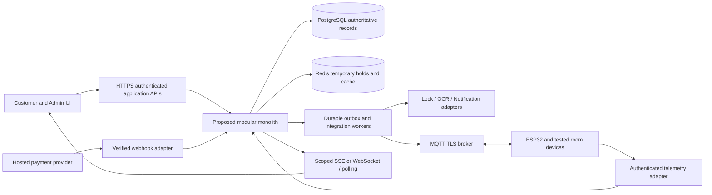

> **SUPERSEDED — historical snapshot retained pending owner deletion review.** Current canonical content: [open section](../ARCHITECTURE.md#system-architecture). Do not update this file; update the four canonical documents in place. Older status/next-action text below is historical.

# CineNest System Architecture

> Task: CN-KB-FEATURES-TECH-001 · Recorded: 2026-10-14 (Asia/Colombo).
> Decision: DOCUMENTED_DRAFT unless a row specifies otherwise. Implementation: NOT_VERIFIED.
> Source S1: user-supplied task text; source PDFs are missing. This is documentation, not proof of implementation, legal compliance, merchant approval or working hardware.

## Desired architecture and implemented baseline
Decision RECOMMENDED: one Spring Boot/Spring Modulith modular monolith with explicit internal boundaries. NestJS remains an alternative; final approval OD-01. No module/table/API implementation is verified. One deployable initially does not imply one unrestricted persistence layer. Public/customer, admin, provider webhook and device ingress have separate trust/authorization boundaries.

Arrows express permitted integration flows, not deployed infrastructure. Object storage is private behind Verification/asset interfaces. External integrations are never assumed inside a successful database rollback.

| Module | Proposed ownership | Responsibilities/interfaces | Transaction boundary | Dependencies |
|---|---|---|---|---|
| Identity & Access | Accounts, sessions, capability assignments, policy-consent references | OIDC/session validation; capability checks and owner/venue scope; stronger admin auth | Own account/session/consent writes; expose account IDs and authorization interfaces | Verification decisions via interface, no raw document reads; all modules consult authorization |
| Venues/Rooms | Venues, rooms, amenities, operating windows, readiness, maintenance and mappings | Catalog, room configuration, physical clearance and permitted capability metadata | Own configuration/readiness writes; public catalog vs restricted status projection | Booking asks schedule/capacity; IoT mapping through interface |
| Booking | Holds, blocking reservations, purchases, guest counts, revisions and session schedule | Concurrency, confirmed lifecycle, changes/extensions/cancellations | Database interval guard and reservation transitions in one transaction; quote/payment verified references | Pricing quotes; verification eligibility; Payments facts; Access/Notifications via durable work |
| Pricing | Stable package catalog/immutable published versions, rate/add-on/promotion eligibility versions and immutable quote snapshots | Validate joint package publication, resolve applicability, calculate backend totals and preserve purchased quote/policy | Versioned quote transaction; no edits to sold snapshots | Room capacity/schedule; Engagement eligibility through interface; Booking consumes quote |
| Verification | Private evidence references, extracted candidates and eligibility decisions | Booker checks, restricted reviewer workflow, retention/deletion | Own decision/evidence metadata; external OCR outside DB transaction | Identity/consent + private storage; Booking sees minimal eligibility decision, never document |
| Payments | Gateway attempts/events/captures plus manual bank requests/verified funds/allocations/reviews, refunds and reconciliation ledger | Hosted checkout and independent manual credit verification, authoritative financial facts and bounded compensation | Inbox + ledger append + outbox atomically; provider capture/refund outside transaction | Booking/quote references; provider adapters; Analytics gets redacted ledger projection |
| Access Control | Credential references/versions, permitted windows and provisioning work | Install/revoke/time entry and support incidents | Credential/work state durable; external lock ack reconciled separately | Booking schedule, IoT/vendor capability interface; Notifications receives protected-link request |
| IoT | Devices, capabilities, credentials references, commands, observations and health | ESP32/broker/vendor adapters; desired vs observed state | Command accepted + durable dispatch transaction; telemetry dedupe/order/freshness | Access intent and room safety/readiness; Notifications for incidents |
| Notifications | Templates, routing consent, delivery attempts and warning schedules | Email/SMS receipts/access instructions and operational warnings | Durable notification work and dedupe; delivery never atomic with booking | Booking/session/access facts and minimal contact interface; provider adapters |
| Customer Engagement | Promotion/referral/loyalty rules and reward ledger | Versioned eligibility, earn/redeem/reverse/expire (rules open) | Ledger adjustment atomic and audited; no direct payment mutation | Verified Booking/Payments facts; Pricing requests eligibility |
| Analytics | Scoped read projections, metric definitions and report freshness | Aggregate authoritative facts without changing domain writes | Projection updates idempotent; eventual consistency explicitly labelled | Domain events/approved read interfaces; finance scopes; no cross-module table mutation |
| Audit | Redacted immutable audit event store and access projection | Actor/action/resource/reason/evidence/correlation trail | Domain durable audit intent in same local transaction; bounded ingestion/recovery | All modules emit safe events; restricted read/export interfaces |

## Interface and failure boundaries
Modules use stable commands/queries/events through published interfaces; no direct mutation of another module’s tables or import of its persistence entities. Reservation-critical writes stay within Booking with immutable references to approved quotes/decisions/payment facts; accept a capture fact once, then transactionally guard inventory. External side effects use an outbox/durable work coordinator with durable failure state and compensating actions. A committed purchase is not silently rewritten when a downstream service fails.

Each module documents ownership, invariant tests, transaction scope, safe event payload and capability checks before implementation. Shared IDs/time/money/envelopes are contracts, not a shared catch-all domain module. [Data contracts](CINENEST-DATA-AND-API-CONTRACTS.md) define proposed integration behavior; [IoT failure modes](CINENEST-IOT-ACCESS-AND-FAILURE-MODES.md) define hardware gates. Stream updates follow the same authorized venue/owner scope and report asOf; clients recover after gaps using an authoritative snapshot.

Multi-venue configuration is proposed resource scoping. It is **not evidence of a fully isolated multi-tenant SaaS product**. Tenant/subscription architecture, data isolation model, onboarding/billing and cross-venue roles remain OD-12. Retain explicit venue IDs where applicable without inventing a tenant schema. Do not call current access isolation implemented.

## Package configuration — CN-KB-PACKAGE-CONFIGURATION-001
Core CN-A12 is user-confirmed; [package implementation design](../product/CINENEST-PACKAGE-MANAGEMENT.md) remains RECOMMENDED. Pricing owns stable catalog identity/versioned terms and quote construction; Booking owns sold snapshots/reservations; Venues/Rooms owns minimum/hours/cleaning/physical capacity; Payments checks accepted quote; Access reads purchased session only. Package administration fits existing boundaries, not a new module or generic rules engine.

A desired configuration write/atomic publish transaction validates related fields, scope/schedules, optimistic version and operational references; durable audited cache/projection invalidation updates eligible catalog without per-edit code deployment. Provider capture/device commands remain outside publication transaction. Sold versions, payment/quote references and booked intervals are immutable except separate agreed amendment revisions. No architecture code/table/deployment evidence asserted.

## Bank payment — CN-KB-BANK-PAYMENT-001
Existing Payments owns bank requests/evidence/review/verified credits/allocation/refund/instruction versions; Booking owns shared durable holds, inventory guard and confirmed snapshots; Notifications owns reviewer/customer delivery; Access consumes eligible confirmed purchase; Audit owns safe immutable evidence. No second booking system or new microservice. [Canonical manual-payment design](../product/CINENEST-BANK-DEPOSIT-AND-MANUAL-PAYMENT.md) is RECOMMENDED; core feature confirmed but unimplemented.

Verified fund fact persists independently of booking transaction success. Guarded allocation and eligible confirmation lock relevant financial/request/inventory state, dedupe operations and create durable access/notice work. Funds receipt cannot be rolled back by external failure or rejected inventory; unmatched/excess/late funds remain resolution obligations. Gateway and bank attempt satisfaction share one booking aggregate to avoid double confirmation/allocation; corrections append ledger entries. Bank credits never synthesize gateway callbacks or card capture facts. Existing package versions/quotes/snapshots and operational minimum/capacity/cleaning boundaries preserved.
